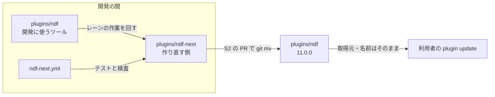
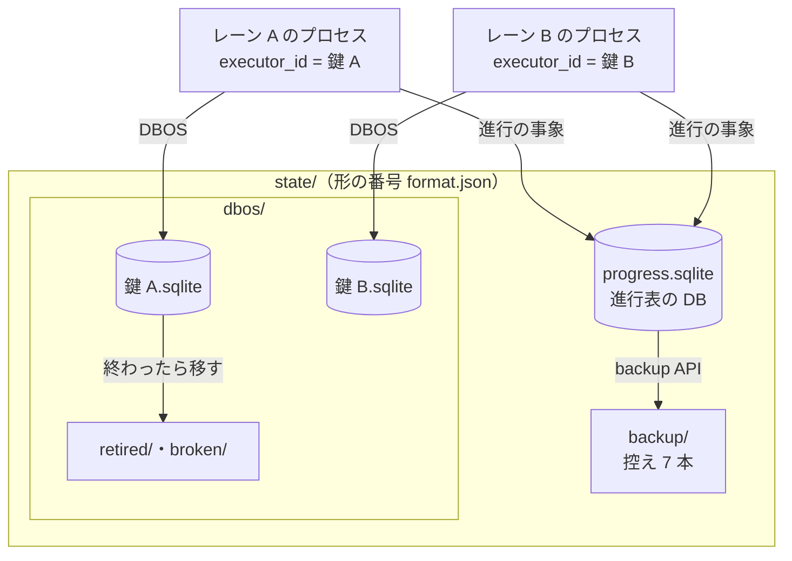

# NDF の作り直し: 別のディレクトリで 0 から作り、できたら ndf と入れ替える（#1142 #3092）

## 目的

- **今どうなっているか**: #1142 は、今の `plugins/ndf/` を子 Issue 72 本・22 の順番で段階的に直す計画だった（PR #3250 で承認）。#3092（工程の進行表）は実装 PR #3247 を出した。しかし 246 ファイルを書き換えて major の指摘 25 件と CI の失敗 70 件が残り、cross-review を 4 ラウンド回しても直らずに閉じた。今のコードを動かしたまま置き換える形では、旧い経路との互換・移行・旧いテストの書き換えが変更の大半を占める
- **誰に効くか**: NDF を作り直すレーン（lrebuild と lr-* の 6 本）と、NDF を使う利用者
- **変えると何が成り立つか**: 新しいディレクトリ `plugins/ndf-next/` に、承認済みの設計（#1142・#3092・#3097・#3098）の最終形を最初から作る。今の `plugins/ndf/` には触らず、開発に使うツールとして使い続けられる。入れ替えは 1 本の PR で行い、revert 1 回で戻せる

## 適用範囲

- **働く範囲**: このリポジトリの次の 3 つ
  - `plugins/ndf-next/`（新設）
  - CI のジョブ 1 本（新設）
  - 入れ替えの PR が触る配布の定義（`plugins/ndf/` 全体・`.claude-plugin/marketplace.json`・`.ndf/project.json` の suite・`scripts/*-allow/`）
- **プロジェクトごとに違うもの**: 足さない。利用先のリポジトリには、入れ替えの後の版（11.0.0）として届く
- **当たるモード**: `standard`（#1142 の「決めたこと」のまま）

## あるべき姿の根拠

| 根拠 | 種類 | 何を示すか |
| --- | --- | --- |
| 利用者の決定（2026-11-13 23:1x JST。原文は `.ndf/handoff/lrebuild-note-rebuild-1142-label.md` の「作り直しの置き場の決め直し」） | 指示 | 同じリポジトリの別のディレクトリで 0 から作り、できたら `ndf` と入れ替える。今の NDF は壊さない |
| PR #3247 を閉じたときのコメント（https://github.com/devbasex/ai-plugins/pull/3247 ） | 実測 | 段階的な置き換えで、設計の欠け 6 件と新しい経路が通らない指摘 19 件が残った |
| `docs/versioning-and-distribution.md` の「ランタイムごとの取得と導入」 | 仕様 | 導入の鍵は取得元の名前とプラグイン名で、リポジトリの中のディレクトリは含まない |
| 承認済みの設計（#1142 の設計と詳細設計・PR #3191・PR #3250） | 設計 | 新しい実装の材料。ここで決め直すのは置き場・順番・食い違いだけ |

要求と受け入れ条件は #1142 の本文にある（コピーは [issue-1142-requirements.md](issue-1142-requirements.md) ）。**受け入れ条件「ラベル `rebuild-1142` の Issue がすべて閉じる」は変えない。** 入れ替えの時点で閉じる形でよい。

この文書は「どこに・どの順で作り、どう入れ替えるか」だけを扱う。部品の中身は、末尾の「材料にする設計」の文書が持つ。

**詳細設計は [issue-1142-design-next-design-detail.md](issue-1142-design-next-design-detail.md) にある。** ファイル配置・子 Issue の表・流す順番・レーンの割り当て・ラベルの付け替えを持つ。

## 人へ残す判断

**承認する人が答えるのは、次の 5 つである。** (a)〜(c) はレッドラインに当たる。レッドラインの番号（P1・C3）は `.ndf/mvv.md` と共通原則の番号で、新しい子の P1・C3 とは別である。

| # | 判断 | 当たるレッドライン | なぜ当たるか | 材料 | 推奨 |
| --- | --- | --- | --- | --- | --- |
| (a) | 入れ替えを `git mv` で行い、プラグイン名と取得元を変えないか | P1（配布物の取得元・版の規則を変える） | 入れ替えは配布物の中身を一度に替え、利用者全員に効く | 名前と取得元を保てば、利用者は登録し直さずに `plugin update` で届く（決定 73）。別名の配布や `source` の差し替えは、利用者の再導入か 600 箇所近い参照の向け直しが要る | `git mv` で入れ替える。版は 11.0.0 にする |
| (b) | 入れ替えの後、利用者の手元の旧い状態（`~/.local/state/ndf` の記録・進行中のプラン）を読まないことを受け入れるか | C3（利用者のデータを変える・移す） | 利用者の手元の記録の読まれ方が変わる | 新しい実装は旧い形を読み替えない（後方互換を置かない方針）。旧い置き場は消さず、名前を変えて残す（決定 79） | 受け入れる。入れ替えの前に、動いているスプリントを終わらせる |
| (c) | 開発の間、`ndf-next` をマーケットプレイスへ載せないか | P1（配布物の取得元・版の規則を変える） | 載せると取得元の中身が増え、開発版の利用者に届く | 載せない場合、試すのは `claude --plugin-dir plugins/ndf-next` だけになる。載せると hook と状態の置き場が `ndf` と二重に働く（決定 74） | 載せない |

**(d)・(e) はレッドラインに当たらない。** 承認済みの要求と今の NDF の扱いを変えるため、ここに並べる。

- (d) #3092 の前提 7 の `progress.py adopt`（動いているスプリントの取り込み）を外すか
  - 材料: 入れ替えの前に、動いているスプリントを終わらせれば取り込むものが無い（決定 76）。外すと #3092 の受け入れ条件の 1 項目が消える
  - 推奨: 外す。承認の後に #3092 の本文を直す
- (e) #3153（CI の結果の監視の読み違え）を今の `plugins/ndf/` でも直すか
  - 材料: 今の NDF は開発に使うツールとして使い続ける。新しい実装では AD1 で作る
  - 推奨: 今の NDF では直さない。レーンの作業が止まったときだけ、即時修正の 4 条件で直す

**(f)・(g) は #3344（DBOS の記録と進行表の置き場）の差分で足した判断で、レッドラインに当たる。** (a)〜(e) は PR #3250 の後の承認で答えが出ている。

| # | 判断 | 当たるレッドライン | なぜ当たるか | 材料 | 推奨 |
| --- | --- | --- | --- | --- | --- |
| (f) | 終わった実行の耐久の記録を、退避してから 14 日で消すか | C4（戻せない操作。データの削除） | 消した記録は戻せない。今の NDF は 30 日で消している | 今の鍵ごとの記録は `.git/ndf/state/dbos` に 2,279 ファイル・687MB（2026-11-14 の実測）。待ちを抱えた実行（`PENDING`・`ENQUEUED`）は消さない。URL（PostgreSQL）では NDF の台帳 `ndf_runs` に載った鍵だけを、鍵の実行がすべて終わってから消す（決定 83） | 消す。待ちを抱えた実行は日数に依らず残す |
| (g) | 置き場の形の番号が自分より古いとき、置き場ごと退避して新しく始めるか | C3（利用者のデータを変える・移す） | 利用者の手元の進行表と耐久の記録が、読まれない場所へ移る | 退避は名前の変更だけで戻せる。形の番号が自分より新しい置き場は触らずに止める（決定 85） | 退避する |

## 設計の結果

**置き場は `plugins/ndf-next/`。** 開発の間のプラグイン名は `ndf-next`、版は `11.0.0-dev.N` とし、入れ替えの PR で名前を `ndf` に、版を `11.0.0` にする。

**子 Issue は 26 本・9 の順番に組み直す。** 72 本の旧い子は、20 本を新しい子へそのまま引き継ぎ、13 本を形を変えて引き継ぎ、18 本を他の子へまとめ、21 本を要らなくする（表は詳細設計の「旧い子の行き先」）。#3092・#3097・#3098 は新しい子 P1・P3・P4 としてそのまま使う。

**レーンは 6 本のまま使う**（lrebuild・lr-flow・lr-data・lr-rf・lr-fix-a・lr-fix-b。各プラン 2 本）。after から lflow・lbr2・lsw を外す。新しいディレクトリは今の NDF のファイルと重ならないためである。

**ラベル `rebuild-1142` の Issue は、旧い子の行き先の表で新しい子へ付け替える。** 付け替えの規則と件数は詳細設計の「ラベルの付け替え」にある。

**DBOS の記録は実行の鍵ごとに分け、1 つの DB に置くのは進行表だけにする（#3344）。** 決定 77 の「DBOS の記録の置き場」と「アプリの版」の 2 行を、決定 81〜87 で置き換えた。中身と #3344 の受け入れ条件との対応は「DBOS の記録と進行表の置き場」の節にある。

## ドメインモデル

### コンテキスト

| コンテキスト | 何の語が 1 つの意味に決まるか |
| --- | --- |
| 配布 | プラグイン・取得元・版・プラグインの入れ替え |
| 進行 | 工程・進行表・行・承認ゲート・レーン（#3092・#3097 の設計のまま） |
| プランの実行 | プラン・ステップ・止まった理由・行き先（#1142 の scripted-flow のまま） |

**コンテキストマップ。** 契約の形を決めるのは上流で、下流はその形に従う。下流は上流の定義を書かない。

| 上流（契約を決める） | 下流（従う） | 関係 | 契約 |
| --- | --- | --- | --- |
| 配布 | 進行 | 顧客と供給者 | プラグインの定義のプラグイン名と版。進行は読むだけで、プラグインの定義は書かない |
| 配布 | プランの実行 | 顧客と供給者 | 同じくプラグインの定義のプラグイン名と版。状態の置き場の名前もここから求める（決定 75） |
| プランの実行 | 進行 | 公開ホストサービス / 順応者 | 進行表の行が、工程から作業を呼ぶ層（上の節の規約）を通してプランを呼び、プランの結果 JSON（`cause`・`outputs`）を読む。プランの実行は進行表を読まず、書かない（scripted-flow のコンテキストマップと同じ向き） |

### 集約

**集約ごとに持ち主は 1 つである。** 部品の子 Issue の PR が書いてよいのは次の 3 つだけである。

- 詳細設計の「ファイル配置」で自分の子の列に載るファイルと、自分のパッケージのテスト（`plugins/ndf-next/tests/<自分のパッケージ>/`。置き場は X0 が作り、中身は各子が書く）
- `cli.py` の副命令の表への自分の副命令の 1 行（詳細設計の「並行と排他」）
- 契約（D1）を変える PR だけは、その契約の下流の読み手とそのテストも同じ PR で直してよい（下の表の「止まった理由の表」の行）

| 集約 | 持ち主（書き換えてよいもの） | 根 | エンティティ | 値オブジェクト |
| --- | --- | --- | --- | --- |
| プラグインの定義 | lrebuild のレーンの PR（X0 が作り、S2 が名前と版を `ndf`・`11.0.0` へ替える）。部品の子の PR は書かない | `plugins/ndf-next/.claude-plugin/plugin.json` | — | プラグイン名・版 |
| 新しいプラグイン | 部品の子 Issue の PR（詳細設計の「ファイル配置」の子の列） | `plugins/ndf-next/` | 部品のパッケージ | — |
| プラン | プランの雛形のモジュール（C3） | `plan.json` | ステップ | ステップの型・条件・ステップの `on_cause` |
| プランの実行 | プランの実行の核（C2） | プランの実行 | ステップの試行 | 止まった理由・行き先・再試行の回数 |
| 止まった理由の表 | 契約（D1。結果 JSON の契約を変える PR が、下流の読み手とそのテストを同じ PR で直す）。実行の中では読むだけ | 止まった理由の表 | 種類 | 終了コード・既定の行き先・再試行の方針 |
| 進行表 | `progress` の書き手（#3092 の設計の書き手の表） | 進行表 | 行・事象 | 状態・止まった理由 |
| 耐久の記録 | DBOS の殻（C1。#3344 の追補を含む）。ほかの子は殻の関数を通してだけ読み書きする | 実行の鍵の記録（SQLite は鍵ごとのファイル、URL は鍵ごとの `application_name`） | 耐久ワークフロー | 実行の鍵・形の番号（`durable.FORMAT`） |
| チェックアウトの置き場 | DBOS の殻（C1 の追補）が形の番号を確かめて用意する。進行表の DB の中身は P1 が書く | `<git の共通ディレクトリ>/<プラグイン名>/state/` | 進行表の DB・鍵ごとのファイル・控え | 形の番号（`format.json`） |

プラン・プランの実行・止まった理由の表の中身（エンティティの形と不変条件 IS1〜IS12）は scripted-flow の設計のまま使う。この表が決めるのは、新しいディレクトリでの持ち主の子だけである。

### 不変条件

| # | 集約 | 条件 | 破れたときの扱い |
| --- | --- | --- | --- |
| I1 | 新しいプラグイン | `plugins/ndf-next/` の中のコードは、自分のディレクトリ名・プラグイン名・状態の置き場の名前を文字で持たない（決定 75） | 検査（X1）が CI で落とす |
| I2 | 新しいプラグイン | 子 Issue の PR は `plugins/ndf/` を変えない（即時修正を除く） | 検査（X1）が差分で落とす |
| I3 | 新しいプラグイン | `plugins/ndf-next/` の中から `plugins/ndf/` の Python を import しない | 検査（X1）が落とす |
| I4 | 進行表 | 進行表のほかに、工程の遷移を決めるものを置かない（#3092 の受け入れ条件 11 のまま） | 工程の定義の登録が断る |
| I5 | 耐久の記録 | ある実行の鍵の耐久ワークフローを取り出して流すのは、同じ鍵で起動したプロセスだけである（決定 81） | 2 つのプロセスが同じファイルを鍵違いで開くテストで、相手のキューを流したら落ちる |
| I6 | 耐久の記録 | 1 つの鍵の記録を開くプロセスは同時に 1 つで、`executor_id` と `application_name` は実行の鍵から求めた同じ値である（前の設計の I17 を引き継ぐ） | 2 つ目の起動は鍵のロック（SQLite は鍵ごとのファイルロック `run_lock`、URL は DB 側の鍵のロック）で待つ。片付けは鍵のロックを待たずに試し、取れた鍵だけを移す・消す |
| I7 | 耐久の記録 | アプリの版（`application_version`）は形の番号（`durable.FORMAT`）だけで決まり、NDF の版とワークフローのソースでは変わらない（決定 84） | `plugin.json` の版だけを上げて起動し直すテストで、途中の実行が回復しなければ落ちる |
| I8 | 耐久の記録 | 終わった実行の記録は生きている置き場に残らず、待ちを抱えた実行（`PENDING`・`ENQUEUED`）の記録は日数で消さない。URL では、鍵の実行（子を含む）の 1 つでも待ちを抱えているか、終わってから `KEEP_DAYS` を過ぎていなければ、その鍵の実行を 1 つも消さない（決定 83） | 退避と消去のテストで、待ちの記録が消えたら落ちる。URL では親だけが 15 日前に終わり子が `PENDING` の鍵で、子が消えたら落ちる |
| I9 | チェックアウトの置き場 | 進行表の DB は DBOS の表を持たない。SQLite の進行表の DB は、`quick_check` が `ok` を返した目印（`state/progress.checked`）が 24 時間以内に無ければ、`quick_check` が `ok` を返すまで書かない。書き込みが `SQLITE_CORRUPT` を受けたら目印を消す（決定 82） | 目印の無い壊したファイルを開くテストで、書き込みが起きたら落ちる |
| I10 | チェックアウトの置き場 | 形の番号が自分と違う置き場へは書かない。古ければ置き場ごと退避し、新しければ止まる（決定 85） | 番号を 1 つ上げた・下げた置き場を開くテスト |
| I11 | チェックアウトの置き場 | 置き場を使うプロセスは置き場のロック（`state.lock`）を共有で持つ。置き場ごとの退避と進行表の DB の `restore` は、置き場のロックを排他で取れ、退避では旧い置き場の鍵のロック（`dbos/*.lock`）もすべて、`restore` では置き場の外の実ファイルなら `<実ファイル>.lock` も取れたときだけ行う（決定 82・85） | 置き場のロックを共有で持つプロセスがいる間に退避・`restore` を打つテストで、名前の変更か控えの配置が起きたら落ちる |
| I12 | 耐久の記録 | URL の片付けが消すのは、NDF の台帳（表 `ndf_runs`）に `durable.launch` が書いた鍵の実行だけである（決定 83） | 台帳に無い `run-` で始まる `application_name` の終わった実行を置いたテストで、それが消えたら落ちる |
| I13 | 耐久の記録 | URL では、同じ鍵の起動（台帳の行の書き込みから DBOS を閉じるまで）と片付け（実行の一覧から `delete_workflows` と台帳の行の削除まで）は、DB 側の同じ鍵のロックの下で直列に起きる（決定 83） | 鍵のロックを別の接続が持つ間に片付けを打つテストで、その鍵の実行か台帳の行が消えたら落ちる |

### ドメインイベント

**要求のイベント（E1〜E9）は、番号のままこの設計の中の起き方へ引き継ぐ。**

| # | イベント（要求） | この設計での発生元 | 受け手 |
| --- | --- | --- | --- |
| E1 | 移行の前の基準を測った | 済み（全体の設計の数） | E9 の比べる相手 |
| E2 | スクリプトの語を用語集に揃えた | 設計（この文書の「用語」の表） | 用語集（承認の後に反映） |
| E3 | 設計を承認した（設計承認ゲート） | 利用者（この設計 PR） | X0 |
| E4 | ライブラリを 1 か所へまとめた | X0・D1 のマージ（新しいディレクトリで最初から 1 か所に作る） | 順番 3 以降の子 |
| E5 | コンテキストごとのモジュールへ移した | 部品の子の PR のマージ（移さず、最初からコンテキストごとに作る） | S1 |
| E6 | エントリポイントの形が変わらないことを確かめた | S1 の受け入れの確かめ（テスト設計）。旧い形との互換は確かめない（決定 76） | S2 |
| E7 | 開発版を導入して確かめた | EN1 の後の開発版 | E8 |
| E8 | 本番を承認した（リリース承認ゲート） | 利用者 | 本番のリリース |
| E9 | 移行の後を同じ物差しで測り直した | conductor（E1 と同じ測り方） | 振り返り（Issue のコメント） |

**この設計で足すイベントは `EN` の番号を付ける。**

| # | イベント | 発生元 | 受け手 |
| --- | --- | --- | --- |
| EN1 | 入れ替えた（`plugins/ndf-next/` が `plugins/ndf/` になった） | S2 の PR のマージ | リリース（開発版のデプロイ）・ラベルの Issue がすべて閉じたかの確かめ |
| EN2 | 置き場を退避した（形の番号が古い・無い） | DBOS の殻の置き場の用意（決定 85） | 結果 JSON の `items`（退避先のパス） |
| EN3 | 実行の記録を退避した・消した | DBOS の殻の片付け（決定 83） | 結果 JSON の `items`・`metrics` |

**進行表とプランの実行の状態の変化（止まった・行き先が決まった・工程が失敗した など）は、材料の設計のイベントを番号のまま使う。** 進行表の側は #3092 の E1〜E15、プランの実行の側は scripted-flow の ES1〜ES5 で、発生元と受け手もそれらの表のとおりである。新しいディレクトリで足すものは無い。

### 用語

| 用語 | 意味 | 用語集への反映 |
| --- | --- | --- |
| プラグインの入れ替え | 作り直した `plugins/ndf-next/` を 1 本の PR で `plugins/ndf/` へ `git mv` し、名前と版を替えること。取得元とプラグイン名は変えない（決定 73）。この文書では「入れ替え」と略す。ラッパーの入れ替えとは別 | 追加（`ndf-workflow`） |
| 新しいプラグイン | 入れ替えまでの間、`plugins/ndf-next/` に作る作り直しの側のプラグイン。開発の間の名前は `ndf-next` | 追加（`ndf-workflow`） |
| プラグインの定義 | プラグインの `plugin.json` が持つプラグイン名と版（文書の中で「配布の定義」と書いていた語。「配布」は用語集で「リリース」へ置き換えた語のため改めた） | 追加（`ndf-workflow`） |
| 初期構成 | 新しいディレクトリに最初に置く `plugin.json`・依存の lock・エントリポイント・CI のジョブ・テストの置き場（子 X0）。スケルトン（SKILL.md の bash）とは別 | 追加（`ndf-workflow`） |
| チェックアウトの置き場 | `<git の共通ディレクトリ>/<プラグイン名>/state/`。どの worktree からも同じ所に解決し、進行表の DB と鍵ごとの耐久の記録と控えを置く。利用者ごとの状態の置き場（決定 79）とは別 | 追加（`ndf-workflow`） |
| 進行表の DB | 計画・レーン・スプリントの進行表と進行の事象を置く 1 つの DB。どの worktree からも同じ所に解決する。DBOS の記録は置かない（決定 81） | 意味の変更（`ndf-workflow`。#3092 の「DBOS の記録と同居」から） |
| 形の番号 | チェックアウトの置き場の `format.json` と耐久の記録のアプリの版が持つ整数。読み書きの形が変わるときだけ上げ、NDF の版とは別に動く（決定 84・85） | 追加（`ndf-workflow`） |

## 外部の調査

**置き場と入れ替えは調べない。** このリポジトリの配布の仕組み（`docs/versioning-and-distribution.md`）の中で閉じるためである。部品の外部の調査は、材料にする設計の「外部の調査」をそのまま引き継ぐ。**DBOS の記録と進行表の置き場（#3344）だけを調べた。**

| 種類 | 調べるか | 理由 |
| --- | --- | --- |
| 標準・仕様 | 調べる | 進行表の DB の健全性の確かめと控えを、SQLite の定める手段で行うため |
| 主要な製品 | 調べない | 耐久実行の置き場の分け方は、使うライブラリ（DBOS）の取り出しの条件で決まり、ほかの製品の解き方は効かない |
| ライブラリとサービス | 調べる | DBOS の取り出し・回復・アプリの版・消す機能の条件を、使う版のパッケージ（wheel）で確かめるため。自前で作るファイルのロックと形の番号の比べ合いは、既存のライブラリと比べるため |

### 標準・仕様

| # | 標準・仕様 | 何を定めているか | 設計への反映 | 出典 |
| --- | --- | --- | --- | --- |
| STD10 | SQLite の `PRAGMA quick_check` / `integrity_check` | `quick_check` は索引と表の中身の照合を省いた O(N) の検査で、壊れていなければ 1 行の `ok` を返す | 進行表の DB と鍵ごとのファイルを開くときに、最後の `ok` から 24 時間を過ぎていれば打つ（決定 82） | https://www.sqlite.org/pragma.html#pragma_quick_check （2026-11-14） |
| STD11 | SQLite の Online Backup API（Python の `sqlite3.Connection.backup`） | 書き込み中の DB から一貫した写しを取る | 進行表の DB の控えを取る（決定 82） | https://www.sqlite.org/backup.html ・ https://docs.python.org/3/library/sqlite3.html#sqlite3.Connection.backup （2026-11-14） |
| STD12 | SQLite の WAL | 読み手が書き手を待たない。書き手は同時に 1 つ | 進行表の DB を WAL で開く（決定 82。#3092 の決定 18 のまま） | https://www.sqlite.org/wal.html （2026-11-14） |

### ライブラリとサービス

| # | 候補 | 版 | ライセンス | 最後のリリースの日付 | 終了のアナウンス | 要件を満たすか | 出典 |
| --- | --- | --- | --- | --- | --- | --- | --- |
| LIB10 | DBOS Transact（Python） | 3.5.0 | MIT | 2026-11-10 | 無し | 満たす。キューの取り出しは `executor_id` で絞らないため、鍵ごとに記録を分ける（決定 81）。`application_version` を設定で固定できる（決定 84） | `uvx --from pip pip download dbos==3.5.0 --no-deps` の wheel（`dbos/_sys_db.py`・`_sys_db_sqlite.py`・`_dbos.py`・`_core.py`・`_queue.py`）・https://pypi.org/pypi/dbos/json （2026-11-14） |
| LIB11 | DBOS Transact（Python） | 3.1.0（今の `plugins/ndf-next/pyproject.toml` の固定） | MIT | 2026-09-24 | 無し | 取り出しの条件は 3.5.0 と同じ。最新の安定版ではないため採らない（決定 87） | 同じ手順の 3.1.0 の wheel（2026-11-14） |
| LIB12 | filelock | 4.2.10 | MIT | 2026-11-09 | 無し | 満たすが採らない。使うのは Linux と macOS の `flock` の共有と排他だけで、今の NDF も標準の `fcntl.flock` で同じロックを取っている（`plugins/ndf/scripts/lib/state_home.py` の `_flock_free`）。依存を増やす理由が無い（決定 85） | https://pypi.org/pypi/filelock/json （2026-11-14） |
| LIB13 | portalocker | 4.4.2 | BSD-3-Clause | 2026-10-28 | 無し | 満たすが採らない。LIB12 と同じ理由に加え、Redis のロックなどの要らない機能を持つ（決定 85） | https://pypi.org/pypi/portalocker/json （2026-11-14） |
| LIB14 | Alembic | 1.20.1 | MIT | 2026-10-22 | 無し | 当たらない。DB の表の版を移す道具で、置き場の形（ディレクトリとファイルの並び）の番号は DB の外にある。進行表の表の版は P1 が #3092 の設計のまま持つ（決定 85・86） | https://pypi.org/pypi/alembic/json （2026-11-14） |

**DBOS 3.5.0 の wheel で確かめたこと**（行番号は 3.5.0 の wheel のもの）:

| 確かめたこと | 根拠の行 |
| --- | --- |
| キューの取り出し（`start_queued_workflows`）の条件は、キュー名・状態 `ENQUEUED`・アプリの版・`application_name`（一致か `NULL`）・パーティションキーだけで、`executor_id` を条件に持たない。取り出した行へ自分の `executor_id` を書く | `_sys_db.py:5224-5265`（取り出しの `select`）・`:5281-5307`（`executor_id=executor_id` を書く `update`）。3.1.0 でも同じ（`_sys_db.py:4782-4810`） |
| `application_name` の条件は「一致」か「`NULL`（どのアプリのものでもない）」で、設定の `name` で起動したプロセスが入れた実行は、その名前で持ち主が決まる | `_sys_db.py:1215-1223`（`_name_filter`）・`_core.py:570-574`・`:656`（入れるときに `GlobalParams.app_name` を書く） |
| 起動の回復は `executor_id`・アプリの版・`application_name` の 3 つが合う `PENDING` だけを拾う | `_dbos.py:984-996`・`_sys_db.py:3244-3265`（`get_pending_workflows`） |
| アプリの版は、設定に無ければワークフローの関数のソース・DBOS の版・アプリ名の MD5 で求まる。設定の `application_version` があればそれを使う | `_dbos.py:411-436`（`compute_app_version`）・`:759-771`・`:884-886` |
| SQLite の接続はすべてのトランザクションを `IMMEDIATE` で始め、`busy_timeout` は 30 秒。WAL は有効にしない | `_sys_db_sqlite.py:43-50` |
| キューの見回りの既定の間隔は 1 秒 | `_queue.py:59` |
| 終わった実行は `DBOSClient.delete_workflows` で消せる（子の実行と付随の表を含む） | `_client.py:994-1003`・`_sys_db.py:2020-2029` |
| `delete_children=True` は子・孫の実行を状態と終わった日時を見ずに再帰で集めて消す | `_sys_db.py:2020-2029`・`:6447-6463`（`get_workflow_children`） |
| `list_workflows` は `application_name`・状態・終わりの時刻で絞れる | `_client.py:1172-1202` |
| 保持期限で終わった実行を自動で消す設定と公開の関数は無い（設定の項目と `DBOS`・`DBOSClient` の関数の一覧に無い） | `_dbos_config.py`・`_client.py`・`_dbos.py` の `def` の一覧 |
| ワークフローの中の分かれ目を版の代わりに残す `DBOS.patch`・`deprecate_patch` がある。版を固定する `enable_patching` は非推奨 | `_dbos.py:4403-4418`・`:4471`・`_dbos_config.py:48` |
| 3.1.0 からの差: シャードした DB（`_shard_keys.py`）・パーティションごとの同時の本数・自動の版上げ（`_auto_upgrade.py`。Enterprise）が増え、アプリの版の MD5 にアプリ名が入った。`enable_patching` は非推奨になり、版を 1 つに保つには `application_version` を明示する | 2 つの wheel のファイルの一覧の差・`_dbos.py:773-779` |

調べた量: 候補 5 件・取得の試み 13 回。

## 機能一覧

| # | 機能 | 誰が使うか |
| --- | --- | --- |
| F1 | 新しいディレクトリの初期構成（パッケージ・依存の lock・CI のジョブ・テストの置き場） | レーン |
| F2 | 新しいディレクトリだけを見る検査（兆候 0 件・構造の規則・I1〜I3） | CI |
| F3 | 部品（契約・アダプター・核・進行表・領域）を、承認済みの設計の最終形で作る | レーン |
| F4 | 工程から作業を呼ぶ層（PR #3247 の欠けを埋める） | 進行表 |
| F5 | 入れ替えの PR と、ラベルの Issue がすべて閉じたかの確かめ | lrebuild |

## 構成要素

| 要素 | 責務 |
| --- | --- |
| `plugins/ndf-next/`（新設） | 新しいプラグインの全体。配置は詳細設計の「ファイル配置」 |
| `.github/workflows/ndf-next.yml`（新設） | `plugins/ndf-next/**` の変更で、新しいディレクトリのテストと検査を走らせる。S2 で消し、既存のジョブへ戻す |
| `plugins/ndf/`（変えない） | 開発に使うツール。S2 で消える |
| 入れ替えの PR（S2） | `git rm plugins/ndf`・`git mv plugins/ndf-next plugins/ndf`・名前と版・許可ファイルと suite の作り直し |

## 工程から作業を呼ぶ層

**PR #3247 の指摘の大半は、進行表の行から実際の作業（プラン・Skill・スクリプト）を呼ぶ決まりが無かったことに集まる。** #3092 の設計は、この層を「`supervise.py new` を呼ぶ」で済ませていた。新しい実装では、工程の定義がこの層の規約を持つ。

| 規約 | 中身 | 埋める指摘（PR #3247） |
| --- | --- | --- |
| 呼び出し先 | 工程の定義の `metadata.ndf.run` が、種類（`plan`・`skill`・`script`）と名前を持つ | 設計と詳細設計が同じ Skill 全体を呼ぶ |
| 入力 | 工程の定義の `metadata.ndf.inputs` が、スプリントの文脈から読む鍵（`pr`・`worktree`・`issues`・`mode`・`delivery`）を列挙する。足りなければ行を始めずに止まった理由 `input_missing` で返す | 引数を組み立てていない・PR の番号が届かない |
| 出力 | 作業が返す結果 JSON の `outputs` を、進行表の事象 `outputs_recorded` としてスプリントの文脈へ書く | 前の工程の出力を次へ渡していない |
| 作業ディレクトリ | 文脈の `worktree` があれば、作業はそこで動く | 用意した worktree を反映していない |
| 配布の経路 | デプロイの工程は `.ndf/project.json` の `delivery` から経路を選ぶ（固定しない） | デプロイの経路が固定 |
| 範囲の重なり | 同じ範囲を 2 つの工程が受け持つ定義は、登録で断る | 実装の雛形がマージまで行う |

詳しい形は詳細設計にある（文脈の鍵の一覧は「内部のデータと定数」、関数と事象の形は「関数の仕様」）。

## DBOS の記録と進行表の置き場（#3344）

**1 つの DB に置くのは進行表だけにし、DBOS の記録は実行の鍵ごとに分ける。** 決定 77 は両方を 1 つの DB に置いたが、DBOS のキューの取り出しは `executor_id` で絞らないため、同じ DB を開いた別のレーンのプロセスがよそのキューを流す（外部の調査の LIB10）。分ければ、取り出し・ロックの待ち・壊れたときの影響・消す単位が、どれも 1 つの実行に閉じる。

| 要素 | 責務 | 持ち主の子 |
| --- | --- | --- |
| チェックアウトの置き場 `<git の共通ディレクトリ>/<プラグイン名>/state/` | どの worktree からも同じ所に解決する。先頭に `format.json`（形の番号） | C1 の追補 |
| 置き場のロック `<git の共通ディレクトリ>/<プラグイン名>/state.lock` | 置き場を使うプロセスが共有で持ち、置き場ごとの退避と `restore` が排他で取る。`state/` の外に置くので、`state/` の名前を変えてもロックは動かない | C1 の追補 |
| 進行表の DB `state/progress.sqlite` | 計画・レーン・スプリントの進行表と進行の事象。WAL・`quick_check`（24 時間に 1 回。目印 `state/progress.checked`）・控え | P1 |
| 鍵ごとのファイル `state/dbos/<鍵の名前>.sqlite` | 1 つの実行の鍵の耐久ワークフロー。開くプロセスは同時に 1 つ | C1 の追補 |
| 退避の置き場 `state/dbos/retired/`・`state/dbos/broken/` | 終わった実行・壊れた実行のファイル（本体と `-wal`・`-shm`・`-journal` をそろえて移し、鍵ごとの `.checked` と `.lock` は生きている置き場から消す）。どちらも移してから 14 日で消す。消す走査は 24 時間に 1 回（目印 `state/dbos/.swept`） | C1 の追補 |
| 検査と走査のロック `state/maint.lock` | 共有の目印（`progress.checked`・`dbos/.swept`）の期限の確かめから検査・控え・走査と目印の更新までを 1 プロセスに限る。2 つの目印を 1 つのロックで兼ねる | C1 の追補・P1 |
| 控え `state/backup/progress-<UTC の日時>.sqlite` | 進行表の DB の写し。新しい 7 本を残す | P1 |
| URL を渡したとき（PostgreSQL） | 進行表と DBOS の記録を 1 つの DB に置き、DBOS の記録は `application_name` で鍵ごとに分ける。NDF が起こした鍵は台帳の表 `ndf_runs` に書く。WAL・`quick_check`・控え・`restore` は当てない（DB の運用に任せる） | C1 の追補・P1 |

**#3344 の受け入れ条件と、解いた所の対応**（子の受け入れ条件の文は詳細設計の「#3344 で子へ足す受け入れ条件」にある）:

| # | 受け入れ条件（指摘） | 設計の決定 | 不変条件 | 子の受け入れ条件 |
| --- | --- | --- | --- | --- |
| 1 | 1 つの DB で別のレーンがよそのキューを流す | 決定 81（鍵ごとのファイルと `application_name`） | I5・I6 | C1 の追補 A1〜A3・C2 の B1・B2 |
| 2 | 詰まりと壊れたときの影響範囲 | 決定 81（ロックと破損が 1 つの実行に閉じる）・決定 82（WAL・`quick_check`・控え） | I9・I11 | C1 の追補 A4・A13・A14・P1 の P1-1〜P1-6・C2 の B3・B6（20 プランと 14 ラッパー相当の負荷と、検査と走査の所要時間） |
| 3 | 膨らみ続ける | 決定 83（実行ごとの退避・14 日・URL でも NDF の台帳の鍵だけを消す） | I8・I12・I13 | C1 の追補 A5・A6・A12・A13・A14・C2 の B4 |
| 4 | 11.0.0-dev.N のたびに途中の実行が取り消される | 決定 84（アプリの版を形の番号に）・決定 85（`format.json`）・決定 86（レーンの起動の確かめ・待ちの一覧） | I7・I10・I11 | C1 の追補 A7〜A9・A11・C2 の B2・B5・P3 の P3-1・M3 の M3-1 |
| 5 | DBOS が 3.1.0 のまま | 決定 87（3.5.0 で作る） | — | C1 の追補 A10 |

## 決定の記録

### 決定 73: 入れ替えは `git mv` で行い、プラグイン名と取得元を変えない

開発の間は `plugins/ndf-next/` に置き、S2 の PR で `plugins/ndf/` を消してから `git mv plugins/ndf-next plugins/ndf` を打つ。名前は `ndf`、取得元は `./plugins/ndf` のまま、版は 11.0.0 にする。

導入の鍵は取得元の名前とプラグイン名である。そのため利用者は登録し直さず、`plugin update` で新しい版が届く。外側の参照（CI のジョブ 8 本・検査のスクリプト 10 本・`.ndf/` の宣言・許可ファイル 526 個）もパスを向け直さずに済む。

- 採らない案 1: `plugins/ndf-next/` を残し、マーケットプレイスの `source` だけを差し替える。外側の参照を 600 箇所近く向け直すことになり、漏れると検査が空のディレクトリを見て 0 件で通る
- 採らない案 2: `ndf-next` の名前のまま配る。利用者が再導入し、Skill の前置き `ndf:` が変わる
- 作り方: ライブラリやサービスを使う

### 決定 74: 開発の間は `ndf-next` をマーケットプレイスへ載せない

試すのは `claude --plugin-dir plugins/ndf-next` と CI のテストだけにする。載せると、開発版の利用者の手元で hook が `ndf` と二重に走り、状態の置き場も混ざる。さらに、develop が main へ入るときに外す決まりが要る。

### 決定 75: 新しいディレクトリの中では、自分の名前を文字で持たない

ディレクトリは `CLAUDE_PLUGIN_ROOT` か `__file__` から、プラグイン名と Skill の前置きは `plugin.json` の `name` から求める。状態の置き場の名前もプラグイン名から求める。こうすれば、入れ替えで書き換えるのは `plugin.json` 2 本の `name` と `version` だけになる。検査（X1）が I1 として固定の文字を落とす。

### 決定 76: #3092 の互換と `adopt` は作らない

新しい CLI は副命令名・引数・`plan.json` の形を今の `supervise.py`・`parallel.py` に合わせない。動いているスプリントの取り込み（#3092 の決定 19・前提 7 の `progress.py adopt`）も作らない。

入れ替えの前に、今の NDF で動いているスプリントをすべて終わらせる（S2 の手順 1）。取り込むものが無ければ、取り込みの経路を作っても使われない。#3092 の本文の前提 7 は、承認の後に直す（判断 (d)）。

### 決定 77: #1142 と #3092 の設計の食い違いは #3092 の側にそろえる

> **表の「アプリの版」と「DBOS の記録の置き場」の 2 行は、#3344 の決定 81・84 で置き換えた（2026-11-14）。** ほかの 3 行はこのまま使う。

| 食い違い | 採る形 | 理由 |
| --- | --- | --- |
| 承認ゲートの待ち方 | #3092 の決定 7（`recv` で待ってプロセスを抜け、`answer` の後の `next` で続ける）。#1142 の決定 27（`--from` で続ける）は採らない | 0 から作るなら、`--from` を手で組み立てる経路を持つ理由が無い |
| アプリの版（決定 84 で置き換えた） | #3092 の決定 21（NDF の版が上がって回復できない実行は取り消し、行を失敗にする）。#1142 の決定 28 は採らない | 版の固定の値を手で上げ忘れる経路が無くなる |
| DBOS の記録の置き場（決定 81 で置き換えた） | #3092 の決定 2（git の共通ディレクトリの下の 1 つの DB に、進行表と同居）。プランの実行も同じ DB を使い、`executor_id` は進行表の行の ID にする | 置き場が 1 つなら、再開の鍵を探す処理が要らない。詰まるときの逃がし方は #3092 の決定 18 のまま |
| 終了コード | #1142 の IS11（止まった理由の種類から引く）。#3092 の「工程の失敗は 1」は採らない | 呼び手が終了コードだけで行き先を選べる |
| `jsonschema` の依存 | `plugins/ndf-next/` の依存の宣言に 1 つだけ置く（グループに分けない） | 新しいディレクトリは自分の依存の宣言を持つ（決定 78） |

### 決定 78: 新しいディレクトリは自分の依存の宣言と lock を持つ

`plugins/ndf-next/pyproject.toml` と `uv.lock` を置き、テストは `uv run --project plugins/ndf-next` で走らせる。リポジトリのルートの `pyproject.toml` は今の NDF のために変えない。S2 で、ルートの宣言を新しい側へ寄せる。

### 決定 79: 状態の置き場は入れ替えのときに旧い分を退避する

新しい実装の状態の置き場は `<状態のホーム>/<プラグイン名>/` で、先頭に形の版のファイル（`format.json`）を置く。入れ替えの後の最初の起動で、形の版のファイルが無い旧い置き場を見つけた場合は消さない。名前を `<プラグイン名>.v10-<日付>` に変えて退避してから、新しく始める。退避は名前の変更だけなので戻せる（判断 (b)）。

### 決定 80: 旧い子 Issue は閉じずに新しい子へ結び、入れ替えまでに閉じる

新しい子 26 本は新しく起票し（P1・P3・P4 は #3092・#3097・#3098 を使う）、#1142 の sub-issue に結ぶ。旧い子 72 本は消さない。行き先の新しい子の本文に「取り込む旧い子」として番号を書く。旧い子は、取り込んだ新しい子の PR の closing keywords で閉じる。要らなくなった 21 本は、S2 の PR で理由を添えて閉じる。

ラベルの件数を受け入れ条件の目印にしているため、要らなくなった子を先に閉じると、残りの件数が実際の進み具合とずれる。

### 決定 81: 別のレーンがよそのキューを流さないよう、DBOS の記録を実行の鍵ごとに分け、1 つの DB には進行表だけを置く

SQLite では、DBOS の記録を実行の鍵ごとのファイル `state/dbos/<鍵の名前>.sqlite` に置く。進行表と進行の事象だけを進行表の DB `state/progress.sqlite` に置く。URL（PostgreSQL）を渡したときは、両方を 1 つの DB に置き、DBOS の記録を `application_name` で鍵ごとに分ける。どちらの形でも、`executor_id` と `application_name` は実行の鍵から求めた同じ値（鍵の名前）にする（I6）。実行の鍵は、耐久ワークフローを起こす単位（プランの実行の回・進行表の ID）である。

DBOS 3.5.0 のキューの取り出しは `executor_id` を条件に持たず、`application_name` が一致するか `NULL` の行を取り出す（LIB10）。1 つの DB を同じ `name` で開いたプロセスどうしは、互いのキューの実行を取り出して自分の作業ディレクトリで流す。承認ゲートで `os._exit` したプロセスの実行は、死んだ `executor_id` のまま `PENDING` で残る。鍵ごとにファイルを分けると、相手の行がそもそも見えない。あわせて、`BEGIN IMMEDIATE` の待ち・1 秒ごとの見回り・壊れたとき・消す単位も 1 つの実行に閉じる。前の設計の決定 26 と I17 が同じ理由でこの形を採っていた。

採らない案 1: 1 つの DB のまま、起動ごとに `application_name` を分ける。取り出しの混ざりは防げるが、34 本（20 本のプランの実行と 14 本のラッパー）のプロセスが 1 秒ごとに同じファイルへ `BEGIN IMMEDIATE` を掛け、1 つの破損がすべてのレーンに効き、退避の単位がファイルにならない。採らない案 2: 1 つの DB のまま、パーティションキーをレーンにする。パーティションキーは呼び手が入れるときに付ける値で、付け忘れた実行（`NULL`）はどのプロセスにも取り出される。採らない案 3: 手元でも PostgreSQL を常駐させる。追加の常駐を要さない条件（#3092 の非機能）に反する。

キューの同時の本数（資源の枠）は 1 つの実行の中でだけ数える。レーンをまたぐ枠は、前の設計と同じく範囲外の #1532 に残す。#3092 の決定 2 の「DBOS は同じ URL を受ける」と、決定 18 の切り替えの条件は、新しい実装では使わない（SQLite では最初から決定 18 の代わりの形にあたる）。

- 作り方: ライブラリやサービスを使う
- 比べた候補: LIB10 / LIB11

根拠: Value 3 / Value 8 / Value 7（MVV 版 7）

### 決定 82: 進行表の DB が壊れても気づいて戻せるよう、その日の最初に開くときに `quick_check` を打ち、backup API で控えを取る

この決定の WAL・`busy_timeout`・`quick_check`・控え・`restore` は、SQLite の進行表の DB と鍵ごとのファイルにだけ当てる。URL（PostgreSQL）を渡したときは、どれも打たない。接続は #3092 の設計のまま `pg_try_advisory_lock` で書き手を 1 つにし、壊れたときの検出と控えと戻しは DB の運用（`pg_dump` などの PostgreSQL の手段）に任せる。`PRAGMA` は PostgreSQL では通らず、打つと Factory の接続がその場で止まるためである。

進行表の DB は WAL・`busy_timeout` 30 秒で開く（#3092 の決定 18 のまま）。開くファイルは `NDF_PROGRESS_DB` の URL（無ければ既定の `state/progress.sqlite`）から解いた実ファイルで、`restore` も同じ解き方で対象を決める。開いたときに、`quick_check` が `ok` を返した目印 `state/progress.checked` の更新時刻が 24 時間より古いか目印が無ければ、`PRAGMA quick_check` を打つ。`ok` なら目印の時刻を今にし、`ok` でなければ書かずに止まり、止まった理由 `store_broken` と、最新の控えのパスと戻す副命令を返す。書き込みが `SQLITE_CORRUPT` を受けたら目印を消し、次に開くプロセスが検査する。控えは SQLite の Online Backup API で、表の版を上げる前と、その日の最初の検査が `ok` を返した直後（最新の控えが 24 時間より古いとき）に取り、新しい 7 本を残す。鍵ごとのファイルも、鍵ごとの目印 `dbos/<鍵の名前>.checked` が 24 時間より古いか無ければ開く前に `quick_check` を打ち、`ok` でなければファイルを本体・`-wal`・`-shm`・`-journal` をそろえて `broken/` へ移し、`store_broken` で止まる。その実行だけが頭から流し直しになる。

**検査を「プロセスで最初に開いたとき」にしないのは、`ndf` が呼ぶたびに新しいプロセスで動くためである。** 14 本のラッパーが `next` と `wait` を打ち続けると（C2 の B3）、DB の大きさに比例する `quick_check` が呼び出しの回数だけ増える。24 時間の目印は控えと同じ間隔で、検査は 1 日に 1 回に収まる。開いた後に壊れた分は、書き込みの失敗（`SQLITE_CORRUPT`）として呼び手に返るため、目印の間の検査は要らない。`integrity_check` は索引と表の照合まで行い、DB の大きさに比例して遅いため打たない。

**共有の目印の検査は、検査と走査のロック `state/maint.lock` を排他で取ってから期限を読み直して行う。** 目印を読むだけで検査に進むと、期限の切れた目印を同時に読んだ複数のプロセスが同じ `quick_check`・控えを重ねて打ち、回数がプロセスの数に比例する（P1-6 が破れる）。進行表の DB の検査はこのロックを待って取り（検査を終えるまで書かないため）、取った後に目印が新しくなっていれば検査しない。検査・控え・目印の更新までをロックを持ったまま行う。決定 83 の走査も同じロックを使う。ロックを目印ごとに分けないのは、どちらも 1 日に 1 回で、重なって待つ時間が短いためである。鍵ごとの目印 `dbos/<鍵の名前>.checked` は鍵のロック（`run_lock`）の下で読み書きするため、このロックを取らない。検査と走査の所要時間と回数は、B3 と P1-3 の負荷の中で測る（B6・P1-6）。

**`restore` は、`open_store` と同じ URL から解いた実ファイルを対象にし、置き場のロック（`state.lock`）を排他で取れたときだけ行い、`-wal`・`-shm`・`-journal` を本体と一緒に退避してから控えを置く。** 置き場を使うプロセスはどれも置き場のロックを共有で持つ（決定 85）ため、排他で取れたことが「進行表の DB への接続が 1 つも無い」ことの確かめになる。取れなければ何も動かさず、止まった理由 `store_in_use` で止まる。`NDF_PROGRESS_DB` が置き場の外の SQLite のファイルを指すときは、ほかのチェックアウトのプロセスも同じファイルを開くため、そのファイルの隣の `<実ファイル>.lock` を開くプロセスが共有で持ち、`restore` が排他で取る。置き場の `progress.sqlite` に決め打ちすると、指定先の壊れた DB は戻らず、別の進行表を控えで上書きする。本体だけを移して控えを写すと、隣に残った旧い `-wal` が新しく置いた控えに重ねて読まれ、戻した中身を書き換えるか壊す。控えは同じディレクトリの一時名へ写して `quick_check` を打ち、`ok` なら `os.replace` で本体の名前にする。壊れた DB を控えで自動で置き換える形は、控えの後の事象を黙って失うため採らない。戻すのは P1 の副命令を人か conductor が打ったときだけにする。

- 作り方: 標準に倣う
- 比べた候補: STD10 / STD11 / STD12

根拠: Value 7 / Value 13（MVV 版 7）

### 決定 83: 置き場が膨らみ続けないよう、終わった実行の鍵ごとのファイルを退避し、退避から 14 日で消す

耐久ワークフローが終わった（`SUCCESS`・`ERROR`・`CANCELLED`）鍵のファイルは、その場で本体・`-wal`・`-shm`・`-journal` をそろえて `dbos/retired/` へ移し、鍵ごとの目印 `.checked` と鍵のロックのファイル `.lock` を生きている置き場から消す。`.lock` と `.checked` を残すと、終わった鍵ごとに 2 つの小さなファイルが残り続け、ファイルの数が膨らむ。起動したときに、走査の目印 `state/dbos/.swept` の更新時刻が 24 時間より古いか目印が無ければ、`retired/` と `broken/` の中の 14 日より古いファイルを消し、生きている置き場に残った終わったファイル（移す前にプロセスが落ちた分）を `retired/` へ移して、目印の時刻を今にする。走査を起動のたびにしないのは、`ndf` が呼ぶたびに新しいプロセスで動き、鍵ごとのファイルを開いて状態を読む走査が呼び出しの回数だけ増えるためである（決定 82 と同じ理由）。待ちを抱えた実行（`PENDING`・`ENQUEUED`）のファイルは日数に依らず残す（I8）。

**移す・消すのは、その鍵のロック（`run_lock`）を持っているときだけである。** 起動したプロセスは持ったまま移し、走査は鍵ごとに待たずに試して取れた鍵だけを移す。取れない鍵は開いているプロセスがいるため触らない。ロックを見ずに移すと、同じ鍵で打ち直した直後（過去の実行は `SUCCESS` で、今回の `ENQUEUED` をまだ書いていない瞬間）のファイルを別のレーンの走査が `retired/` へ移し、起動したプロセスは移した先へ書き続ける（I6 が破れる）。`.lock` はロックを持ったまま最後に消す。消した後に同じ鍵を待っていたプロセスが古いファイルのロックを取り、別のプロセスが作り直した `.lock` を取ると 2 つが同時に通るため、`run_lock` は取った後にパスの inode と開いたファイルの inode が同じかを確かめ、違えば開き直す。走査は決定 82 の検査と走査のロック `state/maint.lock` を待たずに試し、取れなければ飛ばす。取れたら目印を読み直してから走査する。

同じ鍵で打ち直したときは、生きている置き場、`retired/` の順に探す。`retired/` に `SUCCESS` があれば、流さずにその結果を返す。

URL を渡したときも、同じ「鍵の単位で、すべて終わってから 14 日」の規則を当てる（I8・I12）。

- **消す相手は NDF の台帳で決める。** `durable.launch` は URL のとき、DBOS を起動する前に台帳の表 `ndf_runs`（鍵の名前・実行の鍵・起こした時刻）へ 1 行を書く。片付け（`sweep_url`）は台帳に載った鍵の名前だけを `application_name` として `list_workflows` に渡す。`application_name` の接頭辞 `run-` だけで絞ると、同じ DB にある別のアプリの `run-report` のような実行まで消えるためである
- **同じ鍵の起動と片付けは、DB 側の鍵のロックで直列にする（I13）。** `durable.launch` は台帳の行を書く前に PostgreSQL の advisory lock `pg_advisory_lock(RUN_LOCK_SPACE, <鍵の名前から求めた値>)` を待って取り、DBOS を閉じるまで持つ。`sweep_url` は鍵ごとに `pg_try_advisory_lock` で試し、取れた鍵だけ、実行の一覧から `delete_workflows` と台帳の行の削除までを持ったまま行う。ロックが無いと、一覧を取った後に同じ鍵の新しい実行が始まり、起動が台帳の既存の行を使った直後に片付けがその行を消して、待ちを抱えた鍵が台帳から外れ、以後の片付けの対象から漏れる。ファイルのロックでなく DB 側のロックにするのは、URL では別の機械のプロセスも同じ DB を使うためである。SQLite の `run_lock` と同じ役割の、URL の側の形にあたる
- **消すのは鍵の単位で、鍵の実行がすべて終わって 14 日を過ぎたときだけである。** 鍵の `application_name` を持つ実行（子を含む。子は親と同じプロセスで起き、同じ `application_name` を持つ）を集め、1 つでも `PENDING`・`ENQUEUED` か、終わってから 14 日を過ぎていないものがあれば、その鍵は何も消さない。すべてが条件を満たせば、集めた実行の ID をすべて並べて `delete_workflows` を呼び、台帳の行も消す。`delete_children=True` には頼らない。DBOS の `delete_children` は子と孫を状態を見ずに再帰で消す（LIB10）ため、親だけが古い鍵で待ちの子を消してしまう
- 走査の頻度は SQLite と同じ目印（チェックアウトの置き場の `state/dbos/.swept`）と同じロック（`state/maint.lock`）で 24 時間に 1 回にする

今の NDF が URL を渡すと `purge_old`・`retire_if` を当てない形は、新しい実装では持たない。14 日は、失敗の調べ物がスプリント 1 本（およそ 1 週間）の中で済むことと、今の 30 日で 687MB まで膨らんだことから決めた（判断 (f)）。

N1 の `retire`・N3 の作り直しが前提にするファイル単位の退避は、この形で成り立つ。

採らない案: DBOS に終わった実行を日数で消させる。DBOS 3.5.0 は保持期限で消す設定と公開の関数を持たない（LIB10）。

- 作り方: 自前で作る・ライブラリやサービスを使う
- 比べた候補: LIB10 / LIB11

根拠: Value 6 / Value 2（MVV 版 7）

### 決定 84: 開発版が出ても途中の実行を回復できるよう、アプリの版を NDF の版から切り離した形の番号にする

`durable.launch` は DBOS の設定の `application_version` に `f"format-{durable.FORMAT}"` を渡す。DBOS の既定（ワークフローのソース・DBOS の版・アプリ名の MD5。LIB10）は使わない。`11.0.0-dev.N` が出てもアプリの版は変わらないため、承認ゲートで待っていた実行は新しいコードでそのまま回復する。版の違うレーンが同時に動いても、記録が鍵ごとに分かれているため互いに当たらない。

`FORMAT` を上げるのは、耐久ワークフローの中の DBOS の呼び出しの順を変えたときだけである（前の設計の決定 28・I18）。上げ忘れは、耐久ワークフローの関数（`@durable.workflow` を付けた関数。下請けの関数は含まない）のソースから求めた hash を `durable.FORMAT_SOURCE_HASH` の定数と比べるテストで落とす。関数を変えた PR は、`FORMAT` を上げるか、呼び出しの順が変わらないと判断して hash だけを書き直すかを選ぶ。`FORMAT` が違う実行は、#3092 の決定 21 の扱い（古い実行を取り消し、行を失敗にする）を受ける。決定 21 の契機は「NDF の版が上がった」から「形の番号が上がった」に狭まる。

採らない案: 決定 77 の「NDF の版で回復できない実行は取り消す」。開発版が出るたびに途中の実行が取り消され、p6 のように 10.27.59 と 10.27.60 が同時に動くと 1 つの DB では片方が回復しない。採らない案 2: DBOS の `DBOS.patch`（ワークフローの中に分かれ目を残して、旧い実行と新しい実行を同じ版で流す。LIB10）。分かれ目は呼び出しの順を変えるたびにコードへ残り続け、消す時期を別に管理する必要がある。形の番号を上げて古い実行を取り消す方が、耐久ワークフローの関数を読みやすいまま保てる。版を固定する `enable_patching` は 3.5.0 で非推奨である。

- 作り方: ライブラリやサービスを使う・自前で作る
- 比べた候補: LIB10 / LIB11

根拠: Value 3 / Value 5（MVV 版 7）

### 決定 85: 形の違う置き場を読み違えないよう、チェックアウトの置き場の `format.json` に形の番号を持たせ、合わなければ書かない

DBOS の殻は、チェックアウトの置き場を使う前に `format.json` の `format` を自分の `STORE_FORMAT` と比べる。

| 置き場の状態 | 扱い |
| --- | --- |
| 無い・空 | 作り、`format.json` を書く |
| `format.json` が無く、ほかのファイルがある（入れ替えの前の `.git/ndf/state` など） | 置き場ごと `state.v0-<日付>` へ名前を変えて退避し、新しく作る（決定 79 と同じ規則） |
| 番号が自分より小さい | 置き場ごと `state.v<古い番号>-<日付>` へ退避し、新しく作る。退避先のパスと、待ちを抱えていた実行の数を結果の `items` に載せる。退避は名前の変更だけで、古い NDF に戻して名前を戻せば続きを流せる（判断 (g)） |
| 番号が自分と同じ | そのまま使う |
| 番号が自分より大きい | 何も書かずに止まる（止まった理由 `format_newer`）。新しい NDF が作った置き場を古い NDF が退避しないためである |

入れ替えの後はプラグイン名が `ndf` になり、チェックアウトの置き場が今の NDF の `.git/ndf/state` と同じパスになる。`format.json` の無い置き場を退避する規則が、この重なりも解く。

**置き場ごとの退避は、置き場全体の排他の下で行う。** 鍵ごとのロック（`dbos/<鍵の名前>.lock`）も進行表の DB も `state/` の中にあるため、別のレーンが動いている間に `state/` の名前を変えて作り直すと、旧いプロセスは退避先へ書き続け、新しいプロセスは別のロックと DB で同じ実行を始める（I6・I10 が破れる）。

- 置き場のロック `<git の共通ディレクトリ>/<プラグイン名>/state.lock` を `state/` の外に置く。名前を変えてもロックは同じファイルのまま残る
- 置き場を使うプロセス（`durable.launch`・`store.open_store` を呼ぶプロセス）は、使い始める前に置き場のロックを共有（`LOCK_SH`）で取り、プロセスが終わるまで持つ
- 退避（番号が無い・小さい置き場）は次の順で行う。(1) 置き場のロックを共有で取り、`format.json` を読む (2) 退避が要るなら共有を放し、排他（`LOCK_EX`）を待たずに取る (3) 排他の下で `format.json` を読み直す。ほかのプロセスが既に退避して番号が自分と同じなら退避しない (4) 旧い置き場の `dbos/*.lock` をすべて排他で待たずに取ってから名前を変え、新しい置き場を作る (5) 排他を放して共有で取り直し、番号をもう一度確かめる。違えば (1) からやり直す（3 回まで）。番号を読む時点と退避する時点を同じ排他の下に置かないと、2 つのプロセスが同時に旧い番号を読み、先の 1 つが作った新しい置き場を後の 1 つが「旧い置き場」として退避し直す。`flock` の排他から共有への切り替えは不可分でなく、間に別の退避が割り込めるため、取り直した後に確かめる。今の NDF（10.x）は置き場のロックを知らないが、動いている耐久ワークフローの間は鍵のロックを持つ（`plugins/ndf/scripts/lib/state_home.py` の `_flock_free`）ため、この 2 つで旧い版のプロセスが残っていないことを確かめる。どれかが取れなければ何も変えずに止まる（止まった理由 `store_in_use`。結果に取れなかったロックのパスを載せる）
- 鍵のロックを持たない今の NDF の 1 回きりの副命令は、退避の後に `format.json` の無い `state/` を作り直すことがある。次の起動がそれを同じ規則で退避するため、記録は失われない

採らない案: 置き場の中のファイルだけを退避先へ移し、`state/` のディレクトリは残す。旧いプロセスが開いたままの DB と鍵のロックは移した先のファイルを指し続けるため、排他が無ければ同じ食い違いが起きる。

- 作り方: 自前で作る
- 比べた候補: LIB12 / LIB13 / LIB14

根拠: Value 3 / Value 8（MVV 版 7）

### 決定 86: 版の混ざりで止まらないよう、レーンの起動では形の番号がそろっているかを確かめ、NDF の版の違いは記録だけにする

レーンの起動（P3）は、計画が記録した NDF の版と形の番号（`STORE_FORMAT`・`durable.FORMAT`・進行表の表の版）を、自分のものと比べる。形の番号が違えば止まり（`format_mismatch`）、NDF の版だけが違えば止まらずにレーンの行の事象と結果の `warnings` に残す。決定 84 で、NDF の版の違いは耐久の記録に効かなくなったためである。止めると、開発版が出るたびにレーンが止まる。

版を上げる前に、待ちを抱えた実行の一覧を出す。プランの実行（C2）は、置き場の鍵ごとのファイルから `PENDING`・`ENQUEUED` の実行を集める副命令を持つ。中継（M3）は、プラグインの更新を反映する再起動の前にこの一覧を結果に載せる。

採らない案: 計画の中の NDF の版がすべて同じでなければレーンを起動しない。決定 84 の後は版の違いで壊れるものが無く、止めても守るものが無い。採らない案 2: DBOS の自動の版上げ（`auto_upgrade`）に版の違う実行を移させる。Enterprise の機能で使わない（LIB10）。表の版の比べ合いに Alembic を使う案は、置き場と耐久の記録の番号が DB の外にあるため当たらない（LIB14）。

- 作り方: 自前で作る
- 比べた候補: LIB10 / LIB14

根拠: Value 1 / Value 5（MVV 版 7）

### 決定 87: キューまわりの直しを取り込むため、DBOS は 3.5.0 で作り、殻の直しを C2 の前の 1 本の PR にする

`plugins/ndf-next/pyproject.toml` の `dbos==3.1.0` を `dbos==3.5.0` へ上げる。3.1.0 からの差のうち、この設計が当たるのは「アプリの版の MD5 にアプリ名が入った」「`application_version` を明示して版を 1 つに保つ」の 2 つで、どちらも決定 84 の固定の値で効かなくなる。シャードした DB・自動の版上げは Enterprise の機能で、使わない（LIB10 の表）。

決定 81〜85 の殻の直し（`core/durable.py`）と版の引き上げは、C1 #3285 の追補として lr-flow が C2 の前に 1 本の PR で出す。C1 は閉じているため、開き直さずに PR から `Refs #3285 #3344` で指す。C2 に混ぜると、殻の直しだけを revert できない。依存の方針そのもの（ほかのライブラリを最新の安定版へ上げる）は #3347 が持つ。

- 作り方: ライブラリやサービスを使う
- 比べた候補: LIB10 / LIB11

根拠: Value 12 / Value 9（MVV 版 7）

## テスト設計

- 新しいテストは `plugins/ndf-next/tests/` に置き、詳細設計の「単体テストの観点」から書く。今のテストは移さない
- 入れ替えの前に、新しいディレクトリで受け入れの確かめ（S1 の振る舞いの確認。主要な Skill を `claude --plugin-dir` で 1 回ずつ起動する）を通す
- 入れ替えの PR では、既存の CI のジョブ（pytest・構造の検査・契約の検査）が新しい中身に当たって通ることを確かめる
- #3344 の不変条件 I5〜I13 は、それぞれ 1 本のテストで縛る（縛る振る舞いと壊し方は詳細設計の「単体テストの観点」）。20 プランと 14 ラッパー相当の負荷は、C2 の PR に測った値を貼る（C2 の B3）。同じ負荷の中で `quick_check` と片付けの走査の所要時間と回数も測る（C2 の B6・P1 の P1-6）

## 未確認のまま残ること

| 項目 | 内容 |
| --- | --- |
| 進行表の DB の詰まり | DBOS の記録を鍵ごとに分けた後（決定 81）、進行表の DB へ 34 本のプロセスが進行の事象を書いたときに詰まるかは測っていない。P1 の PR で測る（P1-3）。`database is locked` が出るか、書き込みの待ちの 95 パーセンタイルが 1 秒を超えたら、P1 をマージせずに設計へ戻す |
| 鍵のロックを持たない今の NDF の副命令 | 置き場の退避（決定 85）は、置き場のロックと鍵のロックで動いているプロセスを確かめる。今の NDF の 1 回きりの副命令（鍵のロックを持たない）が退避と重なったときの振る舞いは、次の起動での再退避で記録を失わないところまでしか確かめていない。C1 の追補の PR の I11 のテストで、退避の直後に旧い形の副命令を打って確かめる |
| URL（PostgreSQL）の経路の負荷 | `application_name` で分けた DBOS の記録と進行表を 1 つの PostgreSQL に置いたときの負荷は測っていない。Factory の経路を使う子（P3 以降）で測る |
| 入れ替えの時点のラベルの Issue | 26 本の子で閉じきれない Issue が出たら、S2 の前に理由を添えてオーガナイザーへ送る |

## 材料にする設計

| 材料 | 文書 | 新しい実装での扱い |
| --- | --- | --- |
| #1142 の 3 主題 | [issue-1142-design-smells.md](issue-1142-design-smells.md)・[issue-1142-design-data.md](issue-1142-design-data.md)・[issue-1142-design-scripted-flow.md](issue-1142-design-scripted-flow.md) と各詳細設計 | 規則・表・関数の仕様を使う。移行ステップ（ラチェット・読み替えの経路・分割の順序）は使わない |
| 前の企画の設計 | [issue-1142-design-modules.md](issue-1142-design-modules.md)・[issue-1142-design-dbos.md](issue-1142-design-dbos.md)・[issue-1142-design-libraries.md](issue-1142-design-libraries.md)・[issue-1142-design-decisions.md](issue-1142-design-decisions.md) | モジュールの分け方とライブラリの選択を使う。[issue-1142-design-migration.md](issue-1142-design-migration.md) は使わない |
| リファクタリング計画 | [issue-2963-design.md](issue-2963-design.md)・[issue-2963-design-detail.md](issue-2963-design-detail.md) | 判断の関数と耐久の殻の形（RF1）を核の土台にする |
| ラベルの残り | [issue-1142-design-fixes.md](issue-1142-design-fixes.md)・[issue-1142-design-fixes-design-detail.md](issue-1142-design-fixes-design-detail.md) | N 系の振る舞いを新しい部品の仕様として使う |
| 工程の進行表 | [issue-3092-design.md](issue-3092-design.md)・[issue-3092-design-runtime.md](issue-3092-design-runtime.md)・[issue-3092-design-detail.md](issue-3092-design-detail.md)・[issue-3092-design-dbos-behavior.md](issue-3092-design-dbos-behavior.md) | データの形・工程の定義の書式・DBOS の使い方を使う。互換と `adopt` は使わない（決定 76）。決定 2 の「DBOS の記録の同居」と決定 18 は決定 81 で、決定 21 の契機は決定 84 で置き換える |
| PR #3247 の指摘 | 閉じたときのコメントと指摘のスレッド 35 件 | 「工程から作業を呼ぶ層」（上の節）の要件にする |
