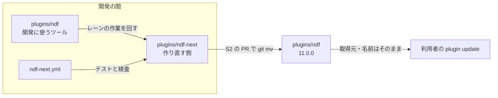
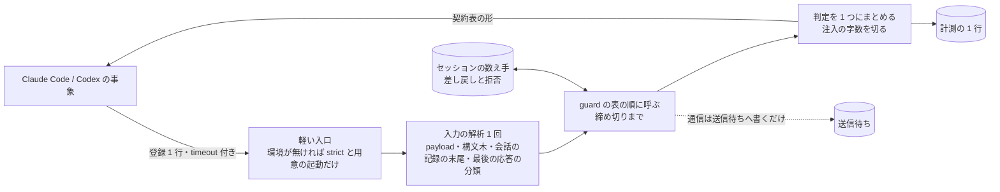
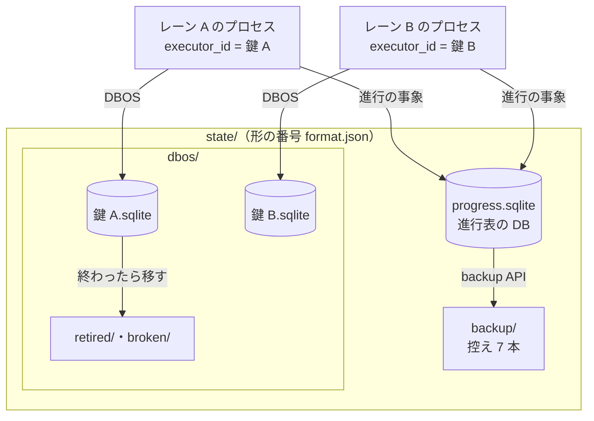

# NDF の作り直し: 別のディレクトリで 0 から作り、できたら ndf と入れ替える（#1142 #3092）

## 目的

- **今どうなっているか**: #1142 は、今の `plugins/ndf/` を子 Issue 72 本・22 の順番で段階的に直す計画だった（PR #3250 で承認）。#3092（工程の進行表）は実装 PR #3247 を出した。しかし 246 ファイルを書き換えて major の指摘 25 件と CI の失敗 70 件が残り、cross-review を 4 ラウンド回しても直らずに閉じた。今のコードを動かしたまま置き換える形では、旧い経路との互換・移行・旧いテストの書き換えが変更の大半を占める
- **誰に効くか**: NDF を作り直すレーン（lrebuild と lr-* の 6 本）と、NDF を使う利用者
- **変えると何が成り立つか**: 新しいディレクトリ `plugins/ndf-next/` に、承認済みの設計（#1142・#3092・#3097・#3098）の最終形を最初から作る。今の `plugins/ndf/` には触らず、開発に使うツールとして使い続けられる。入れ替えは 1 本の PR で行い、revert 1 回で戻せる

## 適用範囲

- **働く範囲**: このリポジトリの次の 3 つ
  - `plugins/ndf-next/`（新設）
  - CI のジョブ 1 本（新設）
  - 入れ替えの PR が触る配布の定義（`plugins/ndf/` 全体・`.claude-plugin/marketplace.json`・`.ndf/project.json` の suite・`scripts/*-allow/`）
- **プロジェクトごとに違うもの**: 足さない。利用先のリポジトリには、入れ替えの後の版（11.0.0）として届く
- **当たるモード**: `standard`（#1142 の「決めたこと」のまま）

## あるべき姿の根拠

| 根拠 | 種類 | 何を示すか |
| --- | --- | --- |
| 利用者の決定（2026-11-13 23:1x JST。原文は `.ndf/handoff/lrebuild-note-rebuild-1142-label.md` の「作り直しの置き場の決め直し」） | 指示 | 同じリポジトリの別のディレクトリで 0 から作り、できたら `ndf` と入れ替える。今の NDF は壊さない |
| PR #3247 を閉じたときのコメント（https://github.com/devbasex/ai-plugins/pull/3247 ） | 実測 | 段階的な置き換えで、設計の欠け 6 件と新しい経路が通らない指摘 19 件が残った |
| `docs/versioning-and-distribution.md` の「ランタイムごとの取得と導入」 | 仕様 | 導入の鍵は取得元の名前とプラグイン名で、リポジトリの中のディレクトリは含まない |
| 承認済みの設計（#1142 の設計と詳細設計・PR #3191・PR #3250） | 設計 | 新しい実装の材料。ここで決め直すのは置き場・順番・食い違いだけ |

要求と受け入れ条件は #1142 の本文にある（コピーは [issue-1142-requirements.md](issue-1142-requirements.md) ）。**受け入れ条件「ラベル `rebuild-1142` の Issue がすべて閉じる」は変えない。** 入れ替えの時点で閉じる形でよい。

この文書は「どこに・どの順で作り、どう入れ替えるか」だけを扱う。部品の中身は、末尾の「材料にする設計」の文書が持つ。

**詳細設計は [issue-1142-design-next-design-detail.md](issue-1142-design-next-design-detail.md) にある。** ファイル配置・子 Issue の表・流す順番・レーンの割り当て・ラベルの付け替えを持つ。

## 人へ残す判断

**#3345（hook の基盤の契約）で足した判断 (h)〜(m) は、節「hook の契約（#3345）」の「#3345 で足した判断」にある。** どれもレッドラインに当たらない。

**承認する人が答えるのは、次の 5 つである。** (a)〜(c) はレッドラインに当たる。レッドラインの番号（P1・C3）は `.ndf/mvv.md` と共通原則の番号で、新しい子の P1・C3 とは別である。

| # | 判断 | 当たるレッドライン | なぜ当たるか | 材料 | 推奨 |
| --- | --- | --- | --- | --- | --- |
| (a) | 入れ替えを `git mv` で行い、プラグイン名と取得元を変えないか | P1（配布物の取得元・版の規則を変える） | 入れ替えは配布物の中身を一度に替え、利用者全員に効く | 名前と取得元を保てば、利用者は登録し直さずに `plugin update` で届く（決定 73）。別名の配布や `source` の差し替えは、利用者の再導入か 600 箇所近い参照の向け直しが要る | `git mv` で入れ替える。版は 11.0.0 にする |
| (b) | 入れ替えの後、利用者の手元の旧い状態（`~/.local/state/ndf` の記録・進行中のプラン）を読まないことを受け入れるか | C3（利用者のデータを変える・移す） | 利用者の手元の記録の読まれ方が変わる | 新しい実装は旧い形を読み替えない（後方互換を置かない方針）。旧い置き場は消さず、名前を変えて残す（決定 79） | 受け入れる。入れ替えの前に、動いているスプリントを終わらせる |
| (c) | 開発の間、`ndf-next` をマーケットプレイスへ載せないか | P1（配布物の取得元・版の規則を変える） | 載せると取得元の中身が増え、開発版の利用者に届く | 載せない場合、試すのは `claude --plugin-dir plugins/ndf-next` だけになる。載せると hook と状態の置き場が `ndf` と二重に働く（決定 74） | 載せない |

**(d)・(e) はレッドラインに当たらない。** 承認済みの要求と今の NDF の扱いを変えるため、ここに並べる。

- (d) #3092 の前提 7 の `progress.py adopt`（動いているスプリントの取り込み）を外すか
  - 材料: 入れ替えの前に、動いているスプリントを終わらせれば取り込むものが無い（決定 76）。外すと #3092 の受け入れ条件の 1 項目が消える
  - 推奨: 外す。承認の後に #3092 の本文を直す
- (e) #3153（CI の結果の監視の読み違え）を今の `plugins/ndf/` でも直すか
  - 材料: 今の NDF は開発に使うツールとして使い続ける。新しい実装では AD1 で作る
  - 推奨: 今の NDF では直さない。レーンの作業が止まったときだけ、即時修正の 4 条件で直す

**(f)・(g) は #3344（DBOS の記録と進行表の置き場）の差分で足した判断で、レッドラインに当たる。** (a)〜(e) は PR #3250 の後の承認で答えが出ている。

| # | 判断 | 当たるレッドライン | なぜ当たるか | 材料 | 推奨 |
| --- | --- | --- | --- | --- | --- |
| (f) | 終わった実行の耐久の記録を、退避してから 14 日で消すか | C4（戻せない操作。データの削除） | 消した記録は戻せない。今の NDF は 30 日で消している | 今の鍵ごとの記録は `.git/ndf/state/dbos` に 2,279 ファイル・687MB（2026-11-14 の実測）。待ちを抱えた実行（`PENDING`・`ENQUEUED`）は消さない。URL（PostgreSQL）では NDF の台帳 `ndf_runs` に載った鍵だけを、鍵の実行がすべて終わってから消す（決定 83） | 消す。待ちを抱えた実行は日数に依らず残す |
| (g) | 置き場の形の番号が自分より古いとき、置き場ごと退避して新しく始めるか | C3（利用者のデータを変える・移す） | 利用者の手元の進行表と耐久の記録が、読まれない場所へ移る | 退避は名前の変更だけで戻せる。形の番号が自分より新しい置き場は触らずに止める（決定 85） | 退避する |

## 設計の結果

**置き場は `plugins/ndf-next/`。** 開発の間のプラグイン名は `ndf-next`、版は `11.0.0-dev.N` とし、入れ替えの PR で名前を `ndf` に、版を `11.0.0` にする。

**子 Issue は 26 本・9 の順番に組み直す。** 72 本の旧い子は、20 本を新しい子へそのまま引き継ぎ、13 本を形を変えて引き継ぎ、18 本を他の子へまとめ、21 本を要らなくする（表は詳細設計の「旧い子の行き先」）。#3092・#3097・#3098 は新しい子 P1・P3・P4 としてそのまま使う。

**hook は 1 事象 1 入口・予算・失敗は通す・差し戻しと拒否の上限・計測の契約の上に作る（#3345）。** 契約と #3345 の受け入れ条件との対応は節「hook の契約（#3345）」に、決定は 88〜96 にある。子の M3 #3297 と S1 #3303 へ足す受け入れ条件は、詳細設計の「#3345 で子へ足す受け入れ条件」にある。

**レーンは 6 本のまま使う**（lrebuild・lr-flow・lr-data・lr-rf・lr-fix-a・lr-fix-b。各プラン 2 本）。after から lflow・lbr2・lsw を外す。新しいディレクトリは今の NDF のファイルと重ならないためである。

**ラベル `rebuild-1142` の Issue は、旧い子の行き先の表で新しい子へ付け替える。** 付け替えの規則と件数は詳細設計の「ラベルの付け替え」にある。

**DBOS の記録は実行の鍵ごとに分け、1 つの DB に置くのは進行表だけにする（#3344）。** 決定 77 の「DBOS の記録の置き場」と「アプリの版」の 2 行を、決定 81〜87 で置き換えた。中身と #3344 の受け入れ条件との対応は「DBOS の記録と進行表の置き場」の節にある。

## ドメインモデル

### コンテキスト

| コンテキスト | 何の語が 1 つの意味に決まるか |
| --- | --- |
| 配布 | プラグイン・取得元・版・プラグインの入れ替え |
| 進行 | 工程・進行表・行・承認ゲート・レーン（#3092・#3097 の設計のまま） |
| プランの実行 | プラン・ステップ・止まった理由・行き先（#1142 の scripted-flow のまま） |

**コンテキストマップ。** 契約の形を決めるのは上流で、下流はその形に従う。下流は上流の定義を書かない。

| 上流（契約を決める） | 下流（従う） | 関係 | 契約 |
| --- | --- | --- | --- |
| 配布 | 進行 | 顧客と供給者 | プラグインの定義のプラグイン名と版。進行は読むだけで、プラグインの定義は書かない |
| 配布 | プランの実行 | 顧客と供給者 | 同じくプラグインの定義のプラグイン名と版。状態の置き場の名前もここから求める（決定 75） |
| プランの実行 | 進行 | 公開ホストサービス / 順応者 | 進行表の行が、工程から作業を呼ぶ層（上の節の規約）を通してプランを呼び、プランの結果 JSON（`cause`・`outputs`）を読む。プランの実行は進行表を読まず、書かない（scripted-flow のコンテキストマップと同じ向き） |

### 集約

**集約ごとに持ち主は 1 つである。** 部品の子 Issue の PR が書いてよいのは次の 3 つだけである。

- 詳細設計の「ファイル配置」で自分の子の列に載るファイルと、自分のパッケージのテスト（`plugins/ndf-next/tests/<自分のパッケージ>/`。置き場は X0 が作り、中身は各子が書く）
- `cli.py` の副命令の表への自分の副命令の 1 行（詳細設計の「並行と排他」）
- 契約（D1）を変える PR だけは、その契約の下流の読み手とそのテストも同じ PR で直してよい（下の表の「止まった理由の表」の行）

| 集約 | 持ち主（書き換えてよいもの） | 根 | エンティティ | 値オブジェクト |
| --- | --- | --- | --- | --- |
| プラグインの定義 | lrebuild のレーンの PR（X0 が作り、S2 が名前と版を `ndf`・`11.0.0` へ替える）。部品の子の PR は書かない | `plugins/ndf-next/.claude-plugin/plugin.json` | — | プラグイン名・版 |
| 新しいプラグイン | 部品の子 Issue の PR（詳細設計の「ファイル配置」の子の列） | `plugins/ndf-next/` | 部品のパッケージ | — |
| プラン | プランの雛形のモジュール（C3） | `plan.json` | ステップ | ステップの型・条件・ステップの `on_cause` |
| プランの実行 | プランの実行の核（C2） | プランの実行 | ステップの試行 | 止まった理由・行き先・再試行の回数 |
| 止まった理由の表 | 契約（D1。結果 JSON の契約を変える PR が、下流の読み手とそのテストを同じ PR で直す）。実行の中では読むだけ | 止まった理由の表 | 種類 | 終了コード・既定の行き先・再試行の方針 |
| 進行表 | `progress` の書き手（#3092 の設計の書き手の表） | 進行表 | 行・事象 | 状態・止まった理由 |
| 耐久の記録 | DBOS の殻（C1。#3344 の追補を含む）。ほかの子は殻の関数を通してだけ読み書きする | 実行の鍵の記録（SQLite は鍵ごとのファイル、URL は鍵ごとの `application_name`） | 耐久ワークフロー | 実行の鍵・形の番号（`durable.FORMAT`） |
| チェックアウトの置き場 | DBOS の殻（C1 の追補）が形の番号を確かめて用意する。進行表の DB の中身は P1 が書く | `<git の共通ディレクトリ>/<プラグイン名>/state/` | 進行表の DB・鍵ごとのファイル・控え | 形の番号（`format.json`） |

プラン・プランの実行・止まった理由の表の中身（エンティティの形と不変条件 IS1〜IS12）は scripted-flow の設計のまま使う。この表が決めるのは、新しいディレクトリでの持ち主の子だけである。

### 不変条件

hook の基盤の不変条件 IH1〜IH10 は、節「hook の契約（#3345）」にある。

| # | 集約 | 条件 | 破れたときの扱い |
| --- | --- | --- | --- |
| I1 | 新しいプラグイン | `plugins/ndf-next/` の中のコードは、自分のディレクトリ名・プラグイン名・状態の置き場の名前を文字で持たない（決定 75） | 検査（X1）が CI で落とす |
| I2 | 新しいプラグイン | 子 Issue の PR は `plugins/ndf/` を変えない（即時修正を除く） | 検査（X1）が差分で落とす |
| I3 | 新しいプラグイン | `plugins/ndf-next/` の中から `plugins/ndf/` の Python を import しない | 検査（X1）が落とす |
| I4 | 進行表 | 進行表のほかに、工程の遷移を決めるものを置かない（#3092 の受け入れ条件 11 のまま） | 工程の定義の登録が断る |
| I5 | 耐久の記録 | ある実行の鍵の耐久ワークフローを取り出して流すのは、同じ鍵で起動したプロセスだけである（決定 81） | 2 つのプロセスが同じファイルを鍵違いで開くテストで、相手のキューを流したら落ちる |
| I6 | 耐久の記録 | 1 つの鍵の記録を開くプロセスは同時に 1 つで、`executor_id` と `application_name` は実行の鍵から求めた同じ値である（前の設計の I17 を引き継ぐ） | 2 つ目の起動は鍵のロック（SQLite は鍵ごとのファイルロック `run_lock`、URL は DB 側の鍵のロック）で待つ。片付けは鍵のロックを待たずに試し、取れた鍵だけを移す・消す |
| I7 | 耐久の記録 | アプリの版（`application_version`）は形の番号（`durable.FORMAT`）だけで決まり、NDF の版とワークフローのソースでは変わらない（決定 84） | `plugin.json` の版だけを上げて起動し直すテストで、途中の実行が回復しなければ落ちる |
| I8 | 耐久の記録 | 終わった実行の記録は生きている置き場に残らず、待ちを抱えた実行（`PENDING`・`ENQUEUED`）の記録は日数で消さない。URL では、鍵の実行（子を含む）の 1 つでも待ちを抱えているか、終わってから `KEEP_DAYS` を過ぎていなければ、その鍵の実行を 1 つも消さない（決定 83） | 退避と消去のテストで、待ちの記録が消えたら落ちる。URL では親だけが 15 日前に終わり子が `PENDING` の鍵で、子が消えたら落ちる |
| I9 | チェックアウトの置き場 | 進行表の DB は DBOS の表を持たない。SQLite の進行表の DB は、`quick_check` が `ok` を返した目印（`state/progress.checked`）が 24 時間以内に無ければ、`quick_check` が `ok` を返すまで書かない。書き込みが `SQLITE_CORRUPT` を受けたら目印を消す（決定 82） | 目印の無い壊したファイルを開くテストで、書き込みが起きたら落ちる |
| I10 | チェックアウトの置き場 | 形の番号が自分と違う置き場へは書かない。古ければ置き場ごと退避し、新しければ止まる（決定 85） | 番号を 1 つ上げた・下げた置き場を開くテスト |
| I11 | チェックアウトの置き場 | 置き場を使うプロセスは置き場のロック（`state.lock`）を共有で持つ。置き場ごとの退避と進行表の DB の `restore` は、置き場のロックを排他で取れ、退避では旧い置き場の鍵のロック（`dbos/*.lock`）もすべて、`restore` では実ファイルの `<実ファイル>.lock` も（置き場の中か外かに依らず）取れたときだけ行う。進行表の DB を開くプロセスは、実ファイルへ接続する前に `<実ファイル>.lock` を共有で取り、全接続を閉じるまで持つ（決定 82・85） | 置き場のロックを共有で持つプロセスがいる間と、置き場の中の DB を別のチェックアウトから開いている間に退避・`restore` を打つテストで、名前の変更か控えの配置が起きたら落ちる |
| I12 | 耐久の記録 | URL の片付けが消すのは、NDF の台帳（表 `ndf_runs`）に `durable.launch` が書いた鍵の実行だけである（決定 83） | 台帳に無い `run-` で始まる `application_name` の終わった実行を置いたテストで、それが消えたら落ちる |
| I13 | 耐久の記録 | URL では、同じ鍵の起動（台帳の行の書き込みから DBOS を閉じるまで）と片付け（実行の一覧から `delete_workflows` と台帳の行の削除まで）は、DB 側の同じ鍵のロックの下で直列に起きる（決定 83） | 鍵のロックを別の接続が持つ間に片付けを打つテストで、その鍵の実行か台帳の行が消えたら落ちる |

### ドメインイベント

**要求のイベント（E1〜E9）は、番号のままこの設計の中の起き方へ引き継ぐ。**

| # | イベント（要求） | この設計での発生元 | 受け手 |
| --- | --- | --- | --- |
| E1 | 移行の前の基準を測った | 済み（全体の設計の数） | E9 の比べる相手 |
| E2 | スクリプトの語を用語集に揃えた | 設計（この文書の「用語」の表） | 用語集（承認の後に反映） |
| E3 | 設計を承認した（設計承認ゲート） | 利用者（この設計 PR） | X0 |
| E4 | ライブラリを 1 か所へまとめた | X0・D1 のマージ（新しいディレクトリで最初から 1 か所に作る） | 順番 3 以降の子 |
| E5 | コンテキストごとのモジュールへ移した | 部品の子の PR のマージ（移さず、最初からコンテキストごとに作る） | S1 |
| E6 | エントリポイントの形が変わらないことを確かめた | S1 の受け入れの確かめ（テスト設計）。旧い形との互換は確かめない（決定 76） | S2 |
| E7 | 開発版を導入して確かめた | EN1 の後の開発版 | E8 |
| E8 | 本番を承認した（リリース承認ゲート） | 利用者 | 本番のリリース |
| E9 | 移行の後を同じ物差しで測り直した | conductor（E1 と同じ測り方） | 振り返り（Issue のコメント） |

**この設計で足すイベントは `EN` の番号を付ける。**

| # | イベント | 発生元 | 受け手 |
| --- | --- | --- | --- |
| EN1 | 入れ替えた（`plugins/ndf-next/` が `plugins/ndf/` になった） | S2 の PR のマージ | リリース（開発版のデプロイ）・ラベルの Issue がすべて閉じたかの確かめ |
| EN2 | 置き場を退避した（形の番号が古い・無い） | DBOS の殻の置き場の用意（決定 85） | 結果 JSON の `items`（退避先のパス） |
| EN3 | 実行の記録を退避した・消した | DBOS の殻の片付け（決定 83） | 結果 JSON の `items`・`metrics` |

**進行表とプランの実行の状態の変化（止まった・行き先が決まった・工程が失敗した など）は、材料の設計のイベントを番号のまま使う。** 進行表の側は #3092 の E1〜E15、プランの実行の側は scripted-flow の ES1〜ES5 で、発生元と受け手もそれらの表のとおりである。新しいディレクトリで足すものは無い。

### 用語

| 用語 | 意味 | 用語集への反映 |
| --- | --- | --- |
| プラグインの入れ替え | 作り直した `plugins/ndf-next/` を 1 本の PR で `plugins/ndf/` へ `git mv` し、名前と版を替えること。取得元とプラグイン名は変えない（決定 73）。この文書では「入れ替え」と略す。ラッパーの入れ替えとは別 | 追加（`ndf-workflow`） |
| 新しいプラグイン | 入れ替えまでの間、`plugins/ndf-next/` に作る作り直しの側のプラグイン。開発の間の名前は `ndf-next` | 追加（`ndf-workflow`） |
| プラグインの定義 | プラグインの `plugin.json` が持つプラグイン名と版（文書の中で「配布の定義」と書いていた語。「配布」は用語集で「リリース」へ置き換えた語のため改めた） | 追加（`ndf-workflow`） |
| 初期構成 | 新しいディレクトリに最初に置く `plugin.json`・依存の lock・エントリポイント・CI のジョブ・テストの置き場（子 X0）。スケルトン（SKILL.md の bash）とは別 | 追加（`ndf-workflow`） |
| チェックアウトの置き場 | `<git の共通ディレクトリ>/<プラグイン名>/state/`。どの worktree からも同じ所に解決し、進行表の DB と鍵ごとの耐久の記録と控えを置く。利用者ごとの状態の置き場（決定 79）とは別 | 追加（`ndf-workflow`） |
| 進行表の DB | 計画・レーン・スプリントの進行表と進行の事象を置く 1 つの DB。どの worktree からも同じ所に解決する。DBOS の記録は置かない（決定 81） | 意味の変更（`ndf-workflow`。#3092 の「DBOS の記録と同居」から） |
| 形の番号 | チェックアウトの置き場の `format.json` と耐久の記録のアプリの版が持つ整数。読み書きの形が変わるときだけ上げ、NDF の版とは別に動く（決定 84・85） | 追加（`ndf-workflow`） |

## 外部の調査

**置き場と入れ替えは調べない。** このリポジトリの配布の仕組み（`docs/versioning-and-distribution.md`）の中で閉じるためである。部品の外部の調査は、材料にする設計の「外部の調査」をそのまま引き継ぐ。**DBOS の記録と進行表の置き場（#3344）だけを調べた。**

| 種類 | 調べるか | 理由 |
| --- | --- | --- |
| 標準・仕様 | 調べる | 進行表の DB の健全性の確かめと控えを、SQLite の定める手段で行うため |
| 主要な製品 | 調べない | 耐久実行の置き場の分け方は、使うライブラリ（DBOS）の取り出しの条件で決まり、ほかの製品の解き方は効かない |
| ライブラリとサービス | 調べる | DBOS の取り出し・回復・アプリの版・消す機能の条件を、使う版のパッケージ（wheel）で確かめるため。自前で作るファイルのロックと形の番号の比べ合いは、既存のライブラリと比べるため |

### 標準・仕様

| # | 標準・仕様 | 何を定めているか | 設計への反映 | 出典 |
| --- | --- | --- | --- | --- |
| STD10 | SQLite の `PRAGMA quick_check` / `integrity_check` | `quick_check` は索引と表の中身の照合を省いた O(N) の検査で、壊れていなければ 1 行の `ok` を返す | 進行表の DB と鍵ごとのファイルを開くときに、最後の `ok` から 24 時間を過ぎていれば打つ（決定 82） | https://www.sqlite.org/pragma.html#pragma_quick_check （2026-11-14） |
| STD11 | SQLite の Online Backup API（Python の `sqlite3.Connection.backup`） | 書き込み中の DB から一貫した写しを取る | 進行表の DB の控えを取る（決定 82） | https://www.sqlite.org/backup.html ・ https://docs.python.org/3/library/sqlite3.html#sqlite3.Connection.backup （2026-11-14） |
| STD12 | SQLite の WAL | 読み手が書き手を待たない。書き手は同時に 1 つ | 進行表の DB を WAL で開く（決定 82。#3092 の決定 18 のまま） | https://www.sqlite.org/wal.html （2026-11-14） |

### ライブラリとサービス

| # | 候補 | 版 | ライセンス | 最後のリリースの日付 | 終了のアナウンス | 要件を満たすか | 出典 |
| --- | --- | --- | --- | --- | --- | --- | --- |
| LIB10 | DBOS Transact（Python） | 3.5.0 | MIT | 2026-11-10 | 無し | 満たす。キューの取り出しは `executor_id` で絞らないため、鍵ごとに記録を分ける（決定 81）。`application_version` を設定で固定できる（決定 84） | `uvx --from pip pip download dbos==3.5.0 --no-deps` の wheel（`dbos/_sys_db.py`・`_sys_db_sqlite.py`・`_dbos.py`・`_core.py`・`_queue.py`）・https://pypi.org/pypi/dbos/json （2026-11-14） |
| LIB11 | DBOS Transact（Python） | 3.1.0（今の `plugins/ndf-next/pyproject.toml` の固定） | MIT | 2026-09-24 | 無し | 取り出しの条件は 3.5.0 と同じ。最新の安定版ではないため採らない（決定 87） | 同じ手順の 3.1.0 の wheel（2026-11-14） |
| LIB12 | filelock | 4.2.10 | MIT | 2026-11-09 | 無し | 満たすが採らない。使うのは Linux と macOS の `flock` の共有と排他だけで、今の NDF も標準の `fcntl.flock` で同じロックを取っている（`plugins/ndf/scripts/lib/state_home.py` の `_flock_free`）。依存を増やす理由が無い（決定 85） | https://pypi.org/pypi/filelock/json （2026-11-14） |
| LIB13 | portalocker | 4.4.2 | BSD-3-Clause | 2026-10-28 | 無し | 満たすが採らない。LIB12 と同じ理由に加え、Redis のロックなどの要らない機能を持つ（決定 85） | https://pypi.org/pypi/portalocker/json （2026-11-14） |
| LIB14 | Alembic | 1.20.1 | MIT | 2026-10-22 | 無し | 当たらない。DB の表の版を移す道具で、置き場の形（ディレクトリとファイルの並び）の番号は DB の外にある。進行表の表の版は P1 が #3092 の設計のまま持つ（決定 85・86） | https://pypi.org/pypi/alembic/json （2026-11-14） |

**DBOS 3.5.0 の wheel で確かめたこと**（行番号は 3.5.0 の wheel のもの）:

| 確かめたこと | 根拠の行 |
| --- | --- |
| キューの取り出し（`start_queued_workflows`）の条件は、キュー名・状態 `ENQUEUED`・アプリの版・`application_name`（一致か `NULL`）・パーティションキーだけで、`executor_id` を条件に持たない。取り出した行へ自分の `executor_id` を書く | `_sys_db.py:5224-5265`（取り出しの `select`）・`:5281-5307`（`executor_id=executor_id` を書く `update`）。3.1.0 でも同じ（`_sys_db.py:4782-4810`） |
| `application_name` の条件は「一致」か「`NULL`（どのアプリのものでもない）」で、設定の `name` で起動したプロセスが入れた実行は、その名前で持ち主が決まる | `_sys_db.py:1215-1223`（`_name_filter`）・`_core.py:570-574`・`:656`（入れるときに `GlobalParams.app_name` を書く） |
| 起動の回復は `executor_id`・アプリの版・`application_name` の 3 つが合う `PENDING` だけを拾う | `_dbos.py:984-996`・`_sys_db.py:3244-3265`（`get_pending_workflows`） |
| アプリの版は、設定に無ければワークフローの関数のソース・DBOS の版・アプリ名の MD5 で求まる。設定の `application_version` があればそれを使う | `_dbos.py:411-436`（`compute_app_version`）・`:759-771`・`:884-886` |
| SQLite の接続はすべてのトランザクションを `IMMEDIATE` で始め、`busy_timeout` は 30 秒。WAL は有効にしない | `_sys_db_sqlite.py:43-50` |
| キューの見回りの既定の間隔は 1 秒 | `_queue.py:59` |
| 終わった実行は `DBOSClient.delete_workflows` で消せる（子の実行と付随の表を含む） | `_client.py:994-1003`・`_sys_db.py:2020-2029` |
| `delete_children=True` は子・孫の実行を状態と終わった日時を見ずに再帰で集めて消す | `_sys_db.py:2020-2029`・`:6447-6463`（`get_workflow_children`） |
| `list_workflows` は `application_name`・状態・終わりの時刻で絞れる | `_client.py:1172-1202` |
| 保持期限で終わった実行を自動で消す設定と公開の関数は無い（設定の項目と `DBOS`・`DBOSClient` の関数の一覧に無い） | `_dbos_config.py`・`_client.py`・`_dbos.py` の `def` の一覧 |
| ワークフローの中の分かれ目を版の代わりに残す `DBOS.patch`・`deprecate_patch` がある。版を固定する `enable_patching` は非推奨 | `_dbos.py:4403-4418`・`:4471`・`_dbos_config.py:48` |
| 3.1.0 からの差: シャードした DB（`_shard_keys.py`）・パーティションごとの同時の本数・自動の版上げ（`_auto_upgrade.py`。Enterprise）が増え、アプリの版の MD5 にアプリ名が入った。`enable_patching` は非推奨になり、版を 1 つに保つには `application_version` を明示する | 2 つの wheel のファイルの一覧の差・`_dbos.py:773-779` |

調べた量: 候補 5 件・取得の試み 13 回。

## 機能一覧

| # | 機能 | 誰が使うか |
| --- | --- | --- |
| F1 | 新しいディレクトリの初期構成（パッケージ・依存の lock・CI のジョブ・テストの置き場） | レーン |
| F2 | 新しいディレクトリだけを見る検査（兆候 0 件・構造の規則・I1〜I3） | CI |
| F3 | 部品（契約・アダプター・核・進行表・領域）を、承認済みの設計の最終形で作る | レーン |
| F4 | 工程から作業を呼ぶ層（PR #3247 の欠けを埋める） | 進行表 |
| F5 | 入れ替えの PR と、ラベルの Issue がすべて閉じたかの確かめ | lrebuild |

## 構成要素

| 要素 | 責務 |
| --- | --- |
| `plugins/ndf-next/`（新設） | 新しいプラグインの全体。配置は詳細設計の「ファイル配置」 |
| `.github/workflows/ndf-next.yml`（新設） | `plugins/ndf-next/**` の変更で、新しいディレクトリのテストと検査を走らせる。S2 で消し、既存のジョブへ戻す |
| `plugins/ndf/`（変えない） | 開発に使うツール。S2 で消える |
| 入れ替えの PR（S2） | `git rm plugins/ndf`・`git mv plugins/ndf-next plugins/ndf`・名前と版・許可ファイルと suite の作り直し |

## hook の契約（#3345）

**新しいプラグインの hook は、増えても Claude Code を遅くせず、止め続けず、会話を埋めない基盤の上に作る。** 今の NDF の hook は、登録と起動の形・失敗の扱い・回数の数え方が guard ごとに別々で、止められ続けて作業が進まない状態がすでに起きている。新しいプラグインの hook（M3 #3297 の判定と S1 #3303 の入口と登録）は、この節の契約に従う。個々の guard が何を止めるかは、この節では決めない。

### 今の NDF で起きていること

2026-10-14〜11-13 の会話の記録（uuid で重複を除いた）と、`plugins/ndf/`（develop 04430fda7）を読んで確かめた。

| 項目 | 実測・場所 |
| --- | --- |
| Tool の呼び出し | 52,497 件 |
| PreToolUse の拒否 | 601 件（1.1%）。Monitor の拒否 24 件を含む。develop の登録には Monitor に当たる guard が無い（`plugins/ndf/hooks/claude.json:5` の matcher）ため、30 日のうち旧い版の記録である |
| Stop の差し戻し | 4,681 回のうち 255 回（5.4%）。93% が本文の待ち（AskUserQuestion を呼ばずに本文で待った）。1 セッションで 35 分に 12 回、連続 6 回が 3 度 |
| 差し戻しの数え方 | 3 か所で別々に数える。本文の待ちは区間ごとの `wait-held.json`（`plugins/ndf/scripts/relay_lib/mark.py:163-198`。通す Stop で `held` を先に偽へ書くため、1 回おきに差し戻せる）、背景の作業が残る Stop は区間ごとの `mark-held.json`（`mark.py:92-100`）、人のいない実行はセッションごとの印の `pushbacks`（`plugins/ndf/scripts/hook_lib/unattended.py:134-142`）。`/goal` の評価役は Claude Code の側にある |
| 同じ拒否の繰り返し | 文脈の上限の拒否は、ラッパーの下では上限を超えている限り止め続ける（`plugins/ndf/scripts/hook_lib/token_guard.py:405`）。同じ範囲を読む拒否は 3 回目から、ファイルが変わるまで毎回返す（`token_guard.py:198-202`） |
| hook の所要 | `hook.py` は記録で p50 84 ms・p99 9.1 s・最大 701 s、手元で 52〜113 ms。前の設計の決定 20 の基準（`worktree-guard.sh` の 30〜32 ms）を目標として置いた所も、所要を常に測る仕組みも無い |
| Stop の hook の合計 | p50 331 ms・p95 2.2 s・最大 35 s。打ち切り 51 件 |
| 締め切りと部品の上限 | 締め切り 3.5 秒（`plugins/ndf/contracts/limits.json:31`）より、AskUserQuestion の転送の待ち 8 秒（`:30`）と git の上限 5 秒（`:34`・`:37`）が長い。新しいプラグインの `plugins/ndf-next/contracts/limits.json:30-37` は同じ値を写している |
| timeout の無い登録 | Claude Code の登録 19 本のうち SessionStart の 3 本（`plugins/ndf/hooks/claude.json:98`・`:105`・`:112`）。そのうち `worktree-session.sh` は `git fetch`（`plugins/ndf/scripts/worktree-session.sh:203`）と、`uv sync` を打つ環境の用意（`plugins/ndf/scripts/hook-env.py:95`）を含む |
| 会話へ入れる量 | 拒否の文が最大 8,439 字（文脈の上限の拒否）、SessionStart が最大 3,712 字。字数の上限は無い（`hook.py:78-81` は各 guard の文をつなぐだけ） |
| 同じ入力の解析の重なり | AskUserQuestion を `hook.py` の guard（`plugins/ndf/scripts/hook_lib/ask_guard.py:161-166`）と別プロセスの `relay.py question open`（`mark.py:292-303`）が判定し直す。Stop で `hook.py`（`plugins/ndf/scripts/hook_lib/wait_notify.py:196`）・`relay.py mark`（`mark.py:186`）・人のいない実行の判定の 3 プロセスが同じ応答を読み直す。文脈の guard は会話の記録の末尾 200 行を 1 回の判定で 2 度開く（`token_guard.py:231-258`） |
| hook の中の通信 | Slack への送信（切り離した子プロセス。`wait_notify.py:223-231`）・SessionStart の `git fetch`（上限なし）・学習の設定の読み書き（`plugins/ndf/scripts/training-optout.py:102-120`。HTTP） |
| 起動の形と既定 | 起動の形が 3 通り（環境の python・システムの `python3`・シェル）。失敗の既定が 2 通り（`hook.py:288-295` は通し、`relay.py question open` は排他を取れないと止める。`mark.py:331-350`） |
| Codex の登録 | `plugins/ndf/hooks/codex.json` は 4 事象（PreToolUse・SessionStart・Stop・PermissionRequest）。Stop で「JSON validation failed」が 3 件 |
| 止める環境変数 | guard ごとに別の名前（`NDF_SLEEP_GUARD`・`NDF_READ_REPEAT_GUARD`・`NDF_CONTEXT_GUARD`・`NDF_SUPERVISOR_CUT_GUARD`・`NDF_WORKER_SKILLS_GUARD`・`NDF_SUPERVISOR_DOCS_GUARD` ほか閾値と通知の変数）。worktree・起票・手元のテスト・問い合わせの guard は止める変数を持たない |
| 依存の環境 | `~/.cache/ndf/venv` に版ごとの環境が 48〜49 個・1.4 GB 残る。消す処理が無い |

### 形

**ランタイムの事象 1 つにつき、登録 1 行・プロセス 1 本で、guard を表の順に呼ぶ。** 入力の解析は事象ごとに 1 回で、guard は解析の結果を受け取るだけにする。

**契約の 8 項目と、それぞれを決めた所**:

| # | 契約（#3345 のあるべき姿） | 決定 | 不変条件 |
| --- | --- | --- | --- |
| 1 | 1 事象 1 入口。guard は表で並べ、入力の解析は 1 回 | 決定 88 | IH1 |
| 2 | 起動の形。`bin/ndf` を通らない軽い入口から始め、環境が無ければ終了コード 0 で通す | 決定 89 | IH2（前の設計の決定 20・I13 を引き継ぐ） |
| 3 | 予算。事象ごとの所要と注入の字数を `limits.json` に置き、上限の順序を検査し、すべての登録に timeout を付ける | 決定 90 | IH3・IH8 |
| 4 | 失敗の規則。既定は通し、止める側に倒すのは宣言した guard だけ | 決定 91 | IH4 |
| 5 | 上限。Stop の差し戻しはセッション共通の数え手で利用者の入力ごとに 2 回まで、同じ理由の拒否は 2 回の後に案内へ下げる | 決定 92 | IH5・IH6 |
| 6 | I/O。同期の経路で通信しない。外部コマンドは git のローカルの副命令だけ | 決定 93 | IH7 |
| 7 | 計測。hook の起動ごとに所要・判定・注入の字数を 1 行で記録する | 決定 94 | IH9 |
| 8 | ランタイムの契約表。Claude Code と Codex の入出力の表と、本体の版ごとの入力の見本で CI を回す | 決定 95 | IH10 |

guard の止め方は `NDF_HOOK_OFF` の 1 つにする（決定 96）。

### 用語（hook の基盤）

| 用語 | 意味 | 用語集への反映 |
| --- | --- | --- |
| hook の入口 | ランタイムの事象ごとの登録 1 行が起動するスクリプト。用意済みの環境の python で動き guard の表を順に呼ぶ `hooks/entry.py` と、環境が無いときにシステムの `python3` で動き `strict` の guard と環境の用意の起動だけを行う `hooks/boot.py` の 2 つ | 追加（`ndf-workflow`） |
| guard の表 | hook の入口が呼ぶ guard を並べた表（`contracts/hooks/guards.json`）。guard ごとに、当たる事象と Tool・順序・`strict` の有無・代わりに勧める Tool を持つ | 追加（`ndf-workflow`） |
| hook の予算 | 事象ごとの所要の目標（p95）・締め切り・余白・登録の timeout・注入の上限の字数。`limits.json` の `hook.budget.<事象>` に置く。開発ループの予算・cross-refactoring の実装の予算とは別 | 追加（`ndf-workflow`） |
| 注入 | hook が会話へ入れる文。拒否の理由・差し戻しの理由・追加の文脈・SessionStart の出力を指す | 追加（`ndf-workflow`） |
| セッションの数え手 | セッションごとの状態のファイル 1 つで、利用者の入力ごとの Stop の差し戻しと同じ拒否の回数を持つもの。利用者の入力で数え直し、中継が送った入力では数え直さない | 追加（`ndf-workflow`） |
| 送信待ち | hook が通信の代わりに通知を書いておく置き場。NDF 自身の送り手が切り離して送る。投稿キューとは別 | 追加（`ndf-workflow`） |
| `strict` の guard | guard の表で、自分の判定の失敗を止める側に倒すと宣言した guard。同じ拒否の上限で案内へ下げない | 追加（`ndf-workflow`） |

用語集へは、承認の後に反映する（ドメインイベント E2 と同じ扱い）。

### 不変条件（hook の基盤）

番号の頭を `IH` にする。ドメインモデルの I1〜I4（と #3344 の I5〜I10）とも、前の設計の I1〜I17 とも別の番号である。

| # | 集約 | 条件 | 破れたときの扱い |
| --- | --- | --- | --- |
| IH1 | hook の登録 | ランタイムの事象 1 つにつき登録は 1 行で、1 回の事象で起動するプロセスは 1 本。payload・シェルの構文木・会話の記録の末尾・最後の応答の分類は、1 回の事象で 1 度だけ作る（決定 88） | 登録の検査と、解析の関数の呼び出し回数を数えるテストが落とす（S1-H1・M3-H1） |
| IH2 | hook の入口 | 入口から import でたどれるモジュールは、標準ライブラリと許した依存の表のものだけで、`bin/ndf` を通らず、依存を入れ直す処理（前の設計の `deps.require()` にあたるもの）を呼ばない。用意済みの環境の python を直に起動する。環境が無いときは、システムの `python3` で標準ライブラリだけの入口（`hooks/boot.py`）を動かし、`strict` の guard の判定と、SessionStart なら環境の用意の切り離した起動だけを行う。ほかは出力なし・終了コード 0 で終わる。`python3` も無ければ何もせずに 0 で終わる。`hooks/boot.py` が受け取る引数は `hooks/entry.py` と同じ位置（`argv[1]` がランタイム、`argv[2]` が事象）にある（前の設計の決定 20・I13 を引き継ぐ。決定 89・決定 91） | import の閉包を構文木でたどるテスト（`boot.py` からの閉包は標準ライブラリだけ）と、環境を消した状態で全事象を起動するテストと、環境を消した状態から SessionStart で用意が終わるまでを通すテストと、環境が無い経路で `boot.py` が受け取る引数を確かめるテストが落とす（M3-H3・M3-H14・S1-H2・S1-H5） |
| IH3 | 予算 | 事象ごとに「部品の上限 ≤ 締め切り − 余白」「締め切り ≤ 登録の timeout」が成り立ち、すべての登録に timeout がある（決定 90） | 予算の検査（`check_budget`）が SessionStart で案内を出し、CI で落ちる（M3-H4・S1-H1） |
| IH4 | 判定 | 例外・締め切り超え・環境が無い・知らない事象と Tool・入力の形の違いは、出力なし・終了コード 0 で通す。止める側に倒すのは、guard の表で `strict` と宣言した guard だけ。`strict` の guard は標準ライブラリだけで書き、入口がほかの guard と依存の import より先に呼ぶ。環境が無いときもシステムの `python3` の経路で呼ぶ（決定 91） | guard に例外を投げさせるテストで止めたら落ちる。環境を消した状態・依存の import を落とした状態で、本番チャネルへのマージを止めなければ落ちる（M3-H6） |
| IH5 | セッションの数え手 | 利用者の 1 回の入力の後に NDF が Stop を差し戻すのは、理由をまたいで合計 `hook.pushback` 回まで。同じ guard・同じ理由・同じ対象の拒否は `hook.deny-repeat` 回の後は案内に下げる（`strict` の guard を除く）。数え直すのは利用者の入力だけ（決定 92） | 本文の待ちで Stop を続けるテストと、同じ範囲を続けて読むテストが、上限を超えて止めたら落ちる（M3-H7） |
| IH6 | guard の表 | guard が代わりに勧める Tool（表の `suggests`）を、ほかの guard が止めない（決定 92） | 勧める Tool の見本の呼び出しを全 guard に通すテストが落とす（M3-H8） |
| IH7 | hook の入口 | 同期の経路で通信しない。起動する外部コマンドは、git のローカルの副命令（表に載るもの）と、NDF 自身の切り離した処理（送信待ちの送り手・環境の用意）の起動だけで、後者は待たない（決定 93） | 入口の処理の間 socket を作れなくしたテストと、`subprocess` の呼び出し先の検査が落とす（M3-H9） |
| IH8 | 予算 | 会話へ入れる文（拒否の理由・差し戻しの理由・追加の文脈・SessionStart の出力）は、事象ごとの注入の上限の字数以下。超える分はファイルへ書き、パスだけを入れる（決定 90） | 上限を超える文を返す guard のテストが落とす（M3-H5） |
| IH9 | 計測 | 入口は起動ごとに計測の 1 行を書く。書けなくても判定は変えない（決定 94） | 計測の書き込みを失敗させたテストで判定が変わったら落ちる（M3-H10） |
| IH10 | ランタイムの契約表 | 入口が返す出力は、ランタイムの契約表にあるその事象の形だけ。契約表に無い事象と、見本で確かめていない版の入力の形の違いは、IH4 のとおり通す（決定 95） | 見本の全件を解析し、出力を契約表の形で確かめる CI が落とす（M3-H11） |

### #3345 の受け入れ条件と、解いた所の対応

子の受け入れ条件の文は、詳細設計の「#3345 で子へ足す受け入れ条件」にある。

| # | 受け入れ条件（指摘） | 設計の決定 | 不変条件 | 子の受け入れ条件 |
| ---: | --- | --- | --- | --- |
| 1 | 新しい設計に hook の契約が無い。決定 20・I13 を引き継がない。子の受け入れ条件に所要・失敗・上限が無い | この節・決定 88〜96 | IH1〜IH10（IH2 が決定 20・I13 を引き継ぐ） | M3-H1〜M3-H14・S1-H1〜S1-H5 |
| 2 | Stop の差し戻しに上限が無い。差し戻す主体が別々に数える | 決定 92 | IH5 | M3-H7 |
| 3 | 同じ拒否を状態が変わるまで返し続ける。sleep の guard が勧める Monitor を止める | 決定 92 | IH5・IH6 | M3-H7・M3-H8 |
| 4 | 締め切りより長い部品の上限。timeout の無い登録 | 決定 90 | IH3 | M3-H4・S1-H1 |
| 5 | 所要の目標を守っておらず、新しい側に測る条件が無い | 決定 90・決定 94 | IH3・IH9 | M3-H10・M3-H13 |
| 6 | 注入の量に上限が無い | 決定 90 | IH8 | M3-H5 |
| 7 | 責務の重なり（AskUserQuestion・Stop の分類・会話の記録の末尾） | 決定 88 | IH1 | M3-H1・M3-H2 |
| 8 | hook の中の通信（Slack・`git fetch`・学習の設定） | 決定 93 | IH7 | M3-H9・M3-H14 |
| 9 | Codex の登録が 4 事象だけで、本体の仕様の変化への備えが無い | 決定 95 | IH10 | M3-H11・S1-H3 |
| 10 | 通すか止めるかの規則と起動の形が 2 通り。古い依存の環境が消えない | 決定 89・決定 91 | IH2・IH4 | M3-H3・M3-H6・M3-H14・S1-H2 |
| 11 | 止める環境変数が 10 個以上ばらばら | 決定 96 | — | M3-H12 |
| 12 | 開発の間 `--plugin-dir` で ndf と ndf-next の hook が二重に走る | 決定 74（S1 の「ndf-next だけを読む起動」の受け入れ条件。2026-11-14 に足した） | — | S1-H4 |

### 外部の調査（hook）

**ランタイムの hook の仕様と、自前で作る部品の代わりになるライブラリを調べた。** 予算・失敗の扱い・出力の形は、ランタイムが hook をどう起動し、何を会話へ入れ、失敗をどう扱うかで決まるためである。ランタイムの仕様の番号の頭は `HK` にする。ライブラリと標準は `LIB20`・`STD20` から振る（#3344 の `STD10`〜・`LIB10`〜 と分ける）。

**主要な製品は調べない。** hook を起動する製品（Claude Code・Codex）の形は HK1〜HK7 で調べた。guard の振り分け・数え手・送信待ちの形は、この 2 つのランタイムの契約とプロジェクトの中の取り決めで決まるためである。

| # | 仕様 | 何を定めているか | 設計への反映 | 出典 |
| --- | --- | --- | --- | --- |
| HK1 | Claude Code の hook の timeout | 単位は秒。command の既定は 600 秒（UserPromptSubmit は 30 秒）。同じ事象に当たる登録は並列に動き、プラグインが持つ同じ command はまとめない | 既定の 600 秒に任せず、すべての登録に予算の timeout を書く（決定 90）。登録が 2 行あると 2 プロセスが同時に走るため、事象ごとに 1 行にする（決定 88） | https://code.claude.com/docs/en/hooks （2026-11-14） |
| HK2 | Claude Code の失敗の扱い | 時間切れ・終了コード 0 と 2 以外・壊れた JSON は、どれも操作を止めない。`onFailure: "block"`（2.1.295 以降）を付けた登録だけが止まる | 既定の向きと IH4 が一致する。`onFailure: "block"` は登録 1 行の全 guard に効くため付けず、`strict` の guard は自分の処理の中で止める側に倒す（決定 91） | 同上 |
| HK3 | Claude Code の会話へ入る量 | `additionalContext`・`systemMessage`・平文の標準出力は各 10,000 字まで。超えるとファイルに保存され、Claude にはパスと先頭 2,000 字が渡る | 注入の上限をこの値より小さく置き、超える分は NDF がファイルへ書いてパスを渡す（決定 90・IH8） | 同上 |
| HK4 | Claude Code の Stop の続き | `stop_hook_active` は Stop の hook の結果で続いているとき真。続きの上限は連続 8 回（`CLAUDE_CODE_STOP_HOOK_BLOCK_CAP`）で、Tool を呼ぶと数え直す | ランタイムの上限 8 回より小さい、利用者の入力ごとに 2 回を NDF の上限にする（決定 92） | 同上 |
| HK5 | Codex CLI の hook | 14 事象（PreToolUse・PermissionRequest・PostToolUse・UserPromptSubmit・Stop・SubagentStop・SessionStart・SessionEnd ほか）。timeout は秒で既定 600、SessionEnd は既定 1 秒・上限 3 秒。プラグインの `hooks/hooks.json` を読む | 契約表に Codex が持つ事象を並べる。今の 4 事象の登録より広く、UserPromptSubmit で数え直しができる（決定 92・決定 95） | https://learn.chatgpt.com/docs/hooks （2026-11-14）・`codex features list`（codex-cli 0.167.0） |
| HK6 | Codex CLI の Stop の出力 | 終了コード 0 のとき標準出力は JSON に限る。出力のスキーマは `additionalProperties: false` で、許すキーは `continue`・`decision`（`block` だけ）・`reason`・`stopReason`・`suppressOutput`・`systemMessage`。`hookSpecificOutput` は許さない | Claude Code の形をそのまま Codex へ返さない。出力の形を契約表がランタイムごとに持ち、見本で確かめる（決定 95・IH10） | 同上・codex-cli 0.167.0 のバイナリの中のスキーマ `stop.command.output` |
| HK7 | 版ごとの入力の変化 | Claude Code は文書と更新履歴に版の条件つきの項目がある（例: `onFailure` は 2.1.295、SessionStart の `agent_id` は 2.1.323）。Codex の変化の記録の置き場は見つからなかった | 版ごとの入力の見本を持ち、新しい版の見本を足して CI で確かめる（決定 95） | https://raw.githubusercontent.com/anthropics/claude-code/main/CHANGELOG.md （2.1.318 まで読んだ。2026-11-14） |

**確かめられなかったこと**: 同じ hook を持つプラグインを `--plugin-dir` で 2 つ読んだときの振る舞い（文書に記述が無い）と、Codex で「JSON validation failed」と出る条件（バイナリの中の文言は `hook returned invalid stop hook JSON output`）。前者は S1-H4 の起動の確かめで、後者は M3-H11 の Codex の見本で確かめる。

**ライブラリと標準**（PyPI の JSON API・2026-11-14。import の所要は手元の Python 3.13.18 で `python -X importtime -c "import <名前>"` の先頭のモジュールの累計を 5 回測った中央値）

| # | 候補 | 版・ライセンス・最後のリリース | 何ができるか | import の所要 | 設計への反映 | 出典 |
| --- | --- | --- | --- | ---: | --- | --- |
| LIB20 | pluggy | 1.7.0・MIT・2026-10-15 | 名前で登録した呼び先を集めて呼ぶ | 18.5 ms | 採らない。表の順・`strict`・`suggests`・締め切りは自前で持つことになる（決定 88） | https://pypi.org/pypi/pluggy/json |
| LIB21 | filelock | 4.2.10・MIT・2026-11-09 | ファイルの排他 | 33.9 ms | 採らない（決定 92） | https://pypi.org/pypi/filelock/json |
| LIB22 | portalocker | 4.4.2・BSD-3-Clause・2026-10-28 | ファイルの排他 | 45.4 ms | 採らない（決定 92） | https://pypi.org/pypi/portalocker/json |
| LIB23 | `fcntl`（標準ライブラリ） | Python に同梱 | `flock` によるファイルの排他（POSIX） | 0.06 ms | 採る（決定 92） | https://docs.python.org/3/library/fcntl.html |
| LIB24 | structlog | 26.1.0・MIT OR Apache-2.0・2026-06-06 | 構造化ログ | 52.9 ms | 採らない（決定 94） | https://pypi.org/pypi/structlog/json |
| LIB25 | python-json-logger | 4.2.0・BSD-2-Clause・2026-08-15 | `logging` の JSON の書式 | 25.0 ms | 採らない（決定 94） | https://pypi.org/pypi/python-json-logger/json |
| LIB26 | jsonschema | 4.26.0・MIT・2026-01-07 | JSON Schema の検証 | 64.2 ms | 採る。CI のテストと契約の検査だけで使い、hook の経路では import しない（決定 90・決定 95） | https://pypi.org/pypi/jsonschema/json |
| LIB27 | fastjsonschema | 2.22.3・BSD-3-Clause・2026-11-01 | JSON Schema の検証（コードを生成する） | 14.6 ms | 採らない。依存が 1 つ増える（決定 95） | https://pypi.org/pypi/fastjsonschema/json |
| LIB28 | persist-queue | 1.1.0・BSD・2025-10-25 | ファイルと SQLite の永続キュー | 46.7 ms | 採らない（決定 93） | https://pypi.org/pypi/persist-queue/json |
| LIB29 | uv | 0.13.8・MIT OR Apache-2.0・2026-11-12（手元 0.13.7） | `uv sync --frozen` で lock どおりの環境を作る。`uv cache prune` の対象は uv のキャッシュの置き場（help の文「Prune dangling cache entries and cached environments」） | — | 環境を作るのに使う。片付けは自前（決定 89） | https://pypi.org/pypi/uv/json・`uv cache prune --help`（uv 0.13.7） |
| STD20 | JSON Lines | — | 1 行に 1 つの JSON の値。UTF-8 | — | 計測の記録の形（決定 94） | https://jsonlines.org/ （2026-11-14） |

参考: 同じ機械で `python -c pass` の起動は中央値 11.2 ms である。

調べた量: 仕様の文書 5 件（HK の 3 件・JSON Lines・Python の `fcntl`）・手元のバイナリ 2 件・ライブラリ 9 件（PyPI）。

### #3345 で足した判断

**どれもレッドラインに当たらない。** 値と範囲の選び方で、設計者が推奨を決めて決定の記録に書いた。差し戻すかは承認で決める。

| # | 判断 | 推奨（採った形） | 比べた候補 | 書いた所 |
| --- | --- | --- | --- | --- |
| (h) | 差し戻しと同じ拒否の上限 N | どちらも 2 回（`hook.pushback`・`hook.deny-repeat`） | 1 回 / 3 回（今の同じ範囲を読む guard の値） | 決定 92 |
| (i) | 止める側に倒す guard | 本番チャネルへのマージを見る guard の 1 本だけ | 0 本 / 問い合わせの転送も加える | 決定 91 |
| (j) | 事象ごとの予算の値 | PreToolUse 系は p95 100 ms・締め切り 1 秒・timeout 3 秒。Stop と SessionStart は p95 300 ms・締め切り 3.5 秒・timeout 6 秒。Codex の SessionEnd は締め切り 2 秒・timeout 3 秒 | 前の設計の 30〜32 ms をそのまま目標にする / 予算を置かず計測だけにする | 決定 90 |
| (k) | 通知の送信と環境の用意の起動 | 入口が NDF 自身の送り手を切り離して起動する（待たない） | 中継のプロセスだけが送る（中継の外では知らせが届かない） | 決定 93 |
| (l) | 止める環境変数 | `NDF_HOOK_OFF` の 1 つ。今の名前は読まない | 今の名前を読み替える | 決定 96 |
| (m) | CI で所要の退行を落とす幅 | 見本の入力で入口を 20 回起動し、p95 が予算の 3 倍を超えたら落とす | 計測の記録を見るだけで CI では落とさない | 決定 94 |

### 未確認のまま残ること（hook）

| 項目 | 内容 |
| --- | --- |
| `/goal` の評価役の続き | `/goal` の評価役は Claude Code の側にあり、NDF の数え手では数えない。`stop_hook_active` は `/goal` の続きでも真になる（`mark.py:167`）ため、それで見分けない。評価役の続きで差し戻しが重なるかは M3 の計測で見る |
| Bash 1 回の解析の回数 | 今の NDF で 1 回の Bash の PreToolUse がシェルの構文木を何回作るかは数えていない。新しい側は IH1 で 1 回に縛る |
| 予算の値の当てはまり | (j) の値は今の記録と前の設計の実測から決めた。M3 の計測（決定 94）で 2 週間分を集めて見直す |

## 工程から作業を呼ぶ層

**PR #3247 の指摘の大半は、進行表の行から実際の作業（プラン・Skill・スクリプト）を呼ぶ決まりが無かったことに集まる。** #3092 の設計は、この層を「`supervise.py new` を呼ぶ」で済ませていた。新しい実装では、工程の定義がこの層の規約を持つ。

| 規約 | 中身 | 埋める指摘（PR #3247） |
| --- | --- | --- |
| 呼び出し先 | 工程の定義の `metadata.ndf.run` が、種類（`plan`・`skill`・`script`）と名前を持つ | 設計と詳細設計が同じ Skill 全体を呼ぶ |
| 入力 | 工程の定義の `metadata.ndf.inputs` が、スプリントの文脈から読む鍵（`pr`・`worktree`・`issues`・`mode`・`delivery`）を列挙する。足りなければ行を始めずに止まった理由 `input_missing` で返す | 引数を組み立てていない・PR の番号が届かない |
| 出力 | 作業が返す結果 JSON の `outputs` を、進行表の事象 `outputs_recorded` としてスプリントの文脈へ書く | 前の工程の出力を次へ渡していない |
| 作業ディレクトリ | 文脈の `worktree` があれば、作業はそこで動く | 用意した worktree を反映していない |
| 配布の経路 | デプロイの工程は `.ndf/project.json` の `delivery` から経路を選ぶ（固定しない） | デプロイの経路が固定 |
| 範囲の重なり | 同じ範囲を 2 つの工程が受け持つ定義は、登録で断る | 実装の雛形がマージまで行う |

詳しい形は詳細設計にある（文脈の鍵の一覧は「内部のデータと定数」、関数と事象の形は「関数の仕様」）。

## DBOS の記録と進行表の置き場（#3344）

**1 つの DB に置くのは進行表だけにし、DBOS の記録は実行の鍵ごとに分ける。** 決定 77 は両方を 1 つの DB に置いたが、DBOS のキューの取り出しは `executor_id` で絞らないため、同じ DB を開いた別のレーンのプロセスがよそのキューを流す（外部の調査の LIB10）。分ければ、取り出し・ロックの待ち・壊れたときの影響・消す単位が、どれも 1 つの実行に閉じる。

| 要素 | 責務 | 持ち主の子 |
| --- | --- | --- |
| チェックアウトの置き場 `<git の共通ディレクトリ>/<プラグイン名>/state/` | どの worktree からも同じ所に解決する。先頭に `format.json`（形の番号） | C1 の追補 |
| 置き場のロック `<git の共通ディレクトリ>/<プラグイン名>/state.lock` | 置き場を使うプロセスが共有で持ち、置き場ごとの退避と `restore` が排他で取る。`state/` の外に置くので、`state/` の名前を変えてもロックは動かない | C1 の追補 |
| 進行表の DB のロック `<実ファイル>.lock`（既定は `state/progress.sqlite.lock`） | 進行表の DB を開くプロセスが、実ファイルへ接続する前に共有で取り、全接続を閉じるまで持つ。`restore` が排他で取る。実ファイルが置き場の中でも外でも取る | P1 |
| 進行表の DB `state/progress.sqlite` | 計画・レーン・スプリントの進行表と進行の事象。WAL・`quick_check`（24 時間に 1 回。目印 `state/progress.checked`）・控え | P1 |
| 鍵ごとのファイル `state/dbos/<鍵の名前>.sqlite` | 1 つの実行の鍵の耐久ワークフロー。開くプロセスは同時に 1 つ | C1 の追補 |
| 退避の置き場 `state/dbos/retired/`・`state/dbos/broken/` | 終わった実行・壊れた実行のファイル（本体と `-wal`・`-shm`・`-journal` をそろえて移し、鍵ごとの `.checked` と `.lock` は生きている置き場から消す）。どちらも移してから 14 日で消す。消す走査は 24 時間に 1 回（目印 `state/dbos/.swept`） | C1 の追補 |
| 検査と走査のロック `<git の共通ディレクトリ>/<プラグイン名>/maint.lock` | 共有の目印（`progress.checked`・`dbos/.swept`）の期限の確かめから検査・控え・走査と目印の更新までを 1 プロセスに限る。2 つの目印を 1 つのロックで兼ねる。`state.lock` の隣、`state/` の外に置くので、退避で動かない | C1 の追補・P1 |
| 控え `state/backup/progress-<UTC の日時>.sqlite` | 進行表の DB の写し。新しい 7 本を残す | P1 |
| URL を渡したとき（PostgreSQL） | 進行表と DBOS の記録を 1 つの DB に置き、DBOS の記録は `application_name` で鍵ごとに分ける。NDF が起こした鍵は台帳の表 `ndf_runs` に書く。WAL・`quick_check`・控え・`restore` は当てない（DB の運用に任せる） | C1 の追補・P1 |

**#3344 の受け入れ条件と、解いた所の対応**（子の受け入れ条件の文は詳細設計の「#3344 で子へ足す受け入れ条件」にある）:

| # | 受け入れ条件（指摘） | 設計の決定 | 不変条件 | 子の受け入れ条件 |
| --- | --- | --- | --- | --- |
| 1 | 1 つの DB で別のレーンがよそのキューを流す | 決定 81（鍵ごとのファイルと `application_name`） | I5・I6 | C1 の追補 A1〜A3・C2 の B1・B2 |
| 2 | 詰まりと壊れたときの影響範囲 | 決定 81（ロックと破損が 1 つの実行に閉じる）・決定 82（WAL・`quick_check`・控え） | I9・I11 | C1 の追補 A4・A13・A14・P1 の P1-1〜P1-6・C2 の B3・B6（20 プランと 14 ラッパー相当の負荷と、検査と走査の所要時間） |
| 3 | 膨らみ続ける | 決定 83（実行ごとの退避・14 日・URL でも NDF の台帳の鍵だけを消す） | I8・I12・I13 | C1 の追補 A5・A6・A12・A13・A14・C2 の B4 |
| 4 | 11.0.0-dev.N のたびに途中の実行が取り消される | 決定 84（アプリの版を形の番号に）・決定 85（`format.json`）・決定 86（レーンの起動の確かめ・待ちの一覧） | I7・I10・I11 | C1 の追補 A7〜A9・A11・C2 の B2・B5・P3 の P3-1・M3 の M3-1 |
| 5 | DBOS が 3.1.0 のまま | 決定 87（3.5.0 で作る） | — | C1 の追補 A10 |

## 決定の記録

### 決定 73: 入れ替えは `git mv` で行い、プラグイン名と取得元を変えない

開発の間は `plugins/ndf-next/` に置き、S2 の PR で `plugins/ndf/` を消してから `git mv plugins/ndf-next plugins/ndf` を打つ。名前は `ndf`、取得元は `./plugins/ndf` のまま、版は 11.0.0 にする。

導入の鍵は取得元の名前とプラグイン名である。そのため利用者は登録し直さず、`plugin update` で新しい版が届く。外側の参照（CI のジョブ 8 本・検査のスクリプト 10 本・`.ndf/` の宣言・許可ファイル 526 個）もパスを向け直さずに済む。

- 採らない案 1: `plugins/ndf-next/` を残し、マーケットプレイスの `source` だけを差し替える。外側の参照を 600 箇所近く向け直すことになり、漏れると検査が空のディレクトリを見て 0 件で通る
- 採らない案 2: `ndf-next` の名前のまま配る。利用者が再導入し、Skill の前置き `ndf:` が変わる
- 作り方: ライブラリやサービスを使う

### 決定 74: 開発の間は `ndf-next` をマーケットプレイスへ載せない

試すのは `claude --plugin-dir plugins/ndf-next` と CI のテストだけにする。載せると、開発版の利用者の手元で hook が `ndf` と二重に走り、状態の置き場も混ざる。さらに、develop が main へ入るときに外す決まりが要る。

### 決定 75: 新しいディレクトリの中では、自分の名前を文字で持たない

ディレクトリは `CLAUDE_PLUGIN_ROOT` か `__file__` から、プラグイン名と Skill の前置きは `plugin.json` の `name` から求める。状態の置き場の名前もプラグイン名から求める。こうすれば、入れ替えで書き換えるのは `plugin.json` 2 本の `name` と `version` だけになる。検査（X1）が I1 として固定の文字を落とす。

### 決定 76: #3092 の互換と `adopt` は作らない

新しい CLI は副命令名・引数・`plan.json` の形を今の `supervise.py`・`parallel.py` に合わせない。動いているスプリントの取り込み（#3092 の決定 19・前提 7 の `progress.py adopt`）も作らない。

入れ替えの前に、今の NDF で動いているスプリントをすべて終わらせる（S2 の手順 1）。取り込むものが無ければ、取り込みの経路を作っても使われない。#3092 の本文の前提 7 は、承認の後に直す（判断 (d)）。

### 決定 77: #1142 と #3092 の設計の食い違いは #3092 の側にそろえる

> **表の「アプリの版」と「DBOS の記録の置き場」の 2 行は、#3344 の決定 81・84 で置き換えた（2026-11-14）。** ほかの 3 行はこのまま使う。

| 食い違い | 採る形 | 理由 |
| --- | --- | --- |
| 承認ゲートの待ち方 | #3092 の決定 7（`recv` で待ってプロセスを抜け、`answer` の後の `next` で続ける）。#1142 の決定 27（`--from` で続ける）は採らない | 0 から作るなら、`--from` を手で組み立てる経路を持つ理由が無い |
| アプリの版（決定 84 で置き換えた） | #3092 の決定 21（NDF の版が上がって回復できない実行は取り消し、行を失敗にする）。#1142 の決定 28 は採らない | 版の固定の値を手で上げ忘れる経路が無くなる |
| DBOS の記録の置き場（決定 81 で置き換えた） | #3092 の決定 2（git の共通ディレクトリの下の 1 つの DB に、進行表と同居）。プランの実行も同じ DB を使い、`executor_id` は進行表の行の ID にする | 置き場が 1 つなら、再開の鍵を探す処理が要らない。詰まるときの逃がし方は #3092 の決定 18 のまま |
| 終了コード | #1142 の IS11（止まった理由の種類から引く）。#3092 の「工程の失敗は 1」は採らない | 呼び手が終了コードだけで行き先を選べる |
| `jsonschema` の依存 | `plugins/ndf-next/` の依存の宣言に 1 つだけ置く（グループに分けない） | 新しいディレクトリは自分の依存の宣言を持つ（決定 78） |

### 決定 78: 新しいディレクトリは自分の依存の宣言と lock を持つ

`plugins/ndf-next/pyproject.toml` と `uv.lock` を置き、テストは `uv run --project plugins/ndf-next` で走らせる。リポジトリのルートの `pyproject.toml` は今の NDF のために変えない。S2 で、ルートの宣言を新しい側へ寄せる。

### 決定 79: 状態の置き場は入れ替えのときに旧い分を退避する

新しい実装の状態の置き場は `<状態のホーム>/<プラグイン名>/` で、先頭に形の版のファイル（`format.json`）を置く。入れ替えの後の最初の起動で、形の版のファイルが無い旧い置き場を見つけた場合は消さない。名前を `<プラグイン名>.v10-<日付>` に変えて退避してから、新しく始める。退避は名前の変更だけなので戻せる（判断 (b)）。

### 決定 80: 旧い子 Issue は閉じずに新しい子へ結び、入れ替えまでに閉じる

新しい子 26 本は新しく起票し（P1・P3・P4 は #3092・#3097・#3098 を使う）、#1142 の sub-issue に結ぶ。旧い子 72 本は消さない。行き先の新しい子の本文に「取り込む旧い子」として番号を書く。旧い子は、取り込んだ新しい子の PR の closing keywords で閉じる。要らなくなった 21 本は、S2 の PR で理由を添えて閉じる。

ラベルの件数を受け入れ条件の目印にしているため、要らなくなった子を先に閉じると、残りの件数が実際の進み具合とずれる。

### 決定 81: 別のレーンがよそのキューを流さないよう、DBOS の記録を実行の鍵ごとに分け、1 つの DB には進行表だけを置く

SQLite では、DBOS の記録を実行の鍵ごとのファイル `state/dbos/<鍵の名前>.sqlite` に置く。進行表と進行の事象だけを進行表の DB `state/progress.sqlite` に置く。URL（PostgreSQL）を渡したときは、両方を 1 つの DB に置き、DBOS の記録を `application_name` で鍵ごとに分ける。どちらの形でも、`executor_id` と `application_name` は実行の鍵から求めた同じ値（鍵の名前）にする（I6）。実行の鍵は、耐久ワークフローを起こす単位（プランの実行の回・進行表の ID）である。

DBOS 3.5.0 のキューの取り出しは `executor_id` を条件に持たず、`application_name` が一致するか `NULL` の行を取り出す（LIB10）。1 つの DB を同じ `name` で開いたプロセスどうしは、互いのキューの実行を取り出して自分の作業ディレクトリで流す。承認ゲートで `os._exit` したプロセスの実行は、死んだ `executor_id` のまま `PENDING` で残る。鍵ごとにファイルを分けると、相手の行がそもそも見えない。あわせて、`BEGIN IMMEDIATE` の待ち・1 秒ごとの見回り・壊れたとき・消す単位も 1 つの実行に閉じる。前の設計の決定 26 と I17 が同じ理由でこの形を採っていた。

採らない案 1: 1 つの DB のまま、起動ごとに `application_name` を分ける。取り出しの混ざりは防げるが、34 本（20 本のプランの実行と 14 本のラッパー）のプロセスが 1 秒ごとに同じファイルへ `BEGIN IMMEDIATE` を掛け、1 つの破損がすべてのレーンに効き、退避の単位がファイルにならない。採らない案 2: 1 つの DB のまま、パーティションキーをレーンにする。パーティションキーは呼び手が入れるときに付ける値で、付け忘れた実行（`NULL`）はどのプロセスにも取り出される。採らない案 3: 手元でも PostgreSQL を常駐させる。追加の常駐を要さない条件（#3092 の非機能）に反する。

キューの同時の本数（資源の枠）は 1 つの実行の中でだけ数える。レーンをまたぐ枠は、前の設計と同じく範囲外の #1532 に残す。#3092 の決定 2 の「DBOS は同じ URL を受ける」と、決定 18 の切り替えの条件は、新しい実装では使わない（SQLite では最初から決定 18 の代わりの形にあたる）。

- 作り方: ライブラリやサービスを使う
- 比べた候補: LIB10 / LIB11

根拠: Value 3 / Value 8 / Value 7（MVV 版 7）

### 決定 82: 進行表の DB が壊れても気づいて戻せるよう、その日の最初に開くときに `quick_check` を打ち、backup API で控えを取る

この決定の WAL・`busy_timeout`・`quick_check`・控え・`restore` は、SQLite の進行表の DB と鍵ごとのファイルにだけ当てる。URL（PostgreSQL）を渡したときは、どれも打たない。接続は #3092 の設計のまま `pg_try_advisory_lock` で書き手を 1 つにし、壊れたときの検出と控えと戻しは DB の運用（`pg_dump` などの PostgreSQL の手段）に任せる。`PRAGMA` は PostgreSQL では通らず、打つと Factory の接続がその場で止まるためである。

進行表の DB は WAL・`busy_timeout` 30 秒で開く（#3092 の決定 18 のまま）。開くファイルは `NDF_PROGRESS_DB` の URL（無ければ既定の `state/progress.sqlite`）から解いた実ファイルで、`restore` も同じ解き方で対象を決める。開いたときに、`quick_check` が `ok` を返した目印 `state/progress.checked` の更新時刻が 24 時間より古いか目印が無ければ、`PRAGMA quick_check` を打つ。`ok` なら目印の時刻を今にし、`ok` でなければ書かずに止まり、止まった理由 `store_broken` と、最新の控えのパスと戻す副命令を返す。書き込みが `SQLITE_CORRUPT` を受けたら目印を消し、次に開くプロセスが検査する。控えは SQLite の Online Backup API で、表の版を上げる前と、その日の最初の検査が `ok` を返した直後（最新の控えが 24 時間より古いとき）に取り、新しい 7 本を残す。鍵ごとのファイルも、鍵ごとの目印 `dbos/<鍵の名前>.checked` が 24 時間より古いか無ければ開く前に `quick_check` を打ち、`ok` でなければファイルを本体・`-wal`・`-shm`・`-journal` をそろえて `broken/` へ移し、`store_broken` で止まる。その実行だけが頭から流し直しになる。

**検査を「プロセスで最初に開いたとき」にしないのは、`ndf` が呼ぶたびに新しいプロセスで動くためである。** 14 本のラッパーが `next` と `wait` を打ち続けると（C2 の B3）、DB の大きさに比例する `quick_check` が呼び出しの回数だけ増える。24 時間の目印は控えと同じ間隔で、検査は 1 日に 1 回に収まる。開いた後に壊れた分は、書き込みの失敗（`SQLITE_CORRUPT`）として呼び手に返るため、目印の間の検査は要らない。`integrity_check` は索引と表の照合まで行い、DB の大きさに比例して遅いため打たない。

**共有の目印の検査は、検査と走査のロック `maint.lock`（`state.lock` の隣）を排他で取ってから期限を読み直して行う。** 目印を読むだけで検査に進むと、期限の切れた目印を同時に読んだ複数のプロセスが同じ `quick_check`・控えを重ねて打ち、回数がプロセスの数に比例する（P1-6 が破れる）。進行表の DB の検査はこのロックを待って取り（検査を終えるまで書かないため）、取った後に目印が新しくなっていれば検査しない。検査・控え・目印の更新までをロックを持ったまま行う。決定 83 の走査も同じロックを使う。ロックを目印ごとに分けないのは、どちらも 1 日に 1 回で、重なって待つ時間が短いためである。鍵ごとの目印 `dbos/<鍵の名前>.checked` は鍵のロック（`run_lock`）の下で読み書きするため、このロックを取らない。検査と走査の所要時間と回数は、B3 と P1-3 の負荷の中で測る（B6・P1-6）。

**`restore` は、`open_store` と同じ URL から解いた実ファイルを対象にし、置き場のロック（`state.lock`）と実ファイルのロック（`<実ファイル>.lock`）を排他で取れたときだけ行い、`-wal`・`-shm`・`-journal` を本体と一緒に退避してから控えを置く。** 置き場を使うプロセスはどれも置き場のロックを共有で持ち（決定 85）、進行表の DB を開くプロセスは、実ファイルへ接続する前にそのファイルの隣の `<実ファイル>.lock` を共有で取って全接続を閉じるまで持つ。2 つを排他で取れたことが「進行表の DB への接続が 1 つも無い」ことの確かめになる。取れなければ何も動かさず、止まった理由 `store_in_use` で止まる。`<実ファイル>.lock` は置き場の中のファイルでも取る。`state.lock` はチェックアウトごとに分かれ、チェックアウト A の既定の DB を B が `NDF_PROGRESS_DB` で開くこともあるため、置き場の中のファイルだけ省くと、B の接続中に A の `restore` が通る。接続の後にロックを取ると、その間に別のチェックアウトの `restore` が排他を取り、接続した DB を置き換える。置き場の `progress.sqlite` に決め打ちすると、指定先の壊れた DB は戻らず、別の進行表を控えで上書きする。本体だけを移して控えを写すと、隣に残った旧い `-wal` が新しく置いた控えに重ねて読まれ、戻した中身を書き換えるか壊す。控えは同じディレクトリの一時名へ写して `quick_check` を打ち、`ok` なら `os.replace` で本体の名前にする。壊れた DB を控えで自動で置き換える形は、控えの後の事象を黙って失うため採らない。戻すのは P1 の副命令を人か conductor が打ったときだけにする。

- 作り方: 標準に倣う
- 比べた候補: STD10 / STD11 / STD12

根拠: Value 7 / Value 13（MVV 版 7）

### 決定 83: 置き場が膨らみ続けないよう、終わった実行の鍵ごとのファイルを退避し、退避から 14 日で消す

耐久ワークフローが終わった（`SUCCESS`・`ERROR`・`CANCELLED`）鍵のファイルは、その場で本体・`-wal`・`-shm`・`-journal` をそろえて `dbos/retired/` へ移し、鍵ごとの目印 `.checked` と鍵のロックのファイル `.lock` を生きている置き場から消す。`.lock` と `.checked` を残すと、終わった鍵ごとに 2 つの小さなファイルが残り続け、ファイルの数が膨らむ。起動したときに、走査の目印 `state/dbos/.swept` の更新時刻が 24 時間より古いか目印が無ければ、`retired/` と `broken/` の中の 14 日より古いファイルを消し、生きている置き場に残った終わったファイル（移す前にプロセスが落ちた分）を `retired/` へ移して、目印の時刻を今にする。走査を起動のたびにしないのは、`ndf` が呼ぶたびに新しいプロセスで動き、鍵ごとのファイルを開いて状態を読む走査が呼び出しの回数だけ増えるためである（決定 82 と同じ理由）。待ちを抱えた実行（`PENDING`・`ENQUEUED`）のファイルは日数に依らず残す（I8）。

**移す・消すのは、その鍵のロック（`run_lock`）を持っているときだけである。** 起動したプロセスは持ったまま移し、走査は鍵ごとに待たずに試して取れた鍵だけを移す。取れない鍵は開いているプロセスがいるため触らない。ロックを見ずに移すと、同じ鍵で打ち直した直後（過去の実行は `SUCCESS` で、今回の `ENQUEUED` をまだ書いていない瞬間）のファイルを別のレーンの走査が `retired/` へ移し、起動したプロセスは移した先へ書き続ける（I6 が破れる）。`.lock` はロックを持ったまま最後に消す。消した後に同じ鍵を待っていたプロセスが古いファイルのロックを取り、別のプロセスが作り直した `.lock` を取ると 2 つが同時に通るため、`run_lock` は取った後にパスの inode と開いたファイルの inode が同じかを確かめ、違えば開き直す。走査は決定 82 の検査と走査のロック `maint.lock`（`state.lock` の隣）を待たずに試し、取れなければ飛ばす。取れたら目印を読み直してから走査する。

同じ鍵で打ち直したときは、生きている置き場、`retired/` の順に探す。`retired/` に `SUCCESS` があれば、流さずにその結果を返す。

URL を渡したときも、同じ「鍵の単位で、すべて終わってから 14 日」の規則を当てる（I8・I12）。

- **消す相手は NDF の台帳で決める。** `durable.launch` は URL のとき、DBOS を起動する前に台帳の表 `ndf_runs`（鍵の名前・実行の鍵・起こした時刻）へ 1 行を書く。片付け（`sweep_url`）は台帳に載った鍵の名前だけを `application_name` として `list_workflows` に渡す。`application_name` の接頭辞 `run-` だけで絞ると、同じ DB にある別のアプリの `run-report` のような実行まで消えるためである
- **同じ鍵の起動と片付けは、DB 側の鍵のロックで直列にする（I13）。** `durable.launch` は台帳の行を書く前に PostgreSQL の advisory lock `pg_advisory_lock(RUN_LOCK_SPACE, <鍵の名前から求めた値>)` を待って取り、DBOS を閉じるまで持つ。`sweep_url` は鍵ごとに `pg_try_advisory_lock` で試し、取れた鍵だけ、実行の一覧から `delete_workflows` と台帳の行の削除までを持ったまま行う。ロックが無いと、一覧を取った後に同じ鍵の新しい実行が始まり、起動が台帳の既存の行を使った直後に片付けがその行を消して、待ちを抱えた鍵が台帳から外れ、以後の片付けの対象から漏れる。ファイルのロックでなく DB 側のロックにするのは、URL では別の機械のプロセスも同じ DB を使うためである。SQLite の `run_lock` と同じ役割の、URL の側の形にあたる
- **消すのは鍵の単位で、鍵の実行がすべて終わって 14 日を過ぎたときだけである。** 鍵の `application_name` を持つ実行（子を含む。子は親と同じプロセスで起き、同じ `application_name` を持つ）を集め、1 つでも `PENDING`・`ENQUEUED` か、終わってから 14 日を過ぎていないものがあれば、その鍵は何も消さない。すべてが条件を満たせば、集めた実行の ID をすべて並べて `delete_workflows` を呼び、台帳の行も消す。`delete_children=True` には頼らない。DBOS の `delete_children` は子と孫を状態を見ずに再帰で消す（LIB10）ため、親だけが古い鍵で待ちの子を消してしまう
- 走査の頻度は SQLite と同じ目印（チェックアウトの置き場の `state/dbos/.swept`）と同じロック（`state.lock` の隣の `maint.lock`）で 24 時間に 1 回にする

今の NDF が URL を渡すと `purge_old`・`retire_if` を当てない形は、新しい実装では持たない。14 日は、失敗の調べ物がスプリント 1 本（およそ 1 週間）の中で済むことと、今の 30 日で 687MB まで膨らんだことから決めた（判断 (f)）。

N1 の `retire`・N3 の作り直しが前提にするファイル単位の退避は、この形で成り立つ。

採らない案: DBOS に終わった実行を日数で消させる。DBOS 3.5.0 は保持期限で消す設定と公開の関数を持たない（LIB10）。

- 作り方: 自前で作る・ライブラリやサービスを使う
- 比べた候補: LIB10 / LIB11

根拠: Value 6 / Value 2（MVV 版 7）

### 決定 84: 開発版が出ても途中の実行を回復できるよう、アプリの版を NDF の版から切り離した形の番号にする

`durable.launch` は DBOS の設定の `application_version` に `f"format-{durable.FORMAT}"` を渡す。DBOS の既定（ワークフローのソース・DBOS の版・アプリ名の MD5。LIB10）は使わない。`11.0.0-dev.N` が出てもアプリの版は変わらないため、承認ゲートで待っていた実行は新しいコードでそのまま回復する。版の違うレーンが同時に動いても、記録が鍵ごとに分かれているため互いに当たらない。

`FORMAT` を上げるのは、耐久ワークフローの中の DBOS の呼び出しの順を変えたときだけである（前の設計の決定 28・I18）。上げ忘れは、耐久ワークフローの関数（`@durable.workflow` を付けた関数。下請けの関数は含まない）のソースから求めた hash を `durable.FORMAT_SOURCE_HASH` の定数と比べるテストで落とす。関数を変えた PR は、`FORMAT` を上げるか、呼び出しの順が変わらないと判断して hash だけを書き直すかを選ぶ。`FORMAT` が違う実行は、#3092 の決定 21 の扱い（古い実行を取り消し、行を失敗にする）を受ける。決定 21 の契機は「NDF の版が上がった」から「形の番号が上がった」に狭まる。

採らない案: 決定 77 の「NDF の版で回復できない実行は取り消す」。開発版が出るたびに途中の実行が取り消され、p6 のように 10.27.59 と 10.27.60 が同時に動くと 1 つの DB では片方が回復しない。採らない案 2: DBOS の `DBOS.patch`（ワークフローの中に分かれ目を残して、旧い実行と新しい実行を同じ版で流す。LIB10）。分かれ目は呼び出しの順を変えるたびにコードへ残り続け、消す時期を別に管理する必要がある。形の番号を上げて古い実行を取り消す方が、耐久ワークフローの関数を読みやすいまま保てる。版を固定する `enable_patching` は 3.5.0 で非推奨である。

- 作り方: ライブラリやサービスを使う・自前で作る
- 比べた候補: LIB10 / LIB11

根拠: Value 3 / Value 5（MVV 版 7）

### 決定 85: 形の違う置き場を読み違えないよう、チェックアウトの置き場の `format.json` に形の番号を持たせ、合わなければ書かない

DBOS の殻は、チェックアウトの置き場を使う前に `format.json` の `format` を自分の `STORE_FORMAT` と比べる。

| 置き場の状態 | 扱い |
| --- | --- |
| 無い・空 | 作り、`format.json` を書く |
| `format.json` が無く、ほかのファイルがある（入れ替えの前の `.git/ndf/state` など） | 置き場ごと `state.v0-<日付>` へ名前を変えて退避し、新しく作る（決定 79 と同じ規則） |
| 番号が自分より小さい | 置き場ごと `state.v<古い番号>-<日付>` へ退避し、新しく作る。退避先のパスと、待ちを抱えていた実行の数を結果の `items` に載せる。退避は名前の変更だけで、古い NDF に戻して名前を戻せば続きを流せる（判断 (g)） |
| 番号が自分と同じ | そのまま使う |
| 番号が自分より大きい | 何も書かずに止まる（止まった理由 `format_newer`）。新しい NDF が作った置き場を古い NDF が退避しないためである |

入れ替えの後はプラグイン名が `ndf` になり、チェックアウトの置き場が今の NDF の `.git/ndf/state` と同じパスになる。`format.json` の無い置き場を退避する規則が、この重なりも解く。

**置き場ごとの退避は、置き場全体の排他の下で行う。** 鍵ごとのロック（`dbos/<鍵の名前>.lock`）も進行表の DB も `state/` の中にあるため、別のレーンが動いている間に `state/` の名前を変えて作り直すと、旧いプロセスは退避先へ書き続け、新しいプロセスは別のロックと DB で同じ実行を始める（I6・I10 が破れる）。

- 置き場のロック `<git の共通ディレクトリ>/<プラグイン名>/state.lock` を `state/` の外に置く。名前を変えてもロックは同じファイルのまま残る
- 置き場を使うプロセス（`durable.launch`・`store.open_store` を呼ぶプロセス）は、使い始める前に置き場のロックを共有（`LOCK_SH`）で取り、プロセスが終わるまで持つ
- 退避（番号が無い・小さい置き場）は次の順で行う。(1) 置き場のロックを共有で取り、`format.json` を読む (2) 退避が要るなら共有を放し、排他（`LOCK_EX`）を待たずに取る (3) 排他の下で `format.json` を読み直す。ほかのプロセスが既に退避して番号が自分と同じなら退避しない (4) 旧い置き場の `dbos/*.lock` と `progress.sqlite.lock` をすべて排他で待たずに取ってから名前を変え、新しい置き場を作る (5) 排他を放して共有で取り直し、番号をもう一度確かめる。違えば (1) からやり直す（3 回まで）。番号を読む時点と退避する時点を同じ排他の下に置かないと、2 つのプロセスが同時に旧い番号を読み、先の 1 つが作った新しい置き場を後の 1 つが「旧い置き場」として退避し直す。`flock` の排他から共有への切り替えは不可分でなく、間に別の退避が割り込めるため、取り直した後に確かめる。今の NDF（10.x）は置き場のロックを知らないが、動いている耐久ワークフローの間は鍵のロックを持つ（`plugins/ndf/scripts/lib/state_home.py` の `_flock_free`）ため、この 2 つで旧い版のプロセスが残っていないことを確かめる。どれかが取れなければ何も変えずに止まる（止まった理由 `store_in_use`。結果に取れなかったロックのパスを載せる）
- 鍵のロックを持たない今の NDF の 1 回きりの副命令は、退避の後に `format.json` の無い `state/` を作り直すことがある。次の起動がそれを同じ規則で退避するため、記録は失われない

採らない案: 置き場の中のファイルだけを退避先へ移し、`state/` のディレクトリは残す。旧いプロセスが開いたままの DB と鍵のロックは移した先のファイルを指し続けるため、排他が無ければ同じ食い違いが起きる。

- 作り方: 自前で作る
- 比べた候補: LIB12 / LIB13 / LIB14

根拠: Value 3 / Value 8（MVV 版 7）

### 決定 86: 版の混ざりで止まらないよう、レーンの起動では形の番号がそろっているかを確かめ、NDF の版の違いは記録だけにする

レーンの起動（P3）は、計画が記録した NDF の版と形の番号（`STORE_FORMAT`・`durable.FORMAT`・進行表の表の版）を、自分のものと比べる。形の番号が違えば止まり（`format_mismatch`）、NDF の版だけが違えば止まらずにレーンの行の事象と結果の `warnings` に残す。決定 84 で、NDF の版の違いは耐久の記録に効かなくなったためである。止めると、開発版が出るたびにレーンが止まる。

版を上げる前に、待ちを抱えた実行の一覧を出す。プランの実行（C2）は、置き場の鍵ごとのファイルから `PENDING`・`ENQUEUED` の実行を集める副命令を持つ。中継（M3）は、プラグインの更新を反映する再起動の前にこの一覧を結果に載せる。

採らない案: 計画の中の NDF の版がすべて同じでなければレーンを起動しない。決定 84 の後は版の違いで壊れるものが無く、止めても守るものが無い。採らない案 2: DBOS の自動の版上げ（`auto_upgrade`）に版の違う実行を移させる。Enterprise の機能で使わない（LIB10）。表の版の比べ合いに Alembic を使う案は、置き場と耐久の記録の番号が DB の外にあるため当たらない（LIB14）。

- 作り方: 自前で作る
- 比べた候補: LIB10 / LIB14

根拠: Value 1 / Value 5（MVV 版 7）

### 決定 87: キューまわりの直しを取り込むため、DBOS は 3.5.0 で作り、殻の直しを C2 の前の 1 本の PR にする

`plugins/ndf-next/pyproject.toml` の `dbos==3.1.0` を `dbos==3.5.0` へ上げる。3.1.0 からの差のうち、この設計が当たるのは「アプリの版の MD5 にアプリ名が入った」「`application_version` を明示して版を 1 つに保つ」の 2 つで、どちらも決定 84 の固定の値で効かなくなる。シャードした DB・自動の版上げは Enterprise の機能で、使わない（LIB10 の表）。

決定 81〜85 の殻の直し（`core/durable.py`）と版の引き上げは、C1 #3285 の追補として lr-flow が C2 の前に 1 本の PR で出す。C1 は閉じているため、開き直さずに PR から `Refs #3285 #3344` で指す。C2 に混ぜると、殻の直しだけを revert できない。依存の方針そのもの（ほかのライブラリを最新の安定版へ上げる）は #3347 が持つ。

- 作り方: ライブラリやサービスを使う
- 比べた候補: LIB10 / LIB11

根拠: Value 12 / Value 9（MVV 版 7）

### 決定 88: hook が増えても所要と解析が増えないよう、事象 1 つにつき登録 1 行・プロセス 1 本にし、guard を表で並べて入力を 1 回だけ解析する

ランタイムの登録は、事象ごとに 1 行の command だけにする。その command が起動する入口は、guard の表（`contracts/hooks/guards.json`）を上から順に呼ぶ。表は guard ごとに、当たる事象と Tool・順序・`strict` の有無・代わりに勧める Tool（`suggests`）を持つ。

入力の解析は、入口が作る 1 つの文脈（`HookContext`）が持つ。payload・シェルの構文木・会話の記録の末尾・最後の応答の分類は、最初に要った guard のときに 1 度だけ作り、ほかの guard は同じものを使う。会話の記録は、行数ではなく末尾の決まった大きさ（`hook.transcript-tail`）を 1 度だけ読む。

今の NDF で別のプロセスが受け持つ判定は、同じプロセスの中の関数にする。

- AskUserQuestion: 問い合わせの判定と、中継へのシグナルファイルの作成
- Stop: 待ちの知らせ・中継の印・人のいない実行の差し戻し

こうすると、判定の重なりと payload の読み直しが無くなる。

- 採らない案: 今の登録の分け方（事象ごとに 1〜3 行）のまま、解析の結果をファイルで渡す。Claude Code は同じ事象の登録を並列に起動する（外部の調査 HK1）ため、渡す順序が決まらず、プロセスの起動の分の所要も残る
- 採らない案: guard の振り分けに pluggy（LIB20）を使う。pluggy は呼び先を名前で集めて呼ぶだけで、事象と Tool の当たり・順序・`strict`・`suggests`・締め切りの打ち切りは表の読み手として自前で書くことになる。import に 18.5 ms かかり、PreToolUse の p95 の目標 100 ms の 2 割に当たる
- 作り方: 自前で作る
- 比べた候補: LIB20

### 決定 89: 環境が無くても Tool の呼び出しを止めないよう、hook は `bin/ndf` を通らない軽い入口から始め、前の設計の決定 20 と I13 を不変条件 IH2 として引き継ぐ

登録の command は、前の設計の決定 20 の形（用意済みの環境の python を直に起動する）を引き継ぎ、入口のスクリプト（`hooks/entry.py`）を渡す。環境が無いときの経路は下に書く。`bin/ndf`（依存の環境を用意して `python -m ndf` を呼ぶ）と `uv run` は通らない。入口から import でたどれるモジュールは、標準ライブラリと許した依存（シェルの字句解析の tree-sitter-bash ほか、表に載せたもの）だけにする。

依存の環境は、lock の hash ごとの置き場（`<キャッシュ>/<プラグイン名>/venv/<uv.lock の hash>`）に作る。初めて導入したときと lock が変わった直後は、登録が指す置き場に環境が無い。

**環境が無いときの経路は、環境の python に依らない。** 登録の command は `sh -c '[ -x "$0" ] && exec "$0" "$@"; command -v python3 >/dev/null 2>&1 || exit 0; b="${1%/*}/boot.py"; shift; exec python3 "$b" "$@"'` にする（引数は環境の python・`hooks/entry.py`・ランタイム・事象）。環境の python があれば `entry.py` を直に起動する。無ければシステムの `python3` で `hooks/boot.py` を起動し、`python3` も無ければ 0 で終わる。boot の経路は `entry.py` のパスから `boot.py` のパスを作って退避し、`shift` で `entry.py` のパスを引数から外してから渡す。どちらの経路でも、起動されたスクリプトの `argv[1]` がランタイム、`argv[2]` が事象になり、`boot.main` は `entry.main` と同じ位置で引数を読む。`entry.py` のパスを残したまま渡すと、`boot.py` の `argv[1]` が `entry.py` のパスになり、ランタイムと事象が 1 つずれる。`boot.py` は標準ライブラリだけで書き、次の 2 つだけを行う。

- `strict` の guard の判定（決定 91）
- SessionStart のとき、環境の用意（`hooks/prepare.py`）を `start_new_session` で切り離して起動する。待たない

用意する処理（`prepare.py`。標準ライブラリだけ）は、置き場ごとの排他のファイルを取ってから `uv sync --frozen` で一時の置き場に環境を作り、名前を変えて置く。排他を取れなければ、ほかの用意が走っているので何もせずに終わる。用意ができるまでの hook は、IH2 のとおり `strict` の guard のほかは何もせずに通す。用意が終わった後の最初の hook から、登録は環境の python で `entry.py` を起動する。

用意する処理は、用意の後に、どの根の目印からも指されず、7 日使われていない環境を消す。根の目印と最後に使った時刻の置き場・書き手・読み手は詳細設計の「データと定数（hook の基盤）」にある。どちらも SessionStart の入口と用意の処理だけが書き、予算の経路（PreToolUse など）は書かない。使い中の環境を作り直さず、lock が変われば別の置き場に作る。走っているプロセスの最中に環境が作り直されて import が落ちる問題（#3105）も、この形で起きなくなる。

- 採らない案: hook も `bin/ndf` から起動する。依存の用意の確かめと起動し直しが毎回の所要に入る（前の設計の決定 20 の実測で `uv run` は 2 回目以降も 13〜26 ms）
- 採らない案: 環境が無いときの経路を置かず、SessionStart の入口（環境の python）から用意を起動する。初めての導入と lock が変わった直後に入口が起動できず、環境が一度も用意されない
- 採らない案: 古い環境の片付けを `uv cache prune` に任せる。対象は uv のキャッシュの置き場で（LIB29）、NDF が lock の hash ごとに置いた環境は対象に入らない

環境は uv で作り、置き場の決め方・根の目印・片付けは自前で書く。

- 作り方: ライブラリやサービスを使う・自前で作る
- 比べた候補: LIB29

### 決定 90: 遅い hook と長い注入を CI で見つけるよう、事象ごとの予算を `limits.json` に置き、上限の順序を検査し、すべての登録に timeout を付ける

`limits.json` に事象ごとの予算を置く。項目は所要の目標（p95）・締め切り・余白・登録の timeout・注入の上限の字数である。推奨の値は次の表で、判断 (j) に並べた。

| 事象 | p95 の目標 | 締め切り | 余白 | 登録の timeout | 注入の上限 |
| --- | ---: | ---: | ---: | ---: | ---: |
| PreToolUse・PermissionRequest・PostToolUse・UserPromptSubmit | 100 ms | 1 秒 | 0.5 秒 | 3 秒 | 600 字 |
| Stop・SubagentStop | 300 ms | 3.5 秒 | 1.5 秒 | 6 秒 | 800 字 |
| SessionStart | 300 ms | 3.5 秒 | 1.5 秒 | 6 秒 | 1,500 字 |
| SessionEnd・Notification・StopFailure（Claude Code） | 300 ms | 3.5 秒 | 1.5 秒 | 6 秒 | 0 字 |
| SessionEnd（Codex） | 300 ms | 2 秒 | 0.5 秒 | 3 秒 | 0 字 |

Codex の SessionEnd は timeout の上限が 3 秒である（外部の調査 HK5）ため、別の行に分けて締め切りと余白を 3 秒の中に収める。ランタイムで値が違う事象は、`limits.json` に `hook.budget.<事象>.<ランタイム>` の鍵を足し、あればそちらを読む。

部品の上限（git の副命令の上限・排他の待ちなど）は、`締め切り − 余白` 以下にする。今の AskUserQuestion の転送の待ち 8 秒は、転送を中継へ任せて待たない形に変える（決定 93）。

検査（`check_budget`）は CI のテストと SessionStart で打つ。SessionStart で破れを見つけたら、1 行の案内を出して続ける（止めない）。

注入の上限は Claude Code が会話へ入れる上限 10,000 字（外部の調査 HK3）より十分小さく置く。超える分は NDF がファイルへ書き、文にはパスと要点だけを入れる。

`limits.json` の形（鍵と型）は、契約の検査が jsonschema（LIB26）で確かめる。`部品の上限 ≤ 締め切り − 余白` のように鍵をまたぐ順序は JSON Schema で書けないため、`check_budget` を自前で書く。

- 作り方: 自前で作る・ライブラリやサービスを使う
- 比べた候補: LIB26・LIB27

### 決定 91: hook の不具合で作業が止まらないよう、失敗は通す側に倒し、止める側に倒すのは guard の表で `strict` と宣言した guard だけにする

例外・締め切り超え・環境が無い・知らない事象と Tool・入力の形の違いは、出力なし・終了コード 0 で通す。ランタイムの既定もこの向きである（外部の調査 HK2）。

`strict` の guard は、自分の判定の中で失敗したときに止める側の答えを返す。登録に `onFailure: "block"` は付けない。登録 1 行の全 guard が止める側に倒れるためである。

**`strict` の guard は標準ライブラリだけで書き、入口の最初に呼ぶ。** 環境の無いとき・依存の import に失敗したとき・ほかの guard が遅いときにも、本番チャネルへのマージを通さないためである。

- 実装は `domains/hooks/strict.py` に置き、import の閉包は標準ライブラリだけにする（IH2 の検査で縛る）。シェルの字句は `shlex` で読み、読めなければ止める側の答えを返す
- 環境の python の入口（`entry.py`）は、`dispatch` と依存を import する前に `strict.py` を呼ぶ。止める答えが出たら、ほかの guard を呼ばずにその答えを返して終わる。入口のプロセスの時間切れで答えが消えるのは、`strict` の guard 自身が遅いときだけになる
- 環境が無いときは、システムの `python3` が `boot.py` から同じ `strict.py` を呼ぶ（決定 89）
- システムの `python3` も無い環境では、環境の用意も起きないため、`strict` の guard も動かない。この経路は IH4 のとおり通す

`strict` にするのは本番チャネルへのマージを見る guard（今の `plugins/ndf/scripts/hook.py:277` の判定）だけで、判断 (i) に並べた。承認の無い本番へのマージは戻せないためである。

- 採らない案: 環境が無い経路にだけ `strict` の判定を別に書き、環境の python の経路は表の順のまま呼ぶ。同じ guard の実装が 2 つになり、依存の import の失敗とほかの guard の遅さでは、環境の python の経路の `strict` の guard が動かないまま残る
- 作り方: 標準に倣う
- 比べた候補: HK2

### 決定 92: 止められ続けて進まない状態を作らないよう、差し戻しと拒否をセッション共通の数え手で数え、利用者の入力ごとの上限を超えたら案内へ下げる

数え手はセッションごとの状態のファイル 1 つで、差し戻しと拒否の回数を利用者の入力ごとに持つ。数え直すのは、利用者の入力（UserPromptSubmit）を受けたときである。

- 中継が送った入力（区間の切り替えの文など）では数え直さない。中継は、送る前に数え手へ印を書く
- 数え手の排他を締め切りまでに取れないときは、数えずに通す（IH4）

**Stop の差し戻しは、理由をまたいで利用者の入力ごとに 2 回まで**（`hook.pushback`）。理由は本文の待ち・背景の作業が残る・人のいない実行の報告の形などである。上限に達した後の Stop は差し戻さずに通し、計測の 1 行に「上限で通した」と書き、待ちの知らせを送信待ちへ書く。

`/goal` の評価役の続きは Claude Code の側の差し戻しで、NDF の数え手は数えない。Claude Code の続きの上限（連続 8 回。外部の調査 HK4）が別に掛かる。

**同じ guard・同じ理由・同じ対象の拒否は、利用者の入力ごとに 2 回の後は案内へ下げる**（`hook.deny-repeat`）。案内へ下げるとは、通して追加の文脈に理由を入れることである。対象は guard が決める鍵で、例えば読む範囲や打つコマンドの hash である。`strict` の guard は下げない。

guard が代わりに勧める Tool（表の `suggests`）は、ほかの guard に止めさせない（IH6）。勧めた Tool の見本の呼び出しを全 guard に通すテストで縛る。

- 採らない案: 理由ごとに上限を持つ。今の NDF は 3 か所で別々に数えており、合計で 6 回続く差し戻しが 3 度起きた
- 採らない案: 数え手の排他に filelock（LIB21）か portalocker（LIB22）を使う。import が 34 ms・45 ms で、PreToolUse の p95 の目標 100 ms の 3〜4 割に当たる。標準ライブラリの `fcntl`（LIB23。0.06 ms）で足りる
- 作り方: 自前で作る
- 比べた候補: LIB21・LIB22・LIB23

### 決定 93: hook の所要を通信の具合に左右させないよう、同期の経路では通信せず、外部コマンドは git のローカルの副命令だけにする

入口の処理の中では socket を開かない。外部コマンドは、表に載せた git のローカルの副命令（`rev-parse`・`status`・`worktree list` など）だけを打つ。

通信の要る処理は、次のとおり hook の外へ出す。

- **通知（Slack）**: 入口は送信待ちのファイルへ書く。NDF 自身の送り手を切り離して起動し、待たない（判断 (k)）
- **SessionStart の `git fetch`**: 外す。起点の解決は取得済みの参照だけで行い、解けなければ案内を出す。取得は worktree を作る副命令（hook ではない）が行う
- **学習の設定の読み書き**: hook から外し、NDF の設定の副命令と中継の起動のときに行う
- **AskUserQuestion の転送**: 入口は中継へのシグナルファイルを書いて返る。転送を待つのは中継である

送信待ちは、通知 1 件を 1 ファイルとして一時の名前で書いて名前を変える形で、標準ライブラリだけで書く。

- 採らない案: 送信待ちに persist-queue（LIB28）を使う。import に 47 ms かかり、入口が書くのは 1 回の起動で 1 件までである
- 作り方: 自前で作る
- 比べた候補: LIB28

### 決定 94: 予算を守れているかを後から測れるよう、hook の起動ごとに所要・判定・注入の字数を 1 行で記録する

入口は起動ごとに、状態の置き場の `hooks/<日付>.jsonl` へ 1 行を足す。項目は時刻・事象・Tool・guard ごとの所要・判定・注入の字数・失敗の種類・数え手の値で、判定は「通した」「案内した」「止めた」「差し戻した」「上限で通した」のどれかである。14 日より古いファイルは SessionStart の入口だけが消す（`metrics.prune(days)`）。PreToolUse などの予算の経路ではディレクトリを走査しない。書き込みに失敗しても判定は変えない（IH9）。

`ndf hooks stats` は、この記録から事象・guard ごとの p50 と p95・拒否と差し戻しの数・注入の最大を返す。

CI は 2 つで退行を落とす。

- import の閉包の検査（決まった結果になる）
- 見本の入力で入口を 20 回ずつ起動し、p95 が予算の 3 倍を超えたら落とすテスト（判断 (m)。CI の機械の揺れを見込んだ幅）

記録の形は JSON Lines（STD20）に倣い、`json` と追記（`O_APPEND`）で書く。

- 採らない案: 構造化ログのライブラリ structlog（LIB24）か python-json-logger（LIB25）を使う。import が 53 ms・25 ms で、PreToolUse の p95 の目標 100 ms の 2.5〜5 割に当たる。書くのは 1 回の起動で 1 行だけである
- 作り方: 自前で作る・標準に倣う
- 比べた候補: STD20・LIB24・LIB25

### 決定 95: ランタイムの仕様の変化で hook が壊れたことに気づけるよう、Claude Code と Codex の入出力の契約表と、本体の版ごとの入力の見本で CI を回す

契約表（`contracts/hooks/runtimes.json`）は、ランタイムごとに次を持つ。

- 持つ事象
- NDF が読む入力の鍵
- 判定（通す・案内・止める・差し戻す）ごとの出力の形
- timeout の上限

Codex の Stop は `hookSpecificOutput` を許さない（外部の調査 HK6）。そのため、出力の形はランタイムごとに分けて持つ。

見本は、本体の版ごとの実際の入力（`tests/domains/hooks/samples/<ランタイム>/<版>/<事象>.json`）で、Claude Code 2.1.325 と Codex 0.167.0 から始める。CI はすべての見本を入口に通し、解析が落ちないことと、出力が契約表の形に合うことを確かめる。本体の版が上がったら、`ndf hooks capture`（利用者が明示して打つ。秘密を伏せて書く）で見本を足す。見本に無い鍵の欠けは、IH4 のとおり通して計測に `input_shape` と書く。

契約表の形と、見本の出力が契約表の形に合うかは、jsonschema（LIB26）で確かめる。新しいプラグインはすでに jsonschema に依存しており（決定 77）、確かめるのは CI のテストだけで hook の経路では import しない。fastjsonschema（LIB27）は依存を 1 つ増やすため採らない。

- 作り方: ライブラリやサービスを使う
- 比べた候補: LIB26・LIB27

### 決定 96: guard の止め方を 1 つで覚えられるよう、止める環境変数を `NDF_HOOK_OFF` の 1 つにする

`NDF_HOOK_OFF` には、止める guard の名前をカンマでつないで渡す。`all` で全部を止める。

- 閾値（sleep の許す秒・同じ範囲を読む回数・文脈の上限など）は `limits.json` に置き、環境変数では受けない
- guard ではない働き（通知・学習の設定・環境の用意）は、D2 の環境変数の表に載せる
- 今の NDF の変数名（`NDF_SLEEP_GUARD` など）は読まない。後方互換を置かない方針（決定 76）による（判断 (l)）

## テスト設計

- 新しいテストは `plugins/ndf-next/tests/` に置き、詳細設計の「単体テストの観点」から書く。今のテストは移さない
- 入れ替えの前に、新しいディレクトリで受け入れの確かめ（S1 の振る舞いの確認。主要な Skill を `claude --plugin-dir` で 1 回ずつ起動する）を通す
- 入れ替えの PR では、既存の CI のジョブ（pytest・構造の検査・契約の検査）が新しい中身に当たって通ることを確かめる
- #3344 の不変条件 I5〜I13 は、それぞれ 1 本のテストで縛る（縛る振る舞いと壊し方は詳細設計の「単体テストの観点」）。20 プランと 14 ラッパー相当の負荷は、C2 の PR に測った値を貼る（C2 の B3）。同じ負荷の中で `quick_check` と片付けの走査の所要時間と回数も測る（C2 の B6・P1 の P1-6）

## 未確認のまま残ること

| 項目 | 内容 |
| --- | --- |
| 進行表の DB の詰まり | DBOS の記録を鍵ごとに分けた後（決定 81）、進行表の DB へ 34 本のプロセスが進行の事象を書いたときに詰まるかは測っていない。P1 の PR で測る（P1-3）。`database is locked` が出るか、書き込みの待ちの 95 パーセンタイルが 1 秒を超えたら、P1 をマージせずに設計へ戻す |
| 鍵のロックを持たない今の NDF の副命令 | 置き場の退避（決定 85）は、置き場のロックと鍵のロックで動いているプロセスを確かめる。今の NDF の 1 回きりの副命令（鍵のロックを持たない）が退避と重なったときの振る舞いは、次の起動での再退避で記録を失わないところまでしか確かめていない。C1 の追補の PR の I11 のテストで、退避の直後に旧い形の副命令を打って確かめる |
| URL（PostgreSQL）の経路の負荷 | `application_name` で分けた DBOS の記録と進行表を 1 つの PostgreSQL に置いたときの負荷は測っていない。Factory の経路を使う子（P3 以降）で測る |
| 入れ替えの時点のラベルの Issue | 26 本の子で閉じきれない Issue が出たら、S2 の前に理由を添えてオーガナイザーへ送る |

## 材料にする設計

| 材料 | 文書 | 新しい実装での扱い |
| --- | --- | --- |
| #1142 の 3 主題 | [issue-1142-design-smells.md](issue-1142-design-smells.md)・[issue-1142-design-data.md](issue-1142-design-data.md)・[issue-1142-design-scripted-flow.md](issue-1142-design-scripted-flow.md) と各詳細設計 | 規則・表・関数の仕様を使う。移行ステップ（ラチェット・読み替えの経路・分割の順序）は使わない |
| 前の企画の設計 | [issue-1142-design-modules.md](issue-1142-design-modules.md)・[issue-1142-design-dbos.md](issue-1142-design-dbos.md)・[issue-1142-design-libraries.md](issue-1142-design-libraries.md)・[issue-1142-design-decisions.md](issue-1142-design-decisions.md) | モジュールの分け方とライブラリの選択を使う。[issue-1142-design-migration.md](issue-1142-design-migration.md) は使わない |
| リファクタリング計画 | [issue-2963-design.md](issue-2963-design.md)・[issue-2963-design-detail.md](issue-2963-design-detail.md) | 判断の関数と耐久の殻の形（RF1）を核の土台にする |
| ラベルの残り | [issue-1142-design-fixes.md](issue-1142-design-fixes.md)・[issue-1142-design-fixes-design-detail.md](issue-1142-design-fixes-design-detail.md) | N 系の振る舞いを新しい部品の仕様として使う |
| 工程の進行表 | [issue-3092-design.md](issue-3092-design.md)・[issue-3092-design-runtime.md](issue-3092-design-runtime.md)・[issue-3092-design-detail.md](issue-3092-design-detail.md)・[issue-3092-design-dbos-behavior.md](issue-3092-design-dbos-behavior.md) | データの形・工程の定義の書式・DBOS の使い方を使う。互換と `adopt` は使わない（決定 76）。決定 2 の「DBOS の記録の同居」と決定 18 は決定 81 で、決定 21 の契機は決定 84 で置き換える |
| PR #3247 の指摘 | 閉じたときのコメントと指摘のスレッド 35 件 | 「工程から作業を呼ぶ層」（上の節）の要件にする |
