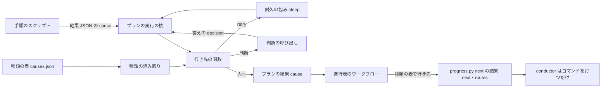
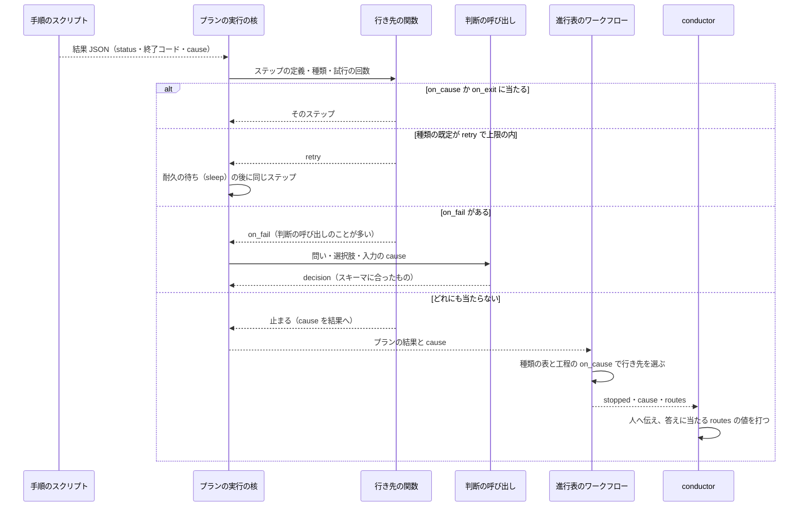

# 開発のワークフロー: 止まった理由を種類で返し、分岐と例外の行き先をスクリプトが選ぶ（#1142）

## 目的

- **今どうなっているか**: プランが止まった後の立て直し・待ちの知らせの扱い・承認の答えの後の行き先を、conductor と supervisor の AI が出力の文と手順書の表を読んで決めている。直近 30 日の会話の記録では、AI がプランの記録の文を読んだ回が 2,040 回、`--from` と `--resume` で再開点を自分で選んだ回が 983 回ある。2026-11-12 には CI の監視の「CI 以外の理由」を AI が読み、レーン lrel が手でやり直しを組んだ（#3153）
- **誰に効くか**: 並列の計画とスプリントを流す利用者と、その conductor・オーガナイザー・supervisor
- **変えると何が成り立つか**: 手順のスクリプトが止まった理由を閉じた語彙の種類で結果 JSON に返し、プランと進行表が種類の表から行き先（待って打ち直す・直す作業へ・判断の呼び出し・人へ）を機械で選ぶ。AI は、スクリプトが決められない中身（直し方・関係の有無・文書）のためだけに、スクリプトが決めた時点で、選択肢か JSON の形で呼ばれる

## 適用範囲

- **働く範囲**: NDF を使うすべてのリポジトリ。結果 JSON の契約・プランの雛形・進行表は NDF が配るため、利用先でも同じに働く
- **プロジェクトごとに違うもの**: 待って打ち直す回数と間隔の上書きは `.ndf/supervise.json` の `causes.<種類>` で受ける（既定は種類の表）。種類の語彙と既定の行き先はプロジェクトで変えない
- **当たるモード**: 5 つすべて。プランで流す工程と、並列の計画のオーガナイザーの手順に当たる

## あるべき姿の根拠

| 根拠 | 種類 | 何を示すか |
| --- | --- | --- |
| STD1・STD2 | 外部の一次情報 | ワークフローの誤りは、種類（`type`）と状態の数で表し、人の読む文（`detail`）と分ける。受け手は種類で捕まえる |
| PRD1・PRD2 | 外部の一次情報 | 耐久ワークフローの製品は、誤りの名前（種類）ごとに再試行と行き先（`Retry`・`Catch`、再試行しない種類）を定義に書き、実行の中では文を読まない |
| PRD3 | 外部の一次情報 | 手順が決まる仕事は、LLM に流れを任せず「決めたコードの経路」で LLM を呼ぶ形（workflow）が予測しやすい |
| `python3 scripts/measure/ai-branching.py --ndf /work/ai-plugins/.ndf`（2026-11-13、2026-10-14 以降） | 実測 | AI が分岐を決めた回の種類ごとの数（下の「洗い出しの一覧」） |
| 「最終的に、すべてのワークフローはスクリプトで動き、AI は補助的に呼ばれるだけなのが理想である」（2026-11-12 利用者。#3152） | 利用者の指示の原文 | 行き先をスクリプトが選び、AI は呼ばれるだけにする |

要求と受け入れ条件は #1142 の本文にある（コピーは [issue-1142-requirements.md](issue-1142-requirements.md) の「AI が判断している分岐と例外」と受け入れ条件「AI の判断からスクリプトへ」）。
この文書は主題「AI の判断からスクリプトへ」（#3152 から統合）の「どう作るか」だけを扱う。工程の粒度の分岐（次にどの工程を流すか）は
#3092 の [issue-3092-design.md](issue-3092-design.md) が持ち、この文書はその下の「工程の中の分岐と例外」を扱う。移した分岐の行き先は、
進行表の工程（#3092 のアクティビティ）とプランのステップに持たせる。判断を純粋な関数と表に寄せる形は [issue-1142-design-smells.md](issue-1142-design-smells.md) の
決定 42（判定データとデータを引く関数）と、#2990・#2963（判断を耐久の殻から切り離す）に合わせる。

## 洗い出しの一覧

### 判定の基準

| 判定 | 基準 |
| --- | --- |
| できる | 判断の入力が機械で読める値（終了コード・結果 JSON の項目・記録の行・GitHub の状態）だけで、行き先が有限の表で書ける |
| 一部できる | 行き先の候補と、候補を絞る入力の一部は機械で決まるが、残りに中身の判断（直し方・関係の有無・文の意味）が要る。機械で決まる分を移し、残りを判断の呼び出しにする |
| できない | 行き先そのものが中身の判断で決まる。呼ぶ時点と答えの形だけをスクリプトが決める（決定 59） |

### 一覧（回数の多い順）

回数の出所: 「会話」は会話の記録（`~/.claude/ndf/accounts/*/projects/-work-ai-plugins*`、5,709 ファイル）の Bash の `tool_use` と tool_result、「記録」はプランの `progress.jsonl`（459 本）、「台帳」は並列の計画の `ledger.jsonl`（p4〜p6）。期間は 2026-10-14 以降で、プランの記録と台帳は 2026-11-07 以降しか残っていない。数え方は下の「数え方」にある。

| # | 置き場 | AI が判断している内容 | 判断の入力 | 行き先の選択肢 | スクリプト化 | できない理由 | 記録上の回数 |
| --- | --- | --- | --- | --- | --- | --- | ---: |
| R01 | `development-workflow` の `agent-layers.md`「プランで流したフェーズの結果は、キューの done の `status` で読む」・`waiting.md`「終わり方」 | 止まったプランの理由を記録の文から読み取る | `report.md`・`progress.jsonl`・`NN-<ステップ>.out` の文 | 直す・再開・待つ・人へ | 一部できる | 直し方は中身の判断。理由の種類は結果 JSON で返せる | 2,040（会話: 記録を読む 1,679・出力を読む 361） |
| R02 | `loop.md` の手順の表（`loop start`・`loop sprint`・`loop lap` の終了コードと `metrics.blocked`） | 開発ループの結果の終了コードと項目から次の 1 手を選ぶ | 終了コード・`metrics` | 打ち直す・人へ戻す・ループを止める | 一部できる | 選定の中身（課題の組）は判断。行き先の表は `next` で返せる | 1,129（会話: `sprint-state.py loop`） |
| R03 | `waiting.md`「1 スプリントの流し方」手順 5・「スプリントを流すコマンド」の「どこかで止まったら」・`interrupt-resume.md` のプランの行 | 止まったプランの再開点（`queue --resume`・`run --from <ステップ>`）を選ぶ | 最後のステップの id・理由の文 | 同じステップから・別のステップから・作り直す | 一部できる | 原因を直す作業は中身。再開点は理由の種類と記録で決まる | 983（会話: `--from` 552・`--resume` 431）。記録: 途中からの実行 226 |
| R04 | `agent-layers.md`「conductor の動き」の表（`完了`・承認ゲートを示す値・`止まった`・`スイッチポイント`） | supervisor のフェーズレポートの `結果` を読み、次の起動か報告かを選ぶ | 報告の見出しと `結果`・`理由` の文 | 次のフェーズ・承認を求める・報告して終える・同じフェーズを起動し直す | 一部できる | `理由` の中身の判断。行き先の表は結果 JSON にすれば機械で引ける | 865（会話: tool_result の「結果: 止まった」419・承認ゲートを示す値 446） |
| R05 | `parallel.md`「手順」3 の `wait` の `metrics.action` の表 | 計画の待ちが返した種類ごとに次の 1 手を打つ | `metrics.action`・`metrics.next` | 問う・答えを送る・打ち直す・起こし直す・終える | 一部できる | 人へ問う中身は範囲外。問い以外の行き先は `next` で決まる | 623（会話: `parallel.py wait`） |
| R06 | `agents/supervisor.md`「落ちたら直して push する」と、手順書の外での CI の手読み | CI のチェックを `gh pr checks`・`gh run view` で読み、直す・待つ・マージを決める | チェックの名前と結論 | 直す・待つ・マージ | できる | — | 621（会話） |
| R07 | `waiting.md`「終わり方」の表（`supervise.py wait` の 0・20・3） | wait の終わり方と done の `status` から次を決める | 終了コード・`items[0].status`・`attention` の行 | 承認を求める・止めるか続けるか・同じ wait を打つ | できる | — | 553（会話: `supervise.py wait`）。記録: `attention` 211 |
| R08 | `supervise_lib/verify_steps.py` の `merge_to_ci_peek`・`judge_step`（`ci_merge`）と `merged-steps.py merge-when-green` の終了コード 1 | マージの失敗（CI のテスト・テスト以外のチェック・マージの拒否）を見分け、直すか打ち直すかを決める | 終了コード 1 と `summary` の文 | 直す・打ち直す・人へ | 一部できる | テストの直しは中身。どのチェックが落ちたかは種類で返せる | 449（会話: マージの手打ち）。記録: `merge` で止まった 18・`merge` から再開 47 |
| R09 | `verify_steps.py` の `merge_steps`（`INFRA_WAIT_STOP`）・`exit_codes.EXIT_INFRA_WAIT` | 基盤の待ち（75）で止まったプランを、いつ打ち直すかを決める | 終了コード 75・文 | 待って打ち直す・人へ | できる | — | 408（会話: tool_result の「基盤待ち」）。会話: `gh run rerun` 27 |
| R10 | `merge_steps` の `on_conflict`（渡さないプランがある）・`merged-steps.py base-sync` | 衝突（4）で止まったプランで、取り込みを手で打つか決める | 終了コード 4 | 取り込みのステップへ・人へ | できる | — | 339（会話: 取り込みの手打ち 316・記録: `merge` が 4 で止まった 23） |
| R11 | `hook_lib/token_guard.py` の文脈の上限の案内 | 会話を切る時点と、続けるか切るかを決める | 案内の文・文脈のトークン数 | 引継ぎ文書を書いて切る・続ける | 一部できる | 引継ぎ文書の中身は AI が書く。切る時点は hook が数で決められる | 198（会話: `handoff.py`） |
| R12 | `asking.md`（`AskUserQuestion` の区分 `ndf-ask:*` と印なしの問い） | 人へ問うかを決め、問いの選択肢を組む | 区分の表・状況の文 | 問う・自分で決めて記録する | 一部できる | 問いの文は AI が書く。区分（レッドライン・戻せない操作）の判定は機械で決まる | 175（会話: 印なし 107・`ndf-ask:*` 68） |
| R13 | `waiting.md` 手順 3〜6・`sprint-state.py gate` の後の「次のステージの `command` を打つ」 | 承認の答えを書いた後、どのコマンドを打つかを目録の文から選ぶ | 答え・目録のステージの `command` と `resume` | 次のステージ・`--from <プラン>=<ステップ>`・打たない | できる | 承認の判断そのものは範囲外。答えの後の行き先は表で決まる | 158（会話: `sprint-state.py gate`）。会話: 承認ゲートの問い 182 |
| R14 | `supervise_lib/slow.py` の遅れの見張り（`judge_slow`） | 遅れたステップを打ち直すか、直すか、止めるか | 一次の調査の文 | 打ち直す・直す・止める | できない | 遅れの原因を読むのは中身の判断。呼ぶ時点は既にスクリプトが決めている | 154（記録: `slow` の行）。記録: `attention` の「遅れ」19 |
| R15 | `development-workflow` の `SKILL.md`「0. worktree の設定を確かめる」の終了コードの表 | 3 つの確かめの終了コードから進むか止まるかを選ぶ | `exit=`・`decl=`・`mvv=` | 手順 1 へ・設定を用意する・止まる | できる | — | 124（会話: `worktree-setup.sh check`） |
| R16 | `parallel.md` の「終了コード 1・`action: error`」 | 耐久ワークフローが失われたときに起こし直すか決める | `metrics.action` | `parallel.py start` を打つ | できる | — | 96（会話: `parallel.py start`・`resume`） |
| R17 | `supervise_lib/design_steps.py` の `gate_steps` の `gate`（`type: judge`） | 設計のプランの最後で、設計承認ゲートへ渡すか止めるかを Claude に選ばせる | `review`・`glossary-recheck` の出力 | `gate`・`stop` | できる | — | 74（記録: `gate` の判断。70 回が `gate`） |
| R18 | `interrupt-resume.md`「conductor の中断の点検」 | 中断した supervisor と worker を誰がどう起こすかを決める | `interrupted` の出力・`SendMessage` の結果 | 続けさせる・起動し直す・待つ | 一部できる | 起こす相手と時点は記録で決まる。`SendMessage` は会話の Tool で、スクリプトから打てない | 61（会話: `SendMessage` 57・`interrupted`/`wait-reset` 4） |
| R19 | `lib/ci_watch.py` の `decide_exit`・`verify_steps.ci_watch_steps` の `ci-peek-merge`（#3153） | 終了コード 3「CI 以外の理由」の後の立て直し | 終了コード 3 と文 | `ci-fix`・待つ・人へ | できる | — | 46（会話: tool_result の「CI 以外の理由」）。記録: `ci-peek-merge` が 3 で止まった 3・`ci-watch.jsonl` の `pending` かつ `after_merge` 5 |
| R20 | `verify_steps.judge_step`・`release_templates` の judge | テストの失敗が変更に関係するかを読み、直すか先へ進むかを選ぶ | 落ちたテストの出力 | `fix`・先へ・`doc-lint`・`stop` | 一部できる | 関係の有無は中身の判断。落ちたテストのファイルと差分の照合は機械でできる | 44（記録: `fix` 28・`doc-lint` 6・`end` 6・`design-tests` 2・`release` 2） |
| R21 | 実装と設計の `work` のステップが `stopped` で終わったとき（プランが止まり conductor へ） | worker が残した欠けを読み、続けるか作り直すかを決める | 結果ファイルの `gaps` の文 | 続きの作業を起こす・人へ | できない | 欠けの中身（何が残ったか）の判断 | 32（記録: `impl` が 1 で止まった 20・`design` が 1 で止まった 12） |
| R22 | `parallel.md`「答えの後の整理」手順 3（`mvv.eligible`） | `mvv-gate.py check` を打ち、「従う」なら MVV の答えを送る | `mvv.eligible`・判定の終了コード | 答えを送る・残す | できる | — | 25（会話: `mvv-gate.py check`） |
| R23 | `pace.md` の手順の表 4（`new sprint --pace` が 1 で断った）・`attention`「スプリント MVV を使えない」 | MVV の承認に戻るか `normal` で進めるかを決める | 終了コード 1・理由の文 | 承認へ戻る・`normal` で作り直す | 一部できる | 承認へ戻るのは人の判断。`normal` の起動の形は機械で返せる | 18（記録: `attention`） |
| R24 | `stage-notes.md` の `refactor.py assess`・`workflow-modes.md` の退避の表 | `assess` の終了コードからリファクタリングを飛ばすか退避するかを決める | 終了コード 0・2・3 | 流す・飛ばす・値を直して打ち直す・退避する | できる | — | 12（会話: `refactor.py assess`） |
| R25 | `parallel.md` のリリース承認ゲートの `settle --rejected` | 中身が空・版数が出し済みのリリースを差し戻すかを決める | リリースの版・含む PR の状態 | 承認を問う・差し戻して組み直す | 一部できる | 承認するかは人。中身が空・版数の食い違いは機械で見つかる | 8（台帳: `settle` の `rejected`） |
| R26 | `agent-layers.md`「supervisor が worker の報告を見るとき」（`結果: 判断が要る`） | worker が返した判断の要る事柄を supervisor が決める | 報告の本文 | 自分で決めて続ける・conductor へ返す | できない | 判断の中身そのもの | 数えられない（結果ファイルは worktree ごとに散り、作業の後に消える。会話の中の報告の見出しは worker の手順書の引用と区別できない） |
| R27 | `workflow-modes.md` の問い 1〜5 | モードを判定する | 変更の中身 | 5 つのモード | できない | 変更の中身を読む判断 | 数えられない（判定は会話の本文に残り、Tool の呼び出しにならない） |

判定の内訳は、できる 11 件（R06・R07・R09・R10・R13・R15・R16・R17・R19・R22・R24）、一部できる 12 件（R01〜R05・R08・R11・R12・R18・R20・R23・R25）、できない 4 件（R14・R21・R26・R27）で、計 27 件である。

回数は「AI が出力を読んで次の手を決めた跡」の件数で、すべてが誤りではない。会話の数は、NDF そのものを開発した会話（同じコマンドを調べた回）を含む上限の値で、1 つのコマンドが 2 つの規則に当たればそれぞれに数える。

### 数え方

```bash
python3 scripts/measure/ai-branching.py --ndf /work/ai-plugins/.ndf --since 2026-10-14 --jobs 6
```

- プランの記録: `--ndf` と `~/.local/state/ndf` の下のすべての `progress.jsonl`。`run` の行の `from`（途中からの実行）を直前の実行の終わり方で分け、`attention` を理由ごとに、`type: judge` のステップを決定ごとに、「止まった」で終わった実行を最後のステップと終了コードの組で数える
- 台帳: `<ndf>/parallel/*/ledger.jsonl` の `ask` を `source` ごとに、`resume` の `take` と `settle` の `result` を数える
- 会話: `assistant` の行の `tool_use` を id で 1 度だけ数え、Bash のコマンドをスクリプトの `RULES` の正規表現で分ける。`AskUserQuestion` を `metadata.source` で分け、tool_result に `PHRASES` の文を含むものを数える
- 手で書いたプランの JSON（Write の `"steps"` を含む `.json`）は 0 件だった。lrel の手のやり直しは `supervise.py run 6-impl-3058.json --from merge` で、R03 に数えた

## ドメインモデル

### コンテキスト

変更は全体の設計（[issue-1142-design.md](issue-1142-design.md) の「コンテキスト」）の 2 つのコンテキストと、#3092 の進行表にまたがる。用語集の `id` はどれも `ndf-workflow` で、#3092 と同じである。

| コンテキスト | 何の語が 1 つの意味に決まるか |
| --- | --- |
| ライブラリ | 止まった理由の種類・種類の表・結果 JSON の `cause` と `routes`（答えごとの行き先） |
| プランの実行 | 行き先・再試行の方針・判断の呼び出し・ステップの `on_cause` |
| 進行表（#3092 の NDF の開発ワークフロー） | 工程の失敗の事象に載る種類・工程の行き先（`metadata.ndf.on_cause`） |

**コンテキストマップ。** 種類の表と結果 JSON の 2 つの項目は、ライブラリが持つ共有カーネルである。下流は表の語彙を写さずに読み、形を変えるときは上流の PR が下流の読み手とそのテストを同じ PR で直す（全体の設計のコンテキストマップと同じ規則）。

| 上流（契約を決める） | 下流（従う） | 関係 | 契約 |
| --- | --- | --- | --- |
| ライブラリ | プランの実行 | 共有カーネル / 順応者 | 種類の表の語彙・既定の行き先・再試行の方針と、結果 JSON の `cause`・`routes`（`lib/README.md`） |
| ライブラリ | 進行表 | 共有カーネル / 順応者 | 同じ種類の表。工程の失敗の事象（#3092 の E8）へ `cause` を写す |
| ライブラリ | 手順のスクリプトを持つほかのコンテキスト（リリース・worktree・収束ループ・文書の検査ほか） | 共有カーネル / 順応者 | `cause.kind` に表の値だけを書く（IS1） |
| プランの実行 | 進行表 | 公開ホストサービス / 順応者 | プランの結果に写した止めたステップの `cause`（#3092 の決定 10 のアクティビティの出力の規約） |
| 進行表 | Factory（`ndf-factory`） | 公開された言語 | 工程の失敗の事象に載る種類と、その標準の誤りの型（IS10） |

conductor はコンテキストではなく、`progress.py next` と承認ゲートの結果の `next`・`routes` を打つだけの読み手である。

### 集約

| 集約 | 持ち主（書き換えてよいもの） | 根 | エンティティ | 値オブジェクト |
| --- | --- | --- | --- | --- |
| 止まった理由の種類の表 | ライブラリ（結果 JSON の契約を変える PR。下流の読み手とそのテストを同じ PR で直す）。実行の中では読むだけ | 種類の表（`contracts/causes.json`） | 種類 | 既定の行き先・再試行の方針・標準の誤りの型 |
| プランの実行（既存） | `supervise_lib` の実行の核 | プランの実行 | ステップの試行 | 止まった理由・行き先の表（`on_cause`）・再試行の回数 |
| 判断の呼び出し | 判断の呼び出しの関数（`supervise_lib` の judge を置き換えるもの）。プランのステップと進行表のアクティビティは、問いと選択肢を渡して答えを受けるだけ | 判断の呼び出し | 試行（最大 2 回） | 問い・選択肢・答えのスキーマ・答え |

種類の表は、[issue-1142-design-data.md](issue-1142-design-data.md) の集約では外部の表のうちの「止まった理由の種類の表」に当たる。2 つ以上のコンテキストが読む事実を契約の表に置く規則（data の決定 45）に従うが、`contracts/facts/` の事実の表ではない（行が意味だけでなく行き先と再試行の方針を持ち、形を結果 JSON の契約と一緒に変えるため）。

### 不変条件

番号は全体の I1〜I16 と分けて `IS` を付ける。

| # | 集約 | 条件 | 破れたときの扱い |
| --- | --- | --- | --- |
| IS1 | 止まった理由の種類の表 | 結果 JSON の `cause.kind` は種類の表にある値だけである | `emit` が形の誤りとして出さず 2 で終える |
| IS2 | 結果 JSON | `cause` を置けるのは `status` が `stopped` か、`gate` で終了コードが 20〜29（判断待ち）のときだけである | 同上 |
| IS3 | プランの実行 | ステップの `on_cause` の鍵は種類の表にあり、行き先はプランのステップの id・`end`・`stop`・`retry` のどれかである | プランの検査（`on_exit_error` と同じ場所）が実行の前に断る |
| IS4 | プランの実行 | 失敗したステップの行き先は、`on_cause` → `on_exit` → 種類の既定が `retry` なら打ち直し → 種類が `unknown` なら人へ → `on_fail` → 止まる、の順で最初に当たったもので決まる。`unknown` は `on_fail` に渡さない | 表を引く 1 つの関数だけが行き先を返し、ほかに分岐を書かない |
| IS5a | プランの実行 | 打ち直しの回数は、種類ごとの上限（種類の表か、ステップの `retry` の上書き）を超えない | 上限に当たった試行を記録し、それ以上は打ち直さない |
| IS5b | プランの実行 | 上限に当たった後の行き先は、IS4 の順から打ち直しを除いた残りで決まる | IS4 と同じ関数が返す |
| IS6a | 判断の呼び出し | 選択肢のモード（`choices` を持つ）では、答えは既定の答えの形（`decision`・`reason`・`basis`）に合い、`decision` が選択肢の中にある | 1 回だけ打ち直し、なお合わなければ `cause.kind: needs_human` で止まる。答えの文から近い選択肢を拾わない |
| IS6b | 判断の呼び出し | 任意の JSON のモード（`schema` を持ち、`choices` を持たない）では、答えは指定のスキーマだけに合えばよい。`decision` の有無と所属は確かめない | IS6a と同じ |
| IS7 | プランの実行・進行表 | 行き先を選ぶ関数は `summary`・`detail`・出力の文を読まない | 構造の検査（行き先の関数の引数に文が無い）とテストで落とす |
| IS8 | 止まった理由の種類の表 | 種類を決められない止まりは `unknown` で、その既定の行き先は人へ戻すことである | AI に種類を推させない（IS4 の順で `on_fail` より先に人へ戻す） |
| IS9 | 結果 JSON | 承認ゲート（10〜19）の結果は、答えごとの次のコマンドを `routes` に持つ | `emit` が形の誤りとして出さない（`presentation_path` と同じ扱い） |
| IS10 | 止まった理由の種類の表 | 各種類は Serverless Workflow の標準の誤りの型（STD1）を 1 つ持つ | 契約の検査が落とす |

`unknown` を `on_fail` より先に人へ戻すのは、`on_fail` が種類を問わない受け皿で、`cause` を返さないスクリプトの止まりまで直すステップや判断の呼び出しへ送ってしまうためである（決定 55）。`on_cause` と `on_exit` を先に引くのは、プランの書き手がそのスクリプトの終了コードの意味を知って書いた表だからである（今の雛形にも `on_exit` の `"1"` がある）。

### ドメインイベント

番号は全体の E1〜E9（要求の「ドメインイベント」。移行の工程の事象）と分けて `ES` を付ける。ES1〜ES5 はプランと進行表の実行の中で起きる事象で、要求の E1〜E9 のどれにも当たらない。

| # | イベント | 発生元 | 受け手 |
| --- | --- | --- | --- |
| ES1 | ステップが理由の種類つきで止まった | 手順のスクリプト（結果 JSON の `cause`） | プランの実行の行き先の関数 |
| ES2 | 打ち直しを待った | プランの実行（耐久の待ち） | 同じステップ |
| ES3 | 判断の呼び出しの答えを受けた | 判断の呼び出し | プランの実行・進行表のワークフロー |
| ES4 | 人へ戻した | プランの実行か進行表のワークフロー | conductor（結果の `next`・`routes`） |
| ES5 | 工程が理由の種類つきで失敗した | 進行表のワークフロー（#3092 の E8 に `cause` を足す） | `progress.py next` の結果 |

### 用語

| 用語 | 意味 | 用語集への反映 |
| --- | --- | --- |
| 止まった理由の種類 | 手順のスクリプトとプランが止まった理由を、閉じた語彙の 1 語で表したもの。結果 JSON の `cause.kind` に入る。人の読む文（`cause.detail`）とは別で、行き先はこれだけで決まる | 追加 |
| 種類の表 | 止まった理由の種類ごとに、意味・既定の行き先・再試行の方針・標準の誤りの型を持つデータ（`plugins/ndf/contracts/causes.json`） | 追加 |
| 行き先 | 止まったステップや工程の次に進む先。プランのステップ・`retry`（待って打ち直す）・判断の呼び出し・人へのどれか | 追加 |
| 判断の呼び出し | スクリプトが決めた時点で、選択肢か JSON のスキーマを渡して AI を 1 回呼び、答えをスキーマで確かめる操作。今の `type: judge` のステップを置き換える | 追加 |
| 答えごとの行き先 | 承認ゲートと人への問いの結果に添える、答えの値から次に打つコマンドへの表（結果 JSON の `routes`） | 追加 |

## 外部の調査

| 種類 | 調べるか | 理由 |
| --- | --- | --- |
| 標準・仕様 | 調べる | 誤りを種類で表す標準（ワークフローの定義の書式と HTTP API の誤りの形）があり、#3092 が定義の書式に Serverless Workflow を借りている |
| 主要な製品 | 調べる | 耐久ワークフローの製品が、誤りの種類ごとの再試行と行き先をどう書くか。LLM のエージェントを決めた経路で呼ぶ形 |
| ライブラリとサービス | 調べる | 今使っている DBOS の再試行と耐久の待ち、Claude Code の CLI の構造化出力 |

### 標準・仕様

| # | 標準・仕様 | 何を定めているか | 設計への反映 | 出典 |
| --- | --- | --- | --- | --- |
| STD1 | Serverless Workflow DSL 1.0.3 の `Error`・Standard Error Types・`try`/`catch` | 誤りは `type`（URI）・`status`（整数）を必須とし、`title`・`detail`・`instance` を任意に持つ。標準の型は configuration・validation・expression・authentication・authorization・timeout・communication・runtime の 8 つ。`catch` は `errors`（型の絞り込み）・`when`・`retry`・`do` を持つ | 種類の表の各行に標準の型を 1 つ持たせ（IS10）、`cause` を `kind`・`detail`・`instance` の形にする（決定 54） | `gh api repos/serverlessworkflow/specification/contents/dsl-reference.md?ref=v1.0.3` の「Error」「Standard Error Types」「Catch」（2026-11-13） |
| STD2 | RFC 9457 Problem Details for HTTP APIs | RFC 7807 を廃した後継。`type`・`status`・`title`・`detail`・`instance` を持ち、知らない拡張の項目は受け手が無視する | 任意の項目を足しても既存の読み手が壊れない形にする（決定 54）。STD1 はこの形を引く | https://www.rfc-editor.org/rfc/rfc9457.html （2026-11-13） |

### 主要な製品

| # | 製品 | どう解いているか | 設計への反映 | 出典 |
| --- | --- | --- | --- | --- |
| PRD1 | AWS Step Functions（Amazon States Language） | 誤りを大文字小文字を区別する名前で表し、`Retry`（`ErrorEquals`・`MaxAttempts`・`IntervalSeconds`・`BackoffRate`）を先に、`Catch`（`ErrorEquals`・`Next`）を後に、配列の順に当てる。`States.ALL` は最後にだけ置ける。`Cause` は人の読む文 | ステップに種類ごとの行き先（`on_cause`）と再試行を書き、当てる順を固定する（IS4・決定 56） | https://docs.aws.amazon.com/step-functions/latest/dg/concepts-error-handling.html （2026-11-13） |
| PRD2 | Temporal | 再試行の方針は既定ですべてを打ち直し、`ApplicationError` の `type` が「再試行しない誤り」の一覧に当たれば打ち直さない。誤った入力のように直す要るものだけを再試行しない種類にする | 待てば解ける種類だけに再試行を持たせ、ほかは打ち直さない（決定 57） | https://docs.temporal.io/encyclopedia/retry-policies （2026-11-13） |
| PRD3 | Anthropic「Building effective agents」 | workflow は「決めたコードの経路で LLM とツールを組む」もの、agent は LLM が流れを決めるもの。手順が決まる仕事は workflow が予測しやすい。routing は入力を分類して決まった後続へ送る | 流れと行き先はスクリプト、LLM は決めた時点で呼ぶ（決定 59） | https://www.anthropic.com/engineering/building-effective-agents （2026-11-13） |
| PRD4 | LangGraph（条件つきの辺） | 経路の関数が状態を受けて次のノードの名前を返し、経路の対応表で名前をノードへ写す。`Command(goto=…)` は行き先の候補を型で宣言する | LLM の答えは選択肢の名前だけにし、名前から行き先への表はスクリプトが持つ（決定 59） | https://docs.langchain.com/oss/python/langgraph/graph-api （2026-11-13） |

### ライブラリとサービス

| # | 候補 | 版 | ライセンス | 最後のリリースの日付 | 終了のアナウンス | 要件を満たすか | 出典 |
| --- | --- | --- | --- | --- | --- | --- | --- |
| LIB1 | DBOS Transact（`dbos`）のステップの再試行と `DBOS.sleep` | 3.1.0（手元） | MIT | 2026-11-10（#3092 の設計の LIB1 と同じ） | 無し | 満たす。ステップは `retries_allowed`・`max_attempts`・`interval_seconds`・`backoff_rate`・`should_retry` を持ち、使い切ると `DBOSMaxStepRetriesExceeded` を上げる。`DBOS.sleep` は耐久の待ちで、落ちても待ちの残りから続く | https://docs.dbos.dev/python/tutorials/step-tutorial ・手元の `site-packages/dbos/_dbos.py`（2026-11-13） |
| LIB2 | Claude Code の CLI の構造化出力（`claude -p --json-schema`） | 2.1.323（手元） | 商用（Anthropic） | — | 無し | 満たす見込み。`--json-schema <schema>` が「JSON Schema for structured output」として `--help` にある。実際の振る舞いは未確認（「未確認のまま残ること」） | `claude --help`（2026-11-13） |
| LIB3 | 今の `supervise_lib/steps.py` の judge（`parse_decision` で答えの文から決定を取り出す） | 手元 | — | — | 無し | 満たさない。選択肢を文で渡し、答えの形を縛らない | `plugins/ndf/scripts/supervise_lib/steps.py` の `JudgeStep`（2026-11-13） |

### 確かめられなかったこと

| 対象 | 試した手段 | 結果と理由 |
| --- | --- | --- |
| Temporal のワークフローの側で失敗の種類から分岐する書き方 | https://docs.temporal.io/encyclopedia/retry-policies | 取得したページは再試行の方針だけを扱い、ワークフローのコードの分岐を書いていない。SDK ごとの文書は試していない |
| OpenAI の構造化出力・関数呼び出しの答えの縛り方 | 試していない | LIB2 で足りるため比べる前に外した |
| Serverless Workflow の `dsl-reference.md` の Web 表示 | https://github.com/serverlessworkflow/specification/blob/v1.0.3/dsl-reference.md | 取得した本文が途中で切れた。`gh api` で原文を取り直した（STD1） |

調べた量: 候補 9 件・取得の試み 9 回。

## 機能一覧

| # | 機能 | 誰が使うか |
| --- | --- | --- |
| F1 | 手順のスクリプトが止まった理由の種類を結果 JSON に返す | 手順のスクリプト |
| F2 | プランが止まった理由の種類から行き先を選ぶ（待って打ち直す・直すステップへ・判断の呼び出し・人へ） | プランの実行 |
| F3 | 判断の呼び出しを、選択肢か JSON のスキーマで縛って 1 回呼ぶ | プランの実行・進行表のワークフロー |
| F4 | 進行表が工程の失敗の種類から行き先を選び、conductor へ打つコマンドだけを返す | 進行表のワークフロー（#3092） |
| F5 | 承認ゲートと人への問いの結果に、答えごとの次のコマンドを添える | conductor・オーガナイザー |
| F6 | 洗い出しの回数を同じコマンドで数え直す | NDF の開発者 |

## 構成要素

| 要素 | 責務 |
| --- | --- |
| 種類の表（`plugins/ndf/contracts/causes.json`。新設） | 種類ごとの意味・既定の行き先・再試行の方針（回数・間隔・倍率・上限）・標準の誤りの型。データだけを持つ |
| 結果 JSON の契約（`lib/step_result.py`・`lib/step-result.sh`・`lib/README.md`） | 任意の項目 `cause` と `routes` の形を確かめる（IS1・IS2・IS9）。`emit` と `sr_emit` が受ける |
| 種類の読み取り（`lib/causes.py`。新設） | 種類の表を読み、結果 JSON から種類を取り出す（`cause` が無ければ終了コードから既定の種類を引く。決定 55）。純粋な処理 |
| 行き先の関数（`supervise_lib/routes.py`。新設） | ステップの定義・種類・試行の回数から行き先を返す 1 つの関数（IS4・IS5a・IS5b・IS7）。文を受けない |
| プランの実行の核（`supervise_lib/engine.py`） | 失敗したステップで行き先の関数を引き、`retry` なら耐久の待ちの後に同じステップを打つ |
| 耐久の包み（`lib/durable.py`） | `DBOS.sleep` を包む `sleep` を足す（I16 のとおり DBOS を import するのはここだけ） |
| 判断の呼び出し（`supervise_lib/steps.py` の judge の置き換え・`supervise_lib/claude.py`） | 問い・選択肢・スキーマを `claude -p --json-schema` で渡し、答えを確かめる（IS6a・IS6b） |
| 手順のスクリプト（`ci-watch.py`・`merged-steps.py` ほか子の課題が挙げるもの） | 止まるときに種類を返す |
| 進行表（#3092 の `lib/progress_model.py`・`lib/progress_run.py`） | 工程の失敗の事象に `cause` を写し、種類の表で工程の行き先を選ぶ |
| 計測（`scripts/measure/ai-branching.py`） | 洗い出しの回数を数える（作り直しの前後で同じコマンド） |



## 入出力の契約

### 結果 JSON に足す 2 つの項目（後方互換の追加）

`plugins/ndf/scripts/lib/README.md` の「手順のスクリプトの結果」の表へ、任意の項目を 2 行足す。既存の項目・`status` の 3 値・終了コードの表は変えない。
今の読み手は `status` と終了コードだけで成否を読むため（「読む側の規則」）、2 つの項目を読まない読み手は今のまま動く（STD2 の「知らない拡張は無視する」と同じ）。

| 項目 | 必須 | 形 | 意味 |
| --- | --- | --- | --- |
| `cause` | いいえ | オブジェクト。`kind`（種類の表の値）・`detail`（空でない文字列）、任意で `instance`（落ちた対象。チェックの名前・ステップの id・ファイル）・`retry_after`（打ち直してよい時刻までの秒。利用上限の解除など） | 止まった理由の種類。`stopped`、または `gate` の 20〜29 のときだけ置ける（IS2） |
| `routes` | いいえ | オブジェクト。鍵は答えの値（`approved`・`rejected` か、問いの選択肢）、値は次に打つコマンドの文字列か `null`（打たない） | 答えごとの行き先。承認ゲート（10〜19）では必ず置く（IS9）。人への問い（`cause.kind` の既定が人へ）にも置ける |

例（`ci-watch.py peek --after-merge` が、分割ジョブの失敗を読んだとき。終了コード 1）:

```json
{"tool": "ci-watch", "status": "stopped", "summary": "#3148 の CI のテストのチェックが落ちた（pytest (0/2)）",
 "items": [{"kind": "check", "name": "Python tests / pytest (0/2)", "result": "failure"}],
 "metrics": {"fixes": 1},
 "cause": {"kind": "test_failed", "detail": "Python tests / pytest (0/2) が failure", "instance": "Python tests / pytest (0/2)"}}
```

### 種類の表（`contracts/causes.json`）

| 種類 | 意味 | 標準の誤りの型（STD1） | 既定の行き先 | 再試行（回数・最初の間隔・倍率・上限） | 終了コードからの既定（`cause` が無いとき） |
| --- | --- | --- | --- | --- | --- |
| `test_failed` | テストのチェック（CI か手元）が落ちた | runtime | 判断（直すステップがあればそこへ） | — | — |
| `check_failed` | テスト以外のチェック（静的解析・文書の検査・PR の本文の検査）が落ちた | validation | 直すステップ | — | 1 |
| `ci_pending` | CI のチェックが終わっていない | timeout | 打ち直す | 10 回・60 秒・1.5・600 秒 | — |
| `infra_wait` | 基盤の待ち（Runner が付かない・API の上限） | communication | 打ち直す | 3 回・600 秒・2・3,600 秒 | 75 |
| `usage_limit` | LLM の利用上限 | communication | 打ち直す（`retry_after` まで待つ） | 1 回・`retry_after` | — |
| `base_conflict` | ベースブランチと衝突 | runtime | 取り込みのステップ | — | 4 |
| `fix_limit` | 改修・収束の回数の上限 | runtime | 人へ | — | — |
| `work_stopped` | worker が作業を終えられずに欠けを残した | runtime | 判断 | — | — |
| `deploy_failed` | CD の結果が失敗 | runtime | 人へ | — | 5 |
| `incomplete` | 手順は終わったが欠けが残る | runtime | 人へ | — | 6 |
| `precondition` | 前提が無い（宣言・認証・対象のファイル） | configuration | 人へ | — | 3 |
| `invalid` | 読めない・呼び出しの誤り | validation | 人へ | — | 2 |
| `deps_missing` | 依存の欠け | configuration | 人へ | — | 69 |
| `refused` | 不変条件で操作を断った（#3092 の I1・I4 など） | validation | 人へ | — | — |
| `not_ci` | マージが CI 以外の理由（保護の規則・権限）で断られた | authorization | 人へ | — | — |
| `needs_human` | 判断の呼び出しの答えが 2 回とも形に合わなかった | runtime | 人へ | — | — |
| `unknown` | 種類を決められない | runtime | 人へ（IS8） | — | 1 |

「判断」は判断の呼び出し（下）、「人へ」はプランを止めて結果に `cause` と `routes` を載せることである。終了コード 3 のうち「正常な否定の結果」（立たない・飛ばしてよい）は止まりではないため種類を持たない。今の `skip_to` で扱う。

### プランのステップに足す 2 つの鍵

| 鍵 | 形 | 意味 |
| --- | --- | --- |
| `on_cause` | `{"<種類>": "<ステップの id>" \| "end" \| "stop" \| "retry"}` | 種類ごとの行き先。IS4 の順で最初に引く |
| `retry` | `{"<種類>": {"max_attempts": 数, "interval": 秒, "backoff": 倍率, "max_interval": 秒}}` | 種類の表の再試行を、このステップだけ上書きする |

### 判断の呼び出しの形（`type: judge` を置き換える）

| 鍵 | 形 | 意味 |
| --- | --- | --- |
| `question` | 文字列 | 問い（今の `question` のまま） |
| `choices` | 文字列の配列 | 選べる値。プランのステップの id・`end`・`stop`・`gate` の組。スキーマの `enum` になる |
| `schema` | 契約のファイルへの参照（任意） | 選択肢で表せない答え（JSON）のスキーマ。あれば `choices` は持たない |
| `inputs` | ステップの id の配列 | 今のまま。加えて、入力のステップの結果の `cause` を構造のまま渡す |

答えの形は、選択肢のモード（`choices` を持つ）では `{"decision": "<選択肢>", "reason": "<1 行>", "basis": ["<読んだ値>"]}` で、`decision` の `enum` が選択肢になる。任意の JSON のモード（`schema` を持つ）では指定のスキーマだけで、`decision` を求めない。CLI に `--json-schema` で渡し、受けた答えを
`jsonschema` で確かめ直す（選択肢のモードは IS6a、任意の JSON のモードは IS6b）。合わなければ 1 回だけ打ち直し、なお合わなければ `cause.kind: needs_human` で止まる。

### 進行表（#3092）との受け渡し

| 受け渡し | 形 |
| --- | --- |
| プラン → アクティビティの出力 | プランの結果（done の項目）に、止めたステップの `cause` をそのまま写す。アクティビティの出力の規約（#3092 の決定 10。統一 JSON レポートを包む形）は `cause` を任意で持つ |
| アクティビティ → 工程の失敗の事象 | 進行表のワークフローは `failed` の事象（#3092 の E8）に `cause` を載せる |
| 工程の行き先 | `progress_model` の純粋な関数が、種類の表の既定の行き先と工程の定義の `metadata.ndf.on_cause`（#3092 の `metadata.ndf` の語彙へ 1 つ足す）から選ぶ。打ち直しと判断は `progress.py next` の中で済ませ、人へだけを `stopped` で返す |
| conductor へ | `progress.py next` の結果の `cause` と `routes`（例: `{"fixed": "progress.py retry <ID> <工程> --reason <理由>", "abandon": "progress.py cancel <ID> --reason <理由>"}`）。conductor は `routes` の値を打つだけで、`summary` から行き先を決めない |

## 処理の流れ



## 決定の記録

### 決定 54: 行き先を文から決めさせないため、止まった理由を結果 JSON の任意の項目 `cause` で返し、種類を閉じた語彙の表に置く

止まったときに読む値が `summary` と出力の文しかないため、AI が文を読んで行き先を決めている（R01 の 2,040 回）。種類を 1 語で返せば、プランと進行表は語の一致だけで表を引ける。
項目は `kind`・`detail`・`instance` の形にし、STD1 の `Error` と STD2 の Problem Details に揃える。Factory は標準の誤りの型で読める（IS10）。
種類の語彙は表のデータ（`contracts/causes.json`）にだけ置き、コードに種類の定数を書かない（[issue-1142-design-smells.md](issue-1142-design-smells.md) の決定 42 と「定数からデータへ」）。

`metrics` の中に種類を置く形は、`metrics` の中身がスクリプトごとに自由なため、形の検査（IS1）を掛けられず採らない。種類を URI（STD1 の `type`）で持つ形は、NDF の中で読み書きする語が長くなり、Factory との対応は表の列で足りるため採らない。

- 作り方: 自前で作る・標準に倣う
- 比べた候補: STD1 / STD2 / PRD1

根拠: Value 3 / Value 8（MVV 版 7）

### 決定 55: 既存の読み手と終了コードの契約を壊さないため、終了コードは変えず、種類を終了コードと別に持ち、`cause` の無い結果は終了コードから既定の種類を引く

終了コードは「読めない（2）」「前提が無い（3）」のように意味が広く、同じ値がスクリプトによって別の事情を表す（`ci-watch.py` の 2 は改修の上限、3 は CI 以外の理由）。種類を終了コードへ詰めると、範囲の契約（10〜19・20〜29）と衝突し、既存の `on_exit` の表がすべて読み替えになる。
そのため、終了コードは今のまま成否と大きな区分だけを表し、細かな理由は `cause.kind` が持つ。`cause` を返さないスクリプトは、種類の表の「終了コードからの既定」の列で種類を引く（1 は `unknown`）。こうすれば子の課題がスクリプトを 1 本ずつ移しても、移していないスクリプトの止まりは人へ戻るだけで、黙って誤った行き先へ進まない。

終了コードを種類ごとに足す形（例: テストの失敗を 7 にする）は、80 余りのエントリポイントの契約の `exit` と呼ぶ側の `on_exit` を一度に直すことになり、採らない。

根拠: Value 3 / Value 11（MVV 版 7）

### 決定 56: プランの行き先を表から機械で選ぶため、ステップに `on_cause` と `retry` を足し、行き先を返す関数を 1 つにして当てる順を固定する

PRD1 の `Retry` → `Catch` のように、当てる順を決めた表にすれば、同じ止まりは毎回同じ行き先へ進む。順は `on_cause` → `on_exit` → 種類の既定が打ち直しなら打ち直し → 種類が `unknown` なら人へ → `on_fail` → 止まる、とする（IS4）。`unknown` を `on_fail` より先に置くのは、`cause` を返さないスクリプトの止まりを、種類を問わない受け皿の `on_fail` へ送らないためである（決定 55・IS8）。`on_exit` を先に残すのは、今の雛形（`INFRA_WAIT_STOP`・`on_conflict`）を書き換えずに動かすためで、子の課題が `on_exit` を `on_cause` へ移した後に消す。
行き先を返すのは `supervise_lib/routes.py` の 1 つの関数だけにし、引数に文を渡さない（IS7）。今の `engine._next_after_step` の分岐は、この関数を引く形へ寄せる。

種類の既定の行き先だけで決め、ステップに表を持たせない形は、同じ種類でもプランごとに直すステップが違う（`ci-fix`・`fix`・`fix-doc`）ため採らない。`on_fail` の判断の呼び出しにすべてを任せる形は、今の judge と同じく AI が文を読むため採らない。

- 作り方: 自前で作る・標準に倣う
- 比べた候補: PRD1 / PRD2 / STD1 / LIB1

根拠: Value 3 / Value 9（MVV 版 7）

### 決定 57: 待てば解ける止まりに AI と人を使わないため、`ci_pending`・`infra_wait`・`usage_limit` はプランの中で耐久の待ちの後に打ち直す

基盤の待ちの文を読んだ回は 408 回、`gh run rerun` の手打ちは 27 回ある（R09）。いずれも、待ってから同じステップを打ち直せば済む。PRD2 と同じく、待てば解ける種類だけに打ち直しを持たせ、ほかの種類は打ち直さない。
待ちは DBOS のステップの再試行ではなく、ワークフローの中の `DBOS.sleep`（LIB1）で行う。プランのステップは 1 回の試行ごとに記録（`NN-<ステップ>.out`）を残すため、再試行をステップの中に隠すと試行の記録が 1 つにまとまってしまう。`DBOS.sleep` は `lib/durable.py` の包みを通して呼ぶ（#1142 の I16）。上限を超えたら打ち直しを外して次の順へ進む（IS5）。

DBOS のステップの `retries_allowed` に任せる形は、試行ごとの記録と `should_retry` の判定を NDF の種類の表と二重に持つため採らない。

- 作り方: ライブラリやサービスを使う
- 比べた候補: LIB1 / PRD1 / PRD2

根拠: Value 3 / Value 2（MVV 版 7）

### 決定 58: 工程の粒度とその中の行き先を食い違わせないため、プランの止まりの種類を #3092 の工程の失敗の事象へ写し、行き先を進行表の純粋な関数が選ぶ

#3092 は、次にどの工程を流すかを進行表に寄せ、工程が失敗したら `progress.py next` が `stopped` で conductor へ返す（#3092 の決定 6・7）。そのとき conductor が理由の文を読むと、この主題の問題が工程の境で残る。
そのため、プランの結果の `cause` をアクティビティの出力と `failed` の事象へそのまま写し、`progress_model` の純粋な関数が種類の表と工程の定義の `metadata.ndf.on_cause` から行き先を選ぶ（#3092 の決定 20 と同じく DBOS を import しない）。打ち直しと判断は `progress.py next` の中で済ませ、conductor へ返すのは人へ戻す止まりだけで、そのとき `routes` に打つコマンドを載せる。#3092 の `retry` は失敗の行だけに当たるため（#3092 の決定 6）、再開点を conductor が選ぶ余地は残らない（R03 の 983 回）。

止まりの扱いをプランの中だけで閉じ、工程へは成否だけを渡す形は、プランで決められない止まり（`precondition`・`refused`）の行き先を conductor が文から決めることになり採らない。

根拠: Value 3 / Value 1（MVV 版 7）

### 決定 59: 「できない」箇所の呼ぶ時点と答えの形をスクリプトが決めるため、AI を呼ぶ形を判断の呼び出し 1 つに寄せ、答えを選択肢か JSON のスキーマで縛る

AI でなければ決められない箇所（R14・R20・R21・R26・R27）は、行き先の候補が有限で、その中から選ぶ判断である。PRD3・PRD4 のとおり、流れをコードが持ち、LLM には決まった時点で選択肢を選ばせる。
呼ぶ時点は定義（プランのステップか、#3092 の工程のアクティビティ）が持ち、AI が自分で「ここで判断する」と決めない。答えは `claude -p --json-schema`（LIB2）でスキーマを渡し、受けた後に `jsonschema` で確かめ直す（CLI の振る舞いに依らないため）。入力には、前のステップの `cause` を構造のまま渡し、AI に文から種類を推させない。

今の judge（LIB3）のように答えの文から決定を取り出す形は、選択肢の外の答えや複数の候補を含む文を黙って読み替えうるため採らない。判断の箇所ごとに別の呼び出しの形を作る形は、同じ確かめを箇所の数だけ持つため採らない。

- 作り方: ライブラリやサービスを使う・標準に倣う
- 比べた候補: LIB2 / LIB3 / PRD3 / PRD4

根拠: Value 3 / Value 1（MVV 版 7）

### 決定 60: AI の答えを推して進まないため、判断の呼び出しの答えが形に合わなければ 1 回だけ打ち直し、なお合わなければ人へ戻す

答えが形に合わないのは、入力が足りないか問いが曖昧なときで、打ち直しを重ねても費用だけが増える（Value 2）。1 回の打ち直しは、出力の途切れのような一時の誤りを拾うためである。2 回とも合わなければ `cause.kind: needs_human` で止まり、問い・2 回の答え・入力の参照を結果に載せる。

答えから最も近い選択肢を選ぶ形は、AI の誤りを黙って行き先に変えるため採らない。打ち直しを上限まで繰り返す形は採らない（上の理由）。

根拠: Value 1 / Value 13（MVV 版 7）

### 決定 61: 承認の答えの後に AI が目録の文を読まないため、承認ゲートと人への問いの結果に答えごとの次のコマンド（`routes`）を必ず添える

承認の判断そのものは範囲の外だが、答えの後に打つコマンドは今、目録（`sprint.json`）のステージの `command` と `resume` の文から AI が選んでいる（R13 の 158 回）。結果に `{"approved": "<コマンド>", "rejected": "<コマンド>"}` を添えれば、conductor は答えを記録して表の値を打つだけになる。#3092 の後は、`routes` の値は `progress.py answer` と `progress.py next` になる。
人へ戻す止まり（種類の既定が人へ）にも、直した後と諦めた後の 2 つを載せる。

答えを受けたスクリプトがそのまま次を流す形は、承認ゲートの答えを AI が書く手順（`AskUserQuestion` の後の記録）と打つ手順を 1 つに混ぜ、人の答えが無いのに答えを書かない決まり（#2707）の確かめる範囲を変えるため採らない。

根拠: Value 1 / Value 3（MVV 版 7）

### 決定 62: 判定がぶれないため、洗い出しの判定を「入力が機械で読めるか」と「行き先が有限の表で書けるか」の 2 つで決める

「スクリプト化できるか」を箇所ごとの印象で決めると、同じ形の箇所で判定が割れる。入力が機械で読める値だけで、行き先が有限の表で書ければ「できる」、入力の一部に中身の判断が要れば「一部できる」、行き先そのものが中身の判断なら「できない」とする（「洗い出しの一覧」の「判定の基準」）。
「一部できる」は、機械で決まる分を `cause` と表へ移し、残りを判断の呼び出しにする。こうすれば「一部できる」も「できない」も、AI を呼ぶ時点と答えの形はスクリプトが決める。

AI の呼び出しの回数の多さで判定する形は、回数が少なくても誤りの影響が大きい箇所（R19。テストが落ちたのに直しを飛ばす）を落とすため採らない。回数は並べる順と子の課題の順序にだけ使う。

根拠: Value 3 / Value 14（MVV 版 7）

### 決定 63: 効果を同じ物差しで比べるため、回数を数えるスクリプトを `scripts/measure/ai-branching.py` に置き、作り直しの後に同じコマンドで数え直す

回数は会話の記録とプランの記録から数えるため、数え方が変わると前後を比べられない。数え方（規則の正規表現・文の一覧・期間）をスクリプトに固定し、作り直しの後に同じ規則で数え直す（要求の非機能と「計測と振り返り」と同じ扱い）。
会話の数は NDF を開発した会話も含む上限であることを、数え方の節に残す。検査（ラチェット）にはしない。会話の記録は利用者の手元にしか無く、継続的統合で読めないためである。

`turn-kinds.py`（実験版。ターンの型を数える）を広げる形は、実験版の置き場の規則（既定で動くものから参照しない）と、測るものの違い（ターンの型と、分岐の跡）から採らない。

根拠: Value 13 / Value 10（MVV 版 7）

### 決定 64: 速く効く所から届けて触るファイルを重ねないため、#3153 を先に単独で直し、種類の契約と行き先の関数を土台の子の課題にして、その上に箇所ごとの子の課題を置く

#3153（CI の監視の読み違い）は、テストが落ちたのに直しを飛ばす不具合で、種類の契約が無くても直し方 1〜3（落ちたチェックの名前の引き継ぎ・分割ジョブの照合・未完了の読み直し）で止まらなくなる。そこで #3153 は直し方 1〜3 を先に出し、直し方 4（種類で返す）は土台の子の課題 1・2 の後に子の課題 4 が引き取る。
土台（子の課題 1: 契約、子の課題 2: 行き先の関数）を先に入れれば、箇所ごとの子の課題は手順のスクリプトと雛形の 1 か所ずつを直すだけになり、並列に流せる。#3092 に依る子の課題 8 は #3092 の実装の後に置く。

箇所ごとに契約まで含めて直す形は、各子の課題が `step_result.py` と `engine.py` を同時に触り、並列に流せないため採らない。

根拠: Value 5 / Value 7（MVV 版 7）

## 子の課題の案

起票はしない。設計承認ゲートの後に conductor が起票し、先頭の設計文書（[issue-1142-design.md](issue-1142-design.md)）の「設計の結果」の表へ、番号と下の触るファイルを写す。

| 子 | 題 | 範囲（洗い出しの行） | 受け入れ条件の要点 | 触るファイル | 先に要るもの |
| --- | --- | --- | --- | --- | --- |
| 1 | 結果 JSON に止まった理由の種類と答えごとの行き先を足し、種類の表を契約に置く | R01・R13 の契約 | `cause`・`routes` の形の誤りを `emit` と `sr_emit` が出さない（IS1・IS2・IS9）。種類の表の各行が標準の誤りの型を持つ（IS10）。`cause` の無い結果で終了コードから既定の種類が引ける | `plugins/ndf/contracts/causes.json`（新設）、`plugins/ndf/scripts/lib/causes.py`（新設）、`plugins/ndf/scripts/lib/step_result.py`、`plugins/ndf/scripts/lib/step-result.sh`、`plugins/ndf/scripts/lib/README.md`、`scripts/check-ndf-contracts.py`、`plugins/ndf/scripts/tests/test_causes.py`（新設） | — |
| 2 | プランの行き先を止まった理由の種類で選び、待てば解ける止まりを打ち直す | R03・R09・R10 | 行き先の関数が IS4 の順で引き、文を受けない（IS7）。`infra_wait` と `ci_pending` が上限の内で待って打ち直され、上限の後は次の順へ進む（IS5a・IS5b）。`on_cause` の誤りを実行の前に断る（IS3） | `plugins/ndf/scripts/supervise_lib/routes.py`（新設）、`plugins/ndf/scripts/supervise_lib/engine.py`、`plugins/ndf/scripts/supervise_lib/plan.py`、`plugins/ndf/scripts/supervise_lib/limits.py`、`plugins/ndf/scripts/lib/durable.py`、`plugins/ndf/scripts/tests/test_routes.py`（新設） | 1 |
| 3（#3153。既存） | CI の監視が分割ジョブの失敗とまとめのチェックの未完了を「CI 以外の理由」と読み違える | R19 | #3153 の直し方 1〜3。直し方 4（種類で返す）は子 4 が引き取る | `plugins/ndf/scripts/lib/ci_watch.py`、`plugins/ndf/scripts/ci-watch.py`、`plugins/ndf/scripts/supervise_lib/verify_steps.py`、`plugins/ndf/scripts/tests/test_ci_watch.py` | — |
| 4 | マージと CI の監視が落ちたチェックの種類を返し、雛形が種類で直すステップへ進む | R06・R08・R19 の直し方 4 | `merge-when-green` の 1 が `test_failed`・`check_failed`・`not_ci` に分かれる。`ci-watch.py` が `test_failed`・`ci_pending` を返す。すべての雛形の `merge` が `base_conflict` で取り込みへ進む。supervisor の定義に CI を手で読む手順が残らない | `plugins/ndf/scripts/merged-steps.py`、`plugins/ndf/scripts/lib/ci_watch.py`、`plugins/ndf/scripts/ci-watch.py`、`plugins/ndf/scripts/supervise_lib/verify_steps.py`、`plugins/ndf/scripts/supervise_lib/templates.py`、`plugins/ndf/agents/supervisor.md`、`plugins/ndf/scripts/tests/test_merged_probe.py` | 1・2・3 |
| 5 | 設計のプランの最後の judge を外し、レビューの結果で設計承認ゲートへ渡す | R17 | `review` が収束し `glossary-recheck` が通れば Claude を起動せずに承認ゲートへ渡る。用語チェックの当たりは承認資料に載る | `plugins/ndf/scripts/supervise_lib/design_steps.py`、`plugins/ndf/scripts/tests/test_design_steps.py`（新設） | 1・2 |
| 6 | 判断の呼び出しの答えを選択肢か JSON のスキーマで縛る | R20（と、できない R14・R21 の呼ぶ形） | 選択肢の外とスキーマに合わない答えで 1 回打ち直し、なお合わなければ `needs_human` で止まる（IS6a・IS6b）。入力に前のステップの `cause` が構造のまま渡る。遅れの見張りと worker の止まりの後の判断も同じ形で呼ぶ | `plugins/ndf/scripts/supervise_lib/steps.py`、`plugins/ndf/scripts/supervise_lib/claude.py`、`plugins/ndf/scripts/supervise_lib/slow.py`、`plugins/ndf/scripts/supervise_lib/verify_steps.py`、`plugins/ndf/scripts/tests/test_judge_call.py`（新設） | 1・2 |
| 7 | プランの wait が止まった理由の種類と次のコマンドを返す | R07・R01 | `supervise.py wait` の結果の `next` が種類の表から決まり、`attention` の行を種類つきで返す。`waiting.md` の「終わり方」の表が `next` を打つ 1 行になる | `plugins/ndf/scripts/supervise_lib/queue.py`、`plugins/ndf/scripts/supervise_lib/state.py`、`plugins/ndf/skills/development-workflow/references/waiting.md`、`plugins/ndf/scripts/tests/test_queue_waits.py` | 1・2 |
| 8 | 進行表が工程の失敗の種類から行き先を選び、conductor へ `routes` だけを返す | R03・R04・R24 | `failed` の事象に `cause` が載り、打ち直しと判断は `progress.py next` の中で済む。conductor へ返るのは人へ戻す止まりだけで、`routes` を持つ。`assess` の終了コードの分岐が定義の条件になる | `plugins/ndf/scripts/lib/progress_model.py`（#3092 が新設）、`plugins/ndf/scripts/lib/progress_run.py`（#3092 が新設）、`plugins/ndf/contracts/workflow/schemas/report.schema.json`（#3092 が新設）、`plugins/ndf/skills/development-workflow/references/agent-layers.md`、`plugins/ndf/scripts/tests/test_progress_model.py`（#3092 が新設） | 1・2・#3092 |
| 9 | 並列の計画の待ちの結果の行き先をスクリプトが選ぶ | R05・R16・R22・R25 | `action: error` で耐久ワークフローを起こし直す。`mvv.eligible` の依頼は `answer` の中で判定を打つ。中身が空・版数が出し済みのリリースは問う前に差し戻しの候補として返る。`parallel.md` の手順 3 の表が `next` を打つ 1 行になる | `plugins/ndf/scripts/parallel.py`、`plugins/ndf/scripts/lib/parallel_cli.py`、`plugins/ndf/scripts/lib/parallel_status.py`、`plugins/ndf/skills/development-workflow/references/parallel.md`、`plugins/ndf/scripts/tests/test_parallel_routes.py`（新設） | 1 |
| 10 | 手順 0 の 3 つの確かめを 1 回の結果 JSON にまとめる | R15 | 1 つのエントリポイントが `worktree-setup.sh check`・`project-decl.py check`・`project-mvv.py check` を打ち、`next` に進む先を返す。`SKILL.md` の終了コードの表が消える | `plugins/ndf/scripts/preflight.py`（新設）、`plugins/ndf/contracts/entrypoints/plugins__ndf__scripts__preflight.py.json`（新設）、`plugins/ndf/skills/development-workflow/SKILL.md`、`plugins/ndf/scripts/tests/test_preflight.py`（新設） | 1 |
| 11 | 開発ループの副命令が行き先を `next` と `routes` で返す | R02 | `loop start`・`loop sprint`・`loop lap` の断りと止まりが種類と `routes` を返し、`loop.md` の手順の表が `next` を打つ 1 行になる | `plugins/ndf/scripts/lib/sprint_loop_cli.py`、`plugins/ndf/skills/development-workflow/references/loop.md`、`plugins/ndf/scripts/tests/test_sprint_loop.py` | 1 |
| 12 | 会話の切れ目と中断の点検の行き先を結果で返す | R11・R18 | 文脈の上限の案内が、切るか続けるかを数で決めて 1 つのコマンドを返す。`interrupted` の結果が起こす相手ごとに次の 1 手（続けさせる・起動し直す・待つ）を返す | `plugins/ndf/scripts/hook_lib/token_guard.py`、`plugins/ndf/scripts/lib/transcript_agents.py`、`plugins/ndf/skills/development-workflow/references/interrupt-resume.md`、`plugins/ndf/scripts/tests/test_token_guard.py` | 1 |
| 13 | 人へ問う時点と問いの選択肢を結果から組み、答えの後は `routes` を打つ | R12・R13・R23 | 承認ゲートと判断待ちの結果に `routes` があり、conductor は答えを記録して値を打つ。問いの区分（レッドライン・戻せない操作）と選択肢を結果が持つ。`new sprint --pace` の断りが `normal` の起動を `routes` で返す | `plugins/ndf/scripts/sprint-state.py`、`plugins/ndf/scripts/lib/ask_policy.py`、`plugins/ndf/scripts/supervise_lib/new_args.py`、`plugins/ndf/skills/development-workflow/references/asking.md`、`plugins/ndf/scripts/tests/test_routes_answer.py`（新設） | 1 |

洗い出しの「できる」「一部できる」の 23 件は、それぞれ上の子のどれかの範囲に入る（R01→7、R02→11、R03→2・8、R04→8、R05→9、R06→4、R07→7、R08→4、R09→2、R10→2、R11→12、R12→13、R13→1・13、R15→10、R16→9、R17→5、R18→12、R19→3・4、R20→6、R22→9、R23→13、R24→8、R25→9）。
「できない」の 4 件のうち R14・R21 は子 6 が呼ぶ形を決め、R26（worker の「判断が要る」）と R27（モードの判定）は、結果ファイル（`ok`・`gate`・`stopped`）とモードの判定の出力（`supervise.py new` の `--mode`）が既に答えの形を決めているため子を置かない。

## テスト設計

| 受け入れ条件・不変条件 | どの振る舞いで縛るか | どう壊したら落ちるべきか |
| --- | --- | --- |
| 受け入れ条件「洗い出しの一覧」「回数の多い順」 | この文書の一覧と `scripts/measure/ai-branching.py` の出力の数が一致する（設計レビューで見る。`.md` の文言のテストは書かない） | — |
| 受け入れ条件「止まった理由を種類で返し、行き先をプランが機械で選ぶ」・IS4・IS7 | 同じ種類で `summary` だけを変えた 2 つの結果で、行き先が同じになる。`on_cause`・`on_exit`・既定・`on_fail` を同時に持つステップで IS4 の順に当たる | 行き先の関数に `summary` を渡す・順を入れ替える |
| 受け入れ条件「できない箇所の呼ぶ時点と答えの形」・IS6a・IS6b | 選択肢のモードで、選択肢の外の答えで 1 回打ち直し、2 回目も外なら `needs_human` で止まる。選択肢の中の答えで次のステップへ進む。任意の JSON のモードで、`decision` を持たずにスキーマに合う答えを受けて進み、スキーマに合わない答えが 2 回続けば `needs_human` で止まる | 答えの文から近い選択肢を拾う・打ち直しを外す・任意の JSON のモードでも `decision` を求める |
| IS1・IS2 | 表に無い `kind`、`ok` に添えた `cause` を `emit` が出さず 2 で終える | 検査を外す |
| IS3 | 表に無い種類を鍵に持つ `on_cause` のプランが実行の前に断られる | 実行の途中で初めて気づく |
| IS5a・IS5b・決定 57 | `infra_wait` が上限の回数まで打ち直され、上限の後は `on_fail` か止まりへ進む。待ちの途中で落としても、続きの待ちから再開する | 上限を外す・待ちを前景の `time.sleep` にする |
| IS4・IS8・決定 55 | `cause` の無い終了コード 1 の結果が `unknown` になり、`on_fail` を持つステップでも人へ戻る | 既定を打ち直しや `on_fail` にする・`unknown` の判定を `on_fail` の後へ置く |
| IS9・決定 61 | 承認ゲートの結果に `routes` が無いと `emit` が出さない。`routes` の値が打てるコマンドである | `routes` を任意にする |
| IS10 | 種類の表の各行が STD1 の 8 つの型のどれかを持つことを契約の検査が確かめる | 型の列を空にする |
| 決定 58 | プランの `cause` が `failed` の事象に写り、`progress.py next` が打ち直しの種類を conductor へ返さずに済ませる | 事象に `cause` を写さない |
| #3153 | 分割ジョブの失敗とまとめのチェックの未完了で、`ci-peek-merge` が `ci-fix` へ進む | 名前の完全一致に戻す |

## 人へ残す判断

無し

## 未確認のまま残ること

| 項目 | 内容 |
| --- | --- |
| `claude -p --json-schema` の振る舞い | `--help` に項目があることだけを確かめた。ラッパー（`relay.py`）の下と、`supervise_lib/claude.py` の起動の形で答えが縛られるかは、子 6 の実装で 1 回打って確かめる。縛られなくても `jsonschema` の確かめ直し（決定 59）で IS6a・IS6b は守れる |
| 種類の分布 | 今の止まりのうち、終了コードから既定の種類を引くと `unknown` になる割合は分からない（今の記録に種類が無い）。子 1・2 のリリースの後に同じスクリプトで数え、`unknown` が多い手順のスクリプトから子 4 以降で種類を返させる |
| 会話の数の重なり | 会話の数は NDF を開発した会話を含む上限である。どれだけが開発の会話かは分けていない。作り直しの後も同じ規則で数えるため、前後の比較には使える |
| 待ちの上限の値 | 種類の表の再試行の回数と間隔（`ci_pending` 10 回・60 秒、`infra_wait` 3 回・600 秒）は今の CI の所要と基盤の待ちの記録からの見積りで、実測していない。子 2 のリリースの後に、上限に当たった回を記録から数えて直す |
