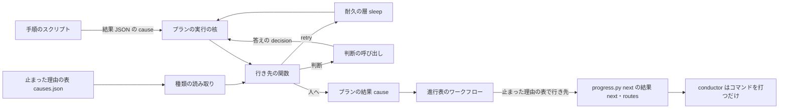
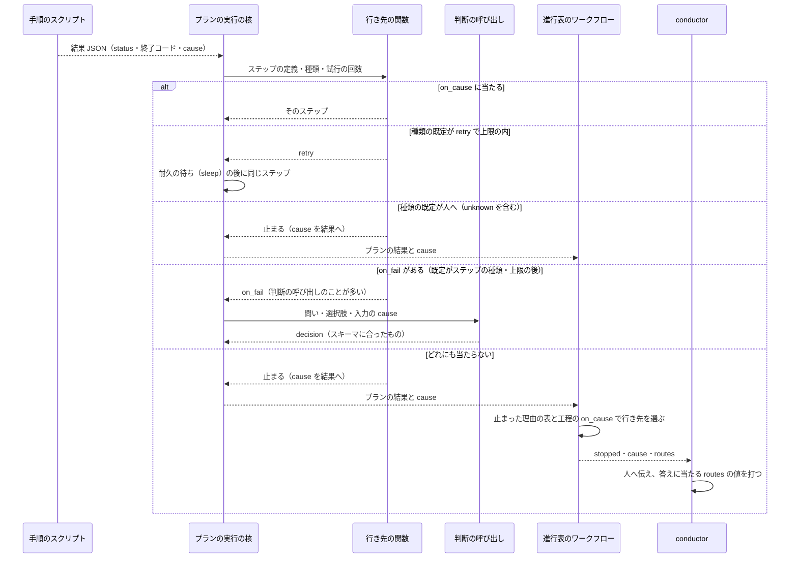

# 開発のワークフロー: 止まった理由を種類で返し、分岐と例外の行き先をスクリプトが選ぶ（#1142）

## 目的

- **今どうなっているか**: プランが止まった後の立て直し・待ちの知らせの扱い・承認の答えの後の行き先を、conductor と supervisor の AI が出力の文と手順書の表を読んで決めている。直近 30 日の会話の記録では、AI がプランの記録の文を読んだ回が 2,040 回、`--from` と `--resume` で再開点を自分で選んだ回が 983 回ある。2026-11-12 には CI の監視の「CI 以外の理由」を AI が読み、レーン lrel が手でやり直しを組んだ（#3153）
- **誰に効くか**: 並列の計画とスプリントを流す利用者と、その conductor・オーガナイザー・supervisor
- **変えると何が成り立つか**: 手順のスクリプトが止まった理由を閉じた語彙の種類で結果 JSON に返し、プランと進行表が止まった理由の表から行き先（待って打ち直す・直す作業へ・判断の呼び出し・人へ）を機械で選ぶ。AI は、スクリプトが決められない中身（直し方・関係の有無・文書）のためだけに、スクリプトが決めた時点で、選択肢か JSON の形で呼ばれる

## 適用範囲

- **働く範囲**: NDF を使うすべてのリポジトリ。結果 JSON の契約・プランのテンプレート・進行表は NDF が配るため、利用先でも同じに働く
- **プロジェクトごとに違うもの**: 待って打ち直す回数と間隔の上書きは `.ndf/supervise.json` の `causes.<種類>` で受ける（既定は上限の宣言 `contracts/limits.json` の `cause.<種類>` の方針）。種類の語彙・終了コード・既定の行き先はプロジェクトで変えない
- **当たるモード**: 5 つすべて。プランで流す工程と、並列の計画のオーガナイザーの手順に当たる

## あるべき姿の根拠

| 根拠 | 種類 | 何を示すか |
| --- | --- | --- |
| STD1・STD2 | 外部の一次情報 | ワークフローの誤りは、種類（`type`）と状態の数で表し、人の読む文（`detail`）と分ける。受け手は種類で捕まえる |
| PRD1・PRD2 | 外部の一次情報 | 耐久ワークフローの製品は、誤りの名前（種類）ごとに再試行と行き先（`Retry`・`Catch`、再試行しない種類）を定義に書き、実行の中では文を読まない |
| PRD3 | 外部の一次情報 | 手順が決まる仕事は、LLM に流れを任せず「決めたコードの経路」で LLM を呼ぶ形（workflow）が予測しやすい |
| `python3 scripts/measure/ai-branching.py --ndf /work/ai-plugins/.ndf`（2026-11-13、2026-10-14 以降） | 実測 | AI が分岐を決めた回の種類ごとの数（下の「洗い出しの一覧」） |
| 「最終的に、すべてのワークフローはスクリプトで動き、AI は補助的に呼ばれるだけなのが理想である」（2026-11-12 利用者。#3152） | 利用者の指示の原文 | 行き先をスクリプトが選び、AI は呼ばれるだけにする |

要求と受け入れ条件は #1142 の本文にある。コピーは [issue-1142-requirements.md](issue-1142-requirements.md) の「AI が判断している分岐と例外」と、受け入れ条件「AI の判断からスクリプトへ」にある。
この文書は、主題「AI の判断からスクリプトへ」（#3152 から統合）の「どう作るか」だけを扱う。隣の設計との分担は次のとおりである。

| 何を | どこが持つか |
| --- | --- |
| 工程の粒度の分岐（次にどの工程を流すか） | #3092 の [issue-3092-design.md](issue-3092-design.md) |
| その下の、工程の中の分岐と例外 | この文書。移した分岐の行き先は、進行表の工程（#3092 のアクティビティ）とプランのステップに持たせる |
| 判断を純粋な関数と表に寄せる形 | [issue-1142-design-smells.md](issue-1142-design-smells.md) の決定 42（判定データとデータを引く関数）と、#2990・#2963（判断を耐久ワークフローの層から切り離す）。この文書はそれに合わせる |

## 洗い出しの一覧

### 判定の基準

| 判定 | 基準 |
| --- | --- |
| できる | 判断の入力が機械で読める値（終了コード・結果 JSON の項目・記録の行・GitHub の状態）だけで、行き先が有限の表で書ける |
| 一部できる | 行き先の候補と、候補を絞る入力の一部は機械で決まるが、残りに中身の判断（直し方・関係の有無・文の意味）が要る。機械で決まる分を移し、残りを判断の呼び出しにする |
| できない | 行き先そのものが中身の判断で決まる。呼ぶ時点と答えの形だけをスクリプトが決める（決定 59） |

### 一覧（回数の多い順）

回数の出所は次の 3 つで、期間は 2026-10-14 以降である。プランの記録と台帳は 2026-11-07 以降しか残っていない。数え方は下の「数え方」にある。

| 列の語 | 出所 |
| --- | --- |
| 会話 | 会話の記録（`~/.claude/ndf/accounts/*/projects/-work-ai-plugins*`、5,709 ファイル）の Bash の `tool_use` と tool_result |
| 記録 | プランの `progress.jsonl`（459 本） |
| 台帳 | 並列の計画の `ledger.jsonl`（p4〜p6） |

| # | 置き場 | AI が判断している内容 | 判断の入力 | 行き先の選択肢 | スクリプト化 | できない理由 | 記録上の回数 |
| --- | --- | --- | --- | --- | --- | --- | ---: |
| R01 | `development-workflow` の `agent-layers.md`「プランで流したフェーズの結果は、キューの done の `status` で読む」・`waiting.md`「終わり方」 | 止まったプランの理由を記録の文から読み取る | `report.md`・`progress.jsonl`・`NN-<ステップ>.out` の文 | 直す・再開・待つ・人へ | 一部できる | 直し方は中身の判断。理由の種類は結果 JSON で返せる | 2,040（会話: 記録を読む 1,679・出力を読む 361） |
| R02 | `loop.md` の手順の表（`loop start`・`loop sprint`・`loop lap` の終了コードと `metrics.blocked`） | 開発ループの結果の終了コードと項目から次の 1 手を選ぶ | 終了コード・`metrics` | 打ち直す・人へ戻す・ループを止める | 一部できる | 選定の中身（Issue の組）は判断。行き先の表は `next` で返せる | 1,129（会話: `sprint-state.py loop`） |
| R03 | `waiting.md`「1 スプリントの流し方」手順 5・「スプリントを流すコマンド」の「どこかで止まったら」・`interrupt-resume.md` のプランの行 | 止まったプランの再開点（`queue --resume`・`run --from <ステップ>`）を選ぶ | 最後のステップの id・理由の文 | 同じステップから・別のステップから・作り直す | 一部できる | 原因を直す作業は中身。再開点は理由の種類と記録で決まる | 983（会話: `--from` 552・`--resume` 431）。記録: 途中からの実行 226 |
| R04 | `agent-layers.md`「conductor の動き」の表（`完了`・承認ゲートを示す値・`止まった`・`スイッチポイント`） | supervisor のフェーズレポートの `結果` を読み、次の起動か報告かを選ぶ | 報告の見出しと `結果`・`理由` の文 | 次のフェーズ・承認を求める・報告して終える・同じフェーズを起動し直す | 一部できる | `理由` の中身の判断。行き先の表は結果 JSON にすれば機械で引ける | 865（会話: tool_result の「結果: 止まった」419・承認ゲートを示す値 446） |
| R05 | `parallel.md`「手順」3 の `wait` の `metrics.action` の表 | 計画の待ちが返した種類ごとに次の 1 手を打つ | `metrics.action`・`metrics.next` | 問う・答えを送る・打ち直す・起動し直す・終える | 一部できる | 人へ問う中身は範囲外。問い以外の行き先は `next` で決まる | 623（会話: `parallel.py wait`） |
| R06 | `agents/supervisor.md`「落ちたら直して push する」と、手順書の外での CI の手読み | CI のチェックを `gh pr checks`・`gh run view` で読み、直す・待つ・マージを決める | チェックの名前と結論 | 直す・待つ・マージ | できる | — | 621（会話） |
| R07 | `waiting.md`「終わり方」の表（`supervise.py wait` の 0・20・3） | wait の終わり方と done の `status` から次を決める | 終了コード・`items[0].status`・`attention` の行 | 承認を求める・止めるか続けるか・同じ wait を打つ | できる | — | 553（会話: `supervise.py wait`）。記録: `attention` 211 |
| R08 | `supervise_lib/verify_steps.py` の `merge_to_ci_peek`・`judge_step`（`ci_merge`）と `merged-steps.py merge-when-green` の終了コード 1 | マージの失敗（CI のテスト・テスト以外のチェック・マージの拒否）を見分け、直すか打ち直すかを決める | 終了コード 1 と `summary` の文 | 直す・打ち直す・人へ | 一部できる | テストの直しは中身。どのチェックが落ちたかは種類で返せる | 449（会話: マージの手打ち）。記録: `merge` で止まった 18・`merge` から再開 47 |
| R09 | `verify_steps.py` の `merge_steps`（`INFRA_WAIT_STOP`）・`exit_codes.EXIT_INFRA_WAIT` | 基盤の待ち（75）で止まったプランを、いつ打ち直すかを決める | 終了コード 75・文 | 待って打ち直す・人へ | できる | — | 408（会話: tool_result の「基盤待ち」）。会話: `gh run rerun` 27 |
| R10 | `merge_steps` の `on_conflict`（渡さないプランがある）・`merged-steps.py base-sync` | 衝突（4）で止まったプランで、取り込みを手で打つか決める | 終了コード 4 | 取り込みのステップへ・人へ | できる | — | 339（会話: 取り込みの手打ち 316・記録: `merge` が 4 で止まった 23） |
| R11 | `hook_lib/token_guard.py` の文脈の上限の案内 | 会話を切る時点と、続けるか切るかを決める | 案内の文・文脈のトークン数 | 引継ぎ文書を書いて切る・続ける | 一部できる | 引継ぎ文書の中身は AI が書く。切る時点は hook が数で決められる | 198（会話: `handoff.py`） |
| R12 | `asking.md`（`AskUserQuestion` の区分 `ndf-ask:*` と区分なしの問い） | 人へ問うかを決め、問いの選択肢を組む | 区分の表・状況の文 | 問う・自分で決めて記録する | 一部できる | 問いの文は AI が書く。区分（レッドライン・戻せない操作）の判定は機械で決まる | 175（会話: 区分なし 107・`ndf-ask:*` 68） |
| R13 | `waiting.md` 手順 3〜6・`sprint-state.py gate` の後の「次のステージの `command` を打つ」 | 承認の答えを書いた後、どのコマンドを打つかを目録の文から選ぶ | 答え・目録のステージの `command` と `resume` | 次のステージ・`--from <プラン>=<ステップ>`・打たない | できる | 承認の判断そのものは範囲外。答えの後の行き先は表で決まる | 158（会話: `sprint-state.py gate`）。会話: 承認ゲートの問い 182 |
| R14 | `supervise_lib/slow.py` の遅れの見張り（`judge_slow`） | 遅れたステップを打ち直すか、直すか、止めるか | 一次の調査の文 | 打ち直す・直す・止める | できない | 遅れの原因を読むのは中身の判断。呼ぶ時点は既にスクリプトが決めている | 154（記録: `slow` の行）。記録: `attention` の「遅れ」19 |
| R15 | `development-workflow` の `SKILL.md`「0. worktree の設定を確かめる」の終了コードの表 | 3 つの確かめの終了コードから進むか止まるかを選ぶ | `exit=`・`decl=`・`mvv=` | 手順 1 へ・設定を用意する・止まる | できる | — | 124（会話: `worktree-setup.sh check`） |
| R16 | `parallel.md` の「終了コード 1・`action: error`」 | 耐久ワークフローが失われたときに起動し直すか決める | `metrics.action` | `parallel.py start` を打つ | できる | — | 96（会話: `parallel.py start`・`resume`） |
| R17 | `supervise_lib/design_steps.py` の `gate_steps` の `gate`（`type: judge`） | 設計のプランの最後で、設計承認ゲートへ渡すか止めるかを Claude に選ばせる | `review`・`glossary-recheck` の出力 | `gate`・`stop` | できる | — | 74（記録: `gate` の判断。70 回が `gate`） |
| R18 | `interrupt-resume.md`「conductor の中断の点検」 | 中断した supervisor と worker を誰がどう起こすかを決める | `interrupted` の出力・`SendMessage` の結果 | 続けさせる・起動し直す・待つ | 一部できる | 起こす相手と時点は記録で決まる。`SendMessage` は会話の Tool で、スクリプトから打てない | 61（会話: `SendMessage` 57・`interrupted`/`wait-reset` 4） |
| R19 | `lib/ci_watch.py` の `decide_exit`・`verify_steps.ci_watch_steps` の `ci-peek-merge`（#3153） | 終了コード 3「CI 以外の理由」の後の立て直し | 終了コード 3 と文 | `ci-fix`・待つ・人へ | できる | — | 46（会話: tool_result の「CI 以外の理由」）。記録: `ci-peek-merge` が 3 で止まった 3・`ci-watch.jsonl` の `pending` かつ `after_merge` 5 |
| R20 | `verify_steps.judge_step`・`release_templates` の judge | テストの失敗が変更に関係するかを読み、直すか先へ進むかを選ぶ | 落ちたテストの出力 | `fix`・先へ・`doc-lint`・`stop` | 一部できる | 関係の有無は中身の判断。落ちたテストのファイルと差分の照合は機械でできる | 44（記録: `fix` 28・`doc-lint` 6・`end` 6・`design-tests` 2・`release` 2） |
| R21 | 実装と設計の `work` のステップが `stopped` で終わったとき（プランが止まり conductor へ） | worker が残した欠けを読み、続けるか作り直すかを決める | 結果ファイルの `gaps` の文 | 続きの作業を起こす・人へ | できない | 欠けの中身（何が残ったか）の判断 | 32（記録: `impl` が 1 で止まった 20・`design` が 1 で止まった 12） |
| R22 | `parallel.md`「答えの後の整理」手順 3（`mvv.eligible`） | `mvv-gate.py check` を打ち、「従う」なら MVV の答えを送る | `mvv.eligible`・判定の終了コード | 答えを送る・残す | できる | — | 25（会話: `mvv-gate.py check`） |
| R23 | `pace.md` の手順の表 4（`new sprint --pace` が 1 で断った）・`attention`「スプリント MVV を使えない」 | MVV の承認に戻るか `normal` で進めるかを決める | 終了コード 1・理由の文 | 承認へ戻る・`normal` で作り直す | 一部できる | 承認へ戻るのは人の判断。`normal` の起動の形は機械で返せる | 18（記録: `attention`） |
| R24 | `stage-notes.md` の `refactor.py assess`・`workflow-modes.md` の退避の表 | `assess` の終了コードからリファクタリングを飛ばすか退避するかを決める | 終了コード 0・2・3 | 流す・飛ばす・値を直して打ち直す・退避する | できる | — | 12（会話: `refactor.py assess`） |
| R25 | `parallel.md` のリリース承認ゲートの `settle --rejected` | 中身が空・版数が出し済みのリリースを差し戻すかを決める | リリースの版・含む PR の状態 | 承認を問う・差し戻して組み直す | 一部できる | 承認するかは人。中身が空・版数の食い違いは機械で見つかる | 8（台帳: `settle` の `rejected`） |
| R26 | `agent-layers.md`「supervisor が worker の報告を見るとき」（`結果: 判断が要る`） | worker が返した判断の要る事柄を supervisor が決める | 報告の本文 | 自分で決めて続ける・conductor へ返す | できない | 判断の中身そのもの | 数えられない（結果ファイルは worktree ごとに散り、作業の後に消える。会話の中の報告の見出しは worker の手順書の引用と区別できない） |
| R27 | `workflow-modes.md` の問い 1〜5 | モードを判定する | 変更の中身 | 5 つのモード | できない | 変更の中身を読む判断 | 数えられない（判定は会話の本文に残り、Tool の呼び出しにならない） |

判定の内訳は次のとおりで、計 27 件である。

| 判定 | 件数 | 行 |
| --- | ---: | --- |
| できる | 11 | R06・R07・R09・R10・R13・R15・R16・R17・R19・R22・R24 |
| 一部できる | 12 | R01〜R05・R08・R11・R12・R18・R20・R23・R25 |
| できない | 4 | R14・R21・R26・R27 |

回数は「AI が出力を読んで次の手を決めた跡」の件数で、すべてが誤りではない。会話の数は、NDF そのものを開発した会話（同じコマンドを調べた回）を含む上限の値で、1 つのコマンドが 2 つの規則に当たればそれぞれに数える。

### 数え方

```bash
python3 scripts/measure/ai-branching.py --ndf /work/ai-plugins/.ndf --since 2026-10-14 --jobs 6
```

- プランの記録: `--ndf` と `~/.local/state/ndf` の下のすべての `progress.jsonl` を読む。`run` の行の `from`（途中からの実行）は、直前の実行の終わり方で分けて数える。`attention` は理由ごとに、`type: judge` のステップは決定ごとに数える。「止まった」で終わった実行は、最後のステップと終了コードの組で数える
- 台帳: `<ndf>/parallel/*/ledger.jsonl` の `ask` を `source` ごとに、`resume` の `take` と `settle` の `result` を数える
- 会話: `assistant` の行の `tool_use` を id で 1 度だけ数え、Bash のコマンドをスクリプトの `RULES` の正規表現で分ける。`AskUserQuestion` を `metadata.source` で分け、tool_result に `PHRASES` の文を含むものを数える
- 手で書いたプランの JSON（Write の `"steps"` を含む `.json`）は 0 件だった。lrel の手のやり直しは `supervise.py run 6-impl-3058.json --from merge` で、R03 に数えた

## ドメインモデル

### コンテキスト

変更は全体の設計（[issue-1142-design.md](issue-1142-design.md) の「コンテキスト」）の 2 つのコンテキストと、#3092 の進行表にまたがる。用語集の `id` はどれも `ndf-workflow` で、#3092 と同じである。

| コンテキスト | 何の語が 1 つの意味に決まるか |
| --- | --- |
| ライブラリ | 止まった理由の種類・止まった理由の表・結果 JSON の `cause` と `routes`（答えごとの行き先） |
| プランの実行 | 行き先・再試行の方針・判断の呼び出し・ステップの `on_cause` |
| 進行表（#3092 の NDF の開発ワークフロー） | 工程の失敗の事象に載る種類・工程の行き先（`metadata.ndf.on_cause`） |

**コンテキストマップ。** 止まった理由の表と結果 JSON の 2 つの項目は、ライブラリが持つ共有カーネルである。下流は表の語彙をコピーせずに読み、形を変えるときは上流の PR が下流の読み手とそのテストを同じ PR で直す（全体の設計のコンテキストマップと同じ規則）。

| 上流（契約を決める） | 下流（従う） | 関係 | 契約 |
| --- | --- | --- | --- |
| ライブラリ | プランの実行 | 共有カーネル / 順応者 | 止まった理由の表の語彙・既定の行き先・再試行の方針と、結果 JSON の `cause`・`routes`（`lib/README.md`） |
| ライブラリ | 進行表 | 共有カーネル / 順応者 | 同じ止まった理由の表。工程の失敗の事象（#3092 の E8）へ `cause` をコピーする |
| ライブラリ | 手順のスクリプトを持つほかのコンテキスト（リリース・worktree・収束ループ・文書の検査ほか） | 共有カーネル / 順応者 | `cause.kind` に表の値だけを書く（IS1） |
| プランの実行 | 進行表 | 公開ホストサービス / 順応者 | プランの結果にコピーした、止めたステップの `cause`（#3092 の決定 10 のアクティビティの出力の規約） |
| 進行表 | Factory（`ndf-factory`） | 公開された言語 | 工程の失敗の事象に載る種類と、その標準の誤りの型（IS10） |

conductor はコンテキストではなく、`progress.py next` と承認ゲートの結果の `next`・`routes` を打つだけの読み手である。

### 集約

| 集約 | 持ち主（書き換えてよいもの） | 根 | エンティティ | 値オブジェクト |
| --- | --- | --- | --- | --- |
| 止まった理由の表 | ライブラリ（結果 JSON の契約を変える PR。下流の読み手とそのテストを同じ PR で直す）。実行の中では読むだけ | 止まった理由の表（`contracts/causes.json`） | 種類 | 終了コード・既定の行き先・再試行の方針の名前（値は上限の宣言）・標準の誤りの型 |
| プランの実行（既存） | `supervise_lib` の実行の核 | プランの実行 | ステップの試行 | 止まった理由・行き先の表（`on_cause`）・再試行の回数 |
| 判断の呼び出し | 判断の呼び出しの関数（`supervise_lib` の judge を置き換えるもの）。プランのステップと進行表のアクティビティは、問いと選択肢を渡して答えを受けるだけ | 判断の呼び出し | 試行（最大 2 回） | 問い・選択肢・答えのスキーマ・答え |

止まった理由の表は、[issue-1142-design-data.md](issue-1142-design-data.md) の集約では外部の表の 1 つに当たる。名前は #3144 の「設計文書の種類の契約」（`contracts/design-docs.json`）と紛れないよう、「種類の表」と呼ばない。2 つ以上のコンテキストが読む事実を契約の表に置く規則（data の決定 45）には従う。ただし `contracts/facts/` の事実の表ではない。行が意味だけでなく行き先と再試行の方針を持ち、形を結果 JSON の契約と一緒に変えるためである。

### 不変条件

番号は全体の I1〜I16 と分けて `IS` を付ける。

| # | 集約 | 条件 | 破れたときの扱い |
| --- | --- | --- | --- |
| IS1 | 止まった理由の表 | 結果 JSON の `cause.kind` は止まった理由の表にある値だけである | `emit` が形の誤りとして出さず 2 で終える |
| IS2 | 結果 JSON | `status` が `stopped` の結果は必ず `cause` を持ち、`ok` と `gate` の結果は持たない | 同上 |
| IS3 | プランの実行 | ステップの `on_cause` と `exit_cause` の値の種類は止まった理由の表にあり、`on_cause` の行き先はプランのステップの id・`end`・`stop`・`retry` のどれかである | プランの検査が実行の前に断る |
| IS4 | プランの実行 | 失敗したステップの行き先は、`on_cause` → 種類の既定の行き先 → `on_fail` → 止まる、の順で最初に当たったもので決まる。種類の既定の行き先は、打ち直し（上限の内）と人へをここで決め、既定がステップ（直すステップ・取り込みのステップ・判断）の種類は次の `on_fail` へ進む。既定が人への種類（`unknown` を含む）は `on_fail` に渡さない | 表を引く 1 つの関数だけが行き先を返し、ほかに分岐を書かない |
| IS5a | プランの実行 | 打ち直しの回数は、種類ごとの上限（止まった理由の表か、ステップの `retry` の上書き）を超えない | 上限に当たった試行を記録し、それ以上は打ち直さない |
| IS5b | プランの実行 | 上限に当たった後の行き先は、IS4 の順から打ち直しを除いた残りで決まる | IS4 と同じ関数が返す |
| IS6a | 判断の呼び出し | 選択肢のモード（`choices` を持つ）では、答えは既定の答えの形（`decision`・`reason`・`basis`）に合い、`decision` が選択肢の中にある | 1 回だけ打ち直し、なお合わなければ `cause.kind: needs_human` で止まる。答えの文から近い選択肢を拾わない |
| IS6b | 判断の呼び出し | 任意の JSON のモード（`schema` を持ち、`choices` を持たない）では、答えは指定のスキーマだけに合えばよい。`decision` の有無と所属は確かめない | IS6a と同じ |
| IS7 | プランの実行・進行表 | 行き先を選ぶ関数は `summary`・`detail`・出力の文を読まない | 構造の検査（行き先の関数の引数に文が無い）とテストで落とす |
| IS8 | 止まった理由の表 | 種類を決められない止まりは `unknown` で、その既定の行き先は人へ戻すことである | AI に種類を推させない（IS4 の順で `on_fail` より先に人へ戻す） |
| IS9 | 結果 JSON | 承認ゲート（10〜19）の結果は、答えごとの次のコマンドを `routes` に持つ | `emit` が形の誤りとして出さない（`presentation_path` と同じ扱い）。`routes` の項目は、承認ゲートを返す 7 本のエントリポイントをすべて直す子 Issue で、必須の形のまま足す |
| IS10 | 止まった理由の表 | 各種類は Serverless Workflow の標準の誤りの型（STD1）を 1 つ持つ | 契約の検査が落とす |
| IS11 | 止まった理由の表 | 各種類は終了コードを 1 つだけ持ち、その値は `stopped` の終了コード（`exit_codes.STOPPED_CODES`）にある。`stopped` の終了コードは `cause.kind` から引き、手順のスクリプトは別に渡さない | 契約の検査が落とす。`emit` は種類と食い違う終了コードを形の誤りにする |
| IS12 | 結果 JSON | `stopped` の結果が `gaps` を持つことと、`cause.kind` が `incomplete` であることは同じである | `emit` が形の誤りとして出さない |

既定が人への種類（`unknown` を含む）は、`on_fail` より先に人へ戻す（決定 55）。`on_fail` は種類を問わないフォールバックである。そこへ送ると、上限に当たった止まりや種類を決められない止まり（例外・結果 JSON を出さない外部のコマンド）まで、直すステップや判断の呼び出しへ進んでしまう。`on_cause` を先に引くのは、プランの書き手がそのステップの止まりの意味を知って書いた表だからである。

### ドメインイベント

番号は全体の E1〜E9（要求の「ドメインイベント」。移行の工程の事象）と分けて `ES` を付ける。ES1〜ES5 はプランと進行表の実行の中で起きる事象で、要求の E1〜E9 のどれにも当たらない。

| # | イベント | 発生元 | 受け手 |
| --- | --- | --- | --- |
| ES1 | ステップが理由の種類つきで止まった | 手順のスクリプト（結果 JSON の `cause`） | プランの実行の行き先の関数 |
| ES2 | 打ち直しを待った | プランの実行（耐久の待ち） | 同じステップ |
| ES3 | 判断の呼び出しの答えを受けた | 判断の呼び出し | プランの実行・進行表のワークフロー |
| ES4 | 人へ戻した | プランの実行か進行表のワークフロー | conductor（結果の `next`・`routes`） |
| ES5 | 工程が理由の種類つきで失敗した | 進行表のワークフロー（#3092 の E8 に `cause` を足す） | `progress.py next` の結果 |

### 用語

| 用語 | 意味 | 用語集への反映 |
| --- | --- | --- |
| 止まった理由の種類 | 手順のスクリプトとプランが止まった理由を、閉じた語彙の 1 語で表したもの。結果 JSON の `cause.kind` に入る。人の読む文（`cause.detail`）とは別で、行き先はこれだけで決まる | 追加 |
| 止まった理由の表 | 止まった理由の種類ごとに、意味・既定の行き先・再試行の方針・標準の誤りの型を持つデータ（`plugins/ndf/contracts/causes.json`） | 追加 |
| 行き先 | 止まったステップや工程の次に進む先。プランのステップ・`retry`（待って打ち直す）・判断の呼び出し・人へのどれか | 追加 |
| 判断の呼び出し | スクリプトが決めた時点で、選択肢か JSON のスキーマを渡して AI を 1 回呼び、答えをスキーマで確かめる操作。今の `type: judge` のステップを置き換える | 追加 |
| 答えごとの行き先 | 承認ゲートと人への問いの結果に添える、答えの値から次に打つコマンドへの表（結果 JSON の `routes`） | 追加 |

## 外部の調査

| 種類 | 調べるか | 理由 |
| --- | --- | --- |
| 標準・仕様 | 調べる | 誤りを種類で表す標準（ワークフローの定義の書式と HTTP API の誤りの形）があり、#3092 が定義の書式に Serverless Workflow を借りている |
| 主要な製品 | 調べる | 耐久ワークフローの製品が、誤りの種類ごとの再試行と行き先をどう書くか。LLM のエージェントを決めた経路で呼ぶ形 |
| ライブラリとサービス | 調べる | 今使っている DBOS の再試行と耐久の待ち、Claude Code の CLI の構造化出力 |

### 標準・仕様

| # | 標準・仕様 | 何を定めているか | 設計への反映 | 出典 |
| --- | --- | --- | --- | --- |
| STD1 | Serverless Workflow DSL 1.0.3 の `Error`・Standard Error Types・`try`/`catch` | 誤りは `type`（URI）・`status`（整数）を必須とし、`title`・`detail`・`instance` を任意に持つ。標準の型は configuration・validation・expression・authentication・authorization・timeout・communication・runtime の 8 つ。`catch` は `errors`（型の絞り込み）・`when`・`retry`・`do` を持つ | 止まった理由の表の各行に標準の型を 1 つ持たせ（IS10）、`cause` を `kind`・`detail`・`instance` の形にする（決定 54） | `gh api repos/serverlessworkflow/specification/contents/dsl-reference.md?ref=v1.0.3` の「Error」「Standard Error Types」「Catch」（2026-11-13） |
| STD2 | RFC 9457 Problem Details for HTTP APIs | RFC 7807 を廃した後継。`type`・`status`・`title`・`detail`・`instance` を持ち、知らない拡張の項目は受け手が無視する | 任意の項目を足しても既存の読み手が壊れない形にする（決定 54）。STD1 はこの形を引く | https://www.rfc-editor.org/rfc/rfc9457.html （2026-11-13） |

### 主要な製品

| # | 製品 | どう解いているか | 設計への反映 | 出典 |
| --- | --- | --- | --- | --- |
| PRD1 | AWS Step Functions（Amazon States Language） | 誤りを大文字小文字を区別する名前で表し、`Retry`（`ErrorEquals`・`MaxAttempts`・`IntervalSeconds`・`BackoffRate`）を先に、`Catch`（`ErrorEquals`・`Next`）を後に、配列の順に当てる。`States.ALL` は最後にだけ置ける。`Cause` は人の読む文 | ステップに種類ごとの行き先（`on_cause`）と再試行を書き、当てる順を固定する（IS4・決定 56） | https://docs.aws.amazon.com/step-functions/latest/dg/concepts-error-handling.html （2026-11-13） |
| PRD2 | Temporal | 再試行の方針は既定ですべてを打ち直し、`ApplicationError` の `type` が「再試行しない誤り」の一覧に当たれば打ち直さない。誤った入力のように直す要るものだけを再試行しない種類にする | 待てば解ける種類だけに再試行を持たせ、ほかは打ち直さない（決定 57） | https://docs.temporal.io/encyclopedia/retry-policies （2026-11-13） |
| PRD3 | Anthropic「Building effective agents」 | workflow は「決めたコードの経路で LLM とツールを組む」もの、agent は LLM が流れを決めるもの。手順が決まる仕事は workflow が予測しやすい。routing は入力を分類して決まった後続へ送る | 流れと行き先はスクリプト、LLM は決めた時点で呼ぶ（決定 59） | https://www.anthropic.com/engineering/building-effective-agents （2026-11-13） |
| PRD4 | LangGraph（条件つきの辺） | 経路の関数が状態を受けて次のノードの名前を返し、経路の対応表で名前をノードへ対応づける。`Command(goto=…)` は行き先の候補を型で宣言する | LLM の答えは選択肢の名前だけにし、名前から行き先への表はスクリプトが持つ（決定 59） | https://docs.langchain.com/oss/python/langgraph/graph-api （2026-11-13） |

### ライブラリとサービス

| # | 候補 | 版 | ライセンス | 最後のリリースの日付 | 終了のアナウンス | 要件を満たすか | 出典 |
| --- | --- | --- | --- | --- | --- | --- | --- |
| LIB1 | DBOS Transact（`dbos`）のステップの再試行と `DBOS.sleep` | 3.1.0（手元） | MIT | 2026-11-10（#3092 の設計の LIB1 と同じ） | 無し | 満たす。ステップは `retries_allowed`・`max_attempts`・`interval_seconds`・`backoff_rate`・`should_retry` を持ち、使い切ると `DBOSMaxStepRetriesExceeded` を上げる。`DBOS.sleep` は耐久の待ちで、落ちても待ちの残りから続く | https://docs.dbos.dev/python/tutorials/step-tutorial ・手元の `site-packages/dbos/_dbos.py`（2026-11-13） |
| LIB2 | Claude Code の CLI の構造化出力（`claude -p --json-schema`） | 2.1.323（手元） | 商用（Anthropic） | — | 無し | 満たす見込み。`--json-schema <schema>` が「JSON Schema for structured output」として `--help` にある。実際の振る舞いは未確認（「未確認のまま残ること」） | `claude --help`（2026-11-13） |
| LIB3 | 今の `supervise_lib/steps.py` の judge（`parse_decision` で答えの文から決定を取り出す） | 手元 | — | — | 無し | 満たさない。選択肢を文で渡し、答えの形を縛らない | `plugins/ndf/scripts/supervise_lib/steps.py` の `JudgeStep`（2026-11-13） |

### 確かめられなかったこと

| 対象 | 試した手段 | 結果と理由 |
| --- | --- | --- |
| Temporal のワークフローの側で失敗の種類から分岐する書き方 | https://docs.temporal.io/encyclopedia/retry-policies | 取得したページは再試行の方針だけを扱い、ワークフローのコードの分岐を書いていない。SDK ごとの文書は試していない |
| OpenAI の構造化出力・関数呼び出しの答えの縛り方 | 試していない | LIB2 で足りるため比べる前に外した |
| Serverless Workflow の `dsl-reference.md` の Web 表示 | https://github.com/serverlessworkflow/specification/blob/v1.0.3/dsl-reference.md | 取得した本文が途中で切れた。`gh api` で原文を取り直した（STD1） |

調べた量: 候補 9 件・取得の試み 9 回。

## 機能一覧

| # | 機能 | 誰が使うか |
| --- | --- | --- |
| F1 | 手順のスクリプトが止まった理由の種類を結果 JSON に返す | 手順のスクリプト |
| F2 | プランが止まった理由の種類から行き先を選ぶ（待って打ち直す・直すステップへ・判断の呼び出し・人へ） | プランの実行 |
| F3 | 判断の呼び出しを、選択肢か JSON のスキーマで縛って 1 回呼ぶ | プランの実行・進行表のワークフロー |
| F4 | 進行表が工程の失敗の種類から行き先を選び、conductor へ打つコマンドだけを返す | 進行表のワークフロー（#3092） |
| F5 | 承認ゲートと人への問いの結果に、答えごとの次のコマンドを添える | conductor・オーガナイザー |
| F6 | 洗い出しの回数を同じコマンドで数え直す | NDF の開発者 |

## 構成要素

| 要素 | 責務 |
| --- | --- |
| 止まった理由の表（`plugins/ndf/contracts/causes.json`。新設） | 種類ごとの意味・終了コード・既定の行き先・再試行の方針の名前・標準の誤りの型。データだけを持つ |
| 上限の宣言（`plugins/ndf/contracts/limits.json`） | 再試行の方針 `cause.<種類>` の値（回数・間隔・倍率・上限）。値はここだけが持つ（決定 57） |
| 結果 JSON の契約（`lib/step_result.py`・`lib/step-result.sh`・`lib/README.md`） | 項目 `cause` と `routes` の形を確かめ、`stopped` の終了コードを種類から引く（IS1・IS2・IS9・IS11・IS12）。`emit` と `sr_emit` が受ける |
| 種類の読み取り（`lib/causes.py`。新設） | 止まった理由の表を読み、種類から終了コードと既定の行き先を引き、IS4 の順で行き先を選ぶ純粋な関数（`pick`）を持つ。プランの実行と進行表が同じ関数を使う |
| 行き先の関数（`supervise_lib/routes.py`。新設） | ステップの定義・プロジェクトの上書き・試行の回数を `causes.pick` へ渡し、プランの行き先を返す（IS4・IS5a・IS5b・IS7）。文を受けない |
| プランの実行の核（`supervise_lib/engine.py`） | 失敗したステップで行き先の関数を引き、`retry` なら耐久の待ちの後に同じステップを打つ |
| 耐久の層（`lib/durable.py`） | `DBOS.sleep` を呼ぶ関数 `sleep` を足す（I16 のとおり DBOS を import するのはここだけ） |
| 判断の呼び出し（`supervise_lib/steps.py` の judge の置き換え・`supervise_lib/claude.py`） | 問い・選択肢・スキーマを `claude -p --json-schema` で渡し、答えを確かめる（IS6a・IS6b） |
| 手順のスクリプト（`ci-watch.py`・`merged-steps.py` ほか子 Issue が挙げるもの） | 止まるときに種類を返す |
| 進行表（#3092 の実装の PR #3191 が新設する `lib/progress_model.py`・`lib/progress_run.py`。2026-11-13 の時点で develop に無い） | 工程の失敗の事象に `cause` をコピーし、`causes.pick` で工程の行き先を選ぶ |
| 計測（`scripts/measure/ai-branching.py`） | 洗い出しの回数を数える（作り直しの前後で同じコマンド） |



## 入出力の契約

### 結果 JSON に足す 2 つの項目

`plugins/ndf/scripts/lib/README.md` の「手順のスクリプトの結果」の表へ 2 行足す。`status` の 3 値と終了コードの区分（0・1〜6・10〜29・69・75）は変えず、`stopped` の終了コードは `cause.kind` から引く（IS11）。
`cause` の無い `stopped` は形の誤りで、出せない（IS2）。`stopped` を出すすべての手順のスクリプトは、`cause` を必須にする子 Issue の PR で同時に種類を返すように直す（決定 65）。

| 項目 | 必須 | 形 | 意味 |
| --- | --- | --- | --- |
| `cause` | `stopped` では必須。ほかは置かない | オブジェクト。`kind`（止まった理由の表の値）・`detail`（空でない文字列）、任意で `instance`（落ちた対象。チェックの名前・ステップの id・ファイル）・`retry_after`（打ち直してよい時刻までの秒。利用上限の解除など） | 止まった理由の種類（IS1・IS2） |
| `routes` | 承認ゲート（10〜19）では必須。人へ戻す `stopped` には置ける | オブジェクト。キーは答えの値（`approved`・`rejected` か、問いの選択肢）、値は次に打つコマンドの文字列か `null`（打たない） | 答えごとの行き先（IS9） |

例（`ci-watch.py peek --after-merge` が、分割ジョブの失敗を読んだとき。終了コード 1）:

```json
{"tool": "ci-watch", "status": "stopped", "summary": "#3148 の CI のテストのチェックが落ちた（pytest (0/2)）",
 "items": [{"kind": "check", "name": "Python tests / pytest (0/2)", "result": "failure"}],
 "metrics": {"fixes": 1},
 "cause": {"kind": "test_failed", "detail": "Python tests / pytest (0/2) が failure", "instance": "Python tests / pytest (0/2)"}}
```

### 止まった理由の表（`contracts/causes.json`）

| 種類 | 意味 | 標準の誤りの型（STD1） | 終了コード | 既定の行き先 | 再試行の方針（`limits.json`） |
| --- | --- | --- | --- | --- | --- |
| `test_failed` | テストのチェック（CI か手元）が落ちた | runtime | 1 | ステップ（判断か直すステップ） | — |
| `check_failed` | テスト以外のチェック（静的解析・文書の検査・PR の本文の検査）が落ちた | validation | 1 | ステップ（直すステップ） | — |
| `push_rejected` | push 前の検査（pre-push の hook）が push を断った | validation | 1 | ステップ（直すステップ） | — |
| `ci_pending` | CI のチェックが終わっていない | timeout | 1 | 打ち直す | `cause.ci-pending` |
| `infra_wait` | 基盤の待ち（Runner が付かない・GitHub の API の上限） | communication | 75 | 打ち直す | `cause.infra-wait` |
| `usage_limit` | LLM の利用上限 | communication | 1 | `retry_after` があれば打ち直す。無ければ人へ | `cause.usage-limit`（1 回の待ちの上限は `supervise.limit-wait-max`） |
| `base_conflict` | ベースブランチと衝突 | runtime | 4 | ステップ（取り込みのステップ） | — |
| `fix_limit` | 改修・収束の回数の上限 | runtime | 1 | 人へ | — |
| `work_stopped` | worker が作業を終えられずに欠けを残した | runtime | 1 | ステップ（判断） | — |
| `deploy_failed` | CD の結果が失敗 | runtime | 5 | 人へ | — |
| `incomplete` | 手順は終わったが欠けが残る（`gaps` を持つ。IS12） | runtime | 6 | 人へ | — |
| `precondition` | 前提が無い（宣言・認証・対象のファイル） | configuration | 3 | 人へ | — |
| `not_applicable` | 正常な否定の結果（立たない・変更なし・飛ばしてよい） | validation | 3 | 人へ（行き先はプランの `on_cause` が書く） | — |
| `invalid` | 読めない・呼び出しの誤り・結果の形の誤り | validation | 2 | 人へ | — |
| `deps_missing` | 依存の欠け | configuration | 69 | 人へ | — |
| `refused` | 不変条件で操作を断った（#3092 の I1・I4 など） | validation | 1 | 人へ | — |
| `not_ci` | マージが CI 以外の理由（保護の規則・権限）で断られた | authorization | 1 | 人へ | — |
| `wait_timeout` | 待ちの上限に達しただけで、待つ相手は動いている（`supervise.py wait`・`parallel.py wait`） | timeout | 3 | 人へ（conductor は結果の `next` の同じ待ちを打つ） | — |
| `interrupted` | 期限・シグナル・遅れの見張りで打ち切った | timeout | 1 | 人へ | — |
| `needs_human` | 判断の呼び出しの答えが 2 回とも形に合わなかった | runtime | 1 | 人へ | — |
| `unknown` | 種類を決められない（例外・結果 JSON を出さない外部のコマンド） | runtime | 1 | 人へ（IS8） | — |

「ステップ」は IS4 の順で `on_fail` へ進むこと、「判断」は判断の呼び出し（下）、「人へ」はプランを止めて結果に `cause` と `routes` を載せることである。終了コード 3 は、前提が無い止まりと正常な否定の結果の 2 つの種類が共有する。プランは種類で分け、今の `skip_to` と `skip_code` を `on_cause` の `not_applicable` に置き換える。

### プランのステップに足すキー

| キー | 形 | 意味 |
| --- | --- | --- |
| `on_cause` | `{"<種類>": "<ステップの id>" \| "end" \| "stop" \| "retry"}` | 種類ごとの行き先。IS4 の順で最初に引く |
| `retry` | `{"<種類>": {"attempts": 数, "interval": 秒, "factor": 倍率, "max_interval": 秒}}` | 再試行の方針を、このステップだけ上書きする。キーの名前は上限の宣言の方針と同じ |
| `exit_cause` | `{"<終了コード>": "<種類>"}` | 結果 JSON を出さない外部のコマンド（`grep`・`git`・`sh -c`）のステップだけが持つ。NDF のエントリポイントを打つステップには書けない（IS3） |

プランのステップのキー `on_exit`・`skip_to`・`skip_code`・`on_fail_only`・`on_section_missing` と、プランの旧いキーの読み替え（`持ち場`）は持たない。今のテンプレートはすべて `on_cause` で書き直す（決定 65）。

### 判断の呼び出しの形（`type: judge` を置き換える）

| キー | 形 | 意味 |
| --- | --- | --- |
| `question` | 文字列 | 問い（今の `question` のまま） |
| `choices` | 文字列の配列 | 選べる値。プランのステップの id・`end`・`stop`・`gate` の組。スキーマの `enum` になる |
| `schema` | 契約のファイルへの参照（任意） | 選択肢で表せない答え（JSON）のスキーマ。あれば `choices` は持たない |
| `inputs` | ステップの id の配列 | 今のまま。加えて、入力のステップの結果の `cause` を構造のまま渡す |

答えの形はモードで分かれる。

| モード | 答えの形 |
| --- | --- |
| 選択肢のモード（`choices` を持つ） | `{"decision": "<選択肢>", "reason": "<1 行>", "basis": ["<読んだ値>"]}`。`decision` の `enum` が選択肢になる（IS6a） |
| 任意の JSON のモード（`schema` を持つ） | 指定のスキーマだけ。`decision` を求めない（IS6b） |

どちらのモードも、CLI に `--json-schema` で渡し、受けた答えを `jsonschema` で確かめ直す。合わなければ 1 回だけ打ち直し、なお合わなければ `cause.kind: needs_human` で止まる。

### 進行表（#3092）との受け渡し

| 受け渡し | 形 |
| --- | --- |
| プラン → アクティビティの出力 | プランの結果（done の項目）に、止めたステップの `cause` をそのままコピーする。アクティビティの出力の規約（#3092 の決定 10。統一 JSON レポートを内側に持つ形）は `cause` を任意で持つ |
| アクティビティ → 工程の失敗の事象 | 進行表のワークフローは `failed` の事象（#3092 の E8）に `cause` を載せる |
| 工程の行き先 | `progress_model` の純粋な関数が、止まった理由の表の既定の行き先と工程の定義の `metadata.ndf.on_cause`（#3092 の `metadata.ndf` の語彙へ 1 つ足す）から選ぶ。打ち直しと判断は `progress.py next` の中で済ませ、人へだけを `stopped` で返す |
| conductor へ | `progress.py next` の結果の `cause` と `routes`（例: `{"fixed": "progress.py retry <ID> <工程> --reason <理由>", "abandon": "progress.py cancel <ID> --reason <理由>"}`）。conductor は `routes` の値を打つだけで、`summary` から行き先を決めない |

## 処理の流れ



## 決定の記録

### 決定 54: 行き先を文から決めさせないため、止まった理由を結果 JSON の任意の項目 `cause` で返し、種類を閉じた語彙の表に置く

止まったときに読む値が `summary` と出力の文しかないため、AI が文を読んで行き先を決めている（R01 の 2,040 回）。種類を 1 語で返せば、プランと進行表は語の一致だけで表を引ける。
項目は `kind`・`detail`・`instance` の形にし、STD1 の `Error` と STD2 の Problem Details に揃える。Factory は標準の誤りの型で読める（IS10）。
種類の語彙は表のデータ（`contracts/causes.json`）にだけ置き、コードに種類の定数を書かない。[issue-1142-design-smells.md](issue-1142-design-smells.md) の決定 42 と「定数からデータへ」に合わせる。

`metrics` の中に種類を置く形は、`metrics` の中身がスクリプトごとに自由なため、形の検査（IS1）を掛けられず採らない。種類を URI（STD1 の `type`）で持つ形は、NDF の中で読み書きする語が長くなり、Factory との対応は表の列で足りるため採らない。

- 作り方: 自前で作る・標準に倣う
- 比べた候補: STD1 / STD2 / PRD1

根拠: Value 3 / Value 8（MVV 版 7）

### 決定 55: 終了コードと種類を食い違わせないため、`stopped` の結果は必ず種類を持ち、終了コードは種類から引く

終了コードは「読めない（2）」「前提が無い（3）」のように意味が広い。同じ値がスクリプトによって別の事情を表す（`ci-watch.py` の 2 は改修の上限、3 は CI 以外の理由）。種類ごとに終了コードを足すと、範囲の契約（10〜19・20〜29）と衝突し、シェルの読み手（`set -e`・`|| exit`）が区分を読めなくなる。
そのため、終了コードは成否と大きな区分（0・1〜6・69・75）だけを表し、止まった理由の表の各行が自分の終了コードを 1 つ持つ（IS11）。手順のスクリプトは種類だけを渡し、`emit` が表から終了コードを引く。種類を決められない止まり（例外・結果 JSON を出さない外部のコマンド・実行の核の打ち切り）もある。これには実行の核かプランの実行が `unknown`・`interrupted`・`invalid` のどれかを付け、人へ戻す（IS8）。終了コードから種類を推す経路は持たない。

終了コードを種類ごとに足す形（例: テストの失敗を 7 にする）は、上の範囲の契約と衝突するため採らない。`cause` を任意にして、無い結果を終了コードから既定の種類へ読み替える形は採らない（決定 65）。種類を返さないスクリプトが残り続け、`unknown` で人へ戻る止まりが増えるためである。

根拠: Value 3 / Value 11（MVV 版 7）

### 決定 56: プランの行き先を表から機械で選ぶため、ステップに `on_cause` と `retry` を足し、行き先を返す関数を 1 つにして当てる順を固定する

PRD1 の `Retry` → `Catch` のように、当てる順を決めた表にすれば、同じ止まりは毎回同じ行き先へ進む。順は `on_cause` → 種類の既定の行き先（打ち直し・人へ） → `on_fail` → 止まる、とする（IS4）。既定が人への種類（`unknown` を含む）は `on_fail` より先に置く。種類を決められない止まりや人が決める止まりを、種類を問わないフォールバックの `on_fail` へ送らないためである（決定 55・IS8）。既定がステップ（直すステップ・取り込みのステップ・判断）の種類は、プランの書き手が `on_cause` に書かなければ `on_fail` へ進む。終了コードで行き先を書く `on_exit` と、同じ役の `skip_to`・`on_fail_only`・`on_section_missing` は持たない。今のテンプレートは、すべて `on_cause` で書き直す（決定 65）。結果 JSON を出さない外部のコマンドだけは、終了コードを種類へ対応づける `exit_cause` をステップに書く。
行き先の順を決める純粋な関数は、`lib/causes.py` の `pick` の 1 つだけにする。プランの実行（`supervise_lib/routes.py`）と進行表（#3092 の `progress_model`）は、どちらもそれを引く。引数に文を渡さない（IS7）。今の `engine._next_after_step` の失敗の分岐は、この関数を引く形へ置き換える。

種類の既定の行き先だけで決め、ステップに表を持たせない形は、同じ種類でもプランごとに直すステップが違う（`ci-fix`・`fix`・`fix-doc`）ため採らない。`on_fail` の判断の呼び出しにすべてを任せる形は、今の judge と同じく AI が文を読むため採らない。

- 作り方: 自前で作る・標準に倣う
- 比べた候補: PRD1 / PRD2 / STD1 / LIB1

根拠: Value 3 / Value 9（MVV 版 7）

### 決定 57: 待てば解ける止まりに AI と人を使わないため、`ci_pending`・`infra_wait`・`usage_limit` はプランの中で耐久の待ちの後に打ち直す

基盤の待ちの文を読んだ回は 408 回、`gh run rerun` の手打ちは 27 回ある（R09）。いずれも、待ってから同じステップを打ち直せば済む。PRD2 と同じく、待てば解ける種類だけに打ち直しを持たせ、ほかの種類は打ち直さない。
回数と間隔の値は、上限の宣言（`contracts/limits.json`）の方針 `cause.<種類>` に置く。止まった理由の表は方針の名前だけを持つ。上限の秒・再試行の回数・待ちの間隔の既定値は上限の宣言だけが持つ、という #2343 の決まりに従う。
待ちは DBOS のステップの再試行ではなく、ワークフローの中の `DBOS.sleep`（LIB1）で行う。プランのステップは 1 回の試行ごとに記録（`NN-<ステップ>.out`）を残すため、再試行をステップの中に隠すと試行の記録が 1 つにまとまってしまう。`DBOS.sleep` は `lib/durable.py` を通して呼ぶ（#1142 の I16）。上限を超えたら打ち直しを外して次の順へ進む（IS5）。

DBOS のステップの `retries_allowed` に任せる形は、試行ごとの記録と `should_retry` の判定を NDF の止まった理由の表と二重に持つため採らない。

- 作り方: ライブラリやサービスを使う
- 比べた候補: LIB1 / PRD1 / PRD2

根拠: Value 3 / Value 2（MVV 版 7）

### 決定 58: 工程の粒度とその中の行き先を食い違わせないため、プランの止まりの種類を #3092 の工程の失敗の事象へコピーし、行き先を進行表の純粋な関数が選ぶ

#3092 は、次にどの工程を流すかを進行表に寄せる。工程が失敗したら、`progress.py next` が `stopped` で conductor へ返す（#3092 の決定 6・7）。そのとき conductor が理由の文を読むと、この主題の問題が工程の境で残る。
そのため、プランの結果の `cause` を、アクティビティの出力と `failed` の事象へそのままコピーする。行き先は `progress_model` の純粋な関数が、止まった理由の表と工程の定義の `metadata.ndf.on_cause` から選ぶ。この関数は、#3092 の決定 20 と同じく DBOS を import しない。
打ち直しと判断は `progress.py next` の中で済ませる。conductor へ返すのは人へ戻す止まりだけで、そのとき `routes` に打つコマンドを載せる。#3092 の `retry` は失敗の行だけに当たるため（#3092 の決定 6）、再開点を conductor が選ぶ余地は残らない（R03 の 983 回）。

止まりの扱いをプランの中だけで閉じ、工程へは成否だけを渡す形は採らない。プランで決められない止まり（`precondition`・`refused`）の行き先を、conductor が文から決めることになるためである。

根拠: Value 3 / Value 1（MVV 版 7）

### 決定 59: 「できない」箇所の呼ぶ時点と答えの形をスクリプトが決めるため、AI を呼ぶ形を判断の呼び出し 1 つに寄せ、答えを選択肢か JSON のスキーマで縛る

AI でなければ決められない箇所（R14・R20・R21・R26・R27）は、行き先の候補が有限で、その中から選ぶ判断である。PRD3・PRD4 のとおり、流れをコードが持ち、LLM には決まった時点で選択肢を選ばせる。
呼ぶ時点は定義（プランのステップか、#3092 の工程のアクティビティ）が持ち、AI が自分で「ここで判断する」と決めない。答えは `claude -p --json-schema`（LIB2）でスキーマを渡し、受けた後に `jsonschema` で確かめ直す（CLI の振る舞いに依らないため）。入力には、前のステップの `cause` を構造のまま渡し、AI に文から種類を推させない。

今の judge（LIB3）のように答えの文から決定を取り出す形は、選択肢の外の答えや複数の候補を含む文を黙って読み替えうるため採らない。判断の箇所ごとに別の呼び出しの形を作る形は、同じ確かめを箇所の数だけ持つため採らない。

- 作り方: ライブラリやサービスを使う・標準に倣う
- 比べた候補: LIB2 / LIB3 / PRD3 / PRD4

根拠: Value 3 / Value 1（MVV 版 7）

### 決定 60: AI の答えを推して進まないため、判断の呼び出しの答えが形に合わなければ 1 回だけ打ち直し、なお合わなければ人へ戻す

答えが形に合わないのは、入力が足りないか問いが曖昧なときで、打ち直しを重ねても費用だけが増える（Value 2）。1 回の打ち直しは、出力の途切れのような一時の誤りを拾うためである。2 回とも合わなければ `cause.kind: needs_human` で止まり、問い・2 回の答え・入力の参照を結果に載せる。

答えから最も近い選択肢を選ぶ形は、AI の誤りを黙って行き先に変えるため採らない。打ち直しを上限まで繰り返す形は採らない（上の理由）。

根拠: Value 1 / Value 13（MVV 版 7）

### 決定 61: 承認の答えの後に AI が目録の文を読まないため、承認ゲートと人への問いの結果に答えごとの次のコマンド（`routes`）を必ず添える

承認の判断そのものは範囲の外である。ただし答えの後に打つコマンドは今、目録（`sprint.json`）のステージの `command` と `resume` の文から AI が選んでいる（R13 の 158 回）。結果に `{"approved": "<コマンド>", "rejected": "<コマンド>"}` を添えれば、conductor は答えを記録して表の値を打つだけになる。#3092 の実装の後は、`routes` の値は `progress.py answer` と `progress.py next` になる。`routes` の項目は最初から必須の形で足し、承認ゲートを返す 7 本のエントリポイントを 1 つの子 Issue ですべて直す。7 本は `handoff.py`・`merged-steps.py`・`mvv-gate.py`・`parallel.py`・`revise-note.py`・`sprint-close.py`・`supervise.py` である。
人へ戻す止まり（種類の既定が人へ）にも、直した後と諦めた後の 2 つを載せる。

答えを受けたスクリプトがそのまま次を流す形は採らない。この形は、承認ゲートの答えを AI が書く手順（`AskUserQuestion` の後の記録）と、コマンドを打つ手順を 1 つに混ぜる。そのため、人の答えが無いのに答えを書かない決まり（#2707）の確かめる範囲が変わる。

根拠: Value 1 / Value 3（MVV 版 7）

### 決定 62: 判定がぶれないため、洗い出しの判定を「入力が機械で読めるか」と「行き先が有限の表で書けるか」の 2 つで決める

「スクリプト化できるか」を箇所ごとの印象で決めると、同じ形の箇所で判定が割れる。入力が機械で読める値だけで、行き先が有限の表で書ければ「できる」とする。入力の一部に中身の判断が要れば「一部できる」、行き先そのものが中身の判断なら「できない」とする（「洗い出しの一覧」の「判定の基準」）。
「一部できる」は、機械で決まる分を `cause` と表へ移し、残りを判断の呼び出しにする。こうすれば「一部できる」も「できない」も、AI を呼ぶ時点と答えの形はスクリプトが決める。

AI の呼び出しの回数の多さで判定する形は、回数が少なくても誤りの影響が大きい箇所（R19。テストが落ちたのに直しを飛ばす）を落とすため採らない。回数は並べる順と子 Issue の順序にだけ使う。

根拠: Value 3 / Value 14（MVV 版 7）

### 決定 63: 効果を同じ物差しで比べるため、回数を数えるスクリプトを `scripts/measure/ai-branching.py` に置き、作り直しの後に同じコマンドで数え直す

回数は会話の記録とプランの記録から数えるため、数え方が変わると前後を比べられない。数え方（規則の正規表現・文の一覧・期間）をスクリプトに固定し、作り直しの後に同じ規則で数え直す（要求の非機能と「計測と振り返り」と同じ扱い）。
会話の数は NDF を開発した会話も含む上限であることを、数え方の節に残す。検査（ラチェット）にはしない。会話の記録は利用者の手元にしか無く、CI で読めないためである。

`turn-kinds.py`（実験版。ターンの型を数える）を広げる形は、実験版の置き場の規則（既定で動くものから参照しない）と、測るものの違い（ターンの型と、分岐の跡）から採らない。

根拠: Value 13 / Value 10（MVV 版 7）

### 決定 64: 速く効く所から届けて触るファイルを重ねないため、#3153 を先に単独で直し、種類の契約と行き先の関数を土台の子 Issue にして、その上に箇所ごとの子 Issue を置く

#3153（CI の監視の読み違い）は、テストが落ちたのに直しを飛ばす不具合である。種類の契約が無くても、直し方 1〜3（落ちたチェックの名前の引き継ぎ・分割ジョブの照合・未完了の読み直し）で止まらなくなる。
そこで #3153 は直し方 1〜3 を先に出し、直し方 4（種類で返す）はSF1b（すべての手順のスクリプトが種類を返す）とSF4 が引き取る。
先に入れる土台は、SF1a（止まった理由の表）・SF1b（結果 JSON の `cause`）・SF2（行き先の関数とテンプレート）である。土台があれば、箇所ごとの子 Issue は手順のスクリプトと手順書を 1 か所ずつ直すだけになり、並列に流せる。#3092 に依るSF8 は #3092 の実装の後に置く。

箇所ごとに契約まで含めて直す形は、各子 Issue が `step_result.py` と `engine.py` を同時に触り、並列に流せないため採らない。

根拠: Value 5 / Value 7（MVV 版 7）

### 決定 65: 移行の間だけの経路を残さないため、結果 JSON・プランのキー・テストを最終の形へ直接変え、形を変えたものの呼び手を同じ子 Issue の PR で直す

利用者の方針（2026-11-13）: 後方互換を意識せず、エントリポイント・計画の JSON・状態ファイル・結果 JSON の形を一番綺麗な最終形へ直接変える。形を変えたものを呼ぶ Skill の手順・hook・プランのテンプレート・テストは、同じ子 Issue の PR で書き換える。テストは 1 から作り直してよい。
そのため、`cause` は最初から `stopped` に必須で（IS2）、`cause` の無い結果を終了コードから読み替える経路を持たない（決定 55）。`on_exit` と同じ役のキーは持たず（決定 56）、`routes` は承認ゲートを返すエントリポイントをすべて直す子 Issue で必須の形のまま足す（IS9）。
`cause` を必須にするSF1b は、`stopped` を出す 127 本のファイルを 1 つの PR で直す。分けると、必須の検査を後で有効にする移行の間の経路が要るためである。
127 本は、`grep -rlE '"stopped"|StepError\(|core_stopped\(' plugins/ndf --include=*.py` と `grep -rl sr_emit plugins/ndf --include=*.sh` の和から、テストと実験版を除いたものである。
各子 Issue のテストは、詳細設計の「単体テストの観点」から新しく書き、置き換えた範囲の古いテストを同じ PR で消す。古いテストを安全網にしない。

`cause` を任意にして子 Issue ごとにスクリプトを移す形と、`on_exit` を `on_cause` と並べて残す形は採らない。どちらも移した後に古い経路を消す子 Issue が要り、その間は 2 つの経路のどちらで動いたかを読み手が見分けることになる。

根拠: Value 3 / Value 5（MVV 版 7）

## テスト設計

| 受け入れ条件・不変条件 | どの振る舞いで縛るか | どう壊したら落ちるべきか |
| --- | --- | --- |
| 受け入れ条件「洗い出しの一覧」「回数の多い順」 | この文書の一覧と `scripts/measure/ai-branching.py` の出力の数が一致する（設計レビューで見る。`.md` の文言のテストは書かない） | — |
| 受け入れ条件「止まった理由を種類で返し、行き先をプランが機械で選ぶ」・IS4・IS7 | 同じ種類で `summary` だけを変えた 2 つの結果で、行き先が同じになる。`on_cause`・既定・`on_fail` を同時に持つステップで IS4 の順に当たる | 行き先の関数に `summary` を渡す・順を入れ替える |
| 受け入れ条件「できない箇所の呼ぶ時点と答えの形」・IS6a・IS6b | 選択肢のモードで、選択肢の外の答えで 1 回打ち直し、2 回目も外なら `needs_human` で止まる。選択肢の中の答えで次のステップへ進む。任意の JSON のモードで、`decision` を持たずにスキーマに合う答えを受けて進み、スキーマに合わない答えが 2 回続けば `needs_human` で止まる | 答えの文から近い選択肢を拾う・打ち直しを外す・任意の JSON のモードでも `decision` を求める |
| IS1・IS2 | 表に無い `kind`、`ok` に添えた `cause`、`cause` の無い `stopped` を `emit` が出さず 2 で終える | 検査を外す・`cause` を任意にする |
| IS3 | 表に無い種類をキーに持つ `on_cause`、NDF のエントリポイントを打つステップの `exit_cause` のプランが実行の前に断られる | 実行の途中で初めて気づく |
| IS5a・IS5b・決定 57 | `infra_wait` が上限の回数まで打ち直され、上限の後は `on_fail` か止まりへ進む。待ちの途中で落としても、続きの待ちから再開する | 上限を外す・待ちを前景の `time.sleep` にする |
| IS4・IS8・決定 55 | 結果 JSON を出さずに 1 で終えた外部のコマンドのステップ（`exit_cause` なし）が `unknown` になり、`on_fail` を持つステップでも人へ戻る。既定が人への種類（例: `fix_limit`）も `on_fail` を持つステップで人へ戻る | 既定を打ち直しや `on_fail` にする・既定が人への判定を `on_fail` の後へ置く・終了コードから種類を推す |
| IS9・決定 61 | 承認ゲートの結果に `routes` が無いと `emit` が出さない。7 本のエントリポイントの承認ゲートの結果が、それぞれ打てるコマンドを `routes` に持つ | `routes` を任意にする |
| IS10 | 止まった理由の表の各行が STD1 の 8 つの型のどれかを持つことを契約の検査が確かめる | 型の列を空にする |
| IS11・IS12 | 終了コードを持たない種類・`stopped` の外の終了コードを持つ種類の表を契約の検査が落とす。種類と違う終了コードと、`gaps` を持つのに `incomplete` でない結果を `emit` が出さない | 終了コードを引数で渡させる・照合を外す |
| 決定 58 | プランの `cause` が `failed` の事象にコピーされ、`progress.py next` が打ち直しの種類を conductor へ返さずに済ませる | 事象に `cause` をコピーしない |

| #3153 | 分割ジョブの失敗とまとめのチェックの未完了で、`ci-peek-merge` が `ci-fix` へ進む | 名前の完全一致に戻す |

## 子 Issue の案

この文書では起票しない。設計承認ゲートの後に conductor が起票する。起票した番号と下の触るファイルは、先頭の設計文書（[issue-1142-design.md](issue-1142-design.md)）の「設計の結果」の表へ転記する。

| 子 Issue | 題 | 範囲（洗い出しの行） | 受け入れ条件の要点 | 触るファイル | 先に要るもの |
| --- | --- | --- | --- | --- | --- |
| SF3（#3153。既存） | CI の監視が分割ジョブの失敗とまとめのチェックの未完了を「CI 以外の理由」と読み違える | R19 | #3153 の直し方 1〜3。マージの結果の落ちたチェックを引き継ぎ、分割ジョブ（`<名前> (k/n)`）をテストのチェックに数え、`--after-merge` の未完了は結論が出るまで読み直す。直し方 4（種類で返す）はSF1b とSF4 が引き取る | `plugins/ndf/scripts/lib/ci_watch.py`、`plugins/ndf/scripts/ci-watch.py`、`plugins/ndf/scripts/supervise_lib/verify_steps.py`、`plugins/ndf/contracts/entrypoints/plugins__ndf__scripts__ci-watch.py.json`、`plugins/ndf/scripts/tests/test_ci_watch.py` | — |
| SF1a | 止まった理由の表と読み手を契約に置く | R01・R13 の契約 | 止まった理由の表の各行が標準の誤りの型と終了コードを 1 つずつ持ち、再試行の方針の名前が上限の宣言にある（IS10・IS11）。`causes.pick` が IS4 の順で行き先を返す | `plugins/ndf/contracts/causes.json`（新設）、`plugins/ndf/scripts/lib/causes.py`（新設）、`plugins/ndf/contracts/limits.json`、`scripts/contracts_lib/causes_decl.py`（新設）、`scripts/check-ndf-contracts.py`、`plugins/ndf/contracts/index.md`、`plugins/ndf/scripts/lib/README.md`、`plugins/ndf/scripts/tests/test_causes.py`（新設）、`scripts/tests/test_causes_decl.py`（新設） | — |
| SF1b | 結果 JSON の `cause` を必須にし、`stopped` を出すすべての手順のスクリプトが種類を返す | R01・R06・R08・R19 の直し方 4 | `cause` の無い `stopped` と、種類と食い違う終了コードを `emit`・`sr_emit`・実行の核が出さない（IS1・IS2・IS11・IS12）。`StepError` が種類を必須で受ける。GitHub の API の上限は `infra_wait` と `retry_after` で返る | `plugins/ndf/scripts/lib/step_result.py`、`plugins/ndf/scripts/lib/step-result.sh`、`plugins/ndf/scripts/lib/proc.py`、`plugins/ndf/scripts/lib/exit_codes.py`、`plugins/ndf/scripts/lib/run_core.py`、`plugins/ndf/scripts/lib/README.md`、`plugins/ndf/agents/worker.md`、`stopped` を出す 127 本（詳細設計の「SF1b の移す先」）、終了コードの意味が変わる契約（`plugins/ndf/contracts/entrypoints/plugins__ndf__scripts__ci-watch.py.json`）、`plugins/ndf/scripts/tests/test_step_result.py`（作り直す）、`plugins/ndf/scripts/tests/test_run_core.py`（作り直す） | SF1a・#2963・#2990・#2992〜#2996 |
| SF2 | プランの行き先を止まった理由の種類で選び、待てば解ける止まりを打ち直す。テンプレートを `on_cause` で書き直す | R03・R09・R10 | 行き先の関数が IS4 の順で引き、文を受けない（IS7）。`infra_wait` と `ci_pending` が上限の内で耐久の待ちの後に打ち直され、上限の後は次の順へ進む（IS5a・IS5b）。`on_cause` と `exit_cause` の誤りを実行の前に断る（IS3）。テンプレートと手順書に `on_exit`・`skip_to`・`on_fail_only`・`on_section_missing` が残らない | `plugins/ndf/scripts/supervise_lib/routes.py`（新設）、`plugins/ndf/scripts/supervise_lib/engine.py`、`plugins/ndf/scripts/supervise_lib/flow.py`、`plugins/ndf/scripts/supervise_lib/plan.py`、`plugins/ndf/scripts/supervise_lib/limits.py`、`plugins/ndf/scripts/supervise_lib/rerun.py`、`plugins/ndf/scripts/supervise_lib/state.py`、`plugins/ndf/scripts/supervise_lib/steps.py`、`plugins/ndf/scripts/supervise_lib/pr.py`、`plugins/ndf/scripts/supervise_lib/worker_steps.py`、`plugins/ndf/scripts/lib/durable.py`、テンプレートの 11 本（`plugins/ndf/scripts/supervise_lib/verify_steps.py`・`templates.py`・`procedures.py`・`paths.py`・`release_templates.py`・`delivery_templates.py`・`design_steps.py`・`sprint_close_steps.py`・`sprint_waves.py`・`sprint_lane_close.py`・`sprint_bundles.py`）、`plugins/ndf/skills/cross-refactoring/SKILL.md`、`plugins/ndf/scripts/tests/test_routes.py`（新設）、`plugins/ndf/scripts/tests/test_plan_routes.py`（新設） | SF1b・#2963・#2990・#2993 |
| SF4 | マージの落ちたチェックをテストとテスト以外に分け、supervisor が CI を手で読む手順を外す | R06・R08 | `merge-when-green` の CI の失敗が `test_failed`・`check_failed` に、保護の規則と権限の拒否が `not_ci` に分かれる。`ci-watch.py` の未完了が `ci_pending` で返る。実装のプランの judge の問いからマージの分岐が消える。supervisor の定義に CI を手で読む手順が残らない | `plugins/ndf/scripts/merged_lib/checks.py`、`plugins/ndf/scripts/merged_lib/merge.py`、`plugins/ndf/scripts/lib/ci_watch.py`、`plugins/ndf/scripts/ci-watch.py`、`plugins/ndf/scripts/supervise_lib/verify_steps.py`、`plugins/ndf/agents/supervisor.md`、`plugins/ndf/scripts/tests/test_merge_causes.py`（新設） | SF2・SF3 |
| SF5 | 設計のプランの最後の judge を外し、レビューの結果で設計承認ゲートへ渡す | R17 | `review` が収束し `glossary-recheck` が通れば、Claude を起動せずに承認ゲートへ渡る。用語チェックの当たりは承認資料に載る | `plugins/ndf/scripts/supervise_lib/design_steps.py`、`plugins/ndf/scripts/supervise_lib/commands.py`、`plugins/ndf/scripts/supervise.py`、`plugins/ndf/contracts/entrypoints/plugins__ndf__scripts__supervise.py.json`、`plugins/ndf/scripts/tests/test_design_gate.py`（新設） | SF2 |
| SF6 | 判断の呼び出しの答えを選択肢か JSON のスキーマで縛る | R20（と、できない R14・R21 の呼ぶ形） | 選択肢の外とスキーマに合わない答えで 1 回打ち直し、なお合わなければ `needs_human` で止まる（IS6a・IS6b）。入力に前のステップの `cause` が構造のまま渡る。遅れの見張りの判断も同じ形で呼ぶ | `plugins/ndf/scripts/supervise_lib/judge_call.py`（新設）、`plugins/ndf/scripts/supervise_lib/steps.py`、`plugins/ndf/scripts/supervise_lib/engine.py`、`plugins/ndf/scripts/supervise_lib/claude.py`、`plugins/ndf/scripts/supervise_lib/slow.py`、`plugins/ndf/contracts/forms/judge-answer.json`（新設）、`plugins/ndf/contracts/forms/slow-answer.json`（新設）、`plugins/ndf/scripts/tests/test_judge_call.py`（新設） | SF2・SF4・#2993・data の DT1 |
| SF7 | プランの wait が attention を種類つきで返し、次のコマンドを `next` に載せる | R07・R01 | `supervise.py wait` の attention の行が `cause` か承認ゲートのフラグを持ち、結果の `next` が打てるコマンドになる。`waiting.md` の「終わり方」の表が `next` を打つ 1 行になる | `plugins/ndf/scripts/supervise_lib/queue.py`、`plugins/ndf/scripts/supervise_lib/state.py`、`plugins/ndf/skills/development-workflow/references/waiting.md`、`plugins/ndf/scripts/tests/test_queue_waits.py`（作り直す） | SF1b・SF2・#2993 |
| SF8 | 進行表が工程の失敗の種類から行き先を選び、conductor へ `routes` だけを返す | R03・R04・R24 | `failed` の事象に `cause` が載り、打ち直しと判断は `progress.py next` の中で済む。conductor へ返るのは人へ戻す止まりだけで、`routes` を持つ。`assess` の終了コードの分岐が定義の条件になる | `plugins/ndf/scripts/lib/progress_model.py`（#3191 が新設）、`plugins/ndf/scripts/lib/progress_run.py`（#3191 が新設）、`plugins/ndf/skills/development-workflow/references/agent-layers.md`、`plugins/ndf/scripts/tests/test_progress_routes.py`（新設） | SF2・SF13・#3191（#3092 の実装） |
| SF9 | 並列の計画の待ちの結果の行き先をスクリプトが選ぶ | R05・R16・R22・R25 | `action: error` で耐久ワークフローを起動し直す。`mvv.eligible` の依頼は `answer` の中で判定を打つ。中身が空・版数が出し済みのリリースは問う前に差し戻しの候補として返る。`parallel.md` の手順 3 の表が `next` を打つ 1 行になる | `plugins/ndf/scripts/parallel.py`、`plugins/ndf/scripts/lib/parallel_cli.py`、`plugins/ndf/scripts/lib/parallel_status.py`、`plugins/ndf/scripts/lib/parallel_answer.py`、`plugins/ndf/skills/development-workflow/references/parallel.md`、`plugins/ndf/scripts/tests/test_parallel_wait_next.py`（新設） | SF1b・#2992 |
| SF10 | 手順 0 の 3 つの確かめを 1 回の結果 JSON にまとめる | R15 | 1 つのエントリポイントが `worktree-setup.sh check`・`project-decl.py check`・`project-mvv.py check` を打ち、`next` に進む先を返す。`SKILL.md` の終了コードの表が消える | `plugins/ndf/scripts/preflight.py`（新設）、`plugins/ndf/contracts/entrypoints/plugins__ndf__scripts__preflight.py.json`（新設）、`plugins/ndf/skills/development-workflow/SKILL.md`、`plugins/ndf/scripts/tests/test_preflight.py`（新設） | SF1b |
| SF11 | 開発ループのサブコマンドの断りと止まりが種類と `next` を返す | R02 | `loop start`・`loop sprint`・`loop lap` の断りと止まりが種類と `next` を返し、`loop.md` の手順の表が `next` を打つ 1 行になる | `plugins/ndf/scripts/lib/sprint_loop_cli.py`、`plugins/ndf/skills/development-workflow/references/loop.md`、`plugins/ndf/scripts/tests/test_sprint_loop_next.py`（新設） | SF1b・#2994 |
| SF12 | 会話の切れ目と中断の点検の行き先を結果で返す | R11・R18 | 文脈の上限の案内が、切るか続けるかを数で決めて 1 つのコマンドを返す。`interrupted` の結果が起こす相手ごとに次の 1 手（続けさせる・起動し直す・待つ）を返す | `plugins/ndf/scripts/hook_lib/token_guard.py`、`plugins/ndf/scripts/lib/transcript_agents.py`、`plugins/ndf/skills/development-workflow/references/interrupt-resume.md`、`plugins/ndf/scripts/tests/test_interrupt_next.py`（新設） | SF1b・data の DT4 |
| SF13 | 承認ゲートの結果に答えごとの次のコマンド（`routes`）を必須で足し、人へ問う区分と選択肢を結果に載せる | R12・R13・R23 | 承認ゲート（10〜19）を返す 7 本のエントリポイントがすべて `routes` を返し、`emit` と `sr_emit` が `routes` の無い 10〜19 の結果を出さない（IS9）。問いの区分（レッドライン・戻せない操作）と選択肢を結果が持つ。`new sprint --pace` の断りが `normal` の起動を `routes` で返す | `plugins/ndf/scripts/lib/step_result.py`、`plugins/ndf/scripts/lib/step-result.sh`、`plugins/ndf/scripts/lib/README.md`、`plugins/ndf/scripts/handoff.py`、`plugins/ndf/scripts/merged-steps.py`、`plugins/ndf/scripts/merged_lib/merge.py`、`plugins/ndf/scripts/mvv-gate.py`、`plugins/ndf/scripts/parallel.py`、`plugins/ndf/scripts/revise-note.py`、`plugins/ndf/scripts/sprint-close.py`、`plugins/ndf/scripts/supervise.py`、`plugins/ndf/scripts/supervise_lib/commands.py`、`plugins/ndf/scripts/sprint-state.py`、`plugins/ndf/scripts/lib/ask_policy.py`、`plugins/ndf/scripts/supervise_lib/sprint.py`、`plugins/ndf/skills/development-workflow/references/asking.md`、`plugins/ndf/skills/development-workflow/references/waiting.md`、`plugins/ndf/skills/development-workflow/references/pace.md`、`plugins/ndf/scripts/tests/test_routes_answer.py`（新設） | SF1b・SF5・SF9・#2963・#2993 |

関数とファイルの粒度は [issue-1142-design-scripted-flow-design-detail.md](issue-1142-design-scripted-flow-design-detail.md) にある。

### 洗い出しの行と子 Issue の対応

洗い出しの「できる」「一部できる」の 23 件は、それぞれ上の表の子のどれかの範囲に入る。

| 洗い出しの行 | 子 Issue |
| --- | --- |
| R01 | SF1b・SF7 |
| R02 | SF11 |
| R03 | SF2・SF8 |
| R04 | SF8 |
| R05 | SF9 |
| R06 | SF1b・SF4 |
| R07 | SF7 |
| R08 | SF1b・SF4 |
| R09 | SF2 |
| R10 | SF2 |
| R11 | SF12 |
| R12 | SF13 |
| R13 | SF1a・SF13 |
| R15 | SF10 |
| R16 | SF9 |
| R17 | SF5 |
| R18 | SF12 |
| R19 | SF3・SF1b・SF4 |
| R20 | SF6 |
| R22 | SF9 |
| R23 | SF13 |
| R24 | SF8 |
| R25 | SF9 |

「できない」の 4 件の扱いは次のとおりである。

| 行 | 扱い |
| --- | --- |
| R14・R21 | SF6 が呼ぶ形を決める |
| R26（worker の「判断が要る」）・R27（モードの判定） | 子を置かない。結果ファイル（`ok`・`gate`・`stopped`）とモードの判定の出力（`supervise.py new` の `--mode`）が、既に答えの形を決めている |

### 流す順

子 Issue の並びは 3 → 1a → 1b → 2 → 4・5・7・9・10・11・12（並列）→ 6・13 → 8 である。

| 子 Issue | 前に置くもの | 理由 |
| --- | --- | --- |
| SF6 | SF4・data の DT1 | SF4 と `supervise_lib/verify_steps.py` を共有する。DT1 が、答えを確かめ直す `jsonschema` の依存を足す |
| SF8 | #3092 の実装（PR #3191）・SF13 | SF13 が `routes` を足す。#3191 の詳細設計は工程の失敗を終了コード 6 で返すため、SF8 で種類の終了コードへ直す（IS11・IS12） |
| 「先に要るもの」に #2963・#2990・#2992〜#2996 を持つ子 | リファクタリング計画の子 Issue の実装 | 触るファイルが重なる（data の DT8 と同じ扱い） |
| SF3（#3153） | 無し | 不具合の修正のため、`supervise_lib/verify_steps.py` が #2993 と重なっても先に出す（決定 64） |


## 人へ残す判断

無し

## 未確認のまま残ること

| 項目 | 内容 |
| --- | --- |
| `claude -p --json-schema` の振る舞い | `--help` に項目があることだけを確かめた。ラッパー（`relay.py`）の下と、`supervise_lib/claude.py` の起動の形で答えが縛られるかは、SF6 の実装で 1 回打って確かめる。縛られなくても `jsonschema` の確かめ直し（決定 59）で IS6a・IS6b は守れる |
| 種類の分布 | SF1b で各手順のスクリプトに付ける種類のうち、`unknown`（例外・外部のコマンド）で止まる割合は分からない（今の記録に種類が無い）。SF1b・SF2 のリリースの後に同じスクリプトで数え、`unknown` の多いステップへ `exit_cause` を書くか、そのスクリプトの種類を細かくする |
| 会話の数の重なり | 会話の数は NDF を開発した会話を含む上限である。どれだけが開発の会話かは分けていない。作り直しの後も同じ規則で数えるため、前後の比較には使える |
| 待ちの上限の値 | 上限の宣言の再試行の回数と間隔（`cause.ci-pending` 10 回・60 秒、`cause.infra-wait` 3 回・600 秒）は今の CI の所要と基盤の待ちの記録からの見積りで、実測していない。SF2 のリリースの後に、上限に当たった回を記録から数えて直す |
| SF1b の大きさ | 127 本のファイルを 1 つの PR で直す。レビューの負担は、詳細設計の「SF1b の移す先」の種類の割り当ての規則で減らすが、レビューに掛かる時間は実測していない |
