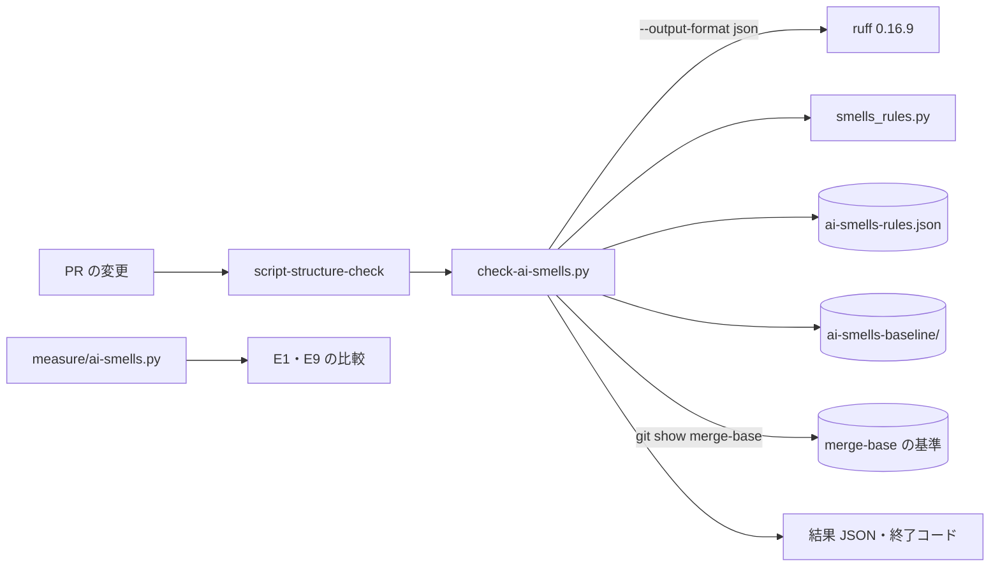
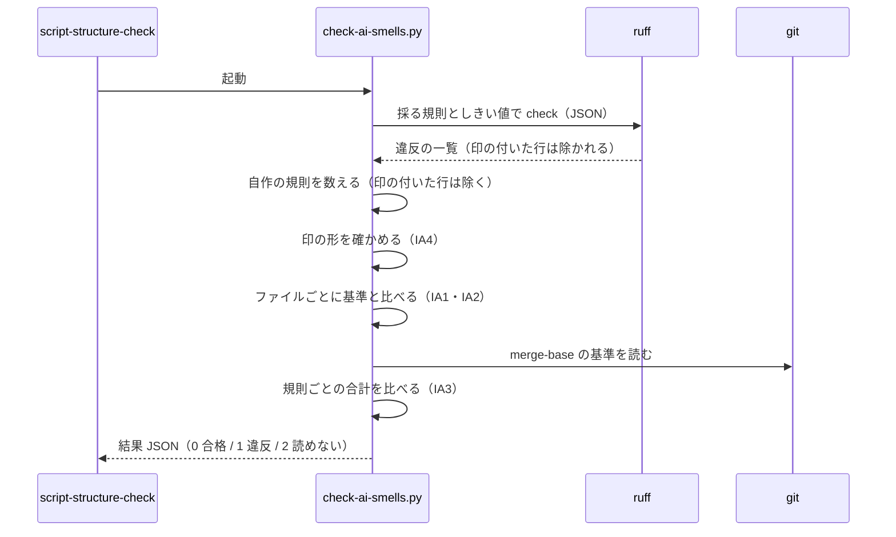

# NDF のスクリプト: AI が陥りやすい作りを数え、増やす変更を継続的統合で落としながら減らす（#1142）

## 目的

- **今どうなっているか**: テストと試行を除く NDF の Python 529 ファイルに、例外の握りつぶし 450 箇所・空のフォールバック 2,780 箇所・ループの中の外部呼び出し 52 箇所などの兆候がある。検査が無いため、AI が書く変更が同じ作りを足し続けている
- **誰に効くか**: NDF を直す worker と conductor（読み違いと隠れた失敗が減る）、NDF の利用者（偽の成功が減る）
- **変えると何が成り立つか**: 7 種類それぞれに継続的統合の検査があり、作り直しの前の数を超える変更が落ちる。許した握りつぶしとフォールバックは境界の種類と理由つきの一覧になり、作り直しの後に同じスクリプトで前後の数を比べられる

## 適用範囲

- **働く範囲**: このリポジトリだけ。見るのは `plugins/ndf/` の Python のうちテスト（`tests/`）と試行（`experimental/`）を除くもの。シェルは見ない（決定 14 でシェルを Python へ書き換えないため、兆候の数え方が別になる）
- **プロジェクトごとに違うもの**: 無し（ai-plugins の開発の検査で、利用先へは配らない）
- **当たるモード**: `standard`（#1142 の設計の一部）

## あるべき姿の根拠

| 根拠 | 種類 | 何を示すか |
| --- | --- | --- |
| 要求の「AI が陥りやすい作り」の外部の調査（GitClear 2025・arXiv:2510.03029・握りつぶしの監査） | 外部の一次情報 | AI の書くコードで重複・兆候・誤りの扱いの問題が増える |
| `python3 scripts/measure/ai-smells.py`（2026-11-13、develop 01a53e912） | 実測 | 7 種類の今の数（下の「基準の数」） |
| ruff 0.16.9 の規則の件数（下の LIB1 の行） | 実測 | 既存の規則で 7 種類のうち何を数えられるか |
| PRD1（新しいコードだけを合否の条件にかける） | 外部の一次情報 | 古い兆候を一度に直さずに、増やす変更だけを落とす形 |
| 「AI が陥りやすい作りを撲滅する。…継続的統合の検査で再び入らないようにする」（2026-11-13 利用者） | 利用者の指示の原文 | 検査で再流入を止める |

要求と受け入れ条件は #1142 の本文にある（コピーは [issue-1142-requirements.md](issue-1142-requirements.md) ）。
この文書は主題「AI が陥りやすい作りの撲滅」の「どう作るか」だけを扱う。全体のドメインモデルとコンテキストは
[issue-1142-design.md](issue-1142-design.md) 、行数の例外リストのラチェット（決定 18）は
[issue-1142-design-decisions.md](issue-1142-design-decisions.md) にある。

## 基準の数（測り直し）

測ったのは 2026-11-13、この worktree の HEAD `01a53e91242d8112c7a22b650f957eb9319424fa`（develop。#3171 のマージ）である。
コマンドは `python3 scripts/measure/ai-smells.py --summary`（起票者の控えを移したもの。数え方は変えていない）。
本文の表（develop b14c8be6a）とすべて同じ値になった。b14c8be6a から HEAD までの変更は #3171 の
マージだけで、触ったのは `docs/glossary*` と `issues/` の 5 ファイルである（`git diff --stat b14c8be6a HEAD`）。

| # | 作り | 数えたもの | 本文 | 測り直し |
| --- | --- | --- | ---: | ---: |
| 1 | 定数の重複 | 同じ値を 2 つ以上のファイルの最上位の定数に持つ値 / 最上位の定数の総数 | 54 / 2,270 | 54 / 2,270 |
| 2 | ループの中の外部呼び出し（N+1） | ループ・内包表記の中の `run`・`gh`・`git` などの呼び出し | 52 | 52 |
| 3 | 分岐の多用 | `elif` 5 本以上の連鎖 / 入れ子の深さ 4 以上の関数 / `if` 10 個以上の関数 | 11 / 107 / 11 | 11 / 107 / 11 |
| 4 | 例外の握りつぶし | 本体が `pass`・定数の `return`・`continue` だけの `except` / うち広い `except` | 450 / 30 | 450 / 30 |
| 5 | フォールバックの多用 | `x or {}` などの空の既定 / 既定値つきの `.get(k, 既定)` | 2,780 / 851 | 2,780 / 851 |
| 6 | コピーで生まれた重複 | 2 つ以上のファイルで同じ名前の関数 / 4 つ以上のファイルに出る 8〜80 字の文字列 | 242 / 471 | 242 / 471 |
| 7 | 長い関数・多い引数 | 60 行を超える関数 / 引数 7 個以上の関数 | 43 / 138 | 43 / 138 |

ファイル 529・行 120,361・関数 7,102 も本文と同じである。箇所の一覧は `--summary` を外した出力（約 440 KB）が持つ。

**計測のスクリプトの数え方は、作り直しの後の測り直し（E9）まで変えない**（決定 8 と同じ理由。前後を比べるため）。
数え方には次の癖があり、継続的統合の検査（下の「構成要素」）は別の数え方をする。前後の比較はこのスクリプトで、
増減で落とすかは検査で見る。

- `elif` の連鎖を、連鎖の途中の `if` からも数える（`hook_lib/write_target.py` の 382・384・386 行は 1 つの連鎖）
- 入れ子のループでは、同じ呼び出しを外側と内側のループで 2 回数える（`release-verification-steps.py:277`）
- `run` は属性の名前だけで拾うため、外部コマンドでない `run` も入る

握りつぶし 450 の内訳（同じ範囲を構文木で数えた）: 本体が定数の `return` 287・`continue` 92・`pass` 71。
受ける例外の型は `OSError` 232・`ValueError` 171・`TypeError` 36・`Exception` 30・`json.JSONDecodeError` 23・
`AttributeError` 17・`KeyError` 11 ほか（1 つの `except` が型を組で受けるため合計は 450 を超える）。
`contextlib.suppress(...)` の呼び出しは 8 箇所ある（握りつぶしの別の書き方で、上の 450 に入らない）。

## ドメインモデル

### コンテキスト

| コンテキスト | 何の語が 1 つの意味に決まるか |
| --- | --- |
| 構造チェック（[issue-1142-design.md](issue-1142-design.md) の用語） | 兆候・兆候の基準ファイル・境界の印・判定データ |

全体の「文書の検査」「ライブラリ」のコンテキストとは、検査が読むだけの関係（下流は NDF のスクリプト、上流は
この検査）で、スクリプトの側は検査の形に従う。

### 集約

| 集約 | 持ち主（書き換えてよいもの） | 根 | エンティティ | 値オブジェクト |
| --- | --- | --- | --- | --- |
| 兆候の基準 | `scripts/check-ai-smells.py`（`--write-baseline` で書く。手で書かない） | 兆候の基準ファイル（元のファイル 1 本に 1 つ） | — | 規則ごとの数 |
| 境界の印 | 印を付けるコードの変更（PR の書き手） | 行末の `# noqa:` | — | 規則・境界の種類・理由 |
| 検査の規則 | `scripts/ai-smells-rules.json` | 規則の表 | — | 採る ruff の規則としきい値・自作の規則・例外の型の分類 |

### 不変条件

番号は全体の I1〜I16 と分けて `IA` を付ける。

| # | 集約 | 条件 | 破れたときの扱い |
| --- | --- | --- | --- |
| IA1 | 兆候の基準 | ファイルごと・規則ごとの今の数（印の付いた箇所を除く）は、そのファイルの基準を超えない。基準ファイルの無いファイルの基準は 0 | 検査が落とす |
| IA2 | 兆候の基準 | 基準は今の数と等しい。今の数が下回ったら、同じ PR で基準を下げる | 検査が落とす（下げ方を出す） |
| IA3 | 兆候の基準 | 規則ごとの基準の合計は、ベースブランチとの merge-base の合計を超えない。ただし merge-base がまだ兆候の検査を持たない初回の導入（A0）に限り、merge-base と比べずに基準を置いてよい（決定 38） | 検査が落とす |
| IA4 | 境界の印 | 印は 4 つの境界の種類（外部コマンド・ネットワーク・利用者の入力・ファイル）のどれかと理由を持つ。ただし規則 `NDF201`（ループの中の呼び出し）の印に限り、境界の種類の代わりに `上限: <件数と根拠>` を持ってよい（決定 41）。内部の例外の型だけを受ける `except` には付けられない | 検査が落とす。`NDF201` 以外の規則の `上限:` の印も落とす |
| IA5 | （計測） | `scripts/measure/ai-smells.py` の数え方は E1 から E9 まで変えない | 振り返りで E1 の出力と見比べる |

### ドメインイベント

番号は全体の E1〜E9 と分けて `EA` を付ける。

| # | イベント | 発生元 | 受け手 |
| --- | --- | --- | --- |
| EA1 | 兆候の基準を記録した | 移行ステップ A0 | 子の課題の PR と A1〜A4（以後、増やす変更が落ちる） |
| EA2 | 兆候を直して基準を下げた | A1〜A4 と子の課題の PR | 次の PR の検査 |
| E9 | 移行の後を同じ物差しで測り直した | conductor（`ai-smells.py` を足す） | 振り返り |

### 用語

| 用語 | 意味 | 用語集への反映 |
| --- | --- | --- |
| 兆候 | AI が陥りやすい作り（7 種類）に当たる箇所の候補。直す対象とは限らない | 追加（`ndf-workflow`） |
| 兆候の基準ファイル | `scripts/ai-smells-baseline/` に元のファイル 1 本につき 1 つ置く、規則ごとの許す数の JSON | 追加（`ndf-workflow`） |
| 境界の印 | 握りつぶし・フォールバック・ループの中の呼び出しを許す行に付ける `# noqa: <規則> <境界の種類>: <理由>`。ループの中の呼び出し（`NDF201`）は `# noqa: NDF201 上限: <件数と根拠>` も使える | 追加（`ndf-workflow`） |
| 判定データ | 分岐の多い判定を置き換える「鍵 → 値か判定の関数」のデータと、それを引く 1 つの関数。要求（#1142 の本文）の「判定表（データ）」はこれを指す。用語集の「判定表」（モードを判定する順の表）と、詳細設計の雛形の「処理の手順」に書く判定表（条件の組み合わせと結果の表）とは別 | 追加（`ndf-workflow`） |

## 外部の調査

| 種類 | 調べるか | 理由 |
| --- | --- | --- |
| 標準・仕様 | 調べる | N+1 を 1 回の問い合わせへまとめる形が GraphQL の仕様と GitHub の API にある |
| 主要な製品 | 調べる | 古い違反を残したまま新しい違反だけを落とす形が静的解析の製品にある |
| ライブラリとサービス | 調べる | 既に依存している ruff の規則で 7 種類のどれが数えられるかを決める |

### 標準・仕様

| # | 標準・仕様 | 何を定めているか | 設計への反映 | 出典 |
| --- | --- | --- | --- | --- |
| STD1 | GraphQL のフィールドの別名（GitHub の GraphQL API） | 1 回の問い合わせで同じフィールドを別名で何度も引ける。`gh api graphql` で `a: pullRequest(number: 3171){…} b: pullRequest(number: 3170){…}` が 1 回の応答で両方を返した | PR・Issue ごとのループの `gh` 呼び出しを 1 回の問い合わせへまとめる（決定 41） | `gh api graphql -f query='query{repository(owner:"devbasex",name:"ai-plugins"){a:pullRequest(number:3171){number state headRefName} b:pullRequest(number:3170){number state}}}'` の出力（2026-11-13） |
| STD2 | `gh pr list --json` の一覧取得 | 開いた PR の `number`・`headRefName` を 1 回で返す | head ごとの `gh pr list --head` を 1 回の一覧と手元の絞り込みへ（決定 41） | `gh pr list --state open --limit 3 --json number,headRefName` の出力（2026-11-13） |

### 主要な製品

| # | 製品 | どう解いているか | 設計への反映 | 出典 |
| --- | --- | --- | --- | --- |
| PRD1 | SonarQube の「新しいコード」の品質の合否（Quality Gate） | 古いコードの問題は残したまま、新しく足すか変えたコードの問題だけを合否の条件にかける。PR の解析は PR が変えたコードの問題だけを出す | 古い兆候は基準として残し、増やす変更だけを落とす（決定 37） | https://docs.sonarsource.com/sonarqube-server/latest/core-concepts/clean-as-you-code/introduction/ （2026-11-13） |

### ライブラリとサービス

| # | 候補 | 版 | ライセンス | 最後のリリースの日付 | 終了のアナウンス | 要件を満たすか | 出典 |
| --- | --- | --- | --- | --- | --- | --- | --- |
| LIB1 | ruff（既に `lint` グループで依存） | 0.16.9（`uv.lock` の固定。最新は 0.17.5） | MIT | 0.16.9 は 2026-09-24、0.17.5 は 2026-11-12 | 無し | 種類 3・4・7 の一部を数えられる。数の基準（ラチェット）は持たない（下の件数の表） | https://docs.astral.sh/ruff/rules/ ・ https://docs.astral.sh/ruff/settings/ ・ https://docs.astral.sh/ruff/linter/#error-suppression ・ https://pypi.org/pypi/ruff/json ・ `uv run --frozen --project . --group lint ruff rule --all`（2026-11-13） |
| LIB2 | pylint（`duplicate-code` R0801） | 4.1.3 | GPL-2.0-or-later | 2026-10-11 | 無し | コピーの重複（種類 6）を行の並びで見られるが、依存が増え、関数の同じ本体は既存の構造チェックが見ている | https://pypi.org/pypi/pylint/json （2026-11-13） |
| LIB3 | 構造チェックの `same-body`・`same-name`（リポジトリの中、`scripts/check-script-structure.py`） | develop 01a53e912 | リポジトリと同じ | — | 無し | 種類 6 の関数の重複を例外リストのラチェットで既に見ている（I4） | `scripts/check-script-structure.py` の docstring（2026-11-13） |
| LIB4 | 「定数からデータへ」の計測（`scripts/measure/const-facts.py`。同じ設計 PR のほかの主題） | 同じ worktree | リポジトリと同じ | — | 無し | 種類 1 の同じ事実を持つ定数を、値の集合・接頭辞まで含めて拾う | `scripts/measure/const-facts.py` の docstring（2026-11-13） |

ruff 0.16.9 の規則の件数（`plugins/ndf` のテストと試行を除く 529 ファイル。`ruff check --isolated --target-version py310
--extend-exclude '**/tests/**' --extend-exclude '**/experimental/**' --statistics --select <規則>`、2026-11-13）:

| 規則 | 何を見るか | 既定のまま | しきい値を合わせた値 | 採るか |
| --- | --- | ---: | ---: | --- |
| S110 try-except-pass | `except` の本体が `pass` だけ | 10 | 71（`flake8-bandit.check-typed-exception = true`） | 採る（種類 4） |
| S112 try-except-continue | `except` の本体が `continue` だけ | 0 | 92（同上） | 採る（種類 4） |
| BLE001 blind-except | `Exception`・`BaseException` を受けて再送出もログもしない | 11 | — | 採る（種類 4） |
| SIM105 suppressible-exception | `try`・`except`・`pass` を `contextlib.suppress` へ書き換えさせる | 39 | — | 採らない（握りつぶしを S110 から見えない形へ移す） |
| PLR1702 too-many-nested-blocks | 入れ子のブロックの深さ（preview） | 0（既定は 5） | 76（`max-nested-blocks = 3`） | 採る（種類 3） |
| PLR0912 too-many-branches | 関数の分岐の数 | 7（既定は 12） | 40（`max-branches = 9`） | 採る（種類 3） |
| C901 complex-structure | 循環的複雑度 | 34（既定は 10） | — | 採らない（PLR0912 と同じ対象を別の物差しで重ねる） |
| PLR0911 too-many-return-statements | `return` の数 | 54 | — | 採らない（要求の 7 種類に無い） |
| PLR0913 too-many-arguments | 引数の数 | 292（既定は 5） | 131（`max-args = 6`） | 採る（種類 7） |
| PLR0917 too-many-positional-arguments | 位置引数の数 | 262 | 108（`max-positional-args = 6`） | 採らない（PLR0913 に含まれる） |
| PLR0915 too-many-statements | 文の数 | 5（既定は 50） | 18（`max-statements = 40`） | 採らない（行数ではなく文の数を見る） |
| PERF203 try-except-in-loop | ループの中の `try` | 25 | — | 採らない（外部呼び出しを見ない） |

規則の一覧（`ruff rule --all` の 970 規則）を名前の `duplicate`・`loop`・`length`・`subprocess`・`default` で探し、
ループの中の外部呼び出し・関数の行数・コードの重複・空のフォールバックを見る規則は無かった（公式の一覧も同じ）。
ruff は違反の数の基準を持たない（ruff の Issue #1149「Support baselines」が open。`ruff check --help` にも基準の
選択肢は無く、あるのは `--add-noqa[=<REASON>]` と `--statistics` だけ）。

### 確かめられなかったこと

| 対象 | 試した方法 | 結果と理由 |
| --- | --- | --- |
| pylint の R0801 のしきい値の既定と見る単位 | https://pylint.readthedocs.io/en/stable/user_guide/messages/refactor/duplicate-code.html | 取得した範囲に本文が無かった（目次だけ）。採らないため追わない |
| SIM105 の自動修正の安全さ | https://docs.astral.sh/ruff/rules/suppressible-exception/ | ページに安全さの記載が無かった。採らないため追わない |

調べた量: 候補 8 件・取得の試み 12 回。

## 機能一覧

| # | 機能 | 誰が使うか |
| --- | --- | --- |
| F1 | 7 種類の兆候をファイルごと・規則ごとに数え、基準と比べて増えた変更を落とす | 継続的統合（PR ごと） |
| F2 | 直して減った分の基準を書き直す（`--write-baseline`） | PR の書き手（worker） |
| F3 | 境界の印の付いた箇所を、規則・境界の種類・理由つきで一覧にする（`--allowed`） | レビュー・振り返り |
| F4 | 作り直しの前後を同じ数え方で測る（`scripts/measure/ai-smells.py`） | conductor（E1・E9） |

## 構成要素

| 要素 | 責務 |
| --- | --- |
| `scripts/measure/ai-smells.py`（この PR で置いた） | 前後の比較の物差し。数え方を変えない（IA5） |
| `scripts/check-ai-smells.py`（新設。エントリポイント） | ruff を JSON で走らせた結果と自作の規則の結果をファイルごとに数え、基準・merge-base と比べる。基準の書き直しと許した箇所の一覧を出す。結果 JSON を 1 行出す |
| `scripts/structure_checks/smells_rules.py`（新設） | 自作の規則（ループの中の外部呼び出し・`elif` の連鎖・定数の `return` と `contextlib.suppress` の握りつぶし・空のフォールバック・60 行を超える関数）を構文木で数える |
| `scripts/ai-smells-rules.json`（新設。データ） | 採る ruff の規則としきい値、自作の規則、例外の型の分類（境界 / 内部 / どちらも）、境界の種類の 4 つ |
| `scripts/ai-smells-baseline/`（新設。データ） | 兆候の基準ファイル。元のファイル 1 本に 1 つ |
| `.github/workflows/script-structure.yml` の `script-structure-check` | 上のエントリポイントを打つ手順を 1 つ足す（必須のチェックの名前は変えない） |
| `pyproject.toml` の `[tool.ruff.lint]` | `external = ["NDF"]` を足す（自作の規則の印を ruff が誤った印として扱わない） |



## データ構造

**兆候の基準ファイル**（`scripts/ai-smells-baseline/<元のパスの / を __ に替えた名前>.json`）は、元のファイルの
パスと、規則ごとの数（0 の規則は持たない）を持つ。すべての規則が 0 になったらファイルを消す。名前の付け方は
既存の例外リスト（`scripts/script-structure-allow/`）の `allow_file_name()` と同じ形にそろえる。

A0 の時点で兆候を 1 つ以上持つファイルは、自作の規則の対象（種類 2・3・4・5・7）だけで 450 本ある
（`ai-smells.py` の出力の箇所から数えた）。基準ファイルもほぼ同じ数になる。

**境界の印**は、その兆候の行の行末に置く。

```python
except OSError:  # noqa: S110 ファイル: 消えたロックは片付け済みとして扱う
for pr in prs[:2]:  # noqa: NDF201 上限: ランタイムは claude と codex の 2 つだけ
```

ruff の規則（S110 など）の印は ruff がそのまま読んで外す。自作の規則（`NDF` で始まる）の印は検査が読む。
ruff は `external` に載る印を誤りとして扱わない（手元で `lint.external` の無い設定と有る設定の両方を試し、
ruff の規則の印に理由の文が続いても ruff が外すことを確かめた）。

## 処理の流れ



## 決定の記録

### 決定 36: 既存の規則で見られるものを自作しないため、握りつぶし・分岐・引数の数を ruff の規則で数え、無いものだけを自作する

7 種類のうち、ruff 0.16.9 に同じものを見る規則があるのは、`pass`・`continue` の握りつぶし（S110・S112）、広い
`except`（BLE001）、入れ子の深さ（PLR1702）、分岐の数（PLR0912）、引数の数（PLR0913）である。しきい値は要求の
物差しに合わせる（入れ子の深さ 4 以上 → `max-nested-blocks = 3`、引数 7 個以上 → `max-args = 6`、`if` 10 個以上 →
`max-branches = 9`、型を指定した `except` も数える `check-typed-exception = true`）。PLR1702 は preview のため、
`explicit-preview-rules = true` で名指しした規則だけを preview で入れる。版は `uv.lock` が固定するため、preview の
振る舞いは版を上げるときにだけ変わる。

ruff に無いのは、ループの中の外部呼び出し・`elif` の連鎖・定数の `return` と `contextlib.suppress` の握りつぶし・
空のフォールバック・関数の行数で、この 5 つだけを `smells_rules.py` に自作する。SIM105 は握りつぶしを
`contextlib.suppress` へ移して S110 から見えなくするため採らず、自作の規則が `contextlib.suppress` も数える。
FURB110（`if` の式を `or` へ書き換えさせる）もフォールバックを増やす向きのため採らない。

pylint の R0801 でコピーの重複を見る案は、依存が増え、関数の重複は既存の構造チェックが見ているため採らない。
ruff の規則をすべて自作する案は、ruff が同じものを速く（529 ファイルで 0.1 秒）数えるため採らない。

- 作り方: ライブラリやサービスを使う・自前で作る
- 比べた候補: LIB1 / LIB2 / LIB3

根拠: Value 12 / Value 11（MVV 版 7）

### 決定 37: 古い兆候を一度に直さずに増やす変更だけを落とすため、基準を元のファイル 1 本に 1 つの JSON に置く

数は 2,780 箇所のフォールバックを含み、一度に直せない。PRD1 と同じく古いものを基準として残し、増やす変更を
落とす。ruff は基準を持たないため（ruff の Issue #1149 が open）、ruff の違反を JSON で受けて検査が数える。

基準の置き場は、元のファイル 1 本に 1 つの JSON にする。並列の PR は触るファイルが重ならないように順序が
組まれる（前提 3）ため、基準ファイルも同じ PR の組の間でしか衝突しない。

採らなかった案:

- 1 つの JSON に全部を置く: 並列の PR が別々のファイルを直しても、同じ JSON の別の行で衝突する
- 1 箇所 1 ファイル（既存の `script-structure-allow` の形）: 4,000 を超えるファイルになり、行番号や関数名で
  鍵を作ると移しただけで別の項目になる
- `ruff --add-noqa` ですべての箇所に印を書く: 1 回の PR が 450 本のファイルを触り、子の課題の PR とすべて衝突する。
  印が「境界として許した」意味と「古いまま残した」意味の 2 つを持つ
- 既存の `script-structure-allow` に種類を足す: 例外リストは理由つきで許した項目の置き場で、理由を持たない古い
  数とは意味が違う

- 作り方: 自前で作る・標準に倣う
- 比べた候補: PRD1 / LIB1 / LIB3

根拠: Value 10 / Value 5（MVV 版 7）

### 決定 38: 減らした分を次の変更が使い戻せないため、基準を今の数に合わせることを求め、合計を merge-base と比べる

ファイルごとに「基準を超えたら落とす」だけでは、直して減った分の余白を、次の変更が同じファイルで使い戻せる。
今の数が基準を下回ったら落とし、`check-ai-smells.py --write-baseline` で基準を下げる PR にする（IA2）。

ファイルを分ける・移す PR（子の課題の多く）は、兆候が元のファイルから新しいファイルへ移る。新しいファイルの
基準ファイルを足すと、移したのではなく足した場合と区別できない。そこで規則ごとの基準の合計を、ベースブランチとの
merge-base の合計と比べ、超えたら落とす（IA3）。移しただけなら合計は変わらない。merge-base と比べる形は
同じワークフローの `ndf-contracts-check`（例外リストを merge-base より増やすと落とす）に倣う。

merge-base がまだ兆候の検査を持たない初回の導入（A0）に限り、merge-base と比べずに基準を置く。A0 は既存の兆候を
残したまま検査と基準を同時に足すため、比べると merge-base の合計 0 を必ず超え、最初の導入の PR が通らない。
検査を持つかどうかは merge-base のワークフローから判定し、既存の `scripts/contracts_lib/ratchet.py` の初回の扱い
（merge-base の CI が検査を走らせていなければ増加を数えない）に倣う。2 回目以降の PR は merge-base が検査を
持つため、合計を超えたら落とす。

基準ファイルの数を上げる変更を一律に落とす案は、ファイルを分ける PR を通せなくするため採らない。

根拠: Value 10 / Value 3（MVV 版 7）

### 決定 39: 許した箇所を理由つきの一覧にするため、境界の印を ruff の `noqa` の行末に書き、一覧は検査が作る

握りつぶしとフォールバックを許すのは、外部との境界（外部コマンド・ネットワーク・利用者の入力・ファイル）だけに
する。許した箇所には、その行の行末に `# noqa: <規則> <境界の種類>: <理由>` を書く。ruff の規則の印は ruff が
そのまま外し、自作の規則の印は検査が外す。印の無い理由・4 つ以外の境界の種類は検査が落とす（IA4）。`NDF201` の印だけは `上限: <件数と根拠>` を許す（決定 41）。一覧は
検査の `--allowed` が印から作る（定義から作り、手で写さない）。

印は理由がコードの隣にあり、行が動いても付いて動く。ruff の `--add-noqa=<理由>` で書け、`RUF100` が要らなく
なった印を見つけられる。

例外リスト（1 項目 1 ファイル）に「ファイル:関数:規則」で載せる案は、1 つの関数に同じ規則の箇所が複数あると
区別できず、理由がコードから離れるため採らない。

- 作り方: 標準に倣う
- 比べた候補: LIB1 / LIB3

根拠: Value 11 / Value 14（MVV 版 7）

### 決定 40: 内部の契約違反を握りつぶさないため、例外の型を境界と内部に分ける表をデータに置き、内部の型には印を許さない

境界での失敗は `OSError`・`subprocess.SubprocessError`・`json.JSONDecodeError`・`UnicodeDecodeError` のような型で
現れ、内部の契約違反は `TypeError`・`AttributeError`・`KeyError`・`IndexError` で現れる。握りつぶしの 450 箇所の
うち `TypeError` 36・`AttributeError` 17・`KeyError` 11 は、内部の形の誤りを黙って既定へ倒している候補である。
`ai-smells-rules.json` に型を「境界」「内部」「どちらもあり得る」（`ValueError` など。入力の解釈と内部の誤りの
両方で出る）の 3 つに分けて持ち、内部の型だけを受ける `except` には境界の印を付けられないようにする。
`Exception` を受ける `except` は BLE001 が見る。

フォールバックは、境界で 1 回だけ形を確かめて型へ直し（既存の `lib/schema.py` の pydantic の包み）、内部は
確かめた型を信じて `.get(k, 既定)` と `or {}` を持たない形へ直す。境界で読む `.get` には境界の印を付ける。

型で分けずに印だけで許す案は、`KeyError` の握りつぶしにも「ファイル」と書けば通るため採らない。

根拠: Value 7 / Value 9（MVV 版 7）

### 決定 41: 外部の呼び出しを件数に比例させないため、ループの中の `gh`・`git` を 1 回の問い合わせへまとめ、まとめない箇所には上限を印に残す

PR・Issue ごとの `gh` は、GraphQL のフィールドの別名で 1 回の問い合わせにまとめる（STD1）。head ごとの
`gh pr list --head` は、開いた PR の一覧を 1 回で取り手元で絞る（STD2。例 `merged-steps.py` の `probe_prs`）。
`git` は 1 回の呼び出しで全体を出して手元で分ける（例 `release-verification-steps.py` の `_verify_runtimes` は
プラグインごとの `git diff --name-only` を、パスの組を渡した 1 回の `git diff --name-only` と手元の振り分けへ）。
まとめる部品はコンテキストのモジュールに書かず、`lib/gh_parts.py` と git の包み（決定 16・19）に置く。

ループが 1 回か上限の小さい回数で済む箇所（ランタイムの 2 つなど）は直さず、`# noqa: NDF201 上限: <件数と
その根拠>` を残す。書き込み（PR へのコメント・ラベル）のように 1 回へまとめられない副作用は、境界の種類
「外部コマンド」の印に理由を書く。

並列の呼び出し（スレッド）で待ち時間だけを縮める案は、API の利用の枠（決定 16）を同じだけ使うため採らない。

- 作り方: 標準に倣う
- 比べた候補: STD1 / STD2

根拠: Value 2 / Value 5（MVV 版 7）

### 決定 42: 判定を読めて足せる形にするため、分岐の多い判定を判定データと、データを引く 1 つの関数へ直す

`elif` の 5 本以上の連鎖・入れ子の深さ 4 以上・`if` 10 個以上の関数は、「鍵 → 値か判定の関数」の表と、表を
引く関数 1 つへ直す。表の事実をほかのファイルやテストも使うなら、契約のデータ（`plugins/ndf/contracts/` の
JSON か `.ndf/` の宣言）へ置き、モジュールの中だけで使うなら最上位の辞書に置く（「定数からデータへ」の主題の
決まりに従う）。

例（`plugins/ndf/scripts/lib/parallel_external.py` の `file_errors`、385 行）: 置き場のファイルのパスの先頭の
ディレクトリ（`requests`・`answers`・`ranges`・`presented`・`progress`・`results`）と `batch.json` で 7 本に
分岐し、枝ごとに形をその場で確かめる。直した形は、先頭のディレクトリ → 形のモデル（`lib/schema.py` の
`Shape`）の表と、パスから鍵を出して表を引き `load_shape` を呼ぶ関数 1 つになる。形の規則は既にある契約
`plugins/ndf/contracts/forms/parallel-external.json` の `rule` の文と同じ事実なので、モデルを正にする。
新しい置き場のファイルを足すときは表に 1 行足すだけになる。

`match` 文へ書き換えるだけの案は、分岐の数が変わらず表として読めないため採らない。

根拠: Value 8 / Value 9（MVV 版 7）

### 決定 43: 子の課題と触るファイルを重ねないため、検査と基準を最初の移行ステップ A0 で入れ、子の課題の範囲は子の課題が直し、範囲の外を A1〜A4 で直す

検査を先に入れると、以後の子の課題の PR は兆候を増やせない。子の課題（リファクタリング計画の #2990・#2963・
#2993・#2992・#2994・#2995）は判断を純粋な関数へ切り出すため、切り出した新しいファイルは基準 0 から始まり、
兆候を持ち込めない。子の課題の範囲のファイルの兆候は、その子の課題の PR が移すときに直す（直さずに移すことは
IA3 で許す）。範囲の外のファイルだけを A1〜A4 が直し、子の課題と同時に流しても触るファイルが重ならない。

A0 は構造チェックの本体（`scripts/check-script-structure.py`）と例外リストを触らない。#2991（ファイルを分ける
基準を責務へ）と #2996（構文木の解析を 1 回に）が触るのはそちらで、A0 は別のエントリポイントとして足す。
#2996 が解析を 1 回にまとめるときに、この検査の構文木の読み取りも含めるかは #2996 の設計が決める。

子の課題の後にまとめて直す案は、子の課題の PR がその間に兆候を足せるため採らない。A0 で兆候もまとめて直す案は、
450 本のファイルを 1 つの PR で触り、すべての子の課題と衝突するため採らない。

根拠: Value 5 / Value 10（MVV 版 7）

### 決定 44: 同じ検査を 2 つ作らないため、種類 1 は「定数からデータへ」の検査、種類 6 は既存の構造チェックで見て、この検査では数えない

種類 1（定数の重複）は、同じ設計 PR の「定数からデータへ」の主題が、同じ事実を持つ定数の一覧と、新しい定数が
既にあるデータと同じ事実を持たないことの検査を持つ（LIB4。[issue-1142-design-data.md](issue-1142-design-data.md) の決定 50 の `check-ndf-contracts.py` の規則 `const-fact`）。種類 6 の関数の重複は、構造チェックの
`same-body`・`same-name` が例外リストのラチェットで既に見ている（LIB3・I4）。この 2 つをこの検査でも数えると、
同じ違反が 2 つの検査で落ち、例外の置き場も 2 つになる。

種類 6 のうち「4 つ以上のファイルに出る文字列」（471）は、大半が `argparse` の説明・案内の文で、同じ事実は
種類 1 の検査が定数として拾う。この数は `ai-smells.py` で前後を比べるだけにし、検査で落とす条件にしない。

この検査で 7 種類すべてを数える案は、上の重なりを生むため採らない。

根拠: Value 11（MVV 版 7）

## 直す順序と触るファイル

子の課題の範囲は、リファクタリング計画の表と各 Issue の題から決めた（#2988 は閉じた）。範囲の外の箇所の数は
`ai-smells.py` の箇所の一覧をパスで振り分けて数えた。

| 範囲 | パス | 種類 2 | 握りつぶし | 空のフォールバック |
| --- | --- | ---: | ---: | ---: |
| #2963・#2993 | `scripts/supervise.py`・`scripts/supervise_lib/` | 7 | 24 | 247 |
| #2992 | `scripts/parallel.py`・`scripts/lib/parallel_*.py` | 1 | 29 | 265 |
| #2994 | `scripts/lib/sprint_loop*.py` | 3 | 4 | 138 |
| #2995 | `scripts/release-steps.py`・`scripts/release_lib/` | 9 | 11 | 92 |
| #2990 | `scripts/lib/durable.py`・`scripts/lib/post_queue.py`・2 本の `drive.py` | 1 | 7 | 66 |
| 範囲の外（A1〜A4） | 上のほか | 31 | 375 | 1,972 |

| 移行ステップ | 何をするか | 触るファイル |
| --- | --- | --- |
| A0 | 検査・規則・基準を入れる。基準は A0 の時点の数で `--write-baseline` が書く | `scripts/check-ai-smells.py`・`scripts/structure_checks/smells_rules.py`・`scripts/ai-smells-rules.json`・`scripts/ai-smells-baseline/`（新設）・`scripts/tests/test_check_ai_smells.py`・`.github/workflows/script-structure.yml`・`pyproject.toml` |
| A1 | 範囲の外の握りつぶしとフォールバックを直すか境界の印を付ける（内部の型の握りつぶしから） | A1 の着手の時点で `check-ai-smells.py` が出す範囲の外のファイルと、その基準ファイル |
| A2 | 範囲の外のループの中の外部呼び出しを直すか上限の印を付ける | 下の 22 本と、その基準ファイル。まとめる部品は `plugins/ndf/scripts/lib/gh_parts.py` |
| A3 | 範囲の外の分岐の多い判定を判定データへ（71 本） | A3 の着手の時点で `check-ai-smells.py` が出す範囲の外のファイルと、その基準ファイル |
| A4 | 範囲の外の長い関数と多い引数（60 行を超える 28・引数 7 個以上 77） | 同上 |
| E9 | `ai-smells.py` で測り直し、表の前後を残す | — |

A2 の 22 本（`plugins/ndf/` から）: `scripts/check-trigger.py`・`scripts/lib/formatting.py`・`scripts/lib/gate1_requests.py`・
`scripts/lib/gh_rest.py`・`scripts/lib/project_mvv.py`・`scripts/lib/test_triage.py`・`scripts/lib/tool_paths.py`・
`scripts/merged-steps.py`・`scripts/merged_lib/checks.py`・`scripts/merged_lib/pull.py`・`scripts/merged_lib/reading.py`・
`scripts/plan-to-spec-steps.py`・`scripts/pr-steps.py`・`scripts/relay_lib/runtime.py`・`scripts/release-verification-steps.py`・
`scripts/sprint_close_lib/collect.py`・`skills/backlog-refinement/scripts/upkeep_gh.py`・`skills/backlog-refinement/scripts/upkeep_overhaul.py`・
`skills/backlog-refinement/scripts/upkeep_routes.py`・`skills/cross-refactoring/scripts/refactor_lib/worktree.py`・
`skills/cross-review/scripts/review_lib/commands/verify_findings.py`・`skills/fix/scripts/fix-steps.py`。

A1・A3・A4 は範囲の外のファイルが数十〜数百本あり、1 本の PR に収めない。着手の時点の一覧をディレクトリ
（`scripts/lib/`・`scripts/hook_lib/`・`scripts/relay_lib/`・各 Skill の `scripts/`）で分け、触るファイルが
重ならない PR に割る。A1〜A4 は互いに同じファイルを触りうるため、同じディレクトリの PR は順に流す。

## テスト設計

| 受け入れ条件・不変条件 | どの振る舞いで縛るか | どう壊したら落ちるべきか |
| --- | --- | --- |
| 7 種類それぞれに検査がある | 種類ごとの兆候を 1 つ持つファイルを基準 0 の木に置くと、検査がその規則で落とす（種類 1・6 は既存と「定数からデータへ」の検査のテストが持つ） | 規則の表から 1 つの規則を外すと、その種類のテストが落ちる |
| IA1 | 基準より 1 つ多い兆候を足すと落ちる | ファイルごとの比較を合計だけの比較に変えると落ちる |
| IA2 | 兆候を 1 つ直して基準を下げないと落ち、`--write-baseline` の後は通る | 下回りを許すと落ちる |
| IA3 | 兆候を持つ関数を別の新しいファイルへ移し、両方の基準を書き直すと通る。移さずに新しいファイルの基準だけを足すと落ちる | merge-base との比較を外すと落ちる |
| IA3（初回の導入） | merge-base が検査を持たない木で、0 でない基準を足すと通る。merge-base が検査を持つ木で同じ基準を足すと落ちる | 初回の判定を外すと前者が落ち、初回の判定を常に真にすると後者が落ちる |
| IA4 | 理由の無い印・4 つ以外の境界の種類・内部の型だけを受ける `except` の印・`NDF201` 以外の規則の `上限:` の印で落ちる。`# noqa: NDF201 上限: <件数と根拠>` の行と正しい境界の印の行は数えず、`--allowed` に理由つきで出る | 印の形を確かめずに外すと落ちる・`上限:` の印を拒むと落ちる |
| 握りつぶしを `contextlib.suppress` へ書き換えても数が減らない | `pass` の握りつぶしを `suppress` へ書き換えた差分で数が変わらない | `suppress` を数えないと落ちる |
| ruff のしきい値が要求の物差しに合う | 入れ子の深さ 4 の関数で PLR1702 が当たり、3 では当たらない。引数 7 個で PLR0913 が当たり 6 個では当たらない | しきい値をずらすと落ちる |
| 前後の数が残る（E1・E9） | `ai-smells.py` の出力の形（種類ごとの数と箇所）を読む側のテストは置かない。E9 で E1 の値（この文書の表）と並べて残す | — |

## 設計の結果

先頭の設計文書（[issue-1142-design.md](issue-1142-design.md) ）の「設計の結果」の表へ写す行である。

| 課題 | 扱い | 取り込み先 | 触るファイル |
| --- | --- | --- | --- |
| #1142 | 実装する | — | `scripts/check-ai-smells.py`、`scripts/structure_checks/smells_rules.py`、`scripts/ai-smells-rules.json`、`scripts/ai-smells-baseline/`（新設）、`scripts/tests/test_check_ai_smells.py`、`.github/workflows/script-structure.yml`、`pyproject.toml`（A0。A1〜A4 は上の「直す順序と触るファイル」） |

## 人へ残す判断

無し

## 未確認のまま残ること

| 項目 | 内容 |
| --- | --- |
| 基準ファイルの数 | A0 で書く基準ファイルは約 450 本の見込み（自作の規則の対象を持つファイルの数）。ruff の規則の分を足した実数は A0 で `--write-baseline` を打って分かる |
| 検査の所要時間 | ruff は 529 ファイルで約 0.1 秒、`ai-smells.py` の構文木の走査は約 3 秒（手元）。merge-base の基準を読む `git show` の回数を含めた CI の時間は A0 の CI で分かる |
| PLR1702 の数え方の差 | 入れ子の深さ 4 以上は `ai-smells.py` で 107、PLR1702（`max-nested-blocks = 3`）で 76。差は `try`・`with` と内包表記の数え方の違いと見ているが、箇所ごとの突き合わせはしていない。A0 のテストを書くときに 1 つずつの例で分かる |
| ruff を 0.17 系へ上げたときの規則の振る舞い | preview の PLR1702 は版で変わりうる。版を上げる PR で検査が落ちたら分かり、基準をその PR で書き直す |
