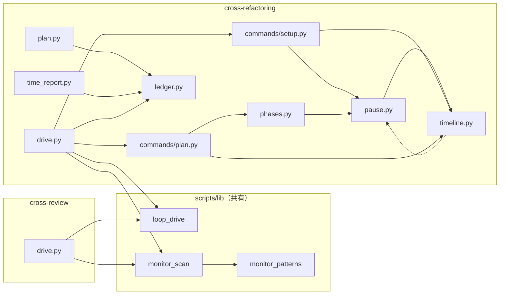
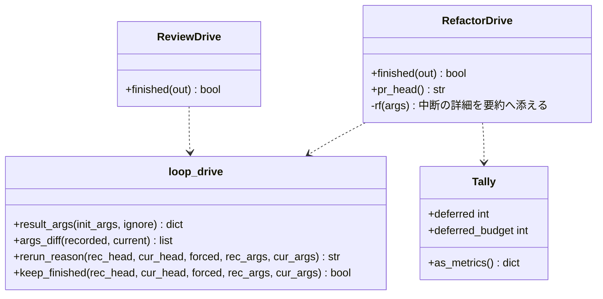
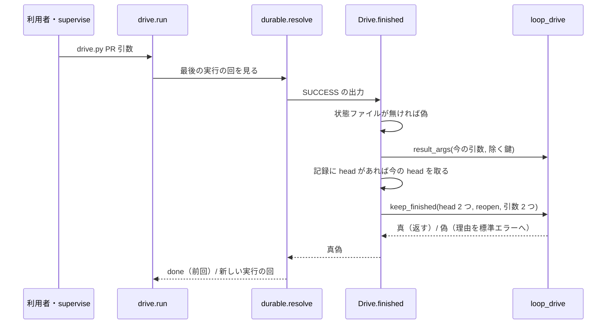
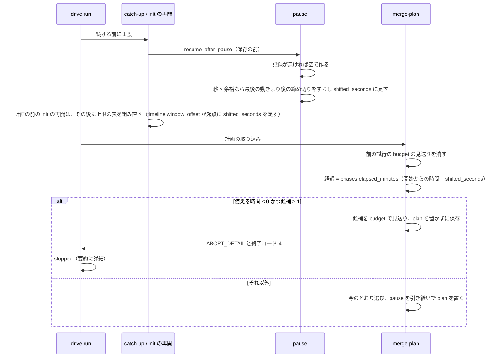
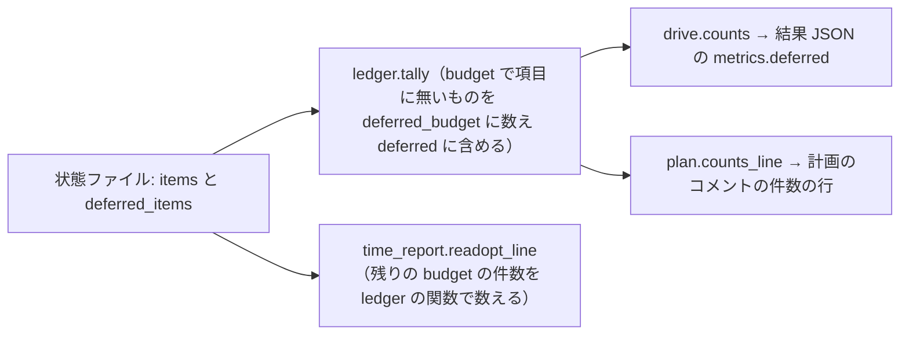
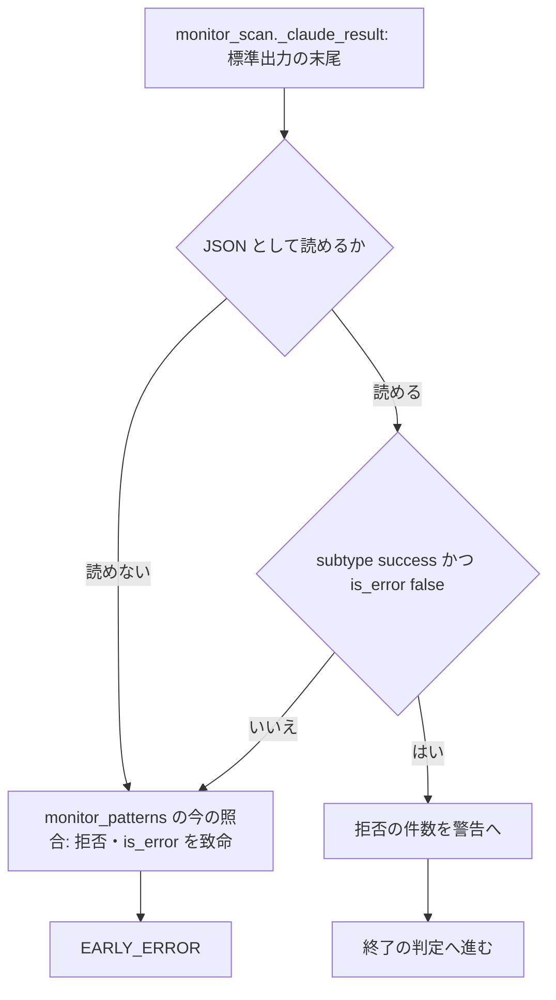

# cross-review / cross-refactoring: 引数を変えて流し直しても前回の結果や時間の残っていない計画が ok で返って承認ゲートまで進み、仕事を終えた後の読み取り 1 回の拒否で検査が止まる → 引数か head が違えば新しく回し、止まっていた時間を除いて時間の無い計画は中断で返し、成功で終わった後の拒否は警告にとどめる（#1263 #1944 #1513）

## 目的

- **何が壊れているか**: 完了した drive を引数を変えて打ち直すと前回の結果が `ok` で返る（#1263）。計画の前で止まった実行は止まっていた時間まで経過に数え、使える時間が 0 分以下でも全候補を見送って `ok` で返り、見送った件数が `metrics.deferred` に出ない（#1944）。claude が `subtype: success` で終えた後でも、読み取り 1 回の拒否で監視が EARLY_ERROR にする（#1513）
- **誰が困るか**: 承認ゲート 2 で承認する人（検査が回っていないことに気づけない）と、検査のプランを流す conductor（共有の worktree を手で外す・止まったプランを手で進める）
- **直すと何が成り立つか**: 結果 JSON とリファクタリング計画を読めば、検査が今回の引数と head で実際に回ったか・時間で何件見送ったかが分かる。成功で終わった担当は拒否 1 回で止まらない

## 適用範囲

- **働く範囲**: 配布先のリポジトリでも働く（cross-review・cross-refactoring の drive と、共有の監視 `scripts/lib/monitor*.py`）
- **プロジェクトごとに違うもの**: 無し。比べる引数は drive が受ける init の引数で、プロジェクトの設定を読まない
- **当たるモード**: `standard`

## あるべき姿の根拠

| 根拠 | 種類 | 何を示すか |
| --- | --- | --- |
| devbasex/devbase PR #301 の `progress.jsonl`（refactor 1.3 秒・review 0.1 秒で前回を返し、外して流し直すと提案 14 件のうち 11 件を採用） | 実測 | 引数を変えた流し直しで前回の結果が返り、実際には回っていない |
| devbasex/devbase PR #462 の出力（計画の前の中断で #1491 のずらしが効かず、全候補を時間で見送って `ok`） | 実測 | 計画の前の止まっていた時間が経過に数えられている |
| PR https://github.com/devbasex/ai-plugins/pull/1573 の検査（claude は `subtype: success`・結果ファイルを書いた後、Bash 1 回の拒否で 240 秒の EARLY_ERROR） | 実測 | 成功で終わった担当が拒否 1 回で止まる |

要求と受け入れ条件は #1263 の本文にある（コピーは `issues/issue-1263-requirements.md`。#1944 #1513 の条件を含む）。この文書は「どう作るか」だけを扱う。

## ドメインモデル

### コンテキスト

| コンテキスト | 何の語が 1 つの意味に決まるか |
| --- | --- |
| `ndf-workflow` | 実行の回・耐久の記録・結果を変える引数（2 つの drive が共有する完了の判定） |
| `ndf-cross-refactoring` | 止まっていた時間・使える時間・時間で見送った候補 |
| `ndf-cross-review` | 監視が担当の起動結果を読む語（EARLY_ERROR） |

`ndf-workflow` と 2 つの Skill のコンテキストは共有カーネルの関係にする。完了の判定（`loop_drive.py`）と監視（`monitor*.py`）は #1142 の L0 で、2 つの drive が同じ型と語を共同で変える。

### 集約

| 集約 | 持ち主（書き換えてよいもの） | 根 | エンティティ | 値オブジェクト |
| --- | --- | --- | --- | --- |
| 実行の回の完了の記録 | 各 drive の耐久ワークフロー（`review_drive` / `refactor_drive`）が終わりで 1 度だけ書く | 耐久ワークフローの出力 | — | 結果 JSON・終わりの head・結果を変える引数 |
| cross-refactoring の状態 | `refactor.py` の副命令（drive は読むだけ） | 状態ファイル | 改善項目・見送りの記録 | 止まっていた時間の記録（`pause`）・上限の表（`limits`）・計画（`plan`） |
| 担当の起動結果 | 監視（`monitor_loop`） | 担当の状態（`AgentStatus`） | — | 早期の致命（`EarlyFatal`）・警告 |

### 不変条件

| # | 集約 | 条件 | 破れたときの扱い |
| --- | --- | --- | --- |
| I1 | 完了の記録 | 記録した結果を返すのは、記録の head と今の head・記録の引数と今の引数がどちらも食い違わないときだけである。`--reopen` なら返さない | 返さずに新しい実行の回を始め、理由と違った引数の名前を標準エラーへ出す |
| I2 | 完了の記録 | 比べられない項目（記録に無い head か引数・今の head を取れないときの head）は比べずに飛ばし、比べられなかったことを標準エラーへ出す。`--reopen` か、比べられた項目の食い違いがあれば I1 のとおり新しい実行の回を始める。前回の結果を返すのは、`--reopen` が無く比べられた項目がすべて一致するときだけである | — |
| I3 | 完了の記録 | 引数の比べ方は 2 つの drive で 1 つの関数を通る。違うのは除く引数の集合だけである | — |
| I4 | 完了の記録 | 置き場・出力だけを変える引数の違いでは回り直さない | — |
| I5 | 状態 | 計画が使う経過時間は、実行の開始からの時間から、締め切りをずらした止まっていた時間の和（`pause.shifted_seconds`）を引いた値である | — |
| I6 | 状態 | 締め切りをずらすのは、最後の動きの時刻より後に来るものだけで、計画の前は提案と計画の枠の締め切りを含む | — |
| I7 | 状態 | 計画の時点の使える時間が 0 分以下で候補が 1 件以上あれば、計画を置かずに中断する。候補は時間の見送りとして記録する | drive は `status: stopped` で返し、要約に件数と使える時間を出す |
| I8 | 状態 | `metrics.deferred` とリファクタリング計画の件数の行の見送りは、`ledger.tally` 1 か所が数え、時間で見送った候補（項目に入っていないもの）を含む | — |
| I9 | 担当の起動結果 | 標準出力を JSON として読めて `subtype: success`・`is_error: false` なら、`permission_denials` は致命にせず警告にする。それ以外は今の照合のまま | — |

### ドメインイベント

| # | イベント | 発生元 | 受け手 |
| --- | --- | --- | --- |
| E1 | 実行の回が完了し、結果・head・引数を記録した | 耐久ワークフロー | 次の打ち直しの `finished` |
| E2 | 引数を変えて drive を打ち直した | 利用者・supervise | drive の `run` |
| E3 | 完了の記録と今回を比べた | `finished` → `loop_drive.keep_finished` | `durable.resolve` |
| E4 | 新しい実行の回を始めた、または前回の結果を返した | `durable.resolve` | drive の `run` |
| E5 | 計画の前で実行が止まった | 外部（ディスクの枯渇・打ち切り） | 次の打ち直し |
| E6 | 打ち直しで耐久ワークフローを続けた | drive の `run` | `catch-up` |
| E7 | 止まっていた時間を測って記録し、締め切りをずらした | `pause.resume_after_pause` | 状態ファイル・報告 |
| E8 | 計画が候補を採用と時間の見送りに分けた | `merge-plan` | 状態ファイル |
| E9 | 結果 JSON とリファクタリング計画のコメントを書いた | drive の done・stopped・pause の出口 | 承認する人・supervise |
| E10 | 実装担当の claude が `subtype: success` で終わった | claude | 監視 |
| E11 | 作業中の Bash の読み取り 1 回が拒否された | claude の承認の設定 | 標準出力の `permission_denials` |
| E12 | 監視が致命か正常な終わりかを判定した | `monitor_loop` | drive |

### 用語

| 用語 | 意味 | 用語集への反映 |
| --- | --- | --- |
| 結果を変える引数 | drive が `init` へ渡す引数のうち、置き場・出力だけを変えるものを除いた残り。完了の記録に残し、打ち直しで今回と比べる | 追加（`ndf-workflow`） |
| 止まっていた時間 | `cross-refactoring` を中断してから、init か drive.py を打ち直して再開するまでの時間。計画の前の中断を含む。再開の時刻 − 最後の動きの時刻で測り、想定最大時間に数えない | 意味の変更（`ndf-cross-refactoring`。「計画の後」の限定を外す） |

## 機能一覧

| # | 機能 | 誰が使うか |
| --- | --- | --- |
| F1 | 完了の記録に結果を変える引数と head を残し、打ち直しで比べて新しい実行の回を始める | 2 つの drive（打ち直す利用者・supervise） |
| F2 | 計画の前の中断でも止まっていた時間を測り、締め切りをずらして経過時間から除く | cross-refactoring の drive・init の再開 |
| F3 | 使える時間が無いまま候補を見送る計画を中断で返す | cross-refactoring の drive |
| F4 | 時間で見送った件数を `metrics.deferred` と計画のコメントの件数の行へ出す | 承認する人 |
| F5 | 成功で終わった claude の `permission_denials` を致命から外し、警告に残す | 監視（cross-review・cross-refactoring の担当） |

## 構成要素

| 要素 | 責務 | 機能 |
| --- | --- | --- |
| `scripts/lib/loop_drive.py` | 結果を変える引数の正規化（`result_args`）と違いの名前（`args_diff`）、完了した回を返すかの判定（`rerun_reason` / `keep_finished`） | F1 |
| `cross-review/scripts/drive.py` | 完了の出力（`outcome`）に引数を足し、`finished` で引数も渡す | F1 |
| `cross-refactoring/scripts/drive.py` | 完了の出力に head と引数を足し、`finished` を `Drive` のメソッドにして `keep_finished` を通す。中断の詳細（`ABORT_DETAIL`）を要約へ添える | F1・F3 |
| `refactor_lib/pause.py` | 計画の前でも止まっていた時間を測り、記録を作って締め切りをずらす | F2 |
| `refactor_lib/timeline.py` | 上限の表の起点のずれに、ずらした止まっていた時間を足す | F2 |
| `refactor_lib/phases.py` | 経過時間から、ずらした止まっていた時間を引く | F2 |
| `refactor_lib/commands/setup.py` | 計画の前の再開で、上限の表を組み直す前に止まっていた時間を測る。新しい状態に空の記録を置く | F2 |
| `refactor_lib/commands/plan.py` | 計画の前の記録を引き継ぐ。使える時間が無ければ中断する。前の試行の時間の見送りを消してから選ぶ | F2・F3 |
| `refactor_lib/ledger.py` | 時間で見送った件数を数え、`deferred` に含める | F4 |
| `refactor_lib/plan.py` | 件数の行に時間で見送った件数を添える | F4 |
| `refactor_lib/time_report.py` | 採り直しの行の残りの件数を `ledger` の関数で数える | F4 |
| `scripts/lib/monitor_scan.py` | 標準出力の JSON を読み、成功の終わりなら拒否を警告へ回す | F5 |
| `scripts/lib/monitor_patterns.py` | 拒否の照合を、致命の表から分けた名前で持つ | F5 |



## 構造



`Tally` は `deferred_budget` を足す。`as_metrics` のキーは変えない（`deferred` が時間の見送りを含む）。

## データ構造

### 完了の記録（耐久ワークフローの出力）

| drive | 今のキー | 足すキー |
| --- | --- | --- |
| cross-review | `result`・`code`・`tmp`・`head` | `args` |
| cross-refactoring | `result`・`state_file` | `head`・`args` |

`args` は `result_args` が返す辞書で、値そのものを持つ。

```json
{"--round-test": [["pytest -q tests/a"]], "--model": [["claude=opus"], ["codex=gpt"]], "--no-code-metrics": [[]], "--scope": [["src/a", "src/b"]]}
```

- 鍵は `--` で始まる語。`--name=value` は鍵と値に分ける。値は次の `--` の語までの語の並び
- 同じ鍵を繰り返したときは出現の順に並べる（`--model` の順は結果を変える）。鍵の順は比べない
- 除く鍵: cross-review は `--worktree`、cross-refactoring は `--worktree-root`・`--plan-file`（置き場と出力の書き出し先。前者 2 つは耐久の記録の鍵の元でもあり、違えば別の記録になる）
- 古い記録は `args`（cross-refactoring は `head` も）を持たない。読めば比べられないとして扱う（I2）

### cross-refactoring の状態ファイル

| フィールド | 今 | 変更後 |
| --- | --- | --- |
| `pause` | `merge-plan` が空で作る。計画の前は無い | `init` が新しい状態に空で置く。計画の前の古い状態で無ければ、測る時に空で作る（`legacy` にしない）。`merge-plan` は在れば引き継ぐ |
| `pause.events[]` | 計画の後の再開だけ | 計画の前の再開も積む |
| `deferred_items[]`（理由 `budget`） | 計画が選ばなかった候補 | 変えない。使える時間が無く中断したときも記録する。`merge-plan` が作り直すときは前の試行の `budget` を消してから選ぶ |
| `plan` | 計画で置く | 使える時間が無く中断したときは置かない（打ち直しで計画を作り直す） |

| 機能 | 完了の記録 | `pause` | `limits` | `deferred_items` | `plan` |
| --- | --- | --- | --- | --- | --- |
| F1 drive の完了・打ち直し | C・R | — | — | — | — |
| F2 catch-up・init の再開 | — | C・U | U | — | R |
| F3 merge-plan の中断 | — | R | — | C・D | R |
| F4 件数の集計 | — | — | — | R | — |

## 入出力の契約

| 契約 | 変更 |
| --- | --- |
| 2 つの drive の結果 JSON | 形は変えない。完了の後に引数か head が違う打ち直しは、前回の `ok` を返さず新しい実行の回の結果を返す |
| cross-refactoring の結果 JSON の `metrics.deferred` | 時間で見送った候補（項目に入っていないもの）を含む。キーは変えない |
| cross-refactoring の結果 JSON の `status` | 使える時間が 0 分以下で候補があると、`ok` ではなく `stopped`（`metrics.exit` は 4）。要約は `refactor.py merge-plan が終了コード 4 で止まった: 使える時間 -3.2 分に候補 5 件が入らない（すべて時間で見送った）` の形 |
| `refactor.py merge-plan` | 使える時間が無いときは `ABORT_DETAIL=<1 行>` を出して終了コード 4。ほかの終了コードと出力は変えない |
| リファクタリング計画のコメントの件数の行 | `見送り N（うち時間 M）`。M が 0 なら括弧を出さない |
| drive の標準エラー | 引数が違う: `↻ 完了の時点と結果を変える引数が違うため（--budget-minutes・--round-test）、新しい実行の回を始める`。比べられない: `ℹ 完了の記録が引数を持たないため、引数を比べずに前回の結果を返す（足すなら --reopen）`。head の行は今の文のまま、末尾を「新しい実行の回を始める」に揃える |
| 監視の標準エラー | 成功の終わりの拒否: `⚠️ <担当> permission_denials N 件（subtype: success で終わったため致命にしない）`。今の警告の行（`early-error WARN`）の 1 回目に載せる |
| 引数・終了コードの表 | 2 つの drive・監視とも変えない |

## 処理の流れ

### F1 完了した回を返すか



`rerun_reason` は `--reopen` → head → 引数の順に見て、最初の理由を返す。記録に引数が無ければ引数を比べない（I2）。今の head を取るのは記録に head があるときだけで、cross-refactoring も cross-review と同じく PR の head（`gh pr view <PR> --json headRefOid`）を使う。終わりの時点の head も同じ関数で取る。

### F2・F3 計画の前の中断から再開して計画する



ずらす締め切りの鍵は、計画の前が `propose_end_at`・`plan_end_at` と計画の後の 4 つ、計画の後は今の 4 つ（I6）。枠が収まらずに止めた後の打ち直し（`window_stopped_at` がある）は起点を打ち直した時刻へ移す既存の扱いが止まっていた時間を含むため、`shift_for_pause` は計画の前のその打ち直しでは記録しない。最終ゲートの後は今のとおり記録しない。

### F4 見送りの件数



### F5 監視の判定



## 非機能の実現方式

| 大項目 | 実現方式 |
| --- | --- |
| 性能・拡張性 | 引数の比較は、耐久の記録が既に読んでいる出力の辞書と、手元の引数の正規化だけで、外部コマンドを足さない。head の取得は cross-refactoring で完了の記録が head を持つ打ち直しのときだけ 1 回増える（決定 3） |
| 移行性 | 古い完了の記録は `args`（cross-refactoring は `head` も）を持たず、その項目を比べずに飛ばす。`--reopen` か比べられた項目の食い違いが無ければ前回を返す（I2）。古い状態ファイルの計画の前に `pause` が無ければ空で作る。計画の後で無ければ今のとおり `legacy` を残す。手で消す手順は無い |

## 決定の記録

### 決定 1: 比べる引数に漏れが出ないよう、init の引数のすべてを記録し、置き場と出力の書き出し先だけを除く

結果を変える引数を名前で並べると、init に引数を足すたびに一覧へ足し忘れ、#1263 と同じ現象が新しい引数で起きる。除く側を並べれば、足し忘れても起きるのは余計な回り直し（費用）で、前回の結果の取り違えにはならない。除くのは状態の置き場（耐久の記録の鍵の元でもある）と、計画の書き出し先の 3 つである。

値は要約（ハッシュ）にせず、そのまま記録する。標準エラーに違った引数の名前を出すため（1263-1）で、引数は耐久の記録の入力として既に同じ DB に入っている。

耐久の記録の入力（DBOS の `load_input`）から読む形は採らない。`durable.resolve` の契約を全種類について変えることになり、drive ごとに入力の並びが違う。

根拠: Value 6 / Value 1（MVV 版 2）

### 決定 2: 2 つの drive で同じ判定を通すため、`rerun_reason` / `keep_finished` に引数の 2 つを足し、cross-refactoring の `finished` を `Drive` のメソッドにする

完了した回を返すかの判定は #1340 で `loop_drive.py` に置いた。cross-refactoring だけ `finished` がモジュールの関数のまま状態ファイルの有無しか見ないのが #1263 の原因で、同じ関数を通せば head の比べ方（1263-3）も同時に揃う。正規化と違いの名前の関数も同じファイルに置き、drive が持つのは除く鍵の集合だけにする。

引数の比較を drive ごとに書く形は採らない。同じ役割の関数を Skill ごとに分けることになる。

根拠: Value 6（MVV 版 2）

### 決定 3: cross-refactoring も cross-review と同じく PR の head で比べ、取得は記録が head を持つときだけにする

1263-3 は「cross-review と同じ head の比べ方」を求める。作業の worktree の `HEAD` は手元の状態で、他者が PR へ積んだ差分を映さない。PR の head を取るには外部コマンドが 1 回要るため、完了の記録が head を持つ打ち直しに限り、非機能の条件の「引数の比較で外部コマンドを増やさない」は引数の比較に保つ。

根拠: Value 6 / Value 3（MVV 版 2）

### 決定 4: 計画の前の止まっていた時間は、締め切りをずらす既存の記録へ積み、経過時間と上限の表の起点の両方から引く

止まっていた時間の記録（`pause`）は #1491 で計画の後だけに作られていた。計画の前にも同じ記録を作れば、報告の行（1944-6）と所要の差し引き（`report`）がそのまま効く。計画は経過時間から使える時間を求め、計画の前の再開は上限の表を開始の時刻から組み直すため、2 か所とも `shifted_seconds` を引く（起点へ足す）。

打ち直した時刻を起点にする既存の扱い（`resumed_at`）へ寄せる形は採らない。止まる前に動いていた時間まで数えなくなり、使える時間が増えすぎる。

根拠: Value 6 / Value 3（MVV 版 2）

### 決定 5: 承認する人が見送りを読めるよう、時間で見送った件数を `ledger.tally` で数えて `deferred` に含める

件数の数え方の正本は `ledger.tally` 1 か所で、結果 JSON とコメントの件数の行がどちらもそこから出る（未決 3）。計画の記録から drive が足すと、2 つの出口で数え方が分かれる。数えるのは見送りの記録のうち理由が `budget` で、項目に入っていないものだけにし、採り直しで項目へ戻ったものを二重に数えない。`metrics` に新しいキーを足さず `deferred` に含めるのは、受け入れ条件 1944-4 の形に合わせ、読む側（supervise・承認資料）を変えないためである。

根拠: Value 6 / Value 2（MVV 版 2）

### 決定 6: 使える時間が無い計画は、計画を置かずに終了コード 4 で中断し、打ち直しで計画を作り直す

計画を置いたまま中断すると、打ち直しの `merge-plan` が「取り込み済み」で同じ 0 件を返し、最終ゲートへ進んで `ok` になる。計画を置かなければ、止まっていた時間を除いた後（決定 4）の打ち直しで使える時間を求め直せる。見送りの記録は保存し、中断の結果 JSON の `metrics.deferred` に件数が出る。前の試行の `budget` の見送りは作り直しの頭で消す。要約へ件数と使える時間を渡すため、`merge-plan` は `ABORT_DETAIL` を出し、drive の `rf` は終了コードで止める前にそれを読んで要約へ添える。

新しい終了コードを足す形は採らない。drive の終了コードの表と supervise の読み方が変わる。

根拠: Value 2 / Value 3（MVV 版 2）

### 決定 7: 成功で終わった担当を止めないため、`permission_denials` の致命は標準出力の JSON の終わり方で決める

拒否は作業の途中の 1 回でも空でない配列で残る。claude が `subtype: success`・`is_error: false` で終わったなら、拒否は回り道で済んでおり、成否は結果ファイルの有無（既存の終了の判定）が決める。JSON として読めない（途中・壊れた出力）ときは今の照合に倒し、致命を取りこぼさない。拒否の件数は今の警告の経路（1 回目だけ標準エラー）へ載せる。

拒否の中身（読み取りか書き込みか）で分ける形は採らない。ツールの入力を解釈する規則が増え、成否の判定には終わり方が既にある。

根拠: Value 2 / Value 6（MVV 版 2）

### 決定 8: 未決 2 は監視の順序で説明でき、終了の判定は変えない

`monitor_loop` は周回ごとに早期の致命を終了の判定より先に照らし、`result_exists` を設定するのは終了の判定（`_process_exit_outcome`）だけである。#1513 の再発は致命で抜けたため既定の偽が記録された。置き場の食い違いではない。決定 7 の後は成功の終わりが終了の判定へ進み、結果ファイルの有無が正しく記録される。

根拠: Value 3（MVV 版 2）

## テスト設計

| 受け入れ条件・不変条件 | どの振る舞いで縛るか | どう壊したら落ちるべきか |
| --- | --- | --- |
| 1263-1・I1 | cross-review の drive を完走させ、`--max-rounds` を変えて打ち直すと新しい実行の回が始まり、標準エラーに引数の名前が出る | `finished` が引数を渡さない・記録に `args` を書かない |
| 1263-2 | cross-refactoring の drive で同じ | `finished` がモジュールの関数のまま状態ファイルだけを見る |
| 1263-3 | cross-refactoring を完走させ、PR の head を進めて打ち直すと新しい実行の回が始まる | 完了の記録に `head` を書かない・今の head を取らない |
| 1263-4 | 引数・head が同じ打ち直しは、2 つの drive とも前回の結果を返す | 引数の鍵の順や `--name=value` の形の違いを違いと数える |
| 1263-5・I2 | `args` の無い記録の打ち直しは、head が同じで `--reopen` が無ければ前回を返し、比べられない旨が出る。head が進んでいれば新しい実行の回を始める | 記録に `args` が無いとき違いと数える |
| 1263-6・I3 | 2 つの drive の `finished` が `loop_drive.keep_finished` を通る（差し替えると両方の結果が変わる） | どちらかが自前の比較を持つ |
| I4 | `--plan-file` だけ・`--worktree` だけが違う打ち直しは前回を返す | 除く鍵を空にする |
| 1944-1・I5 | 提案の後・計画の前で止め、最後の動きの時刻を余裕より古くして打ち直すと、計画の経過時間が止まっていた時間の分だけ減り、`pause.events` に 1 件残る | `phases.elapsed_minutes` が `shifted_seconds` を引かない・計画の前で記録しない |
| 1944-2・I6 | 1944-1 の打ち直しで `propose_end_at`・`plan_end_at` が止まっていた秒だけ後ろへずれ、監視の上限が止まる前の残りから求まる | 計画の前のずらす鍵から 2 つを外す・init の再開が組み直しで起点に足さない |
| 1944-3・I7 | 使える時間 0 分以下で候補があると `merge-plan` が 4 と `ABORT_DETAIL` を返し、drive は `stopped` で要約に件数と使える時間を出す。打ち直しで計画を作り直す | `plan` を置いて中断する・使える時間が正のとき止める |
| 1944-4・I8 | 時間で見送った候補が `metrics.deferred` に含まれ、採り直しで項目へ戻した候補は数えない | `tally` が `deferred_items` を見ない・二重に数える |
| 1944-5 | 計画のコメントの件数の行の見送りが `metrics.deferred` と同じ数で、時間の内訳が出る | 件数の行が `tally` を通らない |
| 1944-6 | 計画の前のずらしで、catch-up の行と報告の止まっていた時間の行が出る | 計画の前の記録で `events` を積まない |
| 1944-7 | 止まらずに完走した実行では、使える時間・採用の件数・`metrics` が変更の前と同じ | 止まっていない実行で `shifted_seconds` が 0 以外になる |
| 1513-1・I9 | `subtype: success`・`is_error: false`・拒否 1 件の標準出力で EARLY_ERROR にならず、結果ファイルがあれば OK と `result_exists: true` | JSON の終わり方を見ずに拒否の照合を当てる |
| 1513-2 | 1513-1 のとき、拒否の件数が警告の行に出る | 警告を出さない |
| 1513-3 | 拒否があり `subtype` が `success` でない・`is_error: true`・JSON として読めないときは EARLY_ERROR | 読めないときに致命を外す |
| 1513-4 | 拒否が空のときの判定が今と同じ | 空の配列を拒否と数える |

## 設計の結果

| 課題 | 扱い | 取り込み先 | 触るファイル |
| --- | --- | --- | --- |
| #1263 | 実装する | — | `plugins/ndf/scripts/lib/loop_drive.py`、`plugins/ndf/skills/cross-review/scripts/drive.py`、`plugins/ndf/skills/cross-refactoring/scripts/drive.py`、`plugins/ndf/scripts/tests/test_lib_loop_drive.py`、`plugins/ndf/skills/cross-review/tests/test_review_drive_resume.py`、`plugins/ndf/skills/cross-refactoring/tests/test_refactor_drive_resume.py`、`docs/glossary/glossary.json`、`docs/glossary.md` |
| #1944 | 実装する | — | `plugins/ndf/skills/cross-refactoring/scripts/refactor_lib/pause.py`、`plugins/ndf/skills/cross-refactoring/scripts/refactor_lib/timeline.py`、`plugins/ndf/skills/cross-refactoring/scripts/refactor_lib/phases.py`、`plugins/ndf/skills/cross-refactoring/scripts/refactor_lib/ledger.py`、`plugins/ndf/skills/cross-refactoring/scripts/refactor_lib/plan.py`、`plugins/ndf/skills/cross-refactoring/scripts/refactor_lib/time_report.py`、`plugins/ndf/skills/cross-refactoring/scripts/refactor_lib/commands/plan.py`、`plugins/ndf/skills/cross-refactoring/scripts/refactor_lib/commands/setup.py`、`plugins/ndf/skills/cross-refactoring/tests/` |
| #1513 | 実装する | — | `plugins/ndf/scripts/lib/monitor_scan.py`、`plugins/ndf/scripts/lib/monitor_patterns.py`、`plugins/ndf/skills/cross-review/tests/test_monitor_early_error.py` |

#1263 と #1944 は `cross-refactoring/scripts/drive.py` と `cross-refactoring/tests/` を共に触るため、同じステージでは 1 本ずつ流れる。

ほかの主題（配布の材料の漏れ #1885 #1686 #1488 / 誤判定 #1875 #1675）と重ならないよう、触る関数を次に限る。

| ファイル | 触る関数・名前 | 触らない（ほかの主題に任せる） |
| --- | --- | --- |
| `scripts/lib/loop_drive.py` | `rerun_reason`・`keep_finished`、足す `result_args`・`args_diff` | `call`・`parse_vars`・`relaunch_seats`・`review_status`・`review_answer`・`write_review_answer` |
| `cross-review/scripts/drive.py` | `Drive.finished`、`review_drive` の `outcome`、足す除く鍵の定数 | ほかのすべて |
| `cross-refactoring/scripts/drive.py` | `Drive.rf`・`Drive.run`、足す `Drive.finished`・`Drive.pr_head`、`refactor_drive` の戻り値、消すモジュールの `finished` | ほかのすべて |
| `scripts/lib/monitor_scan.py` | `_scan_claude_stdout_fatal`・`_scan_fatal`・`_early_error`、足す `_claude_result` | `_scan_patterns`・`_scan_reasoned_fatal`・`_scan_claude_stdout`・ほかのすべて |
| `scripts/lib/monitor_patterns.py` | `CLAUDE_STDOUT_FATAL` から拒否の照合を分けた定数 | `REASONED_FATAL`・`EARLY_ERROR_*`・ほかのすべて |
| `refactor_lib/commands/setup.py` | `_resume` の計画の前の分岐、新しい状態に `pause` を置く 1 行 | ほかのすべて |
| `refactor_lib/commands/plan.py` | `cmd_merge_plan`・`_report` | ほかのすべて |
| `docs/glossary/glossary.json`・`docs/glossary.md` | 語「止まっていた時間」の意味・語「結果を変える引数」の追加（`render` の出力） | ほかの語（#1675 が足す語） |
| テスト | 上の表に挙げたファイルと `cross-refactoring/tests/` の中だけ | `plugins/ndf/scripts/tests/` の `test_lib_loop_drive.py` 以外 |

この主題は `supervise.py`・`supervise_lib/`・`release-steps.py`・`sprint-close.py`・`manual_checks.py` を触らない。

## 未確認のまま残ること

| 項目 | 内容 |
| --- | --- |
| head が進んだ打ち直しの費用 | supervise が完了した refactor のステップを、review が PR へ積んだ後に同じ引数で打ち直す経路があれば、cross-refactoring が回り直す。`--from` を使わない再開でステップを打ち直すかは supervise の側で確かめていない（この主題は supervise を触らない） |
| 引数が指すファイルの中身 | `--extra-instructions-file` などパスで渡す引数は、パスだけを比べる。同じパスで中身を変えた打ち直しは前回を返す |
| cross-review の `--rotate-mode` | init の引数ではなく drive の引数のため比べない。変えても前回を返す |
| 中断した計画の打ち直しの起動 | 決定 6 で計画を置かずに中断した後の打ち直しが、計画の担当を起動し直すか、前の回答を読み直すかは既存の再開（`PHASE`）に従う。費用は実装の結合テストで確かめる |
| 非機能の条件と 1263-3 | 要求の非機能の条件は「外部コマンドを増やさない」だが、1263-3 は PR の head を要る。決定 3 で引数の比較に限って満たす形にした。承認ゲート 1 で確かめる |
