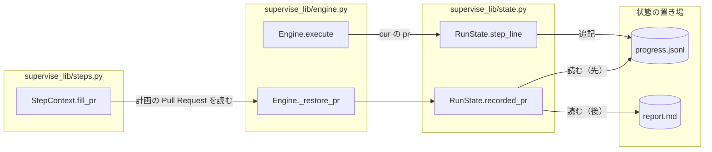
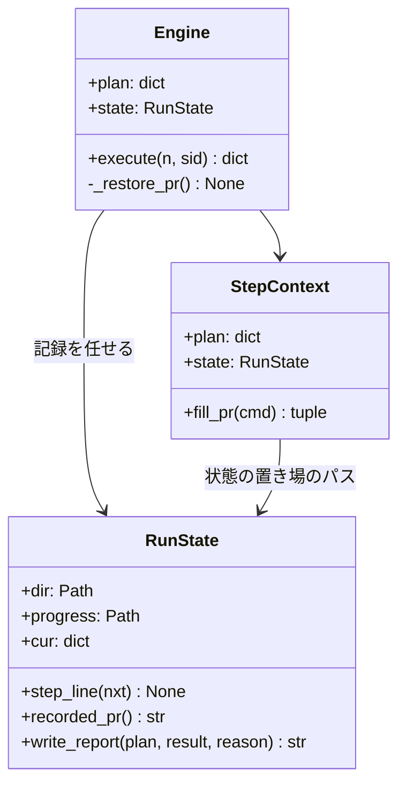
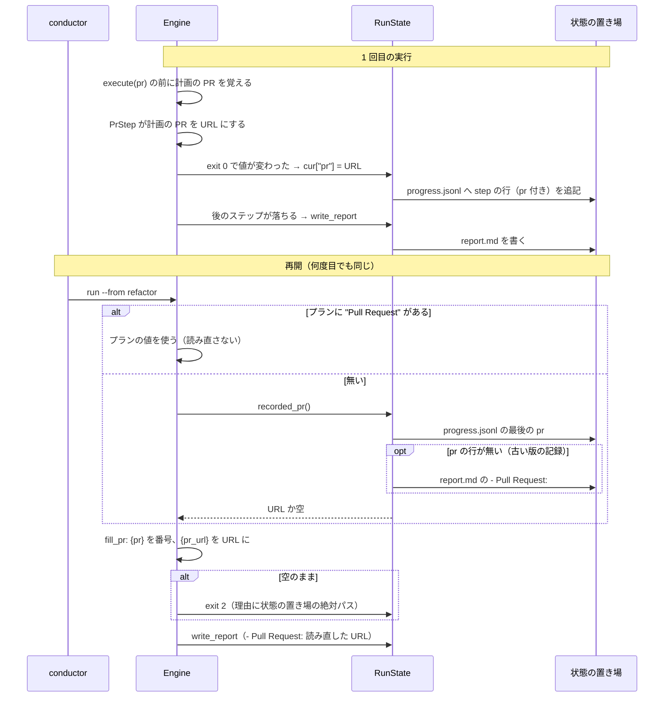

# supervise: `--from` で再開すると前の実行が作った Pull Request を失い「{pr} を置き換える Pull Request がまだ無い」で止まる → 状態の置き場の追記だけの記録から Pull Request を読み直し、何度再開しても `{pr}` が埋まる（#1296）

## 目的

- **何が壊れているか**: `supervise.py run <プラン> --from <ステップ>` の再開は、前の実行の Pull Request を `report.md` からだけ読み直す。`report.md` は実行のたびに上書きされるため、1 度 `Pull Request: 無し` で書かれると以後の再開はすべて `{pr}` で止まる
- **誰が困るか**: Pull Request を作った後のステップ（検査のプランの `refactor` など）で止まったプランを流し直す conductor と利用者。今は番号を直書きした別のプランを作って回避している
- **直すと何が成り立つか**: 前の実行の pr のステップが成功していれば、`report.md` が上書き・削除されていても、何度目の再開でも同じ Pull Request で `{pr}` / `{pr_url}` が埋まる。読めずに止まるときは、読んだ状態の置き場の絶対パスが理由の文に出る

## 適用範囲

- **働く範囲**: 配布先のリポジトリでも働く（`supervise.py run` の `--from` の再開）。`queue` の PR の受け渡しと、耐久ワークフローの続き（`replay`）は変えない
- **プロジェクトごとに違うもの**: 無し（状態の置き場の中のファイルの形だけで決まる。設定も引数も増やさない）
- **当たるモード**: `standard`

## あるべき姿の根拠

| 根拠 | 種類 | 何を示すか |
| --- | --- | --- |
| devbasex/devbase issue #273 の `3-check-state/progress.jsonl`（起票時の記録の表） | 実測 | 1 回目の pr のステップの行（20:15:51・exit 0・要約が PR の URL）は再開の後も `progress.jsonl` に残っていた。上書きで失ったのは `report.md` だけである |
| `RunState.progress_write`（`open(..., "a")`）と `RunState.write_report`（`write_text`） | 実測（コードの読み） | `progress.jsonl` は追記だけ、`report.md` と `state.json` は実行のたびに書き直す。`state.json` の `log` は新しい実行の分だけで始まる |
| `PrStep._publish` と `RunState.step_line` | 実測（コードの読み） | pr のステップの出力は `URL + "\n" + stderr` で、要約はその最後の空でない行を 160 文字で切る。stderr に行があると要約は URL にならない（要求の前提 3） |

要求と受け入れ条件は #1296 の本文にある（コピーは `issues/issue-1296-requirements.md`）。この文書は「どう作るか」だけを扱う。

## ドメインモデル

### コンテキスト

| コンテキスト | 何の語が 1 つの意味に決まるか |
| --- | --- |
| NDF の工程（`ndf-workflow`） | 状態の置き場・プラン・ステップ・再開・フェーズレポート |

1 つのコンテキストに収まる。

### 集約

| 集約 | 持ち主（書き換えてよいもの） | 根 | エンティティ | 値オブジェクト |
| --- | --- | --- | --- | --- |
| 実行の記録 | `RunState`（状態の置き場へ書くのはこのクラスだけ） | 状態の置き場 | ステップの行（`progress.jsonl` の `"kind": "step"`） | ステップの行の `pr`（そのステップが決めた Pull Request） |
| プランの実行 | `Engine` | プラン（`self.plan`） | ステップ | 計画の Pull Request（`plan["Pull Request"]`） |

`Engine` は計画の Pull Request を決め、`RunState` は記録へ書く値と、記録から読み直した値だけを渡す。`Engine` は状態の置き場のファイルを直に読まない。

### 不変条件

| # | 集約 | 条件 | 破れたときの扱い |
| --- | --- | --- | --- |
| I1 | 実行の記録 | `progress.jsonl` の行は追記だけで、前の実行の行を書き換えも消しもしない | 再開で前の実行の Pull Request を読めない。テストで縛る |
| I2 | 実行の記録 | ステップの行に `pr` が付くのは、そのステップが終了コード 0 で終わり、計画の Pull Request をステップの前と違う空でない値にしたときだけである | 失敗した pr のステップの値や、プランに書かれた値を、作った Pull Request として読み直す。テストで縛る |
| I3 | プランの実行 | 再開で使う Pull Request は、プランの `"Pull Request"` > `progress.jsonl` の最後の `pr` > `report.md` の `- Pull Request:` の順に、最初に見つかったものである | プランの値が記録で上書きされる（受け入れ条件 5 の退行）か、古い PR が新しい PR に勝つ（受け入れ条件 6） |
| I4 | プランの実行 | 読み直しは状態の置き場のファイルだけで決まり、LLM も GitHub も呼ばない | 非機能の条件（運用・保守性）に反する。テストは `gh` を偽物にして縛る |
| I5 | プランの実行 | `fill_pr` が `{pr}` を埋められずに返す誤りの文は、状態の置き場の絶対パスを含む | 次に起きたときに、どこを読んだかが分からない（要求の未決） |

### ドメインイベント

| # | イベント | 発生元 | 受け手 |
| --- | --- | --- | --- |
| E1 | 1 回目の実行が pr のステップで Pull Request を作った（または既存の PR を見つけた） | `PrStep._publish` | `Engine.execute`（計画の Pull Request が変わったことを見る） |
| E2 | Pull Request の URL を上書きされない記録へ残した | `RunState.step_line`（ステップの行の `pr`） | E5・E8 の読み直し |
| E3 | 1 回目の実行が後のステップで止まり、報告（`report.md`）を書いた | `RunState.write_report` | 利用者・conductor |
| E4 | 利用者か conductor が `--from <ステップ>` で再開した | 利用者・conductor | `Engine.setup` |
| E5 | 再開が前の実行の Pull Request を読み直した | `Engine._restore_pr`（`RunState.recorded_pr` を読む） | 計画の Pull Request |
| E6 | 再開が `{pr}` / `{pr_url}` を置き換えてステップを流した | `StepContext.fill_pr` | ステップの `cmd` |
| E7 | 再開が止まり、報告を書き直した | `RunState.write_report` | 利用者・conductor |
| E8 | 2 度目の再開が同じ Pull Request を読み直した | `Engine._restore_pr` | 計画の Pull Request |

### 用語

| 用語 | 意味 | 用語集への反映 |
| --- | --- | --- |
| 状態の置き場 | `supervise.py run` の `--state-dir`（省けば `<プラン>-state/`）。`progress.jsonl`・`report.md`・`state.json` を置き、`--from` の再開が前の実行の記録を読む | 追加（`ndf-workflow`。要求の工程で足した。この設計で意味は変えない） |

## 機能一覧

| # | 機能 | 誰が使うか |
| --- | --- | --- |
| F1 | Pull Request を決めたステップの行に、その Pull Request を残す | `supervise.py run`（どのプランでも） |
| F2 | `--from` の再開で、前の実行が決めた Pull Request を読み直して `{pr}` / `{pr_url}` に使う | 再開する conductor と利用者 |
| F3 | 修正より前の版の状態の置き場（`report.md` にだけ PR が残る）からも読み直す | 版を上げた後に古いプランを再開する conductor |
| F4 | `{pr}` を埋められずに止まるとき、理由の文に状態の置き場の絶対パスを出す | 止まった原因を調べる conductor と利用者 |

## 構成要素

| 要素 | 責務 |
| --- | --- |
| `Engine.execute`（`supervise_lib/engine.py`。変える） | ステップの前の計画の Pull Request を覚え、ステップが終了コード 0 で終わって値が変わっていれば、記録の前に `cur["pr"]` へ入れる（I2） |
| `Engine._restore_pr`（`supervise_lib/engine.py`。変える） | `--from` でプランに `"Pull Request"` が無いとき、`RunState.recorded_pr` が返す値を計画の Pull Request にする（I3）。ファイルを直に読まない |
| `RunState.step_line`（`supervise_lib/state.py`。変える） | `cur["pr"]` があればステップの行へ `pr` として書く（E2）。無ければ今と同じ行 |
| `RunState.recorded_pr`（`supervise_lib/state.py`。作る） | `progress.jsonl` の最後の `pr` を返す。無ければ `report.md` の `- Pull Request:` の URL、どちらも無ければ空を返す（I3・F3）。壊れた行は飛ばす |
| `StepContext.fill_pr`（`supervise_lib/steps.py`。変える） | `{pr}` を埋められない誤りの文に、状態の置き場の絶対パスを添える（I5） |



### パッケージ・モジュール構成

```text
plugins/ndf/scripts/
├── supervise_lib/
│   ├── engine.py   # execute（pr の印）・_restore_pr（読み直しの順）
│   ├── state.py    # step_line（pr の欄）・recorded_pr（新規）
│   └── steps.py    # fill_pr（誤りの文）
└── tests/
    └── test_supervise.py   # 再開の振る舞い（既存の test_run_from_restores_pr_from_previous_report の隣）
```

置き場所は変えない。新しいファイルは作らない。

## 構造



`RunState.recorded_pr` を足し、`Engine` と `StepContext` は型を変えない（既存のメソッドの中身だけを変える）。

## データ構造

**変えるのは `progress.jsonl` の `"kind": "step"` の行に、任意の欄 `pr` を 1 つ足すことだけである。** ほかの記録（`state.json`・`report.md`・`.out`）の形は変えない。`state.json` の `log` には `cur` の写しとして `pr` が載るが、読み直しには使わない（決定 1）。

ステップの行（足すのは最後の 1 欄）:

| 欄 | 型 | 空を許すか | 意味 |
| --- | --- | --- | --- |
| `kind` / `at` / `step` / `type` / `exit` / `seconds` / `cost` / `next` / `summary` | 既存 | 既存 | 変えない |
| `pr` | 文字列 | 欄ごと無い | そのステップが終了コード 0 で終わり、計画の Pull Request をこの値に変えた（I2）。pr のステップでは PR の URL、`pr_from` の run のステップでは `metrics` の値。欄が無いのは「このステップは Pull Request を決めていない」で、「Pull Request が無い」ではない |

| 機能 | `progress.jsonl` | `report.md` | 計画（メモリ） |
| --- | --- | --- | --- |
| F1 残す | C（行を足す） | — | R |
| F2 読み直す | R | — | U |
| F3 古い版から読み直す | R | R | U |
| F4 止まる理由 | C（既存のステップの行の要約） | — | R |

- **時系列の扱い**: 事象の記録を採る。`progress.jsonl` は既に追記だけの記録で、「最後に成功した回」（受け入れ条件 6）は最後の `pr` の行として導ける。状態を上書きする記録（`report.md`・`state.json`）は採らない（決定 1）
- **移行**: 既存の状態の置き場は移さない。`pr` の欄が 1 行も無ければ `report.md` を読む（F3）。古い版の読み手は知らない欄を読み捨てる（`progress.jsonl` の読み手は `queue` の attention・`slow_step.import_progress`・`RunState.read_worker_lines` で、いずれも欄を名前で取る）
- **検査の手段**: `uv run --frozen --project . --all-extras pytest plugins/ndf/scripts/tests -q -n 4`

## 処理の流れ



再開の報告の `- Pull Request:` は、読み直した値が計画の Pull Request に入るため、既存の `write_report` のままで URL になる（受け入れ条件 3）。

## 非機能の実現方式

| 大項目 | 条件 | 実現方式 |
| --- | --- | --- |
| 運用・保守性 | 読み直しに LLM も GitHub への問い合わせも使わない | `recorded_pr` は状態の置き場の 2 ファイルを読むだけにする（I4）。`{pr_url}` を番号から引く `fill_pr` の既存の経路は、記録の値が URL なら通らない |
| 移行性 | 修正より前の版の状態の置き場からも `report.md` で読み直せる | `progress.jsonl` に `pr` の行が無いときだけ、今と同じ正規表現で `report.md` を読む（F3） |

## 決定の記録

### 決定 1: 上書きされない記録から読み直すため、`progress.jsonl` のステップの行に `pr` の欄を足し、それを正にする

`progress.jsonl` は状態の置き場で唯一の追記だけの記録で、devbase の事例でも 1 回目の pr のステップの行が再開の後まで残っていた。ステップの行に欄を足せば、「最後に成功した回」は最後の行として決まり、新しいファイルも新しい行の種類も要らない。

既存の `summary` を読む案は、`summary` が出力の最後の空でない行を 160 文字で切った値で、`gh pr create` の stderr に行があると URL にならないため採らない。`state.json` の `log` は新しい実行が `log` を空から書き直すため、再開を 1 度挟むと前の実行の行を失う。専用のファイル（`pr.txt` など）は上書きの記録になり、成功の順序を持てないうえ、状態の置き場の形を 1 つ増やす。

根拠: Value 6 / Value 7（MVV 版 2）

### 決定 2: pr のステップの種類に縛らないため、「終了コード 0 で終わり、計画の Pull Request を変えたステップ」に印を付ける

計画の Pull Request を決めるステップは pr のステップと、`pr_from` を持つ run のステップ（本番のリリースプランの record）の 2 つがある。ステップの種類で分岐せず、`Engine.execute` がステップの前後で計画の Pull Request を比べれば、どちらも同じ規則で残り、将来 PR を決めるステップが増えても漏れない。

pr のステップの型だけに印を付ける案は、`pr_from` の経路で同じ不具合が残り、種類の一覧を 2 か所に持つことになるため採らない。値が変わらない成功（同じ PR を見つけ直した pr のステップ）に印を付けない結果、記録は増えないが、前の行が同じ値を持つため読み直しの結果は変わらない。

根拠: Value 5 / Value 6（MVV 版 2）

### 決定 3: 移行の手当てを 1 か所にするため、`pr` の行が無いときだけ `report.md` を読む

修正より前の版が書いた状態の置き場は `report.md` にしか PR を持たない。読む順を「`progress.jsonl` → `report.md`」に固定し、`progress.jsonl` に 1 行でも `pr` があれば `report.md` を読まない。`report.md` が `Pull Request: 無し` で上書きされていても、新しい版の記録があればそちらが勝つ（受け入れ条件 2）。

2 つを読んで新しい方を選ぶ案は、`report.md` に時刻が無く比べられないため採らない。

根拠: Value 1 / Value 6（MVV 版 2）

### 決定 4: 原因を後から追えるようにするため、`{pr}` の誤りの文に状態の置き場の絶対パスを常に添える

`fill_pr` の誤りの文はステップの出力になり、`progress.jsonl` の要約と `.out` に残る。devbase の事例は、どのパスを読んだかが残っていなかったため原因を絞れなかった。再開に限らず添えるのは、`fill_pr` が再開かどうかを知らず、知らせるために状態を増やすほどの差が無いためである。

報告の `- 理由:` の行（「ステップ X が失敗した（exit=2）」）を書き換える案は、すべての失敗の理由の文を変えることになり範囲を越えるため採らない。状態の置き場そのものを絶対パスへ解決し直す案は、要求が含まないとした（S2）。

根拠: Value 6 / Value 3（MVV 版 2）

## テスト設計

`gh` を偽物にした状態の置き場で `Engine` を 2 度以上流し、再開の振る舞いを縛る。

| 受け入れ条件・不変条件 | どの振る舞いで縛るか | どう壊したら落ちるべきか |
| --- | --- | --- |
| 受け入れ条件 1 / I3 | pr のステップが成功した後で落ちたプランを `--from <後のステップ>` で再開すると、`{pr}` が番号、`{pr_url}` が URL に置き換わり、「まだ無い」で止まらない | `_restore_pr` を呼ばない・`recorded_pr` が空を返すように壊すと落ちる |
| 受け入れ条件 2 / I1 | 受け入れ条件 1 の再開を落とした後、`report.md` を `Pull Request: 無し` に書き換えても、消しても、もう 1 度の再開で同じ PR になる | 読み直しを `report.md` だけに戻すと落ちる。`progress.jsonl` を `"w"` で開くように壊すと落ちる |
| 受け入れ条件 3 | 受け入れ条件 1・2 の再開の `report.md` と、返した `## フェーズの報告` の `- Pull Request:` が前の実行の URL になる | 読み直した値を計画へ入れないように壊すと落ちる |
| 受け入れ条件 4 / I5 | pr のステップを成功させていない状態の置き場で再開し `{pr}` に当たると止まり、ステップの出力に状態の置き場の絶対パスが含まれる（状態の置き場を相対パスで渡しても絶対パスが出る） | 誤りの文からパスを外す・`resolve()` せずに渡したパスのまま出すと落ちる |
| 受け入れ条件 5 / I3 | プランに `"Pull Request"` がある再開では、記録に別の PR があってもプランの値で `{pr}` が埋まる | 読み直しをプランの値より先にすると落ちる |
| 受け入れ条件 6 / I2 | pr のステップが 2 回、別の PR で成功した記録からは、後の PR を読み直す | 最初の `pr` の行を返すように壊すと落ちる |
| I2 | pr のステップが計画の Pull Request を入れたが終了コード 0 以外で終わったとき、その値は記録に残らず、再開は前の成功の PR を使う | 終了コードを見ずに印を付けると落ちる |
| I4 | 読み直しの間に `gh` を呼ばない（偽物の `gh` が呼ばれたら失敗を返す） | 読み直しで `gh pr list` などへ問い合わせるように壊すと落ちる |
| 非機能（移行性） | `progress.jsonl` に `pr` の欄が無く `report.md` にだけ URL がある状態の置き場から再開すると、今と同じく読み直す（既存の `test_run_from_restores_pr_from_previous_report` が縛る） | `report.md` への後戻りを消すと落ちる |
| 受け入れ条件 7 | 既存の supervise のテストがすべて通る | — |

## 設計の結果

| 課題 | 扱い | 取り込み先 | 触るファイル |
| --- | --- | --- | --- |
| #1296 | 実装する | — | `plugins/ndf/scripts/supervise_lib/engine.py`、`plugins/ndf/scripts/supervise_lib/state.py`、`plugins/ndf/scripts/supervise_lib/steps.py`、`plugins/ndf/scripts/tests/test_supervise.py` |

## 未確認のまま残ること

| 項目 | 内容 |
| --- | --- |
| devbase の事例の原因 | cwd が違った / 1 回目が `report.md` を書く前に止まった、のどちらかは確かめていない（要求の前提 2）。次に起きたときは決定 4 の誤りの文で読んだ場所が分かる |
| 誤りの文の長さ | 状態の置き場の絶対パスが長いと、`progress.jsonl` の `summary`（160 文字）ではパスの末尾が切れる。`.out` とステップの結果には全文が残る。実装で実際の長さを見て、切れる所が問題になるなら文の並びを決める（`tdd-cycle`） |
| 耐久ワークフローの続きとの重なり | 落ちた前の起動を続ける経路（`replay`）は `out["pr"]` から計画の Pull Request を戻し、`setup` の読み直しの後に上書きする。値は同じ実行の記録から来るため食い違わない見込みだが、`--from` と続きが重なる場合はテストで確かめる |
