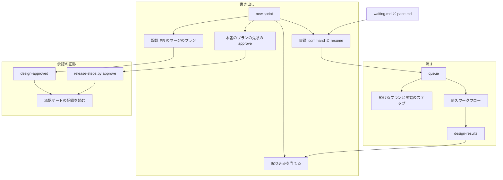
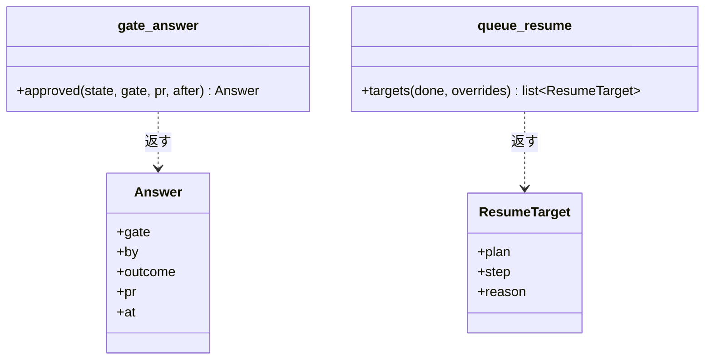
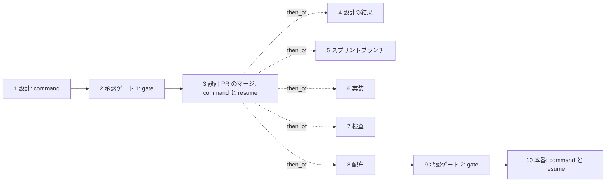
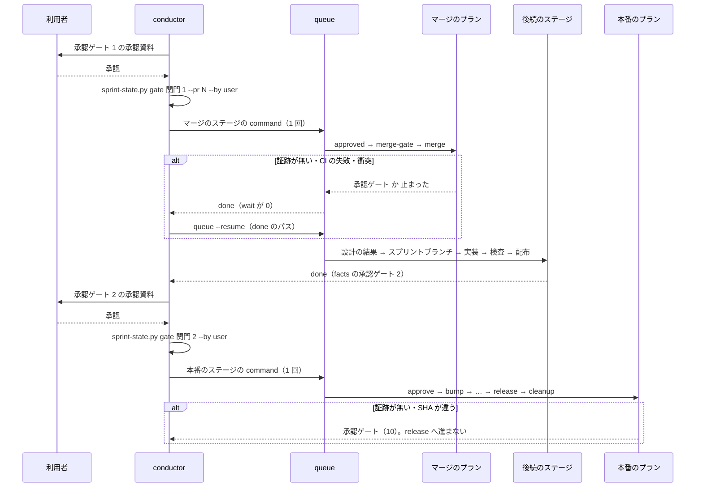
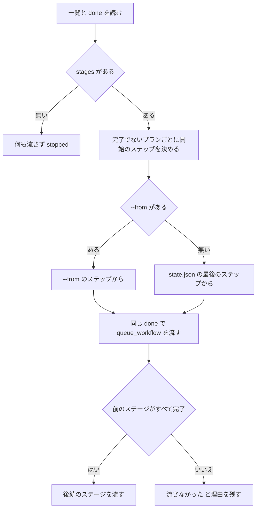

# supervise.py のスプリント: 承認ゲートの後と止まった後を、キューと待ちだけで流せるようにする（#1426）

## 目的

- **何が壊れているか**: `pace: normal` のスプリントで、承認ゲート 1 の後の設計 Pull Request のマージ・承認ゲート 2 の後の承認の記録・止まったプランの続きを、conductor がプランの外のコマンド（`merge-when-green`・`release-steps.py approve`・プランのファイルの写し）で行っている
- **誰が困るか**: conductor と、NDF を無人で動かす Neural Development Factory のランナー（#2168）。打ち忘れ・打ち間違いでプランが止まり、手当ては記録に残らない
- **直すと何が成り立つか**: 承認ゲートで利用者の答えを 1 行記録した後は、キュー 1 回と `wait` 1 回で本番まで流れる。止まったプランは `queue --resume <done>` の 1 回で、止まったステップから後続のステージまで続く

## 適用範囲

- **働く範囲**: NDF を使うすべてのリポジトリ（`supervise.py new sprint` / `new release` / `queue` と `release-steps.py approve`）
- **プロジェクトごとに違うもの**: 取り込んだ課題は引数（`--absorb`）で受ける。承認の証跡の置き場はスプリント状態ファイル（`--state`）のパスで受ける。ほかに新しい宣言は足さない
- **当たるモード**: `standard`（スプリントの全工程）。`--absorb` と `queue --resume` は進め方（`normal` / `fast` / `auto`）によらず働く。承認ゲートの後の並びを変えるのは `normal` だけ

## あるべき姿の根拠

| 根拠 | 種類 | 何を示すか |
| --- | --- | --- |
| #1407 の設計 PR 1423 のマージで、conductor が `sleep 20; merge-when-green …; git pull && queue …` を 3 回つなぎ直した（課題の本文の例） | 実測 | 承認ゲート 1 の後の 3 コマンドがプランの外にあると、失敗のたびに手当てが要る |
| PR 1845（2026-10-08）で、`release-steps.py approve` を打たずに会話を切り、本番のプランが「承認の記録が無い」で止まった | 実測 | 承認の記録をプランの外に置くと打ち忘れる。止まり方は安全側で、証跡なしに通さない今の約束は保つ |
| マイルストーン 26 のセッション 18〜27 で、止まったプランを `4b-impl-1334-cont.json`・`4c-impl-1334-pr.json` に写して作り直した | 実測 | キューが止まったプランを途中から続けられない |
| 再発の記録 m1693・m653・m1290・m1743 で、取り込む課題を設計の前に手で寄せた（4 回） | 実測 | 設計の前に取り込みを決める入口が `new sprint` に無い |
| `pace: auto` は、最初のステージの `command` 1 本に `--then` で後続をつなぐ形で、承認ゲート 1 の後の手当てを持たない（#1370 の決定 3） | 既存の形 | 同じ形を `normal` へ広げれば、新しい仕組みを足さずに済む |

要求と受け入れ条件は #1426 の本文にある（コピーは `issues/issue-1426-requirements.md`）。この文書は「どう作るか」だけを扱う。
決定の記録は [issue-1426-design-decisions.md](issue-1426-design-decisions.md) に分けた。

## ドメインモデル

### コンテキスト

| コンテキスト | 何の語が 1 つの意味に決まるか |
| --- | --- |
| 開発の工程（`ndf-workflow`） | スプリント・ステージ・キュー・承認ゲート・取り込んだ課題・承認の証跡・キューの続き |
| リリース（`ndf-release`） | 承認資料・承認したコミット・承認の記録 |

リリースが供給者、開発の工程が顧客の関係（顧客 / 供給者）。開発の工程は、リリースが書く承認資料と承認の記録の形を
そのまま読み、本番のプランの先頭のステップからリリースの `approve` を呼ぶ。承認資料の形はリリースが決める。

### 集約

| 集約 | 持ち主（書き換えてよいもの） | 根 | エンティティ | 値オブジェクト |
| --- | --- | --- | --- | --- |
| スプリントの目録 | `new sprint`（`supervise_lib/sprint.py`） | 目録 `sprint.json` | ステージ | `command`・`then_of`・`resume`・`gate` の文 |
| プラン | 書き出しは `new sprint`、承認ゲート 1 の後の書き換えは `design-results`、置き場の埋め込みは `queue`（時点で分ける。今の持ち方のまま） | プランの JSON | ステップ | `課題`・`取り込み先`・`実行の条件`・`Pull Request` |
| キューの実行 | `queue`（`supervise_lib/queue.py`・`flow.py`・新しい `queue_resume.py`） | done とその隣の一覧 `<done>.plans.json` | プランの結果（`items` の 1 件） | ステージの並び・`--max`・開始のステップ |
| 承認資料 | `release-steps.py`（`approval-facts` が書き、`approve` が承認の記録を足す） | 承認資料のファイル | — | 承認したコミット・承認の記録 |
| スプリント状態ファイル | `sprint-state.py`（`gate` の書き込みを変える。読むのは `lib/gate_answer.py`） | 状態のファイル | 承認ゲートの記録（承認ゲートの名と `pr` の組で 1 件） | `name`・`by`・`outcome`・`pr`・`at` |

### 不変条件

| # | 集約 | 条件 | 破れたときの扱い |
| --- | --- | --- | --- |
| I1 | プラン | 設計 Pull Request のマージのプランは、その PR の承認の証跡（承認ラベルか、承認ゲート 1 の利用者の承認の記録）が無ければマージへ進まない | 終了コード 10（承認ゲート）で止まる |
| I2 | 承認資料 | 本番のプランの先頭のステップは、利用者の承認の証跡が無ければ承認の記録を書かず、`release` へ進まない。証跡は次のどちらか: 承認資料に `facts` の SHA と一致する承認の記録が既にある（`--state` の無いスプリントで conductor が `approve` を打った場合。書かずに通す）か、スプリント状態ファイルに開発版の `facts` より後に書かれた承認ゲート 2 の利用者の承認の記録がある（承認の記録を書いて通す） | どちらも無ければ書かずに 10 で止まり、`release` へ進まない |
| I3 | 承認資料 | 承認の記録の SHA は、開発版の `facts` のステップの結果の `metrics.approved_sha` に一致し、承認資料の承認したコミットにも一致する | どちらかが違えば書かずに 10 で止まる |
| I4 | キューの実行 | キューの続きは、前の起動で完了したプランを流し直さない | 完了の記録があるプランは記録した結果を返す |
| I5 | キューの実行 | キューの続きでも、後続のステージは前のステージがすべて完了のときだけ流れる | 流さず `流さなかった` と理由を残す |
| I6 | キューの実行 | キューの続きは前の起動のステージの並びをそのまま使い、並びを読めなければ何も流さない | `stopped` の結果を返し、元のコマンドを打ち直すよう `next` に書く |
| I7 | プラン | 取り込んだ課題の実装のプランは `実行の条件` で飛ぶ。`new sprint --absorb` で設計の前に取り込んだ課題は設計のプランを持たない（設計の結果の表で後から取り込んだ課題の設計のプランは、既に流れたものとして残す）。取り込んだ課題は、取り込み先のプランのうち存在するもの（`--design` の取り込み先は設計と実装のプラン、`--issue` の取り込み先は実装のプラン）の `課題` に含まれる | — （書き出しと `design-results` が常にこの形で書く） |
| I8 | スプリントの目録 | 取り込み先が `--design` にも `--issue` にも無い・取り込む課題が `--design` にある・取り込む課題と取り込み先が同じ、のどれかなら、どのファイルも書かない | `stopped` の結果と理由を返す（終了コード 1） |
| I9 | スプリントの目録 | `normal` の承認ゲート 1 の後のステージ（マージ・設計の結果・スプリントブランチ・実装・検査・配布）は、最初のステージの `command` 1 本に `--then` でつながる | — （書き出しが常にこの形で書く） |
| I10 | スプリントの目録 | `fast` と `auto` のステージの並びと、本番のプランの先頭のステップは変わらない | — （既存のテストが縛る） |

### ドメインイベント

| # | イベント | 発生元 | 受け手 |
| --- | --- | --- | --- |
| E1 | スプリントのプランを書き出した | `new sprint` | conductor（目録の `command` を打つ） |
| E2 | 設計のプランが承認ゲート 1 で止まった | 設計のプランの judge | conductor（承認資料を示す） |
| E3 | 利用者が承認ゲート 1 で設計 Pull Request を承認した | 利用者 | conductor（承認の証跡を記録する） |
| E4 | conductor がマージから開発版までのキューを 1 回打った | conductor | キュー |
| E5 | 設計 Pull Request をマージした | 設計 PR のマージのプラン | 設計の結果のステージ |
| E6 | 設計の結果を実装のプランへ写した | 設計の結果のステージ | 実装のステージ |
| E7 | スプリントブランチを作り、実装し、検査がスプリントの Pull Request をマージした | 後続のステージ | 配布のステージ |
| E8 | 開発版を出し、`facts` のステップが承認資料と `metrics.approved_sha` を書いた | 開発版のプラン | conductor（承認ゲート 2 を示す）・本番のプランの先頭のステップ |
| E9 | 利用者が承認ゲート 2 で本番を承認した | 利用者 | conductor（承認の証跡を記録し、本番の `command` を打つ） |
| E10 | 止まったプランを途中のステップから続けた | conductor（`queue --resume`） | キュー |
| E11 | 本番のプランの先頭のステップが承認の記録を書いた | 本番のプランの `approve` | 本番のプランの `release` |
| E12 | 本番を出した | 本番のプラン | conductor（後片付けの後に `ndf-next`） |

### 用語

| 用語 | 意味 | 用語集への反映 |
| --- | --- | --- |
| 承認の証跡 | 承認ゲートで利用者が承認したことを示す、プランの外で残った記録。スプリント状態ファイルの承認ゲートの記録（`--by user --outcome approved`）・承認ラベル・承認資料の承認の記録のどれか。プランのステップは承認の証跡があるときだけ、承認を前提にした操作へ進む | 追加（`ndf-workflow`） |
| キューの続き | `supervise.py queue --resume <done>`。前の起動のステージの並びを読み、完了していないプランを終えたステップから続け、後続のステージも流す | 追加（`ndf-workflow`） |
| 取り込んだ課題 | 受け入れ内容を別の課題の実装へ含めると決めた課題。設計の結果の表か `new sprint --absorb` で決める。実装のプランは `実行の条件` で飛ばす。`--absorb` で決めたときは自分の設計のプランを持たない | 意味の変更（`ndf-workflow`） |

## 機能一覧

| # | 機能 | 誰が使うか |
| --- | --- | --- |
| F1 | `normal` で、承認ゲート 1 の後の設計 PR のマージから開発版までを、キュー 1 本で流す | conductor・Factory のランナー |
| F2 | 止まったプランを、止まったステップから続け、後続のステージも流す（`queue --resume`） | conductor・Factory のランナー |
| F3 | `normal` の本番のプランが、承認ゲート 2 の承認の記録を先頭のステップで書く | conductor・Factory のランナー |
| F4 | `new sprint` が取り込んだ課題を引数で受け、設計と実装のプランへ反映する | スプリントを組む人・conductor |
| F5 | `waiting.md` の手順が、承認ゲートの後と止まったときをキューと `wait` だけで示す | conductor |

## 構成要素

| 要素 | 責務 |
| --- | --- |
| `supervise_lib/sprint.py`（変更） | `normal` の承認ゲート 1 の後のステージを 1 本の `--then` の列に組む。目録の `command` に `--done` を書き、`resume` を `queue --resume` の形にする。`--absorb` を書き出しの後に当てる |
| `supervise_lib/design_merge.py`（新設） | `normal` の設計 PR のマージのプラン（`approved` → `merge_steps`）を組む |
| `supervise_lib/absorb.py`（新設） | `--absorb` の引数を確かめ（I8）、設計と実装のプランの `課題`・`prompt`・`取り込み先`・`実行の条件` を書く（I7） |
| `supervise_lib/sprint_inputs.py`（変更） | 受け入れ条件の確認の対象から取り込んだ課題を除く |
| `supervise_lib/sprint_routes.py`（変更） | 承認ゲート 1・2 のステージの文を、承認の証跡の記録とキューの形に書き直す |
| `supervise_lib/design_stage.py`（変更） | 書き出しで決めた取り込み（プランの `取り込み先`）を、設計の結果の表の取り込みと合わせて保つ |
| `supervise_lib/queue.py`（変更） | 一覧 `<done>.plans.json` へステージの並びと `--max` を足す。`{queue_pr:<名>}` を結果が `関門` のプランからも埋める |
| `supervise_lib/queue_resume.py`（新設） | 前の起動の一覧と結果から、続けるプランと開始のステップを決める（I4・I6） |
| `supervise_lib/flow.py`（変更） | プランごとの開始のステップを `admit_step` と `plan_workflow` の引数へ渡す |
| `supervise.py`（変更） | `queue --resume` / `--from` と、副命令 `design-approved` を受ける |
| `supervise_lib/release_templates.py`（変更） | `normal` の本番のプランの先頭へ `approve` のステップを置く |
| `supervise_lib/new_args.py`（変更） | `--absorb`（sprint）と `--dev-state`（release）を足す |
| `sprint-state.py`（変更） | `gate --by user --outcome approved` の記録に `by: user` と、`--pr` を渡したときの `pr` を書く。同じ承認ゲートの記録の置き換えを承認ゲートの名と `pr` の組で行い、同じ承認ゲート 1 で複数の設計 PR を承認した記録を並べて残す。`--pr` を渡さない書き込みは、同じ承認ゲートの名で `pr` を持たない記録だけを置き換え、`pr` を持つ記録は残す |
| `lib/gate_answer.py`（新設） | スプリント状態ファイルから承認ゲートの利用者の承認の記録を読む（承認ゲート 1・2 で共有）。利用者の承認の記録は、`by` が無いか `user` で、`outcome` が無いか `approved` のもの（`--outcome` を省いた打ち方と、この変更より前に書かれた `by` も `outcome` も無い記録を含む。`gate_word` と同じ読み方）。承認ゲート 1 は `pr` も一致するもの |
| `release_lib/approval.py`・`release-steps.py`（変更） | `approve --facts-from` / `--answer-from` で、証跡と SHA を照らしてから承認の記録を書く（I2・I3） |
| `development-workflow/references/waiting.md`・`pace.md`（変更） | 流し方と止まったときの手順を、キューと `wait` と `queue --resume` の形へ書き直す |
| 用語集（`docs/glossary/glossary.json`・`docs/glossary.md`） | 用語の表の 3 語を反映する |



図には、引数・文・語だけを受け持つ要素（`sprint_inputs.py`・`sprint_routes.py`・`new_args.py`・`supervise.py` の引数・用語集）を
含めない。`design-approved` は `supervise.py` の副命令として図に置いた。

触るファイルの置き場（`plugins/ndf/` の下）:

```text
plugins/ndf/
├── scripts/
│   ├── supervise.py
│   ├── release-steps.py
│   ├── sprint-state.py
│   ├── lib/gate_answer.py            （新設）
│   ├── release_lib/approval.py
│   └── supervise_lib/
│       ├── absorb.py                 （新設）
│       ├── design_merge.py           （新設）
│       ├── queue_resume.py           （新設）
│       ├── design_stage.py
│       ├── flow.py
│       ├── new_args.py
│       ├── queue.py
│       ├── release_templates.py
│       ├── sprint.py
│       ├── sprint_inputs.py
│       └── sprint_routes.py
└── skills/development-workflow/references/
    ├── pace.md
    └── waiting.md
```

**新しいモジュールに分けるのは、行数の上限（`scripts/check-script-structure.py` の 500 行）のためでもある。**
`queue.py` は 487 行、`flow.py` は 493 行、`sprint_waves.py` は 471 行で、続きの解決とマージのプランを
足すと上限を超える。`flow.py` へ足すのは開始のステップの受け渡しだけにする。

## 構造

新しい型は 2 つで、どちらも値を運ぶだけの不変の組である。



`normal` で `--design 1426 1698` と `--state` を渡したときの目録のステージ（オブジェクト図）:



## データ構造

永続のファイルの形へ項目を足す。どれも足すだけで、今の項目の意味は変えない（移行は要らない）。

| ファイル | 足す項目 | 型 | 空の値の扱い |
| --- | --- | --- | --- |
| 目録 `sprint.json` のステージ | `command` に `--done <出力先>/done-<番号>.json` を含める | 文字列 | — |
| 同上 | `resume`（`command` を持つステージとその `then_of` のステージのすべて）。`python3 supervise.py queue --resume <done>` | 文字列 | `gate` / `manual` のステージは持たない |
| `<done>.plans.json` | `stages`（ステージごとのプランのパスの配列の配列）・`max`（整数） | 配列・整数 | 無い一覧（この版より前の queue が書いたもの）は続きに使えない（I6） |
| 取り込んだ課題の実装のプラン | `取り込み先`（取り込み先の課題の番号） | 整数 | 無ければ取り込みなし |
| 設計 PR のマージのプラン `design-merge-<N>` | `Pull Request` に `{queue_pr:design-<N>}` | 文字列 | 埋まらなければ `0` で、`approved` のステップが止まる |
| 本番のプランの `approve` のステップ | `cmd` が `--facts-from {queue_state:release}`（`new release` は `--dev-state` の値）と `--answer-from <状態>` を持つ | 文字列 | `--state` が無ければ `--answer-from` を省く |

| 機能 | 目録 | プラン | `<done>.plans.json` | 承認資料 | スプリント状態ファイル |
| --- | --- | --- | --- | --- | --- |
| F1 | C | C | C | — | R |
| F2 | R | R | R | — | — |
| F3 | C | C | — | R・U | R |
| F4 | C | C | — | — | — |

## 入出力の契約

| 名前 | 入力 | 出力 | 失敗の形 | 互換性 |
| --- | --- | --- | --- | --- |
| `supervise.py queue --resume <done> [--from <プラン名>=<ステップ>]... [--max N] [--poll S]` | `<done>.plans.json` の `stages`・`max` と、done の `items`。`--from` は続けるプランの開始のステップを上書きする（繰り返せる）。`--resume` と位置引数のプラン・`--then` は併せて渡さない | 今の `queue` と同じ結果の JSON を同じ done へ書く。`items` の続けたプランに `resumed_from`（開始のステップ）を足す | 一覧が無い・`stages` が無い・`--from` のプランが一覧に無い → 何も流さず `stopped`。引数の組の誤り → 2 | 足すだけ |
| 続けるプランと開始のステップ | done の `items` の `result` が `止まった` / `報告なし` / `関門` のプラン | 開始のステップは、そのプランの `state.json` の `log` の最後のステップ（落ちたステップか、承認ゲートを返したステップ）。`log` が無ければ頭から | — | — |
| `supervise.py new sprint --absorb <課題>:<取り込み先>...` | 整数の組。何度でも並べられる | 取り込み先の設計と実装のプランの `課題` が両方の番号を持ち、requirements と design の `prompt` が両方の課題を参照する。取り込んだ課題の実装のプランは `取り込み先` と `実行の条件`（`absorbed_condition`）を持つ。取り込んだ課題が `--issue` に無ければ足す | I8 に当たれば計画を書かずに `stopped`（終了コード 1）。形の誤りは 2 | 足すだけ |
| `supervise.py design-approved --pr <N> [--state <状態>]` | 設計 PR の番号とスプリント状態ファイル | 承認ラベルがあれば 0。無く、状態に承認ゲート 1 の `--pr N` の利用者の承認の記録があれば承認ラベルを付けて 0 | 証跡が無い・PR が 0 → 10。`gh` が読めない → 2 | 新設 |
| `release-steps.py approve --approval <資料> --facts-from <開発版の状態ディレクトリ> [--answer-from <状態>] --by user` | 開発版のプランの最後の `facts` のステップの出力（結果 JSON の `metrics.approved_sha`） | 承認資料に承認の記録が既にあり、`facts` の SHA と一致すれば書かずに 0。無ければ、`--answer-from` の承認ゲート 2 の利用者の承認の記録（`at` が `facts` の出力より後）を確かめて書き、0 | `facts` の出力が無い・SHA が資料の承認したコミットと違う・証跡が無い → 書かずに 10。`--facts-from` と `--approved-sha` を併せて渡す → 2 | 足すだけ。`--approved-sha` の今の形は変えない |
| `sprint-state.py gate <状態> <関門の名> --what <要約> --by user --outcome approved [--pr N]` | 今と同じ引数 | 記録に `by: user`・`outcome: approved`、`--pr` を渡せば `pr` を書く。同じ承認ゲートの名と同じ `pr`（どちらも無いを含む）の記録だけを置き換え、別の `pr` の記録は残す。`--pr` を渡さない書き込みは `pr` を持たない記録だけを置き換える | 今のまま | 足すだけ。`--by mvv` の書き込みも、`--pr` を渡さない書き込みと同じく `pr` を持たない記録だけを置き換える（`--withdraw` の振る舞いは変えない） |
| `supervise.py new release --channel prod --dev-state <ディレクトリ>` | 開発版のプランの状態ディレクトリ | 本番のプランの `approve` の `--facts-from` に使う | — | 足すだけ。省けば `{queue_state:release}` |
| `{queue_pr:<名>}` | 名前の一致するプランの報告 | 完了か結果が `関門` のプランの Pull Request の番号 | 無い・飛ばされた → `0`（今のまま） | 結果が `関門` のプランからも埋めるよう広げる（決定 4） |

`normal` の本番のプランの並び（`new sprint` と `new release --channel prod` が書くもの）:

| 順 | ステップ | 次 | 落ちたとき |
| --- | --- | --- | --- |
| 1 | `approve`（`release-steps.py approve --facts-from … --answer-from … --by user`） | `bump` | 10 なら承認ゲートで終える（`gate_next: end`）。それ以外は止まる |
| 2〜 | 今の `bump` → … → `release` → `verify` → `cleanup` | 今のまま | 今のまま |

## 処理の流れ

承認ゲート 1 の後から本番まで（`normal`・`--state` あり）:



`--state` を渡さないスプリントでは、承認の証跡は承認ラベル（承認ゲート 1）と承認資料の承認の記録（承認ゲート 2）
である。conductor は承認ゲート 1 で `gh pr edit <N> --add-label design-approved` を、承認ゲート 2 で今の
`release-steps.py approve --approved-sha …` を打つ。承認ゲートのステージの文がこの形を示す（決定 1）。

キューの続き（`queue --resume <done>`）:



完了したプランは耐久の記録（同じ done の鍵の記録）から結果を返し、流し直さない（I4）。開始のステップが違えば
プランの実行の接頭辞（`prefix_of` の `start`）が変わり、新しい実行の回として `Engine.setup(start)` が前の実行の
結果を読む（#1676 の判定を変えない）。

`waiting.md` の 2 つの節の書き直し（例のスプリントは `--state` を渡す）:

| 節 | 承認ゲート 1 の後 | 承認ゲート 2 の後 | 止まったとき |
| --- | --- | --- | --- |
| スプリントを流すコマンド | 証跡の記録（`sprint-state.py gate … "関門 1" --pr <N> --by user --outcome approved`）→ マージのステージの `command` → `wait`。今の手順 3〜7 を 1 つにまとめ、`merge-when-green` の手順を消す | 証跡の記録（`"関門 2"`）→ 本番のステージの `command` → `wait`。`release-steps.py approve` の手順を消す | ステージの `resume`（`queue --resume <done>`）→ `wait` |
| 1 スプリントの流し方 | — （設計を持たない流し方） | 証跡の記録 → `new release --channel prod --dev-state <開発版の状態> --state <状態>` のプランのキュー → `wait` | `queue --resume <done>` → `wait` |

## 非機能の実現方式

| 大項目 | 要求の条件 | 実現方式 | 確かめ方 |
| --- | --- | --- | --- |
| 可用性 | プランが止まったとき、プランのファイルを写さずに 1 コマンドで続けられる（受け入れ条件 5）。続けた回の耐久の記録は、プロセスが落ちた後に同じコマンドを打ち直すと続きから流れる今の振る舞いを保つ | `queue --resume <done>` が前の一覧から同じステージの並びを組み、同じ done の鍵で耐久ワークフローを起こす。落ちた後に同じ `--resume` を打ち直すと、耐久の記録から続く | 結合のテスト（受け入れ条件 7）と、続きの途中でプロセスを止めて打ち直すテスト |
| 運用・保守性 | 止まった・続けたことはキューの進捗ログと done に残り、conductor が手で作ったプランのファイル（`-r2.json` など）を残さない | 続けたプランの `items` に `resumed_from` を足す。プランのファイルは置き場の埋め込みのほかに書かない | done の JSON とプランのディレクトリのファイルの一覧を読む |
| 移行性 | 既に書き出した目録とプラン（この版より前の `new sprint` が書いたもの）は、今のキューでそのまま流せる。新しい引数は足すだけで、今の引数の意味を変えない | 位置引数と `--then` の `queue` は今のまま。古い一覧は続きにだけ使えず、理由を返す | 前の版の形の目録とプランを今の `queue` で流すテスト |
| セキュリティ | 本番の配布（戻せない操作）の前の承認の記録は、利用者の承認の証跡が無ければ書かない（受け入れ条件 11） | `approve` は承認ゲート 2 の利用者の承認の記録を `facts` の後の時刻で照らし、無ければ 10。キューに入れたこと・`--from` で入ったことは証跡に数えない | 受け入れ条件 11・12 のテスト |

## 決定の記録

決定は [issue-1426-design-decisions.md](issue-1426-design-decisions.md) に分けた。

## テスト設計

| 受け入れ条件・不変条件 | どの振る舞いで縛るか | どう壊したら落ちるべきか |
| --- | --- | --- |
| AC1・I9 | `normal` と `--design` の `new sprint` の目録に、承認ゲート 1 の直後のステージとして設計 PR ごとの `design-merge-<N>` のプランがあり、`approved` → `merge-gate` → `merge` を持ち、`Pull Request` が `{queue_pr:design-<N>}` である | マージのステージを置かない・番号を固定の値で書く・`merge_steps` を外す |
| AC2・I9 | 同じ目録で、マージのステージだけが `command` を持ち、設計の結果から配布までが `then_of` を持ち、`command` の `--then` の順がステージの順と一致する | 実装か検査のステージに `command` を残す・`--then` の順を入れ替える |
| AC3 | `--design` を渡さない `normal` では、マージのステージが無く、スプリントブランチ（`--designed` があれば設計の結果）の `command` に配布までがつながる | マージのステージを空で置く・配布の `then_of` を検査のままにする |
| AC4 | `waiting.md` の手順のコマンドを一時ディレクトリの `new sprint` で打ち、目録の `command` と一致する（手で照らす。`.md` の文言のテストは書かない） | — （手順の確認として実装の PR に結果を載せる） |
| AC5・AC7・I5 | 一時ディレクトリで、3 ステップ目で落ちるプランと後続のステージを流し、落ちる原因を除いて `queue --resume` を打つと、3 ステップ目から流れ、後続のステージまで完了する | 頭から流し直す・後続のステージを流さない・開始のステップを 1 つずらす |
| AC6・I4 | 同じステージで完了したプランの耐久の記録があると、続きで流し直さない（ステップの数が増えない） | 完了したプランの接頭辞を変える |
| AC6・I5 | 続けたプランが再び止まると、後続のステージは `流さなかった` になる | 続けたプランの結果を見ずに後続を流す |
| I6 | `stages` の無い一覧と、一覧の無い done では、何も流さず `stopped` を返す | 古い一覧を `plans` だけで流す |
| AC8 | 目録の `command` を持つステージと `then_of` のステージの `resume` が、どれも `queue --resume <その done>` の形である | `then_of` のステージに今の形の `resume` を残す |
| AC9 | `normal` の `new sprint` と `new release --channel prod` の本番のプランの先頭が `approve` で、`--facts-from` を持つ | 先頭を `bump` のままにする・`--approved-sha` を固定で書く |
| AC10・I3 | 開発版の `facts` の出力の SHA と承認資料の承認したコミットが違うと、`approve` は書かずに 10 を返す | SHA を承認資料から読み直す |
| AC11・I2 | 承認資料に一致する承認の記録が無く、承認ゲート 2 の利用者の承認の記録も無いか `facts` の出力より前の時刻だと、`approve` は書かずに 10 を返し、プランは `release` へ進まない。`--answer-from` を渡さず、承認資料に `facts` の SHA と一致する承認の記録があれば書かずに 0 を返す | 時刻を見ない・`--by mvv` の記録を証跡に数える・10 を止まったと扱う・`--state` の無いスプリントの既存の承認の記録で通さない |
| AC12 | 一時ディレクトリに開発版の `facts` の出力・承認資料・承認の記録を置いて本番のプランを流すと、`release` の承認の照合を通る（`gh` はスタブ） | `approve` の後に `release` が承認の記録を読めない |
| I1 | 承認ラベルも承認ゲート 1 の記録も無いと、`design-approved` は 10 を返し、マージのプランは `merge` へ進まない。記録があればラベルを付けて 0 | 証跡なしに 0 を返す・別の PR の記録を証跡に数える |
| I1（記録の書き込み） | `sprint-state.py gate … "関門 1" --pr 1 --by user --outcome approved` の後に `--pr 2` で同じ承認ゲートを書くと、両方の記録が `by: user` と `pr` を持って残り、`design-approved --pr 1` と `--pr 2` がどちらも 0 を返す。続けて `--pr` を渡さずに同じ承認ゲートを書いても、`--by mvv` で同じ承認ゲートを書いても、`pr` を持つ 2 件は残る | 同じ承認ゲートの名で前の PR の記録を上書きする・`by` か `pr` を書かない・`--pr` を渡さない書き込みか `--by mvv` の書き込みで `pr` を持つ記録を消す |
| I2（記録の読み取り） | `by` も `outcome` も無い承認ゲート 2 の記録（`gate "関門 2" --what "本番 <版>"` の既定の打ち方と、この変更より前の記録）を `lib/gate_answer.py` が利用者の承認として返す。`outcome: rejected` と `by: mvv` の記録は返さない | `by: user`・`outcome: approved` を持つ記録だけを数え、既定の打ち方の承認で本番のプランを止める |
| AC13・AC14・I7 | `--absorb 1693:1688` で、`design-1688` の `課題` が `[1688, 1693]` で requirements と design の `prompt` が両方を参照し、`design-1693` が無く、`impl-1693` が `取り込み先` と `実行の条件` を持つ | 取り込んだ課題の設計のプランを書く・`prompt` に片方しか入れない |
| AC14・I7（2 つの経路を揃える） | 承認ゲート 1 の後の `design-results` が、表に無い書き出しの取り込みを保ち、表の取り込みと合わせる。表で後から取り込んだ課題の流れた設計のプランを消さず、`--issue` の取り込み先（設計のプランが無い）へは実装のプランだけに反映する | 表の内容で `課題` を作り直して書き出しの取り込みを消す・後から取り込んだ課題の設計のプランを拒む・取り込み先に設計のプランを作る |
| AC15 | 取り込んだ課題の本文に受け入れ条件の節が無くても、`new sprint` が止まらない | 確認の対象から取り込んだ課題を除かない |
| AC16・I8 | 取り込み先が `--design` にも `--issue` にも無い・取り込む課題が `--design` にある・同じ番号のとき、ファイルを書かずに `stopped` を返す | 一部のプランを書いてから止まる |
| AC17・I10 | `fast` と `auto` の目録のステージの並びと、本番のプランの先頭のステップ（`mvv`）が変わらない（既存のテスト） | `normal` の並びの変更を `auto` へ漏らす |
| AC18 | `uv run --frozen --project . --all-extras pytest . -q -n 4`・`scripts/check-lint.sh`・`python3 scripts/check-script-structure.py` が通る | 新しいモジュールを足さずに `flow.py` へ書いて 500 行を超える |
| 移行性 | 前の版の形の目録（`resume` が `queue <プラン> --then …` の形）とプランを、今の `queue` で流せる | 位置引数の `queue` の振る舞いを変える |

## 設計の結果

| 課題 | 扱い | 取り込み先 | 触るファイル |
| --- | --- | --- | --- |
| #1426 | 実装する | — | `plugins/ndf/scripts/supervise.py`、`plugins/ndf/scripts/release-steps.py`、`plugins/ndf/scripts/sprint-state.py`、`plugins/ndf/scripts/lib/gate_answer.py`、`plugins/ndf/scripts/release_lib/approval.py`、`plugins/ndf/scripts/supervise_lib/`、`plugins/ndf/scripts/tests/`、`plugins/ndf/skills/development-workflow/references/waiting.md`、`plugins/ndf/skills/development-workflow/references/pace.md`、`docs/glossary/glossary.json`、`docs/glossary.md` |

残る子課題（#1912・#1918・#1920・#1921）はこの表に載せない。表の行はスプリント PR の閉じる行になるが、子課題は
実装の Pull Request のマージの後に受け入れ条件を確かめてから閉じる（要求の前提 1）。

## 未確認のまま残ること

| 項目 | 内容 |
| --- | --- |
| `--state` を渡さない `normal` | 承認ゲート 2 の後に conductor が `release-steps.py approve` を打つ形が残る（決定 1）。`waiting.md` の手順は `--state` を渡す形で書く。`--state` の無いスプリントで手当てが残るかは、リリースの後の最初の `normal` のスプリントで数える |
| 開始のステップの読み方 | `state.json` の `log` の最後の行が、落ちたステップと承認ゲートを返したステップを必ず指すかは、実装で 3 つの終わり方（ステップが落ちた・承認ゲートを返した・遅れの再試行の後に打ち切られた）を走らせて確かめる |
| `{queue_pr:<名>}` を結果が `関門` のプランへ広げる影響 | まとめの `{queue_pr:release-prod}` が、後片付けの承認ゲートで終えた本番のプランからも埋まる。リリース後テストが流れるのは正しい向きと見ているが、実物では確かめていない |
| 用語集の衝突の解消 | 並行の設計 PR の語の追加どうしの衝突は `merge-when-green`（#1913）が解く前提で、マージのプランの中で起きたときの実物の確認はリリースの後のスプリントで行う |
| #1916 の受け入れ条件 5 の保留 | `--impl-timeout` を渡し、refactor の上限を延ばさずに済むかは、要求の「検証手段」の手動確認と同じスプリントで確かめる |
