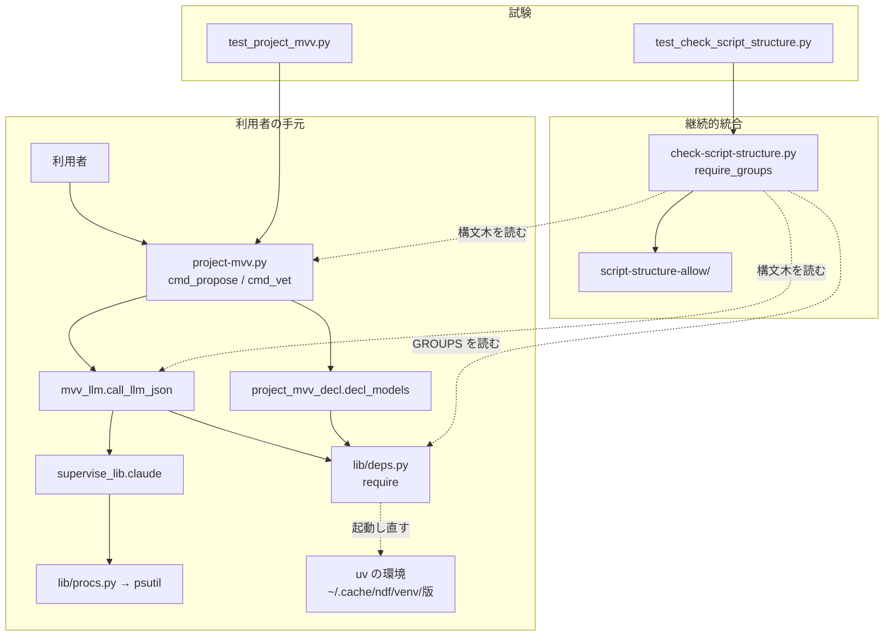
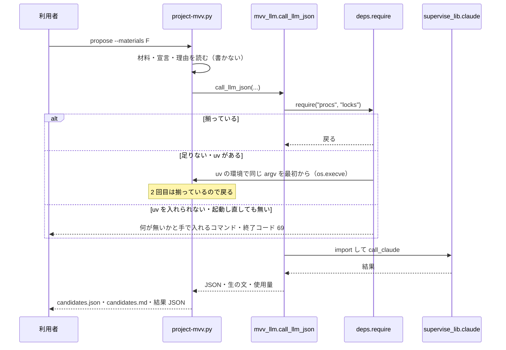
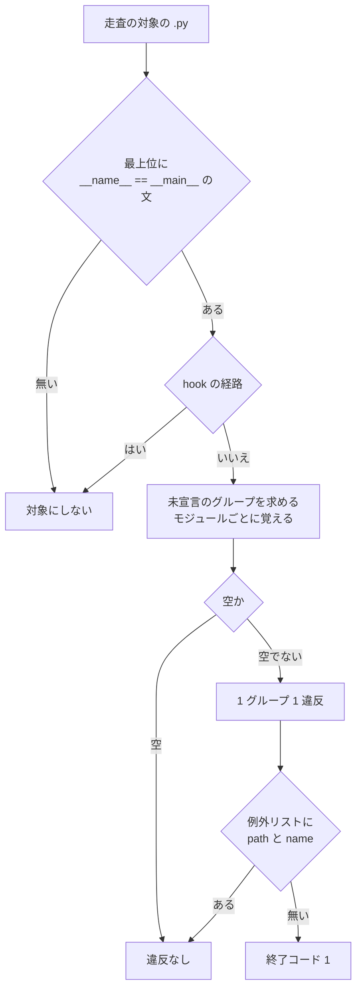

# project-mvv.py propose / vet: psutil の無い python3 でも依存を用意して最後まで進み、同じ形の欠けを継続的統合で落とす（#1455）

## 目的

- **何が壊れているか**: `project-mvv.py propose` / `vet` は、関数の中で遅れて読む `supervise_lib.claude` から `psutil` へ届くのに、その経路で `deps.require` を呼ばない。psutil の無い python3 では `ModuleNotFoundError` で止まる。構造チェックの `require-groups` は最上位で `require` を呼ぶエントリポイントの、読み込み時の import しか見ないため、この形を落とせない
- **誰が困るか**: `project-mvv.md` の手順 0 の案内どおりに打つ利用者（2026-09-29 の carmo-cdk）。同じ形の欠けを持つほかのエントリポイントを使う利用者も、手元の環境しだいで同じように止まる
- **直すと何が成り立つか**: `propose` / `vet` は、ほかの NDF のスクリプトと同じく `deps.require` が uv の環境へ起動し直して進む。関数の中の import を含めて、宣言されていない依存グループへ届く経路を、構造チェックが Pull Request の時点で落とす

## 適用範囲

- **働く範囲**: このリポジトリの配布物（`plugins/ndf/`）と、その構造チェック（`scripts/check-script-structure.py`）。直した `propose` / `vet` は配布先のリポジトリでも働く。構造チェックはこのリポジトリの継続的統合でだけ働く
- **プロジェクトごとに違うもの**: 無し（依存グループの宣言は `plugins/ndf/pyproject.toml` と `lib/deps.py` の `GROUPS` の 1 組で、利用者のリポジトリの設定を読まない）
- **当たるモード**: `standard`

## あるべき姿の根拠

| 根拠 | 種類 | 何を示すか |
| --- | --- | --- |
| 前提 1 の再現（2026-10-30、psutil の無い python 3.12 の venv で `propose` が `lib/procs.py:23` で終了コード 1） | 実測 | 直す対象の現象が今の木で起きる |
| 構造チェックを広げた試作（`/tmp` に置いた試作、2026-10-30）で、エントリポイント 33 本に宣言の無い依存グループへ届く経路が 60 件（`filelock` の 2 つのグループを 1 件に数える）。決定 1 の 2 か所を直した写しでは `project-mvv.py` を含む 4 本が消えて 29 本 | 実測 | 同じ形の欠けが `project-mvv.py` の 1 本に限らず、決定 1 の直しで `project-mvv.py` の違反が消える |
| 今の構造チェック全体の所要 7.13 秒、そのうち `require_groups` 1.57 秒。試作の規則は単独で 2.28 秒（読み込みを含む） | 実測 | 広げても所要の増え方が 1 秒前後に収まる |
| 関数の中で `deps.require` を呼んでから import する前例（`lib/project_mvv.py` の `sprint_source`・`lib/monitor.py` の `main`・`lib/run_metrics.py`・`lib/post_queue.py`・`lib/gh_parts.py`） | 既存の形 | 呼ばれる側が自分の依存グループを宣言する形が、すでにリポジトリの約束事になっている |

要求と受け入れ条件は #1455 の本文にある（コピーは `issues/issue-1455-requirements.md`）。この文書は「どう作るか」だけを扱う。

## ドメインモデル

### コンテキスト

| コンテキスト | 何の語が 1 つの意味に決まるか |
| --- | --- |
| NDF の開発ワークフロー（`ndf-workflow`） | エントリポイント・構造チェック・依存グループ・未宣言のグループ・任意の依存・依存の欠け |

1 つのコンテキストに収まる。

### 集約

| 集約 | 持ち主（書き換えてよいもの） | 根 | エンティティ | 値オブジェクト |
| --- | --- | --- | --- | --- |
| 依存グループの表 | `lib/deps.py`（`GROUPS`）と `plugins/ndf/pyproject.toml` の 1 組。この課題では変えない | `GROUPS` | 依存グループ | import の名前 |
| 依存の宣言 | `deps.require(…)` を書く各モジュール（エントリポイントと、遅れて import する関数を持つモジュール） | `deps.require` の呼び出し | — | 並べたグループの集合・覆う範囲（モジュール全体 / 関数の中のそれより後） |
| 依存の宣言の検査 | `scripts/check-script-structure.py` の `require-groups` | 違反 | — | 違反の 1 件（エントリポイントのパス・グループ・届いた外部の名前と書いたモジュール） |
| 例外リスト | `scripts/script-structure-allow/` の `require-groups` の項目 | 項目のファイル | — | `path`・`name`（グループ）・`reason` |

### 不変条件

| # | 集約 | 条件 | 破れたときの扱い |
| --- | --- | --- | --- |
| I1 | 依存の宣言の検査 | エントリポイントから import をたどって届く外部パッケージは、その依存グループが「覆う宣言」（I4）のどれかに並ぶか、任意の依存（I2）である | `require-groups` の違反（エントリポイントのパス・グループ・届いた名前と書いたモジュール）を出し、終了コード 1 |
| I2 | 依存の宣言の検査 | 任意の依存（`except ImportError` / `ModuleNotFoundError` を受ける `try` の中の import と、同じ関数の中で `importlib.util.find_spec("<名前>")` か `deps.importable("<グループ>")` で確かめる名前の import）は違反にしない | 違反を出さない |
| I3 | 依存の宣言の検査 | 関数の中で `deps.require` を呼んでから import する依存グループは、そのモジュールを読む側の未宣言のグループに入れない | 読む側に違反を出さない |
| I4 | 依存の宣言 | 覆う範囲は 3 つだけ: モジュールの最上位の文として呼ぶ `require` は、それより後の最上位の文とすべての関数の本体。`main` の本体の最上位の文として呼ぶ `require` は、そのモジュールをエントリポイントとして検査するときだけモジュール全体。ほかの関数の中で呼ぶ `require` は、その関数の中のそれより後の import だけ | 別の関数の `require` を覆いに数えない。ほかのモジュールから読まれるモジュールの `main` の `require` も数えない（`supervise_lib.claude` が `lib/monitor.py` を読んでも `monitor.main` は走らず、その `require("procs", "locks")` は覆いにならない） |
| I5 | 依存の宣言 | 関数の中で起動し直しうる `require` は、そのプロセスが外へ書く（ファイル・標準出力・投稿）より前に呼ばれる | 起動し直した後に同じ書き込みが 2 度起きる。実装で呼ぶ位置と呼び出し元の手前を読んで確かめ、満たさない箇所は直さずに例外リストへ載せる |
| I6 | 依存の宣言 | psutil などが揃った python3 では `require` は何もせず戻る（起動し直さない） | 非機能の条件（性能）を満たさない |
| I7 | 依存の宣言の検査 | hook の経路（`HOOK_ENTRIES` から import でたどれるモジュール）のエントリポイントは `require-groups` の対象にしない（`hook-deps` が持つ。I13・決定 20） | hook の経路が違反を出す（hook は `require` を呼べないため直せない） |
| I8 | 例外リスト | この課題で足す `require-groups` の項目は、`reason` に理由と起こした課題の番号を持つ | 承認ゲート 2 で差し戻す |

### ドメインイベント

| # | イベント | 発生元 | 受け手 |
| --- | --- | --- | --- |
| E1 | 利用者が `project-mvv.py propose` か `vet` を打った | 利用者（手順 0 の案内） | `project-mvv.py` の副命令のハンドラー |
| E2 | 依存の仕組みが、要るグループの外部パッケージを import できるかを確かめた | `mvv_llm.call_llm_json` の `deps.require("procs", "locks")` | `lib/deps.py` の `require` |
| E3 | 足りなかったので、uv の環境で同じ副命令と引数のまま自分を起動し直した | `lib/deps.py` の `require` | uv の環境で起動した `project-mvv.py`（同じ副命令を最初から） |
| E4 | LLM を 1 回呼び、候補か照合の結果を書いた | `mvv_llm.call_llm_json` → `supervise_lib.claude.call_claude` | `cmd_propose`（`candidates.json`・`candidates.md`）/ `vet_body`（`project-mvv.jsonl`） |
| E5 | 構造チェックが、エントリポイントの未宣言のグループを求め、違反を出した | `check-script-structure.py` の `require_groups` | 継続的統合のジョブと、Pull Request の書き手 |

### 用語

| 用語 | 意味 | 用語集への反映 |
| --- | --- | --- |
| 依存グループ | `lib/deps.py` の `GROUPS` と `pyproject.toml` の extra に並ぶ、外部パッケージの用途ごとのまとまり（`procs`・`locks` など）。`deps.require` へ名前で渡す | 追加 |
| 未宣言のグループ | モジュールから import をたどって届く外部パッケージの依存グループのうち、そのモジュールの中で覆う `deps.require` が無いもの。そのモジュールを読む側が引き受ける | 追加 |
| 任意の依存 | 無ければ代わりの手段へ落ちる import。`except ImportError` / `ModuleNotFoundError` で受けるか、同じ関数の中で `find_spec` / `deps.importable` で確かめてから読む | 追加 |
| エントリポイント | 用語集のとおり | — |
| 構造チェック | 用語集のとおり | — |

## 機能一覧

| # | 機能 | 誰が使うか |
| --- | --- | --- |
| F1 | psutil の無い python3 で `propose` を打っても、依存を用意して候補を書くところまで進む | MVV を策定する利用者 |
| F2 | 同じ条件で `vet` を打っても、依存を用意して照合を記録するところまで進む | MVV を策定・改訂する利用者 |
| F3 | 関数の中の import を含めて、エントリポイントの未宣言のグループを構造チェックが違反として出す | Pull Request の書き手と継続的統合 |
| F4 | 任意の依存と、呼ばれる側が自分で宣言した依存を違反にしない | Pull Request の書き手 |

## 構成要素

| 要素 | 責務 |
| --- | --- |
| `project_lib/mvv_llm.py` の `call_llm_json`（変える） | `supervise_lib.claude` を import する前に `deps.require("procs", "locks")` を呼ぶ。グループの並びは `supervise_lib.claude` の未宣言のグループと一致させ、ずれは構造チェックが落とす |
| `lib/project_mvv_decl.py` の `decl_models`（変える） | `pydantic` を読む前に `deps.require("schema")` を呼ぶ。呼び出し元の `cmd_schema` は既に `require("schema")` を呼んでおり、振る舞いは変わらない。`project-mvv.py` に残る `schema` の違反を、呼ばれる側の宣言で消す |
| `scripts/check-script-structure.py` の `require_groups`（変える） | エントリポイント（`if __name__ == "__main__":` の文を最上位に持つ `.py`。hook の経路を除く）ごとに未宣言のグループを求め、1 グループ 1 違反で出す。モジュールごとの結果を覚えて 2 度目は求め直さない |
| `scripts/check-script-structure.py` の docstring の `require-groups` の段落（変える） | 新しい対象と、覆う範囲（I4）と、任意の依存（I2）を書く |
| 違反した既存のエントリポイント（変える・例外リストへ載せる） | 1 件ごとに即時修正の 4 条件で決める（前提 5）。直すときの形は決定 4 |
| `scripts/script-structure-allow/` の `require-groups` の項目（足す） | 直さない違反を 1 項目 1 ファイルで持つ。`reason` に理由と課題の番号 |
| `scripts/tests/test_check_script_structure.py`・`plugins/ndf/scripts/tests/test_project_mvv.py`（足す） | テスト設計の行を縛る |



図に含めないもの: 違反した既存のエントリポイント（実装で 1 件ごとに決めるため、この時点で名前が決まらない）と、docstring の段落（`check-script-structure.py` の中にある）。

システムの文脈と配置は変わらない。`project-mvv.py` は利用者の手元の python3 で動き、足りなければ `deps.require` の既存の手順で uv の環境へ移る。構造チェックは継続的統合の `script-structure-check` のジョブの中で動く。

### モジュールの置き場

```text
plugins/ndf/scripts/
├── project-mvv.py              # 変えない（cmd_schema の require("schema") も残す）
├── project_lib/mvv_llm.py      # call_llm_json に require("procs", "locks")
├── lib/project_mvv_decl.py     # decl_models に require("schema")
└── lib/deps.py                 # 変えない
scripts/
├── check-script-structure.py   # require_groups を広げる
├── script-structure-allow/     # require-groups の項目を足す（実装で決まる件数）
└── tests/test_check_script_structure.py
```

## 入出力の契約

`project-mvv.py` の副命令・引数・出力・終了コードは変えない。psutil の無い python3 では、`call_llm_json` の手前で uv の環境へ起動し直す（`deps.require` の既存の契約。足りなければ終了コード 69）。

構造チェックの起動・結果 JSON の形・終了コード（0 / 1 / 2）・例外リストのファイル名の決め方は変えない。`require-groups` の違反の 1 件は次の形である。

| 鍵 | 値 |
| --- | --- |
| `kind` | `require-groups` |
| `path` | エントリポイントのパス（根からの相対） |
| `function` | 足りない依存グループの名前。例外リストの `name` に当たる。1 つの外部の名前が 2 つのグループに属するとき（`filelock` は `locks` と `durable`）は、どちらかが並べば満たし、違反の名前は `GROUPS` で先に出るもの |
| `detail` | `<外部の名前>（<書いたモジュール>）へ届くのに deps.require() にグループ <名前> が無い` |

例外リストの項目が違反に当たらなくなったら、今と同じく `unused-allow` で落ちる。

## 処理の流れ

### `propose` / `vet`（psutil の無い python3）



`vet` も同じ順で、`vet_body` が照合の記録を組み（書かない）、`call_llm_json` を呼び、戻ってから `project-mvv.jsonl` へ 1 行を足す。形の誤りで LLM を呼ばない場合（`shape_problems` が返す・改訂に承認済みの MVV が無い）は `require` を通らない。起動し直す前のプロセスは外へ何も書いていない（I5）。

### 構造チェックの `require_groups`



未宣言のグループは、モジュールの文を上から読んで求める。

| 文 | 扱い |
| --- | --- |
| モジュールの最上位の `deps.require(…)` / `require(…)` | 並べたグループを、それより後の最上位の文とすべての関数の本体の覆いに足す（I4） |
| `main` の本体の最上位の同じ呼び出し | エントリポイントとして検査するときだけ、並べたグループを未宣言のグループから引く。ほかのモジュールから読まれるときは数えない（I4） |
| 関数の本体の `deps.require(…)` | 並べたグループを、その関数のそれより後の文の覆いに足す（I4） |
| `except ImportError` / `ModuleNotFoundError` を受ける `try` の本体 | 中の import を読まない（I2）。`else`・`finally`・`except` の本体は読む |
| 関数の中の `find_spec("<名前>")` / `deps.importable("<グループ>")` | その名前のグループを、その関数全体の覆いに足す（I2） |
| 外部の import（`GROUPS` の import の名前に当たる） | その時点の覆いに無ければ、グループを未宣言に足す |
| 走査の根（エントリポイントの置き場・`scripts/`・`scripts/lib/`）のモジュールの import | そのモジュールの未宣言のグループのうち、その時点の覆いに無いものを足す（I3） |

import の解決（置き場の順・相対 import）は今の `require_groups` と同じにする。

処理の流れの図に含めないもの: `project_mvv_decl.decl_models`（通るのは `cmd_schema` だけで、既存の `require("schema")` の後に呼ぶため順序が変わらない）、docstring の段落、2 つのテスト、決定 4 で直す既存のエントリポイント（直した後の順序は、上の `propose` の図の `require` の位置と同じ形になる）。互いに import し合うモジュールは、たどっている途中のモジュールを空として扱う。

## 非機能の実現方式

| 大項目 | 条件 | 実現方式 |
| --- | --- | --- |
| 性能・拡張性 | psutil の入った python3 の `propose` / `vet` は起動し直さない | `deps.require` は揃っていれば `find_spec` を見て戻るだけである（既存の契約）。`call_llm_json` の呼び出しごとに 1 回で、所要は計らずに済む大きさに収まる |
| 運用・保守性 | 構造チェックの所要が目に見えて増えない | モジュールごとの未宣言のグループと構文木を 1 回だけ求めて覚える。試作で `require_groups` 単独 2.28 秒（今 1.57 秒）。PR に、変更前と変更後の `python3 scripts/check-script-structure.py` の所要を秒で書く |
| システム環境 | psutil が無くても動く。uv が無ければ既存の手順で入れる | `deps.require` の既存の手順をそのまま通る（前提 6） |

## 決定の記録

### 決定 1: 依存を知る場所で宣言するため、`propose` / `vet` の直しは `call_llm_json` の中で `deps.require("procs", "locks")` を呼ぶ形にする

`supervise_lib.claude` を関数の中で読むのは `call_llm_json` で、psutil が要ると分かるのもそこである。ここで宣言すれば、`propose` / `vet` のほかにこの関数を呼ぶ経路が増えても同じ宣言が効く。呼び出し元（`cmd_propose`・`vet_body`）はこの関数の手前で読むだけで、起動し直しても書き込みが 2 度起きない（I5）。グループの並びは構造チェックが `supervise_lib.claude` の未宣言のグループと突き合わせる。同じ考えで、`project-mvv.py` に残る `schema` の違反は、`pydantic` を遅れて読む `project_mvv_decl.decl_models` の中で `deps.require("schema")` を呼んで消す（呼ぶのは `cmd_schema` だけで、そこは既に `require("schema")` を呼んでいる）。

副命令のハンドラー（`cmd_propose` / `cmd_vet`）で呼ぶ形は採らない。`mvv_llm` を最上位で読む `project-mvv.py` から見ると、どの関数がどの依存へ届くかは呼び出しの流れを追わないと分からず、検査が呼び出しの流れを追わない（決定 2）ため、直しても違反が消えない。`project-mvv.py` の最上位で呼ぶ形も採らない。`check` と `collect` まで起動し直すようになり、uv もネットワークも無い環境では今は通る `check` が終了コード 69 で止まる（受け入れ条件 3）。`supervise_lib/claude.py` の最上位で呼ぶ形も採らない。import しただけで `os.execve` が走り、ライブラリの最上位に `require` を置かない今の約束事から外れる。

根拠: Value 6 / Value 2（MVV 版 3）

### 決定 2: 速く確かな検査にするため、検査は呼び出しの流れを追わず、モジュールの import と `require` の位置だけで未宣言のグループを求める

呼び出しの流れ（どの関数がどの関数を呼ぶか）を追うと、属性の呼び出し・引数で渡す関数・動的な振り分けで解決できない箇所が残り、規則が当て推量になる。import と `require` の位置だけなら構文木から決まり、モジュールごとに 1 回求めて覚えられる。代わりに、関数の中の import はその関数が呼ばれるかどうかに関わらず読む側へ持ち越す（多めに出す）。多めに出た違反は、呼ばれる側で宣言するか（決定 4）、例外リストへ理由つきで載せる。

関数の中の `require` を、同じモジュールのほかの関数の import の覆いに数える形は採らない。モジュールのどこかに `require` があれば覆うことになり、`lib/monitor.py` の `main` の `require("procs", "locks")` が、`supervise_lib.claude` から読まれたときにも `monitor` の遅れた `import procs` を覆ってしまう。ほかのモジュールから読まれたとき、`main` は走らない。例外は `main` の本体の最上位の文として呼ぶ `require` で、そのモジュールをエントリポイントとして起動したときは副命令へ振り分ける前に必ず走る。このため、エントリポイントとして検査するときだけモジュール全体を覆う（`estimate.py` の前例）。

根拠: Value 4 / Value 3（MVV 版 3）

### 決定 3: 今の `require-groups` を置き換えるため、対象を「最上位で `require` を呼ぶエントリポイント」から「`__main__` の文を持つ `.py` すべて（hook の経路を除く）」へ広げ、1 つの種類のまま持つ

最上位で `require` を呼ばないエントリポイント（`project-mvv.py`）が今の検査の外にあることが、この課題の見落としの 1 つ目の理由である。新しい種類を足すと、同じ問い（宣言の無い依存へ届くか）を 2 つの種類が別の範囲で答え、例外リストの項目もどちらの種類かで分かれる。今の種類の範囲は新しい範囲に含まれるため、置き換えて 1 つにする。hook の経路は `require` を呼べないので対象から外し、`hook-deps` に任せる（I7）。

対象をスクリプトの置き場（`scripts/` の直下・`experimental/`・各 Skill の `scripts/`）のパスで決める形は採らない。`lib/monitor.py` のように `lib/` に置いて直接起動するモジュールが外れる。

根拠: Value 6 / Value 8（MVV 版 3）

### 決定 4: 直した後の形を揃えるため、検査が落とした既存のエントリポイントは、宣言を足す場所を 2 つの形のどちらかに限って直す

直す形は次の 2 つだけにする。どちらにも当たらない違反と、即時修正の 4 条件（Value 1）を満たさない違反は、例外リストへ理由と課題の番号つきで載せる（前提 5）。違反の件数（試作で 33 本・60 件、決定 1 の直しの後で 29 本）と 1 件ごとの扱いは実装の Pull Request に書く。

| 形 | 当てるとき |
| --- | --- |
| エントリポイントの最上位（か `main` の先頭）の `require` へグループを足す | そのエントリポイントがすでに最上位か `main` の先頭で `require` を呼んでいる。足すグループで、今は通る副命令が起動し直すようになっても、その副命令の出力と終了コードが変わらない |
| 遅れて import する関数の中で、import の前に `require` を呼ぶ | その関数と呼び出し元の手前が外へ書かない（I5）。同じグループの宣言が複数のエントリポイントの違反を一度に消すとき（`claude_accounts` の遅れた `import procs` など）を優先する |

`require` を呼ばないエントリポイントに最上位の `require` を新しく置く形は採らない。決定 1 と同じく、今は依存無しで通る副命令まで起動し直すようになる。

根拠: Value 1 / Value 6（MVV 版 3）

## テスト設計

| 受け入れ条件・不変条件 | どの振る舞いで縛るか | どう壊したら落ちるべきか |
| --- | --- | --- |
| 受け入れ条件 1・I6 | psutil の無い python で `propose` を打つと、差し替えた LLM が呼ばれ、終了コードが psutil の入った python で打ったときと同じになる。psutil の入った python では起動し直さない | `call_llm_json` の `require` を外すと `ModuleNotFoundError`（終了コード 1）で落ちる。`require` を最上位へ移すと、psutil の入った python でも `check` が起動し直す |
| 受け入れ条件 2 | 同じ条件で `vet --kind candidate` を打つと、差し替えた LLM が呼ばれ、照合の記録が 1 行だけ増える | `require` を外すと落ちる。起動し直す前に記録を書くように壊すと、記録が 2 行になる（I5） |
| 受け入れ条件 3 | psutil の無い python で `check` と `collect` を打つと、直す前と同じ出力と終了コードで、起動し直さない | `project-mvv.py` の最上位に `require("procs")` を置くと、uv の無い環境で終了コード 69 になる |
| 受け入れ条件 4・I1 | 最上位で `require` を呼ばないエントリポイントから、関数の中の import を経て外部パッケージへ届く小さな木で、エントリポイントのパス・グループ・届いた名前と書いたモジュールを持つ違反が出る | 関数の本体の import を読まないように壊すと、違反が出ない |
| 受け入れ条件 5 | 直す前の `project-mvv.py` と `mvv_llm.py` の写しで、`procs` の違反が出て終了コードが 0 でない | 対象を最上位で `require` を呼ぶエントリポイントに戻すと、違反が出ない |
| 受け入れ条件 6・I2 | `except ImportError` を受ける `try` の中の import と、同じ関数で `find_spec` を確かめてから読む import は違反にならない。`except (ImportError, OSError)` のような組も同じ | `try` の受け手を見ないように壊すと、違反が出る |
| 受け入れ条件 6・I3 | 呼ばれる側の関数が `require` を呼んでから import する木で、読む側のエントリポイントに違反が出ない。`require` を import の後に置いた木では違反が出る | 呼ぶ位置を見ずに関数の中の `require` を数えるように壊すと、後に置いた木でも違反が出ない |
| I4 | 関数 A の `require` は、同じモジュールの関数 B の import と最上位の import を覆わない。`main` の本体の最上位の `require` は、そのモジュールをエントリポイントとして検査するときモジュール全体を覆い、ほかのモジュールから読まれるときは覆わない。`main` の中の `if` の下の `require` は覆わない | 関数の中の `require` をモジュール全体に数えるように壊すと、関数 B の違反が消える。`main` の覆いを読まれる側にも数えるように壊すと、`monitor` を読む側の違反が消える |
| I7 | hook の経路のエントリポイントに外部の import があっても `require-groups` の違反が出ない | hook の経路を外さないように壊すと、`hook.py` に違反が出る |
| 受け入れ条件 7・I8 | 最終の木で構造チェックが終了コード 0。足した `require-groups` の項目は、`reason` に課題の番号（`#` と数字）を持つ | 番号の無い項目を足すと、項目の形のテストが落ちる |
| 受け入れ条件 8 | `mvv-gate.py`・`parallel-measure.py`・`supervise.py` の既存のテストが、引数・出力・終了コードを変えずに通る | 既存の `require` からグループを外すと、そのエントリポイントに違反が出る |
| 受け入れ条件 9 | 全体テストが通る | — |
| I5 | 実装で、関数の中に足す `require` ごとに、その関数と呼び出し元の手前が外へ書かないことを読んで確かめ、PR の 1 件ごとの扱いに書く（静的には縛れない） | — |

## 設計の結果

| 課題 | 扱い | 取り込み先 | 触るファイル |
| --- | --- | --- | --- |
| #1455 | 実装する | — | `plugins/ndf/scripts/project_lib/mvv_llm.py`、`plugins/ndf/scripts/lib/project_mvv_decl.py`、`scripts/check-script-structure.py`、`scripts/script-structure-allow/`、`scripts/tests/test_check_script_structure.py`、`plugins/ndf/scripts/tests/test_project_mvv.py`、`plugins/ndf/scripts/`、`plugins/ndf/skills/` |

`plugins/ndf/scripts/` と `plugins/ndf/skills/` は、決定 4 で直す既存のエントリポイントと遅れて import する関数の置き場である。どのファイルを直すかは実装で 1 件ごとに決まる。

## 未確認のまま残ること

| 項目 | 内容 |
| --- | --- |
| 違反の件数 | 試作の 33 本・60 件は、`/tmp` の試作（本体の検査とは別のコード）で数えた値である。実装の規則で数え直した値と 1 件ごとの扱いを実装の PR に書く |
| 多めに出る違反 | 決定 2 のとおり、呼ばれない関数の import も読む側へ持ち越す。例外リストの項目が増えすぎる場合（目安を決めていない）は、呼び出しの流れを追う規則を別の課題として起こす |
| 互いに import し合うモジュール | たどっている途中のモジュールを空として扱うため、循環の中の依存を少なめに数えうる。今の木で循環がどれだけあるかは数えていない |
| 起動し直す位置の安全（I5） | 構造チェックは `require` を呼ぶ位置より前の書き込みを見ない。実装で読んで確かめた結果に頼る |
| 利用者の環境での確認 | psutil の無い `/usr/bin/python3` で手順 0 の案内どおりに `propose` が最後まで進むかは、リリース後テストで確かめる |
