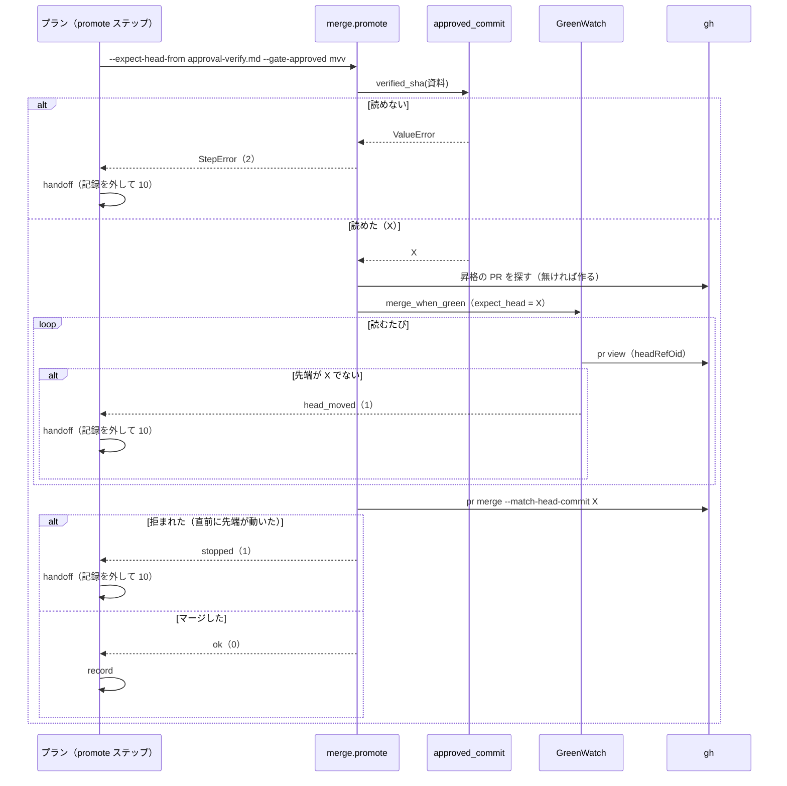

# 配布: fast / auto の昇格で、導入の確認の後にベースブランチが進むと、確かめていないコミットが本番チャネルへ入る → 確かめたコミットのときだけマージし、違えば承認ゲート 2 へ戻る（#1529）

## 目的

- **何が壊れているか**: `pace: fast` / `auto` の昇格のプランは、導入の確認を走らせたコミットと照合せずに、CI が通った昇格の Pull Request の先端をマージする。確認の後にベースブランチが進むと、確かめていないコミットが MVV 判定の後にそのまま本番チャネルへ入る
- **誰が困るか**: 承認ゲート 2 を MVV 判定に任せたリポジトリの利用者（承認の材料と本番へ届く中身が食い違う）と、その本番の利用者
- **直すと何が成り立つか**: 本番チャネルへ入るのは、MVV 判定が読んだ導入の確認の記録のコミットに限る。食い違えばマージせずに承認ゲート 2 で人へ戻る

## 適用範囲

- **働く範囲**: 配布先のリポジトリでも働く（`.ndf/worktree.json` の `delivery` で経路 `promote` を組み、`.ndf/pace.json` で `fast` / `auto` を選んだリポジトリ）
- **プロジェクトごとに違うもの**: ベースブランチと本番チャネルの名前は、今と同じく引数（`--head` / `--base`）と宣言から読む。照合の材料は承認資料のパスを引数で受ける。設定のキーは足さない
- **当たるモード**: `standard`（承認ゲート 2 と配布に当たる安定版の変更）

## あるべき姿の根拠

| 根拠 | 種類 | 何を示すか |
| --- | --- | --- |
| `docs/specifications/ndf-release-approved-commit.md`（#815） | 実測（本番の配布の既存の照合） | 本番の配布は、承認したコミットと配布の時点の先端を比べ、違えば止まって人へ戻す |
| #1454 の手動反映の本番系の手順 | 実測（既存の手順） | 先端が変わったら承認ゲート 2 からやり直す |
| `release_lib/deploy.py` の `verify_markdown` の出力を `^- ベースブランチ \S+ の先頭: \`(...)\`。導入の確認はこのコミットで走らせた$` で読んだ結果（2026-10-24） | 実測 | 導入の確認の承認資料から 40 桁の SHA を 1 つ読める。手動反映の承認資料（`deploy_markdown`）の行には当たらない |

要求と受け入れ条件は #1529 の本文にある（コピーは [issue-1529-requirements.md](issue-1529-requirements.md)）。この文書は「どう作るか」だけを扱う。

## ドメインモデル

### コンテキスト

| コンテキスト | 何の語が 1 つの意味に決まるか |
| --- | --- |
| NDF のリリース（`ndf-release`） | 昇格のプラン・昇格の Pull Request・承認したコミット・確かめたコミット |
| NDF の工程（`ndf-workflow`） | 導入の確認・承認資料・本番チャネル・承認ゲート 2 |

**2 つは共有カーネルの関係にある。** 導入の確認の承認資料は `ndf-workflow` の語だが、その中の確かめたコミットの行の形は、
書き手（`release-steps.py verify-facts`）と読み手（`merged-steps.py promote`）が `lib/approved_commit.py` の 1 か所を共有して決める。
同じリポジトリの同じ担い手が両方を持ち、共有する部分は 1 行の形と読み取りの関数だけに保てる。

### 集約

| 集約 | 持ち主（書き換えてよいもの） | 根 | エンティティ | 値オブジェクト |
| --- | --- | --- | --- | --- |
| 導入の確認の承認資料 | `release_lib/deploy.py` の `verify_facts`（書く）。行の形は `lib/approved_commit.py` | 承認資料（`approval-verify.md`） | — | 確かめたコミット（40 桁の SHA）・ベースブランチの名前・確認の終了コード |
| 昇格のマージ | `merged_lib/merge.py` の `promote` | 昇格の Pull Request | — | 先端（`headRefOid`）・照合する SHA（`expect_head`） |
| 昇格のプラン | `supervise_lib/delivery_templates.py` の `plan_promote` | プラン | ステップ（`verify`・`prepare`・`mvv`・`note`・`promote`・`handoff` ほか） | 承認資料のパス（`VERIFY_MATERIAL`） |

昇格のマージは、導入の確認の承認資料をパスで参照し、中身を書き換えない。

### 不変条件

| # | 集約 | 条件 | 破れたときの扱い |
| --- | --- | --- | --- |
| I1 | 昇格のマージ | 照合する SHA を受けた `promote` は、昇格の Pull Request の先端がその SHA に等しいときだけ `gh pr merge` を呼び、`--match-head-commit` にその SHA を渡す | 読むたびに比べ、違えば `gh pr merge` を呼ばずに `items[].result: head_moved`（`head` と `expected` つき）で終了コード 1 |
| I2 | 昇格のマージ | `--expect-head-from` を受けた `promote` は、資料から確かめたコミットを読めないまま照合を飛ばさない | `gh` を 1 度も呼ばずに `StepError`（終了コード 2）で止まる |
| I3 | 導入の確認の承認資料 | 確かめたコミットの行を書く形と読む形は同じ 1 か所が決め、`verify_markdown` の出力は今と同じ文字列である | 読めなければ I2 の扱い |
| I4 | 昇格のプラン | `fast` / `auto` の `promote` ステップは、`mvv` ステップが材料に渡すのと同じパス（`VERIFY_MATERIAL`）を `--expect-head-from` に渡し、失敗は `handoff` へ進む | プランの組み立てのテストが落ちる |
| I5 | 昇格のプラン | `normal` の `promote` と `promote-approved` のコマンドは今と同じで、`--expect-head-from` を持たない | プランの組み立てのテストが落ちる |

### ドメインイベント

| # | イベント | 発生元 | 受け手 |
| --- | --- | --- | --- |
| E1 | 導入の確認がベースブランチの先頭 X で走り、承認資料に X を書いた | `verify` ステップ（`verify-facts`） | `mvv` ステップ（材料として読む）・`promote` ステップ（X を読む） |
| E2 | 昇格の Pull Request を用意し、承認資料を書いた | `prepare` ステップ | `mvv` ステップ |
| E3 | MVV 判定が 2 つの承認資料を読み、承認ゲート 2 を通した | `mvv` ステップ | `note` ステップ |
| E4 | 判定の記録を昇格の Pull Request へ書いた | `note` ステップ | `promote` ステップ |
| E5 | ベースブランチが X から Y へ進んだ | プランの外のマージ | `promote` ステップ（E6 で先端の Y として読む） |
| E6 | 昇格の Pull Request の先端を読み、X と比べた | `promote` ステップ（`GreenWatch` の 1 回の読み） | E7 または E8 |
| E7 | 先端が X のまま CI が通り、X を本番チャネルへマージした | `promote` ステップ | `record` ステップ |
| E8 | マージせずに止まり、`handoff` が MVV 判定の記録を外して承認ゲート 2 へ戻した | `promote` ステップ（非 0）→ `handoff` ステップ | 人（承認ゲート 2） |
| E9 | リリース記録を昇格の Pull Request へ書いた | `record` ステップ | まとめの `close`（`{queue_pr:promote}`） |

### 用語

| 用語 | 意味 | 用語集への反映 |
| --- | --- | --- |
| 確かめたコミット | 導入の確認を走らせた、ベースブランチの先頭のコミットの SHA（40 桁）。導入の確認の承認資料に書かれ、`fast` / `auto` の昇格でマージしてよい先端はこのコミットに限る | 追加（`ndf-release`） |

## 機能一覧

| # | 機能 | 誰が使うか |
| --- | --- | --- |
| F1 | `fast` / `auto` の昇格で、確かめたコミットのときだけ本番チャネルへマージする | 昇格のプランを流す supervisor（承認ゲート 2 を MVV 判定に任せた利用者） |
| F2 | 先端が確かめたコミットと違う・確かめたコミットを読めないとき、マージせずに承認ゲート 2 へ戻す | 同上。戻った後は承認ゲート 2 の利用者 |
| F3 | `merged-steps.py promote` を手で打つときに、導入の確認の承認資料を渡して照合させる | 手で昇格を進める担い手 |

## 構成要素

| 要素 | 責務 | 変更 |
| --- | --- | --- |
| `lib/approved_commit.py` | 確かめたコミットの行の形（`verified_line(base, sha)`）と、その行を承認資料から読む関数（`verified_sha(path)`。資料が無い・行が無い・行が 2 つ以上・40 桁でないなら `ValueError`）を持つ。git も gh も呼ばない | 足す |
| `release_lib/deploy.py` の `verify_markdown` | 確かめたコミットの行を `verified_line` で作る。出力は今と同じ | 変える |
| `merged-steps.py` | `promote` の副命令に `--expect-head-from <承認資料>` を足し、モジュールの docstring と `--help` に照合と失敗の形を書く | 変える |
| `merged_lib/merge.py` の `promote` | `--expect-head-from` があれば、最初に `verified_sha` で読み、`a.expect_head` に入れてから今までどおり `merge_when_green` を呼ぶ。読めなければ `StepError`（2） | 変える |
| `merged_lib/checks.py` の `GreenWatch._check_expected` と `merge.py` の `merge_when_green` | 読むたびに先端と `expect_head` を比べ、違えば `head_moved` で止める。マージは `--match-head-commit` で比べた先端に固定する | 変えない（呼ぶだけ） |
| `supervise_lib/delivery_templates.py` の `plan_promote` | `fast` / `auto` の `promote` ステップのコマンドに `--expect-head-from {VERIFY_MATERIAL}` を足す。`on_fail: handoff` は今のまま | 変える |
| `supervise_lib/verify_steps.py` の `handoff_step` | `by: mvv` の記録を外し、終了コード 10 を返す | 変えない |
| `skills/development-workflow/references/pace.md` | 昇格のプランの説明に、`promote` が確かめたコミットと照合し、違えば `handoff` で承認ゲート 2 へ戻ることを書く。承認ゲート 2 の続きの行に「`promote` が照合で止まった（`head_moved`・資料を読めない）ときは `run <プラン> --from verify` から流し直す。`--from promote-approved` は照合を持たず、導入の確認も MVV 判定もしていない今の先端をマージする」を足す | 変える |
| `docs/glossary/glossary.json` と `docs/glossary.md` | 「確かめたコミット」を足し、`glossary.py render` で作り直す | 変える |

パスは `plugins/ndf/scripts/` からの相対（`pace.md` は `plugins/ndf/` から、用語集はリポジトリの直下から）。

```mermaid
graph LR
    subgraph プラン["昇格のプラン（plan_promote）"]
        V[verify] --> P[prepare] --> M[mvv] --> N[note] --> PR[promote]
        PR -- 非 0 --> H[handoff]
        PR -- 0 --> R[record]
    end
    V -- 書く --> MAT[(approval-verify.md)]
    M -- 読む --> MAT
    PR -- --expect-head-from --> CLI[merged-steps.py promote]
    CLI --> PRO[merge.promote]
    PRO -- verified_sha --> AC[approved_commit]
    AC -- 読む --> MAT
    V --> DEP[deploy.verify_markdown]
    DEP -- verified_line --> AC
    PRO -- expect_head --> MWG[merge_when_green]
    MWG --> GW[GreenWatch._check_expected]
    H --> HS[handoff_step のコマンド]
```

図には文書（`pace.md`・用語集）を含めない。

## 入出力の契約

### `merged-steps.py promote`

| 項目 | 書くこと |
| --- | --- |
| 名前 | `merged-steps.py promote --head <ベースブランチ> --base <本番チャネル> [--prepare] [--gate-approved user\|mvv] [--expect-head-from <承認資料>]` |
| 入力（足す） | `--expect-head-from`: 任意。`release-steps.py verify-facts` が書いた導入の確認の承認資料のパス。読んだ確かめたコミットを `merge-when-green --expect-head` と同じ照合に使う |
| 出力（成功） | 今と同じ。`items[]` に `{"kind": "pr", "result": "merged", "head": <X>, "gate_approved": "mvv"}`、終了コード 0 |
| 失敗の形（足す 1） | 先端が X でない（待つ間に変わった・別の先端でマージ済みを含む）: `status: stopped`・`items[]` に `{"kind": "pr", "name": "#<番号>", "result": "head_moved", "head": <Y>, "expected": <X>}`・終了コード 1。`gh pr merge` は呼ばない。最後の読みとマージの間に先端が変われば、`--match-head-commit X` で GitHub がマージを拒み、既存の「`gh pr merge --admin` が失敗」（1）になる |
| 失敗の形（足す 2） | 承認資料が無い・確かめたコミットの行が無いか 2 つ以上・40 桁の 16 進でない: `status: stopped`・終了コード 2。昇格の Pull Request を探さず・作らず、`gh` を呼ばない |
| 互換性 | 引数を渡さない呼び出し（`normal` の `promote` / `promote-approved`、手で打つ既存の呼び出し）は今と同じ。`--prepare` と一緒に渡されたときも先に読み（読めなければ 2）、読めればマージへ進まない今の振る舞いのまま終える |

### `lib/approved_commit.py`

| 名前 | 入力 | 出力 | 失敗の形 |
| --- | --- | --- | --- |
| `verified_line(base, sha)` | ベースブランチの名前・40 桁の SHA | `- ベースブランチ <base> の先頭: \`<sha>\`。導入の確認はこのコミットで走らせた` | 無し（形を作るだけ） |
| `verified_sha(path)` | 承認資料のパス | 小文字の 40 桁の SHA | `ValueError`（資料が無い・行が無い・行が 2 つ以上・`parse_sha` が通らない） |

## 処理の流れ



## 非機能の実現方式

| 大項目 | 実現方式 |
| --- | --- |
| 運用・保守性 | 照合は既存の `--expect-head`（`GreenWatch._check_expected` と `--match-head-commit`）を呼ぶだけにし、比べる処理を書き足さない。承認資料の行の形は `lib/approved_commit.py` の 1 か所が書き手と読み手の両方に渡す |
| セキュリティ | 確かめたコミットを読めないときは、`gh` を呼ぶ前に非 0 で止まる。SHA をシェルの置換で渡さないため、空の値で照合が抜ける経路が無い |

## 決定の記録

### 決定 1: 確かめたコミットと違う先端を 1 つも通さないため、照合に `--expect-head` を使い `compare_approved` を使わない

`--expect-head` は、CI を待つ間の読みのたびに先端を比べ、マージを `--match-head-commit` で比べた先端に固定する。待つ間に先端が変わる場合（受け入れ条件 3）と、最後の読みとマージの間に変わる場合の両方を、既存のコードのまま塞げる。

`approved_commit.compare_approved` に `allowed` を 0 個で渡す形は採らない。手元の git を 1 度読むだけで待つ間の変化を見ず、木が等しい別のコミット（中身の無いマージなど）を通すため、受け入れ条件 2 の「Y をマージしない」を満たさない。

根拠: Value 6 / Vision（MVV 版 2）

### 決定 2: 照合を飛ばす経路を作らないため、`promote` は SHA ではなく承認資料のパスを受けて自分で読む

プランのコマンドで `--expect-head "$(…)"` のように SHA を置換して渡すと、読めなかったときに空の値が渡り、`_check_expected` は空の値を「照合しない」と扱う。`promote` が `--expect-head-from <承認資料>` を受けて中で読めば、読めないことを `promote` 自身が失敗として返せる（I2）。

`release-steps.py` に SHA を出す副命令を足してプランで繋ぐ形は採らない。ステップが 1 つ増え、空の値の経路も残る。

根拠: Value 4 / Vision（MVV 版 2）

### 決定 3: 書き手と読み手の食い違いを防ぐため、確かめたコミットの行の形を `lib/approved_commit.py` に置き、`verify_markdown` もそれで書く

読み手だけを足すと、行の文言を書き手の側で直したときに読み手が黙って読めなくなる（I2 で止まるが、そのたびに承認ゲート 2 へ落ちる）。`approved_commit.py` は承認資料の欄の名前と SHA の形の検査を既に持ち、`merged_lib` と `release_lib` の両方から読める。

承認資料に `| 承認したコミット | <SHA> |` の欄を足して `material_sha` で読む形は採らない。`mvv-gate.py` がその欄を見て承認の記録を書き足すようになり、承認資料の中身を変えることになる（要求の「含まない」）。

根拠: Value 6（MVV 版 2）

### 決定 4: 材料が MVV 判定と食い違わないため、プランは `mvv` と同じ定数 `VERIFY_MATERIAL` を `promote` に渡す

同じ定数を両方のステップのコマンドに入れれば、MVV 判定が読んだ資料と照合に使う資料が同じファイルになる（受け入れ条件 6）。資料を書くのは `verify` ステップだけで、`--from verify` で打ち直すと資料も作り直される。

プランを組む時点の先端や `origin/<ベースブランチ>` を `promote` が引き直す形は採らない。確認の後に進んだ先端を拾い、照合の意味が無くなる。

根拠: Vision / Value 2（MVV 版 2）

### 決定 5: 食い違ったときの復帰先を今の手順に揃えるため、`promote` の失敗の種類で行き先を分けない

`head_moved`（1）・読めない（2）・マージの拒否（1）・衝突（4）のどれも、今の `on_fail: handoff` が承認ゲート 2 へ戻す（受け入れ条件 4・5）。`on_exit` で種類ごとに行き先を変えると、戻った後の人の手順（`--from promote-approved` か `--from verify`）が種類ごとに分かれ、要求の前提 4（続きは今の手順のまま）から外れる。

行き先を分けない代わりに、人が選ぶ続きを `pace.md` に書く。`promote` が照合で止まった（`head_moved`・資料を読めない）ときは `--from verify` から流し直す。`promote-approved` のステップは `--expect-head-from` を持たず（この設計が照合を足すのは `promote` のステップだけ）、`--from promote-approved` は導入の確認も MVV 判定もしていない今の先端をマージするためである。`handoff` の文言（「昇格のマージ」）は先端が動いたことを示さないため、人は `promote` の出力の `head_moved` を見て選ぶ。続きの手順はどちらも今あるもので、前提 4 のとおり手順そのものは変えない。

根拠: C4 / Value 2 / Value 6（MVV 版 2）

## テスト設計

| 受け入れ条件・不変条件 | どの振る舞いで縛るか | どう壊したら落ちるべきか |
| --- | --- | --- |
| 1 / I1 | 先端が資料の X のまま CI が通ると、`promote --expect-head-from` は `gh pr merge … --match-head-commit X` を 1 度呼んで 0 で終わる | 照合する SHA を `--match-head-commit` に渡さないように壊す |
| 2 / I1 | 最初の読みで先端が Y なら、`gh pr merge` を呼ばずに `head_moved`（`head: Y`・`expected: X`）と終了コード 1 を出す | `promote` が `expect_head` を設定しないように壊す |
| 3 / I1 | 1 回目の読みは X・2 回目の読みで Y になると、Y をマージせず 2 と同じ結果になる | 比較を最初の読みだけにするように壊す |
| 3 / I1 | 待つ間に Y で既にマージされた PR を、成功にせず `head_moved` で止める | 既存の `test_merge_when_green_expect_head_stops_when_merged_at_other_head` と同じ形を `promote` で通す |
| 4 / I4 | `fast` / `auto` のプランの `promote` ステップは `--expect-head-from` と `mvv` の `--material` に同じ `VERIFY_MATERIAL` を持ち、`on_fail` が `handoff` である | `promote` のコマンドから資料のパスを外すか、別のパスを渡すように壊す |
| 4 | プランを流して `promote` が非 0 で終わると、`handoff` へ進み終了コード 10（承認ゲート）になる | `promote` の `on_fail` を外すように壊す |
| 5 / I2 | 資料が無い・行が無い・行が 2 つ・SHA が 39 桁のそれぞれで、`gh` を 1 度も呼ばずに終了コード 2 で終わる | 読めないときに `expect_head` を空のまま進めるように壊す |
| 6 / I4 | 上の 4 / I4 の行で縛る（`mvv` と `promote` が同じパスを持つ） | `promote` だけ別の資料のパスを持たせる |
| 7 / I5 | `normal` のプランの `promote` と `promote-approved` のコマンドが今の文字列と等しく、`--expect-head-from` を含まない | `normal` の分岐にも引数を足すように壊す |
| 8 | `fast` / `auto` のプランを `base` と `production_branch` に `develop` / `main` 以外の名前で組むと、`promote` のコマンドにその名前だけが現れる | 名前を定数で埋め込むように壊す |
| 9 | `merged-steps.py promote --help` が `--expect-head-from` を出す | 引数を足さないように壊す（`pace.md` の文言は照合しない） |
| I3 | `verify_markdown` の出力を `verified_sha` で読むと、書いた SHA が返る。出力は今の文字列と等しい | 書き手の行の文言だけを変えるように壊す |

## 設計の結果

| 課題 | 扱い | 取り込み先 | 触るファイル |
| --- | --- | --- | --- |
| #1529 | 実装する | — | `plugins/ndf/scripts/lib/approved_commit.py`、`plugins/ndf/scripts/release_lib/deploy.py`、`plugins/ndf/scripts/merged-steps.py`、`plugins/ndf/scripts/merged_lib/merge.py`、`plugins/ndf/scripts/supervise_lib/delivery_templates.py`、`plugins/ndf/skills/development-workflow/references/pace.md`、`plugins/ndf/scripts/tests/`、`docs/glossary/glossary.json`、`docs/glossary.md` |

## 未確認のまま残ること

| 項目 | 内容 |
| --- | --- |
| `normal` の昇格の照合（要求の未決 1） | 利用者が承認ゲート 2 で見た先端と `promote-approved` がマージする先端の照合は、この設計に入れない。同じ食い違いは起きうるが、照合の材料（承認したときの先端を残す記録）が `normal` の経路に無い。別の課題にするかを承認ゲート 1 で決める |
| 照合で止まった後の続き | `promote` が照合で止まった後に人が `--from promote-approved` を選ぶと、照合を持たない `promote-approved` が確かめていない先端をマージする。これを防ぐのは `pace.md` の続きの行（`--from verify` から流し直す）だけで、テストでは縛らない（テスト設計の 9 のとおり `pace.md` の文言は照合しない）。`handoff` の文言も先端が動いたことを示さない |
| 実機での昇格 | 本番チャネルへのマージを伴うため、手元では `gh` を差し替えたテストでだけ確かめる。実機はリリース後テストで、経路 `promote` を持つリポジトリが `fast` / `auto` で通るときに見る |
| 既存のテストの形 | `test_supervise_new.py` の `test_plan_promote_with_mvv_judges_before_merging` は `promote` のコマンドが `--gate-approved mvv` で終わることを見ている。引数を足す位置によってはこの検査を直す |
