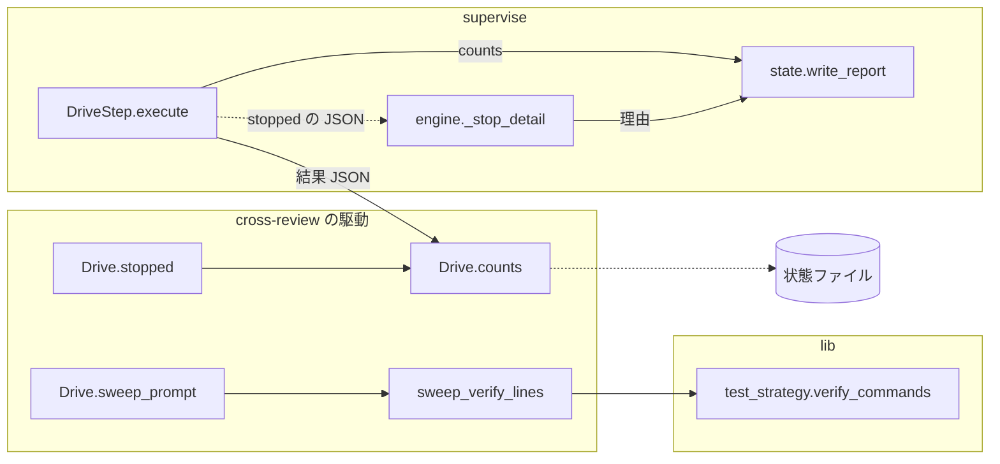
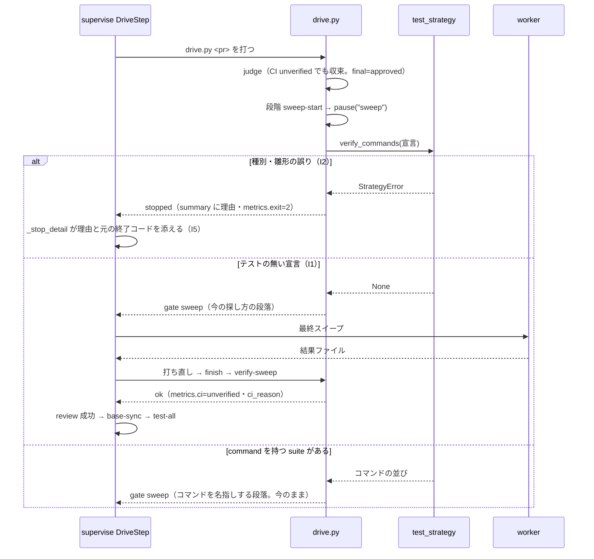

# CI もテストも無いリポジトリで、収束した cross-review が最終スイープの手前で終了コード 2 で止まり、検査のプランが毎回止まる → テストの無い宣言では検証のコマンドを名指しせずに最終スイープへ進み、止まったときは元の終了コードと理由が報告の 1 行に出る（#1593）

## 目的

- **何が壊れているか**: 解析が「テストが無い」と測った宣言（`.ndf/project.json` の `test` が `{"suites": []}`）を、cross-review の最終スイープの指示を組む関数が「不正な宣言」として終了コード 2 で止める。収束した後に毎回止まり、継続的統合の未検証と見分けがつかない
- **誰が困るか**: テストも継続的統合も持たないリポジトリ（文章・設定だけのリポジトリなど）でスプリントの検査を流す conductor。`supervise.py run --from test-all` で手で再開している（#1426）
- **直すと何が成り立つか**: テストの無い宣言では、検証のコマンドを名指しせずに最終スイープへ進み、`review` の先（`base-sync`・`test-all`）へ流れる。駆動が止まるべきときは、止めた理由と元の終了コードが supervise の報告の 1 行に出る。継続的統合を確かめられなかったことは `review` の件数に残る

## 適用範囲

- **働く範囲**: 配布先のリポジトリでも働く。cross-review の駆動（単独の `/ndf:cross-review` を含む）と、supervise の drive のステップ（スプリントの検査・単発の検査・cross-refactoring の最終ゲートの入れ子）
- **プロジェクトごとに違うもの**: テストの有無は宣言（`.ndf/project.json` の `test`）で受ける。継続的統合の有無は宣言で受けず、PR の head のチェックジョブの照会結果で受ける（要求の前提 4）。雛形に値を埋め込まない
- **当たるモード**: `standard`

## あるべき姿の根拠

| 根拠 | 種類 | 何を示すか |
| --- | --- | --- |
| `test_strategy.verify_commands({"test": {"suites": []}})` が `StrategyError: test.suites に command を持つ suite が無い` を上げる（2026-10-24、`4602364f` で実行） | 実測 | テストの無い宣言を、最終スイープの指示を組む経路が「不正」として扱う |
| `measure_repo.measure_test` は、テストの手段・コマンド・記述がどれも無いリポジトリに `measured({"suites": []})` を返す（`plugins/ndf/scripts/project_lib/measure_repo.py:354-356`） | 実測（コードの読み） | `{"suites": []}` は解析が正しく測った値であり、壊れた宣言ではない |
| `verify_commands` の docstring「宣言が無いときと分けないと、不正な宣言が最終スイープの既定の探し方へ黙って流れる」（#1483 I13） | 既存の決定 | 不正な宣言（種別・雛形の誤り）を止める理由は「黙って流れる」ことであり、テストが無いと測った宣言には当たらない |

要求と受け入れ条件は #1593 の本文にある（コピーは `issues/issue-1593-requirements.md`）。この文書は「どう作るか」だけを扱う。

## ドメインモデル

### コンテキスト

| コンテキスト | 何の語が 1 つの意味に決まるか |
| --- | --- |
| cross-review（`ndf-cross-review`） | 収束ループ・最終スイープ・継続的統合の判定（`ci.verdict`）・駆動の止まり |
| cross-refactoring（`ndf-cross-refactoring`） | 宣言の `test` から解くテストの戦略と全体テスト（`lib/test_strategy.py`） |
| 開発ワークフロー（`ndf-workflow`） | プラン・ステップ・件数・フェーズレポート（supervise） |

関係: cross-review の駆動は、テストの戦略の語（全体テスト・宣言の `test`）を cross-refactoring のコンテキストから**共有カーネル**として使う（`lib/test_strategy.py` を同じチームが持ち、両方が読む）。supervise は駆動の結果 JSON（`lib/step_result.py` の形）を**公開された言語**として読む。駆動ごとの `metrics` の中身は駆動が決め、supervise は件数として写すだけで意味を解釈しない（ただし `metrics.exit` は `lib/drive_pause.py` が全駆動に共通の意味を定める）。

### 集約

| 集約 | 持ち主（書き換えてよいもの） | 根 | エンティティ | 値オブジェクト |
| --- | --- | --- | --- | --- |
| 収束ループの状態 | cross-review の `state.py`（駆動は読むだけ） | 状態ファイル（`cross-review-pr<N>-state.json`） | ラウンド | 継続的統合の判定（`verdict`・`reason`）・最終スイープの記録（`sweep`） |
| 駆動の結果 | cross-review の `drive.py`（`Drive.counts`・`Drive.stopped`） | 結果 JSON（1 行） | — | 件数（`metrics`）・止まりの理由（`summary`）・元の終了コード（`metrics.exit`） |
| ステップの記録 | supervise の `engine.py`・`worker_steps.py` | ステップの記録（`state.cur`） | — | 件数（`counts`）・止まった理由 |

**宣言の `test` はこの変更の集約に含めない。** 宣言は利用者の設定（C7）で、この変更は読む側の解釈だけを変え、宣言を書き換えない。

### 不変条件

| # | 集約 | 条件 | 破れたときの扱い |
| --- | --- | --- | --- |
| I1 | 駆動の結果 | 宣言の `test` が「テストの無い宣言」のとき、最終スイープの指示を組む処理は止まらず、検証のコマンドを名指ししない | 止まれば受け入れ条件 2 を満たさない。テストで落とす |
| I2 | 駆動の結果 | 宣言の `test` に種別か雛形の誤りがあるときは、テストの有無にかかわらず今のとおり終了コード 2 で止める（#1483 I13 を保つ） | 黙って進めば不正な宣言が既定の探し方へ流れる。テストで落とす |
| I3 | 駆動の結果 | 最後のラウンドに継続的統合の判定があれば、駆動の結果の件数（`metrics.ci`）にその判定が載る。判定が `unverified`・`meta_only`・`pending` なら理由（`metrics.ci_reason`）も載る | 載らなければ受け入れ条件 3 を満たさない |
| I4 | 駆動の結果 | 件数へ足すのは新しいキーだけで、既存のキー（`review_status` ほか）の値と意味を変えない | cross-refactoring の最終ゲートの判定が変わる。テストで落とす |
| I5 | ステップの記録 | drive のステップが駆動の `stopped` で失敗したとき、supervise の止まった理由の 1 行に、駆動の `summary` と元の終了コード（`metrics.exit`）が載る | 載らなければ受け入れ条件 4 を満たさない |
| I6 | 駆動の結果 | 継続的統合の判定は、今のとおり駆動の成否を変えない。`code_failure` は修正へ回し、`unverified` は収束を妨げない | 継続的統合のあるリポジトリの判定が緩む・きつくなる（受け入れ条件 5）。テストで落とす |

### ドメインイベント

| # | イベント | 発生元 | 受け手 |
| --- | --- | --- | --- |
| E3 | 判定が継続的統合を照会し、`unverified` を記録した | `state.py judge` | 状態ファイル → `Drive.counts`（I3） |
| E4 | 状態に `final: approved` を書いた | `state.py judge` | 駆動の段階 `sweep-start` |
| E5 | 最終スイープの指示を組んだ | `Drive.sweep_prompt`（`sweep_verify_lines`） | supervise の drive のステップ（pause を worker へ渡す）。テストの無い宣言では止まらない（I1） |
| E7 | `verify-sweep` が状態の `sweep` を書いた | `state.py verify-sweep` | `Drive.finish` |
| E8 | 駆動が `ok` を返した | `Drive.finish` | supervise の drive のステップ（`review` が成功して `base-sync` へ） |
| E9 | 継続的統合を確かめられなかったことが報告に載った | supervise の `write_report`（件数の行） | conductor・承認ゲートの資料 |
| E11 | 駆動が `stopped` を返した（理由と元の終了コードつき） | `Drive.stopped` | supervise の `_stop_detail`（I5） |

E1・E2・E6・E10 は要求のとおりで、この変更は発生元も受け手も変えない。E11 は要求に無いイベントで、受け入れ条件 4 の経路を表すために足した。

### 用語

| 用語 | 意味 | 用語集への反映 |
| --- | --- | --- |
| テストの無い宣言 | `.ndf/project.json` の `test` があり、`unknown` と `strategy` を持たず、種別・雛形の誤りが無く、`command` も `scope_command` も持つ suite が 1 つも無いもの（解析が「テストが無い」と測った `{"suites": []}` を含む） | 追加（`ndf-cross-refactoring`） |

## 機能一覧

| # | 機能 | 誰が使うか |
| --- | --- | --- |
| F1 | テストの無い宣言のリポジトリで、収束した cross-review が最終スイープへ進み、駆動が `ok` で終わる | cross-review を使う開発者・supervise の検査のプラン |
| F2 | 駆動の結果の件数に、最後のラウンドの継続的統合の判定と理由が載る | supervise の報告を読む conductor・承認する人 |
| F3 | drive のステップが駆動の止まりで失敗したとき、止まった理由の 1 行に駆動の理由文と元の終了コードが載る | supervise の報告を読む conductor |
| F4 | 止まった出所の再現（受け入れ条件 1）を、手元の再現と一時リポジトリの再現の 2 段で行う | 実装の担当（conductor） |

## 構成要素

| 要素 | 責務 | 変えること |
| --- | --- | --- |
| `plugins/ndf/scripts/lib/test_strategy.py` の `verify_commands` | 宣言の `test` から、最終スイープに名指しする全体テストのコマンドを返す | テストの無い宣言では `None` を返す（I1）。種別・雛形の誤りは今のとおり `StrategyError`（I2） |
| `plugins/ndf/skills/cross-review/scripts/drive.py` の `Drive.counts` | 駆動の結果の件数を組む | 最後のラウンドの `ci.verdict` を `ci`、理由を `ci_reason` として足す（I3・I4）。docstring の件数の一覧も足す |
| `plugins/ndf/skills/cross-review/scripts/drive.py` の `sweep_verify_lines` | 最終スイープの検証の段落を組む | 変えない（`verify_commands` が `None` を返せば今の探し方の段落になる）。`Stop` の理由文の頭に「最終スイープの指示を組めない」を足し、継続的統合の未検証と見分けられるようにする |
| `plugins/ndf/scripts/supervise_lib/engine.py` の `_stop_detail` | 止まった理由へ、ステップの結果の要約を添える | 結果 JSON が `stopped` で `metrics.exit` を持つとき、要約の後ろへ「（元の終了コード N）」を添える（I5） |
| `plugins/ndf/scripts/supervise_lib/plan.py` の docstring（drive のステップの節） | drive のステップの読み方を説明する | 件数に `ci`・`ci_reason` が載ること、止まった理由に元の終了コードが添うことを足す |
| `plugins/ndf/skills/cross-review/SKILL.md`（駆動の件数の一覧。170 行目付近）と `drive.py` の docstring（17 行目） | 駆動の結果の読み方を説明する | 件数の一覧へ `ci`・`ci_reason` を足す |
| テスト（`plugins/ndf/scripts/tests/test_lib_test_strategy.py`・cross-review の駆動のテスト・supervise の engine のテスト） | 不変条件を縛る | 下の「テスト設計」の行を足す |

構成要素図（変える要素だけ。点線は読むだけの関係）:



`plan.py` の docstring・`SKILL.md`・テストは説明と検査のため、図に含めない。

## 入出力の契約

**駆動の結果 JSON の `metrics` へ 2 つのキーを足す。** 既存のキーは変えない（I4）。

| キー | 型 | いつ載るか | 値 |
| --- | --- | --- | --- |
| `ci` | 文字列か `null` | いつも（`gate`・`ok`・`stopped` のどれでも。`counts` を組めるとき） | 最後のラウンドの `ci.verdict`（`passed` など判定の値そのもの）。最後のラウンドに `ci` が無ければ `null` |
| `ci_reason` | 文字列か `null` | いつも | `ci` が `unverified` なら `ci.reason`、`meta_only` なら `ci.note`、`pending` なら未完了のチェックジョブの名前を空白で連ねたもの。ほかは `null` |

supervise の件数の行（`counts_text`）は `null` のキーを出さないため、継続的統合の判定が無い実行では件数の行は今と同じになる。判定の値の集合は `review_lib/ci.py` の `_round_ci` が持ち、この変更は写すだけで集合を変えない。

**supervise の止まった理由の形を足す。** 今の形は `ステップ <id> が失敗した（exit=<ステップの exit>）: <要約>` で、要約は結果 JSON の `summary` である。結果 JSON の `status` が `stopped` で `metrics.exit` が整数のとき、要約の後ろへ `（元の終了コード <metrics.exit>）` を添える。検査のプランの `abort` へ回したときの「直前のステップの要約」（#1917 の決定 7）にも同じ規則を当てる。

例（テストの無い宣言で今の実装が止まる場合の、直した後の理由。受け入れ条件 4 の形）:

```text
ステップ abort が失敗した（exit=1）: …: review: 最終スイープの指示を組めない: .ndf/project.json の test が不正: test.suites[0].kind は test か lint で書く（今: unit）（元の終了コード 2）
```

## 処理の流れ

最終スイープの指示を組むまでの流れ（I1・I2 の分岐）:



`verify_commands` の判定の順（上から当てる）:

| # | 宣言の `test` | 返すもの |
| --- | --- | --- |
| 1 | 無い・`unknown` を持つ | `None`（今のまま） |
| 2 | 種別か雛形に誤りがある | `StrategyError`（今のまま。I2） |
| 3 | `strategy` を書かず、`command` も `scope_command` も持つ suite が 1 つも無い（テストの無い宣言） | `None`（変える。I1） |
| 4 | 戦略を解けない（`local-scoped-ci-whole` を宣言したのに `scope_command` が無い など） | `StrategyError`（今のまま） |
| 5 | 解ける | 全体テストのコマンドの並び（今のまま。空なら `None`） |

2 を 3 より先に当てるのは、`command` の無い suite でも種別か雛形の誤りは不正な宣言であり、黙って流さないためである（I2）。2 の検査は `resolve` が今使う `_check_kind` と `_check_templates` をそのまま使い、新しい検査を作らない。

## 非機能の実現方式

| 大項目 | 条件 | 実現方式 |
| --- | --- | --- |
| 運用・保守性 | 止まった理由は、supervise の報告の 1 行から、止めたスクリプト・終了コード・理由文が読める | 駆動の `Stop` の理由文が止めた所（「最終スイープの指示を組めない」・「state.py verify-sweep が終了コード N で止まった」など、今の `must` の文）を持ち、supervise の `_stop_detail` が元の終了コードを添える。報告の「理由」の行は 1 行のまま |
| システム環境 | 継続的統合の手段に依らず同じ雛形が通る | 雛形（`templates.py`）を変えない。継続的統合の有無で分岐する値をプランへ書かず、判定は実行の時点の照会結果を件数へ写すだけにする |

## 決定の記録

### 決定 1: 止まる原因の層で直すため、検査のプランの雛形を変えず、最終スイープの検証コマンドの解き方を直す

止めているのは、`sweep_verify_lines` が `verify_commands` の `StrategyError` を終了コード 2 の `Stop` にする経路である（`drive.py:58-83`）。継続的統合の照会は収束を妨げない（`judge.py:216-219`）ため、継続的統合の有無を見て雛形の `on_fail` を切り替えても、この止まりは消えない。解析が正しく測った `{"suites": []}` を不正として扱うことが原因なので、`verify_commands` が「テストの無い宣言」を `None`（名指しするコマンドが無い）として返すように直す。単独の `/ndf:cross-review` も同じ経路を通るため、雛形で直すと単独の利用で止まりが残る。

起票者の提案（プランを作るときに継続的統合の有無を見て `review` の `on_fail` を切り替える・`test-all` を確かめの代わりにする）は採らない。止まる原因が継続的統合ではないため直らず、雛形に継続的統合の有無の分岐を足すと Value 5 の「同じ雛形が通る」から外れる。

根拠: Value 6 / Value 5（MVV 版 2）

### 決定 2: 不正な宣言を黙って流さないため、種別と雛形の検査をテストの有無の判定より先に当てる

#1483 I13 は「宣言が無いときと分けないと、不正な宣言が最終スイープの既定の探し方へ黙って流れる」ために `StrategyError` を上げる。テストの無い宣言を `None` にするとき、`command` の無い suite に種別の誤り（`kind: unit` など）があっても `None` になると、この決定を破る。そのため `_check_kind`・`_check_templates` を先に当て、誤りが無いときだけ「テストの無い宣言」として扱う。

`resolve` の「`command` を持つ suite が無い」を全体で `None` にする案は採らない。supervise の `new sprint` と cross-refactoring は全体テストを要し、そこでは今のとおり止めるのが正しい（テストの無いリポジトリでスプリントを流すときは `--test-cmd` か `supervise.json` の `test.command` を渡す）。

根拠: Value 6（MVV 版 2）

### 決定 3: 継続的統合を確かめられなかったことを残すため、駆動の件数へ最後のラウンドの判定を写し、`test-all` を代わりの確かめとは書かない（未決 1）

状態ファイルには最後のラウンドの `ci.verdict` と `reason` が既にある。駆動の `counts` がそれを `ci`・`ci_reason` として写せば、supervise は今の仕組み（ステップの `counts` → 報告の件数の行）のまま報告へ載せられ、supervise 側に新しい読み方を足さずに済む。

`test-all` を継続的統合の代わりの確かめとして承認資料に書く案は採らない。`test-all` は手元の全体テストで、継続的統合が走らせるチェック（別の環境・別のジョブ）と同じものを確かめたとは言えない。書くと、測っていないことを確かめたと示すことになる。承認する人は件数の `ci unverified` と理由を読み、`test-all` の結果と合わせて自分で判断する。

根拠: Value 3 / Vision（未検証のまま残ることを承認へ届ける）（MVV 版 2）

### 決定 4: 止まった理由から止めたスクリプトと終了コードを読めるようにするため、supervise の `_stop_detail` で `metrics.exit` を添える

`metrics.exit` は `lib/drive_pause.py` が全駆動に共通の意味（止まったスクリプトの元の終了コード）を定めている。添える所を supervise の 1 か所にすれば、cross-review と cross-refactoring の両方の駆動に効き、駆動ごとに理由文へ終了コードを書き足さずに済む。駆動の側は、理由文が止めた所を名指しすることだけを持つ（`must` の「<スクリプト> が終了コード N で止まった」は既にそうなっており、`sweep_verify_lines` の理由文だけ「最終スイープの指示を組めない」を足す）。

駆動の `summary` へ終了コードを書き足す案は採らない。駆動の結果 JSON は単独の cross-review でも読まれ、終了コードは `metrics.exit` に既にある。同じ値を 2 か所に持つことになる。

根拠: Value 6（同じ役割を Skill ごとに分けない）（MVV 版 2）

### 決定 5: 宣言の不正を検査のプランの書き出しで先に見つける検査は足さない（未決 2）

決定 1・2 の後で最終スイープが止まる宣言は、種別・雛形の誤りか戦略を解けない宣言である。supervise の `new sprint` / `new check` は、`--test-cmd` を渡さないときは同じ `resolve` で宣言を解き、これらを `DeclError` として既に書き出しで止める（`supervise_lib/decl.py:275-279`）。`--test-cmd` を渡したときだけ書き出しを通り、最終スイープで止まる。その止まりは決定 4 で理由と終了コードが報告に出る（受け入れ条件 4）ため、同じ検査を書き出しへ重ねない。

根拠: Value 1（処理の改善・削減に寄与しない検査を足さない）/ Value 6（MVV 版 2）

### 決定 6: 受け入れ条件 1 の再現を、手元の再現と一時リポジトリの再現の 2 段に分ける（未決 3）

手元の再現は、`.ndf/project.json` の `test` を `{"suites": []}` にした作業ディレクトリで駆動の段階 `sweep-start` を通し、`stopped`・`metrics.exit` = 2・理由文を確かめる。GitHub も外部への公開も要らず、実装の最初のタスクとして直す前に走らせる。一時リポジトリの再現（継続的統合を持たない GitHub のリポジトリに PR を開き、検査のプランを `supervise.py queue` で流す）は、受け入れ条件 1・2・3 の値を実機で取るためのもので、リポジトリの作成と削除が C5・C4 に当たる。作る場所と消すかは承認ゲート 1 で利用者が決める（要求の未決 3）。承認が無ければ、一時リポジトリの再現はリリース後テスト（`release-verification`）へ回し、実装では手元の再現と単体テストで受け入れ条件 2・3・4 の振る舞いを縛る。

手元の再現で止まらなかった（別の所で止まる・止まらない）ときは、要求の前提 1 が崩れたものとして実装を止め、要求を書き直す（要求の前提 1 のとおり）。

根拠: Value 3 / C4 / C5（MVV 版 2）

## テスト設計

| 受け入れ条件・不変条件 | どの振る舞いで縛るか | どう壊したら落ちるべきか |
| --- | --- | --- |
| I1・受け入れ条件 2 | `verify_commands({"test": {"suites": []}})` と、`command` も `scope_command` も無い suite だけを持つ宣言が `None` を返す。`strategy: local-scoped-ci-whole` を書いた `suites: []` は今のとおり `StrategyError`。テストの無い宣言の作業ディレクトリで `sweep_verify_lines` が空の段落を返し、`Stop` を上げない | 判定の順の 3 を消して `resolve` へ流すと落ちる |
| I2 | `command` の無い suite に `kind: unit` を書いた宣言と、`{paths}` の誤った雛形を持つ宣言で `StrategyError` が上がり、`sweep_verify_lines` が終了コード 2 の `Stop` を上げる | 判定の順の 2 と 3 を入れ替えると落ちる |
| I3・受け入れ条件 3 | 最後のラウンドの `ci` が `unverified`（理由つき）の状態ファイルから `Drive.counts` を組むと、`ci` = `unverified`・`ci_reason` = 理由になる。`ci` の無いラウンドでは両方 `null`。supervise の報告の件数の行に `ci unverified` が出る | `counts` が最初のラウンドの `ci` を読むように壊すと落ちる。`ci_reason` を `unverified` 以外でも `null` にすると `meta_only` の行で落ちる |
| I4 | 同じ状態ファイルから組んだ `counts` の既存のキー（`review_status` ほか）の値が、変更の前後で同じ | `review_status` を `ci` で置き換えると落ちる |
| I5・受け入れ条件 4 | drive のステップの結果 JSON が `stopped`・`metrics.exit` = 2 のとき、`_stop_detail` の理由に駆動の `summary` と「元の終了コード 2」が載る。`abort` へ回したときの直前のステップの要約にも載る。`metrics.exit` が無い結果では今の形のまま | `metrics.exit` を読まないように壊すと落ちる。`status` が `ok` の結果にも添えるように壊すと落ちる |
| I6・受け入れ条件 5 | 継続的統合が `code_failure` のとき、判定は今のとおり終了コード 2 で修正へ回す（既存のテストが縛る。変えない） | 既存のテストが落ちる |
| 受け入れ条件 6 | 駆動が `stopped` を返したとき、`review` のステップは今のとおり失敗して `on_fail: abort` へ進む（既存の supervise のテストが縛る） | 既存のテストが落ちる |
| 受け入れ条件 1 | 手元の再現（決定 6）で、直す前の実装が `stopped`・`metrics.exit` = 2・理由「.ndf/project.json の test が不正: test.suites に command を持つ suite が無い」を返すことを確かめ、値を課題のコメントへ書く。一時リポジトリの再現は承認ゲート 1 の判断に従う | 手動確認。値が合わなければ前提 1 が崩れたとして止める |
| 受け入れ条件 7 | `.ndf/project.json` の `test` の suites がすべて通る | — |

## 設計の結果

| 課題 | 扱い | 取り込み先 | 触るファイル |
| --- | --- | --- | --- |
| #1593 | 実装する | — | `plugins/ndf/scripts/lib/test_strategy.py`、`plugins/ndf/skills/cross-review/scripts/drive.py`、`plugins/ndf/scripts/supervise_lib/engine.py`、`plugins/ndf/scripts/supervise_lib/plan.py`、`plugins/ndf/skills/cross-review/`、`plugins/ndf/scripts/tests/` |

## 未確認のまま残ること

| 項目 | 内容 |
| --- | --- |
| takemi-ohama/novel の宣言 | novel の `.ndf/project.json` の `test` が `{"suites": []}` だったかは確かめられない（記録が手元に無い。要求の前提 3）。状態ファイルの 3 つの値（`final: approved`・`sweep: null`・止まりが 2）と、novel がテストも継続的統合も持たないことに合う候補として選んだ。ほかの候補（`state.py init` が `TMP_DIR` を返さない、子のスクリプトが 2 を返した）は、`sweep: null` と `final: approved` の両方には合わない（`init` はラウンドより前）か、出所の再現でしか分けられない。決定 6 の手元の再現と一時リポジトリの再現で確かめる |
| 一時リポジトリの置き場 | 作る場所と、確かめた後に消すかは利用者が承認ゲート 1 で決める（要求の未決 3。C4・C5）。決まらなければ受け入れ条件 1〜3 の実機の値はリリース後テストで取る |
| テストの無いリポジトリでの `test-all` | テストの無い宣言で `new sprint` を流すには `--test-cmd` か `supervise.json` の `test.command` が要る（決定 2）。novel がどちらで流したかは分からない。`test-all` がその雛形で通るかはこの変更の範囲外で、受け入れ条件 2 は「`test-all` まで流れる」までを確かめる |
| 最終スイープの探し方 | テストの無い宣言では、最終スイープは今の探し方（`docs/02-fix-and-rotation.md` の Step 7.5）で検証のコマンドを探す。探して見つからなければ検証を走らせない。この振る舞いは今の「宣言が無い」ときと同じで、変えない |
