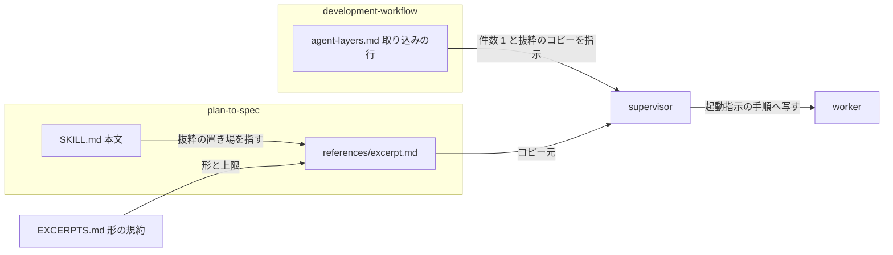
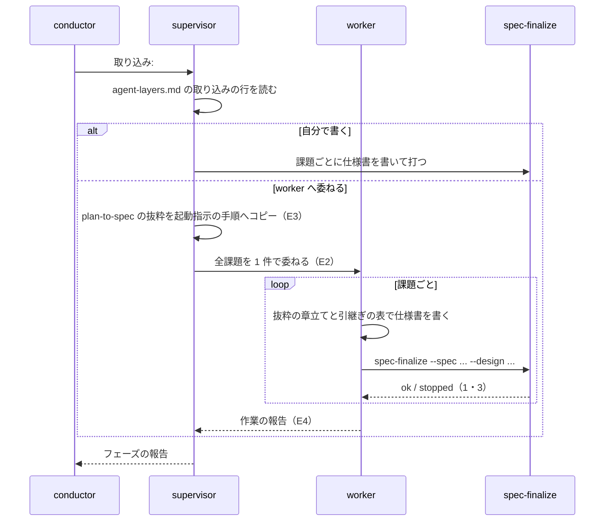

# 確定仕様化: 課題ごとに並べた worker が plan-to-spec の手順をそれぞれに読み、仕様書の章立てがそろわず組み直しの往復が起きる → 全課題を 1 件の worker へ委ね、起動指示に plan-to-spec の抜粋を写して同じ章立てで書かせる（#1594）

## 目的

- **何が壊れているか**: 3 層の「取り込み」で supervisor が確定仕様化を課題ごとの worker へ並べ、`SKILL.md` を読めない worker と読んだ worker で手順の読み方が割れる。plan-to-spec には起動指示へ写す抜粋が無い
- **誰が困るか**: 確定仕様化の Pull Request を受け取る利用者（章立てがそろわず組み直しを頼む）と、スプリントの費用を払う利用者（worker 3 件の固定費。m1385 で合計 152,157）
- **直すと何が成り立つか**: 確定仕様化を委ねる worker は全課題で 1 件になり、その worker は起動指示に写された抜粋の章立てと引継ぎの表に従って書く

## 適用範囲

- **働く範囲**: NDF を使うすべてのリポジトリの 3 層の `normal` / `auto` の「取り込み」フェーズ（supervisor が確定仕様化を回すとき）。`pace: fast` の `new close` は既に 1 ステップで回っており振る舞いを変えない
- **プロジェクトごとに違うもの**: 無し（抜粋と 3 層の規約は配布物が持つ。仕様書の置き場と既存の章立ては、抜粋の判断の基準どおり worker が対象のリポジトリの `docs/` から読む）
- **当たるモード**: 確定仕様化を通すモード（`standard`、実行で決まった設定が以後の判断の前提になる `operation`、確定版を残す `documentation`）

## あるべき姿の根拠

| 根拠 | 種類 | 何を示すか |
| --- | --- | --- |
| takemi-ohama/novel の PR #41 で、3 件の worker のうち 1 件が `SKILL.md` を読まずに設計文書の章立てのまま返し、1 往復の組み直しになった | 実測 | 課題ごとの worker と抜粋の欠落が、読み方のぶれを生む |
| `skill-stats --agents` が m1693・m1385 の 2 スプリント続けて「取り込み」に `worker を使いすぎ` を付けた（m1385: worker 3 件・固定費の合計 152,157） | 実測 | 課題ごとに並べる形は固定費が見合わない |
| m1693 の振り返り（https://github.com/devbasex/ai-plugins/pull/1718#issuecomment-5976476551 ）の「次も付けば worker を 1 件へ束ねる」 | 利用者の指示の原文 | 束ねる方向は決まっていた |
| 抜粋の下書きを手元で測ると 37 行・1,423 文字だった（`EXCERPTS.md` の「分量を確かめる」のコマンド） | 実測 | 標準の章立てと引継ぎの表を入れても上限（40 行・2,000 文字）に収まる |

要求と受け入れ条件は #1594 の本文にある（コピーは `issues/issue-1594-requirements.md`）。この文書は「どう作るか」だけを扱う。

## ドメインモデル

### コンテキスト

| コンテキスト | 何の語が 1 つの意味に決まるか |
| --- | --- |
| NDF の開発ワークフロー（`ndf-workflow`） | 確定仕様化・抜粋・worker・supervisor・起動指示 |

1 つのコンテキストに収まる。

### 集約

| 集約 | 持ち主（書き換えてよいもの） | 根 | エンティティ | 値オブジェクト |
| --- | --- | --- | --- | --- |
| plan-to-spec の手順 | `plugins/ndf/skills/plan-to-spec/SKILL.md`（正本） | 本文 | 抜粋（`references/excerpt.md`） | 標準の章立て・引継ぎの表の行・`spec-finalize` の呼び出しと終了コード |
| 3 層の委ね方 | `agent-layers.md`（3 層の規約の正本） | フェーズの表 | 「取り込み」の行 | worker の件数・起動指示の「手順」 |

**抜粋の持ち主は本文である。** 抜粋は本文を直す人が一緒に直し、抜粋だけを先に変えない（`EXCERPTS.md` の「正本は本文」）。

### 不変条件

| # | 集約 | 条件 | 破れたときの扱い |
| --- | --- | --- | --- |
| I1 | plan-to-spec の手順 | 抜粋は 1 行目のマーカー・3 つの見出しの順・40 行以内かつ 2,000 文字以内を保つ | 実装の完了判定で測り、超えたら `EXCERPTS.md` の「上限を超えたとき」の順で扱う（決定 2） |
| I2 | plan-to-spec の手順 | 抜粋の規則はすべて本文にある。本文に無い規則を抜粋に置かない | コードレビューで本文の手順 3・4・5・6・8 と 1 行ずつ突き合わせ、本文に無い行は消す |
| I3 | plan-to-spec の手順 | 抜粋の標準の章立てと引継ぎの表の行は、本文の手順 3 と同じ並び・同じ件数（章 12 個・行 11 個）である | コードレビューで数え直し、本文に合わせる |
| I4 | 3 層の委ね方 | 確定仕様化を worker へ委ねるときは、全課題を 1 件の worker に委ねる | supervisor が課題ごとに並べたら、次のスプリントの `skill-stats --agents` の目印として現れる（振り返りで拾う） |
| I5 | 3 層の委ね方 | worker の定義の「`SKILL.md` を読まない」は変わらない | 実装の差分に `plugins/ndf/agents/worker.md` と「worker が守る規則」の 6 が現れたら差し戻す |

### ドメインイベント

| # | イベント | 発生元 | 受け手 |
| --- | --- | --- | --- |
| E1 | supervisor が「取り込み」フェーズで確定仕様化の工程に入った | conductor（フェーズを渡す） | supervisor |
| E2 | supervisor が全課題の確定仕様化を 1 件の worker へ委ねた（または自分で書いた） | supervisor | worker |
| E3 | supervisor が plan-to-spec の抜粋を起動指示の「手順」へコピーした | supervisor | worker |
| E4 | worker が抜粋の章立てと引継ぎの表に従って全課題の仕様書を書き、`spec-finalize` でコミットした | worker | supervisor（作業の報告） |
| E5 | `skill-stats --agents` が次のスプリントの「取り込み」の worker の件数と目印を出した | `skill-stats` | 振り返り（`retrospective`） |

### 用語

| 用語 | 意味 | 用語集への反映 |
| --- | --- | --- |
| 確定仕様化 | 完了した実装計画を `docs/` の確定仕様へ書き直す工程 | 無し（既存の語） |
| 抜粋 | 呼ぶ側が要る部分だけを Skill の本文から取り出したもの | 無し（既存の語） |
| worker | 1 つの作業（調査・修正・検証・集計）を行うサブエージェント | 無し（既存の語） |
| supervisor | 1 つのフェーズを通すサブエージェント | 無し（既存の語） |

## 機能一覧

| # | 機能 | 誰が使うか |
| --- | --- | --- |
| F1 | 確定仕様化を委ねるときに、起動指示の「手順」へ写せる plan-to-spec の抜粋を得る | supervisor |
| F2 | 確定仕様化を全課題で 1 件の worker へ委ねる規約を読む | supervisor |
| F3 | 抜粋の章立てと引継ぎの表に従い、全課題の仕様書を同じ体裁で書く | worker |
| F4 | plan-to-spec の本文を直すときに、抜粋も直す対象だと気づく | plan-to-spec を直す開発者 |

## 構成要素

| 要素 | 責務 | 変更 |
| --- | --- | --- |
| `plugins/ndf/skills/plan-to-spec/references/excerpt.md` | plan-to-spec の手順のうち、確定仕様化を委ねられた worker が要る部分（呼び出し・結果の読み方・判断の基準）を持つ | 新規 |
| `plugins/ndf/skills/plan-to-spec/SKILL.md` | 正本。抜粋の置き場を 1 行で指す | 1 行を足す |
| `plugins/ndf/skills/development-workflow/references/agent-layers.md` | 3 層の規約。「取り込み」の行で、委ねるときの件数と抜粋のコピーを決める | 表の 1 セルを書き足す |

変えないもの: `plugins/ndf/agents/worker.md`、`agent-layers.md` の「worker が守る規則」の 6、`plugins/ndf/skills/EXCERPTS.md`、`plugins/ndf/scripts/supervise_lib/sprint.py` の `_spec_pr_steps`。



### 抜粋の中身

**本文の手順から次のものだけを取る。** 取らないものは `EXCERPTS.md` の「入れないもの」に当たる。

| 見出し | 載せるもの | 本文の出所 |
| --- | --- | --- |
| 呼び出し | `spec-finalize` の呼び出し 1 行と、打つ時点（仕様書を書き終えた後。`--spec` は 1 つしか取らないため仕様書ごとに打つ） | 手順 8 |
| 結果の読み方 | `ok`（0）・`stopped`（1）・`stopped`（3）の意味と次にすること | 手順 8 |
| 判断の基準 | 書き直しの方針・置き場・標準の章立ての並び・引継ぎの表の 11 行（項目 → 章と、書き換え方の要点）・リンクの直し方・コードとの照合とクラス図の 1 度だけの同期・対象の plan が決められないときの返し方 | 基本方針・手順 1〜6 |

| 載せないもの | 理由 |
| --- | --- |
| 進捗記録（本文の末尾の `projects-sync.sh`） | 上の層の責務。worker は記録しない |
| 利用者への確認（手順 1 の 4・手順 2 の plan を残す運用） | 対話の確認。worker では `結果: 判断が要る` で返す側に読み替える |
| `$SCRIPTS` の決め方 | 値を解決するコード。supervisor が起動指示の「入力」で絶対パスを渡す |
| 設計判断の引継ぎ例・ファイル名の例・完了報告のテンプレート | 例とテンプレート。worker は `## 作業の報告` で返す |
| 手順 7 のセルフレビューの観点 | チェックリスト。判断の基準の各行が同じ観点を持つ |

下書きの実物（手元で測った形。実装は本文と突き合わせて言い回しを直してよいが、見出し・並び・件数は変えない）:

```markdown
<!-- ndf-excerpt: plan-to-spec -->
# plan-to-spec の抜粋

## 呼び出し

python3 "$SCRIPTS/plan-to-spec-steps.py" spec-finalize --spec <仕様書> --design <元 plan・設計>... [--title <索引の説明>] --root .

- 仕様書を書き終えた後に、仕様書ごとに 1 回打つ。元の plan・設計の削除・索引への追記・コミットはこのコマンドが行う

## 結果の読み方

| `status`（終了コード） | 意味 | 次にすること |
| --- | --- | --- |
| `ok`（0） | 元の plan・設計を消し、コミットした | `items[]` の `commit` を報告に載せる |
| `stopped`（1） | コミットする変更が無い・git が失敗した | `summary` を読んで直し、打ち直す |
| `stopped`（3） | 仕様書か設計が無い・用語集の設定か正本が読めない・語の形が崩れている | `summary` を読んで直し、打ち直す |

## 判断の基準

- plan をそのまま移さず、現在のコードと一致する仕様として書き直す。開発の履歴・TODO・PR 分割・作業のチェックリスト・未採用案は落とす
- 置き場は同種の仕様書がある既存の docs の分類。無ければ `docs/specifications/`。ファイル名は英数字とハイフン
- 章立ては他の仕様書を先に見て揃える。既存 docs に明確な型があればそちらを優先し、無ければ標準の章立て: `# {仕様名}` → `概要` → `背景` → `対象範囲` → `仕様` → `データ・設定` → `外部連携` → `エラー処理` → `セキュリティ` → `運用` → `テスト観点` → `関連リンク`。該当しない章は削る
- plan と設計文書の次の項目は落とさず引き継ぐ（plan の項目 → 引継ぎ先の章）:
  - ドメイン用語 → `概要` の直後の `用語`（用語集の設定があればその文書を指し、定義を写さない）
  - コンテキスト → `概要` の直後
  - 集約 → `仕様` の冒頭
  - 不変条件 → `仕様` の中の「常に成り立つ条件」
  - ドメインイベント → `仕様` の該当箇所
  - 入出力の契約 → `仕様` / `データ・設定` / `外部連携`（現行の契約だけ）
  - 設計判断の記録 → `背景`、または `仕様` の該当箇所に 1〜2 行（結論と理由だけ）
  - データ構造 → `データ・設定`（移行の手順は落とす）
  - 構成要素と責務 → `概要` の直後、または `仕様` の冒頭
  - 処理の流れ（図） → `仕様` の該当箇所（現行の図だけ）
  - 受け入れ条件 → `テスト観点`（観点へ言い換え、チェックボックスを外す）
- リンクは移した後の位置から有効に直す。確かめられないリンクは消すか確実な上位の文書へ差し替える
- 書いた後にコードと照合する。設計文書のクラス図はここで 1 度だけ実装に合わせる
- 対象の plan が決められないときは `結果: 判断が要る` で返す
```

### 本文から指す 1 行

`SKILL.md` の「手順」の見出しの直前（入力の節の後）に置く。progress-tracking の書き方に揃える。

```markdown
**呼ぶ側へ渡す抜粋は [references/excerpt.md](references/excerpt.md) にある。** supervisor が確定仕様化を
worker へ委ねるときは、起動指示へこれをコピーし、本文を読ませない。
```

### 「取り込み」の行

`agent-layers.md` の「プランで流すか supervisor で回すか」の表の「取り込み」の行の「supervisor で回すとき」の
セルへ書き足す。既存の文は消さない。

```markdown
確定仕様化（`plan-to-spec`）。worker へ委ねるときは全課題を 1 件の worker に委ね、起動指示の「手順」へ
`plan-to-spec` の抜粋（`references/excerpt.md`）をコピーする。`normal` のプランはこの工程を持たない
（`pace: fast` は `new close` が持つ）
```

抜粋の場所は進捗記録の行（`progress-tracking` の抜粋）と同じく、Skill 名と `references/excerpt.md` で書く。
別の Skill の `references/` への相対パスにしない（`check-cross-skill-refs.py` が数える形を作らない）。

## 処理の流れ



worker が `stopped` を直せないとき、または対象の plan が決められないときは `結果: 判断が要る` で返し、
supervisor が手順を足して委ね直すか自分で書く（E2 の失敗の経路。既存の規約のまま）。

`SKILL.md` の 1 行は本文を直す開発者が読むもので（F4）、この流れには現れない。

## 非機能の実現方式

| 大項目 | 条件 | 実現方式 |
| --- | --- | --- |
| 性能・拡張性 | 変更後の最初のスプリントで「取り込み」の worker が 1 件以下・`worker を使いすぎ` の目印が付かない | 規約で件数を 1 件に決める（I4）。測るのはリリース後の振り返りで、`skill-stats --agents` の「取り込み」の行を見る。この変更では測る仕組みを足さない |
| 運用・保守性 | 抜粋は本文の写しで、本文に無い規則を足さない | 抜粋の各行に本文の出所（手順の番号）を持たせてコードレビューで突き合わせる（I2・I3）。`SKILL.md` から抜粋を指し、本文を直す人の目に入れる。機械の一致検査は足さない（要求の対象範囲の外） |

## 決定の記録

### 決定 1: 委ねる単位の規則を確定仕様化だけに効かせるため、件数の規約を「取り込み」の表の行に書く

課題ごとに並べることが問題になるのは、課題の境界を越えて体裁をそろえる確定仕様化である（`parallel-work.md` も確定仕様化の単位をスプリントとしている）。
起動指示の節に「同じ Skill の手順を課題ごとに並べない」と一般則で書くと、課題ごとの並列を意図して開いている実装のフェーズとの線引きが要り、
目の前の変更の範囲を越える。「取り込み」の行は確定仕様化を supervisor で回すと書いている唯一の箇所で、supervisor がフェーズを回すときに読む。

一般則として起動指示の節に書く案は、他の工程で同じぶれが測れていないため採らない。同じぶれが別の工程で見つかったら、その時点で一般則へ寄せる。

根拠: Value 6 / Value 3（MVV 版 2）

### 決定 2: 抜粋が上限に収まると実測できたため、上限を超えたときの止め所を新しく決めず `EXCERPTS.md` の順に従う

下書きは 37 行・1,423 文字で、40 行・2,000 文字に収まった。止め所を設計で決めると `EXCERPTS.md` の「上限を超えたとき」と 2 つ目の正ができる。
後から本文が伸びて超えたときは、`EXCERPTS.md` の 1（入れないものを外す）→ 2（スクリプトへ出す）→ 3（抜粋を置かず supervisor が段落をコピー）の順で扱う。

引継ぎの表を項目と章だけに削って余白を作る案は、書き換え方の要点（定義を写さない・結論と理由だけ・移行の手順は落とす）が無いと worker が章へ何を書くかを決められず、ぶれが残るため採らない。

根拠: Value 3 / Value 7（MVV 版 2）

### 決定 3: 体裁のぶれと固定費を同時に減らすため、確定仕様化を委ねる worker を全課題で 1 件にする

worker を課題ごとに並べると、抜粋を同じにしても worker ごとに既存の docs の読み方（置き場・既存の型の優先）が割れうる。1 件なら同じ worker が先に書いた仕様書を見て次を揃える。
固定費は worker の件数に比例し、m1385 では 3 件で 152,157 だった。並列で縮む待ち時間は、取り込みのフェーズが検証リリースまでを持つため、承認ゲート 2 までの時間に対して小さい。

課題ごとに並べたまま抜粋だけを渡す案は、固定費が減らず `worker を使いすぎ` の目印が残るため採らない。worker の定義に起動指示が名指しした `SKILL.md` の読み取りを許す案は、#828 の抜粋の規約と逆向きになるため採らない（要求の前提 1）。

根拠: Value 3 / Value 1（MVV 版 2）

## テスト設計

`.md` の文言を照合するテストは書かない（`AGENTS.md`）。受け入れ条件は既存の検査・測定のコマンドと、コードレビューの突き合わせで縛る。

| 受け入れ条件・不変条件 | どの振る舞いで縛るか | どう壊したら落ちるべきか |
| --- | --- | --- |
| 抜粋のファイル・マーカー・3 つの見出しの順（I1） | 完了判定で `head -1` と `grep -n '^## '` を見る | マーカーを消す・見出しの順を入れ替えると、出力が受け入れ条件の形と食い違う |
| 40 行以内かつ 2,000 文字以内（I1） | `EXCERPTS.md` の「分量を確かめる」の 2 行 | 41 行目を足すと `wc -l` が 41 を返す |
| 呼び出しに `spec-finalize` 1 行・結果の読み方に `ok` と `stopped`（1・3） | コードレビューで本文の手順 8 と突き合わせる | 終了コード 3 の行を消すと、本文の手順 8 にある結果が抜粋に無くなる |
| 判断の基準に標準の章立てと引継ぎの表の各行・本文に無い規則が無い（I2・I3） | コードレビューで本文の手順 3 の章 12 個・表の 11 行を数え直し、抜粋の各行の出所を本文に探す | 章を 1 つ落とす・本文に無い規則を 1 行足すと、数え直しと出所の突き合わせで見つかる |
| `SKILL.md` から抜粋を指す 1 行 | `python3 scripts/check-markdown-links.py` | リンク先のパスを誤ると検査が落ちる |
| 「取り込み」の行に件数 1 と抜粋のコピー（I4） | コードレビューで行を読む。効果は E5（リリース後の振り返り）で測る | 規約を書かないと、次のスプリントの `skill-stats --agents` に目印が残る |
| worker の定義と「worker が守る規則」の 6 が変わらない（I5） | `git diff <起点> -- plugins/ndf/agents/worker.md` が空、`agent-layers.md` の差分に規則の 6 の行が無い | 規則の 6 の文を書き換えると差分に現れる |
| `_spec_pr_steps` の出力が変わらない | 既存の `test_supervise_contract.py`（`plans/close/4-close.json` のフィクスチャ） | `spec` のステップを変えると契約テストが落ちる |
| 既存の検査が通る | `check-skill-frontmatter.py`・`check-markdown-links.py`・`check-cross-skill-refs.py`・全体テスト | 別の Skill の `references/` を相対パスで指すと `check-cross-skill-refs.py` が落ちる |

## 設計の結果

| 課題 | 扱い | 取り込み先 | 触るファイル |
| --- | --- | --- | --- |
| #1594 | 実装する | — | `plugins/ndf/skills/plan-to-spec/references/excerpt.md`、`plugins/ndf/skills/plan-to-spec/SKILL.md`、`plugins/ndf/skills/development-workflow/references/agent-layers.md` |

## 未確認のまま残ること

| 項目 | 内容 |
| --- | --- |
| 効果の実測 | 「取り込み」の worker の件数と目印は、マージ後の最初の `normal` のスプリントの振り返りで `skill-stats --agents` を見るまで分からない（要求の前提 5） |
| 1 件の worker の所要時間 | 課題が多いスプリント（例えば 6 件以上）で 1 件の worker が全課題を書き切れるか（context window と時間）は測っていない。書き切れないときは `結果: 判断が要る` で返り、supervisor が残りを自分で書くか委ね直す |
| 抜粋が本文の変更に追随するか | 機械の一致検査を置かないため、本文を直す人が抜粋を直し忘れると食い違う。`SKILL.md` から指す 1 行だけが防ぎになる |
