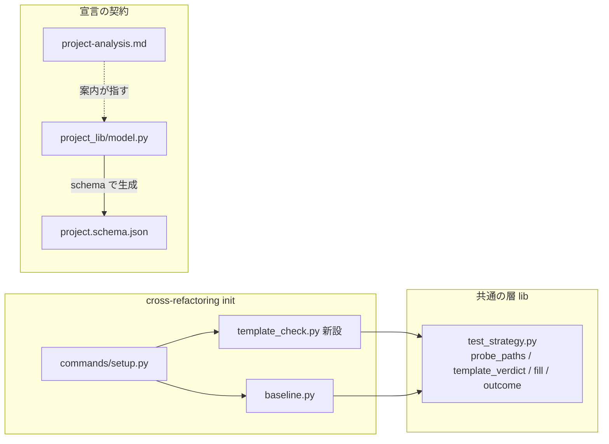
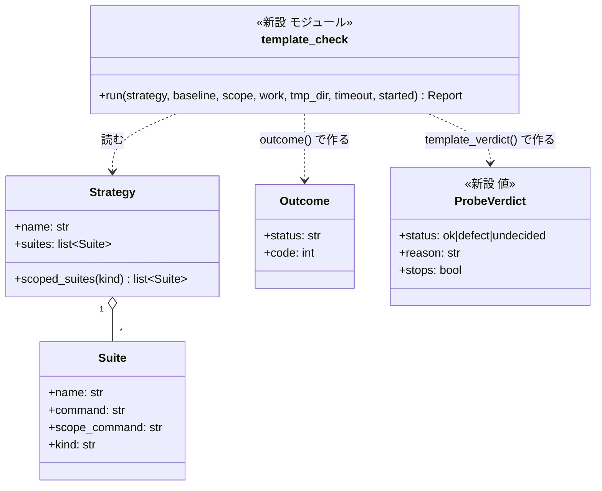
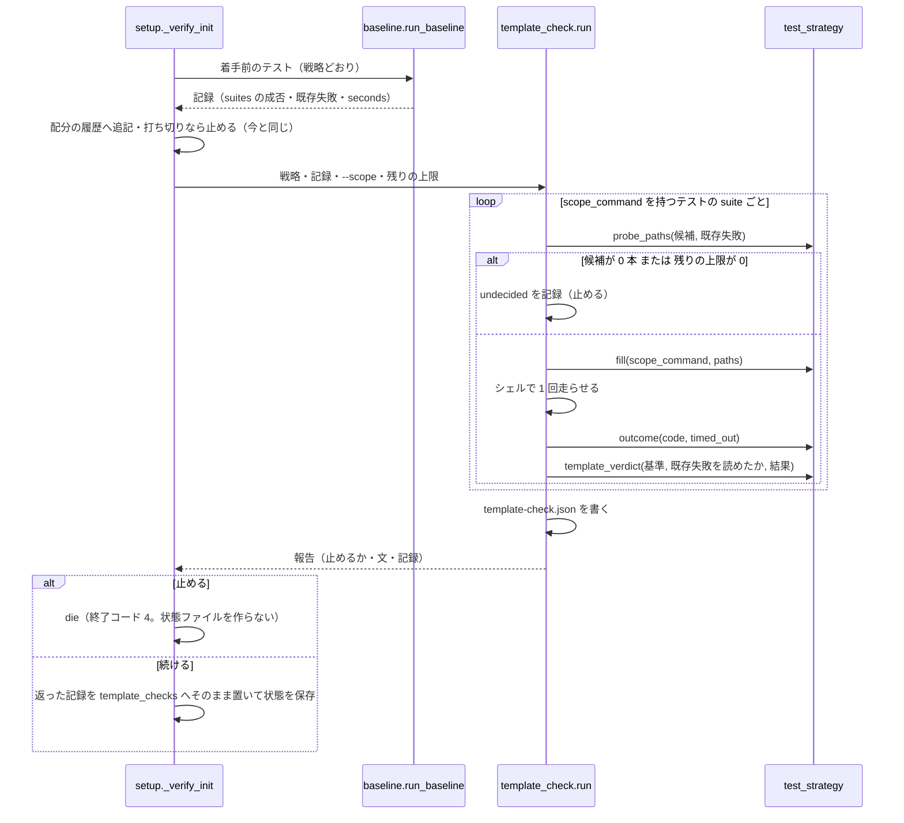

# cross-refactoring: ファイルのパスを受けない範囲テストのテンプレートで改修の範囲テストが毎回落ち、修正のラウンドを使い切る → 着手前にテンプレートを試して止まり、直す箇所が出る（#1630）

## 目的

- **何が壊れているか**: 宣言の `scope_command` が `{paths}` に入るテストのファイルを受けない形（unittest の `discover -s {paths}` など）だと、改修の範囲テストがコードと関係なく毎回落ち、落ちた項目が修正へ回る
- **誰が困るか**: ファイルのパスを受けないランナーを宣言に書いたプロジェクトで cross-refactoring を回す人。修正のラウンドを上限まで使い、時間と context を無駄にする
- **直すと何が成り立つか**: 改修のラウンドに入る前にテンプレートを 1 回試し、受けないと分かれば当たった suite・今のテンプレート・入れたパス・直す箇所を出して止まる。宣言の契約から `{paths}` に何が入るかが分かる

## 適用範囲

- **働く範囲**: 配布先のリポジトリでも働く（cross-refactoring の `init` と、宣言の契約・手順 0 の案内）
- **プロジェクトごとに違うもの**: ランナーとテンプレートは宣言（`.ndf/project.json` の `test.suites[].scope_command`）か引数（`--round-test` / `--baseline-test` の `{paths}` を含む値）で受ける。ランナーの名前とコマンドの語は見ない
- **当たるモード**: cross-refactoring を回すすべての実行。`development-workflow` のモードには依らない

## あるべき姿の根拠

| 根拠 | 種類 | 何を示すか |
| --- | --- | --- |
| `python3 -m unittest discover -s tests/test_x.py` が exit 1、`discover -s tests` が exit 0、`python3 -m unittest tests/test_x.py tests/test_y.py` が exit 0、`python3 -m unittest tests` が exit 5（Python 3.14.4、2026-10-24 に手元で実行） | 実測 | ランナーによって受けるパスの種類が違い、コマンドの語からは決められない。走らせれば分かる |
| takemi-ohama/novel の PR #58 で 13 件中 9 件が範囲テストで落ち、修正のフェーズが 10 回以上続いた（#1630 の本文） | 実測 | 改修のラウンドに入ってから見分けると、修正のラウンドを使い切る |
| `test_strategy.py` の I1（種別と戦略をコマンドの語で決めない）・I2（加工は `{paths}` の置き換えだけ） | 既存の形に揃える | 見分けは字句ではなく実行の結果で行う |

要求と受け入れ条件は #1630 の本文にある（コピーは `issues/issue-1630-requirements.md`）。この文書は「どう作るか」だけを扱う。

## ドメインモデル

### コンテキスト

| コンテキスト | 何の語が 1 つの意味に決まるか |
| --- | --- |
| `ndf-workflow` | 範囲テストのテンプレート・テストの戦略・全体テスト（`lib/test_strategy.py` が持つ語） |
| `ndf-cross-refactoring` | 着手前のテスト・既存失敗・改修の範囲テスト（`refactor_lib/` が持つ語） |

`ndf-workflow` が供給者、`ndf-cross-refactoring` が顧客の関係（顧客 / 供給者）。試走のファイルの選び方と判定の規則は
`ndf-workflow` の純粋な関数が持ち、cross-refactoring は走らせて結果を渡すだけにする。supervise・`test-run.py` も
同じ関数を後から使える（I10 と同じ置き方）。

### 集約

| 集約 | 持ち主（書き換えてよいもの） | 根 | エンティティ | 値オブジェクト |
| --- | --- | --- | --- | --- |
| テストの戦略 | `lib/test_strategy.py` の `resolve`（`init` で 1 度解き、以後は状態ファイルの写しを読むだけ） | `Strategy` | `Suite` | `ScopeRun`・`Outcome` |
| 着手前のテストの記録 | `refactor_lib/baseline.py`（`init` の中だけで書く。変えない） | 状態ファイルの `baseline_test` | — | suite ごとの成否・既存失敗 |
| **テンプレートの試走の記録（新設）** | `refactor_lib/template_check.py` の `run`（`init` の中だけで組む） | 状態ファイルの `template_checks` と `<tmp_dir>/template-check.json` | — | suite ごとの入れたパス・結果・基準・判定・直す箇所 |

テンプレートの試走の記録は、着手前のテストの記録と別の集約にする（決定 7）。記録の中身を組むのも
`template-check.json` を書くのも `template_check.run` だけで、`commands/setup.py` は `run` が返した記録を
状態ファイルの `template_checks` へそのまま置くだけにする（`baseline.run_baseline` の記録を `baseline_test` へ
そのまま置く今の形と同じ）。`setup.py` も `baseline.py` も試走の記録の中身を書き換えない。試走は着手前のテストの記録を
読むだけで、`baseline_test` を書き換えない。テストの戦略も変えない（試走の結果で戦略を書き換えない）。

### 不変条件

| # | 集約 | 条件 | 破れたときの扱い |
| --- | --- | --- | --- |
| I1 | テストの戦略 | 試走に使うコマンドは、改修の範囲テストと同じ組み立て（`fill(scope_command, paths)`）で作る。コマンドの語・ランナーの名前を見ない | 試走が改修の範囲テストと違うものを確かめることになり、見分けが外れる。テストで落とす |
| I2 | テンプレートの試走の記録 | 試走は `scope_command` を持つテストの種別の suite ごとに高々 1 回、`init` の 1 回の起動の中で、着手前のテストの上限の残りの中で走らせる。**試走の対象の suite は、判定が `ok` のときだけ続ける**（「判定しない」で続ける経路を持たない。決定 6） | 上限の残りが無い・打ち切り（`timed_out`）・候補が 0 本のときは `undecided` で止める。続けると、確かめていない suite のテンプレートの不備が改修の範囲テストへ届く |
| I3 | テンプレートの試走の記録 | 試走に入れるパスは、その suite が受け持つテストのファイルを最大 2 本。次の順に、最初に 1 本以上見つかった場所から選ぶ。(1) `--scope` のテストの置き場所の配下でテストの名前の形のもの（`source: scope`）(2) リポジトリの追跡ファイルでテストの名前の形のもののうち、`suite_for` が**その suite を返したもの**だけ（最初の suite へ寄せない。`source: repo`）(3) その suite が宣言した `paths`（`.` と glob を除く）の配下の追跡ファイル（名前の形を問わない。`source: paths`）。どれも既存失敗の ID を持つファイルを除く | 既存失敗のファイルを入れると、コードの失敗をテンプレートの不備と取り違える。受け持たないファイルを入れると、正しいテンプレートを不備と取り違える。3 つとも 0 本なら `undecided` で止める（I2） |
| I4 | テンプレートの試走の記録 | 「不備」と判定するのは、基準（その suite の着手前のテスト）が通った、または既存失敗を読めて試走のファイルから除けたうえで、試走が `failed` で終わったときだけ | 不備でないテンプレートで止まる。テストで落とす |
| I5 | テンプレートの試走の記録 | 判定が「不備」か「判定できない」の suite が 1 つでもあれば、`init` は状態ファイルを作らずに終了コード 4 で止まる。改修の範囲テストは走らない | テンプレートの不備で落ちた項目が修正へ回る（#1630 の現象） |
| I6 | テンプレートの試走の記録 | 止まるときも続けるときも、`template_check.run` が試走の記録（suite・テンプレート・入れたパス・結果・判定・直す箇所）を `<tmp_dir>/template-check.json` に書く。続けるときは `setup.py` が `run` の返した記録を状態ファイルの `template_checks` へそのまま置く | 止めた理由を後から読めない（非機能の運用・保守性） |
| I7 | テストの戦略 | 静的解析の suite（`kind: lint`）と `scope_command` の無い suite は試走しない。範囲テストの組み立て（`scope_runs`）は変えない | 前提 4 の退行。既存のテストで落とす |

### ドメインイベント

| # | イベント | 発生元 | 受け手 |
| --- | --- | --- | --- |
| E1 | 宣言に `scope_command` を書いた | 手順 0 の解析か人の手書き | 宣言の検査（E2）。案内（`project-analysis.md`）と `Suite` の説明に `{paths}` に入るパスの種類が載る |
| E2 | 宣言を検査した | `project-decl.py check`・`test_strategy.resolve` | `init`（E3）。字句の不備だけを見る（変えない） |
| E3 | 着手前のテストを走らせた | cross-refactoring の `init`（`baseline.run_baseline`） | テンプレートの試走（E3a） |
| E3a | **テンプレートを試走した（新設）** | `init`（`template_check.run`） | `init`。不備・判定できないなら止まり、ほかは記録して E4 へ |
| E4 | 改修の範囲テストを組み立てた | 改修の計画・実装・検証 | 範囲テストの実行（変えない） |
| E5 | 範囲テストが落ちた | E4 のコマンドの終了コード | 修正（E6）。試走の対象の suite はどれも判定が `ok` のときだけ E4 へ進む（I2・I5）ため、テンプレートの不備では起きない |
| E6 | 落ちた項目を修正へ回した | E5 | 修正担当（変えない。止め方は #2095） |

要求の E2 と E3 のあいだに足すとしたイベントを、E3 の直後の E3a として置く。基準（着手前のテストの成否と既存失敗）が
E3 で決まってからでないと、試走の失敗をテンプレートの不備と言えないためである（決定 3）。

### 用語

| 用語 | 意味 | 用語集への反映 |
| --- | --- | --- |
| テンプレートの試走 | cross-refactoring の `init` が着手前のテストの後に、範囲テストのテンプレートへテストのファイルを最大 2 本入れて 1 回走らせ、`{paths}` に入るパスを受けるかを見分けること。不備か判定できなければ改修の前に止まる | 追加（`ndf-cross-refactoring`） |
| 範囲テストのテンプレート | `{paths}` を引用の外の 1 字句として含むテストのコマンド（宣言の `scope_command` か、`{paths}` を含む引数）。`{paths}` には、改修の範囲テストではテストのファイルのパス、CI に任せる戦略の着手前のテストではテストの置き場所（ディレクトリかファイル）、静的解析では変更したファイルのパスが、シェルの引用で守った並びで入る | 意味の変更（`ndf-workflow`。入るパスの種類を足す） |

## 機能一覧

| # | 機能 | 誰が使うか |
| --- | --- | --- |
| F1 | 改修のラウンドに入る前に、範囲テストのテンプレートが `{paths}` に入るテストのファイルを受けるかを試し、受けなければ直す箇所を出して止まる | cross-refactoring を回す人（supervise の検査のフェーズを含む） |
| F2 | 宣言の契約（`Suite` の説明・公開のスキーマ）で、`{paths}` に入るパスの種類を場所ごとに示す | 宣言を書く AI と人 |
| F3 | 手順 0 の案内で、ファイルのパスを受けないランナー（unittest）の書き方を示す | 手順 0 で解析する AI と確かめる人 |

## 構成要素

| 要素 | 責務 |
| --- | --- |
| `plugins/ndf/scripts/lib/test_strategy.py`（変更） | 純粋な関数を 2 つと、判定の値オブジェクト `ProbeVerdict` を足す。`probe_paths`（suite が受け持つ候補のファイルから、既存失敗のファイルを除いて最大 2 本を選ぶ）と `template_verdict`（基準の成否・既存失敗を読めたか・試走の結果から判定を返す）。プロセスもファイルも触らない |
| `plugins/ndf/skills/cross-refactoring/scripts/refactor_lib/template_check.py`（新設） | 試走の実行と記録（集約「テンプレートの試走の記録」の持ち主）。候補のファイルを「候補のファイル」の節の順（`--scope` のテストの置き場所 → リポジトリ全体で `suite_for` が当たったもの → suite の `paths` の配下）で集め、`probe_paths` で選び、`fill` で組んだコマンドをシェルで走らせ、`outcome` と `template_verdict` で判定する。記録を `<tmp_dir>/template-check.json` へ書き、記録と、止める判定なら直す箇所を添えた文を返す |
| `plugins/ndf/skills/cross-refactoring/scripts/refactor_lib/commands/setup.py`（変更） | `_verify_init` で、着手前のテストの後・配分の履歴の追記の後に `template_check.run` を呼ぶ。止める判定なら `die`（終了コード 4）、続けるなら `run` の返した記録を状態ファイルの `template_checks` へそのまま置く（中身を書き換えない） |
| `plugins/ndf/scripts/project_lib/model.py`（変更） | `Suite` の説明に、`{paths}` に入るパスの種類を場所ごと（改修の範囲テスト・CI に任せる戦略の着手前のテスト・静的解析）に書き、ファイルを受けないテンプレートは `init` が試走で止めることを書く |
| `plugins/ndf/skills/development-workflow/schemas/project.schema.json`（作り直し） | `project-decl.py schema --out` で `model.py` から作り直す。手で直さない |
| `plugins/ndf/skills/development-workflow/references/project-analysis.md`（変更） | `test` の行に、`{paths}` に入るパスの種類と、ファイルを受けないランナーの書き方（unittest は `scope_command` を `python3 -m unittest {paths}`、`command` を `python3 -m unittest discover -s <テストのディレクトリ>`）を書く。書く前に再現のリポジトリで走らせて終了コードを確かめる |
| `plugins/ndf/skills/cross-refactoring/SKILL.md`（変更） | 終了コード 1（中断）の `metrics.exit` 4 の理由の並びに「範囲テストのテンプレートが `{paths}` に入るテストのファイルを受けない（試走で見分けた）」を足す |
| `docs/glossary/glossary.json`・`docs/glossary.md`（変更） | 用語の表の 2 行を反映し、`glossary.py render` で作り直す |



`SKILL.md` と用語集は呼び出しの関係を持たないため、図に含めない。

## 構造



`ProbeVerdict` は `test_strategy.py` に置く値オブジェクトで、`stops` は `status` が `defect` か `undecided` のとき真である。

## 入出力の契約

### `init` の止まり方（コマンドの約束）

| 項目 | 書くこと |
| --- | --- |
| 名前 | `refactor.py init`（cross-refactoring の着手） |
| 入力 | 変わらない（`--scope`・`--round-test`・`--baseline-test` など） |
| 出力（続けるとき） | 変わらない。標準エラーに試走の 1 行（`✅ 範囲テストのテンプレートを試走: <suite> …`）を足す。状態ファイルの `template_checks` に記録を置く |
| 失敗の形（止めるとき） | 終了コード 4。状態ファイルを作らない。標準エラーに下の「止めるときの文」。`<tmp_dir>/template-check.json` に記録 |
| 互換性 | 不備（`defect`）で止まるのは、今まで改修の範囲テストが必ず落ちていた宣言だけである。ファイルを受けるテンプレート（このリポジトリの pytest）は試走が通り、続く。ほかに、ファイルを受けるテンプレートでも確かめられずに（`undecided`）止まる宣言がある: テストの名前が形（`test_*`・`*_test.*`・`*.test.*`・`*_spec.*`・`*.spec.*`）に当たらず（`FooTest.java`・`FooTests.cs`・`UserTest.php`・`*.bats`・Rust の `tests/*.rs` など）、かつその suite が `paths` を宣言していない（`.` だけ）とき。止める文が `paths` の宣言と `--round-test` の 2 つの直し方を出すため、利用者は 1 回直せば以後は止まらない。互換の経路は要らない |

止めるときの文（suite ごとに 1 段。判定が `defect` の例）:

```text
⛔ 範囲テストのテンプレートが {paths} に入るテストのファイルを受けません（suite: unit）
   今のテンプレート: python3 -m unittest discover -s {paths}
   入れたパス: tests/test_x.py tests/test_y.py
   試走: python3 -m unittest discover -s tests/test_x.py tests/test_y.py → 終了コード 1（着手前のテストは通っていた）
   直す箇所: .ndf/project.json の test.suites[0].scope_command（{paths} にはテストのファイルのパスが入る。
   ファイルを受けるコマンドへ直すか、--round-test に {paths} を含まない全体テストを渡す）
```

判定が `undecided` のときは、「受けません」の代わりに「受けるかを確かめられません」と理由（候補のファイルが無い・
上限の残りが無い・打ち切り・既存失敗を除けない）を出す。`undecided` でも `defect` と同じく、直す箇所の行に `fix_at`
（宣言の suite なら `.ndf/project.json の test.suites[<番号>].scope_command`）を必ず出し、直し方に「`--round-test` に
`{paths}` を含まない全体テストを渡す」を必ず添える。理由が「候補のファイルが無い」ときは、直し方に「その suite の
`paths` にテストの置き場所を宣言する」も添える。

`--round-test` / `--baseline-test` の雛形の suite（`args`）で止まったときは、直す箇所を
「`--round-test` の値」のように引数の名前で出す。

### `template-check.json`（記録の形）

```json
{
  "checked_at": "2026-10-24T12:00:00Z",
  "stopped": true,
  "suites": [
    {
      "suite": "unit",
      "index": 0,
      "fix_at": ".ndf/project.json の test.suites[0].scope_command",
      "scope_command": "python3 -m unittest discover -s {paths}",
      "paths": ["tests/test_x.py", "tests/test_y.py"],
      "source": "scope",
      "command": "python3 -m unittest discover -s tests/test_x.py tests/test_y.py",
      "code": 1,
      "outcome": "failed",
      "reference": "green",
      "verdict": "defect",
      "reason": "着手前のテストは通り、試走が終了コード 1 で落ちた",
      "log": "<tmp_dir>/template-check-0.log"
    }
  ]
}
```

| キー | 型 | 意味 |
| --- | --- | --- |
| `stopped` | bool | `init` を止めたか |
| `suites[].index` | int か null | 宣言の `test.suites` の番号。引数の雛形なら null |
| `suites[].fix_at` | str | 直す箇所 |
| `suites[].paths` | list[str] | 試走で `{paths}` へ入れたパス（0〜2 本。0 本なら判定は `undecided`） |
| `suites[].source` | str か null | 候補を選んだ場所。`scope`（`--scope` のテストの置き場所）/ `repo`（リポジトリの追跡ファイルのうち、名前がテストの形で `suite_for` が当たったもの）/ `paths`（suite の `paths` の配下の追跡ファイル）。0 本なら null |
| `suites[].code` / `outcome` | int か null / str | 試走の終了コードと `test_strategy.outcome` の結果。走らせなかったら null と `not_run` |
| `suites[].reference` | str | 基準（その suite の着手前のテストの成否）。`green` / `red` / `none`（走っていない）。`source` が `repo` か `paths` のときは、着手前のテストがその suite の `command`（全体）で通ったときだけ `green` で、ほかは `none` |
| `suites[].verdict` | str | `ok` / `defect` / `undecided` |

状態ファイルの `template_checks` は同じ形の `suites` の並びである。旧い状態ファイル（キーが無い）は
空の並びとして読む。

## 処理の流れ



宣言の契約の文書（`model.py`・スキーマ・案内）・`SKILL.md`・用語集は実行の流れに現れないため、図に含めない。

起動の失敗（`launch_failed`）は今の `launch.stop(None, …, "baseline", …)` と同じ扱いで止まる（試走も
テストのコマンドの起動であり、起動の失敗の見分けは 1 か所に置く）。

### 判定の表（`template_verdict`）

| 試走の結果 | 基準（suite の着手前のテスト） | 既存失敗のファイルを除けたか | 判定 | `init` |
| --- | --- | --- | --- | --- |
| 走らせなかった（候補 0 本・残りの上限 0） | — | — | `undecided` | 止める |
| `timed_out` | — | — | `undecided` | 止める |
| `passed` | — | — | `ok` | 続ける |
| `failed` | `green` | — | `defect` | 止める |
| `failed` | `red` か `none` | 除けた（JUnit を読めた） | `defect` | 止める |
| `failed` | `red` か `none` | 除けない（JUnit を読めない） | `undecided` | 止める |

`launch_failed` はこの表に来る前に `launch.stop` で止まる。

### 候補のファイル（`probe_paths`）

- 候補は `scope.test_locations(--scope)` のそれぞれの配下の `test_files_under`（追跡ファイルのうちテストの名前の形）を、
  `suite_groups` と同じ受け持ちの規則（`suite_for`、当たらなければ最初のテストの suite）で suite へ振り分けたもの
- その suite の候補が `--scope` の配下に 1 本も無ければ、`test_files_under(".")`（リポジトリ全体）のうち、`suite_for` が
  その suite を返したファイルだけを候補にする（`source: repo`）。`suite_for` が None を返したファイル（どの suite の
  `paths` にも当たらない。たとえば宣言していない `e2e/login.spec.ts`）は、`suite_groups` と違って最初の suite へ寄せず、
  候補にしない。寄せると、正しいテンプレートでも受け持たないファイルで試走が落ち、`defect` で止まる。テストを本体と別の場所に
  置き、その suite のテストが `--scope` に無い構成でも試走できる
- それでも 0 本なら、その suite が宣言した `paths` の要素のうち `.` と glob を除いたものの配下の追跡ファイル（名前の形を
  問わない）を候補にする（`source: paths`）。テストの名前が形に当たらないエコシステム（`FooTest.java`・`FooTests.cs`・
  `UserTest.php`・`*.bats`・Rust の `tests/*.rs`）でも、suite がテストの置き場所を `paths` に宣言していれば試走できる。
  `.` と glob を除くのは、テストでないファイル（`README.md` など）を入れて正しいテンプレートを不備と取り違えないためである
- `source` が `repo` か `paths` のとき、基準は着手前のテストがその suite の `command`（全体）で通ったときだけ `green` とし、
  ほかは `none`・既存失敗は「除けない」として扱う（範囲を絞った着手前のテストは、`--scope` の外のファイルの成否を示さない）
- 3 つとも 0 本なら `probe_paths` は空を返し、判定は `undecided`（止める。直し方に `paths` の宣言を添える）
- 既存失敗の ID を `test_triage.by_file` でファイルへ直し、そのファイルを候補から除く
- 並べ替えた順の先頭から最大 2 本。2 本にするのは、1 本は受けて 2 本目を受けないテンプレート（`discover -s a b` は 2 本目を
  開始のディレクトリと読まない）を見分けるためである

## 非機能の実現方式

| 大項目 | 要求の条件 | 実現方式 | 確かめ方 |
| --- | --- | --- | --- |
| 性能・拡張性 | 受け入れ条件 1 の見分けのために足す実行は、cross-refactoring の 1 回の起動につき suite ごとに高々 1 回とし、その所要を着手前のテストの上限（`INIT_TEST_SHARE`）の中に収める | 試走は suite ごとに 1 回。上限は着手前のテストと同じ `init_test_timeout` から、着手前のテストの開始からの経過を引いた残り（`test_triage.run_within` に同じ `started` を渡す）。残りが 0 なら走らせず `undecided` で止める | 試走の回数を数える単体テストと、上限の残りが 0 のときに走らせず止めるテスト |
| 運用・保守性 | 見分けた結果（止めた理由・当たった suite）が結果の JSON か状態ファイルに残り、後から読める | 止めても続けても `<tmp_dir>/template-check.json` に書く。続けるときは `run` の返した記録を状態ファイルの `template_checks` へそのまま置く | 止める結合のテストで JSON のキーを読む |

## 決定の記録

### 決定 1: 走らせて見分けるため、試走の場所を宣言の検査ではなく cross-refactoring の `init` にする

テンプレートがファイルを受けるかは、コマンドの語から決められない（前提 1。unittest でも `discover -s` と
`python3 -m unittest` で逆になる）。見分けるには走らせるしかなく、走らせるには作業ディレクトリ・依存・テストの
ファイルが要る。`init` はそれをすでに用意し、着手前のテストを走らせている。

`project-decl.py check` で走らせる案は採らない。宣言の検査は純粋な検査で、所要の上限も作業ディレクトリも持たず、
手順 0 の度に外部のコマンドを走らせることになる。`test_strategy.resolve` で走らせる案も採らない。`resolve` は純粋な
処理だけを置く層で（冒頭の約束）、supervise・`test-run.py`・cross-review の解決にも実行が漏れる。

根拠: Value 4 / Value 5 / Value 6（MVV 版 2）

### 決定 2: 判定の規則を共通の層に置くため、ファイルの選び方と判定を `test_strategy.py` の純粋な関数にし、実行だけを cross-refactoring に置く

範囲テストの組み立ては `test_strategy.py` に寄せている（I10）。試走の選び方と判定も同じ層に置けば、supervise や
`test-run.py` が後から同じ見分けを使うときに関数を分けずに済む。実行（プロセス・ログ・上限）は呼ぶ側の責務で、
`baseline.py` が着手前のテストを走らせるのと同じ置き方である。

`refactor_lib/` の中に判定まで置く案は採らない。Skill ごとに見分けの関数が分かれる（Value 6）。

根拠: Value 6（MVV 版 2）

### 決定 3: 試走の失敗をコードの失敗と取り違えないため、着手前のテストの後に走らせ、基準が通ったか既存失敗を除けたときだけ不備とする

試走の失敗には、テンプレートの不備とコードの既存の失敗の 2 つの原因がありうる。着手前のテストがその suite で通って
いれば、同じコードの一部のファイルが落ちる理由はテンプレートにしかない。落ちていても、JUnit から既存失敗のファイルが
分かれば、それを除いたファイルで試せる。どちらも成り立たないときは「判定できない」として止まり、人へ戻す
（共通原則の「決められないときも人へ戻す」）。

着手前のテストより先に試走する案は採らない。基準が無く、既存の失敗を抱えたリポジトリでいつも取り違える。
判定できないときに続ける案も採らない。続けると、テンプレートの不備で落ちた項目が修正へ回る経路が残る（受け入れ条件 3）。

根拠: Mission / Value 1（MVV 版 2）

### 決定 4: 改修の範囲テストへ不備が届かないことを入口で保証するため、修正へ回す側には見分けを足さない

不備か判定できない suite があれば `init` が状態ファイルを作らずに止まるため、改修の範囲テストはそもそも走らない
（受け入れ条件 3 を構造で満たす）。検証で落ちた範囲テストを走らせ直してテンプレートの不備かを見分ける案は採らない。
項目ごとに走らせ直しが増え、着手前に 1 回で分かることを何度も確かめることになる。修正担当が「コード起因の失敗なし」を
返したときの止め方は別の主題として #2095 に残した（要求の未決 2）。

根拠: Value 6 / Mission（MVV 版 2）

### 決定 5: 入るパスの種類は変えず、契約に場所ごとに書く

`{paths}` に入るパスを、改修の範囲テスト（テストのファイル）と CI に任せる戦略の着手前のテスト（テストの置き場所）で
そろえる案（要求の未決 3）はこの課題では採らない。受け入れ条件は「入る種類が分かる」ことと「受けないなら止まる」ことで、
そろえなくても満たせる。着手前のテストへ入れるパスを変えると、範囲テストの所要の履歴（置き場所ごとの記録）にも効く。
CI に任せる戦略でファイルだけを受けるテンプレートの着手前のテストが落ちる件は #2096 に残した。

根拠: Value 1 / Value 6（MVV 版 2）

### 決定 6: 試走の対象の suite を確かめずに続ける経路を作らないため、候補 0 本・上限の残り 0・打ち切りを `undecided` で止める

「判定しない（`skipped`）」で続けると、試走していない suite もそのまま改修の範囲テストへ進み、ファイルを受けない
テンプレートで落ちた項目が修正へ回る経路が残る（E5 の保証と受け入れ条件 1・3 が成り立たない）。候補が `--scope` に無い
ときはリポジトリ全体（`suite_for` が当たったものだけ）から、名前の形に当たらなければ suite の `paths` の配下から選び直して
試走できる場合を広げ、それでも確かめられないときだけ止めて人へ戻す
（共通原則の「決められないときも人へ戻す」）。止める文には `defect` と同じ直す箇所（`fix_at`）と、`--round-test` に全体テストを渡す直し方を必ず添え、
利用者が 1 回で続けられるようにする。

`skipped` の suite は改修の範囲テストで落ちても修正へ回さない（全体テストへ落とす）案は採らない。修正へ回す側に見分けを
足すことになり、決定 4（入口で保証し、回す側には見分けを足さない）に反する。

根拠: Mission / Value 1 / Value 6（MVV 版 2）

### 決定 7: 書き換えてよいものを 1 つに決めるため、試走の記録を別の集約にし、持ち主を `template_check.py` にする

試走の記録を着手前のテストの記録（持ち主 `baseline.py`）の一部にすると、中身を組む `template_check.py` と状態へ写す
`setup.py` を含め、書く場所が 3 つに割れる。記録を組んで `template-check.json` に書くのは `template_check.run` だけにし、
`setup.py` は返った値を状態ファイルの `template_checks` へそのまま置く（`baseline_test` と同じ置き方）。

`baseline.py` を経由して書く案は採らない。`baseline.py` は着手前のテストの実行と記録の責務で、試走の判定（`ndf-workflow` の
関数）と実行を持ち込むと、変えない約束の集約に新しい責務が入る。

根拠: Value 6 / Value 7（MVV 版 2）

## テスト設計

| 受け入れ条件・不変条件 | どの振る舞いで縛るか | どう壊したら落ちるべきか |
| --- | --- | --- |
| 受け入れ条件 1・I5 | `scope_command: python3 -m unittest discover -s {paths}`・`command: python3 -m unittest discover -s tests` の宣言を持つ再現のリポジトリ（`--scope scripts/storylib`、テストは `tests/`）で `init` を打つと、終了コード 4 で止まり、状態ファイルが無い。戦略ごとに期待する判定を分けて縛る: 着手前のテストが全体（`command`）を走らせる戦略では基準が `green` になり `defect`、CI に任せる戦略では `source: repo` の基準が `none`・unittest は JUnit を書かないため `undecided` | 試走を呼ばないと落ちる。止める判定でも状態を保存すると落ちる。戦略ごとの判定を取り違えると落ちる |
| 受け入れ条件 2・I6 | 受け入れ条件 1 の両方の戦略で、止まったとき標準エラーと `template-check.json` に suite の名前・今の `scope_command`・入れたパス・`test.suites[<番号>].scope_command` が出る（`undecided` でも `fix_at` を出す） | 直す箇所の番号を宣言の並びと違えると落ちる。記録を書かずに止まると落ちる。`undecided` の文で `fix_at` を省くと落ちる |
| 受け入れ条件 3 | 受け入れ条件 1 の宣言では `init` の後の工程（計画・実装・検証）へ進めず、修正のラウンドが 0 回である | 不備の判定でも状態ファイルを作ると落ちる |
| 受け入れ条件 4 | `project-decl.py schema` の出力と公開のスキーマが一致する（既存の `test_published_schema_matches_the_model`） | `model.py` を直してスキーマを作り直さないと落ちる |
| 受け入れ条件 5 | 案内に書く unittest の 2 つのコマンドを再現のリポジトリで走らせた終了コード（`python3 -m unittest <ファイル> <ファイル>` が 0、`discover -s tests` が 0）を、実装の Pull Request の本文に添える | （`.md` の文言を照合するテストは書かない。AGENTS.md） |
| 受け入れ条件 6 | このリポジトリの宣言（pytest の `scope_command`）で、試走が `ok` になり `init` が続く。`scope_runs` が組むコマンドは今と同じ | 試走で `{paths}` の置き換えを `fill` 以外にすると落ちる |
| 受け入れ条件 7・I7 | 静的解析の suite と `scope_command` の無い suite は試走されず、既存の範囲テストの組み立てのテストが通る | 試走の対象に `kind: lint` を入れると落ちる |
| I1 | 試走のコマンドが `fill(scope_command, paths)` と一致する | コマンドの語で分岐を足すと落ちる |
| I2 | 試走が suite ごとに 1 回で、上限の残りが 0・打ち切りなら `undecided` で `init` が止まる | 2 回走らせると落ちる。上限を別に取ると落ちる。上限の残りが 0 で続けると落ちる |
| I3 | 既存失敗の ID を持つファイルが候補から除かれ、最大 2 本が選ばれる。`--scope` にその suite のテストが無ければリポジトリ全体から `suite_for` がその suite を返したファイルだけが選ばれ（`--scope` が本体のディレクトリ、suite のテストは別の置き場所の構成）、どの suite の `paths` にも当たらない `e2e/login.spec.ts` は選ばれない。名前の形に当たらないテスト（`tests/FooTest.php`）だけを持ち、`paths: ["tests"]` を宣言した suite では `paths` の配下から選ばれ（`source: paths`）、`paths` が `.` だけなら 0 本で `undecided` で止まり、直し方に `paths` の宣言が出る | 既存失敗のファイルを選ぶと落ちる。3 本以上選ぶと落ちる。`--scope` の外から選ばずに止めると落ちる。受け持たないファイルを最初の suite へ寄せると落ちる。`paths` の配下から選ばずに止めると落ちる。`paths` が `.` で全追跡ファイルから選ぶと落ちる。0 本で続けると落ちる |
| I6・決定 7 | 続けるとき、状態ファイルの `template_checks` が `template-check.json` の `suites` と一致し、`baseline_test` が試走の前と同じである | `setup.py` が記録を書き換えると落ちる。`baseline_test` へ書くと落ちる |
| I4 | 判定の表の 6 行どおりの判定を返す（`template_verdict` の単体テスト） | 基準 `red` で既存失敗を除けないのに `defect` を返すと落ちる。`passed` で止めると落ちる。走らせなかった・`timed_out` で続けると落ちる |

## 設計の結果

| 課題 | 扱い | 取り込み先 | 触るファイル |
| --- | --- | --- | --- |
| #1630 | 実装する | — | `plugins/ndf/scripts/lib/test_strategy.py`、`plugins/ndf/skills/cross-refactoring/scripts/refactor_lib/template_check.py`、`plugins/ndf/skills/cross-refactoring/scripts/refactor_lib/commands/setup.py`、`plugins/ndf/skills/cross-refactoring/SKILL.md`、`plugins/ndf/scripts/project_lib/model.py`、`plugins/ndf/skills/development-workflow/schemas/project.schema.json`、`plugins/ndf/skills/development-workflow/references/project-analysis.md`、`plugins/ndf/scripts/tests/`、`plugins/ndf/skills/cross-refactoring/scripts/tests/`、`docs/glossary/glossary.json`、`docs/glossary.md` |

## 未確認のまま残ること

| 項目 | 内容 |
| --- | --- |
| 確かめられずに止まる頻度 | 候補のファイルが 3 つの場所のどれにも無い・上限の残りが 0・打ち切りのときは `undecided` で止まる（決定 6）。テストの名前が形に当たらないエコシステム（Java・C#・PHP・bats・Rust など）で suite が `paths` を宣言していない（`.` だけ）ときは、ファイルを受けるテンプレートでも毎回止まる。止まったときは `paths` を宣言するか `--round-test` に全体テストを渡せば続けられるが、どれだけ起きるかは実行で測る |
| CI に任せる戦略での止まり方 | `source` が `repo` か `paths` で着手前のテストが全体を走らせない戦略では、基準が `none` になり、JUnit を読めないランナーでは不備のテンプレートも `defect` ではなく `undecided` で止まる。止める文は `fix_at` を必ず出すため直す箇所は分かるが、不備と言い切れない文になる頻度は実行で測る |
| 判定できないで止まる頻度 | 着手前のテストが落ち、JUnit を読めず（unittest は既定で JUnit を書かない）、試走のファイルにコードの失敗があると止まる。止まったときの直し方（JUnit を宣言に書く・`--round-test`）を文に出すが、どれだけ起きるかは実行で測る |
| 再開の経路 | この変更より前に作った状態ファイルからの再開は試走を通らない。旧い状態は `template_checks` を空として読む |
| ランナーごとの受け方 | unittest のほかに、ファイルを受けないランナーの実例は確かめていない。見分けは実行の結果だけに依るため、ランナーの種類に依らない |
