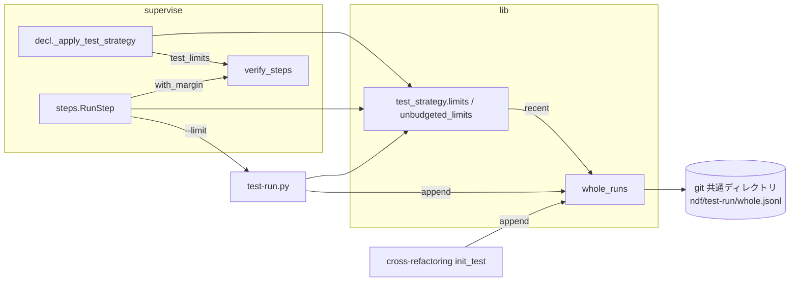
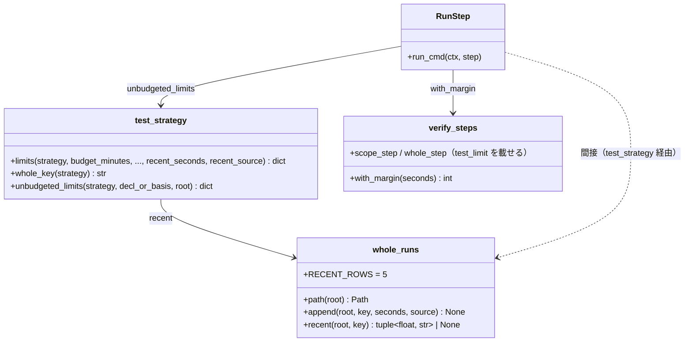
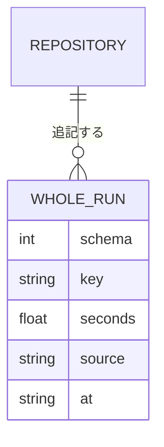
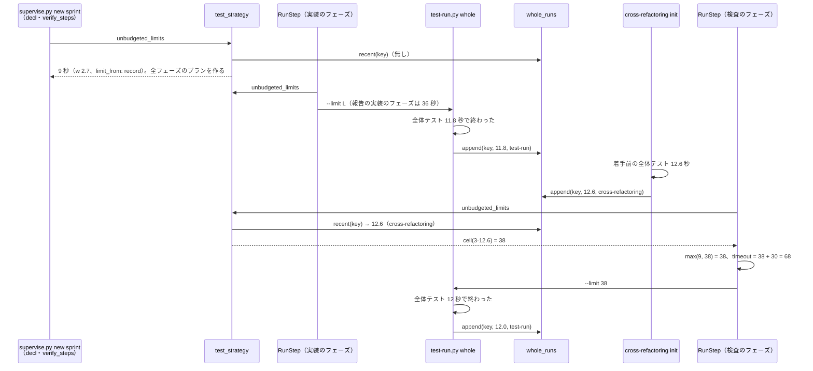

# supervise.py のテストの上限: 先に走った全体テストの実測で決め直し、テストが増えたスプリントの後のフェーズでも時間切れで止まらない（#1631）

## 目的

- **何が壊れているか**: 予算なしのテストの上限（`whole_timeout`・`test_timeout`）が、`.ndf/project.json` の所要の記録の 3 倍だけで決まる。スプリントでテストが増えて全体テストが記録の 3 倍を超えると、後のフェーズの `test-all` が上限で止まる
- **誰が困るか**: NDF でスプリントを回す利用者と conductor。`test_duration` を手で直し、プランを作り直すまで進まない
- **直すと何が成り立つか**: 同じリポジトリで先に走った全体テストの実測が、後のプランの作成と、各テストのステップの開始の時点で上限に入る。記録が古くても、実測の 3 倍までは止まらない

## 適用範囲

- **働く範囲**: 配布先のどのリポジトリでも働く（`supervise.py` のプランと `test-run.py`、cross-refactoring の着手前のテスト）。実測はリポジトリの git の共通ディレクトリに置き、利用者の設定（`.ndf/`）は書き換えない
- **プロジェクトごとに違うもの**: 全体テストのコマンド。宣言（`.ndf/project.json` の `test`）か引数（`--test-cmd`）から解いた戦略で受け、実測はそのコマンドの集合ごとに分けて残す
- **当たるモード**: `standard`

## あるべき姿の根拠

| 根拠 | 種類 | 何を示すか |
| --- | --- | --- |
| #1631 の本文: takemi-ohama/novel のスプリント world で、記録 2.7 秒から上限 9 秒が決まり、全体テストの実測は約 12 秒（着手前のテストは 12.6 秒）で時間切れになった | 実測 | 記録の 3 倍だけで決める上限は、テストが増えると後のフェーズで止まる |
| 本文の再現のコマンドを 2026-10-30 の develop で打ち直した結果 `{'init_test_timeout': 9, 'test_timeout': 9, 'whole_timeout': 9}` | 実測 | 予算なしの枝は今も記録だけで上限を決める |
| `supervise_lib/sprint.py` の 128 行と 259 行（検査のプランを `new sprint` の時点で組む）、`supervise_lib/decl.py` の `decl_fields` が `test_limits` を各プランへ引き継ぐ（2026-10-30 の develop） | コードの事実 | スプリントの検査のプランは実装のフェーズより前に作られる。プランの作成の時点だけで実測を読んでも、同じスプリントの検査のフェーズには届かない（決定 3） |

要求と受け入れ条件は #1631 の本文にある（コピーは [issue-1631-requirements.md](issue-1631-requirements.md)）。この文書は「どう作るか」だけを扱う。

## ドメインモデル

### コンテキスト

| コンテキスト | 何の語が 1 つの意味に決まるか |
| --- | --- |
| NDF の開発ワークフロー（`ndf-workflow`） | 所要の記録・全体テストの実測・テストの上限・ステップの `timeout` |

cross-refactoring（着手前のテスト）は同じコンテキストの中の呼び出し元で、全体テストの実測を同じ関数で書く。別のコンテキストへの翻訳は無い。

### 集約

| 集約 | 持ち主（書き換えてよいもの） | 根 | エンティティ | 値オブジェクト |
| --- | --- | --- | --- | --- |
| 全体テストの実測の記録 | `lib/whole_runs.py`。`test-run.py` と cross-refactoring の着手前のテストは、`whole_runs.append` を通してだけ書く | リポジトリ（git の共通ディレクトリ）ごとの 1 つの追記の列 | 実測の行 | 全体テストの鍵・秒・出所・時刻 |
| テストの上限 | `lib/test_strategy.py` の `limits`。値を計算するのはこの関数だけで、呼び出し元は渡された値を使う | 上限の表（`init_test_timeout`・`test_timeout`・`whole_timeout`・`ci_wait_timeout`・`basis`） | — | 所要の記録 `w`・全体テストの実測 `m`・CI の壁時計 `c` |

**所要の記録（`.ndf/project.json`）はこの変更の集約に含めない。** 持ち主は今どおり宣言の解析（`/ndf:development-workflow` の手順 0）で、この変更は読むだけにする（C7）。

### 不変条件

| # | 集約 | 条件 | 破れたときの扱い |
| --- | --- | --- | --- |
| I1 | テストの上限 | 予算なしで `w` が既知のとき、`test_timeout` と `whole_timeout` は `ceil(3·max(w, m))`（`m` が無ければ `ceil(3·w)`）。`m` が `w` 以下なら今の `limits` と同じ値（受け入れ条件 2・5、前提 5） | 単体テストが値の不一致で落とす |
| I2 | テストの上限 | 予算なしで `w` が無いか不明のとき（I1 は当てない）、上限は `UNKNOWN_DURATION_LIMITS`（900 / 1800 秒）を下回らない。`3·m` が上回るときだけ `3·m` に広げる（前提 6） | 単体テストが落とす |
| I3 | テストの上限 | 予算を持つ呼び出しの返す値は、`m` を渡しても渡さなくても今と同じ（受け入れ条件 9）。予算ありには I1・I2 を当てない | 既存の `limits` の予算ありのテストが落とす |
| I4 | テストの上限 | 上限には余裕の係数も定数も足さない。余裕はステップの `timeout` の `with_margin(上限)` だけが持つ（受け入れ条件 7） | 単体テストが「上限 = 3 倍の切り上げ」と「ステップの `timeout` = `with_margin(上限)`」の両方で落とす |
| I5 | テストの上限 | テストのステップで `test-run.py` が使う上限は、そのステップの `timeout` を決めた上限と同じ値である（受け入れ条件 3） | 同じ 1 つの値を `--limit` で渡す形にし、別々に計算しない。結合テストが落とす |
| I6 | 全体テストの実測の記録 | 行は追記だけで書き換えない。残すのは手元で走らせた全体テストが上限の中で終わった（通った・落ちたを問わない）ときだけで、打ち切り・起動の失敗・CI の待ち・範囲テストは残さない（前提 2、E3） | 書く関数は終わった秒しか受け取らない。結合テストが落とす |
| I7 | 全体テストの実測の記録 | 読み書きの失敗は、全体テストの合否・終了コード・プランの作成を変えない（受け入れ条件 8） | 読めなければ `m` は無し、書けなければ残さずに結果をそのまま返す |

### ドメインイベント

要求の E1〜E5 を引き継ぎ、ステップの開始で上限を決め直す E6 を足す。

| # | イベント | 発生元 | 受け手 |
| --- | --- | --- | --- |
| E1 | プランを作った（実測を読み、上限を決め、ステップの `timeout` に `with_margin` を掛けた） | `supervise.py new` / `new sprint`（`decl._apply_test_strategy`） | プランの「テストの時間」と各テストのステップ |
| E2 | 全体テストを走らせた | `test-run.py whole` | E3 |
| E3 | 全体テストの実測を残した | `test-run.py whole`（手元の全体テストが上限の中で終わった） | 後の E1・E4・E6 |
| E4 | 単独の `test-run.py` が上限を決めた | `test-run.py` を `--limit` 無しで起動した | `test-run.py` 自身 |
| E5 | 着手前の全体テストの実測を得て残した | cross-refactoring の `init`（着手前のテストの `mode` が `whole` で、打ち切られなかった） | 後の E1・E4・E6。同じプランの `test-all` も E6 で読む（決定 4） |
| E6 | テストのステップの開始で上限を決め直した | プランの run のステップ（`test-limited`・`test-all`）の開始 | そのステップの `timeout` と、`test-run.py` へ渡す `--limit` |

### 用語

| 用語 | 意味 | 用語集への反映 |
| --- | --- | --- |
| 所要の記録 | 要求の「用語」と同じ | 要求で追加済み |
| 全体テストの実測 | 先に走った手元の全体テスト（静的解析を含む全体検証）の壁時計の秒。全体テストの鍵ごとに追記で残す | 要求で追加済み（意味は変えない） |
| テストの上限 | 要求の「用語」と同じ | 要求で追加済み |
| 全体テストの鍵 | 戦略の全体テストのコマンドの集合から作る識別子。コマンドが違う実測を混ぜないために使う | 追加 |

## 機能一覧

| # | 機能 | 誰が使うか |
| --- | --- | --- |
| F1 | 手元の全体テストが終わったら、その秒を全体テストの実測として残す | `test-run.py whole`（プランの `test-all`）・cross-refactoring の着手前のテスト |
| F2 | プランを作るとき、所要の記録と直近の実測から上限を決め、「テストの時間」に根拠を載せる | `supervise.py new` / `new sprint` を呼ぶ conductor |
| F3 | テストのステップを始めるとき、その時点の実測で上限を決め直し、ステップの `timeout` と `test-run.py` の上限を同じ値にする | プランを流す `supervise.py run` |
| F4 | 単独で起動した `test-run.py` が、所要の記録と直近の実測から上限を決める | conductor・利用者 |

## 構成要素

| 要素 | 責務 |
| --- | --- |
| `lib/whole_runs.py`（新規） | 全体テストの実測の置き場を解き、行を追記し、鍵ごとの直近の実測（最新 5 行の最大の秒と、その行の出所）を返す。読み書きの失敗は例外にせず、無しとして返す |
| `lib/test_strategy.py` | `limits` の予算なしの枝が `recent_seconds`・`recent_source` を受け、I1・I2 で上限を決めて `basis` に載せる。`whole_key(strategy)` で全体テストの鍵を作る。`unbudgeted_limits(strategy, decl_or_basis, root)` が実測を読んで `limits` を呼ぶ（呼び出し元 3 つが同じ関数を使う） |
| `test-run.py` | `scope` / `whole` に `--limit` を足す（渡されたらその秒を上限に使い、無ければ `unbudgeted_limits`）。`whole` は手元の全体テストが上限の中で終わったら `whole_runs.append` を呼ぶ |
| `supervise_lib/decl.py` | `_apply_test_strategy` が `unbudgeted_limits` で上限を決める（E1） |
| `supervise_lib/verify_steps.py` | 範囲テストと手元の全体テストのステップに `test_limit`（上限の表の鍵と、プランの作成の時点の秒）を載せ、コマンドに `--limit {test_limit}` を入れる。CI に任せる戦略の全体テストのステップには載せない |
| `supervise_lib/steps.py` | run のステップの開始で `test_limit` があれば上限を決め直し（E6）、`{test_limit}` を置き換え、`timeout` を `with_margin(上限)` にする。決め直した値と根拠をステップの状態に残す |
| cross-refactoring の `refactor_lib/init_test.py` | 着手前のテストが `mode: whole` で打ち切られなかったら、`whole_runs.append` を呼ぶ（E5） |



### 配置

プランの実行（`supervise.py run`）・`test-run.py`・cross-refactoring は、どれも利用者の手元の同じ git リポジトリの worktree の中で動く別プロセスである。worktree ごとの `.ndf/tmp/` ではなく git の共通ディレクトリに置くのは、スプリントの実装（課題ごとの worktree）と検査（スプリントのブランチの worktree）が別の worktree で走るためである（決定 2）。

### パッケージ・モジュール構成

```text
plugins/ndf/scripts/
├── lib/
│   ├── test_strategy.py        # limits の予算なしの枝・whole_key・unbudgeted_limits
│   └── whole_runs.py           # 新規。全体テストの実測の置き場・追記・直近
├── test-run.py                 # --limit・実測の追記
└── supervise_lib/
    ├── decl.py                 # プランの作成の上限
    ├── verify_steps.py         # test_limit を載せたステップ
    └── steps.py                # ステップの開始の決め直し
plugins/ndf/skills/cross-refactoring/scripts/refactor_lib/
└── init_test.py                # 着手前の全体テストの実測の追記
```

## 構造



`unbudgeted_limits` が受ける `decl_or_basis` は 2 つの形を持つ。プランの作成と単独の `test-run.py` は宣言（`whole_seconds` と `ci_wall_seconds` で `w` と `c` を読む）を、ステップの開始はプランの「テストの時間」の `basis`（`w`・`w_source`・`c`）を渡す。どちらでも `limits` を呼ぶのはこの関数だけにする（Value 6）。

## データ構造

全体テストの実測の記録は、リポジトリごとに 1 つの JSON Lines のファイルである。

| 置き場 | 条件 |
| --- | --- |
| `<git の共通ディレクトリ>/ndf/test-run/whole.jsonl` | git のリポジトリの中（worktree を含む）。共通ディレクトリは `estimate_records.find_git_dir` で解く |
| `${XDG_STATE_HOME:-~/.local/state}/ndf/test-run/<リポジトリの根の sha256 の先頭 12 文字>/whole.jsonl` | git でないとき（`estimate_records.estimate_dir` と同じ解き方） |



| 列 | 型 | 空の値の扱い | 意味 |
| --- | --- | --- | --- |
| `schema` | 整数 | 空にしない。1 | 行の形の版。知らない版の行は読み飛ばす |
| `key` | 文字列 | 空にしない | 全体テストの鍵（`whole_key`。全体テストのコマンドの集合を並べ替えて改行でつないだものの sha256 の先頭 16 文字） |
| `seconds` | 実数 | 空にしない。0 より大きい | 手元の全体検証（静的解析とテスト）を始めてから終わるまでの壁時計の秒。小数 1 桁 |
| `source` | 文字列 | 空にしない | `test-run`（`test-run.py whole`）/ `cross-refactoring`（着手前のテスト） |
| `at` | 文字列 | 空にしない | 書いた時刻（ISO 8601、UTC） |

**直近の実測は、同じ `key` の最新 5 行のうち最大の秒とする。** 落ちたテストが早く止まった短い行で上限が記録の 3 倍へ戻らないようにするためである（決定 2）。

**行は追記だけで、書き換えも消しもしない。** 1 回の全体テストで 1 行（約 150 バイト）増える。長さを詰める処理は持たない（未確認のまま残ること）。壊れた行・`schema` の違う行は読み飛ばす。

| 機能 | 全体テストの実測の記録 | 所要の記録（`.ndf/project.json`） |
| --- | --- | --- |
| F1 | 作る | — |
| F2 | 読む | 読む |
| F3 | 読む | —（プランの `basis` の `w` を使う） |
| F4 | 読む | 読む |

## 入出力の契約

### `test-run.py`

| 引数 | 対象 | 意味 |
| --- | --- | --- |
| `--limit <秒>`（新規） | `scope` / `whole` | その実行の上限。`scope` では `test_timeout`、`whole` では `whole_timeout` をこの値に置き換える。ほかの上限（`ci_wait_timeout` と落ちたテストの走らせ直しの `test_timeout`）は今どおり `unbudgeted_limits` で決める。省くと `unbudgeted_limits` の値 |

出力の 1 行の JSON の `items[0].limits` は、置き換えた後の値を出す（今の形のまま）。終了コードは変えない。

### プランの「テストの時間」

`limits` の `basis` に、予算なしの枝でだけ 3 つの欄を足す。既存の欄の意味は変えない。

| 欄 | 値 |
| --- | --- |
| `recent` | 上限に使った直近の実測の秒。無ければ `null` |
| `recent_source` | その行の `source`（`test-run` / `cross-refactoring`）。無ければ `null` |
| `limit_from` | `record`（記録の 3 倍で決まった）/ `recent`（実測の 3 倍で決まった）/ `unknown`（所要が不明のときの値）。受け入れ条件 4 の「記録だけで決めたときはその旨」 |

### プランのステップ

範囲テスト（`test-limited`）と手元の全体テスト（`test-all`）の run のステップに、`test_limit` の欄を足す。

```json
{
  "id": "test-all",
  "type": "run",
  "timeout": 39,
  "test_limit": {"key": "whole_timeout", "seconds": 9},
  "cmd": "python3 .../test-run.py whole --pr {pr} --limit {test_limit}"
}
```

| 欄 | 意味 |
| --- | --- |
| `test_limit.key` | 上限の表の鍵（`test_timeout` / `whole_timeout`） |
| `test_limit.seconds` | プランの作成の時点の上限。`timeout` は `with_margin(この値)` |

run のステップは開始の時点で、`max(test_limit.seconds, その時点の unbudgeted_limits の値)` を上限にし、`{test_limit}` をその秒へ、`timeout` を `with_margin(その秒)` へ置き換える。決め直した上限と `basis` はステップの状態（`cur.test_limit`）に残す。決め直せないとき（戦略か `basis` が読めない）は `test_limit.seconds` のまま流す。`test_limit` を持たないステップ（この変更の前に作ったプラン・CI に任せる戦略の全体テスト）は今どおり動く。

## 処理の流れ

スプリントの実装のフェーズの `test-all` が残した実測を、同じスプリントの検査のフェーズの `test-all` が開始の時点で読む流れ（受け入れ条件 1）。



単独の `test-run.py`（`--limit` 無し）は、起動の時点で `unbudgeted_limits` を呼び、同じ式で上限を決める。

**記録の 3 倍を超える最初の全体テストは、今どおり止まる。** 打ち切りは残さない（I6）ため、実測が 1 件も無いリポジトリで初めて超えたときは、cross-refactoring の着手前のテスト（予算で決まる上限で走る）か `test_duration` の再解析が実測を作るまで同じ上限のままである（未確認のまま残ること）。

## 非機能の実現方式

| 大項目 | 要求の条件 | 実現方式 | 確かめ方 |
| --- | --- | --- | --- |
| 可用性 | 実測の読み書きに失敗しても、プランの作成と全体テストの実行を止めない | `whole_runs.append` と `recent` は `OSError` と壊れた行を捕まえ、書けなければ知らせを標準エラーへ 1 行出して続け、読めなければ無しを返す。ステップの開始の決め直しが失敗したらプランの作成の時点の値で流す | 置き場をディレクトリでなくファイルにして書けなくし、`test-run.py whole` の終了コードと `status` が今と同じことを確かめる |
| 運用・保守性 | 上限を決めた根拠がプランの「テストの時間」から読める | `basis` の `recent`・`recent_source`・`limit_from`。ステップの開始で決め直した値はステップの状態の `cur.test_limit` に残す | プランの作成のテストで欄を読む |
| 移行性 | 実測の置き場が無いリポジトリでは今と同じ上限で動く。利用者の操作は要らない | 置き場が無ければ `recent` は無しで、`limits` は今の値を返す。`test_limit` の無い古いプランのステップは今どおり動く | 実測の無いリポジトリで `limits` の値が今と同じことを単体テストで見る |

## 決定の記録

### 決定 1: テストが記録より遅くなった分だけ上限が追い付くよう、上限を記録と直近の実測の大きい方の 3 倍にする

上限の式は `ceil(3·max(w, m))` の 1 つにし、「実測が上限の一定の割合を超えたら決め直す」の割合を 1/3（実測が記録を超えたら）に置いた形と同じになる。実測が記録以下なら今の値のままで、ハングを見つけるまでの時間は延びない。

要求の受け入れ条件 2（後のプランの上限は `max(3w, 3m)` 以上）と受け入れ条件 5（実測が記録の 3 倍以下なら今と同じ）は、`w < m ≤ 3w` の範囲で両立しない（例: `w` 2.7・`m` 5 で、条件 2 は 15 秒以上、条件 5 は 9 秒）。この設計は条件 2 を採る。条件 5 の例（`w` 2.7・`m` 3）は切り上げで 9 秒になり、どちらでも満たす。条件 5 の文を「実測が記録以下のとき」へ直すかは、承認ゲート 1 で利用者が決める（未確認のまま残ること）。条件 5 を採ると、実測が上限の 9 割で通った次の全体テストが少し伸びるだけで止まり、目的の 1 つ目を満たさない。

根拠: Value 1 / Value 6（MVV 版 3）

### 決定 2: 別の worktree で走ったフェーズの実測を読めるよう、置き場を git の共通ディレクトリにし、直近を同じ鍵の最新 5 行の最大にする

スプリントの実装は課題ごとの worktree で、検査はスプリントのブランチの worktree で走る。worktree ごとの `.ndf/tmp/` に置くと、検査のフェーズは実装のフェーズの実測を読めない。git の共通ディレクトリは worktree の間で 1 つで、コミットされず、利用者の設定でもない（前提 4・C7）。置き場の解き方は見積の記録（`estimate_records.find_git_dir`）と同じ関数を使う。

範囲はリポジトリ全体にし、ブランチやスプリントで分けない。同じコマンドの全体テストなら所要はブランチによらず近く、分けると新しいスプリントの最初のプランで実測が無くなる。コマンドの違う全体テスト（`--test-cmd` の雛形・静的解析の範囲）は鍵で分ける。

直近を最新の 1 行にすると、落ちたテストが早く止まった短い行で上限が記録の 3 倍へ戻り、次の全体テストが止まる。最新 5 行の最大なら、伸びた実測は 5 回の実行の間は残る。テストを減らして速くなった後に上限が詰まるまでの 5 回は、ハングを見つけるまでの時間が延びるだけで止まらない。

根拠: Value 5 / C7（MVV 版 3）

### 決定 3: 全フェーズのプランを先に作るスプリントでも実測が届くよう、テストのステップの開始で上限を決め直し、同じ値を `test-run.py` へ渡す

`new sprint` は検査のプランを実装のフェーズより前に組み、上限を `decl_fields` で各プランへ引き継ぐ。プランの作成の時点だけで実測を読むと、#1631 の報告の場面（同じスプリントの実装のフェーズの後の検査）は直らない。

ステップの開始で決め直すとき、`test-run.py` が自分でもう一度計算すると、その間に並ぶプランが実測を書けば値が食い違い、ステップの `timeout` より長い上限で走りうる（受け入れ条件 3）。そこで run のステップが 1 度だけ決め、`--limit` で渡し、同じ値に `with_margin` を掛ける。決め直した値はプランの作成の時点の値を下回らせない（`max`）。下回ると同じプランの中で上限が揺れ、前提 5 の「記録より速くなったことを理由に上限を詰めない」にも反する。

`test-run.py` に実測を読ませ、ステップの `timeout` の側をプランの作成の時点の値で上から押さえる形は採らない。上限が `timeout` で頭打ちになり、検査のフェーズで広がらない。

根拠: Value 2 / Value 6（MVV 版 3）

### 決定 4: 検査のフェーズの `test-all` が同じフェーズの着手前のテストの実測も使えるよう、cross-refactoring の着手前の全体テストも実測として残す（未決 1）

決定 3 でステップの開始に上限を決め直すため、同じプランの中で先に走った着手前のテストの秒も `test-all` に届く。報告の 12.6 秒はこの値で、実装のフェーズの実測が無いリポジトリ（この変更より前に実装のフェーズを終えたスプリント）でも検査のフェーズが止まらない。残すのは `mode: whole`（手元で全 suite を走らせた）で打ち切られなかったときだけで、`scope`・`round` は残さない（前提 2）。

根拠: Value 1 / Value 6（MVV 版 3）

### 決定 5: 速いテストのハングを見つける時間を延ばさないよう、絶対値の下限を足さない（未決 3）

60 秒の下限を足すと、記録 2.7 秒のリポジトリの上限は 9 秒から 60 秒になり、受け入れ条件 5 の「今と同じ値」を外れる。ステップの `timeout` には既に `with_margin` の最低 30 秒があり、下限はその余白に余白を重ねる。テストが伸びた分は決定 1 の実測が受け持つ。

根拠: Value 6（MVV 版 3）

### 決定 6: 上限が受け持つ範囲と実測の範囲を揃えるため、実測は静的解析を含む手元の全体検証の壁時計にする

`test-run.py whole` は静的解析とテストを 1 つの `whole_timeout` に収める。テストだけの秒を残すと、静的解析が重いリポジトリで実測が上限の受け持ちより短くなる。cross-refactoring の着手前の全体テストも全 suite（静的解析を含む）を走らせた秒であり、同じ意味になる。

根拠: Value 6 / Value 8（MVV 版 3）

## テスト設計

| 受け入れ条件・不変条件 | どの振る舞いで縛るか | どう壊したら落ちるべきか |
| --- | --- | --- |
| 受け入れ条件 1 | 記録 2.7 秒・全体テストが 12 秒かかる手元のリポジトリで、`test-all` の実測を残した後、同じプランの組み立てで作った別のプラン（検査のプラン相当）の `test-all` のステップを流すと、上限でもステップの `timeout` でも止まらず、`.ndf/project.json` が変わらない | ステップの開始の決め直しを外す・実測の追記を外すと、上限 9 秒で止まって落ちる |
| 受け入れ条件 2・I1 | `limits` に `w` と `recent_seconds` を与えると、`whole_timeout` と `test_timeout` が `ceil(3·max(w, m))` になる。プランの作成で実測が置き場にあれば同じ値が「テストの時間」に出る | `max` を `w` だけに戻すと落ちる |
| 受け入れ条件 3・I5 | 決め直した上限で `{test_limit}` と `timeout` が同じ値から作られる。`--limit` を渡した `test-run.py` は宣言から計算した値でなくその値で打ち切る | `test-run.py` が `--limit` を読み捨てて自分で計算すると落ちる。`timeout` を作成の時点の値のまま残すと落ちる |
| 受け入れ条件 4 | `basis` の `recent`・`recent_source`・`limit_from` が、実測無し（`record`）・実測で決まった（`recent`）・所要不明（`unknown`）の 3 通りで出る | 欄を落とすと落ちる |
| 受け入れ条件 5・I1 | 実測が無いとき・実測が記録以下のとき、`limits` の値が今と同じ（本文の再現のコマンドの 9 秒） | 実測に係数を足すと落ちる |
| 受け入れ条件 6 | 下限を足さない（決定 5）。`w` 2.7 で上限が 9 のままであることを受け入れ条件 5 の行が縛る | — |
| 受け入れ条件 7・I4 | 上限は 3 倍の切り上げそのままで、ステップの `timeout` は `with_margin(上限)` | 上限に余裕を足すと落ちる |
| 受け入れ条件 8・I7 | 置き場が書けない・壊れた行があるとき、`test-run.py whole` の終了コードと `status` が今と同じで、上限は記録だけで決まる | 書けないときに例外を上げる・終了コードを変えると落ちる |
| 受け入れ条件 9・I3 | `budget_minutes` を渡す `limits` の返す値が、`recent_seconds` の有無で変わらない | 予算ありの枝で実測を使うと落ちる |
| I2 | 予算なしで `w` が無く実測があるとき、上限が `UNKNOWN_DURATION_LIMITS` を下回らず、`3·m` が上回るときだけ広がる | 実測で 1800 秒より詰めると落ちる |
| I6 | 打ち切り・起動の失敗・CI に任せる戦略・範囲テストでは行が増えない。cross-refactoring の `mode: whole` で打ち切られなかったときだけ行が増える | 打ち切りでも追記すると落ちる |
| 決定 2 | 別の worktree で残した実測を、同じリポジトリの別の worktree から読める。最新 5 行の最大を返し、鍵の違う行は読まない | 置き場を worktree の `.ndf/tmp/` にすると落ちる。最新 1 行にすると落ちる |
| 決定 3 | 決め直した値がプランの作成の時点の値を下回らない | `max` を外して実測だけで決めると落ちる |

## 設計の結果

| 課題 | 扱い | 取り込み先 | 触るファイル |
| --- | --- | --- | --- |
| #1631 | 実装する | — | `plugins/ndf/scripts/lib/test_strategy.py`、`plugins/ndf/scripts/lib/whole_runs.py`、`plugins/ndf/scripts/test-run.py`、`plugins/ndf/scripts/supervise_lib/decl.py`、`plugins/ndf/scripts/supervise_lib/verify_steps.py`、`plugins/ndf/scripts/supervise_lib/steps.py`、`plugins/ndf/skills/cross-refactoring/scripts/refactor_lib/init_test.py`、`plugins/ndf/scripts/tests/` |

## 未確認のまま残ること

| 項目 | 内容 |
| --- | --- |
| 受け入れ条件 2 と 5 の食い違い | `w < m ≤ 3w` で 2 つの条件は両立しない。設計は条件 2 を採った（決定 1）。条件 5 を「実測が記録以下のとき」へ直すかを承認ゲート 1 で利用者が決める |
| 最初に超えた全体テスト | 記録の 3 倍を初めて超えた全体テストは今どおり止まり、打ち切りは実測に残さない（要求の E3）。cross-refactoring の着手前のテストか `test_duration` の再解析が実測を作るまで続く。打ち切りを「少なくとも上限の秒」として残すかは、この要求の範囲の外で、実際に起きた回数を見てから決める |
| 記録のファイルの長さ | 追記だけで詰めない。1 回 約 150 バイトで、1,000 回で 約 150 KB。読む時間が問題になる長さに届くかは、リリース後の実測で見る |
| ステップの開始の決め直しの所要 | 置き場の 1 ファイルを読むだけの見込みで、手元で測っていない。実装（`tdd-cycle`）で 1 回測る |
| `ci_wait_timeout` との関係 | CI に任せる戦略の全体テストのステップは今どおり `with_margin(ci_wait_timeout)` で、その中で走る手元の静的解析は `whole_timeout` を使う。この食い違いはこの変更の前からあり、範囲の外（要求の「含まない」） |
