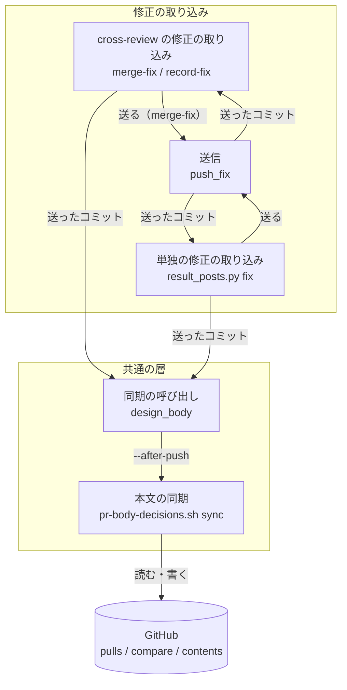
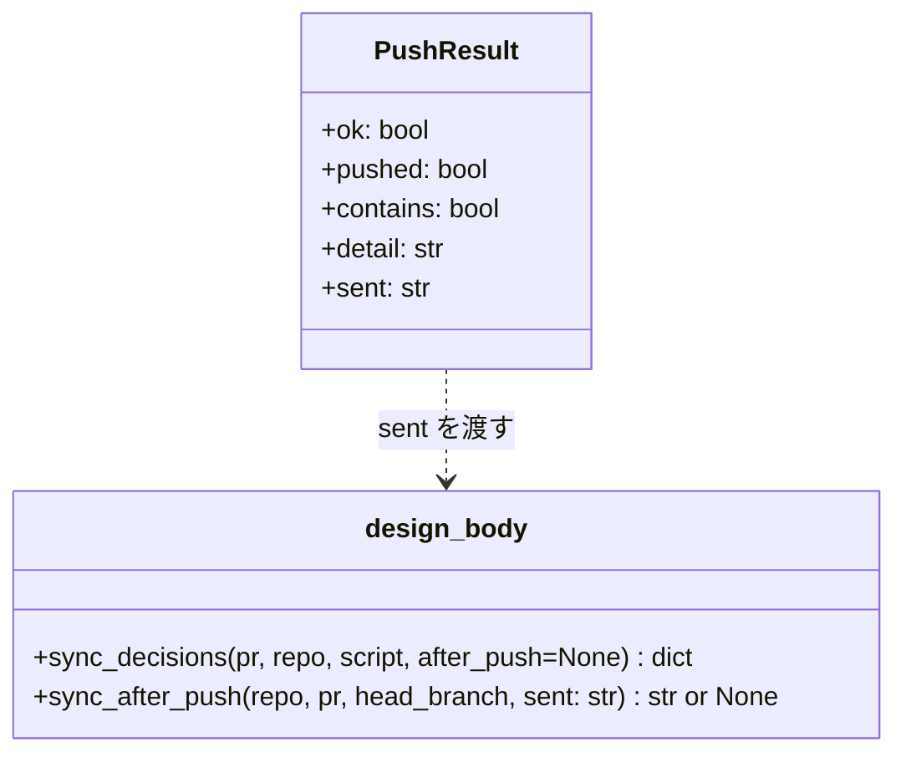
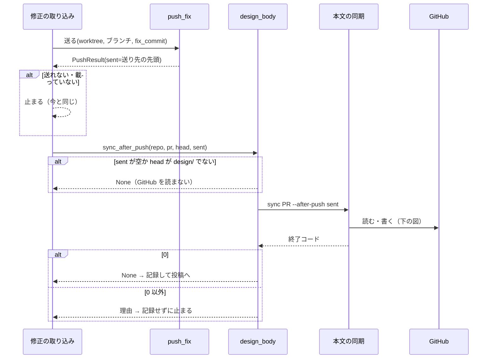
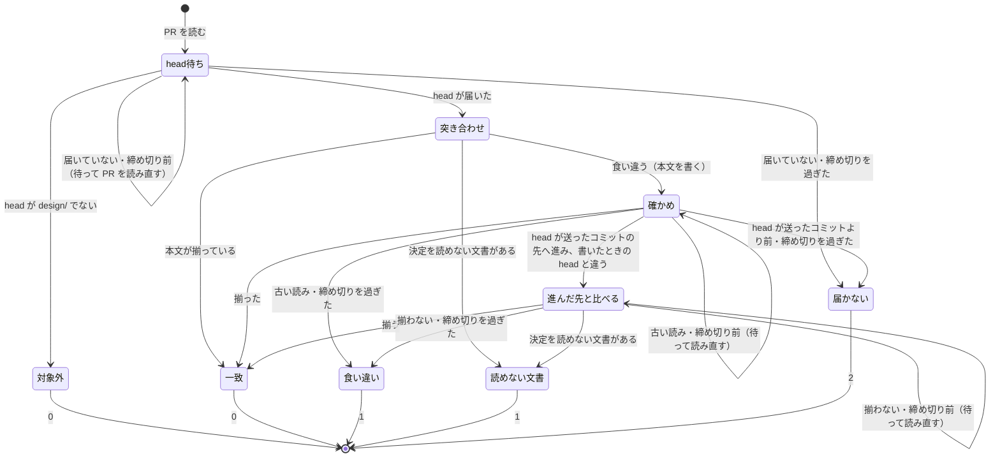

# cross-review: 修正を送った直後の本文の同期が GitHub の古い読みで食い違いと判定し、駆動が止まる → 送ったコミットに PR の head が届くまで上限の内で待ち、書いた後も上限の内で読み直してから揃ったと報告する（#1644）

## 目的

- **何が壊れているか**: 修正を送った直後に打つ `pr-body-decisions.sh sync` が、GitHub の `pulls/{pr}` が返す古い head か古い本文を読み、本文の「決めたこと」と設計文書の決定の見出しが食い違ったまま 1 を返す
- **誰が困るか**: 設計の PR を cross-review で回す conductor。決定の見出しを変える修正が入るたびに駆動（`merge-fix`）が止まり、手で sync を打って `--from review` で流し直す
- **直すと何が成り立つか**: GitHub の読みの遅れが上限の内なら、本文の同期は送ったコミットの設計文書で本文を揃えて 0 を返し、駆動は次のラウンドへ進む。上限を超えたら、待ったコミットと上限を書いて止まる

## 適用範囲

- **働く範囲**: 配布先のリポジトリでも働く。設計の PR（head が `design/` で始まる）を cross-review か `result_posts.py fix` で直すすべてのリポジトリ
- **プロジェクトごとに違うもの**: 無し（GitHub の読みの遅れはリポジトリに依らない）。待つ上限は引数 `--wait-seconds` で変えられ、既定は 30 秒
- **当たるモード**: `standard`

## あるべき姿の根拠

| 根拠 | 種類 | 何を示すか |
| --- | --- | --- |
| PR #1641 の 3 ラウンド目で `merge-fix` が sync の 1 で止まり、約 15 分後に同じ sync を手で打つと 0 で揃った（課題 #1644 の本文） | 実測 | 同じ入力で時間を置くと揃う。読みの遅れを待てば止まらない |
| `gh api repos/devbasex/ai-plugins/compare/<A>...<B> --jq .status` が、B が A の子孫なら `ahead`、同じなら `identical`、祖先なら `behind` を返し、GitHub が知らないコミットでは 404 と終了コード 1 を返した（2026-10-12 実測、短縮の SHA でも `identical`） | 実測 | 「head が送ったコミットか子孫か」を 1 回の読みで判定でき、送ったコミットを GitHub がまだ知らない間は失敗として見分けられる |
| `record-fix` が同じ判定（`compare` の `identical` / `ahead`）でコミットが head にあるかを確かめている（`review_lib/commands/record_fix.py`） | 既存の形に揃える | 到達の判定に新しい方法を持ち込まない |

要求と受け入れ条件は #1644 の本文にある（コピーは [issue-1644-requirements.md](issue-1644-requirements.md) ）。この文書は「どう作るか」だけを扱う。

## 例: PR #1641 の 3 ラウンド目を、直した後の形で通すと

1. 修正担当が設計文書の決定 9 の見出しを直し、コミット 27eb2db1 を作る
2. `state.py merge-fix` が 27eb2db1 を `design/issue-1289` へ送り、送り先を取り直して先頭が 27eb2db1（の完全な SHA）だと知る
3. `merge-fix` は `pr-body-decisions.sh sync 1641 --after-push 27eb2db1…` を打つ
4. sync が `pulls/1641` を読むと head は 1 つ前のコミットだった。`compare/27eb2db1…...<読んだ head>` は `behind` なので、1 秒待って読み直す。2 回目で head が 27eb2db1 になる
5. 27eb2db1 の設計文書から決定の見出しを読み、本文の「決めたこと」を書き直す
6. 書いた後に読み直すと、本文がまだ書く前のものだった。head は 27eb2db1 のままなので、1 秒待って読み直す。2 回目で揃い、`書き直した: 設計文書 1 本 / 決定 9 件` と 0 を返す
7. `merge-fix` は修正の取り込みを記録し（段階 `recorded`）、投稿へ進む

30 秒たっても head が 27eb2db1 に届かなければ、4 の後で `ERROR: 待っても PR の head が送ったコミットに届かなかった（送ったコミット 27eb2db1…、上限 30 秒、最後に読んだ head …）` を出して 2 を返す。`merge-fix` は記録せずに止まり、打ち直すと送信と本文の同期からやり直す。

## ドメインモデル

### コンテキスト

| コンテキスト | 何の語が 1 つの意味に決まるか |
| --- | --- |
| cross-review の修正の取り込み（`cross-review`） | 修正の取り込み・送ったコミット・修正の記録の段階（`recorded` / `posted` / `done`） |
| 設計 PR の本文（`design-pr-body`） | 決定の見出し・本文の「決めたこと」・本文の同期・head の設計文書 |

取り込みが顧客、本文が供給者の関係（顧客 / 供給者）。取り込みは「送ったコミット」を渡して本文の同期を頼み、同期の結果（終了コード）だけを受ける。本文の同期が head の到達の判定を持ち、取り込みの側には待ちを書かない（受け入れ条件 5）。

### 集約

| 集約 | 持ち主（書き換えてよいもの） | 根 | エンティティ | 値オブジェクト |
| --- | --- | --- | --- | --- |
| 設計 PR の本文の「決めたこと」 | `pr-body-decisions.sh sync`（render は PR を作る前の本文だけ） | PR の本文の「決めたこと」の節 | — | 決定の見出しの並び・送ったコミット（SHA）・待つ上限（秒） |
| 修正の記録 | `merge_fix.ingest_fix`（`merge-fix` と `record-fix` が通る） | ラウンドの `fix` | 取り込みの段階 | 送ったコミット |

「送ったコミット」は 2 つの集約の間を値として渡る。本文の同期は修正の記録を読まず、修正の記録は本文を書かない。

### 不変条件

| # | 集約 | 条件 | 破れたときの扱い |
| --- | --- | --- | --- |
| I1 | 設計 PR の本文 | `--after-push <SHA>` の sync が 0 を返すのは、読んだ PR の head が送ったコミットか子孫で、本文の「決めたこと」がその head の設計文書の決定の見出しと一致したと読めたときだけである | 0 を返さない。head が届かなければ 2、上限まで食い違えば 1 |
| I2 | 設計 PR の本文 | 1 回の sync が待つ時間の合計は `--wait-seconds`（既定 30 秒）を超えない。待ちの締め切りは書く前と書いた後で 1 つを共有する | 締め切りを過ぎたら読み直さずに判定する |
| I3 | 設計 PR の本文 | 最初の読みで head が送ったコミットと一致し、書いた後の最初の読み直しで揃ったとき、GitHub への読みの回数は `--after-push` を渡さない sync と同じで、待たない | — |
| I4 | 設計 PR の本文 | `--after-push` を渡さない呼び方（`sync`・`check`・`render`）の振る舞いと終了コードは変わらない | — |
| I5 | 設計 PR の本文 | 書いた後に head が送ったコミットの先へ進んでいたら、進んだ先の設計文書と突き合わせる。書いたときの決定を一致と報告しない。食い違っても古い本文の読みを否定できないため、共有の締め切りまで本文を読み直してから判定する | 締め切りを過ぎても食い違えば 1 |
| I6 | 修正の記録 | 本文の同期が 0 でないとき、修正の取り込みを記録しない（段階 `recorded` へ進まない） | 理由を出して止まる。打ち直すと送信と本文の同期からやり直す |
| I7 | 修正の記録 | 送ったコミットが無い（送らなかった）か head が `design/` で始まらないとき、本文の同期を打たない | — |

### ドメインイベント

| # | イベント | 発生元 | 受け手 |
| --- | --- | --- | --- |
| E1 | 修正のコミットを送った | `merge-fix`（`push_fix`）・`record-fix`（ホストが送り、`compare` で確かめた）・`result_posts.py fix`（`push_fix`） | 本文の同期（`--after-push` に送ったコミットを渡す） |
| E2 | PR の head が送ったコミットへ進んだ | GitHub | 本文の同期（`pulls/{pr}` の読みと `compare` で観測する） |
| E3 | head の設計文書から決定の見出しを読んだ | 本文の同期 | 本文の同期（E4 の材料） |
| E4 | 本文の「決めたこと」を書き直した | 本文の同期 | GitHub（PR の本文） |
| E5 | 書いた本文と head を読み直して突き合わせた | 本文の同期 | 修正の取り込み（終了コード） |
| E6 | 別の push で head が送ったコミットの先へ進んだ | 別の担い手 | 本文の同期（進んだ先の設計文書と突き合わせる） |
| E7 | 修正の取り込みを記録した（段階 `recorded`） | `merge_fix.ingest_fix` | cross-review の駆動（投稿へ進む） |

### 用語

用語集へ足す語・意味を変える語は無い。この文書の「送ったコミット」「本文の同期」は要求の「語の使い方」が定めたこの課題の中だけの言い回しで、用語集へ足さない。

## 機能一覧

| # | 機能 | 誰が使うか |
| --- | --- | --- |
| F1 | 修正を送った直後の本文の同期が、PR の head が送ったコミットへ届くまで上限の内で待つ | cross-review の駆動（`merge-fix` / `record-fix`）・`/ndf:fix`（`result_posts.py fix`） |
| F2 | 本文を書いた後の読み直しが古い値を返しても、上限の内で読み直して揃ったのを確かめる | 同上 |
| F3 | 上限を超えたら、待ったコミットと上限を理由に書いて止まる | conductor（打ち直すか調べるかを判断する） |
| F4 | 修正の取り込みが、送ったコミットを本文の同期へ渡す | `merge-fix` / `record-fix` / `result_posts.py fix` |

## 構成要素

| 要素 | 変更 | 責務 |
| --- | --- | --- |
| 本文の同期（`plugins/ndf/scripts/pr-body-decisions.sh`） | 変更 | `sync` に省略できる引数 `--after-push <SHA>` と `--wait-seconds <秒>` を足す。`--after-push` があるときだけ、書く前に head の到達を待ち、書いた後の読み直しを上限の内で繰り返す。到達の判定（文字列の一致、違えば `compare`）と待ちの締め切りはここ 1 か所に置く |
| 同期の呼び出し（`plugins/ndf/scripts/lib/design_body.py`） | 変更 | `sync_decisions` に `after_push` を足し、渡されたら `--after-push` を付けて打つ。`sync_after_push` の 4 つ目の引数を「送ったか（bool）」から「送ったコミット（SHA、送らなければ空）」へ変える |
| 送信（`plugins/ndf/scripts/lib/result_posts.py` の `push_fix` / `PushResult`） | 変更 | 送った後に取り直した送り先の先頭の完全な SHA を `PushResult.sent` に入れる（既定は空文字で、既存の 4 つの位置引数の作り方を壊さない） |
| 単独の修正の取り込み（`result_posts.py` の `cmd_fix`） | 変更 | `sync_after_push` へ `pushed.sent` を渡す（送らなかったときは空） |
| cross-review の修正の取り込み（`plugins/ndf/skills/cross-review/scripts/review_lib/commands/merge_fix.py` の `_record_new_fix`） | 変更 | `merge-fix` は `pushed.sent`、`record-fix`（`pushed_by_host`）は確かめた修正のコミット（`fix_commit`）を `sync_after_push` へ渡す |
| `fix-steps.py finalize` | 変えない | 送るコミットが無いときだけ `sync_decisions` を `after_push` なしで打つ（対象範囲の外） |



### 置き場所

```text
plugins/ndf/
├── scripts/
│   ├── pr-body-decisions.sh          # 変更: --after-push / --wait-seconds、到達の待ち、書いた後の読み直し
│   ├── lib/
│   │   ├── design_body.py            # 変更: after_push を渡す
│   │   └── result_posts.py           # 変更: PushResult.sent、cmd_fix が sent を渡す
│   └── tests/
│       ├── test_pr_body_decisions.py # 変更: 遅れを返す偽の gh で受け入れ条件 1〜4・8・9
│       └── test_result_posts.py      # 変更: 送ったコミットが同期へ渡る
└── skills/cross-review/
    ├── scripts/review_lib/commands/merge_fix.py  # 変更: 送ったコミットを渡す
    └── tests/                                    # 変更: merge-fix / record-fix が送ったコミットを渡す、0 でないとき記録しない
```

## 構造

触る型は `PushResult` の 1 つと、`design_body` の 2 つの関数の引数である。



- `sent` は `push_fix` が成功して送り先を取り直せたときだけ埋まる。`fix_commit` が無い（送らない）・失敗のときは空
- `sync_after_push(..., sent)` は `sent` が空か head が `design/` で始まらなければ何もしない（I7。今の `pushed=False` と同じ）
- `sent` は報告された `fix_commit` ではなく送り先の先頭にする。`push_fix` はworktreeの `HEAD` を送り、`fix_commit` はその祖先でもよいためである。先頭を待てば `fix_commit` も含まれる

## 入出力の契約

### `pr-body-decisions.sh sync`

| 項目 | 書くこと |
| --- | --- |
| 名前 | `pr-body-decisions.sh sync <PR番号> [--repo <所有者>/<リポジトリ>] [--after-push <SHA> [--wait-seconds <秒>]]` |
| 入力 | `--after-push`: 省略できる。7〜40 桁の 16 進。送ったコミット。`--wait-seconds`: 省略できる。0 以上の整数。既定 30。`--after-push` と組むときだけ受ける |
| 出力（成功） | 今と同じ。`一致: …` か `書き直した: …` を標準出力へ出して 0。待った回数が 1 回以上なら、標準出力の最後へ `待った: <秒> 秒 / 読み直し <回> 回` を 1 行足す（標準エラーへ出すと、`design_body` が理由に標準エラーを優先して読むため、1 のときの差分が理由から消える） |
| 失敗の形 | 下の表 |
| 互換性 | 引数を足さない呼び方は今と同じ（I4）。`check` と `render` は新しい引数を受けない |

| 終了コード | `--after-push` を渡したときに当たる場合 | 今との違い |
| --- | --- | --- |
| 0 | head が送ったコミットか子孫で、本文がその head の決定の見出しと揃ったと読めた。対象外（head が `design/` で始まらない）も 0 | 待ってから判定する |
| 1 | 上限の内で読み直しても、本文が head の設計文書と揃わなかった。決定を読めない文書がある | 書いた後の食い違いは、上限まで読み直してから 1 にする |
| 2 | 上限の内に head が送ったコミットか子孫へ届かなかった（書く前と書いた後のどちらでも）。読めなかった・書けなかった | 「head が届かなかった」を 2 の場合に足す（決定 4） |
| 3 | 呼び出しの誤り。`--after-push` の値が 16 進 7〜40 桁でない・`--wait-seconds` が整数でない・`--wait-seconds` だけを渡した・`check` に新しい引数を渡した | 新しい引数の誤りを 3 の場合に足す |

**head が届かなかったときの標準エラー**は、`design_body` が 300 文字で切るため、SHA と上限を先頭に置く。

```text
ERROR: 待っても PR の head が送ったコミットに届かなかった（送ったコミット <SHA>、上限 <秒> 秒、最後に読んだ head <SHA>）
```

スクリプトの冒頭の終了コードの説明（正本）へ、上の 2 と 3 の場合を書き足す。

### `design_body`

| 関数 | 入力 | 出力 |
| --- | --- | --- |
| `sync_decisions(pr, repo=None, script=None, after_push=None)` | `after_push` は送ったコミット。`None` なら今と同じ引数で打つ | 今と同じ `{"name", "result", "code", "reason"}`。`LABELS` は変えない |
| `sync_after_push(repo, pr, head_branch, sent)` | `sent` は送ったコミット（空なら送っていない） | 揃えば `None`、揃わなければ理由の文字列（今と同じ形） |

`fix-steps.py finalize` は `sync_decisions` を `after_push` なしで呼び、変わらない。

## 処理の流れ

### 呼び出し元から本文の同期まで



`record-fix` は送信を通らず、`compare` で head にあると確かめた `fix_commit` を `sent` として渡す。

### 本文の同期の中（`--after-push` を渡したとき）



- **「届いた」の判定**: 読んだ head が送ったコミットと一致する（送ったコミットが短縮なら前方一致）か、`compare/<送ったコミット>...<読んだ head>` の `status` が `identical` / `ahead` のとき。一致すれば `compare` を読まない（I3）。`behind` / `diverged` と、`compare` の失敗（送ったコミットを GitHub がまだ知らない 404 を含む）は「届いていない」として扱い、締め切りまで読み直す
- **確かめの「古い読み」**: 読み直した head が書いたときの head と同じで本文が揃っていないとき（書く前の本文が返った）と、読み直した head が送ったコミットへ届いていないとき（送る前の head が返った）。書いたときの head と違い、送ったコミットか子孫なら E6 として「進んだ先と比べる」へ移る（I5）
- **進んだ先と比べる**: 進んだ先の設計文書を読んで突き合わせ、書き直さない（決定 5）。揃わなくても、書いた後の本文の読みが古いだけかもしれないため、締め切りまで「確かめ」と同じ待ち方で `pulls/{pr}` を読み直して突き合わせ直し、締め切りを過ぎても揃わなければ 1 にする（I5）。読み直した head がさらに進んでいれば、その先の設計文書を読み直す
- **待ち方**: 締め切りは呼び出しの時刻 + `--wait-seconds`。間隔は 1 秒から倍にし 8 秒を上限とし、締め切りを越える分は切る。待った後は `pulls/{pr}` を読み直す。設計文書（`files` と `contents`）は head が変わったときだけ読み直す
- **`--wait-seconds 0`**: 待たずに 1 回ずつ判定する。届いていなければ 2

## 非機能の実現方式

| 大項目 | 要求の条件 | 実現方式 | 確かめ方 |
| --- | --- | --- | --- |
| 可用性 | push の直後の読みの遅れ（前提 1）で、本文の同期が誤って 1 を返して駆動を止めない（受け入れ条件 1・2）。遅れが上限を超えたときは止め、0 に畳まない（受け入れ条件 4） | `--after-push` の sync が、書く前は head の到達を、書いた後は本文と head の読み直しを、共有の締め切りの内で繰り返す。締め切りを過ぎたら 1 か 2 を返し、0 にしない | 最初の N 回だけ古い head・古い本文を返す偽の `gh` で 0 を、締め切りを超える N で 2 か 1 を見る |
| 性能・拡張性 | 遅れが無いときに待ちを足さない（受け入れ条件 9）。遅れがあるときの待ちは前提 2 の上限の内 | head の一致を文字列で先に見て、`compare` は一致しないときだけ読む。待ちの合計は `--wait-seconds`（既定 30 秒）で切る | 遅れの無い偽の `gh` で `gh api` の呼び出しの回数が `--after-push` なしと同じことを数える。上限を超える遅れで所要時間が上限 + 読み 1 回分に収まることを測る |
| 運用・保守性 | 止めたときの理由に、待ったコミットの SHA と上限を書き、手で打ち直すか調べるかを判断できる（受け入れ条件 4） | 届かなかったときの標準エラーを `送ったコミット <SHA>、上限 <秒> 秒、最後に読んだ head <SHA>` の形で先頭に置き、`design_body` の 300 文字の切り詰めに掛からないようにする | `merge-fix` の停止の理由に SHA と上限が載ることを見る |

## 決定の記録

### 決定 1: 待ちを共通の層 1 か所に置くため、`pr-body-decisions.sh sync` に省略できる引数 `--after-push <SHA>` を足し、待ちと読み直しをスクリプトの中に置く

書いた後の読み直し（受け入れ条件 2）はスクリプトの中の `sync_section` にあり、外から sync を打ち直しても「書いた後の読みが古かった」と「本当に食い違った」を区別できない。スクリプトの中に置けば、書く前の待ちと書いた後の読み直しが 1 つの締め切りを共有でき、呼び出し元 3 つは SHA を渡すだけになる。

`design_body` で sync を丸ごと打ち直す案は採らない。打つたびに変更したファイルの一覧と設計文書を読み直し、遅れが無いときと同じ読みの回数（受け入れ条件 9）を待ちの間にも何倍も使う。呼び出し元ごとに待つ案は、要求の境界（行わない）に当たる。

根拠: Value 6 / Value 4（MVV 版 2）

### 決定 2: 「届いた」を観測で判定するため、送ったコミットを手掛かりにし、PR の head が送ったコミットか子孫になるまで待つ

送った側は送り先の先頭を知っているため、待つ相手が決まる。子孫まで認めるのは、別の push で head が先へ進んでいても（E6）待ち続けないためである。到達は `compare` の `identical` / `ahead` で見る。`record-fix` が同じ判定を使っており、1 回の読みで決まる（あるべき姿の根拠の実測）。

固定の時間だけ待つ案は採らない。遅れが無いときも待ち（受け入れ条件 9 に反する）、遅れが長ければ足りない。本文の書き直しが反映されたかだけで判定する案は、書く前の head が古いとき（受け入れ条件 1）に古い設計文書で書いてしまう。

根拠: Value 3 / Value 4（MVV 版 2）

### 決定 3: 送ったコミットに報告された `fix_commit` ではなく送り先の先頭を使うため、`PushResult` に `sent` を足す

`push_fix` はworktreeの `HEAD` を送り、`fix_commit` はその祖先でもよい。`fix_commit` を待つと、PR の head が送ったものの途中のコミットでも「届いた」と判定し、先頭の設計文書で揃わない。`push_fix` は送った後に送り先を取り直しているため、その先頭の SHA を返せば読みを足さずに済む。`sent` は既定値を持つ 5 つ目の欄にし、既存の 4 つの位置引数の作り方とテストの偽物を壊さない。

`record-fix` はホストが送ったコミットを `compare` で確かめているため、そのコミット（`fix_commit`）を渡す。

根拠: Value 6（MVV 版 2）

### 決定 4: 新しい終了コードを足さないため、上限の内に head が届かないときは 2（読めなかった）を返す

届かないのは「PR の head を、要る状態で読めなかった」ことで、本文と設計文書の食い違いを確かめたわけではない。1 は「突き合わせて食い違った」の意味を保つ。呼び出し元（`design_body` の `LABELS`）は 0 以外をすべて止める扱いで、新しいコードを足すと `LABELS` と承認の提示の両方を直すことになる。2 の場合を 1 つ足すことは、終了コードの意味を変える変更として承認ゲート 1 で見る（要求の境界「確認してから行う」）。

1 にする案は採らない。食い違いの差分を出せない停止を 1 に入れると、`check` の 1 が持つ「差分を出す」の意味と混ざる。

根拠: Value 3（MVV 版 2）

### 決定 5: 待ちを 1 か所で上限に収めるため、締め切りを書く前と書いた後で共有し、既定を 30 秒にし、`--wait-seconds` で変えられるようにする

前提 2 は「駆動の 1 ステップを目に見えて延ばさない、数十秒の桁」である。締め切りを共有すれば、1 回の sync の待ちの合計が上限を超えない（I2）。間隔は 1 秒から倍にして 8 秒で止め、遅れが短いときは 1〜2 回の読み直しで抜ける。既定は呼び出し元が渡さない値で、変えたい利用者だけが引数で渡す。待つ時間はリポジトリの形に依らないため、`.ndf/` の設定には置かない。

書いた後に head が送ったコミットの先へ進んでいたら（E6）、進んだ先の設計文書と突き合わせ、書き直さない。揃わないときは古い本文の読みと区別できないため、共有の締め切りまで読み直してから 1 にする（I5）。進めた側が自分の本文の同期を打つためである。もう 1 度書き直す案は、2 つの担い手が同じ節を交互に書く経路を作る。

根拠: Value 1 / Value 5（MVV 版 2）

### 決定 6: 既存の呼び方を変えないため、待ちと読み直しは `--after-push` を渡したときだけ働かせる

`check`・継続的統合・`fix-steps.py finalize`・承認の提示は push の直後に打たず、待つ相手（送ったコミット）を持たない。待ちを既定にすると、遅れの無い食い違いでも上限まで待ってから 1 を返し、継続的統合の時間が延びる。引数を足さない呼び方は終了コードの意味も読みの回数も今のままにする（受け入れ条件 8）。

根拠: Value 1 / Value 6（MVV 版 2）

## テスト設計

| 受け入れ条件・不変条件 | どの振る舞いで縛るか | どう壊したら落ちるべきか |
| --- | --- | --- |
| 受け入れ条件 1 / I1 | 最初の N 回（上限の内）だけ送る前の head を返す `pulls/{pr}` で、`sync --after-push <送ったコミット>` が送ったコミットの設計文書の見出しで本文を書き、0 を返す | 待たずに最初の head で書くと、本文が古い見出しになり落ちる |
| 受け入れ条件 2 | 書いた後の最初の N 回だけ書く前の本文、または送る前の head を返す読みで、sync が 0 を返し、書き込みは 1 回だけ | 書いた後の読み直しを 1 回にすると 1 で落ちる。古い読みのたびに書き直すと書き込みの回数で落ちる |
| 受け入れ条件 3 / I5 | 書いた後の読みで head が送ったコミットの子孫へ進み、その設計文書の見出しが書いたものと違うとき、締め切りまで読み直した後に 1 を返し、差分に進んだ先の見出しが出る。進んだ先の見出しが書いたものと同じで、書いた後の最初の N 回だけ書く前の本文を返すときは 0 を返し、書き込みは 1 回だけ | 進んだ先を読まずに書いたときの見出しで比べると 0 で落ち、進んだ先との食い違いで読み直さずに 1 を返すと後者で落ちる |
| 受け入れ条件 4 | 上限を超えて送る前の head を返し続けると 2 を返し、標準エラーの先頭 300 文字に送ったコミットの SHA と上限の秒が入る。本文は書かない | 0 か 1 を返すと落ちる。SHA か上限が理由に無いと落ちる |
| 受け入れ条件 5 | `merge-fix` は `push_fix` が返した `sent`、`record-fix` は確かめた `fix_commit`、`result_posts.py fix` は `sent` を、`sync_after_push` 経由で `--after-push` に渡す | 呼び出し元のどれかが SHA を渡さない（`--after-push` が付かない）と落ちる |
| 受け入れ条件 6 / I6 | sync が 0 でないとき、`merge-fix` は段階 `recorded` を記録せずに止まり、打ち直すと sync をもう 1 度打つ | 0 以外で記録すると落ちる。打ち直しで sync を飛ばすと落ちる |
| 受け入れ条件 7 / I7 | head が `design/` でない PR か `sent` が空のとき、`sync_after_push` は `gh` を 1 度も呼ばない | 送らなかったときに sync を打つと落ちる |
| 受け入れ条件 8 / I4 | `--after-push` を渡さない `sync`・`check`・`render` は、今のテストのまま通る。`--wait-seconds` だけ・`check --after-push`・16 進でない SHA は 3 を返し、GitHub を読まない | 引数なしの sync が待つか読み直すと、読みの回数で落ちる |
| 受け入れ条件 9 / I3 | 遅れの無い `pulls/{pr}` で、`--after-push` 付きの sync の `gh api` の呼び出しが、付けないときと同じ回数で、`compare` を呼ばず、待たない | 一致しても `compare` を読むか、1 度でも待つと落ちる |
| I2 | 遅れが上限を超える偽物で、sync の所要時間が `--wait-seconds` + 読み 1 回分に収まる。書く前と書いた後の両方で遅れても合計が上限を超えない | 締め切りを書く前と書いた後で別々に持つと所要時間で落ちる |
| `PushResult.sent`（決定 3） | `push_fix` が送った後に取り直した送り先の先頭の完全な SHA を `sent` に入れる。送らないとき・失敗のときは空 | `fix_commit` をそのまま入れると、`fix_commit` が先頭の祖先の場合に落ちる |

## 設計の結果

| 課題 | 扱い | 取り込み先 | 触るファイル |
| --- | --- | --- | --- |
| #1644 | 実装する | — | `plugins/ndf/scripts/pr-body-decisions.sh`、`plugins/ndf/scripts/lib/design_body.py`、`plugins/ndf/scripts/lib/result_posts.py`、`plugins/ndf/skills/cross-review/scripts/review_lib/commands/merge_fix.py`、`plugins/ndf/scripts/tests/`、`plugins/ndf/skills/cross-review/tests/` |

## 未確認のまま残ること

| 項目 | 内容 |
| --- | --- |
| 停止の原因 | 再現していない（前提 1）。3 つの読みのどれが古かったかに依らず揃う形にした。リリース後テストで遅れが起きなければ「遅れが起きず確かめられなかった」と記録する |
| 既定の上限 30 秒が足りるか | GitHub の `pulls/{pr}` の遅れの長さを測っていない。上限を超えた停止が出たら、標準エラーの「最後に読んだ head」と時刻から遅れを数え、既定を見直す |
| `compare` の遅れ | 送ったコミットを GitHub がまだ知らない間、`compare` が 404 を返すと置いた（存在しないコミットで 404 と終了コード 1 を実測）。取り込みの途中で別の状態を返すかは確かめていない。どの失敗も「届いていない」として締め切りまで読み直す |
