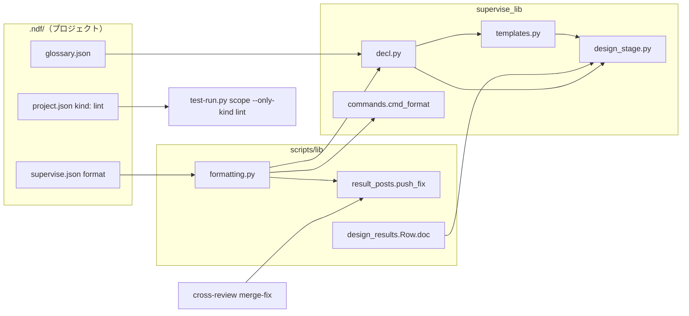
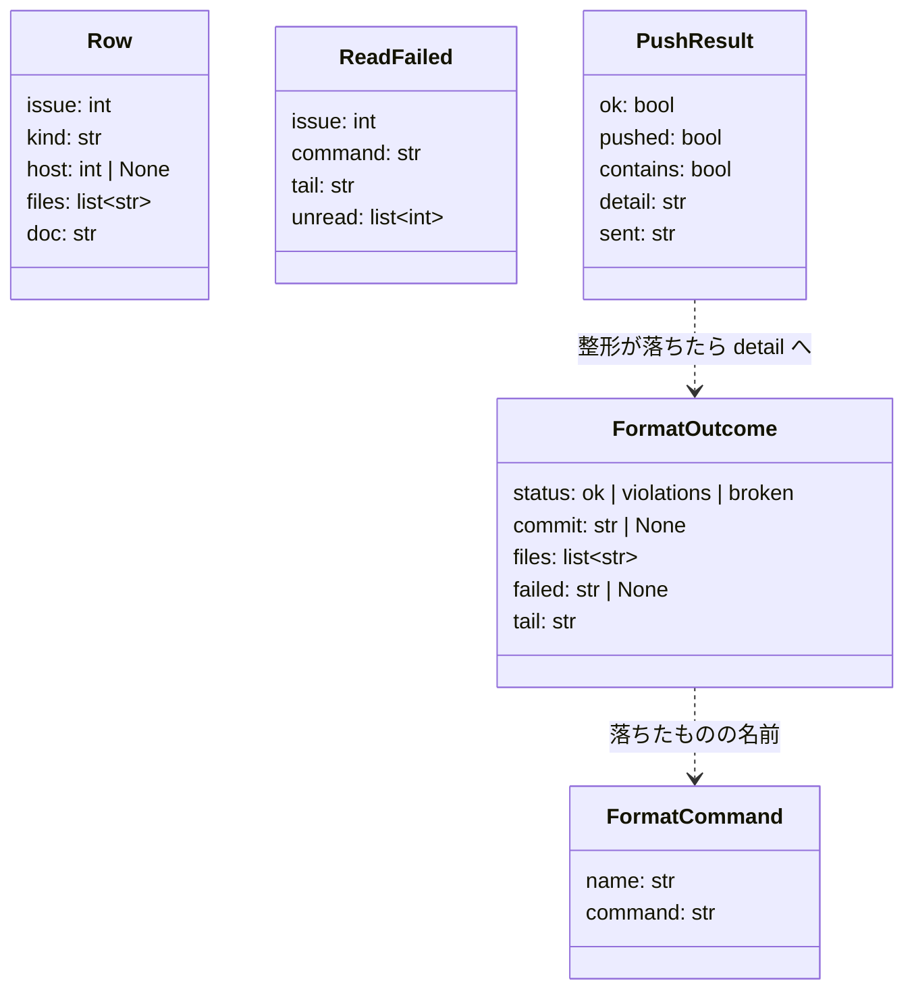
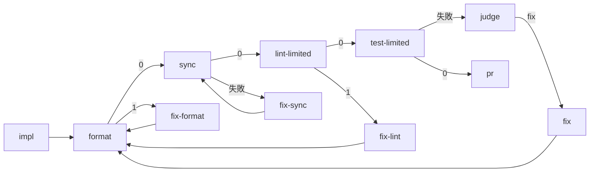
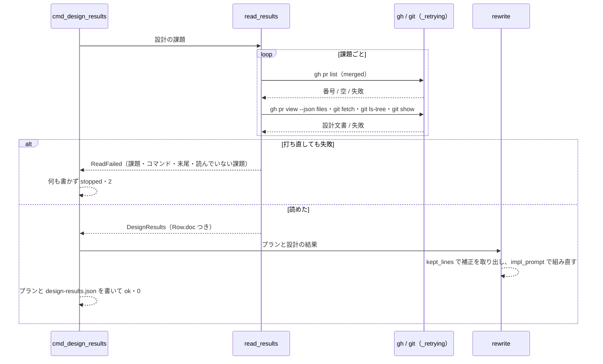
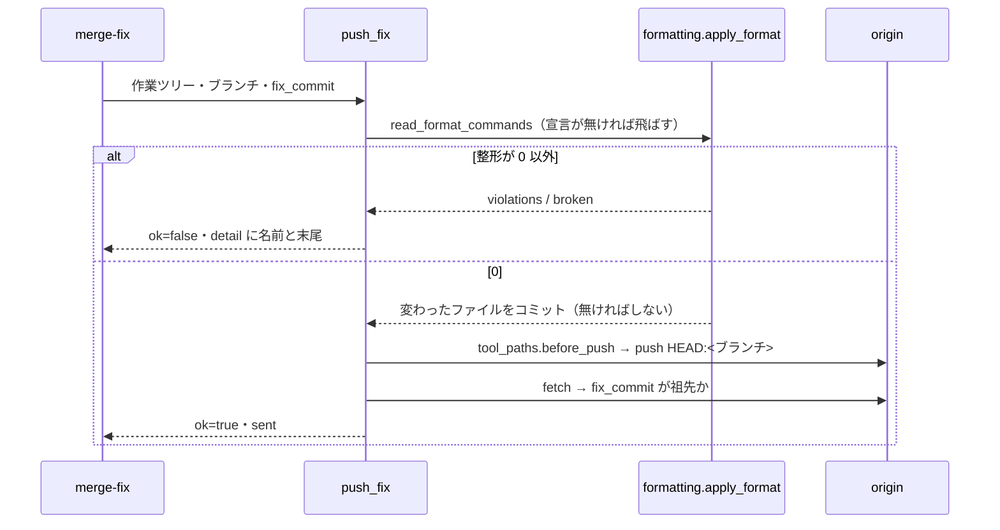

# スプリントの実装と cross-review: conductor が実装の指示へ足した補正が「設計の結果」で消え、整形の違反と GitHub の一時的な失敗のたびに手当てが要る → 補正は残り、整形と静的解析はステップが受け持ち、一時的な失敗では書き換えずに止まる（#1651 #1941 #1507）

## 目的

- **何が壊れているか**: 「設計の結果」のステージが実装の指示を作り直して conductor の補正を消す。worker の整形の違反で push が落ちる（実装のプランと cross-review の両方）。GitHub の 504 で設計の結果を読めないまま、触るファイルの無い実装のプランを `status: ok` で書く
- **誰が困るか**: スプリントを回す conductor（毎スプリント、5 本のプランへ同じ 3 行を手で足し、整形の違反の後に `check-lint.sh --fix` を打って再開している）と、その手当てを待つ利用者
- **直すと何が成り立つか**: 雛形が設計文書のパスと用語集の確認を持ち、補正は書き直しの後も残る。整形と静的解析は範囲テストと push の前にスクリプトが当てる。一時的な失敗ではプランを書き換えずに止まる

## 適用範囲

- **働く範囲**: 配布先のリポジトリでも働く（`supervise.py` の雛形・`design-results`・cross-review の送信）
- **プロジェクトごとに違うもの**: 整形のコマンドは `.ndf/supervise.json` の `format`、静的解析は `.ndf/project.json` の `kind: lint` の suite、用語集の有無は `.ndf/glossary.json`（用語集の設定）で受ける。どれも無ければ今の振る舞いのまま
- **当たるモード**: 実装のプランを作るすべてのモード（`new impl` / `new fix` / `new sprint`）。cross-review はモードに関わらず

## あるべき姿の根拠

| 根拠 | 種類 | 何を示すか |
| --- | --- | --- |
| m725（2026-10-03）で `design-results` の後、4 本のプランの補正が消えた | 実測 | 書き直しが補正を消す（#1651） |
| m464（PR 1700）で `prompt` に `check-lint` の補正があっても `pr` が整形の検査で落ちた | 実測 | worker への指示では整形が保証されず、ステップが要る（#1651） |
| m1693（PR 1716）で範囲テストが静的解析で 3 回落ち、1 回約 310 秒を 3 往復した | 実測 | 範囲テストの前に静的解析を当てると往復の秒が減る（#1651） |
| m1982 で 5 本のプランに同じ 3 行を手で足した | 実測 | 同じ手当ての 2 度目以降で、雛形へ入れる対象である（Value 4） |
| #1941 で打ち直すと 5 件とも読めた | 実測 | 504 は打ち直しで通る一時的な失敗である |
| #1507 の round 2 の修正コミット 554d14d1 が `ruff format` 違反で pre-push に落ちた | 実測 | cross-review の送信の前にも整形が要る |

要求と受け入れ条件は #1651 の本文にある（コピーは `issues/issue-1651-requirements.md`）。この文書は「どう作るか」だけを扱う。決定の記録は `issues/issue-1651-design-decisions.md` に分けた。

## ドメインモデル

### コンテキスト

| コンテキスト | 何の語が 1 つの意味に決まるか |
| --- | --- |
| NDF の開発ワークフロー（`ndf-workflow`） | 実装のプラン・補正・設計の結果・整形・一時的な失敗 |
| NDF の cross-review（`ndf-cross-review`） | 修正の送信・`fix_commit` |

関係は**共有カーネル**とする。共有するのは「整形の宣言」と、それを読んで当てる 1 つの関数（`lib/formatting.py`）だけである。同じチームが両方を持ち、共有する部分を宣言の形と関数 2 つに保てる。

### 集約

| 集約 | 持ち主（書き換えてよいもの） | 根 | エンティティ | 値オブジェクト |
| --- | --- | --- | --- | --- |
| 実装の指示 | `templates.impl_prompt`（文を組むのはこの関数だけ。`design_stage.rewrite` はこれを呼ぶ） | `impl` のステップの `prompt` | — | 雛形の行・補正の行・設計文書のパス・用語集の行 |
| 実装のプランのステップの並び | `templates.plan_to_merge`（この主題の分は `templates.pre_test_steps`） | プランの `steps` | 各ステップ | 遷移（`next` / `on_fail` / `on_exit`） |
| 設計の結果 | `design_stage.read_results` | `DesignResults` | `Row` | 扱い・取り込み先・触るファイル・設計文書のパス（`Row.doc`） |
| 整形の宣言 | プロジェクト（`.ndf/supervise.json`）。NDF は `formatting.format_commands` で読むだけ | `format` の並び | — | `FormatCommand`（名前・コマンド） |
| 修正の送信 | `result_posts.push_fix` | 送り先のブランチの先頭 | — | `PushResult`・整形のコミット |

### 不変条件

| # | 集約 | 条件 | 破れたときの扱い |
| --- | --- | --- | --- |
| I1 | 実装の指示 | 書き直しの前の `prompt` にあった補正の行は、書き直しの後も同じ順ですべて残る | テストで落とす（1651-1） |
| I2 | 実装の指示 | 同じ入力で書き直しを 2 回流した結果は、1 回流した結果と同じ（補正・触る範囲・設計文書の行が重ならない） | テストで落とす（1651-1） |
| I3 | 実装の指示 | 雛形が組む行に、整形や静的解析のコマンドを打てという worker への指示を含めない | テストで落とす（1651-7） |
| I4 | 設計の結果 | 一時的な失敗が打ち直しの後も残ったときは、実装のプランと `design-results.json` を 1 つも書き換えない | `status: stopped`・終了コード 2（1941-2） |
| I5 | 修正の送信 | 整形のコミットは `fix_commit` の上に足し、`fix_commit` は送り先の祖先のまま残る（書き換え・amend をしない） | `push_fix` が `contains` の判定で止まる（1507-2） |
| I6 | 修正の送信・実装のプランのステップの並び | 整形でコミットするのは、整形の前に変更が無く整形で変わった追跡ファイルだけ | テストで落とす |
| I7 | 実装のプランのステップの並び | 整形と静的解析の宣言が無いプロジェクトでは、ステップの並びが今と同じ | テストで落とす（1651-6） |
| I8 | 整形の宣言 | 実装のプランと修正の送信は、同じ関数（`formatting.format_commands`）で同じ宣言を読む | テストで落とす（1507-5） |

### ドメインイベント

| # | イベント | 発生元 | 受け手 |
| --- | --- | --- | --- |
| E1 | 実装のプランが雛形から書かれた | `templates.plan_impl` | conductor・`design_stage.rewrite` |
| E2 | conductor が `impl` の指示へ補正を足した | conductor | `design_stage.rewrite`（I1 で残す） |
| E3 | 設計 PR を探した | `design_stage.merged_design_pr` | `design_stage.read_results` |
| E3' | 一時的な失敗で設計の結果を読めずに止まった | `design_stage.read_results`（`ReadFailed`） | `cmd_design_results`（書かずに終わる）・conductor |
| E4 | 設計文書を読み、「設計の結果」の表を集めた | `design_stage.read_results` | `design_stage.rewrite` |
| E5 | 実装のプランが書き直された（補正は残る） | `design_stage.rewrite` | 実装のステージ（queue） |
| E6 | 実装の worker がコミットした | `impl` のステップ | `format` のステップ |
| E7 | 宣言の整形が当たり、変わったファイルがコミットされた | `format` のステップ（`supervise.py format`） | `sync` か `lint-limited` のステップ |
| E8 | 宣言の静的解析が変更範囲へ当たった | `lint-limited` のステップ（`test-run.py scope --only-kind lint`） | `test-limited`（通った）・`fix-lint`（違反） |
| E9 | 範囲テストが通り、`pr` が push した | `test-limited` → `pr` | `test-all` |
| E10 | cross-review の修正の worker が修正をコミットし、`fix_commit` を書いた | 修正の worker | `merge-fix` |
| E11 | 送信の前に宣言の整形が当たり、変わったファイルが新しいコミットで足された | `result_posts.push_fix`（`formatting.apply_format`） | `push_fix` の push |
| E12 | push し、`fix_commit` が送り先に載ったことを確かめた | `result_posts.push_fix` | `merge-fix` の本文の揃え・記録 |

### 用語

| 用語 | 意味 | 用語集への反映 |
| --- | --- | --- |
| 補正 | conductor が雛形の書いたプランへ手で足した指示や値。プランを書き直す側は消さない | 追加（`ndf-workflow`。要求の工程で追加済み） |
| 整形 | 規則を変えずにコードの形だけを揃えるコマンド。何を打つかはプロジェクトの宣言が持つ | 追加（`ndf-workflow`。要求の工程で追加済み） |
| 一時的な失敗 | GitHub や git の呼び出しが 0 以外で終わり、打ち直せば通りうる失敗（5xx・接続の切断）。打ち直しても残れば、読めなかったとして止まる | 追加（`ndf-workflow`。`ndf-cross-review` の同じ語は投稿の失敗を指し、意味を変えない） |

## 機能一覧

| # | 機能 | 誰が使うか |
| --- | --- | --- |
| F1 | 「設計の結果」で実装のプランを書き直しても、conductor の補正が残る | conductor |
| F2 | 実装の指示に、設計文書のパスと用語集の確認が雛形から入る | 実装の worker |
| F3 | 実装の後・範囲テストの前に、宣言の整形が当たってコミットされる | スプリントの実装のプラン |
| F4 | 範囲テストの前に、宣言の静的解析が変更範囲へ当たる | スプリントの実装のプラン |
| F5 | GitHub の一時的な失敗を打ち直し、それでも読めなければ書き換えずに止まる | conductor |
| F6 | cross-review の修正の送信の前に、宣言の整形が当たってコミットされる | cross-review（と `/ndf:fix` の単独の送信） |

## 構成要素

| 要素 | 責務 |
| --- | --- |
| `lib/formatting.py`（新規） | 整形の宣言の形を見る（`format_commands`）、根の宣言を読む（`read_format_commands`）、整形を当てて変わったファイルだけをコミットする（`apply_format`） |
| `supervise_lib/templates.py` | `IMPL_RULES` と `impl_prompt` が設計文書のパス・用語集の行・残す補正を組む。`pre_test_steps`（新規）が `format`・`fix-format`・`sync`・`fix-sync`・`lint-limited`・`fix-lint` を組み、`plan_to_merge` がそれを置く |
| `supervise_lib/design_stage.py` | 打ち直し（`_retrying`）、一時的な失敗の見分け（`ReadFailed`）、設計文書のパスの収集、補正の取り出し（`kept_lines`）と書き直し |
| `supervise_lib/decl.py` | `format` の宣言と用語集の有無（`glossary_ready`）を引数へ写し、スプリントの各プランへ引き継ぐ |
| `supervise_lib/commands.py`・`supervise.py`・`supervise_lib/paths.py` | `supervise.py format [--root] [--commit]` の副命令と、プリセット `format` |
| `test-run.py` | `scope --only-kind lint` / `scope --only-kind test`（渡した種別の suite だけを変更範囲へ当てる） |
| `lib/result_posts.py` | `push_fix` が push の前に `formatting.apply_format` を呼ぶ |
| `lib/design_results.py` | `Row.doc`（その行を読んだ設計文書のパス）を持ち、`design-results.json` へ写す |
| `.ndf/supervise.json` | ai-plugins の整形の宣言 `format`（C7。実装の中でコミットし、承認ゲート 2 で人が見る） |



## 構造



`ReadFailed` は `design_stage` の例外で、`DesignResultsError`（食い違い・取り込み先が無い）とは別に捕まえる。

## 入出力の契約

### 整形の宣言（`.ndf/supervise.json` の `format`）

| 項目 | 形 | 省略したとき |
| --- | --- | --- |
| `format` | `[{"name": "<名前>", "command": "<シェルのコマンド>"}, ...]`。根で順に打つ | 整形のステップを置かず、送信の前にも整形しない |

コマンドの終了コードの約束: 0 = 整形の後に違反が残らない / 1 = 整形で直らない違反が残る / それ以外 = 仕組みの失敗。
形が違う（オブジェクトでない・`name` か `command` が無い）ときは `DeclError`（雛形）か `broken`（送信）になる。

ai-plugins の宣言は `[{"name": "lint-fix", "command": "bash scripts/check-lint.sh --fix"}]` とする（終了コードの約束は `check-lint.sh` の 0 / 1 / 2 と同じ）。

### `supervise.py format [--root DIR] [--commit]`

| 終了コード | status | いつ |
| --- | --- | --- |
| 0 | `ok` | すべてのコマンドが 0。`--commit` なら変わったファイルを 1 つのコミットにした（無ければコミットしない） |
| 1 | `stopped` | どれかのコマンドが 1（直らない違反）。`items[].tail` に出力の末尾 |
| 2 | `stopped` | 宣言が無い・形が違う・コマンドが 0 と 1 以外・コミットが落ちた |

`items` はコマンドごとの `{name, result, exit, tail}` と、コミットしたときの `{name: "commit", sha, files}`。
コミットの件名は `Update: 宣言の整形を当てる（<名前>）`。

### `test-run.py scope --only-kind lint` / `--only-kind test`

`--only-kind` に渡した種別（suite の `kind`。`lint` か `test`）の suite だけを打つ。当てる範囲は種別を絞った後も今の `scope` と同じで、テストの suite は `--paths`、静的解析の suite は `--changed`（無ければ起点との merge-base からの差分と追跡していない新しいファイル）。範囲に入るファイルが無ければ、`--only-kind lint` は `ok`・終了コード 0、`--only-kind test` と付けないときは今のまま 2。ただし `--only-kind test` は、戦略の範囲の雛形を持つ `kind: test` の suite が 1 つも無い（静的解析の suite だけを宣言した）とき、打たずに `ok`・終了コード 0 を返す（静的解析は前の `lint-limited` で通っている）。戦略が round-only のときは範囲に当てず、`round_runs()` を渡した種別で絞って打つ（その種別が無ければ同じく `ok`・0）。ほかの終了コードは `scope` と同じ。

### 実装のプランの形

| 項目 | 変化 |
| --- | --- |
| `設計文書`（新規・省略可） | `design-results` が書く設計文書のパスの並び。`impl_prompt` が `設計文書:` の行を組む材料 |
| `steps` | 宣言があれば `format`・`fix-format`・`lint-limited`・`fix-lint` が加わる（並びは「処理の流れ」） |

`format` のステップ: `{"type": "run", "preset": "format", "stage": "実装", "on_exit": {"2": "stop"}, "on_fail": "fix-format"}`。
`lint-limited` のステップ: `{"type": "run", "stage": "完了判定", "cmd": "<scope_cmd> --only-kind lint", "on_exit": {"2": "stop"}, "on_fail": "fix-lint"}`。
`fix-format` / `fix-lint` は `FIX_PROMPT` の修正の worker で、`next` は `pre_test_steps(a)` が返す並びの先頭（`format`。`format` の宣言が無ければ `sync`、それも無ければ `lint-limited`）。`fix-lint` は `lint-limited` を置くときだけ置くので、先頭は必ず実在する。
`lint-limited` を置くプランでは、`test-limited` の `cmd` を `<scope_cmd> --only-kind test` にする（静的解析の suite を同じ範囲へ 2 度当てない）。`lint-limited` を置かないときは今のまま `<scope_cmd>`。静的解析の suite だけを宣言したプロジェクトでは `--only-kind test` が `ok`・0 を返すので、`lint-limited` が通れば `test-limited` を経て `pr` へ進む（judge へ落ちない）。

### 実装の指示（`impl` の `prompt`）

```text
課題 #1651・#1941・#1507 を実装する。本文はそれぞれ `gh issue view <番号>` で読む（何をするか と 受け入れ条件）。
設計文書: issues/issue-1651-design.md（決定の記録と「設計の結果」を読んでから実装する）
触る範囲: plugins/ndf/scripts/supervise_lib/templates.py、…
共通:
- 文書には今の決まりだけを書く。.md の文言を照合するテストは書かない
- コミットの件名と本文に課題を閉じる語（Closes / Fixes / Resolves）を書かない。区切りごとにコミットする（push しない）
- 文書に語を足したら `python3 <plugins>/scripts/glossary.py check --file <文書>` を打ち、新しい語は用語集へ足す
<補正の行（書き直しの前の順のまま）>
```

`設計文書:` は `設計文書` が空なら出さない。用語集の行は `glossary_ready` が真のときだけ出す。

### `supervise.py design-results` の結果

| 場合 | status | 終了コード | 書くもの |
| --- | --- | --- | --- |
| すべて読めた・PR が無い・表が無い | `ok` | 0 | 今と同じ。`design-results.json` の `rows[].doc` が加わる |
| 打ち直しても `gh` / `git` が 0 以外 | `stopped` | 2 | 何も書かない。`summary` に読めなかった課題・コマンド・出力の末尾 300 文字・読んでいない課題 |

## 処理の流れ

図に含めない要素: `decl.py`・`paths.py`・`supervise.py`・`commands.py`・`.ndf/supervise.json`（雛形を組む前に宣言を引数へ写す部分と副命令の受け口で、順序を持たない。`format` のステップの中身は `commands.cmd_format` → `formatting.apply_format`）。

### 実装のプランのステップの並び（宣言がすべてあるとき）



宣言ごとに置くかを決める: `format` と `fix-format` は `format` の宣言、`sync` と `fix-sync` は `sync_checks`、`lint-limited` と `fix-lint` は範囲の雛形を持つ `kind: lint` の suite があり、かつ宣言から解いた戦略（`test_strategy.resolve`）が round-only でないときだけ置く（round-only は範囲に当てず全 suite を打つので、範囲の静的解析を先に当てる意味が無い。`test-limited` は今のまま）。どれも無ければ `impl → test-limited` で今と同じ（I7）。`format` と `lint-limited` の終了コード 2 は止まる。図の `fix-format` / `fix-lint` / `fix` から `format` への矢印は「並びの先頭」を指し、`format` を置かないプランでは置いたステップのうち最も前のもの（`sync`、無ければ `lint-limited`）へ向く。`lint-limited` を置くときは、`test-limited` は `--only-kind test` でテストの suite だけを打つ。

`pre_test_steps(a)` はこの並びの `format` から `fix-lint` までを、置くステップだけで返し、`fix-format` / `fix-lint` の `next` を返す並びの先頭へ向けて組む。`plan_to_merge` は `head` の `next` と `fix` の `next` をその先頭（並びが空なら `test-limited`）へ向け、並びに `lint-limited` があれば `test-limited` の `cmd` に `--only-kind test` を足す。#2003 が起点の取り込みを `head` の後に置くときは、取り込みの `next` を同じ先頭へ向ける。

### 「設計の結果」の書き直し



`_retrying` は `waits.retry_call` で、0 以外の終了を 15 秒の間隔で打ち直す。1 コマンドの待ちは 30 秒まで（3 回打つ）、1 回の実行の待ちの合計は 120 秒まで（使い切った後は打ち直さない）。`gh pr list` が 0 で空なら PR が無い（`unread`）。`git show` は `git ls-tree` で `origin/<base>` にあるパスだけに打つ（起点で消えたファイルは失敗でなく読み飛ばす）。最初に失敗が残った課題で止め、残りの課題は「読んでいない」として出す。

補正の取り出し（`kept_lines`）: 書き直しの前のプランの状態（`課題`・`触るファイル`・`設計文書`）から組んだ指示と、書き直しの後の状態から組んだ指示の、空でない行の和を「雛形の行」とする。今の `prompt` の空でない行のうち雛形の行に無いものを、順を保って補正とする。雛形の行を書き換えた行も補正として残る。

### 修正の送信（`push_fix`）



`merge-fix` は変えない。`push_fix` の失敗は今の `review_lib.die`（理由に `detail`）で止まる（1507-4）。

## 非機能の実現方式

| 大項目 | 実現方式 |
| --- | --- |
| 可用性 | 打ち直しの待ちは 1 回の実行で合計 120 秒まで。ステージの `timeout` 600 秒の内に収まる。打ち直しても読めなければ書かずに止まる（I4） |
| 性能・拡張性 | `lint-limited` は変更範囲に当て、`format` は宣言のコマンドをそのまま根で打つ（範囲を渡す口を持たない。ai-plugins の `check-lint.sh --fix` は追跡ファイルすべてに当たり、コミットに入るのは I6 のとおり整形で変わったファイルだけ）。`lint-limited` を置くと `test-limited` は `--only-kind test` で静的解析の suite を打ち直さない。完了判定で、ai-plugins の実装のプランでの `format`・`lint-limited` と、修正のループ 1 回で通る `sync` の秒を測り、`format` と `lint-limited` の和が範囲テスト 1 回（約 310 秒）より短いことを実装の PR に書く |
| 運用・保守性 | 整形と静的解析のコマンド名は `.ndf/` にだけ書く。`supervise_lib`・`lib`・`cross-review` に `check-lint`・`ruff` を書かない |
| 移行性 | `format` の宣言は省略できる。既にある実装のプランの JSON（`設計文書` が無い）は `design-results` も実行も今のまま流れる |

## 決定の記録

決定の記録は `issues/issue-1651-design-decisions.md` にある。

## テスト設計

| 受け入れ条件・不変条件 | どの振る舞いで縛るか | どう壊したら落ちるべきか |
| --- | --- | --- |
| 1651-1・I1 | 補正の行を途中と末尾に足したプランへ `rewrite` を流すと、補正が同じ順で残り、触る範囲と課題は設計の結果のとおり | 補正を捨てる・順を入れ替える・触る範囲を古いまま残すと落ちる |
| 1651-1・I2 | 同じ入力で `rewrite` を 2 回流した `prompt` が 1 回目と同じ | 雛形の行の和を取らず古い指示だけで見分けると、設計文書の行が重なって落ちる |
| 1651-2 | 設計の結果を読めた課題の `prompt` に `Row.doc` のパスが入り、取り込んだ課題の文書のパスも入る | 取り込み先だけの文書にすると落ちる |
| 1651-3 | 用語集の設定と用語集があるとき `glossary.py check` の行が入り、無いとき入らない | 設定を見ずに常に入れると落ちる |
| 1651-4 | `format` の宣言のあるプランは `impl` の後・`test-limited` の前に `format` を持つ。整形違反のコミットを持つ一時リポジトリで `supervise.py format --commit` を打つと、違反が消えたコミットが足される | ステップを `pr` の後に置く・コミットしないと落ちる |
| 1651-5 | `kind: lint` の suite のあるプランは `test-limited` の前に `lint-limited` を持ち、違反で `fix-lint` → `format` へ戻る。`--only-kind lint` はテストの suite を打たない | テストの suite も打つ・`on_fail` が `test-limited` へ向くと落ちる |
| 1651-6・I7 | 宣言が無いプロジェクトのプランの `steps` の id の並びが今と同じ | 宣言が無いのにステップを置くと落ちる |
| 1651-5（重ねて打たない） | `kind: lint` の suite のあるプランの `test-limited` の `cmd` が `--only-kind test` を持ち、無いプランは今の `cmd` のまま | `lint-limited` を置いたのに `test-limited` が静的解析の suite も打つと落ちる |
| 1651-5（種別ごとの範囲） | `--only-kind test` はテストの suite を `--paths` へ、`--only-kind lint` は静的解析の suite を `--changed` へ当てる。実装のファイルだけを変えた `--changed` と、テストのファイルを渡した `--paths` で、テストの suite が打たれる | `--only-kind test` を `--changed` へ当てると落ちる |
| 1651-5（静的解析だけの宣言） | `kind: lint` の suite だけを宣言したプランで、`lint-limited` が通った後の `test-limited`（`--only-kind test`）が `ok`・0 を返し `pr` へ進む | 対象なしの 2 を返して judge へ落ちると落ちる |
| 1651-5（round-only） | テストの suite が範囲の雛形を持たない宣言（戦略 round-only）のプランは `lint-limited`・`fix-lint` を置かず、`test-limited` の `cmd` は今のまま。round-only で `--only-kind lint` を打つと静的解析の suite の `command` だけを打つ | round-only で `lint-limited` を置く・`--only-kind lint` がテストの suite も打つと落ちる |
| 1651-4・1651-5（行き先） | `kind: lint` の suite はあるが `format` の宣言が無いプランで、`fix-lint`・`fix` の `next` が実在するステップ（`sync`、無ければ `lint-limited`）を指す。宣言がすべてあるプランでは `fix` の後に `format` → `sync` を通る | `next` を `format` に固定する・`fix` の `next` を `test-limited` のままにすると落ちる |
| 1651-7・I3 | 雛形が組む `prompt` に宣言の整形・静的解析のコマンドが現れない（宣言の `command` の文字列で照らす） | `IMPL_RULES` へ整形の指示を足すと落ちる |
| 1941-1 | 1 回目に 504 で落ち 2 回目に通る応答で、失敗が無いときと同じプランを書いて `ok` | 打ち直さない・打ち直しの結果を捨てると落ちる |
| 1941-2・I4 | 打ち直しても落ちる応答で、プランと `design-results.json` が書き換わらず `stopped`・2、`summary` に課題とコマンドの末尾 | 失敗を `unread` に入れて `ok` にすると落ちる |
| 1941-3 | `gh` が 0 で空・表が無い文書は `unread` で `ok` | 空の応答を失敗として止めると落ちる |
| 1507-1 | 整形違反の修正コミットを持つ一時リポジトリ（裸のリポジトリを origin にし、pre-push で整形を検査）で `push_fix` が整形のコミットを足して送れる | 整形しないで送ると pre-push で落ちる |
| 1507-2・I5 | 送った後、`fix_commit` が送り先の祖先で `ok` | amend で整形を混ぜると落ちる |
| 1507-3 | 整形で何も変わらないとき、コミットが増えない | 空のコミットを作ると落ちる |
| 1507-4 | 整形のコマンドが 1 / 2 で終わると送らず、`detail` に名前と末尾 | 失敗を無視して送ると落ちる |
| 1507-5・I8 | 雛形（`decl`）と `push_fix` が `formatting.format_commands` を通る（同じ宣言の誤った形で両方が同じ誤りを出す） | 片方が宣言を自前で読むと落ちる |
| I6 | 整形の前から変更のあるファイルはコミットに入らない | `git add -A` で全部をコミットすると落ちる |

## 設計の結果

| 課題 | 扱い | 取り込み先 | 触るファイル |
| --- | --- | --- | --- |
| #1651 | 実装する | — | `plugins/ndf/scripts/supervise_lib/templates.py`、`plugins/ndf/scripts/supervise_lib/design_stage.py`、`plugins/ndf/scripts/supervise_lib/decl.py`、`plugins/ndf/scripts/supervise_lib/commands.py`、`plugins/ndf/scripts/supervise_lib/paths.py`、`plugins/ndf/scripts/supervise_lib/plan.py`、`plugins/ndf/scripts/supervise.py`、`plugins/ndf/scripts/test-run.py`、`plugins/ndf/scripts/lib/formatting.py`、`plugins/ndf/scripts/lib/result_posts.py`、`plugins/ndf/scripts/lib/design_results.py`、`plugins/ndf/scripts/lib/README.md`、`plugins/ndf/scripts/tests/`、`.ndf/supervise.json`、`docs/glossary/glossary.json`、`docs/glossary.md` |
| #1941 | 取り込む | #1651 | — |
| #1507 | 取り込む | #1651 | — |

3 主題が共に触るファイルで、この主題が触る関数と触らない関数は次のとおり（前提 8）。

| ファイル | この主題が触る | 触らない（受け持ち） |
| --- | --- | --- |
| `supervise_lib/templates.py` | `IMPL_RULES`・`impl_prompt`・`plan_impl`（`prompt` を組む引数だけ）・`pre_test_steps`（新規）。`plan_to_merge` は `sync` のステップを組む行を `pre_test_steps` の呼び出しへ置き換える行と、`head[-1]["next"]` と `fix` の `next` を `pre_test_steps` の先頭へ向ける行と、`lint-limited` があるとき `test-limited` の `cmd` へ `--only-kind test` を足す行だけ | `plan_to_merge` の `上限` と `test-limited` から後のステップ（#1909・#1917 #2003）、`judge_step`・`RULE_IMPL`・`RULE_CHECK`・`FIX_PROMPT`・`plan_check`・`plan_check_since`（#1917 #2003） |
| `supervise_lib/flow.py` | 触らない | `plan_workflow`（#1909 #1676） |
| `supervise_lib/design_stage.py` | `merged_design_pr`・`changed_design_docs`・`read_results`・`rewrite`・`cmd_design_results`・`_retrying`（新規）・`kept_lines`（新規）・`ReadFailed`（新規） | `impl_plans`（変えない） |

#2003 の起点の取り込みは `head` の後に置き、その `next` を `pre_test_steps(a)` の先頭（空なら `test-limited`）へ向ける。経路が `format` と `lint-limited` の 2 本ぶん長くなる分は、#1909 の「上限を経路から決める」形が数える。この主題は `上限` の値を変えない。

## 未確認のまま残ること

| 項目 | 内容 |
| --- | --- |
| 秒の実測 | `format`・`lint-limited` と、修正のループで新たに通る `sync` の秒は実装の完了判定で測る（非機能の性能の行）。`sync` の秒が範囲テスト 1 回に比べて重ければ、修正の行き先から `sync` を外すかを振り返りで決める |
| 直らない違反の往復 | `format` が 1 を返し続ける（変更に起因しない既存の違反）とき、`fix-format` との往復は経路の上限で止まる。往復を judge で切るかは、実際に起きた回数を振り返りで数えてから決める |
| `/ndf:fix` の単独の送信 | `push_fix` を通るため整形が当たるようになる。単独の送信で整形のコミットが足されることを、次の実利用で確かめる |
| 整形の前から変わっていたファイル | worker が未コミットのまま残したファイルを整形が変えたときは、コミットに入れず結果の `items` に出すだけである。実際に起きるかは実装で確かめる |
