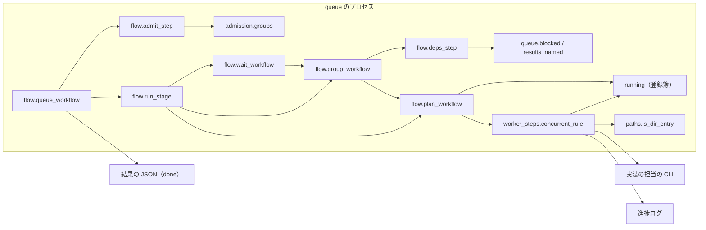
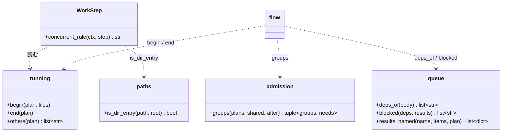
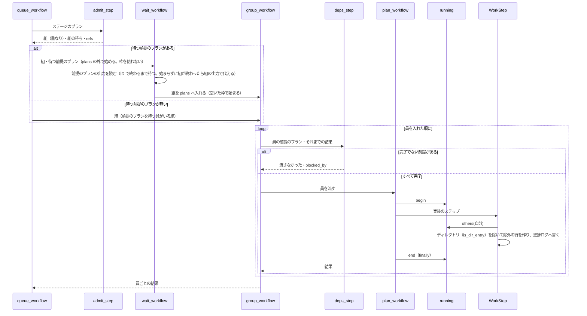

# supervise queue: 同時には走っていないプランのファイルを「変えない」と渡されて実装の担当が止まり、止まったプランを前提にする後ろのプランが流れ出す → 除外の行は起動の時点で走っているプランのファイルだけになり、前提のプランが完了でなければ後ろのプランを流さない（#1674）

## 目的

- **何が壊れているか**: `supervise.py queue` が、実装の担当の指示文へ、同時には走らない（`--max 1`・後から始まる・既に終わった）プランの `触るファイル` を「変えない」として渡す。ディレクトリ（`plugins/ndf/scripts/tests/`）もそのまま渡り、テストを足す作業まで禁じる。止まったプランの結果を前提にするプランも、そのまま流れ出す
- **誰が困るか**: queue でスプリントの実装を流す conductor。3 回の再発（m7c・m815・m1910）で、担当が作業前に止まり、毎回 1 本ずつ流し直した
- **直すと何が成り立つか**: 担当が受け取る除外の行は、その時点で走っている他のプランのファイルだけになる。前提のプランを明示したプランは、前提のプランが完了でなければ流れず、その理由が結果の JSON に残る

## 適用範囲

- **働く範囲**: NDF を入れたすべてのリポジトリの `supervise.py queue`（配布物の `plugins/ndf/scripts/supervise_lib/`）。`supervise.py run` は 1 本だけを流すため、除外の行は今までどおり付かない
- **プロジェクトごとに違うもの**: 無し（プランの JSON の `触るファイル` と `前提のプラン` だけを読む。宣言（`.ndf/`）の項目は足さない）
- **当たるモード**: `standard` の実装のプラン（スプリントの queue と、conductor が `new impl` で作るプラン）

## あるべき姿の根拠

| 根拠 | 種類 | 何を示すか |
| --- | --- | --- |
| m1910 の進捗ログ: `5-impl-1915` と `5-impl-1908` の `impl` の起動は 2026-10-11T19:43:04Z、`5-impl-1916` の最初の行は 21:06:02Z（`~/.local/state/ndf/sv/sprint-m1910/*-state/progress.jsonl`） | 実測 | #1916 は 2 本の担当の起動の時点で走っていなかった。起動の時点で走っているプランだけを入れれば、この再発では除外の行が付かない |
| m1910 の `5-impl-1916.json` の `触るファイル` の末尾が `plugins/ndf/scripts/tests/` | 実測 | ディレクトリ 1 行が、テストを足す・直す受け入れ条件と衝突した |
| 課題の本文「除外の行に入れるのは、実際に同時に流れるプランが触るファイルだけにする。`--max 1` や、同時に流さない組の中では空にする」 | 利用者の指示の原文（起票者の文） | 除外の行の範囲 |
| 課題の本文「除外の行の広さは #1811（テストのディレクトリの包含を重なりとしない）と同じ直し方で狭める」 | 利用者の指示の原文（起票者の文） | ディレクトリを除外の行の単位にしない |

要求と受け入れ条件は #1674 の本文にある（コピーは `issues/issue-1674-requirements.md`）。この文書は「どう作るか」だけを扱う。

## ドメインモデル

### コンテキスト

| コンテキスト | 何の語が 1 つの意味に決まるか |
| --- | --- |
| NDF の工程（`ndf-workflow`） | プラン・queue・ステージ・重なりの組・除外の行・前提のプラン・流さなかった |

1 つのコンテキストに収まる。

### 集約

| 集約 | 持ち主（書き換えてよいもの） | 根 | エンティティ | 値オブジェクト |
| --- | --- | --- | --- | --- |
| queue の実行 | `flow.queue_workflow`（ステージの並び・組・結果の items） | queue の実行（`done` のパスが識別子） | プランの実行（`plan_workflow`。プランの絶対パスが識別子） | 重なりの組・前提のプラン・結果の item |
| 走っているプランの登録簿 | `supervise_lib/running.py`（新設。登録と抹消は `flow.plan_workflow` だけが呼ぶ） | 登録簿（queue のプロセスに 1 つ） | — | 登録（プランのパス・`触るファイル`・登録の順） |
| 実装の指示文 | `worker_steps.WorkStep` | ステップの指示文 | — | 除外の行 |

登録簿は永続しない。queue のプロセスが落ちて打ち直したときは、続きから流れ始めたプランが登録し直す（「未確認のまま残ること」）。

### 不変条件

| # | 集約 | 条件 | 破れたときの扱い |
| --- | --- | --- | --- |
| I1 | 走っているプランの登録簿 | 登録簿にあるのは、`plan_workflow` が始まって終わっていない（例外で終わったものを含めて抜けた）プランだけである | 抹消を `finally` で行う。残ると後のプランの除外の行が広がる |
| I2 | 実装の指示文 | 除外の行に入るのは、担当を起動する時点で登録簿にある自分以外のプランの `触るファイル` のうち、ディレクトリでないものだけである。1 つも無ければ行を付けない | テストで落とす |
| I3 | queue の実行 | `前提のプラン` に挙げたプランの結果が `完了` でないプラン（結果が無い・後ろにある・見つからないを含む）は、担当の CLI を起動しない | items に `流さなかった` と、どの前提のプランが完了でなかったかを残す |
| I4 | queue の実行 | `前提のプラン` を持たないプランの流し方（ステージ・枠・重なりの組・`--then`）は変わらない | 既存のテストで落とす |
| I5 | queue の実行 | 同じステージの前提のプランを持つ組は、前提のプラン自身（を流す耐久ワークフロー）が終わるまで耐久キュー `plans` の外で待ち、`--max` の枠を塞がない。前提のプランと同じ重なりの組にいる他のプランの終わりは待たない。前提が終わった後、触るファイルの重ならない組どうしは空いた枠で同時に流れる。1 本ずつ流れる同じ組に入るのは、触るファイルが重なるプランと、前提で互いを待ち合う組だけである | テストで落とす |

### ドメインイベント

| # | イベント | 発生元 | 受け手 |
| --- | --- | --- | --- |
| E1 | queue がステージのプランを受け付け、組（重なり）と組の待ち（待つ前提のプラン）を決めた | `flow.admit_step` | `flow.run_stage` |
| E2 | プランが空いた枠で始まった（登録簿へ登録した） | `flow.plan_workflow` | 登録簿（`running.begin`） |
| E3 | 実装の担当へ渡す指示文を組み立て、除外の行を決めた | `WorkStep.execute` | 担当の CLI・進捗ログ（`kind: concurrent`） |
| E4 | プランが終わった（登録簿から抹消した） | `flow.plan_workflow` | 登録簿（`running.end`）・`flow.wait_workflow`（前提のプランの終わりを待つ後ろの組） |
| E5 | 前提のプランが完了でないため、後ろのプランを流さないと決めた | `flow.deps_step`（新設の耐久ステップ。`group_workflow` が員を流す前に呼ぶ） | 結果の items |
| E6 | queue が結果の JSON を書いた | `flow.done_step` | conductor（`supervise.py wait`） |

### 用語

| 用語 | 意味 | 用語集への反映 |
| --- | --- | --- |
| 除外の行 | queue が実装の担当の指示文の末尾に足す 1 行。担当を起動する時点で走っている他のプランの触るファイルのうち、ディレクトリでないものを変えないよう求める | 意味の変更（`ndf-workflow`） |
| 前提のプラン | プランの JSON の `前提のプラン` に名前で挙げたプラン。その結果が完了でなければ、queue は挙げた側のプランを流さない | 追加（`ndf-workflow`） |

## 機能一覧

| # | 機能 | 誰が使うか |
| --- | --- | --- |
| F1 | 実装の担当へ、起動の時点で走っている他のプランのファイルだけを除外の行として渡す | queue が起動する実装の担当 |
| F2 | 除外の行からディレクトリを外す | queue が起動する実装の担当 |
| F3 | 除外の行の中身を進捗ログに残す | conductor・振り返り |
| F4 | プランへ前提のプランを書く（`new impl --after`） | conductor |
| F5 | 前提のプランが完了でないプランを流さず、理由を結果の JSON に残す | conductor（`supervise.py wait` の結果を読む） |

## 構成要素

| 要素 | 責務 | 変更 |
| --- | --- | --- |
| `supervise_lib/running.py` | 走っているプランの登録簿。`begin(plan, files)`・`end(plan)`・`others(plan)`（自分以外の登録の `触るファイル` を登録の順に重ねずに返す）。排他は自前の `threading.Lock` | 新設 |
| `supervise_lib/paths.py` | `is_dir_entry(path, root)` を足す（`触るファイル` の 1 行が、末尾が `/` か、`root` の下の既存のディレクトリ）。ファイルを読む判定のため、ファイルを読まない `admission` には置かない | 変更 |
| `supervise_lib/admission.py` | `groups` に引数 `after`（プラン → 同じステージの前提のプラン）を足し、組（重なりの和集合）に加えて組の待ち（組 → 待つ前提のプラン。前提のプランが queue で前にあるときだけ辺を張る）を返す。待ちが循環する組はまとめて 1 つの組にし、入れた順に流す。`others` を消す | 変更 |
| `supervise_lib/worker_steps.py` | `concurrent_rule` が `running.others(ctx.plan_path)` から `paths.is_dir_entry`（`root` は担当の作業場所）に当たるものを除いて行を作る。行の中身（入れたもの・外したディレクトリ）を進捗ログへ `kind: concurrent` で書く。定数 `CONCURRENT_FILES` を消す | 変更 |
| `supervise_lib/flow.py` | `plan_workflow` の始めに `running.begin`、`finally` で `running.end`。`_engine` と `_plan_args` から `others` を消す。`admit_step` が `前提のプラン` を読んで `groups` へ渡す。`run_stage` は前提のプランを持つプランを必ず `group_workflow` で入れ、待つ前提のプランがある組は `wait_workflow`（新設。耐久キュー `plans` に入れずに `durable.start` で始める）で包む。`wait_workflow` は待つ前提のプランの耐久ワークフロー（`refs[A]["id"]`。`group_workflow` が員を同じ ID で `durable.start` するため、組の中のプランも同じ ID で引ける）の出力を読み終えてから組を `plans` へ入れる（優先度は組の順のまま）。その ID がまだ始まっていなければ、始まって終わるか、前提のプランを含む組が終わるまで待つ。組が前提のプランを始めずに終わったときは、組の出力にある前提のプランの item を前提の結果に代える（完了でないため `deps_step` が流さない）。`group_workflow` が員を流す前に `deps_step` を呼び、完了でない前提があれば員を流さない | 変更 |
| `supervise_lib/queue.py` | `deps_of(body)`（プランの JSON の `前提のプラン`）・`blocked(deps, results)`（完了でない前提のプランの一覧）を足す。`fill_queue_pr` の「名前の一致する計画の結果を引く」部分を `results_named(name, items, plan)` へ切り出し、前提の確かめと共有する。`plan_item` が `流さなかった` の出力を item にする（`blocked_by` を持つ）。`_queue_result` の要約を「N 本は流さなかった」にする | 変更 |
| `supervise_lib/new_args.py` | `--files` の説明を新しい意味に合わせる。`impl` に `--after NAME...` を足す | 変更 |
| `supervise_lib/procedures.py` | `with_touched` の隣に `with_after(plan, names)`（`前提のプラン` を書く） | 変更 |
| `supervise_lib/templates.py` | `new impl` のプランへ `with_after` を通す | 変更 |
| `docs/glossary/glossary.json`・`docs/glossary.md` | 「除外の行」の意味の変更と「前提のプラン」の追加 | 変更 |



`new_args`・`procedures`・`templates` はプランを作る側（`supervise.py new impl`）で、queue のプロセスの外にあるため図に含めない。用語集は文書のため図に含めない。

### 値の集合へ値を足すことの確かめ

結果の item の `result` の値は足さず、`流さなかった` に新しい理由（前提のプラン）が加わる。`流さなかった` を前提にした規則（`fill_stage`・`_queue_result`・`queue_prs`・`admit_step`）を集めて当て、当てはまらないのは次の 1 つだけだった。

| 規則 | 場所 | 当てはまらない理由と直し方 |
| --- | --- | --- |
| 要約に「後続 N 本は流さなかった」と書く | `queue._queue_result` | 同じステージの中のプランも数に入り「後続」が誤りになる。「N 本は流さなかった」に変える（構成要素の `queue.py`） |

## 構造



`running` が独立したモジュールなのは、`flow` が `engine` を経て `worker_steps` を読むため、`worker_steps` から `flow` を読むと循環するからである。

## 入出力の契約

### プランの JSON

| 項目 | 型 | 必須 | 意味 |
| --- | --- | --- | --- |
| `前提のプラン` | 文字列の配列 | 任意 | 前提にするプランの名前。照合は `{queue_pr:<名>}` と同じ（ファイル名の拡張子を除いた部分が名前と同じか、`-<名>` で終わる） |

無いときは今までどおり流れる（移行性）。

### `supervise.py new impl`

```text
supervise.py new impl ... [--files PATH...] [--after NAME...]
```

`--after` を渡すと `前提のプラン` を書く。`--files` の説明は「触るファイル。queue で同時に走る他のプランの実装の指示文へ除外として載る（ディレクトリは載らない）」にする。

### 結果の JSON（`done`）の item

前提のプランで流さなかったプランの item:

```json
{"plan": ".../5-impl-1686.json", "result": "流さなかった",
 "reason": "前提のプランが完了でない: .../5-impl-1685.json（止まった）",
 "blocked_by": [".../5-impl-1685.json"]}
```

`blocked_by` は足す項目で、既存の項目は変えない。前提のプランが見つからないときは `blocked_by` にその名前を入れ、理由は「前提のプラン <名> が見つからない」にする。結果がまだ無い（後ろにある）ときは「前提のプラン <パス> の結果が無い（後ろにある）」にする。

### 進捗ログの行（`kind: concurrent`）

```json
{"kind": "concurrent", "at": "...", "step": "impl", "files": ["lib/a.py"], "dirs": ["plugins/ndf/scripts/tests/"]}
```

`kind: 実装` のステップのたびに書く。`files` が空なら除外の行は付いていない。

## 処理の流れ



前提のプランを持たないプランは、今までどおり 1 本なら `plan_workflow`、重なりの組なら `group_workflow` で入れ、`deps_step` を通らない。

例: 同じステージに A・B・C があり、B と C がともに A だけを前提にし、3 本の触るファイルが重ならないとき、組は {A}・{B}・{C} の 3 つで、{B} と {C} がそれぞれ {A} を待つ。A が終わると B と C は `--max 2` 以上なら同時に流れる。待つ間の B・C は `plans` の外にいるため、`--max 1` でも A の枠は塞がれない。

`deps_step` が読む「それまでの結果」は、前のステージの items・このステージで記録のある（流し直さない）プランの出力・待った前提のプランの出力・同じ組で先に流れた員の出力の 4 つである。どれにも無い名前は `results_named` で同じディレクトリのプランの報告を読む（承認ゲートの後に単独で流すときと同じ）。報告も無ければ「見つからない」として流さない。

## 非機能の実現方式

| 大項目 | 要求の条件 | 実現方式 | 確かめ方 |
| --- | --- | --- | --- |
| 運用・保守性 | 除外の行の中身と、依存で流さなかったプランは、queue の記録から後で確かめられる | 除外の行は進捗ログの `kind: concurrent` の行、流さなかったプランは結果の JSON の item（`reason`・`blocked_by`） | テストで進捗ログと結果の JSON を読む |
| 移行性 | 依存を明示していない既存のプランの JSON は、書き直さずにそのまま流れる | `前提のプラン` は任意の項目で、無ければ `deps_step` を通らない | 既存の queue のテストがそのまま通る |

## 決定の記録

### 決定 1: 走っていないプランを除外の行に入れないため、除外の行を受け付けの時点でなく担当の起動の時点の登録簿から作る

除外の行は、受け付け（`admit_step`）の時点で「他の組のすべてのプラン」を静的に入れていた。`--max` の枠と始まる時刻はそこでは分からない。queue のプランは同じプロセスの中で流れるため、`plan_workflow` が始まりと終わりを登録簿へ書き、実装のステップが起動の時点で読めば、要求の前提 1 の「走っているプラン」がそのまま得られる。同じ組の員は 1 本ずつ流れ、前提のプランを待つ組は前提のプランが終わってから始まるため、受け入れ条件 2 も登録簿だけで満たされる。

受け付けの時点で `--max` から同時に走りうるプランを推す案は採らない。プランごとの所要が違うため、`--max 2` 以上では推した集合と実際に走っている集合が食い違う。

根拠: Value 6・Value 3（MVV 版 2）

### 決定 2: ディレクトリをテストの追加まで禁じないため、除外の行からディレクトリを外す

同時に走る 2 本は重なりの組でない。重なりの判定はディレクトリの包含を見るため、相手のディレクトリは自分の `触るファイル` のどれとも包含で重ならない。それでも担当がそのディレクトリへ触るのは、宣言に無いテストの追加・既存のテストの直しであり、ほぼすべての課題の受け入れ条件（テストを足す・既存のテストが通る）が求める作業である。#1811 の「ファイルの単位で同じものを触るときだけ直列にする」と同じく、除外の行もファイルの単位に揃える。

「中の既存のファイルを変えない」と書き換える案は採らない。m1910 の #1915 は既存のフィクスチャの書き直しが受け入れ条件で、書き換えた行でも止まる。

根拠: Value 6・Value 1（MVV 版 2）

### 決定 3: 依存を推さずに明示させるため、前提のプランをプランの JSON の項目にし、`new impl --after` で書く

前提はプランの性質であり、どの queue で流しても同じである。queue の引数にすると、打ち直しや単独の再投入のたびに書き直す必要がある。名前の照合は `{queue_pr:<名>}` と同じにし、照合の関数を 1 つにする。スプリントの分解（`sprint_waves.py`）は書かない。スプリントの表の「依存」の列は自由な文で、読み取ると推すことになるため（要求の「含まない」）。

`supervise.py queue --after A=B` の引数にする案は採らない。プランの外に前提が置かれ、`wait` や振り返りでプランだけを読んでも前提が分からない。

根拠: Value 5・Value 6（MVV 版 2）

### 決定 4: 前提のプランの終わりを枠を塞がずに待ち、重ならない後ろのプランを並列に流すため、待ちを耐久キューの外に置く

同じステージに待つ前提のプランがある組は、耐久キュー `plans` に入れずに始める `wait_workflow` で包み、前提のプラン自身の耐久ワークフロー（`refs[A]["id"]`）の出力を読み終えてから組を `plans` へ入れる。前提のプランを含む重なりの組の終わりは待たない。A が重なりの組 {A, X} にあっても、A だけを前提にし X と重ならない B は X の終わりを待たずに流れる。待つ間は枠を使わず、前提が終わった後は重ならない組どうしが空いた枠で同時に流れる。組（1 本ずつ流れるまとまり）は触るファイルの重なりだけで決まり、依存による待ちと重なりによる直列を分ける。確かめは `group_workflow` の員の前の 1 か所（`deps_step`）に集める。前のステージ・記録のあるプラン・queue の外のプランの結果もここで読む。待ちが循環する組（組 G1 の員が G2 の員を、G2 の員が G1 の員を前提にする）は待ち合って進まないため、まとめて 1 つの組にし、入れた順に流す。前提のプランが queue で後ろにあるときは待ちの辺を張らず、`deps_step` が「結果が無い（後ろにある）」として流さない。

同じステージの前提のプランと後ろのプランを和集合で同じ組にする案は採らない。B と C がともに A だけを前提にし触るファイルが重ならないときも A・B・C が 1 つの組になり、A の後に並列に流せる B と C まで 1 本ずつ流れ、所要時間が延びる。後ろのプランを `plans` へ入れてから中で前提のプランの出力を待たせる案も採らない。待つ間も `--max` の枠を 1 つ塞ぎ、`--max 1` で前提のプランが後ろの並びにあると止まったまま進まない。

根拠: Value 6・Value 3（MVV 版 2）

### 決定 5: 前提が満たされない理由を後から読めるため、流さなかった item に `blocked_by` を足す

`reason` は文で、どのプランかを機械で読めない。`blocked_by` にパス（見つからないときは名前）を並べる。

根拠: Value 7（MVV 版 2）

## テスト設計

| 受け入れ条件・不変条件 | どの振る舞いで縛るか | どう壊したら落ちるべきか |
| --- | --- | --- |
| 1（`--max 1`） | 重ならない 2 本以上を `--max 1` で流すと、どの実装の指示文にも除外の行が無い | 受け付けの時点で他の組のファイルを入れると落ちる |
| 2（同じ組） | 重なりの組の 2 本と、前提でつながる 2 本の指示文に互いのファイルが入らない | 登録簿の抹消を忘れる・組の員を同時に流すと落ちる |
| I5（前提の待ち） | 重ならない A・B・C で B と C が A だけを前提にするとき、`--max 2` で B と C の担当が A の終わった後に同時に走り、どちらの指示文にも A のファイルが入らない。`--max 1` でも、待つ B・C が枠を塞がず A が流れ、その後に B・C が流れ切る。後ろのプランが前提のプランより前の並びにあると、待ちの辺を張らず、queue は止まらずに終わり、後ろのプランは `deps_step` が「結果が無い（後ろにある）」として流さない（I3・受け入れ条件 5 と同じ結果）。A が X と重なりの組 {A, X} にあるとき、A だけを前提にする B は X の終わりを待たずに流れる。待ちが循環する 2 組は 1 つの組として入れた順に流れる | B・C を A と同じ組に入れる・待つ組を `plans` の中で待たせる・前提のプランでなく前提のプランを含む組の終わりを待つ・循環をまとめないと落ちる |
| 3・I2（走っているプラン） | `--max 2` で、後から始まったプランの指示文には先に走っているプランのファイルが入り、先に始まったプランの指示文には後から始まったプランのファイルが入らない。終わったプランのファイルは入らない | 起動の時点でなく登録の後の変化を読む・終わったプランを残すと落ちる |
| 4・I2（ディレクトリ） | 相手の `触るファイル` が `tests/`（末尾 `/`）と既存のディレクトリ名（末尾 `/` 無し）のとき、除外の行に入らず、進捗ログの `dirs` に残る | `is_dir_entry` を末尾の `/` だけで見る・ディレクトリを残すと落ちる |
| I1（例外で終わったプラン） | 例外で終わったプランの後に始まったプランの指示文に、そのファイルが入らない | `end` を `finally` で呼ばないと落ちる |
| 5・I3（前提で止める） | 前提のプランが止まったとき、後ろのプランの担当の CLI が起動されない（同じステージ・前のステージ・結果が `関門` の記録のそれぞれ） | 前提を見ずに流す・`関門` を完了とみなすと落ちる |
| 6（結果の JSON） | 流さなかった item に `result: 流さなかった`・前提のプランを含む `reason`・`blocked_by` があり、要約が「N 本は流さなかった」になる | `blocked_by` を落とす・要約を「後続」のままにすると落ちる |
| 5（見つからない・後ろにある） | 前提の名前に一致するプランが queue にも同じディレクトリの報告にも無いとき、後ろの並びにあるときに流さない | 見つからない前提を満たしたとみなすと落ちる |
| 7・I4（前提の無いプラン） | 前提を持たないプランは、同じステージの別のプランが止まっても流れる。`--then` の後ろのステージは今までどおり流れない | `deps_step` をすべてのプランに当てて止めると落ちる |
| 非機能（運用・保守性） | 実装のステップのたびに進捗ログへ `kind: concurrent` が 1 行書かれる | 行を書かないと落ちる |
| F4（`new impl --after`） | `--after a b` でプランの `前提のプラン` が `["a", "b"]` になり、渡さなければ項目が無い | 渡さないときに空の配列を書くと落ちる |
| 8 | 既存の `plugins/ndf/scripts/tests/` がすべて通る（`test_supervise.py` の #1248 のテストは、起動の時点の規則に合わせて期待を書き直す） | — |

## 設計の結果

| 課題 | 扱い | 取り込み先 | 触るファイル |
| --- | --- | --- | --- |
| #1674 | 実装する | — | `plugins/ndf/scripts/supervise_lib/running.py`、`plugins/ndf/scripts/supervise_lib/admission.py`、`plugins/ndf/scripts/supervise_lib/paths.py`、`plugins/ndf/scripts/supervise_lib/worker_steps.py`、`plugins/ndf/scripts/supervise_lib/flow.py`、`plugins/ndf/scripts/supervise_lib/queue.py`、`plugins/ndf/scripts/supervise_lib/new_args.py`、`plugins/ndf/scripts/supervise_lib/procedures.py`、`plugins/ndf/scripts/supervise_lib/templates.py`、`plugins/ndf/scripts/tests/test_supervise_queue.py`、`plugins/ndf/scripts/tests/test_supervise.py`、`docs/glossary/glossary.json`、`docs/glossary.md` |

## 未確認のまま残ること

| 項目 | 内容 |
| --- | --- |
| 落ちた後の打ち直し | 登録簿は永続しない。打ち直しで続きから流れ始めたプランが登録し直す前に、別のプランの実装のステップが起動すると、そのプランが除外の行から漏れる。漏れても担当が止まる側には倒れない（除外の行が狭まるだけ）。実装で打ち直しのテストを走らせて頻度を見る |
| 起動の時点の先後 | `--max 2` 以上で、ほぼ同時に始まった 2 本は、先に実装のステップへ着いた側の除外の行が空になる。要求の前提 1 のとおり、後から着いた側へ必ず知らされる |
| 実運用での効果 | 次のスプリントの実装の queue で、担当が除外の行を理由に止まらないことを、`~/.local/state/ndf/sv/<スプリント>/` の進捗ログの `kind: concurrent` で見る（リリース後テスト） |
| スプリントの分解が前提を書くこと | `sprint_waves.py` は `前提のプラン` を書かない（決定 3）。conductor が `new impl --after` か JSON で書く |
