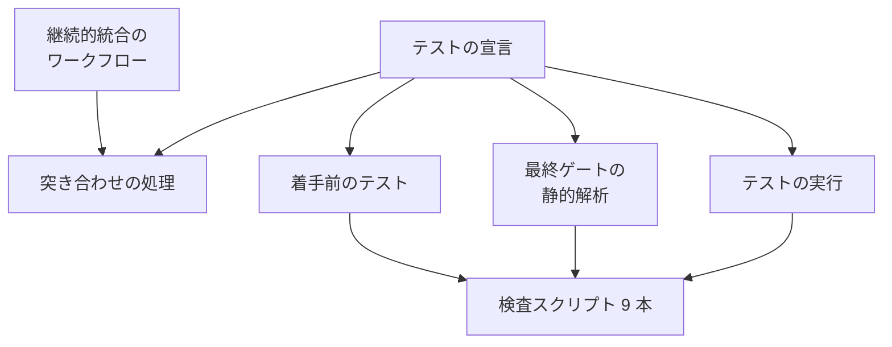
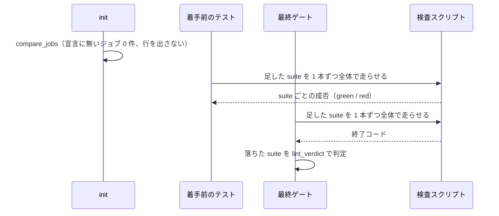

# このリポジトリのテストの宣言: 継続的統合のジョブ 11 件を、手元で走らせる静的解析か理由つきの除外として載せる（#1694）

## 目的

- **今どうなっているか**: このリポジトリの継続的統合のジョブ 24 件のうち 11 件（生成物の同期・Skill の frontmatter・リンク・文書の行数・指示書・`claude plugin validate` など）が、テストの宣言（`.ndf/project.json` の `test`）のどこにも載っていない。cross-refactoring の改善項目がこれらの検査を壊しても、着手前のテストと最終ゲートは走らせず、Pull Request を出した後の継続的統合で初めて落ちる。`init` は毎回「宣言に無いもの 11 件」を知らせる
- **誰に効くか**: このリポジトリで cross-refactoring・cross-review・テストの実行（`test-run.py`）を回す開発者と AI
- **変えると何が成り立つか**: 手元で判定が決まる 9 件は静的解析の suite として最終ゲートで走り、改善項目が壊せば変更起因として止まる。手元で判定が決まらない 2 件は理由つきの除外になり、`init` は「宣言に無いジョブ」を知らせなくなる

## 適用範囲

- **働く範囲**: このリポジトリだけ。変えるのは宣言の `test` の要素だけで、配布物（`plugins/`）・継続的統合のワークフロー・突き合わせの処理（`ci_coverage.py`）・宣言のスキーマは変えない
- **プロジェクトごとに違うもの**: どのジョブを suite にするか・除外にするかは、各リポジトリの宣言（設定）で受ける。この変更はこのリポジトリの設定の値だけを決める
- **当たるモード**: `standard`

## あるべき姿の根拠

| 根拠 | 種類 | 何を示すか |
| --- | --- | --- |
| 9 本のコマンドを作業ディレクトリの根で走らせると、すべて終了コード 0、所要の合計 19.6 秒（2026-11-05、このブランチの worktree、1 回の実測）。走らせた後の `git status --porcelain` は空 | 実測 | 9 件は手元で判定が決まり、作業ディレクトリを書き換えないこと |
| `claude` を `PATH` から外して `bash scripts/validate-runtime-plugins.sh` を走らせると、`==> claude CLI not found; skipped claude plugin validate` を出して終了コード 0、8.5 秒（2026-11-05） | 実測 | `claude` の CLI が無いホストでも、このジョブの残りの検査は走り、判定が決まること |
| `scripts/validate-runtime-plugins.sh` の `if command -v claude` の分岐 | 実測（コードの読み取り） | CLI の有無で落ちないことが、スクリプト自身の約束であること |
| `plugins/ndf/scripts/lib/test_triage.py` の `lint_verdict`、`plugins/ndf/skills/cross-refactoring/scripts/refactor_lib/gate_lint.py` の `lint_gate` | 実測（コードの読み取り） | 最終ゲートは静的解析の suite を 1 本ずつ走らせ、着手前の suite ごとの成否で既存失敗と変更起因を分けること |
| `plugins/ndf/scripts/project_lib/merge.py` の I1（置き換えてよいのは、キーが無い項目と、前の解析の値のままの項目だけ）と、宣言の `analysis.written` に `test` の指紋が無いこと | 実測（コードと宣言の読み取り） | 宣言の再解析が、手で足した `test` の要素を置き換えないこと |

要求と受け入れ条件は #1694 の本文にある（コピーは [issue-1694-requirements.md](issue-1694-requirements.md) ）。この文書は「どう作るか」だけを扱う。

## ドメインモデル

### コンテキスト

| コンテキスト | 何の語が 1 つの意味に決まるか |
| --- | --- |
| このリポジトリの開発の検査（`repo-dev-checks`） | 継続的統合のジョブ・ジョブの識別子・除外したジョブ |
| cross-refactoring（`ndf-cross-refactoring`） | 宣言に無いジョブ・着手前のテスト・最終ゲート・既存失敗・変更起因 |

**関係は公開された言語である。** 2 つのコンテキストは、宣言のスキーマ（`plugins/ndf/skills/development-workflow/schemas/project.schema.json`）の `test.suites[].ci_jobs`・`test.ci_exempt` を介してだけやり取りする。この変更はスキーマを変えず、このリポジトリの側の値だけを足す。

### 集約

| 集約 | 持ち主（書き換えてよいもの） | 根 | エンティティ | 値オブジェクト |
| --- | --- | --- | --- | --- |
| テストの宣言（`.ndf/project.json` の `test`） | このリポジトリの開発者（手で書く。宣言の再解析は指紋の無い `test` を置き換えない） | `test` | suite（`name` で識別）・除外したジョブ（`job` で識別） | ジョブの識別子・コマンド・除外の理由 |

### 不変条件

| # | 集約 | 条件 | 破れたときの扱い |
| --- | --- | --- | --- |
| I1 | テストの宣言 | 継続的統合のジョブはどれも、suite の `ci_jobs` か除外したジョブのどちらか一方だけに当たる | 両方に当たる・どちらにも当たらないジョブがあれば、実装の検証で止め、宣言を直す |
| I2 | テストの宣言 | 足した除外したジョブの理由は空でなく、手元で判定が決まらない要因を書く | 理由が空ならスキーマの検査（`project-decl.py check`）が 3 を返す。要因でない理由は実装の検証で直す |
| I3 | テストの宣言 | 足した suite の `command` は、`ci_jobs` に書いたジョブの `run` の行と同じスクリプトを同じ引数で呼ぶ（継続的統合だけで要る準備の手順は除く） | 実装の検証で止め、コマンドを直す |
| I4 | テストの宣言 | 足した suite は、秘密とネットワークを使わずに根で走り、終了コード 0 で終わる。所要の合計は 30 秒以内 | 0 で終わらない suite は、宣言へ載せる前に原因を調べて人へ戻す |
| I5 | テストの宣言 | 既存の suite 5 本と既存の除外 5 件は、名前・コマンド・`ci_jobs`・理由が変わらない | 差分に既存の要素の変更があれば戻す |

### ドメインイベント

| # | イベント | 発生元 | 受け手 |
| --- | --- | --- | --- |
| E1 | 宣言に suite と除外を足した | 実装の変更 | cross-refactoring の `init`・着手前のテスト・最終ゲート、cross-review、`test-run.py` |
| E2 | `init` が継続的統合のジョブと宣言を突き合わせた | cross-refactoring の `init`（`compare_jobs`） | `init` の出力（宣言に無いジョブが 0 件なら行を出さない） |
| E3 | 着手前のテストで、足した静的解析の suite を全体で走らせた | cross-refactoring の着手前のテスト（`baseline.py`） | 最終ゲート（suite ごとの成否を既存失敗の判定に使う） |
| E4 | 最終ゲートで、足した静的解析の suite を全体で走らせた | cross-refactoring の最終ゲート（`gate_lint.py`） | 最終ゲートの判定（変更起因なら止まる） |

### 用語

| 用語 | 意味 | 用語集への反映 |
| --- | --- | --- |
| ジョブの識別子 | 継続的統合のジョブを指す `<ワークフローのファイルのパス>#<job id>`。`#<job id>` を省くとそのファイルのジョブすべてを指す | 無し（要求の用語を引き継ぐ。突き合わせの処理と宣言のスキーマの説明が持つ） |
| 除外したジョブ | 手元の検証で走らせないと宣言したジョブ。宣言の `test.ci_exempt` に理由と組で書く | 無し（同上） |
| 宣言に無いジョブ | 継続的統合のジョブのうち、どの suite の `ci_jobs` にも除外したジョブにも当たらないもの | 無し（同上） |

## 機能一覧

| # | 機能 | 誰が使うか |
| --- | --- | --- |
| F1 | 改善項目が継続的統合の検査 9 件を壊したとき、cross-refactoring の最終ゲートが変更起因として止める | cross-refactoring を回す開発者と AI |
| F2 | cross-review とテストの実行（`test-run.py whole`）で、検査 9 件を全体テストの一部として走らせる | cross-review を回す AI・手元でテストを走らせる開発者 |
| F3 | 手元で判定が決まらない 2 件を、理由つきで手元の検証から外す | 宣言を読む開発者と AI |
| F4 | `init` が「宣言に無いジョブ」を知らせない | cross-refactoring を回す開発者と AI |

## 構成要素

| 要素 | 責務 |
| --- | --- |
| テストの宣言（`.ndf/project.json` の `test`）※変える | suite 9 本と除外したジョブ 2 件を足す。ほかの要素は変えない |
| 突き合わせの処理（`refactor_lib/ci_coverage.py`）※変えない | 宣言とワークフローのジョブを突き合わせ、宣言に無いジョブを挙げる |
| 着手前のテスト（`refactor_lib/baseline.py`）※変えない | 静的解析の suite を全体で走らせ、suite ごとの成否を残す |
| 最終ゲートの静的解析（`refactor_lib/gate_lint.py`）※変えない | 静的解析の suite を 1 本ずつ走らせ、落ちたものを既存失敗か変更起因に分ける |
| テストの実行（`plugins/ndf/scripts/test-run.py`）※変えない | `whole` で宣言の suite の `command` を走らせる |
| 検査スクリプト 9 本（`scripts/` と `plugins/ndf/scripts/instructions-check.py`）※変えない | 継続的統合と同じ検査を、手元で同じ引数で行う |



## データ構造

宣言のスキーマは変えない。足す値は次のとおりである。

### 足す suite

9 本とも `kind: lint`・`needs: []` で、`scope_command`・`junit`・`paths` を書かない（決定 3）。`ci_jobs` はジョブの単位の識別子 1 つで、パスは `.github/workflows/runtime-plugin-validate.yml`（以下の表では `#` 以降だけを書く）。並びは既存の suite 5 本の後ろに、ワークフローのジョブの順で置く。

| `name` | `runner` | `command` | `ci_jobs` | 手元の所要 |
| --- | --- | --- | --- | --- |
| `runtime-plugin-build-check` | `build-runtime-plugins` | `bash scripts/build-runtime-plugins.sh --check` | `#runtime-plugin-build-check` | 0.2 秒 |
| `skill-frontmatter-check` | `check-skill-frontmatter` | `python3 scripts/check-skill-frontmatter.py` | `#skill-frontmatter-check` | 0.1 秒 |
| `skill-repo-assumptions-check` | `check-skill-repo-assumptions` | `python3 scripts/check-skill-repo-assumptions.py` | `#skill-repo-assumptions-check` | 0.2 秒 |
| `skill-shell-vars-check` | `check-skill-shell-vars` | `python3 scripts/check-skill-shell-vars.py` | `#skill-shell-vars-check` | 0.3 秒 |
| `service-boundary-check` | `check-service-boundary` | `python3 scripts/check-service-boundary.py` | `#service-boundary-check` | 1.3 秒 |
| `runtime-plugin-validate` | `validate-runtime-plugins` | `bash scripts/validate-runtime-plugins.sh` | `#runtime-plugin-validate` | 11.0 秒 |
| `markdown-link-check` | `check-markdown-links` | `python3 scripts/check-markdown-links.py --root .` | `#markdown-link-check` | 6.2 秒 |
| `doc-line-limit-check` | `check-doc-line-limit` | `python3 scripts/check-doc-line-limit.py --root .` | `#doc-line-limit-check` | 0.1 秒 |
| `instruction-files-check` | `check-instruction-files` | `python3 plugins/ndf/scripts/instructions-check.py --root .` | `#instruction-files-check` | 0.1 秒 |

所要は 2026-11-05 のこのブランチの worktree での 1 回の実測で、合計 19.6 秒（丸める前の値の和。表の値の和は 19.5 秒。非機能の条件の 30 秒以内）。`runtime-plugin-validate` は `claude` の CLI があるときの値で、無いときは 8.5 秒。`name` は継続的統合のジョブ id と同じにし、最終ゲートの記録と継続的統合のチェックの名前を同じ語で読めるようにする。`runner` は呼ぶスクリプトの名前（拡張子を除く）で、判定には使われない。

1 本を宣言に書いた形の例:

```json
{
  "name": "runtime-plugin-build-check",
  "runner": "build-runtime-plugins",
  "kind": "lint",
  "command": "bash scripts/build-runtime-plugins.sh --check",
  "needs": [],
  "ci_jobs": [
    ".github/workflows/runtime-plugin-validate.yml#runtime-plugin-build-check"
  ]
}
```

### 足す除外したジョブ

既存の除外 5 件の後ろに、パスの順で置く。

| `job` | `reason` |
| --- | --- |
| `.github/workflows/runtime-plugin-smoke-latest.yml` | 定期と手動でだけ起動し、ネットワークから最新の CLI の版を解決して入れる。項目のコミットだけでは判定が決まらない |
| `.github/workflows/runtime-plugin-validate.yml#required-checks-check` | Pull Request の宛先のブランチと GitHub の API（トークン）を使う。項目の変更で結果が変わらない |

`runtime-plugin-smoke-latest.yml` はジョブが 1 件だけで扱いが分かれないため、ファイルの単位で書く。`required-checks-check` は同じファイルに suite にするジョブがあるため、ジョブの単位で書く（要求の前提 2）。

## 処理の流れ

宣言を読む処理はどれも変えない。足した値が通る経路は次のとおりである。



最終ゲートで落ちた suite の判定は、既存の `lint_verdict` の表のとおりである。足した suite は `scope_command` を持たないため、次の 2 行だけを通る。

| 着手前の成否 | 判定 |
| --- | --- |
| 通っていた | 変更起因（最終ゲートが止まる） |
| 落ちていた | 既存失敗（判定から外す） |
| 読めない | 変更起因 |

`scope_command` を持たない suite は、改善項目ごとの検証（範囲テスト）では走らない（`targets.py` の `lint_runs_for` は `scope_command` を持つ suite だけを使う）。改善項目が壊した場合に気づくのは最終ゲートである。

## 非機能の実現方式

| 大項目 | 実現方式 |
| --- | --- |
| 性能・拡張性 | 足す suite の所要の合計は 19.6 秒（実測）。着手前のテストと最終ゲートは、それぞれこの分だけ長くなる。`runtime-plugin-validate` は別の suite と同じ検査（生成物の同期・リンク・文書の行数）を内部でもう一度行い、重なりは実測で約 6.5 秒（決定 2） |
| システム環境 | 足す suite はリポジトリの中のファイルだけを読む。`scripts/check-markdown-links.py` が使う `urllib` は `urllib.parse`（文字列の分解）だけで、通信をしない。`claude plugin validate` が通信をするかは確かめられていない（「未確認のまま残ること」） |

## 決定の記録

### 決定 1: 落ちた検査を 1 つずつ判定できるよう、ジョブ 1 件に suite を 1 本置く

最終ゲートは静的解析の suite を 1 本ずつ走らせ、着手前の suite ごとの成否で既存失敗と変更起因を分ける（`gate_lint.py`・`lint_verdict`）。9 件を 1 本の suite にまとめると、どれか 1 つが着手前から落ちていれば suite 全体が既存失敗として判定から外れ、ほかの 8 件を改善項目が壊しても止まらない。`&&` でつないだコマンドは最初の失敗で止まり、後ろの検査が走らない。

9 本の `command` を 1 本の suite にまとめる形は採らない。suite を増やす費用は宣言の行数だけで、走らせる時間は変わらないためである。

根拠: Value 7（根本原因の場所で直す）/ Value 2（人が判断できる量に収める）（MVV 版 5）

### 決定 2: `claude` の CLI が無いホストでも残りの検査を走らせるため、`runtime-plugin-validate` を suite にする

このジョブのスクリプトは CLI が無いと `claude plugin validate` だけを飛ばし、定義ファイルの形・マーケットプレイスの登録・説明文書の数と版・Skill の境界をまたぐ参照の検査を走らせて 0 で終わる（実測）。後ろの 2 つの検査（`check-doc-staleness.py`・`check-cross-skill-refs.py`）は、継続的統合ではこのジョブでしか走らない（`.github/` と `scripts/*.sh` を検索し、呼ぶのは `scripts/validate-runtime-plugins.sh` だけ）。除外にすると改善項目が壊しても手元で気づけない。継続的統合で先に CLI を入れる手順（`npm install -g`）は準備の手順で、受け入れ条件 4 が除く。Codex のホストで CLI が無いときは、`claude plugin validate` の分だけ継続的統合より検査が少なくなる。

除外にする形は採らない。CLI の有無で変わるのは検査の 1 つだけで、残りの検査は手元で判定が決まるためである。スクリプトの中で別の suite と重なる検査（約 6.5 秒）は、重ならないように別の suite を外す形も採らない。外すとその suite の `command` の引数が継続的統合のジョブと変わり（スクリプトの中では `--root` に絶対パスを渡す）、決定 1 の 1 件ずつの判定も失うためである。

根拠: Value 6（どのプロジェクトでも使える形を保つ）/ Value 1（小さく出して使って確かめる）（MVV 版 5）

### 決定 3: 読まれない値を宣言に残さないため、足す suite に `scope_command` と `paths` を書かない

9 本の検査スクリプトはどれも対象のファイルのパスを引数に受けず、受ける形にする変更はこの課題の範囲の外である（要求の対象範囲）。静的解析の suite の `paths` を読むのは、`scope_command` を持つ suite の範囲を決めるとき（`lint_verdict`・`targets.py` の `suite_lint_files`・`lint_runs_for`）だけで、`scope_command` の無い suite では読まれない。読まれない値を書くと、検査スクリプトの読む範囲が変わっても誰も気づかず古くなる。

`{paths}` を受け取って捨てる `scope_command`（例: 末尾に `# {paths}` を付ける）は採らない。継続的統合と同じ引数で呼ぶ約束（受け入れ条件 4）から外れ、改善項目ごとに全体の検査を走らせて時間が増えるためである。

根拠: Value 3（やめる・縮めるを既定にする）/ Value 5（決まった手順はスクリプトに、判断と中身は AI に）（MVV 版 5）

### 決定 4: 手元で判定が決まらない 2 件を、理由つきの除外にする

`required-checks-check` は Pull Request の宛先のブランチと GitHub の API を使い、`runtime-smoke-latest` はネットワークから最新の CLI を入れる。どちらも要求の前提 3（秘密・ネットワーク・Pull Request の文脈を使わずに手元で判定が決まる）を満たさない。理由には、手元で判定が決まらない要因を書く（受け入れ条件 2）。

`check-required-checks.py` を宛先を固定して手元で走らせる形は採らない。GitHub の API とトークンが要り、継続的統合と同じ引数でも呼べないためである。

根拠: 共通原則 C1（秘密に触れる操作を手元の検証に入れない）/ Value 6（MVV 版 5）

## テスト設計

要求の取り決めのとおり、振る舞いを変えないためテストのコードは足さない。受け入れ条件と不変条件は、実装の検証でコマンドを走らせて確かめる。

| 受け入れ条件・不変条件 | どの振る舞いで縛るか | どう壊したら落ちるべきか |
| --- | --- | --- |
| 受け入れ条件 1・3 / I1 | 根の宣言と作業ディレクトリで `compare_jobs` を打つと、`status` が `compared`、`undeclared` が空 | 足した suite か除外を 1 つ消すと、`undeclared` にそのジョブが出る |
| I1（一方だけ） | 宣言の `ci_jobs` と除外の `job` を並べ、同じ識別子・同じファイルを指すファイルの単位の識別子が両方に無い | `required-checks-check` を suite と除外の両方に書くと、重なりとして見つかる |
| 受け入れ条件 2 / I2 | 足した除外 2 件の `reason` が空でなく、要因（ネットワーク・Pull Request の宛先と GitHub の API）を書いている | `reason` を空にすると `project-decl.py check` が 3 を返す |
| 受け入れ条件 4 / I3 / I4 | 足した suite の `command` を根で 1 本ずつ走らせると 0 で終わり、文字列がワークフローの `run` の行と一致する | 引数を変える（`--root .` を外すなど）と `run` の行との照合で食い違う |
| I4（CLI が無いホスト） | `claude` を `PATH` から外して `runtime-plugin-validate` の `command` を走らせても 0 で終わる | スクリプトが CLI の有無で落ちる形になると 0 以外で終わる |
| 受け入れ条件 5 | `project-decl.py check --root .` が 3 を返さない（今は入力が古いため 2） | スキーマに無いキーを足すと 3 を返す |
| 受け入れ条件 6 / I5 | `git diff` で、既存の suite 5 本と除外 5 件の行が変わっていない | 既存の要素を書き換えると差分に現れる |
| 非機能の条件（性能） | 足した suite の所要の合計が 30 秒以内 | — |
| 全体 | `uv run --frozen --project . --all-extras pytest . -q -n 4` が通る | — |

## 設計の結果

| 課題 | 扱い | 取り込み先 | 触るファイル |
| --- | --- | --- | --- |
| #1694 | 実装する | — | `.ndf/project.json` |

## 未確認のまま残ること

| 項目 | 内容 |
| --- | --- |
| `claude plugin validate` の通信 | この環境ではネットワークを切る操作（`unshare -n`）が権限で拒否され、通信の有無を確かめられなかった。通信するなら非機能の条件（システム環境）に触れる。実装の検証で、通信できない状態で走らせられる環境があれば確かめる |
| 所要のばらつき | 所要は 1 回の実測で、ばらつきは測っていない。ファイルが増えるとリンクの検査（6.2 秒）と `runtime-plugin-validate`（11.0 秒）が伸びる |
| ジョブが増えたとき | 継続的統合にジョブを足すと、`init` はまた「宣言に無いジョブ」を知らせる。これは突き合わせの処理の目的どおりの振る舞いで、この課題では自動の検査を足さない |
| 宣言の再解析 | `project-decl.py check` は今「古い」（入力の `.github/workflows/pytest.yml` が変わった）を返す。再解析はこの課題の範囲の外で、再解析は指紋の無い `test` を置き換えない（`merge.py` の I1） |
