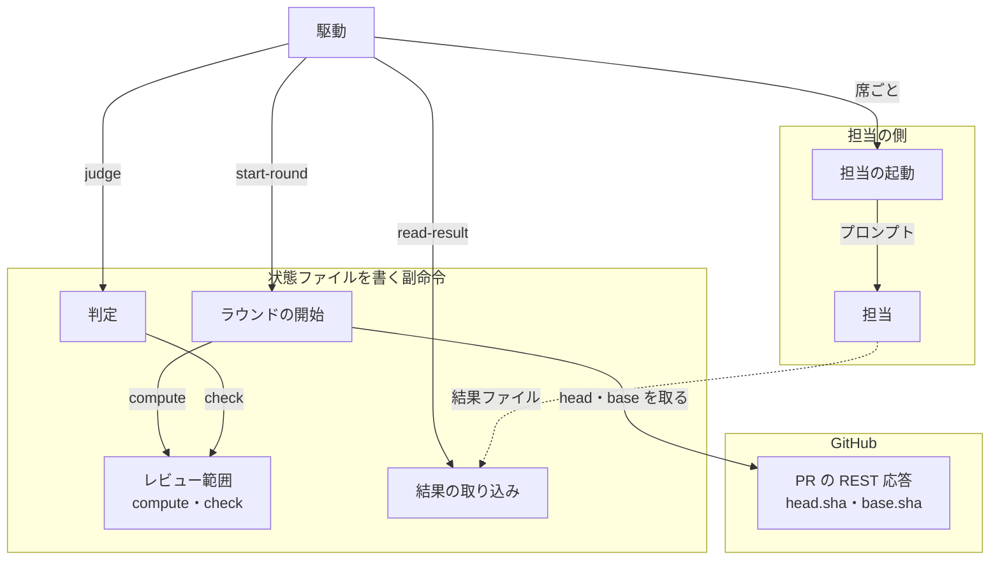
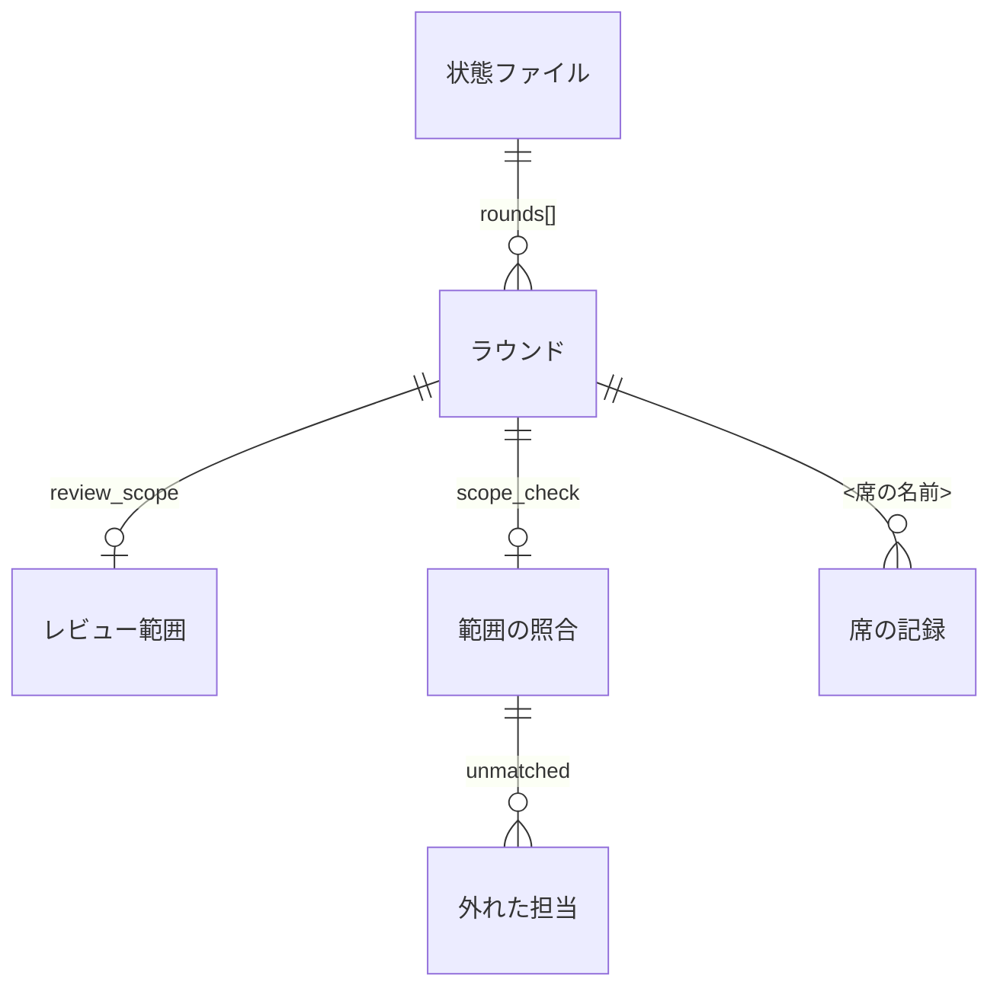
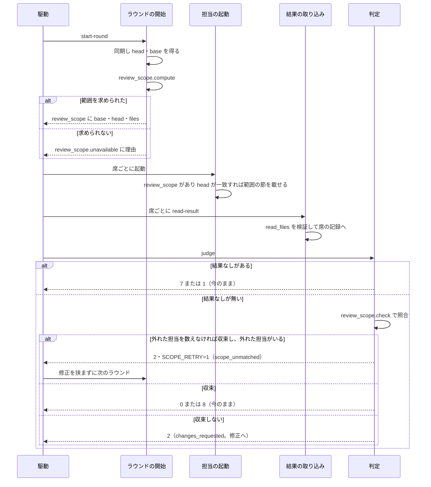
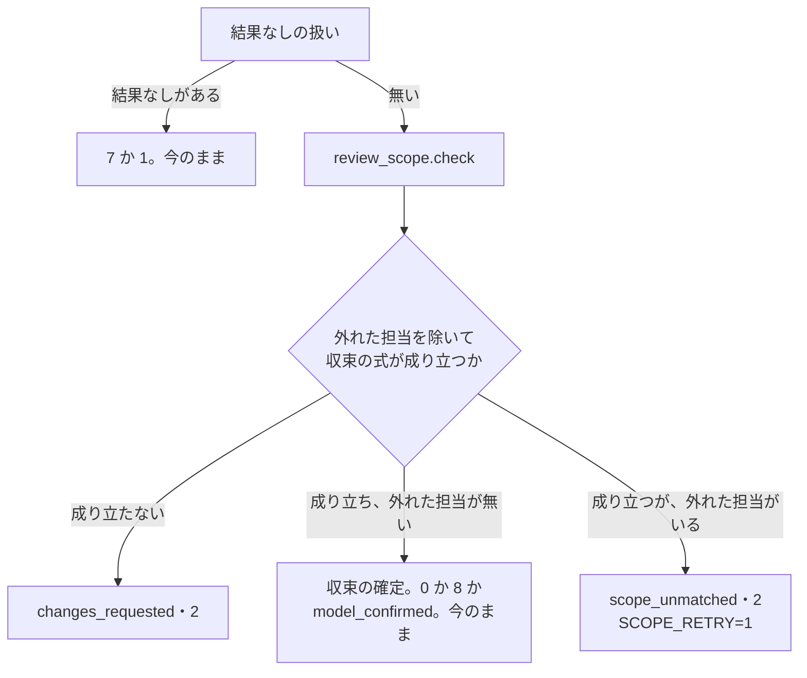

# cross-review: 担当がレビュー範囲を推測してスプリント PR の末尾のコミットだけを見て APPROVE し、全差分を見ないまま収束する → 担当へ base と head の SHA とファイル数を渡し、読んだファイル数が足りない承認では収束しない（#1702）

## 目的

- **何が壊れているか**: cross-review の担当へのプロンプトに base の SHA が無く、担当は Pull Request のコメントや直近のコミットから範囲を推測する。スプリント PR（16 ファイル・4 課題分）で、担当が末尾の cross-refactoring の 2 コミットだけを見て APPROVE し、その round が「全員 APPROVE・指摘 0」として収束した（devbasex/devbase #421・#432）
- **誰が困るか**: cross-review の収束を「全差分を見て通った」と読んで、設計の承認や本番への配布の承認へ進む利用者と conductor
- **直すと何が成り立つか**: 担当は範囲を推測しなくてよい（プロンプトに base・head・コマンド・ファイル数が載る）。読んだファイル数が差分のファイル数の半分に満たない承認は収束に数えず、修正を挟まずに次のラウンドへ進む

## 適用範囲

- **働く範囲**: cross-review を使うすべてのリポジトリ（配布先を含む）。範囲は担当の worktree の `git` で数え、言語・テストのコマンド・ベースブランチに依存しない
- **プロジェクトごとに違うもの**: 無し。base は Pull Request が持つ値（`base.sha`）を読み、ベースブランチ名を既定に埋め込まない。しきい値はプロジェクトによって変わる値ではないため、設定にしない（決定 3）
- **当たるモード**: `standard`

## あるべき姿の根拠

| 根拠 | 種類 | 何を示すか |
| --- | --- | --- |
| devbasex/devbase #421 の round 1〜3 の観察（#1702 の本文の表） | 実測 | 範囲を書かない round 1・2 では担当が末尾の 2 コミットへ狭め、`git diff <base>...<head>` を読むよう指示した round 3 では 2 者とも全差分を見た。範囲をプロンプトで渡せば狭めない |
| 同じ観察の kiro・claude の申告（「変更は manager.py だけ」） | 実測 | 範囲を狭めた担当は、読んだファイルの数が差分の数より大きく少ない（16 に対して 1〜2）。数の照合で見分けられる |
| GitHub REST `GET /repos/{owner}/{repo}/pulls/{number}` の応答の `base.sha` | 外部の一次情報 | 今 `head` を取っている同じ 1 回の応答に base のコミットも入っている。API の呼び出しを増やさずに base の SHA を得られる |

要求と受け入れ条件は #1702 の本文にある（コピーは `issues/issue-1702-requirements.md`）。この文書は「どう作るか」だけを扱う。

## ドメインモデル

### コンテキスト

| コンテキスト | 何の語が 1 つの意味に決まるか |
| --- | --- |
| cross-review（`ndf-cross-review`） | ラウンド・席・レビュー範囲・読んだファイル数・範囲の照合・収束 |
| 担当 CLI（`ndf-agent-cli`） | 担当・結果ファイル・結果なし |

cross-review が担当 CLI の語（担当・結果ファイル・結果なし）をそのまま使う関係（順応者）。この変更は担当 CLI の語の意味を変えない。**照合で外れた担当は「結果なし」にしない。** 結果ファイルは残っているため、「結果なし」（結果ファイルを残さずに終わったこと）の意味を広げずに、別の語「範囲の照合」で扱う（決定 4）。

### 集約

| 集約 | 持ち主（書き換えてよいもの） | 根 | エンティティ | 値オブジェクト |
| --- | --- | --- | --- | --- |
| 収束ループの状態（状態ファイル `cross-review-pr<PR>-state.json`） | `state.py` の副命令（`start-round` がレビュー範囲、`read-result` が読んだファイル数、`judge` が範囲の照合と判定を書く） | 状態ファイル | ラウンド（`rounds[]`）・席の記録（`rounds[].<席>`） | レビュー範囲・読んだファイル数・範囲の照合の結果 |
| 担当の結果ファイル（`<席>-review-pr<PR>-result.json`） | 担当（書く）。`read-result` は読むだけ | 結果ファイル | — | 判定（`event`）・重要度ごとの件数・読んだファイル数 |

担当のプロンプト（`launch-reviewer.sh` が書く `<席>-review-pr<PR>-prompt.md`）は状態ファイルから導く写しで、集約に入れない。

### 不変条件

| # | 集約 | 条件 | 破れたときの扱い |
| --- | --- | --- | --- |
| I1 | 収束ループの状態 | そのラウンドのプロンプトに載る base・head・ファイル数は、そのラウンドの `review_scope` と一致し、`review_scope.head_sha` はそのラウンドの `head_sha` と一致する | 起動の時点で `review_scope` の head とラウンドの head が違えば、範囲の節を載せずに起動する（範囲なしに落とす。I4 と同じ扱い） |
| I2 | 収束ループの状態 | 範囲の照合で外れた担当、または読んだファイル数が測れない担当の「通した」（`APPROVE` か、重大な指摘の無い `COMMENT`）は、「全員が通した」にも「新しい指摘 0 件」にも数えない | 判定はそのラウンドを収束させない |
| I3 | 収束ループの状態 | 範囲の照合は指摘を捨てない。`REQUEST_CHANGES` の担当の指摘は、読んだファイル数に関わらず今と同じく取り込まれる | 照合は判定（`judge`）の中だけで行い、取り込み（`read-result`）の経路を変えない |
| I4 | 収束ループの状態 | レビュー範囲を求められないラウンドは止まらずに担当を起動し、照合しなかったことと理由が判定の出力と状態ファイルに残る | 範囲を求める処理は失敗を理由に変えて返し、終了コードで止めない |
| I5 | 収束ループの状態 | 範囲の照合で外れたことだけが収束を妨げたラウンドは、修正の工程を通らずに次のラウンドへ進み、ラウンドの上限（`max_rounds`）は今のまま効く | 判定は `verdict = scope_unmatched` と終了コード 2 を返し、駆動はそれを修正へ回さない |

### ドメインイベント

| # | イベント | 発生元 | 受け手 |
| --- | --- | --- | --- |
| E1 | ラウンドを始め、head の SHA を記録した | `start-round` | E2（同じ副命令の続き） |
| E2 | レビュー範囲（base・head・差分のファイル数）を求めた、または求められなかった理由を記録した | `start-round`（`review_scope.compute`） | `launch-reviewer.sh`・`judge` |
| E3 | 担当のプロンプトにレビュー範囲を載せた | `launch-reviewer.sh` | 担当 |
| E4 | 担当が判定と読んだファイル数を結果ファイルに書いた | 担当 | `read-result` |
| E5 | 通した担当の読んだファイル数を差分のファイル数と突き合わせた | `judge`（`review_scope.check`） | `judge` の判定・状態ファイル |
| E6 | 収束した / 収束しなかった（範囲の照合で外れた / 修正へ） | `judge` | `drive.py` |

### 用語

| 用語 | 意味 | 用語集への反映 |
| --- | --- | --- |
| レビュー範囲 | そのラウンドで担当が見る差分。base と head の SHA の組と、その間の変更ファイル | 追加（要求で足した語。出所をこの設計へ移す） |
| 読んだファイル数 | 担当が結果ファイルの `read_files` に書く、レビュー範囲のうち差分を読んだファイルの数。担当の自己申告 | 追加（`ndf-cross-review`） |
| 範囲の照合 | 判定で、通した担当の読んだファイル数をレビュー範囲のファイル数と突き合わせ、半分に満たない・測れない担当の「通した」を収束に数えないこと | 追加（`ndf-cross-review`） |

## 機能一覧

| # | 機能 | 誰が使うか |
| --- | --- | --- |
| F1 | ラウンドごとにレビュー範囲（base・head・ファイル数）を求めて記録する | cross-review の駆動（`drive.py`） |
| F2 | 担当のプロンプトにレビュー範囲と、結果ファイルへ読んだファイル数を書く指示を載せる | 担当 |
| F3 | 担当の読んだファイル数を状態ファイルの席の記録へ残す | 判定・後から記録を読む人 |
| F4 | 範囲の照合で外れた・測れない「通した」を収束に数えず、判定の出力に席・読んだ数・差分の数を出す | 駆動・conductor |
| F5 | 照合で外れただけのラウンドを、修正を挟まずに次のラウンドへ進める | 駆動 |

## 構成要素

| 要素 | 責務 | 変更 |
| --- | --- | --- |
| PR のメタデータ（`review_lib/github.py` の `PrMetadata`） | 1 回の REST の応答から head・base を取る | `base_sha`（応答の `base.sha`）を足す |
| head の解決（`review_lib/workspace.py` の `HeadRef` / `_resolve_head_ref`） | その時点の head を GitHub から取り直す | `HeadRef` に `base_oid` を足し、同じ応答の `base_sha` を入れる |
| レビュー範囲（`review_lib/review_scope.py`、新設） | 範囲を求める `compute` と、読んだファイル数を照らす `check` の 2 つの関数。しきい値の定数 `READ_FILES_MIN_RATIO` を持つ | 新設 |
| ラウンドの開始（`review_lib/commands/start_round.py`） | ラウンドを開き、head とレビュー範囲を記録する | 同期の後に `review_scope.compute` を呼び、`rounds[-1].review_scope` に書く |
| 担当の起動（`scripts/launch-reviewer.sh`） | 状態ファイルからプロンプトを組んで担当を起動する | `review_scope` から「このラウンドのレビュー範囲」の節と `read_files` の指示を組む。設計 PR の差分の節（`PREV_SHA` / `DIFF_SCOPE_BLOCK`）はこの節へ統合して消す |
| 結果の取り込み（`review_lib/commands/read_result.py`） | 結果ファイルを読み、投稿して席の記録に書く | `read_files` を検証して席の記録へ `read_files`（整数か `null`）と `read_files_reason` を書く |
| 判定（`review_lib/commands/judge.py`） | 結果なし → 収束 → 修正の出口を決める | 結果なしの扱いの後、収束の評価の前に範囲の照合を入れ、新しい出口 `scope_unmatched` を足す |
| 駆動（`scripts/drive.py` の `after_judge`） | 判定の終了コードから次の段階を決める | `SCOPE_RETRY=1` なら修正を挟まずに次のラウンドへ進む |
| 手順と契約の文書（`docs/01-state-and-review.md`・`docs/04-contracts.md`・`docs/05-pool-and-convergence.md`） | 判定の出口・状態の欄・結果ファイルの契約・終了基準 | 01 の出口の表に 1 行、04 の結果ファイルの契約に `read_files`、05 に節「範囲の照合」（状態の欄の説明を含む）。04 の「重要なフィールド」は 05 の節を指す 1 行だけにする（04 は 499 行で、500 行を超えないため） |



実線は呼び出し、破線はファイルの受け渡しである。PR のメタデータと head の解決はラウンドの開始の中で呼ばれ、REST への矢印に含める。手順と契約の文書は動く要素ではないため図に含めない。

置き場所（変える範囲だけ）:

```text
plugins/ndf/skills/cross-review/
├── scripts/
│   ├── launch-reviewer.sh              # 変更
│   ├── drive.py                        # 変更（after_judge）
│   └── review_lib/
│       ├── review_scope.py             # 新設
│       ├── github.py                   # 変更（PrMetadata.base_sha）
│       ├── workspace.py                # 変更（HeadRef.base_oid）
│       └── commands/
│           ├── start_round.py          # 変更
│           ├── read_result.py          # 変更
│           └── judge.py                # 変更
├── docs/
│   ├── 01-state-and-review.md          # 変更
│   ├── 04-contracts.md                 # 変更
│   └── 05-pool-and-convergence.md      # 変更
└── tests/                              # 足す
```

`plugins/ndf/scripts/lib/` へは置かない。cross-refactoring の担当は範囲を Pull Request から受けないため、同じ役割を両方が使う形にならない（要求の「前提とする取り決め」）。git の呼び出しは既存の `scripts/lib/proc.py` の `git_out` を使う。

## データ構造

状態ファイル（JSON）のラウンドの記録に 2 つ、席の記録に 2 つの欄を足す。どれも追記で、既存の欄の意味は変えない。



### `rounds[].review_scope`（`start-round` が書く）

| 欄 | 型 | 空を許すか | 意味 |
| --- | --- | --- | --- |
| `range` | `"full"` / `"since_previous"` | 求められたとき許さない | `classifications.diff_scope` の値。`since_previous` は設計 PR の 2 ラウンド目以降 |
| `base_sha` | 文字列（40 桁） | 求められたとき許さない | `full` は PR の `base.sha`、`since_previous` は同じ PR の 1 つ前のラウンドの `head_sha` |
| `head_sha` | 文字列（40 桁） | 求められたとき許さない | そのラウンドの `head_sha` と同じ値（I1） |
| `files` | 整数（0 以上） | 求められたとき許さない | `git -C <worktree> diff --name-only <base_sha>...<head_sha>` の行数 |
| `unavailable` | 文字列 | 求められたとき欠ける | 求められなかった理由。このとき上の 4 つは欠ける |

`unavailable` の値:

| 値 | いつ |
| --- | --- |
| `no_head` | worktreeの同期を飛ばした（`worktree_path` が無い・登録済みのworktreeでない）ため、head を記録していない |
| `no_base` | PR の応答に `base.sha` が無い |
| `base_missing` | base のコミットがworktreeに無く、`git fetch origin <base_sha>` でも取れない |
| `diff_failed` | `git diff --name-only` が非 0 で終わった |

`review_scope` の欄そのものが無いラウンドは、この版より前の状態ファイルのラウンドである。判定はこれを `unavailable = legacy` と同じに扱う（移行性）。

### `rounds[].<席>` に足す欄（`read-result` が書く）

| 欄 | 型 | 空を許すか | 意味 |
| --- | --- | --- | --- |
| `read_files` | 整数（0 以上）か `null` | 許す | 結果ファイルの `read_files`。`null` は「測れない」で、「0 件読んだ」ではない |
| `read_files_reason` | `"missing"` / `"not_integer"` | `read_files` が整数なら欠ける | `null` の理由。`missing` は鍵が無い、`not_integer` は整数でない（真偽値・文字列・小数・負の数を含む） |

### `rounds[].scope_check`（`judge` が書く）

| 欄 | 型 | 空を許すか | 意味 |
| --- | --- | --- | --- |
| `checked` | 真偽値 | 許さない | 照合したか |
| `reason` | 文字列 | `checked` が真なら欠ける | 照合しなかった理由。`review_scope.unavailable` の値・`legacy`・`model_stage` |
| `files` | 整数 | `checked` が偽なら欠ける | 照らした差分のファイル数（`review_scope.files`） |
| `min_read` | 整数 | `checked` が偽なら欠ける | 通すのに要る読んだファイル数（決定 3 の式） |
| `unmatched` | `{seat, read_files, reason}` の並び | 許さない（空の並び） | 外れた通した担当。`reason` は `too_few` / `missing` / `not_integer` |

`judge` は同じラウンドで何度も打たれる（起動し直し・投稿の流し直しの後）。`scope_check` はそのたびに書き直し、最後の判定の値が残る。過去の判定の値を残す必要は無い（判定は同じ入力から同じ値を導く）。

### 機能とデータの対応

| 機能 | `review_scope` | 席の `read_files` | `scope_check` | `verdict` |
| --- | --- | --- | --- | --- |
| F1 範囲を求めて記録する | C | — | — | — |
| F2 プロンプトに載せる | R | — | — | — |
| F3 読んだ数を残す | — | C | — | — |
| F4 照合する | R | R | C/U | U |
| F5 次のラウンドへ進める | — | — | — | R |

## 入出力の契約

### 担当へのプロンプト（`launch-reviewer.sh`）

`review_scope` に `unavailable` が無く、`review_scope.head_sha` がそのラウンドの `head_sha` と一致するときだけ、「必須コンテキスト」の次に次の節を載せる。それ以外は節を載せず、結果ファイルの例にも `read_files` を載せない（今の形のまま。受け入れ条件 8）。

````text
## このラウンドのレビュー範囲
- base: <base_sha>
- head: <head_sha>
- 差分のファイル数: <files>

```bash
git -C "<worktree>" diff <base_sha>...<head_sha>
git -C "<worktree>" diff --name-only <base_sha>...<head_sha>
```

この範囲の <files> ファイルをすべて見る。Pull Request のコメントや直近のコミットから範囲を狭めない。
````

`range = since_previous` のときは、節の最後の文を「前のラウンドのレビュー対象（<base_sha>）からの変更だけを見る。変わっていない行へ新しい指摘を出さない。」に替える（今の設計 PR の差分の節の文を引き継ぐ）。

結果ファイルの例に 1 行を足す。

```json
{
  "event": "APPROVE",
  "by_severity": {"critical": 0, "major": 0, "minor": 0, "nit": 0},
  "read_files": 16
}
```

指示: 「`read_files` は、上のレビュー範囲のファイルのうち、差分を読んだファイルの数を整数で書く。範囲の外に読んだファイルは数えない。」

### 結果ファイル（担当が書く）

| 鍵 | 型 | 必須か | 変更 |
| --- | --- | --- | --- |
| `event` | `APPROVE` / `REQUEST_CHANGES` / `COMMENT` | 必須 | 変わらない |
| `by_severity` | 重要度ごとの整数 | 任意 | 変わらない |
| `read_files` | 0 以上の整数 | 任意（無ければ測れないとして扱う） | 追加 |

互換性: 鍵を足すだけで、`read_files` を持たない結果ファイルも今と同じく取り込まれる（`read-result` の終了コードは変わらない）。持たない担当が通したときだけ、その「通した」が収束に数えられなくなる（受け入れ条件 6）。

### 判定（`state.py judge`）の出力

標準出力の `KEY=VALUE` の行を 3 つ足す。既存の行と終了コードの意味は変えない。

| 行 | いつ出すか | 形 |
| --- | --- | --- |
| `SCOPE_CHECK` | 結果なしの扱いを抜けた後、毎回 | `checked` か `unchecked:<理由>`（例: `unchecked:base_missing`） |
| `SCOPE_UNMATCHED` | `checked` のとき毎回（外れた担当が無ければ空） | `'<席>=<読んだ数>/<差分の数> ...'`。測れないときは読んだ数の位置に理由（例: `'kiro=1/16 codex=missing/16'`） |
| `SCOPE_RETRY` | 出口が `scope_unmatched` のとき | `1` |

標準エラーには、外れた担当ごとに「kiro は 16 ファイルのうち 1 ファイルを読んだと申告した（8 以上で数える）。この承認を収束に数えない」の形の 1 行を出す。

判定の出口（`docs/01-state-and-review.md` の表）に 1 行を足す。

| ラウンドの状態 | 出口 | 終了コード | `verdict` |
| --- | --- | --- | --- |
| 照合で外れた通した担当を数えなければ収束したが、外れた担当がいる | 修正を挟まずに次のラウンドへ | 2（`SCOPE_RETRY=1`） | `scope_unmatched` |

`start-round` の前のラウンドの確認（`_require_fix_for_changes`）は `changes_requested` だけに修正の記録を求めるため、`scope_unmatched` のラウンドの後は修正の記録なしで次のラウンドを開ける（`model_confirmed` と同じ）。

## 処理の流れ



### `review_scope.compute` の手順

1. `head` が無ければ `unavailable = no_head`
2. 範囲の種類を `classifications.diff_scope(review_kind, round_in_pr)` で決める
3. base を決める。`full` は `HeadRef.base_oid`（空なら `unavailable = no_base`）。`since_previous` は同じ PR（`rounds[].pr` が等しい）の 1 つ前のラウンドの `head_sha`。それが無いか head と同じなら `full` へ落とす（今の設計 PR の差分の節が「前の head と同じなら節を出さない」のと同じ結果）
4. `git -C <worktree> cat-file -e <base>^{commit}` が非 0 なら `git -C <worktree> fetch --quiet origin <base>` を 1 度打ち、なお非 0 なら `unavailable = base_missing`
5. `git -C <worktree> diff --name-only <base>...<head>` を打ち、非 0 なら `unavailable = diff_failed`。0 なら空でない行を数えて `files` にする

どの失敗でも例外や終了コードで止めず、理由を返す（I4）。GitHub の API は呼ばない。base は手順 3 の時点で、head を取った同じ REST の応答から得ている。

### `review_scope.check` の手順（副作用の無い関数）

入力はそのラウンドの記録と席の一覧、出力は `scope_check` の値。

1. `review_scope` が無い → `checked = false, reason = legacy`
2. `review_scope.unavailable` がある → `checked = false, reason = <その値>`
3. ラウンドの `stage` が `model` → `checked = false, reason = model_stage`（決定 5）
4. 通した担当（`participants._is_pass` が真の席）ごとに、`read_files` が `null` なら `read_files_reason` を、`read_files < min_read` なら `too_few` を `unmatched` に積む。`min_read = ceil(files × READ_FILES_MIN_RATIO)`
5. 通していない担当（`REQUEST_CHANGES`・重大な指摘のある `COMMENT`）は照らさない（I3）

### 判定の中の順序



「外れた担当を除いて」の意味: 収束の式 `carried is None and (round_passes or (findings_measurable and new_findings == 0))` を今のまま評価し、成り立ったうえで `unmatched` が空でなければ収束させない（I2）。外れた担当の「通した」は、全員が通した（`round_passes`）にも新しい指摘 0 件にも寄与しない。収束の式が成り立たないラウンドは、照合の結果に関わらず今と同じく修正へ回る。

## 非機能の実現方式

| 大項目 | 要求の条件 | 実現方式 | 確かめ方 |
| --- | --- | --- | --- |
| 性能・拡張性 | 差分のファイル数は worktree の `git` で数え、ラウンドごとに GitHub の API の呼び出しを増やさない（base の SHA の取得を除く） | base の SHA は head を取っている同じ REST の 1 回の応答の `base.sha` から読む。ファイル数は `git diff --name-only` で数える。base が無いときの `git fetch` は GitHub の API ではなく git の取得である | `start-round` のテストで、偽の `gh` が受けた呼び出しの数が変わらないことを見る |
| 運用・保守性 | 照合で外れた担当・照合しなかったラウンドが判定の出力と状態ファイルに残り、後から読める | 判定の出力の `SCOPE_CHECK` / `SCOPE_UNMATCHED` と、状態ファイルの `rounds[].review_scope` / `rounds[].scope_check` / 席の `read_files` | 判定のテストで出力の行と状態ファイルの欄を読む |
| 移行性 | base の SHA を持たない前の版の状態ファイルから再開しても止まらない（取得し直すか、範囲なしに落ちる） | 次に開くラウンドは `start-round` が範囲を求め直す。開いた後の版の境で `review_scope` を持たないラウンドは、起動では範囲の節を載せず、判定では `unchecked:legacy` として照合しない | `review_scope` の欄が無いラウンドの状態ファイルで起動と判定を打つテスト |

## 決定の記録

### 決定 1: API の呼び出しを増やさないため、base の SHA は head と同じ REST の応答の `base.sha` から読む

`_resolve_head_ref` が毎ラウンド打つ `GET /repos/{repo}/pulls/{pr}` の応答に `base.sha` が入っており、今は捨てている。`PrMetadata` と `HeadRef` に 1 つずつ欄を足せば、呼び出しは 0 件増える。

`init` で 1 度だけ取って状態ファイルに持つ形は採らない。巻き直し（`rotate-pr`）で Pull Request が替わると base も替わりうるため、ラウンドごとに head と同じ時点で取るほうが、head と base の時点がずれない。`origin/<base_branch>` をworktreeで解く形も採らない。base のブランチが進むと、その時点の Pull Request の base と一致しなくなる。

根拠: Value 6 / Value 3（MVV 版 2）

### 決定 2: 範囲の規則を 1 か所に置くため、範囲は `start-round` が Python で求めて状態ファイルに書き、起動スクリプトは写すだけにする

起動スクリプトは今、設計 PR の差分の範囲を `rounds[-2].head_sha` から自前で組み、規則の正本（`classifications.diff_scope`）を呼ばずにコメントで指すだけである。範囲を `start-round` で求めて `review_scope` に書けば、2 つの席が同じ値を読み、判定も同じ値で照らせる。設計 PR の差分の節はこの節へ統合し、`PREV_SHA` と `DIFF_SCOPE_BLOCK` を消す。範囲を求められない設計 PR の 2 ラウンド目は前のラウンドからの差分の節も載らず、担当は全差分を見る（今の節の「差分が取れないときだけ PR の全差分を見る」と同じ結果）。

起動スクリプトで `git diff --name-only` を打つ形は採らない。判定が照らす値と担当が見た値を同じにするには、どちらかが書いた値をもう片方が読む必要があり、2 つの席の起動で 2 度数えることになる。

根拠: Value 4 / Value 6（MVV 版 2）

### 決定 3: 範囲を狭めた承認を確実に見分けつつ生成物を飛ばす担当を外さないため、しきい値は「差分のファイル数の半分（切り上げ）」の比にする

`min_read = ceil(files × 0.5)` とし、`read_files >= min_read` の担当だけを数える。16 ファイルなら 8 で、受け入れ条件の例の 2（数えない）と 16（数える）、スプリント PR の形の 1（数えない）を分ける。観察された範囲の狭め方は末尾の数コミットへの絞り込みで、読んだ数は差分の 1 割前後（16 に対して 1〜2）だった。半分ならこの形を余裕をもって拾い、ロックファイルや生成物を読み飛ばす担当は外さない。読んだ数が差分の数を上回るのは外さない（範囲の外を読むのは誤りではない）。

差の絶対値（例: 3 ファイル以上少ない）は採らない。2 ファイルの差分で 0 を申告しても外せず、100 ファイルの差分では数ファイルの読み飛ばしで外れる。設定（`.ndf/review.json`）にもしない。値はプロジェクトの形ではなく担当の振る舞いで決まるため、プロジェクトごとに違うものに当たらない。定数 `READ_FILES_MIN_RATIO` に置き、値の妥当性は状態ファイルに残る `read_files` と `files` の組で後から測る（未確認のまま残ること）。

根拠: Value 3 / Value 5（MVV 版 2）

### 決定 4: 「結果なし」の意味を広げないため、照合で外れた担当は起動し直さずに、修正を挟まない次のラウンドで別の席に見させる

照合で外れた担当は結果ファイルを残しており、「結果なし」（結果ファイルを残さずに終わったこと）に当たらない。結果なしの経路（終了コード 7・`no_results`・振り替えの規則）へ載せると、外した担当の導出と振り替えの規則がこの事象にも効き、2 度外れた担当が実行の残りから外れる。次のラウンドは席の輪番で組み直されるため、別の担当が全範囲を見る機会になる。修正するものが無いため修正の工程を通さない（設計 PR のモデルレビューの承認が修正を挟まずに次のラウンドへ進むのと同じ形）。ラウンドの上限は `start-round` が今のまま数える。

同じ席を同じラウンドで起動し直す形は採らない。範囲の節が載ったプロンプトで狭めた担当へ同じプロンプトを渡し直しても、結果が変わる見込みが無い。照合のための新しい起動し直しの記録を足すと、結果なしの起動し直しの記録と同じ役割の記録が 2 つになる。

根拠: Value 8 / Value 1（MVV 版 2）

### 決定 5: モデルレビューの目的と食い違わないため、設計 PR のモデルレビューは照合しない

モデルレビュー（1 ラウンド目）は、設計文書のドメインモデルの節と用語集の差分だけを見るよう指示される。担当が要求のコピーや設計文書の残りを読まないのは指示どおりで、読んだ数が差分の数の半分に満たなくても範囲を狭めた誤りではない。モデルレビューの承認では収束しない（`model_confirmed` で詳細レビューへ進む）ため、照合しなくても全差分を見ないまま収束することは起きない。プロンプトの範囲の節は、モデルレビューでも同じに載せる。

根拠: Value 1（MVV 版 2）

### 決定 6: 範囲の種類で 2 つのコマンドの形を持たないため、設計 PR の前のラウンドからの範囲も 3 点の `git diff <前の head>...<head>` にする

今の設計 PR の差分の節は 2 点の `git diff <前の head> <head>` を使う。前の head が今の head の祖先なら 2 点と 3 点は同じ差分になり、巻き直しで祖先でなくなったときは、3 点は分岐点からの変更（今の head の側だけ）を返し、2 点は前の head の側の変更を逆向きに混ぜる。1 つの形にそろえれば、プロンプトとファイル数を数えるコマンドが範囲の種類に関わらず同じになる。

根拠: Value 6 / Value 8（MVV 版 2）

## テスト設計

スプリント PR の形の入力は、一時の git リポジトリ（bare の origin とworktree）に、base から 16 ファイルを変える複数のコミットと、その後に 1 ファイルだけを変える 2 コミット（cross-refactoring の形）を積んで作る。

| 受け入れ条件・不変条件 | どの振る舞いで縛るか | どう壊したら落ちるべきか |
| --- | --- | --- |
| 1・9 | スプリント PR の形で `start-round` を打つと `review_scope` が `base_sha`・`head_sha`・`files = 16` を持ち、起動したプロンプトに base・head・`git -C <worktree> diff <base>...<head>`・16 が載る | 末尾の 2 コミットだけを数える（`files = 1`）・base を載せない・2 点の diff にする |
| 2・I1 | round 1 の head A から round 2 の head B へ進めると、round 2 のプロンプトの head は B で、ファイル数は B で数え直した値であり、A は head として載らない | `rounds[0]` の head や前のラウンドのファイル数を使う |
| 3 | 設計 PR の 2 ラウンド目は、同じ PR の前のラウンドの head から今の head までの範囲とそのファイル数が載る。前の head と今の head が同じなら全範囲 | 設計 PR でも全範囲を出す・別の PR のラウンドの head を前の head にする |
| 4 | `read_files` を書いた結果ファイルを取り込むと、席の記録に同じ整数が残り、プロンプトに `read_files` の指示が載る | 席の記録へ写さない・指示を載せない |
| 5・9・I2 | 差分 16 で、`read_files = 1` と `2` の `APPROVE` は数えずに終了コード 2・`SCOPE_RETRY=1`・`SCOPE_UNMATCHED` に席と `1/16` が出る。`16` の `APPROVE` 2 者は収束（0） | しきい値を差分の数そのものにする（15 でも外す）・外れた担当を新しい指摘 0 件の経路で収束させる |
| 6 | `read_files` が無い・`"16"`・`true`・`-1` の `APPROVE` は数えず、`SCOPE_UNMATCHED` に `missing` か `not_integer` が出る | 測れない値を 0 か一致として扱う |
| 7・I5 | 照合で外れただけのラウンドの後、修正の記録なしで `start-round` が次のラウンドを開き、駆動は修正の段階を通らない。上限のラウンド数で `final = max_rounds` になる | `scope_unmatched` の後に修正の記録を求める・駆動が修正へ回す・上限を数えない |
| 10・I3 | `read_files = 1` の `REQUEST_CHANGES` の指摘が今と同じ件数取り込まれ、判定は `changes_requested` で修正へ回る | 照合で外れた担当の指摘を捨てる |
| 8・I4 | base のコミットが取れないworktree（fetch も失敗）で、`start-round` は 0 で終わり `review_scope.unavailable = base_missing`、プロンプトに範囲の節と `read_files` の指示が無く、判定は `SCOPE_CHECK=unchecked:base_missing` で今と同じ出口 | 範囲を求められないときに止める・照合しなかったことを出さない |
| 移行性 | `review_scope` の欄の無いラウンドの状態ファイルで起動と判定を打つと止まらず、`SCOPE_CHECK=unchecked:legacy` | 欄が無いと例外で落ちる |
| 決定 5 | `stage = model` のラウンドでは `read_files = 1` の `APPROVE` でも照合せず、今どおり `model_confirmed` | モデルレビューで照合する |
| 非機能（性能） | `start-round` の偽の `gh` の呼び出しの数が変更前と同じ | base を別の呼び出しで取る |
| 11 | `uv run --frozen --project . --all-extras pytest plugins/ndf/skills/cross-review/tests -q -n 4` が通る。設計 PR の差分の節を `rounds[-2].head_sha` から組むことを確かめていた既存のテスト（`test_review_kind_defaults.py`）は、`review_scope` から組む形へ入力を替える | — |

## 設計の結果

| 課題 | 扱い | 取り込み先 | 触るファイル |
| --- | --- | --- | --- |
| #1702 | 実装する | — | `plugins/ndf/skills/cross-review/scripts/`、`plugins/ndf/skills/cross-review/docs/`、`plugins/ndf/skills/cross-review/tests/` |

## 未確認のまま残ること

| 項目 | 内容 |
| --- | --- |
| `base.sha` と GitHub の差分の一致 | 前提 1 は「3 点の diff は GitHub の Pull Request の差分と同じ範囲」とする。REST の `base.sha` が base のブランチの進みにどの時点で追随するかは確かめていない。base のブランチを head へ取り込んだ Pull Request で、`files` と応答の `changed_files` が一致するかを実装（`tdd-cycle`）とリリース後テストで見る |
| しきい値 0.5 の妥当性 | 正当に読み飛ばす担当の割合を測っていない。状態ファイルの `read_files` と `files` の組を、リリース後のスプリント PR で集めて見直す |
| 自己申告の正しさ | 担当が読まずに差分の数を書けば通る（前提 4・対象範囲の外）。プロンプトに範囲が載ることで狭める誘因は減るが、申告の水増しは防がない |
| フォークの Pull Request | base のコミットをworktreeへ取るのは `origin` からの取得で、フォークでも base は base のリポジトリにあるため取れる見込みである。フォークの Pull Request での実測は無い |
