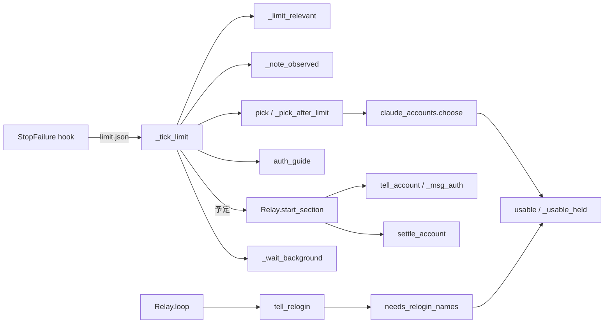
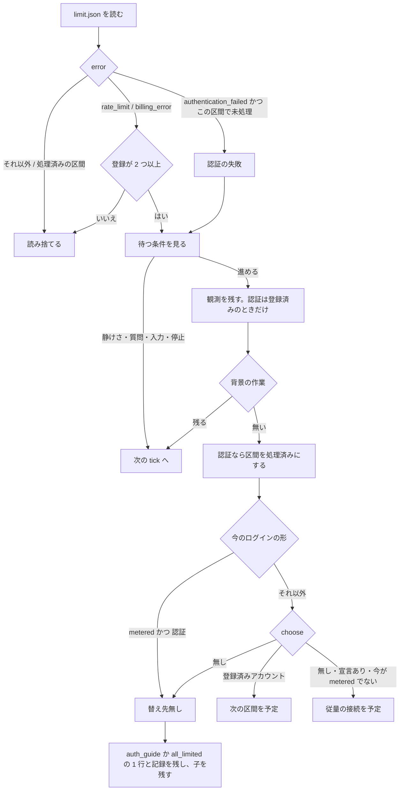

# relay: 既定のログインと従量の接続で 401 が出ると子が `/login` の表示のまま止まり、再登録が要るアカウントが切り替え先に選ばれる → どのログインの形でも 401 の原因と直し方が 1 行で出て替えられる先へ替わり、再登録が要るアカウントは起動時に知らされて選ばれない（#1727）

## 目的

- **何が壊れているか**: relay は登録済みアカウントの 401 だけを扱い、既定のログインと従量の接続の 401 では何も出さない。refreshToken が空のアカウントも、アクセストークンが期限内なら切り替え先に選ばれる
- **誰が困るか**: relay の下で claude を動かす利用者。端末を見るまで子が `Please run /login · API Error: 401` のまま止まり、共有の認証ファイルが壊れたアカウントへ切り替わって再び止まる
- **直すと何が成り立つか**: どのログインの形でも、401 のときに原因と直し方が画面に 1 行で出て、替えられる先があれば relay が替えて続ける。再登録が要るアカウントは起動時に 1 行で知らされ、切り替え先に選ばれない

## 適用範囲

- **働く範囲**: relay（`relay.py run`。Claude Code だけ）を使う、配布先のすべてのリポジトリ
- **プロジェクトごとに違うもの**: 無し（登録済みアカウントと従量の接続の宣言は利用者ごとの設定で、今と同じ置き場から読む）
- **当たるモード**: `standard`

## あるべき姿の根拠

| 根拠 | 種類 | 何を示すか |
| --- | --- | --- |
| 2026-10-04、novel コンテナで子が `Please run /login · API Error: 401 OAuth access token has been revoked.` を出したまま止まった | 実測 | 既定のログインの 401 を relay が扱わず、利用者が端末を見るまで進まない |
| 同じ日の `claude -p "reply OK" --model haiku` で、nyle-team だけが refreshToken も expiresAt も無く `OAuth session expired and could not be refreshed` で失敗した | 実測 | refreshToken が空のアカウントは、ログインし直すまで使えない |
| 「直し方（2026-10-04 利用者の決定: 推奨 1・2 を採る）」 | 利用者の指示の原文 | 既定のログイン・従量の接続でも 401 を出して案内し、すべて認証できないときは従量の接続へ退避する |

要求と受け入れ条件は #1727 の本文にある（コピーは [issue-1727-requirements.md](issue-1727-requirements.md)）。この文書は「どう作るか」だけを扱う。

## 例: 変えた後に 3 つの 401 がどう扱われるか

1. 登録が 0 件で、既定のログインで動く子が 401 で止まる。StopFailure hook が `limit.json` に `error: authentication_failed` を書く。
   relay は替え先が無いので、`ndf-relay: 既定のログインで認証に失敗した（401）。claude の中で /login を打ってログインし直す。子はこのまま残す`
   を出し、`log.jsonl` に `{"event": "account", "reason": "auth", "from": null, "to": null}` を残す
2. 登録が 1 件（`work1`）で、従量の接続の宣言もある。既定のログインで動く子が 401 で止まる。relay は `work1` を選び、
   次の区間を `work1` で起動する。以後の区間も `work1` のまま続く（既定のログインへ戻らない）
3. `work1` が 401 になり、ほかに使える登録済みアカウントが無い。relay は従量の接続へ替える。従量の接続でも 401 になれば、
   `ndf-relay: 従量の接続で認証に失敗した（401）。python3 ~/.claude/ndf/relay.py account check metered で宣言を確かめる（…）。子はこのまま残す`
   を出し、別の先へは替えない
4. 次に relay を起動すると、`work1` の認証ファイルの refreshToken が空なら、`ndf-relay: アカウント work1 は再登録が要る。python3 ~/.claude/ndf/relay.py account add work1 で登録し直す`
   が 1 行出る。`work1` は切り替え先に選ばれない

## ドメインモデル

### コンテキスト

| コンテキスト | 何の語が 1 つの意味に決まるか |
| --- | --- |
| NDF のラッパー（`ndf-relay`） | 既定のログイン・登録済みアカウント・従量の接続・上限シグナルファイル・再登録が要る・認証の失敗の観測 |

1 つのコンテキストに収まる。**Claude Code 本体は外部の系で、NDF は本体の形に合わせる（順応者）。** 認証ファイル
（`.credentials.json`）の形と、`invalid_grant` で refreshToken を空にする振る舞いは本体が決める。NDF は読むだけで書かない。

### 集約

| 集約 | 持ち主（書き換えてよいもの） | 根 | エンティティ | 値オブジェクト |
| --- | --- | --- | --- | --- |
| セッションのアカウント（ラッパーの 1 回の実行） | `relay_lib/run.py` の `Relay`（`relay_lib/switch.py` の `AccountSwitch` を継ぐ） | 今の区間のアカウント（名前・`metered`・None） | — | 切り替えの予定（先・理由）・認証の失敗を扱った区間 |
| 登録の記録（アカウントごと） | `lib/claude_accounts.py` | アカウント（名前） | — | 再登録が要る印・認証の失敗の観測・上限の観測 |

**アカウントの認証情報（認証ファイル）はこの変更の集約ではない。** 持ち主は Claude Code と、#1576 の更新の排他を
取ったプロセスである。この変更は認証ファイルを読むだけで、書き換えない（要求の境界・C1）。

**既定のログインと従量の接続は登録の記録を持たない。** この 2 つの 401 は、セッションのアカウントの集約の中だけで扱い、
登録の記録へは書かない（I6）。

### 不変条件

| # | 集約 | 条件 | 破れたときの扱い |
| --- | --- | --- | --- |
| I1 | セッションのアカウント | 認証の失敗の扱い（案内の 1 行・記録の行・切り替え）は、1 つの区間で 1 度だけ行う | 同じ区間の 2 度目の上限シグナルファイルは読み捨てる |
| I2 | セッションのアカウント | 従量の接続で動く区間の認証の失敗では、別の先へ替えない | 案内を出して子を残す |
| I3 | 登録の記録 | 認証ファイルの refreshToken が空（無い・空の文字列）の登録済みアカウントは、アクセストークンの期限に依らず候補にならず、再登録が要る印が真になる | 候補から外す |
| I4 | セッションのアカウント | 上限（`rate_limit` / `billing_error`）での切り替えは、今と同じく登録が 2 つ以上のときだけ行う | 登録が 1 つ以下なら上限シグナルファイルを読み捨てる（今のまま） |
| I5 | セッションのアカウント | 画面の行と `log.jsonl` には、アカウントの名前・`metered`・変数の名前だけを書き、トークン・API キー・宣言の値を書かない | — |
| I6 | 登録の記録 | 認証の失敗の観測は登録済みアカウントにだけ残す。既定のログインと従量の接続の名前で登録の記録を作らない | 記録しない |
| I7 | セッションのアカウント | 認証の失敗で替えた先は、以後の区間でも引き継ぐ。登録が 1 つ以下でも既定のログインへ戻さない | — |

### ドメインイベント

番号は要求の「ドメインイベント」を引き継ぐ。

| # | イベント | 発生元 | 受け手 |
| --- | --- | --- | --- |
| E1 | relay が起動し、再登録が要るアカウントを知らせた | `Relay.loop`（最初の区間の前） | 利用者（画面） |
| E2 | 子の応答が認証の失敗で終わった | Claude Code の StopFailure hook（`limit.json`） | `AccountSwitch._tick_limit` |
| E3 | relay が認証の失敗を観測し、記録に残した | `AccountSwitch._tick_limit` | 登録の記録（登録済みアカウントのときだけ。I6） |
| E4 | relay が替え先を選んだ（登録済みアカウント / 従量の接続 / 無し） | `AccountSwitch.pick` | `_tick_limit`（予定を上限シグナルファイルの読み取りの結果へ載せる） |
| E5 | relay が替え先で次の区間を起動した | `Relay.start_section` | 利用者（画面）・`log.jsonl` |
| E6 | relay が 401 と直し方を画面に出し、子を残した | `AccountSwitch._tick_limit` | 利用者（画面）・`log.jsonl` |

### 用語

| 用語 | 意味 | 用語集への反映 |
| --- | --- | --- |
| 従量の接続 | 利用上限の無い、使った分だけ費用が掛かる claude の接続（Bedrock か Anthropic API の API キー）。中身は利用者が宣言し、登録済みアカウントがすべて上限か認証できないときに使う | 意味の変更（`ndf-relay`。使う時に「認証できないとき」を足す） |
| 既定のログイン | 共有の設定ディレクトリ（`${CLAUDE_CONFIG_DIR:-~/.claude}`。親から引き継いだ `CLAUDE_CONFIG_DIR` の指定を含む）のログイン。relay の区間のアカウントが None のときに子が親から引き継ぐもので、401 の扱いと `/login` の修復先はこのディレクトリ | 変えない（要求の工程で足した） |
| 再登録が要る | 登録の記録の `needs_relogin` が真の登録済みアカウントの状態 | 変えない（要求の工程で足した。refreshToken が空のときに真になる条件は I3 が持つ） |

## 機能一覧

| # | 機能 | 誰が使うか | 受け入れ条件 |
| --- | --- | --- | --- |
| F1 | どのログインの形の 401 も、上限シグナルファイルの同じ経路で扱う | relay（`_tick_limit`） | 1・2・3・8・10 |
| F2 | 401 の後の替え先を、ログインの形ごとの順で選ぶ（従量の接続からは替えない） | relay（`pick`） | 2・3・7 |
| F3 | 替え先が無いとき、ログインの形に合う直し方を 1 行で出す | 利用者（画面） | 1・3・4・9 |
| F4 | 登録が 1 つ以下でも、401 で替えた先を起動し、以後の区間も引き継ぐ | relay（`start_section`） | 2 |
| F5 | refreshToken が空の登録済みアカウントを再登録が要るにする | `lib/claude_accounts.py`（`usable`） | 5・7 |
| F6 | 起動時に、再登録が要るアカウントを 1 行ずつ知らせる | 利用者（画面） | 6・9 |

## 構成要素

| 要素 | 変更 | 責務 |
| --- | --- | --- |
| `relay_lib/switch.py` の `AccountSwitch._tick_limit` | 変更 | 認証の失敗の条件からアカウントの種類（None・`metered`）の除外を外す。替え先が無いときは理由が認証なら `auth_guide` の 1 行を出す |
| `relay_lib/switch.py` の `AccountSwitch._limit_relevant` | 変更 | 登録の数（`multi`）の条件を上限（`LIMIT_ERRORS`）にだけ掛ける。認証の失敗は登録の数に依らず扱う |
| `relay_lib/switch.py` の `AccountSwitch._note_observed` | 変更 | 認証の失敗の観測を、今のアカウントが登録済みのとき（None でも `metered` でもない）だけ登録の記録へ残す（I6） |
| `relay_lib/switch.py` の `AccountSwitch._pick_after_limit` | 変更 | 理由が認証で今が従量の接続なら、候補を選ばずに「替え先無し」を返す（I2） |
| `relay_lib/switch.py` の `AccountSwitch.auth_guide`（新規） | 新規 | 今のログインの形（None・`metered`・名前）から、401 の替え先が無いときの 1 行を作る。名前とコマンドだけを書く（I5） |
| `relay_lib/switch.py` の `AccountSwitch.tell_account` と `_msg_auth` | 変更 | 認証で従量の接続へ替えたときに「すべて上限にある」と言わない。既定のログインからの切り替えで `None` と出さない |
| `relay_lib/switch.py` の `AccountSwitch._wait_background` | 変更 | 背景の作業を待つ 1 行で、認証の失敗を「上限」と言わない |
| `relay_lib/run.py` の `Relay.start_section` | 変更 | 切り替えの予定があれば登録の数に依らず使う。予定が無く登録が 1 つ以下なら今のアカウントを引き継ぐ（I7）。アカウントで動いた区間は記録の `account` と画面の 1 行を残す |
| `relay_lib/run.py` の `Relay.loop` | 変更 | 最初の区間の前に `tell_relogin` を呼ぶ（E1） |
| `relay_lib/switch.py` の `AccountSwitch.tell_relogin`（新規） | 新規 | 再登録が要るアカウントの名前を得て、1 つにつき 1 行を出す。判定の失敗は飛ばし、起動を止めない |
| `relay_lib/switch.py` の `AccountSwitch.settle_account` | 変更 | 書き戻しの条件から登録の数を外す（登録が 1 つで切り替えた区間でも共有の `.claude.json` へ書き戻す） |
| `lib/claude_accounts.py` の `_usable_held` | 変更 | refreshToken が空なら、アクセストークンの期限に依らず再登録が要るにする（I3）。ほかの判定は今のまま |
| `lib/claude_accounts.py` の `needs_relogin_names`（新規） | 新規 | 登録済みアカウントを順に `usable` で確かめ、再登録が要るものの名前を返す。読めないアカウントは飛ばす（ネットワークを使わない） |
| `skills/development-workflow/references/relay.md` | 変更 | 401 の案内の 3 つの文と、「1 アカウント = 1 ログイン」の運用の 1 文を足す（決定 7） |
| `plugins/ndf/scripts/tests/test_relay_account.py`・`test_claude_accounts.py` | 変更 | テスト設計の行を足す |

**`relay.py` のサブコマンドと引数、`limit.json` の形、StopFailure hook は変えない。**

図は呼び出しの関係だけを描き、文書（`relay.md`）とテストは含めない。

## 処理の流れ

### 上限シグナルファイルを読んでから替えるまで

今の `_tick_limit` の順（読み取り → 関わるか → 待つか → 観測の記録 → 背景の作業 → 選び直し → 起動の許可）を変えない。
変えるのは、認証の失敗の判定・登録の数の掛け方・観測の記録先・選び直しの分岐・替え先が無いときの 1 行・背景の作業を待つ 1 行の 6 か所である。

### 区間の起動で使うアカウント

| 予定 | 登録が 2 つ以上 | 登録が 1 つ以下 |
| --- | --- | --- |
| 予定あり（上限・認証の失敗の後） | 予定の先 | 予定の先（今は捨てている） |
| 予定なし（ndf-next・最初の区間） | `pick(None)`（今のまま） | 今のアカウント（今は常に None） |

最初の区間では今のアカウントが None なので、登録が 1 つ以下の最初の区間は今と同じく既定のログインで起動する。
アカウントで動いた区間（予定の先か引き継いだ先が None でない）は、登録の数に依らず記録の `start` の行に `account` を持ち、
`tell_account` の 1 行を出す。

### 起動時の知らせ

`Relay.loop` が最初の区間を起動する前に `tell_relogin` を呼ぶ。入れ替えた後の版（`from_handover`）は起動ではないので
呼ばない。`needs_relogin_names` は `names()` を回して `usable` を呼び（I3 の判定で印を付ける）、`load_account` の印が真の
名前を返す。排他を取れないアカウント・読めないアカウントは飛ばす。`tell_relogin` は例外を捕まえて何も出さずに戻る。

## 入出力の契約

### 画面の 1 行（`ndf-relay: ` に続く文）

| 場面 | 文 |
| --- | --- |
| 既定のログインの 401・替え先無し（受け入れ条件 1） | `既定のログインで認証に失敗した（401）。claude の中で /login を打ってログインし直す。子はこのまま残す` |
| 従量の接続の 401（受け入れ条件 3） | `従量の接続で認証に失敗した（401）。python3 ~/.claude/ndf/relay.py account check metered で宣言（環境変数 NDF_SUPERVISE_CLAUDE_FALLBACK か保存した宣言）を確かめる。子はこのまま残す` |
| 登録済みアカウントの 401・替え先無し（受け入れ条件 4） | `アカウント <名前> で認証に失敗した（401）。python3 ~/.claude/ndf/relay.py account add <名前> で登録し直す。子はこのまま残す` |
| 401 で従量の接続へ替えた（受け入れ条件 2・7） | `<今のログインの形>で認証に失敗し、替えられる登録済みのアカウントが無い。従量の接続（<変数の名前>）へ替えて続ける` |
| 401 で既定のログインから登録済みアカウントへ替えた（受け入れ条件 2） | `認証が通らなかったため、アカウントを 既定のログイン から <名前>へ替えて続ける` |
| 起動時の知らせ（受け入れ条件 6） | `アカウント <名前> は再登録が要る。python3 ~/.claude/ndf/relay.py account add <名前> で登録し直す` |
| 認証の失敗で背景の作業を待つ | `認証に失敗したが、背景の作業が残っているため終わるまで替えない` |

`<今のログインの形>` は `既定のログイン` か `アカウント <名前>`。案内のコマンドは、relay.md が利用者に示している形
（`python3 ~/.claude/ndf/relay.py …`）に揃える。上限の文（`all_limited`・`_msg_limit`）は変えない（受け入れ条件 10）。

### `log.jsonl` の `account` の行

項目は今のまま（`event`・`section`・`reason`・`from`・`to`・`earliest`、従量の接続へ替えたときは `keys`）。値の組が増える。

| 場面 | `reason` | `from` | `to` |
| --- | --- | --- | --- |
| 既定のログインの 401・替え先無し | `auth` | `null` | `null` |
| 従量の接続の 401 | `auth` | `metered` | `null` |
| 既定のログインの 401・替えた | `auth` | `null` | 名前か `metered` |

`keys` は変数の名前だけ（今のまま）。起動時の知らせは記録に残さない（受け入れ条件 6 が画面だけを求める）。

## 非機能の実現方式

| 大項目 | 実現方式 |
| --- | --- |
| 可用性 | `tell_relogin` は例外を捕まえて戻り、`needs_relogin_names` は排他を取れない・読めないアカウントを飛ばす。最初の区間の起動は知らせの成否に依らない |
| 運用・保守性 | 認証の失敗の経路を別に作らず、`_tick_limit` → `pick` → `choose` → `usable` の今の経路の条件だけを変える（Value 6） |
| セキュリティ | 1 行と記録の行を作る関数（`auth_guide`・`tell_account`・`tell_relogin`）は、名前・`metered`・変数の名前（`fallback_env` の鍵）だけを受け取り、値を受け取らない（I5・C1） |

## 決定の記録

### 決定 1: 認証の失敗を 1 つの経路で扱うため、`_tick_limit` の認証の条件からログインの形の除外を外し、登録の数の条件を上限だけに掛ける

既定のログインと従量の接続の 401 も、上限シグナルファイルの同じ読み取り・待ち・選び直しで扱う。違うのは選び直しの
分岐（決定 3）と替え先が無いときの 1 行（決定 4）だけで、どちらも既存の関数の中の分岐で足りる。登録の数の条件
（`multi`）を上限にだけ掛けると、上限の振る舞いは変わらず（I4）、登録が 1 つ以下の 401 も扱える。

認証の失敗だけの監視の経路（子の画面の文字列を読む・別のシグナルファイル）は、hook と待ちの条件を写すことになるため採らない。

根拠: Value 6（MVV 版 2）

### 決定 2: 登録が 1 つ以下でも替えた先で続けるため、区間の起動は予定を登録の数に依らず使い、予定の無い区間は今のアカウントを引き継ぐ

今の `start_section` は、登録が 1 つ以下だと予定を捨てて既定のログインで起動する。予定を使うだけでは、次の ndf-next の区間で
既定のログイン（401 の出た先）へ戻ってしまう（I7）。予定の無い区間は今のアカウントのままにすれば、登録が 1 つ以下の最初の
区間は今と同じ None のままで、401 の後だけ先が変わる。

登録が 1 つ以下でも `multi` を真にする案は、使用率の定期の確認と区間ごとの選び直しが動き、上限の振る舞いが変わる
（受け入れ条件 10）ため採らない。

根拠: Value 2 / Value 6（MVV 版 2）

### 決定 3: 従量の接続の 401 で行き来しないため、理由が認証で今が従量の接続なら候補を選ばない

従量の接続は最後の退避先で、そこへ来たのは登録済みアカウントがすべて使えないからである。今の `_pick_after_limit` は
従量の接続の後に `choose` を呼び、上限の外れたアカウントへ戻す（`recovered`）。認証の失敗でこれを通すと、宣言の誤りを直さない
まま登録済みアカウントと従量の接続の間を行き来しうる。従量の接続の 401 の直し方は宣言を確かめることなので、替えずに案内を出す
（要求の前提 1）。上限の後の戻し（`recovered`）は変えない。

根拠: Value 2（MVV 版 2）

### 決定 4: 「上限にある」と「認証に失敗した」を取り違えないため、替え先が無いときの 1 行を理由で分け、認証の文は `auth_guide` 1 つが作る

今は理由に依らず `all_limited` の「登録済みのアカウントはすべて上限にある」を出す。理由が認証なら `auth_guide(今のログインの形)` の
文を出し、上限なら今の文のまま出す。ログインの形ごとの直し方（`/login`・`account check metered`・`account add <名前>`）は
この 1 関数の表に置き、`tell_account` の従量の接続への切り替えの文も同じ形の語（`既定のログイン`・`アカウント <名前>`）を使う。

文を呼び出しの場所ごとに書く案は、同じ直し方が複数の場所に分かれるため採らない。

根拠: Value 6 / Value 8（MVV 版 2）

### 決定 5: 候補の判定と起動時の知らせを食い違わせないため、refreshToken の判定は `_usable_held` の 1 か所で変え、知らせもその判定を通す

refreshToken が空のアカウントを外す判定は、`choose` が通る `usable` の中にある。起動時の知らせ（`needs_relogin_names`）も
`usable` を呼んで印を付けてから印を読むため、「知らされたが選ばれる」「知らされないが選ばれない」が起きない。

起動時に認証ファイルを別の関数で読み直す案は、判定が 2 か所に分かれるため採らない。

根拠: Value 6（MVV 版 2）

### 決定 6: refreshToken が空なら期限内のアクセストークンでも外すため、`_usable_held` で refreshToken の有無を先に見る

refreshToken が空のアカウントは、アクセストークンの期限が来た時点で区間の途中で 401 になり、ログインし直すまで戻らない
（あるべき姿の根拠の 2 行目）。期限内のアクセストークンで使えるとする今の判定（#1576）を、refreshToken が空のときだけ変える。
refreshToken があって期限切れのとき・期限が無いときの扱いは今のまま（要求の前提 3）。

期限内なら残す案は、区間の途中の 401 を招くため採らない。

根拠: Value 2（MVV 版 2）

### 決定 7: 運用の助言を 1 か所に置くため、「1 アカウント = 1 ログイン」の案内は relay.md に 1 文足し、起動時の 1 行には添えない

起動時の 1 行はアカウントごとに出し、直す操作（`account add <名前>`）だけを持つ。同じアカウントを 2 つの設定ディレクトリで
別々にログインしない運用は、1 度読めば足りる助言で、起動のたびに出すと 1 行が長くなる。relay.md のアカウントの節の
「再登録が要る」の説明に 1 文を足す（要求の未決 1）。

根拠: Value 2 / Value 7（MVV 版 2）

### 決定 8: 既定のログインの認証ファイルに触れないため、既定のログインの 401 の案内は refreshToken の有無で文を変えない

既定のログインの 401 は、refreshToken が空でも取り消されていても `/login` で直る。文を変えるには共有の
`~/.claude/.credentials.json` を読む経路が要り、relay.md の「共有の `~/.claude/.credentials.json` は読み書きしない」に反する（要求の未決 2）。

根拠: C1 / Value 1（MVV 版 2）

## テスト設計

上限シグナルファイルとアカウントの記録を偽物で置く今の形（`account_fake.py`）で縛る。

| 受け入れ条件・不変条件 | どの振る舞いで縛るか | どう壊したら落ちるべきか |
| --- | --- | --- |
| 受け入れ条件 1 | 登録 0 件・既定のログインの区間で `authentication_failed` を置くと、`/login` を含む 1 行と `reason: auth`・`from: null`・`to: null` の行が残り、次の区間を起動しない | 認証の条件に None の除外を戻す / 登録の数の条件を認証にも掛ける |
| 受け入れ条件 2 | 既定のログインの区間の 401 で、使える登録済みアカウントがあればそれを、無く宣言があれば `metered` を予定にする。登録 1 件の起動でも予定の先で次の区間を起動する | `start_section` が登録 1 件で予定を捨てる |
| 受け入れ条件 3・I2 | 従量の接続の区間の 401 では、上限の外れた登録済みアカウントがあっても予定を作らず、`account check metered` の 1 行と `from: metered`・`to: null` の行が残る | 認証のときも `choose` を呼ぶ |
| 受け入れ条件 4 | 登録済みアカウントの区間の 401 で替え先が無いとき、1 行が「上限にある」を含まず、そのアカウントの `account add <名前>` を含む | 理由に依らず `all_limited` を出す |
| 受け入れ条件 5・I3 | refreshToken が空で期限内のアクセストークンを持つアカウントは `choose` に選ばれず、`needs_relogin` が真になる。refreshToken があるアカウントは今と同じく選ばれる | `_usable_held` が期限内のアクセストークンだけで真を返す |
| 受け入れ条件 6 | 再登録が要るアカウントが 2 つあれば起動時に 2 行、無ければ 0 行出る。判定が例外を投げても最初の区間は起動する | `tell_relogin` が例外を外へ出す / 印を読まずに出す |
| 受け入れ条件 7 | すべての登録済みアカウントが再登録が要るか認証の失敗の観測を持つとき、登録済みアカウントの区間の 401 で宣言があれば `metered` を予定にする | 認証の失敗の観測のあるアカウントを候補に残す |
| 受け入れ条件 8・I1 | 同じ区間で `authentication_failed` を 2 度置いても、1 行と記録の行と予定は 1 度だけ | 処理済みの区間を見ない |
| 受け入れ条件 9・I5 | 宣言とトークンに目印の値を入れて上の場面を通し、画面の出力と `log.jsonl` に目印が現れない | 1 行に宣言の値か変数の値を入れる |
| 受け入れ条件 10・I4 | 登録 1 件・既定のログインの区間で `rate_limit` を置くと、今と同じく読み捨てる。既存の上限のテストが通る | 登録の数の条件を外す |
| I6 | 既定のログインと従量の接続の区間の 401 の後に、登録の記録の置き場に `metered` も空の名前のアカウントもできない | `_note_observed` が今のアカウントを確かめずに `note_auth_failed` を呼ぶ |
| I7 | 登録 1 件で 401 の後に替えた先は、次の ndf-next の区間でも同じ先で起動する | 予定の無い区間を登録の数が 1 つ以下のとき None で起動する |

## 設計の結果

| 課題 | 扱い | 取り込み先 | 触るファイル |
| --- | --- | --- | --- |
| #1727 | 実装する | — | `plugins/ndf/scripts/relay_lib/switch.py`、`plugins/ndf/scripts/relay_lib/run.py`、`plugins/ndf/scripts/lib/claude_accounts.py`、`plugins/ndf/skills/development-workflow/references/relay.md`、`plugins/ndf/scripts/tests/` |

## 未確認のまま残ること

| 項目 | 内容 |
| --- | --- |
| refreshToken を持たない正しいログインの形 | `account add` の登録は `claude auth login` の OAuth で refreshToken を持つ前提である。refreshToken を持たない正しい認証ファイル（長期の token など）が登録済みアカウントに入る経路は確かめていない。あれば I3 で外れ、起動時に「再登録が要る」と出る |
| Claude Code が refreshToken を空にする時点 | `invalid_grant` で空にする振る舞いは 2026-10-04 の観測からの推定で、本体の版で変わりうる（順応者）。変われば I3 が働く場面が減るだけで、誤って外すことはない |
| 既定のログインの 401 から替えた先の画面 | 登録が 1 つ以下で替えた区間では、使用率の定期の確認が動かない（`multi` が偽のまま）。上限の切り替えは今と同じく働かない（I4）。実機の見え方はリリース後テストで見る |
| `account list` の表示の時点 | `account list` は `usable` を通らないため、refreshToken が空のアカウントは、relay の起動か `choose` を通るまで「使える」と出る |
