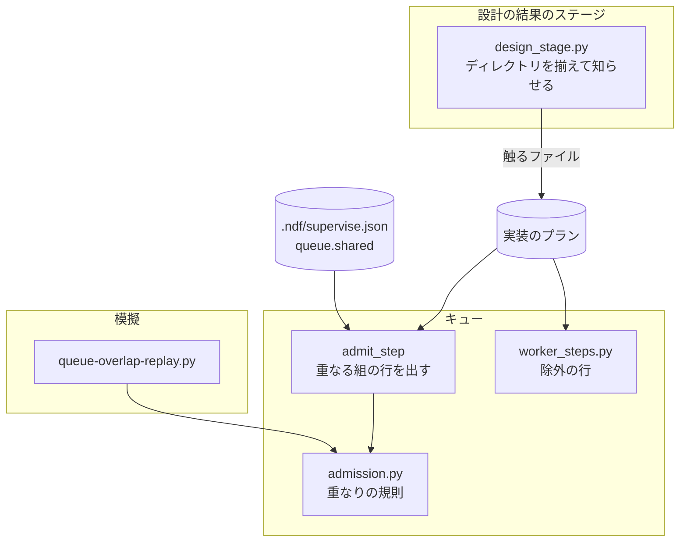
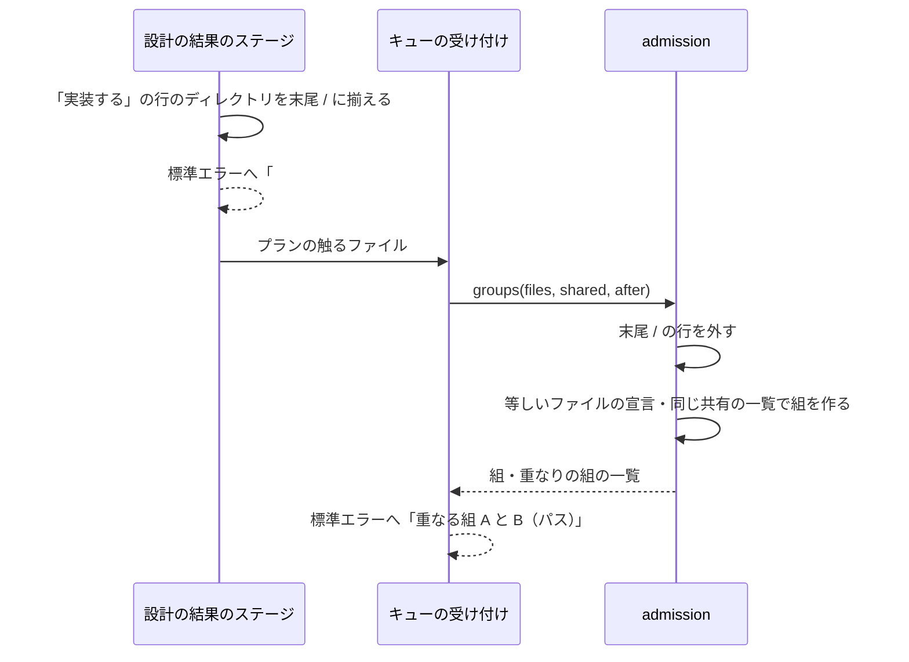

# supervise の重なりの判定: 同じファイルを宣言したプランだけを直列にし、別のファイルを触るプランを同時に流す（#1811）

## 目的

- **今どうなっているか**: キューは触るファイルの包含で重なりの組を決めるため、テストのディレクトリ `plugins/ndf/scripts/tests/` をディレクトリのまま宣言したプランが、同じディレクトリの別のファイルを触るプランと直列になる。8 スプリントの 60 組のうち 31 組が重なりの組になり、うち 10 組が偽の重なりだった（この文書の「模擬の結果」）
- **誰に効くか**: スプリントの実装のステージを `supervise.py queue` で流す conductor と、その経過を待つ利用者
- **変えると何が成り立つか**: 等しいファイルを宣言した 2 本と、同じ共有の一覧に当たる 2 本だけが直列になり、それ以外は同時に流れる。同じ 8 スプリントで重なりの組は 16 組、偽の重なりは 2 組になる

## 適用範囲

- **働く範囲**: NDF を使うすべてのリポジトリ（重なりの判定と設計の結果のステージは NDF の部品）。共有の一覧の宣言の見直しは ai-plugins の `.ndf/supervise.json` だけ
- **プロジェクトごとに違うもの**: 共有の一覧は各リポジトリの `.ndf/supervise.json` の `queue.shared` で受ける（形は変えない）。ディレクトリかどうかの判定は設計の結果のステージの `--root` の作業場所で行う
- **当たるモード**: `standard` / `legacy-refactor` / `light` のうち、スプリントの実装のステージを `supervise.py queue` で流すもの

## あるべき姿の根拠

| 根拠 | 種類 | 何を示すか |
| --- | --- | --- |
| STD1（git の 3-way マージ） | 外部の一次情報 | 衝突は同じファイルの同じ箇所を両方が変えたときに起きる。同じディレクトリの別のファイルどうしは衝突しない。重なりの単位をファイルにする根拠 |
| 「模擬の結果」の表 | 実測 | 新しい規則で偽の重なりが 10 組から 2 組へ減る。共有の一覧 `lib/README.md` の当たりは 19 組を直列にし、両方の PR が `lib/README.md` を変えた組は 0 組だった |
| 課題の本文の「依頼」 | 利用者の指示の原文ではない（起票者の推定 S1・S2） | ファイルの単位で同じものを触るときだけ直列にする |

要求と受け入れ条件は #1811 の本文にある（コピーは [issue-1811-requirements.md](issue-1811-requirements.md) ）。この文書は「どう作るか」だけを扱う。

## ドメインモデル

### コンテキスト

| コンテキスト | 何の語が 1 つの意味に決まるか |
| --- | --- |
| NDF の工程（`ndf-workflow`） | 触るファイル・ディレクトリの宣言・重なりの組・共有の一覧・偽の重なり・設計の結果・除外の行 |

1 つのコンテキストに収まる。

### 集約

| 集約 | 持ち主（書き換えてよいもの） | 根 | エンティティ | 値オブジェクト |
| --- | --- | --- | --- | --- |
| 設計の結果 | 設計の結果のステージ（`supervise_lib/design_stage.py`） | 設計の結果（`design-results.json`） | 行（課題ごと） | 触るファイルの 1 行（ファイルの宣言 / ディレクトリの宣言） |
| 実装のプラン | 設計の結果のステージ（`触るファイル` を書く） | プラン（プランの JSON） | — | 触るファイルの 1 行 |
| ステージの受け付け | キューの受け付けのステップ（`supervise_lib/flow.py` の `admit_step`） | 受け付けの結果（組・待ち・重なりの組の一覧） | — | 重なりの組・共有の一覧 |

重なりの組を決める規則は `supervise_lib/admission.py` だけが持つ。受け付けのステップはこの規則を呼び、結果をキューの記録へ書く。

### 不変条件

| # | 集約 | 条件 | 破れたときの扱い |
| --- | --- | --- | --- |
| I1 | ステージの受け付け | ディレクトリの宣言（末尾が `/` の行）は、重なりの組の判定のどこにも使わない（ファイルの宣言との包含・ディレクトリの宣言どうしの一致・共有の一覧への当たり） | テストが落とす |
| I2 | ステージの受け付け | 2 本のプランが等しいファイルの宣言を 1 つ以上持つなら、重なりの組になる。等しさはパスの要素の並びで比べる（`./a.py` と `a.py` は等しい） | テストが落とす |
| I3 | ステージの受け付け | 2 本のプランのファイルの宣言が同じ共有の一覧に当たるなら、重なりの組になる。当たりは `touched_by`（無ければ一覧のパス）とファイルの宣言の包含で見る | テストが落とす |
| I4 | ステージの受け付け | 判定はファイルシステムを読まず、組ごとの比較（N×(N−1)/2 回）だけで決まる | テストが落とす（判定の関数を、存在しないパスだけで呼んで結果が変わらない） |
| I5 | 設計の結果 | 「実装する」の行の触るファイルのうち、末尾が `/` の行と `--root` の下の既存のディレクトリの行は、末尾が `/` の形で設計の結果とプランへ書かれる。ステージは課題の番号とそのパスを標準エラーへ出し、止まらない | テストが落とす |
| I6 | 実装のプラン | 実装の担当へ渡す除外の行に、ディレクトリの宣言が入らない（#1674 の I2。退行しない） | テストが落とす |
| I7 | ステージの受け付け | キューの記録の「重なる組」の行は、組を作ったパスを 1 つだけ示す（両側が同じパスのため） | テストが落とす |

### ドメインイベント

| # | イベント | 発生元 | 受け手 |
| --- | --- | --- | --- |
| E1 | 設計の結果のステージが、設計文書の「設計の結果」の表を読んだ | 設計の結果のステージ | 同じステージ（E2 へ進む） |
| E2 | 設計の結果のステージが、実装のプランの触るファイルを書き換えた（ディレクトリの宣言を末尾 `/` の形にそろえ、標準エラーへ知らせる） | 設計の結果のステージ | キュー（E3） |
| E3 | キューが、同じステージのプランの重なりの組を決めた | キューの受け付けのステップ | キュー（E4）・キューの記録 |
| E4 | キューが、重なりの組ごとに直列で、組の間は並行でプランを流した | キュー | 実装の担当（E5） |
| E5 | 実装の担当が、並行して走る他のプランのファイルを「変えない」と受け取った | 実装のステップ | 実装の担当 |
| E6 | 並行に流した実装の PR が、スプリントのブランチへマージされた | 実装のプランの PR のステップ | スプリントのブランチ（衝突は git が示す） |
| E7 | 模擬が、8 スプリントの宣言を作り直して偽の重なりを数えた | 模擬のスクリプト | 実装の PR の本文 |

### 用語

| 用語 | 意味 | 用語集への反映 |
| --- | --- | --- |
| 重なりの組 | 同じステージの 2 本のプランで、触るファイルに等しいファイルの宣言を持つか、同じ共有の一覧に当たるもの。ディレクトリの宣言は判定に使わない。同時には流さない | 意味の変更 |
| ディレクトリの宣言 | 触るファイルの 1 行で、末尾が `/` のもの。設計の結果のステージは作業場所の既存のディレクトリをこの形に揃える。重なりの組の判定と除外の行に使わない | 追加 |
| 偽の重なり | 重なりの組と判定された 2 本のうち、両方の実装の PR が実際に変えたファイルに共通するものが 1 つも無い組 | 要求の段階で追加済み |
| 共有の一覧 | 複数のプランが同じ行の並びへ書き足すファイル。`.ndf/supervise.json` の `queue.shared` に書く | 変えない |

## 外部の調査

| 種類 | 調べるか | 理由 |
| --- | --- | --- |
| 標準・仕様 | 調べる | 並行に作った変更がどの単位で衝突するかは、マージの道具の仕様が決める |
| 主要な製品 | 調べる | マージキューの製品が、変更どうしの干渉をどの単位で判断しているかを比べる |
| ライブラリとサービス | 調べない | 判定は既存の自前の関数（約 30 行の副作用の無い関数）の比較の単位を変えるだけで、置き換えの対象になる部品が無い。マージキューの製品は PR の実際の変更を見る仕組みで、実装の前に組を決めるキューには使えない（前提 1） |

### 標準・仕様

| # | 標準・仕様 | 何を定めているか | 設計への反映 | 出典 |
| --- | --- | --- | --- | --- |
| STD1 | git の 3-way マージ（`git merge` の「HOW CONFLICTS ARE PRESENTED」） | 共通の祖先からの変更のうち、片方だけが変えた箇所はそのまま取り込まれ、両方が同じ箇所を変えたときだけ衝突として人に解決を求める | 衝突が起きうる最小の単位はファイルである。ディレクトリの包含は衝突の条件にならないため、判定に使わない（決定 1） | https://git-scm.com/docs/git-merge （2026-11-11） |

### 主要な製品

| # | 製品 | どう解いているか | 設計への反映 | 出典 |
| --- | --- | --- | --- | --- |
| PRD1 | Mergify のマージキューのスコープ | PR が触るコードの領域（スコープ）をファイルのパターンから決め、重なるスコープの PR をまとめる。リポジトリ全体に効くファイルは `barrier_files` として宣言し、それを変えた PR を全スコープに当たるものとして扱う | 重なりを PR の実際の変更から決める形は、実装の前に組を決めるキューでは取れない（前提 1）。全体に効くファイルを宣言で名指す形は、共有の一覧（`queue.shared`）と同じ考えで、仕組みは残す（決定 3） | https://docs.mergify.com/merge-queue/scopes/ （2026-11-11） |

### 確かめられなかったこと

| 対象 | 試した手段 | 結果と理由 |
| --- | --- | --- |
| Mergify のパーティションの文書 | https://docs.mergify.com/merge-queue/partitions/ | HTTP 404。スコープの文書（PRD1）で代えた |

調べた量: 候補 2 件・取得の試み 4 回。

## 機能一覧

| # | 機能 | 誰が使うか |
| --- | --- | --- |
| F1 | 別のファイルを触るプランを同時に流す（ディレクトリの宣言を重なりの判定に使わない） | `supervise.py queue` を打つ conductor |
| F2 | 等しいファイルを宣言したプランと、同じ共有の一覧に当たるプランを直列に流す | 同上 |
| F3 | 設計の結果のディレクトリの宣言を見つけて知らせ、末尾 `/` の形に揃える | 設計の結果のステージを流す conductor と、設計を書く担当 |
| F4 | 設計の結果の触るファイルをファイル単位で書く手順 | 設計を書く担当 |
| F5 | 過去のスプリントの宣言で重なりの組を判定し直し、偽の重なりを数える | 実装の担当（受け入れ条件 6）と、規則を見直す人 |

## 構成要素

| 要素 | 責務 |
| --- | --- |
| `plugins/ndf/scripts/supervise_lib/admission.py` | 重なりの規則の唯一の置き場。`overlap_of` はディレクトリの宣言（末尾 `/`）を外し、残ったファイルの宣言の一致（パスの要素の並び）と、共有の一覧への当たりで重なりを返す。`shared_hits` もディレクトリの宣言を当たりに使わない。`contains`・`touches` は共有の一覧の `touched_by` の当たりにだけ使う。モジュールの説明文の規則の箇条を新しい規則に書き換える |
| `plugins/ndf/scripts/supervise_lib/flow.py` の `admit_step` | 「重なる組」の行に、組を作ったパス 1 つを出す（`⊃` の分岐を消す） |
| `plugins/ndf/scripts/supervise_lib/design_stage.py` | `cmd_design_results` が、書き換える前に「実装する」の行の触るファイルのディレクトリ（`paths.is_dir_entry(パス, --root)`）を末尾 `/` の形に揃え、課題ごとに標準エラーへ 1 行ずつ出す。結果の JSON の `metrics.dirs`（課題の番号 → ディレクトリの宣言）に載せる |
| `plugins/ndf/scripts/supervise_lib/new_args.py` | `new impl --files` の help に、ディレクトリ（末尾 `/`）は重なりの判定にも除外の行にも使わないことを書く |
| `plugins/ndf/skills/design/references/design-template.md` | 「設計の結果の書き方」の触るファイルの列とテンプレートの例の行を、ファイル単位で書く形にする（受け入れ条件 5）。テストのような複数の課題が同時に触る置き場はファイルを 1 つずつ書くこと、索引のように行を書き足すファイルは書き足すならそのファイルを書くこと、ディレクトリを書いたときは重なりの判定に使われず他のどのプランとも同時に流れることを書く |
| `.ndf/supervise.json` | `queue.shared` の `plugins/ndf/scripts/lib/README.md` の行を消す（`queue` の節ごと消す。決定 3） |
| `plugins/ndf/scripts/experimental/queue-overlap-replay.py`（新設） | 模擬のスクリプト。前提 5 の規則でスプリントを選び、各プランの触るファイルを I5 の形に揃えて `admission.overlaps` で組を判定し直し、`gh` で取った PR の変更ファイルと突き合わせて、スプリントごとの組の数と偽の重なりの一覧を Markdown の表で出す。重なりの規則を自分で持たない |
| `docs/ndf-experiments.md` | 実験版の台帳へ模擬のスクリプトの 1 行を足す |
| `plugins/ndf/scripts/tests/test_supervise_queue.py`・`test_sprint_procedures.py` | 包含で重なることを縛っているテスト（`test_containment_is_judged_by_path_components` の `overlaps` の行・`test_groups_join_chained_overlaps_and_keep_the_order`・`pkg/ ⊃ pkg/x.py` の行を出すキューのテスト・AC13 の組のテスト）を新しい規則の期待へ書き換え、「テスト設計」の行を足す |
| `plugins/ndf/scripts/tests/test_design_results_rewrite.py` | 設計の結果のステージの I5 のテストを足す |

図に含めない要素: `new_args.py`（help の文）、`design-template.md`（設計を書く担当が読む手順）、`docs/ndf-experiments.md`（台帳）、テスト。

## 処理の流れ

失敗の経路は既存のまま: 設計文書の表が読めないとステージは止まる（E1）。プランが読めないと触るファイルを空として扱う（E3）。ディレクトリの判定でファイルシステムを読めない（権限など）ときは `Path.is_dir` が偽を返し、そのパスはファイルの宣言として残る。

## 非機能の実現方式

| 大項目 | 要求の条件 | 実現方式 | 確かめ方 |
| --- | --- | --- | --- |
| 性能・拡張性 | 重なりの判定は組ごとの比較（N×(N−1)/2 回）を超えない。ファイルシステムへの問い合わせを判定の中で増やさない | `overlaps` の 2 重の繰り返しは変えない。組の中の比較は、ファイルの宣言を正規化した集合の積で行う。ディレクトリの判定は末尾の `/` だけで行い、既存のディレクトリの判定は設計の結果のステージ（判定の外）で 1 回だけ行う | I4 のテスト（存在しないパスだけで呼んで結果が変わらない） |
| 運用・保守性 | 重なりの判定の規則を持つ場所は `admission.py` の 1 か所のまま。同じ役割の関数を別に作らない | 模擬のスクリプトは `admission.overlaps` を呼び、規則を持たない。レーンの検査（`lib/parallel_plan.py` の `touch_overlaps`）は対象範囲の外で変えない | レビューで模擬のスクリプトに比較の処理が無いことを見る |
| 移行性 | `queue.shared` の形（`path`・`touched_by`）は読めるままにする | 形と読み込み（`decl.py`）は変えない。変わるのは、当たりにディレクトリの宣言を使わないことだけである | 既存の共有の一覧のテスト（ファイルの宣言で当たる）が通る |

## 決定の記録

### 決定 1: 衝突の起きない組を直列にしないため、ディレクトリの宣言を重なりの判定に使わず、等しいファイルの宣言だけで重ねる

衝突は同じファイルを両方が変えたときにだけ起きる（STD1）。ディレクトリの包含を重なりとすると、テストのディレクトリのようにほぼすべての実装が触る置き場で、衝突の起きない組まで直列になる。模擬では、今の規則の偽の重なり 10 組が、この決定だけで 4 組になった（残りのうち 2 組は決定 3 で無くなる）。ファイルの宣言どうしの包含（`a/b` のファイルと `a/b/c` のファイル）は起こりえないため、比較は等しさだけにする。

ディレクトリの宣言をその時点の既存のファイルへ展開する形は採らない。同じディレクトリへ別々のファイルを足す 2 本が既存のファイルを通じて重なったまま残る（前提 3）。テストのディレクトリだけを重なりから外す形も採らない。`supervise_lib/`・`lib/` をディレクトリで宣言した組（スプリント lspeed-1 の #2309）が残り、外す置き場の一覧がリポジトリごとに要る（Value 6）。PR の実際の変更で組を決める形（PRD1）は、流す前に変更が分からないため採れない（前提 1）。

- 作り方: 自前で作る・標準に倣う
- 比べた候補: STD1 / PRD1

根拠: Value 7 / Value 6 / Value 4（MVV 版 6）

### 決定 2: 判定の外でファイルシステムを読むため、ディレクトリの判定と知らせは設計の結果のステージが行い、宣言は消さずに末尾 `/` の形へ揃える

判定の関数はファイルを読まない（非機能の条件）。末尾に `/` の無いディレクトリ（例: `plugins/ndf/scripts/tests`）を判定で見分けるには、宣言の形を判定の前に揃える必要がある。設計の結果のステージはプランを書く唯一の持ち主で、作業場所を `--root` で持つため、ここで既存のディレクトリを末尾 `/` の形にし、課題の番号とパスを標準エラーへ出して次へ進む（受け入れ条件 4）。

ディレクトリの宣言を触るファイルから消す形は採らない。実装の担当へ渡る触る範囲の情報が減り、除外の行は既にディレクトリを外している（I6）。ステージを止める形は、受け入れ条件 4 が進むことを求めるため採らない。`new impl --files` で conductor が直に書いたプランは揃わないが、末尾 `/` の無いディレクトリはファイルの宣言として等しさだけで比べられ、包含で広がらない。

根拠: Value 7 / Value 5（MVV 版 6）

### 決定 3: 書き足しの無い組を直列にしないため、ai-plugins の共有の一覧から `lib/README.md` の行を消し、仕組みは残す

模擬では、ファイルの宣言が `lib/README.md` の `touched_by`（`plugins/ndf/scripts/lib/`）に当たった組が 19 組あり、両方の PR が `lib/README.md` を変えた組は 0 組、偽の重なりは 2 組（lcost-1 の #2908 と #2914、lproc lap-9 の #2737 と #2803）だった。`lib/README.md` を変えた組は 2 組あったが、どちらも `lib/` をディレクトリで宣言しており、この行では捕まえられない。`lib/` のモジュールを足して索引へ行を書き足す課題は、設計の結果に `lib/README.md` を書けば等しいファイルの宣言として重なる（設計テンプレートの手順。F4）。

`touched_by` を狭める形（新しいファイルを足すときだけ当てる）は採らない。宣言からは新しいファイルか既存のファイルかが分からず、判定でファイルシステムを読むことになる。共有の一覧の仕組み（`queue.shared` と `shared_hits`）は残す。全体に効くファイルを名指す形は PRD1 の `barrier_files` と同じ考えで、ほかのリポジトリが使える（Value 6）。

- 作り方: 自前で作る
- 比べた候補: PRD1

根拠: Value 4 / Value 5 / C7（MVV 版 6）

### 決定 4: 受け入れ条件 6 の模擬を打ち直せるよう、模擬を実験版のスクリプトとして置く

模擬の結果は実装の PR の本文に載せる。スクリプトを残せば、レビューと次の見直しで同じ数を打ち直せる。呼んだときだけ働くため実験版の置き場（`plugins/ndf/scripts/experimental/`）に置き、台帳に 1 行を足す。重なりの規則は `admission.overlaps` を呼んで使い、自分では持たない（非機能の条件）。

PR の本文に表だけを載せる形は採らない。打ち直す手段が無く、規則を変えたときに数え直せない。

根拠: Value 4 / Value 9（MVV 版 6）

### 決定 5: 受け入れ条件 6 を改め、0 組を求めるのはディレクトリの宣言と共有の一覧による偽の重なりに限る

模擬で残る偽の重なり 2 組は、両方の設計の結果が同じファイルを宣言した組である。受け入れ条件 3 と前提 2 を保つ限り外せない。この課題が直すのはディレクトリの包含と共有の一覧の広さであり、同じファイルの宣言は直す対象ではない。そこで条件 6 を「ディレクトリの宣言と共有の一覧による偽の重なりが 0 組になる。同じファイルの宣言による組は数と組を記録する」へ改めた。要求の写しと課題の本文も同じ文に直した。

- 決めた人: conductor（判断の記録 c2d308693e02）

## 模擬の結果

設計の時点で、決定 1〜3 の規則を同じ 8 スプリントに当てた結果である。実装の PR では、実験版のスクリプトで同じ数を打ち直して本文に載せる。

**スプリントの選び方（前提 5）**: `.ndf/sprint-*` と `.ndf/loop/*/lap-*/sprint` のうち、実装のプラン（`<番号>-impl-<課題>.json`）で、実装のステップの記録（`<プラン>-state/01-impl.out`）と報告の PR を持つものが 2 本以上あるもの（2026-11-11 時点）。偽の重なりを数えるには両方の PR が要るため、PR の無いプランは数えない。

**組の判定**: プランの `触るファイル`（設計の結果を読んだ値）を I5 の形に揃え（末尾 `/` か、このブランチのコミット 5f54e60bd の作業場所の既存のディレクトリ）、`admission.overlaps` で判定した。今の規則は `.ndf/supervise.json` の共有の一覧を含めて判定した。PR の変更ファイルは `gh pr view --json files`（100 件を超える PR は `gh api --paginate`）で取った。

| スプリント | 数えたプラン | 組 | 今の規則: 重なり | 今の規則: 偽の重なり | 新しい規則: 重なり | 新しい規則: 偽の重なり |
| --- | ---: | ---: | ---: | ---: | ---: | ---: |
| lcost-1 | 10 | 45 | 20 | 4 | 12 | 1 |
| lspeed-1 | 3 | 3 | 3 | 2 | 2 | 1 |
| lcore lap-1 | 2 | 1 | 1 | 0 | 0 | 0 |
| lcore lap-2 | 3 | 3 | 1 | 0 | 0 | 0 |
| lcore lap-13 | 2 | 1 | 1 | 0 | 1 | 0 |
| lproc lap-1 | 3 | 3 | 3 | 3 | 0 | 0 |
| lproc lap-2 | 3 | 3 | 1 | 0 | 1 | 0 |
| lproc lap-9 | 2 | 1 | 1 | 1 | 0 | 0 |
| 合計 | 28 | 60 | 31 | 10 | 16 | 2 |

新しい規則で残る偽の重なり:

| スプリント | 組 | 重なったパス | なぜ残るか |
| --- | --- | --- | --- |
| lcost-1 | #2912 と #2923 | `docs/glossary.md` | 両方の設計の結果が同じファイルを宣言し、どちらの PR もそのファイルを変えていない |
| lspeed-1 | #2309 と #2925 | `plugins/ndf/scripts/test-run.py` | 同上 |

2 組はどちらも等しいファイルの宣言による。I2（等しいファイルの宣言は重なる）と受け入れ条件 3 を保つ限り、判定の規則では外せない。受け入れ条件 6 は、ディレクトリの宣言と共有の一覧による偽の重なりを 0 組とし、同じファイルの宣言による組は数と組を記録する（決定 5）。新しい規則でディレクトリの宣言と共有の一覧による偽の重なりは 0 組で、条件 6 を満たす。同じファイルの宣言による 2 組は上の表で記録する。

## テスト設計

| 受け入れ条件・不変条件 | どの振る舞いで縛るか | どう壊したら落ちるべきか |
| --- | --- | --- |
| 受け入れ条件 1・I1 | `tests/` と `a.py`、`tests/test_b.py` と `b.py` の 2 本を `queue --max 2` で流すと、2 本の実行の区間が重なり、標準エラーに「重なる組」の行が出ない | ディレクトリの宣言を包含で比べるように戻すと落ちる |
| 受け入れ条件 2・I1 | 両方が `tests/` を持ち、ファイルの宣言に共通が無い 2 本が同時に流れる | ディレクトリの宣言どうしを等しさで比べると落ちる |
| 受け入れ条件 3・I2・I7 | 両方が `supervise_lib/admission.py` を持つ 2 本が直列に流れ、「重なる組 A と B（plugins/ndf/scripts/supervise_lib/admission.py）」の行が 1 回出る。`./a.py` と `a.py` も重なる | 等しさの比較を消す・パスを正規化せずに文字列で比べる・行に `⊃` の形を残すと落ちる |
| I3 | ファイルの宣言が同じ共有の一覧の `touched_by` に当たる 2 本は重なり、ディレクトリの宣言だけが当たる 2 本は重ならない | 共有の一覧の当たりを消す・ディレクトリの宣言を当たりに使うと落ちる |
| I4 | 存在しないパスだけを渡しても `overlaps`・`groups` の結果が同じになる | 判定の中で `is_dir` などファイルシステムを読むと、存在するディレクトリを渡したときと結果が変わり落ちる |
| 受け入れ条件 4・I5 | 「実装する」の行に `x/`（末尾 `/`）と `--root` の下の既存のディレクトリ `y`（末尾 `/` なし）を持つ設計の結果でステージを流すと、プランの触るファイルが `x/`・`y/` になり、標準エラーに課題の番号と 2 つのパスが出て、結果は `ok` | 揃える処理を消す・ステージを止める・知らせを出さないと落ちる |
| 受け入れ条件 5 | 設計テンプレートの「設計の結果の書き方」をレビューで読む（`.md` の文言を照合するテストは書かない） | — |
| 受け入れ条件 6 | 実験版のスクリプトを 8 スプリントの記録へ打ち、ディレクトリの宣言と共有の一覧による偽の重なりが 0 組であることと、同じファイルの宣言による組の数と組を、表で実装の PR の本文に載せる | — |
| 受け入れ条件 7・I6 | 既存の除外の行のテスト（`tests/test_supervise.py` の、`concurrent_rule` がディレクトリを外すテスト）が通る | 除外の行にディレクトリを入れると落ちる |
| 受け入れ条件 8 | `uv run --frozen --project . --all-extras pytest . -q -n 4` が通る | — |

## 設計の結果

| 課題 | 扱い | 取り込み先 | 触るファイル |
| --- | --- | --- | --- |
| #1811 | 実装する | — | `plugins/ndf/scripts/supervise_lib/admission.py`、`plugins/ndf/scripts/supervise_lib/flow.py`、`plugins/ndf/scripts/supervise_lib/design_stage.py`、`plugins/ndf/scripts/supervise_lib/new_args.py`、`plugins/ndf/skills/design/references/design-template.md`、`.ndf/supervise.json`、`plugins/ndf/scripts/experimental/queue-overlap-replay.py`、`docs/ndf-experiments.md`、`plugins/ndf/scripts/tests/test_supervise_queue.py`、`plugins/ndf/scripts/tests/test_sprint_procedures.py`、`plugins/ndf/scripts/tests/test_design_results_rewrite.py` |

## 人へ残す判断

| 判断 | 当たるレッドライン | なぜ当たるか |
| --- | --- | --- |
| `.ndf/supervise.json` の `queue.shared` から `lib/README.md` の行を消す（決定 3） | C7 | 利用者の設定（`.ndf/`）を書き換える。変更は実装の中でコミットし、設計承認ゲートとリリース承認ゲートで人が見る |

## 未確認のまま残ること

| 項目 | 内容 |
| --- | --- |
| 宣言に無い同じファイルの変更 | 模擬では、PR が同じファイルを変えたのに新しい規則で重ならない組が 21 組あった（今の規則では 14 組）。多くは確定仕様・`plugins/ndf/contracts/index.md` などの宣言に無いファイルである。衝突になるかは、スプリントのブランチへのマージで git の衝突として初めて分かる（前提 6）。リリース後の次のスプリントのマージの記録で確かめる |
| 実際の経過の短縮 | 模擬は組の数だけを数え、経過の分は推定していない。次のスプリントのキューの記録で、実装のステージで同時に動いた本数を確かめる（要求の検証手段の「手動確認」） |
