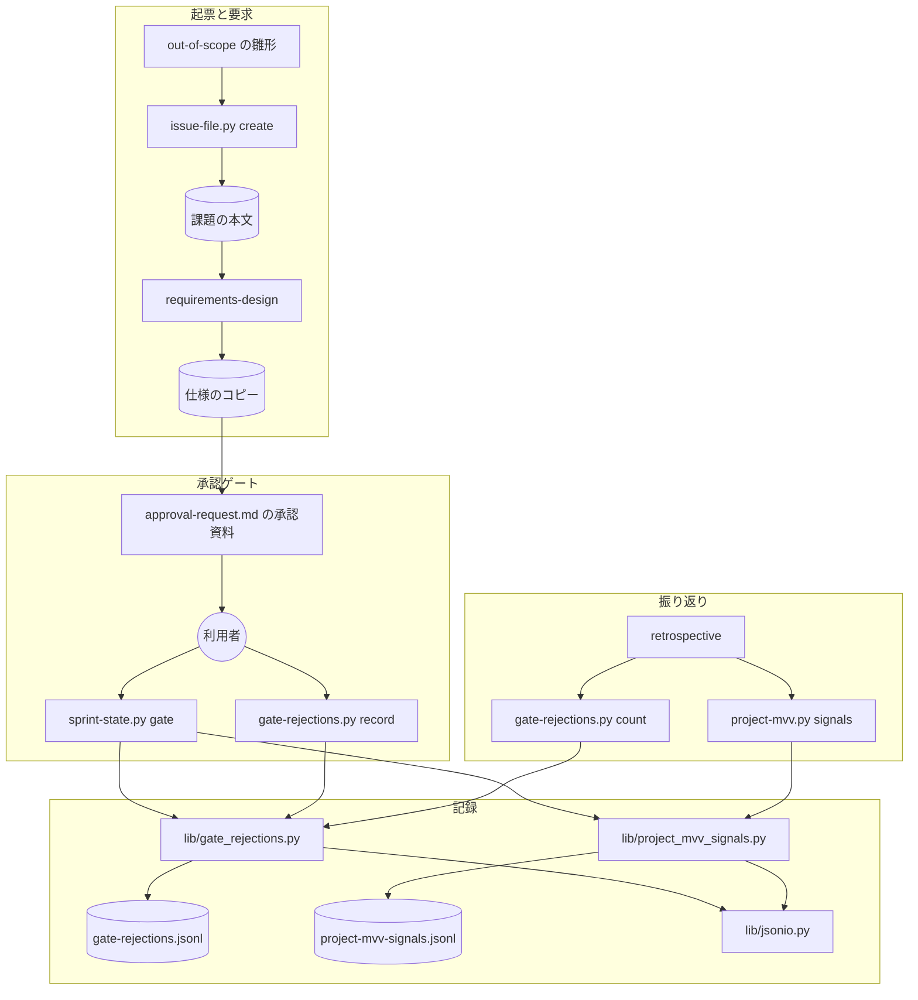
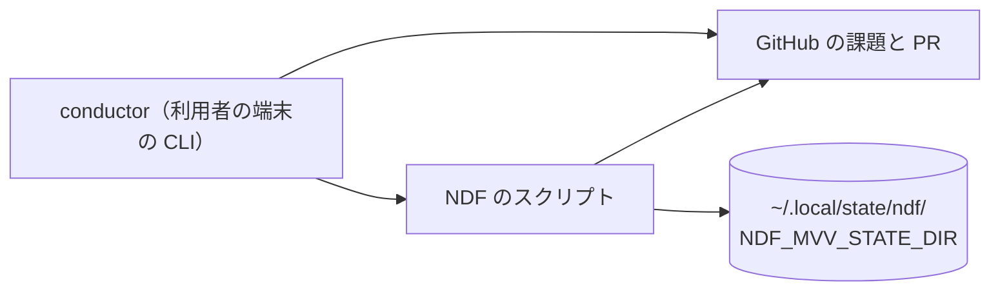
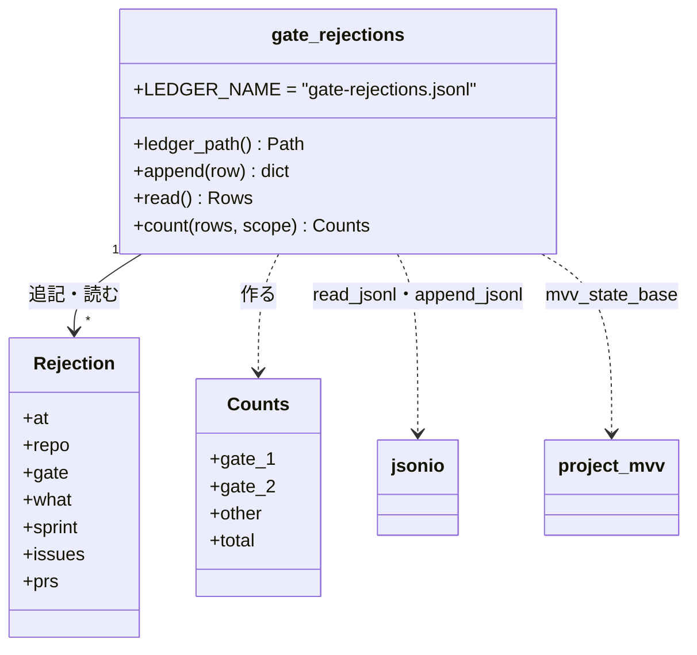
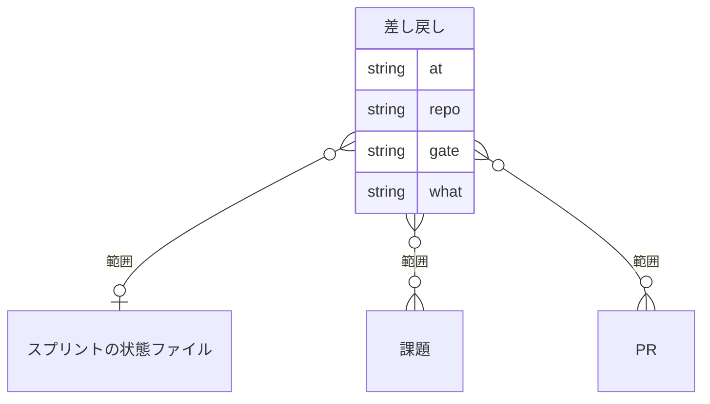
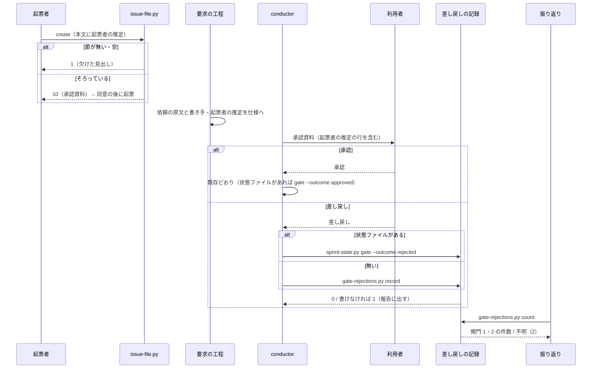

# 起票・要求・承認ゲート: 起票者が推して足した条件が利用者の決定と見分けられずに承認ゲート 1 を通り、承認ゲートで人が差し戻した回数も数えられない → 起票者の推定が本文・仕様・承認資料で区別されて承認ゲート 1 で確かめられ、差し戻しが pace によらず記録されて振り返りで承認ゲートごとに数えられる（#1833）

## 目的

- **何が壊れているか**: 起票者（課題を書いた AI）が文書やコードから推して足した条件が、課題の本文・仕様のコピー・承認資料のどこでも利用者の決定と区別されない。承認ゲートで利用者が差し戻しても、`pace: normal` では記録が残らない
- **誰が困るか**: 承認ゲート 1 で設計を承認する利用者。#1658 の「Draft でない」の条件は承認ゲート 2 で初めて退けられ、開発版を 3 回出した。振り返りの読み手も、差し戻しが「覆し」に数えられないため見直しの兆候に気づけない
- **直すと何が成り立つか**: 起票者の推定が節として本文から承認資料まで運ばれ、承認ゲート 1 で利用者が確かめる。差し戻しは pace と MVV 判定の有無によらず 1 件ずつ記録され、振り返りで承認ゲート 1・2 に分けて数えられる

## 適用範囲

- **働く範囲**: 配布先のリポジトリでも働く。範囲外の課題の起票（`out-of-scope`・`retrospective`）、要求の仕様（`requirements-design`）、承認資料（`development-workflow` の `approval-request.md`）、差し戻しの記録と件数（`sprint-state.py` と新しい `gate-rejections.py`）
- **プロジェクトごとに違うもの**: 記録の対象のリポジトリだけ。`--repo` の引数で受け、無ければ `origin` の URL から読む（`lib/repo.owner_repo`）。`origin` から読めない（remote 名が違う・ローカルだけ）ときは止めずに、覆しの記録と同じ `mvv_repo_key(root)`（根の絶対パス）を使う。この解決は `lib/gate_rejections.py` の 1 か所に置き、`record`・`count`・`sprint-state.py gate` が同じ関数を使う。記録の置き場は既存の `NDF_MVV_STATE_DIR` を使い、新しい設定を足さない
- **当たるモード**: 起票者の推定は起票と要求の工程を通るすべてのモード。承認資料の行は承認ゲート 1 を通る `standard`・`documentation`（と設計 PR を分けた `legacy-refactor`）。差し戻しの記録は承認ゲート 1・2 を通るすべてのモードと pace

## あるべき姿の根拠

| 根拠 | 種類 | 何を示すか |
| --- | --- | --- |
| 「Draft でない PR の cross-refactoring を止める必要はない」（2026-10-07、m1743 の承認ゲート 2） | 利用者の指示の原文 | 起票者が足した条件が承認ゲート 2 まで利用者の決定として扱われた |
| `~/.local/state/ndf/` の下に `gates` か `rejections` を持つ状態ファイルが 0 件、`project-mvv-signals.jsonl` が無い（2026-10-10 の実測。要求の前提 6） | 実測 | `pace: normal` の差し戻しを記録する経路が実際の運用で使われていない |
| `sprint.json` の `rejections` を読むコードが 0 件（`grep -rn rejections plugins/ndf` で、書く `sprint-state.py:300` とテストだけが当たる） | 実測 | 状態ファイルの差し戻しは書くだけで読まれていない。置き場を移しても読み手は壊れない |

要求と受け入れ条件は #1833 の本文にある（コピーは `issues/issue-1833-requirements.md`）。この文書は「どう作るか」だけを扱う。

## ドメインモデル

### コンテキスト

| コンテキスト | 何の語が 1 つの意味に決まるか |
| --- | --- |
| 開発の工程（`ndf-workflow`） | 起票者の推定・仕様のコピー・承認資料・承認ゲートの差し戻し |
| MVV（`ndf-mvv`） | 覆し・改訂の兆候 |

開発の工程が供給者、MVV が顧客の関係（顧客 / 供給者）。承認ゲートの答えは開発の工程が持ち、MVV はその答えのうち直前の MVV 判定と食い違うものだけを覆しとして受ける。差し戻しの記録は MVV へ渡らず、覆しの件数は差し戻しの記録から作らない。

### 集約

| 集約 | 持ち主（書き換えてよいもの） | 根 | エンティティ | 値オブジェクト |
| --- | --- | --- | --- | --- |
| 課題の本文 | 起票するまでは起票者（`issue-file.py create` が骨格を検査する）。起票した後は要求の工程（`requirements-design`）だけで、書き換えるのは承認ゲート 1 で起票者の推定が差し戻されたときの、その推定の行の取り消し線と理由・日付だけ（手順 1a）。起票者は起票した後に本文を書き換えない | 課題 | — | 起票者の推定の行（条件・推した出所） |
| 仕様のコピー | 要求の工程（`requirements-design`。`spec-copy.py write` が作る） | 仕様 | — | 依頼の原文（文・書き手・日付）、起票者の推定の行（条件・推した出所・この要求での扱い） |
| 承認資料 | conductor（`approval-request.md` の形で組む） | 承認資料 | — | 承認の判断に使うものの行 |
| 差し戻しの記録 | `lib/gate_rejections.py`（書くのは `append` だけ） | 差し戻し 1 件 | — | 承認ゲートの名前・日時・要約・範囲（リポジトリ・スプリント・課題・PR） |
| 覆しの記録 | `lib/project_mvv_signals.py`（既存。変えない） | 覆し 1 件 | — | 種類・直前の MVV 判定 |

差し戻しの記録は 1 件ずつ独立した事象で、ほかの集約を ID（スプリントの状態ファイルのパス・課題と PR の番号）でだけ参照する。

### 不変条件

| # | 集約 | 条件 | 破れたときの扱い |
| --- | --- | --- | --- |
| I1 | 課題の本文 | `create` で作る課題の本文は `## 起票者の推定` の節を持ち、節は空でない（「無し」の 1 行を含む） | 課題を作らず、終了コード 1 で欠けた見出し（`missing` / `empty`）を `items` に返す。GitHub を呼ぶ前に止まる |
| I2 | 差し戻しの記録 | 利用者の差し戻し 1 回につき、記録はちょうど 1 行増える。既存の行は書き換えない（追記だけ） | 書けなければ終了コード 1 で止め、書けなかったことを結果 JSON の `summary` に出す |
| I3 | 差し戻しの記録 | 各行は承認ゲートの名前・日時・要約・リポジトリを持ち、スプリントの状態ファイル・課題・PR のうち 1 つ以上を持つ | 範囲が 1 つも無い `record` は書かずに終了コード 2 で止まる |
| I4 | 差し戻しの記録 | 件数は記録を読めたときだけ数で出す。読めない（読み込みの失敗・壊れた行がある）ときは数を出さずに「不明」と出す。ファイルが無いときは 0 | 「不明」を 0 と出さない。終了コード 2 で `metrics` の件数を `null` にする |
| I5 | 覆しの記録 | 差し戻しの記録を足しても、覆しの件数・閾値・改訂の提案は同じ入力で変わらない | 覆しの記録（`project-mvv-signals.jsonl`）へ差し戻しを書かず、`signals` は差し戻しの記録を読まない |
| I6 | 差し戻しの記録 | 状態ファイルを持つスプリントの差し戻しは、状態ファイルではなく差し戻しの記録にだけ書く（置き場を 1 つにする） | `sprint-state.py gate --outcome rejected` は `sprint.json` へ `rejections` を書かない |

### ドメインイベント

| # | イベント | 発生元 | 受け手 |
| --- | --- | --- | --- |
| E1 | 起票者が課題の本文に起票者の推定の節を書いた | `out-of-scope`（`retrospective` から呼ばれる場合を含む） | `issue-file.py create` の骨格の検査 |
| E2 | 課題を起票した | `issue-file.py create` | 要求の工程（`requirements-design`） |
| E3 | 要求の工程が依頼の原文とその書き手を仕様に写した | `requirements-design` の手順 1 | 仕様のコピー（`spec-copy.py write`） |
| E4 | 要求の工程が起票者の推定を仕様の節に写し、各行の扱いを書いた | `requirements-design` の手順 1a | 仕様のコピー、承認資料（E5） |
| E5 | 承認資料に起票者の推定の一覧が載った | conductor（`approval-request.md`） | 利用者（E6） |
| E6 | 利用者が承認ゲートで承認した、または差し戻した | 利用者 | conductor |
| E7 | 差し戻しが記録に 1 件残った | `sprint-state.py gate --outcome rejected`（状態ファイルがあるとき）か `gate-rejections.py record`（無いとき） | 差し戻しの記録（`gate-rejections.jsonl`） |
| E8 | 振り返りが承認ゲートの差し戻しの件数を承認ゲートごとに出した | `gate-rejections.py count` | `retrospective` の観点の表と投稿 |

### 用語

| 用語 | 意味 | 用語集への反映 |
| --- | --- | --- |
| 起票者の推定 | 課題の題・本文に、利用者の指示の原文に無く起票者（課題を書いた AI）が文書・コード・経緯から推して足した条件。承認ゲート 1 で利用者が確かめるまで、利用者の決定として扱わない | 追加（要求の変更で `pending_source` 付きで足した。この設計で変えない） |
| 承認ゲートの差し戻し | 承認ゲートで利用者が承認せず、対象を直すよう戻したこと。MVV 判定の有無を問わず 1 回を 1 件と数える。MVV 判定との食い違いである覆しとは別の数 | 追加（同上） |
| 差し戻しの記録 | 承認ゲートの差し戻しを 1 回 1 行で追記する JSONL（`<NDF_MVV_STATE_DIR>/gate-rejections.jsonl`）。pace と状態ファイルの有無によらず唯一の置き場 | 追加 |
| 覆し | 承認ゲートで人の答えが直前の MVV 判定と食い違ったこと | 変えない |

## 機能一覧

| # | 機能 | 誰が使うか |
| --- | --- | --- |
| F1 | 範囲外の課題を起票するとき、起票者の推定の節が無い本文を退ける | 起票者（`out-of-scope`・`retrospective` を通す AI） |
| F2 | 範囲外の課題の本文の雛形で、起票者の推定の書き方を示す | 起票者 |
| F3 | 要求の仕様で、依頼の原文の書き手と日付を示し、起票者の推定とその扱いを節に書く | 要求の工程を通す AI |
| F4 | 起票者の推定の節を持たない既存の課題から、起票者の推定を拾い出して仕様に書く | 要求の工程を通す AI |
| F5 | 承認ゲート 1 の承認資料に起票者の推定の一覧を載せる | 承認ゲート 1 で承認する利用者 |
| F6 | 承認ゲートの差し戻しを、pace と状態ファイルの有無によらず 1 件ずつ記録する | conductor |
| F7 | スプリント・課題・PR ごとに、差し戻しの件数を承認ゲート 1・2 に分けて出す | 振り返りを書く AI と、それを読む利用者 |

## 構成要素

| 要素 | 新設 / 変更 | 責務 |
| --- | --- | --- |
| `plugins/ndf/scripts/issue-file.py` | 変更 | 骨格（`SKELETON`）に `起票者の推定` を足す（`由来` の前）。`create` が欠けを 1 で返す（F1） |
| `plugins/ndf/skills/out-of-scope/SKILL.md` | 変更 | 手順 5 の本文の雛形に `## 起票者の推定` の節と書き方（1 行 1 条件・推した出所・0 件は「無し」）を足し、節と見出しの数を直す（F2） |
| `plugins/ndf/skills/requirements-design/references/spec-template.md` | 変更 | 「依頼（原文）」に書き手（利用者 / AI の起動指示 / 起票者 / 不明）と日付の行を足し、`## 起票者の推定` の表（条件・推した出所・この要求での扱い）を足す（F3） |
| `plugins/ndf/skills/requirements-design/SKILL.md` | 変更 | 手順 1 に書き手と日付の書き方と「書き手が利用者でない文を原文として扱わない」を足し、手順 1a（起票者の推定を写す。節が無い既存の課題では本文から拾い出す）を足す（F3・F4） |
| `plugins/ndf/skills/development-workflow/references/approval-request.md` | 変更 | 「承認の判断に使うもの」に「起票者の推定（設計 PR）」の行を足し、設計 PR と `documentation` の判断に使うものの並びにも足す（F5）。「止まる手段」の後に「答えを記録する」の節を足す（F6） |
| `plugins/ndf/scripts/lib/gate_rejections.py` | 新設 | 差し戻しの記録の置き場・1 行の形・追記・読み取り・承認ゲートごとの件数（F6・F7） |
| `plugins/ndf/scripts/gate-rejections.py` | 新設 | 状態ファイルを持たない差し戻しの `record` と、件数の `count` の入口（F6・F7） |
| `plugins/ndf/scripts/sprint-state.py` | 変更 | `gate --outcome rejected` の書き先を `sprint.json` の `rejections` から差し戻しの記録へ替える。覆しの記録は今のまま（F6） |
| `plugins/ndf/scripts/lib/jsonio.py` | 変更 | `project_mvv_signals.py` の `read_jsonl`・`append_jsonl` を移し、壊れた行を `broken` で扱えるようにする（下の決定 4） |
| `plugins/ndf/scripts/lib/project_mvv_signals.py` | 変更 | `read_jsonl`・`append_jsonl` を `jsonio` から読む。振る舞いは変えない |
| `plugins/ndf/skills/retrospective/SKILL.md` | 変更 | 手順 2 の観点の表に「承認ゲートの差し戻し」の行を足し、出所を `gate-rejections.py count` にする。投稿の雛形の「MVV を見直すか」の前に件数を載せる（F7） |
| `plugins/ndf/skills/development-workflow/references/conductor-entrypoints.md` | 変更 | `gate-rejections.py` を一覧に足す |
| `plugins/ndf/skills/development-workflow/references/pace.md` | 変更 | 「承認ゲートで止まった後の続け方」の差し戻しの行に、記録の置き場が差し戻しの記録であることを足す |



図に描かない要素: `conductor-entrypoints.md` と `pace.md`（どちらも上の入口を指す一覧と説明で、呼び出しの関係を持たない）。

### システムの文脈と配置



差し戻しの記録は、覆しと MVV 判定の記録と同じ置き場（端末ごとの `NDF_MVV_STATE_DIR`）に置く。GitHub へは書かない。常駐の処理は置かず、記録は承認ゲートに答えた時点でスクリプトが 1 行足すだけである。

### パッケージ・モジュール構成

```text
plugins/ndf/scripts/
├── gate-rejections.py          （新設: record / count）
├── issue-file.py               （SKELETON に 1 つ足す）
├── sprint-state.py             （gate --outcome rejected の書き先）
├── lib/
│   ├── gate_rejections.py      （新設）
│   ├── jsonio.py               （read_jsonl・append_jsonl を受け入れる）
│   └── project_mvv_signals.py  （jsonio から読む）
└── tests/
    ├── test_gate_rejections.py （新設）
    ├── test_issue_file.py
    ├── test_sprint_state.py
    └── test_project_mvv.py
```

## 構造



`Rejection` と `Counts` は型として作らず、辞書の形の約束である（既存の記録と同じ書き方）。形は「データ構造」の表が持つ。

## データ構造

### 保存する形

| 項目 | 内容 |
| --- | --- |
| 置き場 | `<mvv_state_base()>/gate-rejections.jsonl`（`NDF_MVV_STATE_DIR` → `~/.local/state/ndf`。覆し・MVV 判定の記録と同じディレクトリ） |
| 単位 | 差し戻し 1 回を 1 行。追記だけで、書き換えと削除をしない（事象の記録） |
| 主キー | 持たない。同じ答えを 2 度打てば 2 行になる（記録するのは conductor が利用者の答えを受けた 1 回だけ） |



### 1 行の定義

| 鍵 | 型 | 空を許すか | 意味 |
| --- | --- | --- | --- |
| `at` | 文字列（ISO 8601、UTC） | 許さない | 利用者が差し戻した日時。`--at` が無ければ書いた時刻 |
| `repo` | 文字列（`<所有者>/<リポジトリ>`、または根の絶対パス） | 許さない | 差し戻した対象のリポジトリ。`--repo` か `origin` の URL から読み、どちらも無ければ `mvv_repo_key(root)`（根の絶対パス） |
| `gate` | 文字列 | 許さない | 承認ゲートの名前。`関門 1` / `関門 2`（`sprint-state.py` の記録の名前と同じ）。ほかの名前（`MVV` など）もそのまま書く |
| `what` | 文字列 | 許さない | 何を差し戻したかの要約（`--what`） |
| `sprint` | 文字列（絶対パス）か `null` | 許す | スプリントの状態ファイル。`null` は「状態ファイルを持たない進め方」であり、未入力ではない |
| `issues` | 整数の配列 | 空の配列を許す | 差し戻した対象の課題。空は「課題を渡さなかった」 |
| `prs` | 整数の配列 | 空の配列を許す | 差し戻した対象の PR。空は「PR を渡さなかった」 |
| `by` | 文字列 | 許さない | 常に `user` |

`sprint`・`issues`・`prs` のうち 1 つ以上は空でない（I3）。

### 機能との対応

| 機能 | 差し戻しの記録 | `sprint.json` の `rejections` | 覆しの記録 |
| --- | --- | --- | --- |
| F6 状態ファイルのあるスプリントの差し戻し（`sprint-state.py gate`） | C | —（書かなくなる） | C（直前の MVV 判定と食い違うときだけ。今のまま） |
| F6 状態ファイルの無い差し戻し（`gate-rejections.py record`） | C | — | — |
| F7 件数（`gate-rejections.py count`） | R | — | — |
| 覆しの集計（`project-mvv.py signals`。変えない） | — | — | R |

### 時系列の扱いと移行

事象の記録を採る。差し戻しは「何回起きたか」が意味を持ち、状態として上書きすると回数が消える。

既存の `sprint.json` の `rejections` は移さない。2026-10-10 の実測で、`rejections` を持つ状態ファイルは 0 件である（要求の前提 6）。既存の状態ファイルは鍵が残っていても読まずに止まらない。ファイルが無い端末では件数を 0 と出す（I4）。

### 検査の手段

`uv run --frozen --project . --all-extras pytest plugins/ndf/scripts/tests/test_gate_rejections.py -q` で 1 行の形と件数を確かめる。

## 入出力の契約

### `issue-file.py create`（変更）

| 項目 | 書くこと |
| --- | --- |
| 入力 | 変えない。`--body-file` の本文が求める見出しが `起票者の推定` の 1 つ増えて 6 つになる（`何を見つけたか`・`どこで見つけたか`・`なぜこの変更の範囲外なのか`・`直さないと何が起きるか`・`起票者の推定`・`由来`） |
| 出力 | 変えない |
| 失敗の形 | `## 起票者の推定` が無い・空なら、課題を作らずに 1。`items` に `{"heading": "起票者の推定", "result": "missing" \| "empty"}`。節が「無し」の 1 行だけなら欠けとしない |
| 互換性 | 呼び手は `out-of-scope` の手順 5 だけで（`retrospective` は `out-of-scope` を呼ぶ）、同じ変更で雛形を直す。手で `create` を打つ利用者は節を足す必要がある。互換の経路は持たない |

### `gate-rejections.py record`（新設）

```text
python3 gate-rejections.py record --gate <承認ゲートの名前> --what <要約>
    (--sprint <状態ファイル> | --issue <N>... | --pr <N>...)... [--repo <所有者>/<リポジトリ>] [--at <ISO 8601>]
```

| 項目 | 書くこと |
| --- | --- |
| 入力 | `--gate`（必須）・`--what`（必須、空白だけは不可）・範囲（`--sprint` / `--issue` / `--pr` のうち 1 つ以上。`--issue` と `--pr` は繰り返せる）・`--repo`（省くと現在地の `origin` の URL、読めなければ `mvv_repo_key(root)`）・`--at`。`--gate` には `関門 1` / `関門 2`（`sprint-state.py` の記録の名前と同じ。`count` がこの文字列で仕分ける）を渡す。`承認ゲート 1` などの別の書き方は `other` に数えられる |
| 出力（0） | `lib/step_result.py` の形の 1 行の JSON。`tool` は `gate-rejections`、`items` に書いた 1 行、`metrics.path` に記録のパス |
| 失敗の形 | 1: 記録を書けない（`summary` に理由とパス）。2: 引数の形の誤り・範囲が無い。`origin` から読めないことでは止まらない |
| 互換性 | 新設 |

### `gate-rejections.py count`（新設）

```text
python3 gate-rejections.py count [--sprint <状態ファイル>] [--issue <N>]... [--pr <N>]... [--repo <所有者>/<リポジトリ>]
```

| 項目 | 書くこと |
| --- | --- |
| 入力 | 範囲（`--sprint` / `--issue` / `--pr`）。渡した範囲のどれかに当たる行を数える（または）。`--repo` は必ず掛かる絞り込み（省くと `origin` の URL、読めなければ `mvv_repo_key(root)`。`record` と同じ解決）。範囲を 1 つも渡さなければ、そのリポジトリのすべての行を数える |
| 出力（0） | `metrics` に `gate_1`・`gate_2`・`other`・`total`（整数）。`items` は数えた行。`summary` は `承認ゲートの差し戻し: 関門 1 が N 件・関門 2 が M 件（ほか K 件）` |
| 失敗の形（2） | 記録を読めない・壊れた行がある: `metrics` の 4 つを `null`、`summary` を `承認ゲートの差し戻し: 不明（<理由>）`。引数の形の誤りも 2 |
| ファイルが無いとき | 0 で、件数はすべて 0 |
| 互換性 | 新設 |

### `sprint-state.py gate --by user --outcome rejected`（変更）

| 項目 | 書くこと |
| --- | --- |
| 入力 | 変えない |
| 出力 | 変えない（`summary`・`items` の覆し・`metrics.gates`）。`sprint.json` に `rejections` を書かない |
| 書く先 | 差し戻しの記録へ 1 行。`sprint` は状態ファイルの絶対パス、`prs` は `--pr`（無ければ空）、`issues` は状態ファイルの `issues`、`repo` は `--root`（既定はカレント）の `origin` の URL、読めなければ `mvv_repo_key(root)`。リポジトリの解決は覆しの記録（`record_override`）より前に行う |
| 失敗の形 | 記録を書けなければ `stopped`（終了コード 1）。`summary` に理由を出し、覆しの記録は書いた後でも書いたまま残す。`origin` からリポジトリを読めないことでは止まらない（根の絶対パスへ落とす）ため、`origin` の無いリポジトリで打ち直して覆しが重なることはない |
| 互換性 | 承認（`--outcome approved` と省略）・MVV の承認・`--by mvv`・`--withdraw` は変えない（受け入れ条件 13） |

## 処理の流れ



起票者の推定が承認ゲート 1 で差し戻されたときは、要求の「変更の途中で要求が変わったとき」の形（消さずに取り消し線と理由・日付）で課題の本文の行を書き換え、`spec-copy.py write` で写しを作り直す（要求の前提 3）。手順は `requirements-design` の手順 1a に書く。

## 非機能の実現方式

| 大項目 | 条件 | 実現方式 |
| --- | --- | --- |
| 運用・保守性 | 差し戻しの記録は、承認の記録と同じ置き場か承認の記録から辿れる場所に置く。常駐の処理を置かない | 覆しと MVV 判定の記録と同じ `NDF_MVV_STATE_DIR` に置く。状態ファイルのあるスプリントの行は `sprint` に状態ファイルの絶対パスを持ち、承認の記録（`sprint.json` の `gates`）から同じパスで辿れる。書くのは答えを受けた時点の 1 回のスクリプトの実行だけ |
| 移行性 | 既存の課題の本文と既存の状態ファイルを読んでも止まらない。既存の記録は 0 か「不明」として読む | `requirements-design` は節の無い本文から拾い出す（F4）。`count` は記録のファイルが無ければ 0、読めなければ「不明」。既存の `sprint.json` の `rejections` は読まず、書き換えもしない |

## 決定の記録

### 決定 1: 起票者が推定を書き忘れたまま課題が作られないよう、起票の骨格に `起票者の推定` の見出しを足して `create` で止める

起票者の推定かどうかは書き手にしか分からない（要求の前提 1）。書いたかどうかだけは機械で確かめられるため、既存の骨格の検査（`skeleton_gaps`）に 1 つ足す。「無し」の 1 行を空と扱わないので、推定が無い起票も止まらない。

雛形に節を足すだけにする案は採らない。書き忘れが起票の時点で見えず、承認ゲート 1 まで運ばれない。

根拠: Value 2 / Value 4（MVV 版 2）

### 決定 2: 承認する人が要約で判断を変えないよう、承認資料の起票者の推定は仕様のコピーの節の行をそのまま並べる

承認資料の行は conductor が組む既存の行（目的・決めたこと など）と同じ経路に足す。「決めたこと」を見出しのまま並べるのと同じ理由で、条件と扱いを要約しない。節が無い・読めないときは「無し（<理由>）」と出し、承認ゲートは止めない（既存の欄の扱いと同じ）。

承認資料のこの行のためだけに抽出のスクリプトを作る案は採らない。ほかの行も conductor が設計文書から写しており、1 行だけ機械にすると組み立ての経路が 2 つになる。

根拠: Value 2 / Value 7（MVV 版 2）

### 決定 3: 差し戻しの置き場を 1 つにするため、pace と状態ファイルの有無によらず差し戻しの記録（`gate-rejections.jsonl`）にだけ書く

`pace: normal` の単発の変更は状態ファイルを持たないため、状態ファイルの `rejections` だけでは受け入れ条件 9 を満たせない。状態ファイルがあるときも同じ記録へ書けば、`count` が読むのは 1 か所になる。`sprint.json` の `rejections` は読み手が 0 件で、既存の記録も 0 件のため、書くのをやめても壊れる読み手と移すデータが無い。置き場は覆しと同じディレクトリにし、新しい設定を足さない。

状態ファイルの `rejections` と、状態ファイルの無いときの別の記録の 2 か所に分ける案は採らない。同じ事象の置き場が 2 つになり、数える側が両方を読む。課題や PR へコメントで残す案も採らない。差し戻しのたびに他者が読む場所へ書き込み、件数を数えるのに GitHub の検索が要る。

根拠: Value 4 / Value 6 / Value 7（MVV 版 2）

### 決定 4: 同じ役割の関数を増やさないため、JSONL の読み書きを `lib/jsonio.py` へ移し、差し戻しの記録と覆しの記録で共有する

`count` は壊れた行を「不明」として扱う必要があり、`project_mvv_signals.read_jsonl` は壊れた行を黙って飛ばす。読み方を 2 つ書かずに、`jsonio` の既存の `read` と同じ `broken` の引数を持つ `read_jsonl` を 1 つ置き、覆しの側は今の振る舞い（飛ばす）を引数で選ぶ。`project_mvv_signals` の名前はそのまま使えるようにし、呼び手を変えない。

差し戻しの側に読み方を新しく書く案は採らない。同じ役割の関数が `lib/` に 2 つ並ぶ。

根拠: Value 6（MVV 版 2）

### 決定 5: 記録の無い端末で件数が嘘にならないよう、ファイルが無ければ 0、読めなければ「不明」と分ける

記録はこの変更の後の最初の差し戻しで作られる。ファイルが無いことは「この端末で差し戻しを記録していない」ことを表し、件数 0 と出す。読み込みの失敗と壊れた行は、何件あったかを言えないため「不明」と出し、終了コード 2 で数を出さない。

ファイルが無いときも「不明」とする案は採らない。差し戻しの無いスプリントがいつまでも「不明」になり、振り返りが数を読めない。

根拠: Value 3（MVV 版 2）

### 決定 6: 承認ゲートの数を変えないため、答えの記録は既存の承認ゲートの答えの直後に 1 行打つだけにする

差し戻しを記録するスクリプトは、利用者の答えを受けた conductor が打ち、利用者へ新しい確認を求めない。打つ場所は `approval-request.md` の「答えを記録する」の節の 1 か所に置き、`pace.md` と `release` はそこを指す。節には `--gate` に渡す名前を固定したコマンド例を置く:

```text
python3 gate-rejections.py record --gate "関門 1" --what <要約> --issue <N>   # 設計の承認の差し戻し
python3 gate-rejections.py record --gate "関門 2" --what <要約> --pr <N>      # 本番への配布の承認の差し戻し
```

本文の語は「承認ゲート 1 / 2」のままでよいが、`--gate` の値は `関門 1` / `関門 2` だけを書く（`sprint-state.py` の記録の名前と同じで、`count` が `gate_1` / `gate_2` に仕分ける）。

承認資料の提示と同じスクリプトで答えも受ける案は採らない。答えは `AskUserQuestion` で受けるため、スクリプトは答えを知らない。

根拠: Value 2 / Value 7（MVV 版 2）

## テスト設計

| 受け入れ条件・不変条件 | どの振る舞いで縛るか | どう壊したら落ちるべきか |
| --- | --- | --- |
| 受け入れ条件 1・I1 | `## 起票者の推定` が無い本文と、見出しだけの本文で `create` が 1 を返し、`items` に `missing` / `empty` が出て GitHub を呼ばない | `SKELETON` から見出しを外すと落ちる |
| 受け入れ条件 2 | 節が「無し」の 1 行だけで、ほかがそろった本文の `create` が 10（承認資料）を返す | 「無し」を空と扱うと落ちる |
| 受け入れ条件 3〜8・11 | `.md` の手順の文言はテストで固定しない（`AGENTS.md` の DON'T）。リリース後の手動確認（要求の検証手段）で見る | — |
| 受け入れ条件 9・I2・I3 | `record` が 1 回で記録を 1 行増やし、行が `gate`・`at`・`what`・`repo` と範囲を持つ。範囲が無ければ 2 で書かない。`sprint-state.py gate --outcome rejected` も 1 行増やす（`pace` が `normal` の状態ファイルでも） | 追記を上書きに替える・範囲の検査を外す・`sprint-state.py` の書き先を戻すと落ちる |
| I2（書けない） | 記録の置き場が書けないとき、`record` と `sprint-state.py gate --outcome rejected` が 1 を返す | 書けなかったのに 0 を返すと落ちる |
| 受け入れ条件 10・I4 | `count` がスプリント・課題・PR の範囲ごとに `gate_1`・`gate_2` を数える。壊れた行があると 2 で件数が `null`、`summary` に「不明」。ファイルが無いと 0 | 壊れた行を飛ばして数える・範囲の絞り込みを外す・ファイルが無いときに 2 を返すと落ちる |
| 受け入れ条件 12・I5 | 差し戻しを記録する前と後で、同じ覆しの記録と MVV 判定の記録に対する `project-mvv.py signals` の `metrics` が同じ | 差し戻しを覆しの記録へ書く・`signals` が差し戻しの記録を読むと落ちる |
| I6 | `sprint-state.py gate --outcome rejected` の後の `sprint.json` に `rejections` が無い | `sprint.json` へ書くのを残すと落ちる |
| 受け入れ条件 13 | 既存の `test_issue_file.py`（`resolve-target`・`dup`・`note`・`by-origin`）と `test_sprint_state.py`（承認・MVV 判定・取り消し）が通る。全体テストが通る | 既存の振る舞いを変えると落ちる |
| 決定 4 | `project_mvv_signals.read_jsonl` が壊れた行を今どおり飛ばす | 共有の関数の既定を「止める」にすると覆しの集計のテストが落ちる |

## 設計の結果

| 課題 | 扱い | 取り込み先 | 触るファイル |
| --- | --- | --- | --- |
| #1833 | 実装する | — | `plugins/ndf/scripts/issue-file.py`、`plugins/ndf/scripts/gate-rejections.py`、`plugins/ndf/scripts/sprint-state.py`、`plugins/ndf/scripts/lib/gate_rejections.py`、`plugins/ndf/scripts/lib/jsonio.py`、`plugins/ndf/scripts/lib/project_mvv_signals.py`、`plugins/ndf/scripts/tests/`、`plugins/ndf/skills/out-of-scope/SKILL.md`、`plugins/ndf/skills/requirements-design/`、`plugins/ndf/skills/development-workflow/references/`、`plugins/ndf/skills/retrospective/SKILL.md` |

## 未確認のまま残ること

| 項目 | 内容 |
| --- | --- |
| 端末をまたぐ件数 | 差し戻しの記録は端末ごとの置き場にあり、スプリントを複数の端末で通すと 1 台の `count` には一部しか出ない。覆しの記録と同じ制約で、この変更では扱わない |
| リリース前の差し戻し | この変更より前の差し戻しは記録に無く、`count` は 0 を出す。リリースの後のスプリントから数が意味を持つ |
| 要求の未決 1・3 | 起票者の推定がある設計 PR を MVV 判定で自動で通すか（未決 1）、差し戻しの件数に閾値を置くか（未決 3）は、利用者が承認ゲート 1 で決める。この設計は前提 4 のまま通してよいとし、件数を出すだけにする |
| `release` の参照 | 承認ゲート 2 の答えの記録を `release` から `approval-request.md` の「答えを記録する」へ辿れるか。`release` の承認の手順の書き場所は実装で確かめ、無ければ 1 行の参照を足す |
