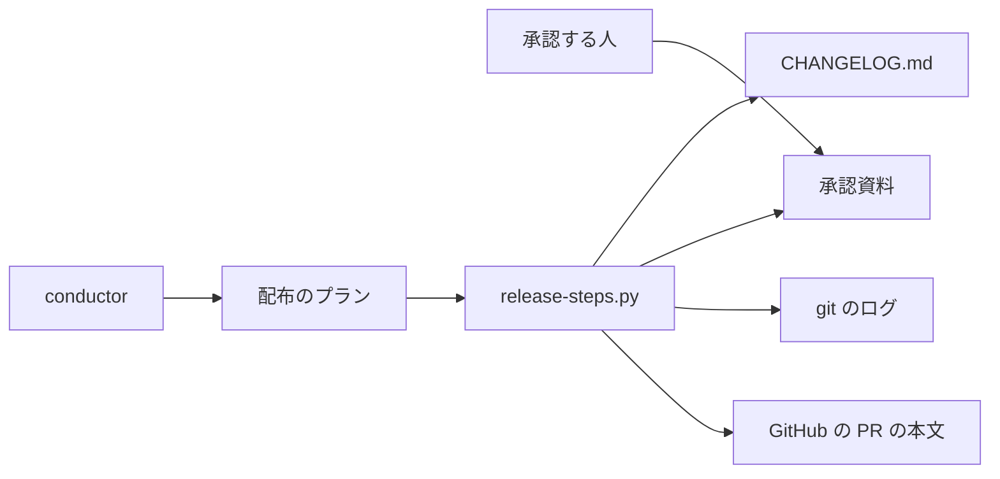
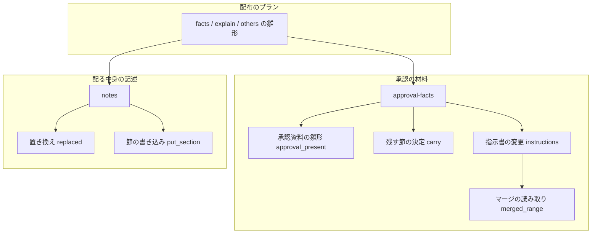
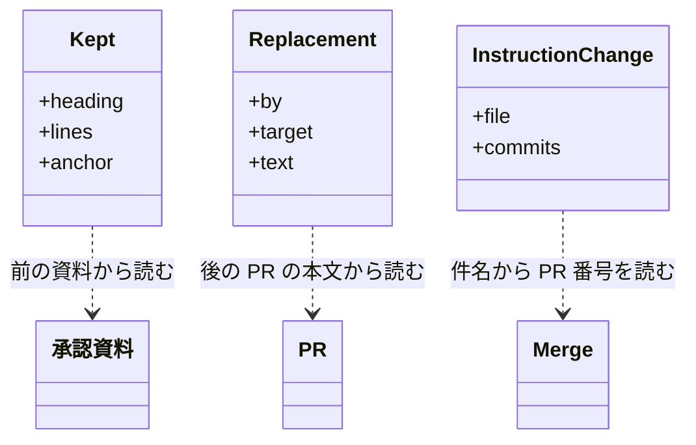
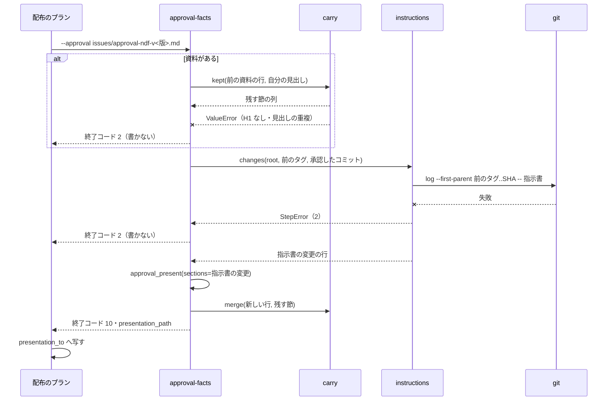
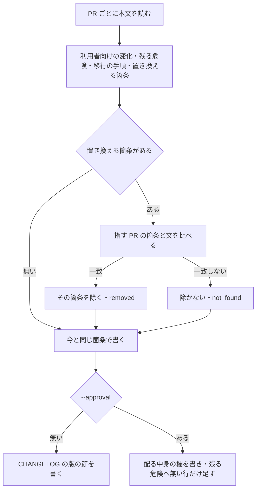

# release: 開発版を出し直すたびに承認資料の手で足した節が消え、後の PR が置き換えた古い箇条が CHANGELOG に戻る → 手で足した節と残る危険の中身が残り、指示書の変更の節が生成され、置き換えられた箇条が載らない（#1834）

## 目的

- **何が壊れているか**: 承認ゲート 2 で差し戻して同じ版の開発版を出し直すと、`approval-facts` が承認資料を丸ごと作り直し、手で足した節（未検証・残る危険の中身・指示書の変更）が消える。後の PR が前の PR の振る舞いを変えても、前の PR の箇条が CHANGELOG と承認資料の「配る中身」へ戻る
- **誰が困るか**: conductor は出し直しのたびに控えから節を書き戻し、マージ済みの PR の本文を手で直している。書き戻しを忘れると、承認する人が読む資料から残る危険と指示書の変更が抜ける
- **直すと何が成り立つか**: 何度出し直しても手で足した節と残る危険の中身が残る。指示書の変更は生成の側で集まる。置き換えられた古い箇条は、前の PR の本文に触れずに載らなくなる

## 適用範囲

- **働く範囲**: 配布先のリポジトリでも働く（`release-steps.py` の `approval-facts`・`notes` と、配布のプランの雛形）
- **プロジェクトごとに違うもの**: 指示書のファイルは `.ndf/instructions.json` の `files` で受ける（無ければ宣言の既定）。承認資料の置き場は今どおり配布のプランの `presentation_to` で受ける
- **当たるモード**: `standard`

## あるべき姿の根拠

| 根拠 | 種類 | 何を示すか |
| --- | --- | --- |
| ndf 10.17.66 の dev.2・dev.3 で、承認資料の手の節を `~/.local/state/ndf/sv/sprint-m1743/approval-ndf-v10.17.66.dev1.md`・`.dev2.md` から書き戻した（#1834 の本文） | 実測 | 作り直しで手の節が消えることが、2 回続けて起きた |
| PR #1825 の本文の「利用者向けの変化」に、#1827 が振る舞いを変えた後の箇条の手直し（「Draft かどうかは問わない〔#1827〕」）が残っている（`gh pr view 1825` で 2026-10-12 に確かめた） | 実測 | 置き換えの手段が無いため、マージ済みの本文を直すしかなかった |
| `git log --first-parent --format='%h%x09%s' ndf--v10.17.69..ndf--v10.17.70^2 -- AGENTS.md CLAUDE.md KIRO.md` が `0c00290e5 Merge pull request #1891 …` の 1 行を返した（2026-10-12 に実行） | 実測 | 指示書を変えた PR を、前のタグからの first-parent のログで拾える |
| 用語集の「指示書」（`ndf-instructions`）の意味は「既定の名前は AGENTS.md / CLAUDE.md / KIRO.md」 | 既存の形 | 宣言が無いときの指示書の既定は、`instructions_lib/declaration.py` の `DEFAULT_FILES` が 1 か所で持つ |

（要求と受け入れ条件は #1834 の本文にある。コピーは [issue-1834-requirements.md](issue-1834-requirements.md)。この文書は「どう作るか」だけを扱う）

## 例: 10.17.66 の出し直しを、変えた後の形で通すと

1. dev.1 のプランの `facts` が承認資料 `issues/approval-ndf-v10.17.66.md` を作る。`## 指示書の変更` の節は、前のタグから develop の先端までに `AGENTS.md`・`CLAUDE.md`・`KIRO.md` を変えたコミットを並べる（変わっていなければ「- 無し」）
2. conductor が `## 未検証・残る危険` に箇条を書き足し、`## 補足` の節を足す
3. 承認ゲート 2 で差し戻され、#1827 が develop へ入る。#1827 の本文は次の節を持つ（箇条の文は #1825 の元の箇条を写したものとして示す例）

   ```markdown
   ## 置き換える箇条

   - #1825: cross-refactoring の init は、対象の Pull Request が閉じている・マージ済み・Draft でない・状態を判定できない場合に処理を止める
   ```

4. dev.2 のプランの `facts` が `approval-facts --approval issues/approval-ndf-v10.17.66.md` で承認資料を作り直す。1・2・指示書の変更・同意・戻し方の節は作り直し、`## 未検証・残る危険`・`## 補足` は見出しも中身も前と同じ位置に残る
5. `explain`（`notes --approval`）が #1825 の箇条のうち 3 の文と一致する 1 つを除き、#1827 の箇条を並べる。`## 未検証・残る危険` には #1827 の本文の箇条のうち、まだ無いものだけを足す
6. `notes`（CHANGELOG）も同じ除き方で版の節を書く。#1825 の本文には触れない

## ドメインモデル

### コンテキスト

| コンテキスト | 何の語が 1 つの意味に決まるか |
| --- | --- |
| 配布（`ndf-release`） | 承認資料の節・手で足した節・置き換える箇条・承認したコミット |
| 指示書（`ndf-instructions`） | 指示書（`.ndf/instructions.json` の `files`、無ければ既定） |

配布が顧客、指示書が供給者の関係（顧客 / 供給者）。配布は指示書の宣言の読み込み（`Declaration.load`）を
そのまま使い、指示書の範囲を自分で決めない。

### 集約

**承認資料は 1 つのファイルだが、節ごとに書き手が決まっている。** 集約は節の組ごとに分け、持ち主を 1 つにする。

| 集約 | 持ち主（書き換えてよいもの） | 根 | エンティティ | 値オブジェクト |
| --- | --- | --- | --- | --- |
| 承認の材料 | `approval-facts` | 承認資料の H1 | `## 1. 対象を開くためのもの`・`## 2. 承認の判断に使うもの`・`## 指示書の変更`・`## 同意を求めること`・`## 戻し方` | 承認したコミット・含む PR・指示書の変更の行 |
| 配る中身の記述 | `notes --approval` | `## 2.` の「配る中身」と `検証への配布で確かめたこと` の欄 | `## 未検証・残る危険`・`## 移行の手順` | PR の箇条 |
| 他のプラグインの上げ幅 | `changed-plugins --approval` | `## 版を上げる他のプラグイン` | — | 上げ幅の行・同意の 1 行 |
| 手で足した節 | 人と conductor | 上の 3 つの持ち主が書く見出しに当たらない `## ` の節 | — | 見出しと中身 |
| CHANGELOG の版の節 | `notes`（`write_notes`） | `## [<plugin> <版>]` | — | PR の箇条 |

`changelog`（`_update_changelog`）は版の節の見出しを置き、仮の中身として PR のタイトルを並べるだけである。
節の中身は後の `notes` が `write_notes`（`replace_lines_under`）で丸ごと書き直すため、版の節の最終の箇条を
決める持ち主は `notes` の 1 つにする。置き換え（I7・F3）も `notes` だけに入れ、`changelog` のタイトルには効かせない。

**`approval-facts` は「承認の材料」だけを作り直し、ほかの集約の節は書き換えずに残す。** 残した節のうち、
`notes` と `changed-plugins` の節は同じプランの後のステップが自分の書き方で書き直す（今の振る舞い）。
「配る中身」の欄と同意の 1 行は「承認の材料」の節の中にあるため、作り直しで仮の値へ戻り、同じプランの
`explain`・`others` が書き直す（今の振る舞い）。

### 不変条件

| # | 集約 | 条件 | 破れたときの扱い |
| --- | --- | --- | --- |
| I1 | 承認の材料 | `approval-facts` は、前の承認資料のうち自分の書く見出しに当たらない `## ` の節を、見出しと中身を 1 字も変えずに作り直し後の資料へ残す | — （作り直しの結果で縛る） |
| I2 | 承認の材料 | 残した節は、前の資料で直前にあった `approval-facts` の節（無ければ H1）の後に、前の資料と同じ順で置く。その節が作り直し後に無ければ `## 同意を求めること` の前に置く | — |
| I3 | 承認の材料 | 前の承認資料が読めない・同じ `## ` の見出しが 2 つある・H1 が無いときは、承認資料を書かずに止める | 終了コード 2。`presentation_path` を出さず、`presentation_to` の先の資料は前のまま |
| I4 | 承認の材料 | `## 指示書の変更` の行は、前のタグから承認したコミットまでの first-parent のログで指示書に触れたコミットだけから作る | git のログが失敗したら書かずに止める（終了コード 2。空の節で上書きしない） |
| I5 | 承認の材料 | 指示書に触れたコミットが無い版では、`## 指示書の変更` の節は `- 無し` の 1 行 | — |
| I6 | 配る中身の記述 | `notes --approval` は `## 未検証・残る危険` の既にある行を消さず、PR の本文の箇条のうち節に無いものだけを足す。足す箇条が 1 つ以上あれば「PR の本文に記載が無い」の行だけを外す | — |
| I7 | CHANGELOG の版の節・配る中身の記述 | 置き換える箇条が指す PR の箇条のうち、文が一致するものだけを除く。一致しない置き換えでは何も除かない | 結果 JSON の items に `kind: replacement`・`result: not_found` で載せ、終了コードは 0 |
| I8 | CHANGELOG の版の節・配る中身の記述 | `notes` と `changelog` は PR の本文を読むだけで書かない（`gh pr edit` を呼ばない） | — |
| I9 | CHANGELOG の版の節・配る中身の記述 | 置き換える箇条を持つ PR が無い版では、CHANGELOG の版の節と承認資料の欄の中身が今と同じ | — |

### ドメインイベント

| # | イベント | 発生元 | 受け手 |
| --- | --- | --- | --- |
| E1 | 開発版の配布のプランが `approval-facts` を走らせた | 配布のプランの `facts` | `approval-facts` |
| E2 | 既にある承認資料から、残す節を読み取った | `approval-facts` | `approval-facts`（E4） |
| E3 | 前のタグから承認したコミットまでの指示書の変更を集めた | `approval-facts` | `approval-facts`（E4） |
| E4 | 承認の材料の節と残す節を合わせて承認資料を書いた | `approval-facts` | 監督の写し（`presentation_to`）→ `explain`・`others` |
| E5 | `notes` が PR の本文から箇条を集め、置き換えられた箇条を除いた | `notes` | `notes`（E6） |
| E6 | CHANGELOG の版の節と承認資料の「配る中身」を書いた | `notes` | 承認する人・`mvv-gate.py --material` |

### 用語

| 用語 | 意味 | 用語集への反映 |
| --- | --- | --- |
| 手で足した節 | 承認資料の `## ` の節のうち、配布のステップ（`approval-facts`・`notes --approval`・`changed-plugins --approval`）が書く見出しに当たらないもの。作り直しの後も見出しと中身が残る | 追加（`ndf-release`） |
| 置き換える箇条 | 後の PR の本文の `## 置き換える箇条` の節に書く行。同じ版に含む前の PR の「利用者向けの変化」の箇条を指し、その箇条を CHANGELOG と承認資料の「配る中身」から除く | 追加（`ndf-release`） |
| 承認資料 | （意味は変えない） | — |
| 指示書 | （意味は変えない。宣言の `files`、無ければ既定の AGENTS.md / CLAUDE.md / KIRO.md） | — |

## 機能一覧

| # | 機能 | 誰が使うか |
| --- | --- | --- |
| F1 | 開発版を出し直しても、承認資料の手で足した節と残る危険の中身が残る | 承認する人・conductor |
| F2 | 指示書を変えた版で、承認資料に指示書の変更（ファイル・コミット・差分を見るコマンド）が並ぶ | 承認する人 |
| F3 | 後の PR の本文で、前の PR の箇条を CHANGELOG と配る中身から外す | PR の書き手・利用者（CHANGELOG を読む人） |
| F4 | 見つからない置き換えを結果 JSON で知らせる | conductor |

## 構成要素

| 要素 | 変更 | 責務 |
| --- | --- | --- |
| `plugins/ndf/scripts/lib/step_result.py` の `approval_present` | 変更 | 節の見出しを定数（`PRESENT_HEADINGS`）にし、`## 同意を求めること` の前へ足す節（`sections=[(見出し, 行)]`）を受ける。ほかの呼び手は渡さず、出力は今と同じ |
| `plugins/ndf/scripts/release_lib/carry.py` | 新規 | 承認資料の作り直しで残す節を決める純粋な処理。`kept(old_lines, own)` が残す節と錨（直前の自分の節）を返し、`merge(new_lines, kept)` が作り直し後の行へ差し込む。資料の形が壊れていれば `ValueError` |
| `plugins/ndf/scripts/release_lib/instructions.py` | 新規 | 指示書の変更の行を作る。`Declaration.load` で指示書を決め、ファイルごとに first-parent のログを読み、節の行（ファイル・短い SHA と PR 番号・`git diff` のコマンド）を返す。git が失敗すれば `StepError`（2） |
| `plugins/ndf/scripts/lib/merged_range.py` | 変更 | 件名から PR 番号を読む部分を `pr_number(parents, subject)` に切り出し、`merges_in` と `instructions.py` が使う。`merges_in` の結果は変わらない |
| `plugins/ndf/scripts/release_lib/replaced.py` | 新規 | PR の本文の `## 置き換える箇条` を読み（`parse(body, n)`）、PR ごとの箇条から一致するものを除く（`apply(notes, replacements)`）。見つからない置き換えを返す |
| `plugins/ndf/scripts/release-steps.py` の `cmd_approval_facts` | 変更 | `--approval <承認資料>` を受ける。資料があれば `carry.kept` で残す節を読み、`approval_present` の出力へ `carry.merge` で差し込む。`## 指示書の変更` を `instructions.py` から書く |
| `plugins/ndf/scripts/release-steps.py` の `pr_notes`・`cmd_notes`・`write_approval` | 変更 | `pr_notes` が本文の `## 置き換える箇条` も読み、`cmd_notes` が `replaced.apply` の後の箇条で CHANGELOG と欄を書く。`write_approval` の `## 未検証・残る危険` は I6 の足し方にする |
| `plugins/ndf/scripts/release_lib/others.py` の `put_section` | 変更 | 既にある節へ、無い行だけを足す書き方（`merge_lines`）を持つ。今の `replace=True/False` の振る舞いは変えない |
| `plugins/ndf/scripts/supervise_lib/release_templates.py` の `_dev_approval_steps` | 変更 | `facts` のステップの `approval-facts` へ `--approval {approval}`（`presentation_to` と同じパス）を渡す |
| `plugins/ndf/skills/release/references/release-steps.md` | 変更 | `approval-facts --approval` の残し方・`## 指示書の変更`・`notes` の置き換えと残る危険の足し方・`## 置き換える箇条` の書き方を書く |
| `plugins/ndf/skills/pr/SKILL.md` | 変更 | PR の本文の節の案内に、`## 置き換える箇条`（任意）を 1 行足し、書き方は `release-steps.md` を指す |
| `docs/glossary/glossary.json`・`docs/glossary.md` | 変更 | 「手で足した節」「置き換える箇条」を足し、`glossary.py render` で作り直す |

### 文脈



GitHub の PR の本文と git のログは読むだけで、書かない（I8）。

### 構成要素の関係



### 置き場所

```text
plugins/ndf/scripts/
├── release-steps.py              # 変更
├── lib/
│   ├── step_result.py            # 変更
│   └── merged_range.py           # 変更
├── release_lib/
│   ├── carry.py                  # 新規
│   ├── instructions.py           # 新規
│   ├── replaced.py               # 新規
│   └── others.py                 # 変更
├── supervise_lib/
│   └── release_templates.py      # 変更
└── tests/
    ├── test_release_steps.py     # 変更
    ├── test_release_carry.py     # 新規
    └── test_release_replaced.py  # 新規
```

## 構造



| 型 | 属性 | 責務 |
| --- | --- | --- |
| `Kept`（`carry.py`） | `heading`: `## ` の行・`lines`: 見出しの次から次の `## ` の前までの行・`anchor`: 前の資料で直前にあった自分の節の見出し（無ければ `None`。H1 の直後を指す） | 残す節 1 つ |
| `Replacement`（`replaced.py`） | `by`: 置き換えを書いた PR の番号・`target`: 指す PR の番号・`text`: 箇条の文（比べる形に整えたもの） | 置き換える箇条 1 行 |
| `InstructionChange`（`instructions.py`） | `file`: 指示書のパス・`commits`: `[(短い SHA, PR 番号 または None)]`（ログの順） | 変わった指示書 1 つ |

`Merge`（`merged_range.py`）は既存の型で、中身を変えない。

## 入出力の契約

### `release-steps.py approval-facts`

| 項目 | 書くこと |
| --- | --- |
| 名前 | `release-steps.py approval-facts --version <版> --prs <PR番号>... [--prev-tag <タグ>] [--plugin <名前>] [--approval <承認資料>] [--root <dir>]` |
| 入力 | `--approval`（任意）: 前の承認資料のパス（相対はリポジトリの根から）。無い・ファイルが無いときは今と同じく新しく作る |
| 出力（成功） | 今と同じ終了コード 10（`gate`）・`presentation_path`。承認資料に `## 指示書の変更` の節が加わる。`metrics` に `kept`（残した節の見出しの列）と `instructions`（変わった指示書の数）を足す。items は今と同じ PR の行だけ |
| 失敗の形 | 前の承認資料が読めない・H1 が無い・同じ `## ` の見出しが 2 つある: 終了コード 2、承認資料を書かない（I3）。指示書の宣言が壊れている（`CheckError`）・git のログが失敗: 終了コード 2、書かない（I4） |
| 互換性 | `--approval` を渡さない呼び手（手で打つ・ほかの雛形）は、`## 指示書の変更` が加わるだけで今と同じ |

**`## 指示書の変更` の節の形**（`## 2. 承認の判断に使うもの` の後、`## 同意を求めること` の前）:

```markdown
## 指示書の変更

- `CLAUDE.md`: 0c00290e5（#1891）
  - 差分: `git diff ndf--v10.17.69 3f2a…（承認したコミット 40 桁） -- CLAUDE.md`
```

- 指示書ごとに 1 箇条。コミットは first-parent のログの順に `短い SHA（#PR）` を読点で並べる。PR 番号が読めないコミットは `短い SHA` だけ
- 変わった指示書が無ければ `- 無し`（I5）
- 指示書は `Declaration.load(root).files`。宣言が無ければ `DEFAULT_FILES`（`AGENTS.md`・`CLAUDE.md`・`KIRO.md`）。範囲で触れていないファイルは並べない

**承認資料の節の持ち主**（`approval-facts` が作り直す見出しは `PRESENT_HEADINGS` と `## 指示書の変更`）:

| 見出し | 書き手 | 作り直しで |
| --- | --- | --- |
| H1・`## 1. 対象を開くためのもの`・`## 2. 承認の判断に使うもの`・`## 指示書の変更`・`## 同意を求めること`・`## 戻し方` | `approval-facts` | 作り直す |
| `## 未検証・残る危険`・`## 移行の手順` | `notes --approval` | 残す（後の `explain` が I6 と今の置き換えで書く） |
| `## 版を上げる他のプラグイン` | `changed-plugins --approval` | 残す（後の `others` が書き直す） |
| それ以外の `## ` の節 | 人・conductor | 残す（I1・I2） |

### `release-steps.py notes`

| 項目 | 書くこと |
| --- | --- |
| 入力 | 今と同じ。PR の本文の `## 置き換える箇条` の節を新しく読む |
| 出力（成功） | 終了コード 0。置き換えで除いた箇条は CHANGELOG の版の節にも「配る中身」の欄にも載らない。items に置き換えごとの行を足す: `{"kind": "replacement", "name": "#<by>→#<target>", "result": "removed" \| "not_found", "text": <文>}`。`metrics.replaced`（除いた箇条の数）を足す |
| 失敗の形 | 今と同じ。`## 置き換える箇条` の行が形に合わないときは止めず、`result: unreadable` で items に載せる |
| 互換性 | 節を書かない PR だけの版では、出力のファイルの中身が今と同じ（I9）。items と metrics は足すだけ |

**PR の本文の `## 置き換える箇条` の形**:

```markdown
## 置き換える箇条

- #1825: cross-refactoring の init は、対象の Pull Request が閉じている・マージ済み・Draft でない・状態を判定できない場合に処理を止める
```

- 1 行に 1 つ。`- #<前の PR の番号>: <前の PR の「利用者向けの変化」の箇条の 1 行目>`
- 比べるときは、両側の末尾の `（#N…）` / `(#N…)` の括弧を外し、空白の続きを 1 つにする。前の PR の箇条が `（#1821）` のように別の PR を指す括弧で終わっていても一致する
- 指す PR は同じ版の PR（`notes` へ渡す PR）に限る。版の外の PR を指す行は `not_found`
- 一致した箇条だけを除く。同じ文の箇条が 2 つあれば両方を除く
- 前の PR の「未検証・残る危険」と「移行の手順」は除かない

## 処理の流れ

図に現れない構成要素は、文書と用語集（`release-steps.md`・`pr/SKILL.md`・`docs/glossary/`）の 3 つである。
`merged_range` は `instructions` が件名から PR 番号を読むときに呼ぶ（`pr_number`）。

### 出し直しの `facts`



### `notes`（CHANGELOG と承認資料の欄で同じ）



## 非機能の実現方式

| 大項目 | 要求の条件 | 実現方式 | 確かめ方 |
| --- | --- | --- | --- |
| 運用・保守性 | 承認資料を書き直す前に、手で足した節を読めないときは書き換えずに止める（手の節を黙って失わない） | `carry.kept` を `approval_present` より先に呼び、`ValueError` なら一時ファイルも書かずに終了コード 2 で止める。`presentation_path` を出さないため、監督は写さない | 見出しを重複させた資料で走らせ、終了コード 2 と資料のバイトが変わらないことを見る |
| 移行性 | 既にある承認資料（置き換えの節・指示書の変更の節を持たないもの）を、そのまま作り直しに渡せる | `## 指示書の変更` が無い資料では錨の候補が減るだけで、残す節は `## 2.` の後へ置く。PR の本文の置き換えの節は任意 | 10.17.71 の承認資料の形の資料を渡し、終了コード 10 と残した節を見る |

## 決定の記録

### 決定 1: 手の節を黙って失わないため、`approval-facts` が前の承認資料を読んで自分の節だけを作り直す

`approval-facts` に `--approval` を足し、前の資料のうち自分が書く見出しに当たらない節をすべて残す。手で足した節だけでなく、
`notes` と `changed-plugins` の節も残す。残る危険の中身（前提 2）が作り直しを越えるには、その節を「作り直す側」から
外す必要があるためである。後のステップの節は同じプランで書き直されるので、残しても古い中身は残らない。

監督の写し（`copy_presentation`）で合わせる案は採らない。写しはどのステップの承認ゲートにも使う汎用の処理で、承認資料の
節の持ち主を知らない。`approval-facts` が承認資料へ直接書く案も採らない。写し先と一時の出力が同じファイルになり、
`shutil.copyfile` が同じファイルの写しで失敗する。

根拠: Value 4 / Value 6（MVV 版 2）

### 決定 2: 残した節の置き場所を作り直しで動かさないため、錨を「直前にあった `approval-facts` の節」にする

残す節ごとに、前の資料で直前にあった自分の節の見出しを錨として持ち、作り直し後はその節の後へ、前と同じ順で置く。
錨が作り直し後に無ければ `## 同意を求めること` の前に置く（受け入れ条件 2）。`## 指示書の変更` は `## 2.` と
`## 同意を求めること` の間に生成するため、1 回目と 2 回目で残す節の並びが変わらない。

錨を直前の任意の節（手の節を含む）にする案は採らない。手の節が消されると錨が無くなり、後ろの手の節が連鎖して
同意の前へ動く。

根拠: Value 2（MVV 版 2）

### 決定 3: 残る危険の中身を残しつつ新しい PR の危険も載せるため、`notes` は既にある節へ無い行だけを足す

今は節があれば書かない（`replace=False`）。作り直しで節が残るようになると、出し直しで加わった PR の危険が載らなくなる。
既にある行を消さず、PR の箇条のうち節に無いものだけを足す。足す箇条があれば「PR の本文に記載が無い」の行だけを外す。

節を作り直す案は採らない。手で足した危険が消え、この課題の現象が残る危険の節で起き続ける。何を集めるか
（レビュー・リファクタリング・設計の未確認）は #1488 が持ち、ここでは足し方だけを決める。

根拠: Value 1（人を害する・残る危険に関わる指摘は直す）/ Value 2（MVV 版 2）

### 決定 4: 前の PR の本文に触れずに古い箇条を外すため、後の PR の本文に `## 置き換える箇条` を書き、箇条の文で指す

`- #<前の PR>: <前の PR の箇条の 1 行目>` の形にする。文で指すと、書き手が CHANGELOG の案を見て写せ、読む人も
何が外れるかを本文だけで読める。末尾の `（#N）` を外して比べるため、スプリント PR が実装の PR の番号を付けた
箇条でもそのまま写せる。

PR 番号だけで指す案は採らない。スプリント PR は箇条を 10 以上持ち、1 つだけを外せない。番号と順番で指す案も
採らない。本文の箇条の並びを数えて書く必要があり、写し間違いを本文から見つけられない。

根拠: Value 1 / Value 4（MVV 版 2）

### 決定 5: 置き換えの書き間違いで配る中身を壊さないため、見つからない置き換えは除かずに知らせる

一致しない置き換えは何も除かず、終了コード 0 のまま items に `not_found` で載せる。前方一致や近い文で除く案は
採らない。意図しない箇条を黙って外すと、利用者が読む CHANGELOG から変化が抜け、承認する人も気づけない。

根拠: Value 1（MVV 版 2）

### 決定 6: 指示書の既定を 1 か所に保つため、宣言が無いときも `Declaration.load` の既定（`AGENTS.md`・`CLAUDE.md`・`KIRO.md`）を使う

受け入れ条件 8 は宣言が無いときに `AGENTS.md` と `CLAUDE.md` だけとするが、指示書の既定は `instructions_lib/declaration.py`
の `DEFAULT_FILES` が持ち、用語集の「指示書」も同じ 3 つを既定とする。配布のために別の既定を置くと、同じ役割の定数が
2 つになり、`instructions-check.py` が見る指示書と承認資料に載る指示書が食い違う。宣言が無く `KIRO.md` も無い
リポジトリでは、受け入れ条件 8 と同じ結果になる。

**受け入れ条件 8 の文を「宣言の既定（`AGENTS.md`・`CLAUDE.md`・`KIRO.md`）」へ直すかは、承認ゲート 1 で決める**
（「未確認のまま残ること」）。

根拠: Value 5 / Value 6（MVV 版 2）

### 決定 7: 指示書の変更を承認するコミットの範囲で数えるため、first-parent のログと既存の件名の読み方を使う

`git log --first-parent <前のタグ>..<承認したコミット> -- <指示書>` を指示書ごとに打ち、件名から PR 番号を
`merged_range` と同じ規則（merge commit の `Merge pull request #N`・squash の末尾 `(#N)`）で読む。読み方は
`pr_number` に切り出して共有する。`gh` で PR ごとの変更ファイルを読む案は採らない。PR の数だけ呼び出しが増え、
版上げの PR のように範囲の外で数えるものとの区別が要る。

根拠: Value 3 / Value 6（MVV 版 2）

## テスト設計

| 受け入れ条件・不変条件 | どの振る舞いで縛るか | どう壊したら落ちるべきか |
| --- | --- | --- |
| 受け入れ条件 1・I1 | `## 補足` を足した承認資料で `approval-facts --approval` を 2 回続けて打つと、2 回目の後に `## 補足` の見出しと中身がバイト単位で残る | 残す節を読まずに作り直す・中身の末尾の空行を詰める |
| 受け入れ条件 1・I1（残る危険） | 手で書いた `## 未検証・残る危険` の行が、作り直しの後も残る | 残る危険を `approval-facts` の節として扱う |
| 受け入れ条件 2・I2 | `## 2.` の後の手の節は `## 2.` の後に、`## 戻し方` の後の手の節は `## 戻し方` の後に戻る。錨の見出しを消した資料では同意の前に置かれる | 残す節を常に末尾か同意の前に置く・錨を手の節にする |
| 受け入れ条件 3 | 資料が無い状態で打つと、1・2・指示書の変更・同意・戻し方の順の節だけを持つ資料ができる | 資料が無いときに止める・節の順を変える |
| I3 | H1 の無い資料・同じ見出しが 2 つある資料では終了コード 2 で、`presentation_path` を出さず、渡した資料のバイトが変わらない | 壊れた資料で手の節を捨てて書く |
| 受け入れ条件 6・I4 | 範囲で `CLAUDE.md` に触れたマージがある git の履歴で、節にファイル・`短い SHA（#N）`・`git diff <前のタグ> <SHA> -- CLAUDE.md` が並ぶ。squash の件名でも PR 番号が出る | first-parent を外して実装の PR の中のコミットまで並べる・範囲の起点を前の正式版の main 側にする |
| I4（失敗） | git のログが失敗すると終了コード 2 で、資料を書かない | 失敗を空の節として書く |
| 受け入れ条件 7・I5 | 指示書に触れていない範囲では `- 無し` の 1 行 | 節ごと省く |
| 受け入れ条件 8 | 宣言が無いリポジトリで `AGENTS.md`・`CLAUDE.md` の変更が並ぶ。宣言の `files` に無いファイルの変更は並ばない | 宣言を読まず固定の名前で探す・宣言の `files` を無視する |
| 受け入れ条件 4・I7 | 後の PR が `## 置き換える箇条` で前の PR の箇条を指す版で、CHANGELOG の版の節と配る中身の欄に前の箇条が無く、後の PR の箇条がある。前の箇条の末尾が別の PR の `（#N）` でも外れる | 末尾の括弧を外さずに比べる・CHANGELOG と欄の片方だけで除く |
| 受け入れ条件 5・I8 | `notes`・`changelog` の実行で `gh pr edit` が 1 回も呼ばれない | 置き換えを前の PR の本文へ書き戻す |
| 受け入れ条件 9・I7 | 一致しない置き換えでは何も除かれず、items に `result: not_found` の行が 1 つ載り、終了コードは 0 | 前方一致で除く・見つからないときに止める |
| 受け入れ条件 10・I9 | 置き換えの節を持たない PR だけの版で、CHANGELOG の版の節と承認資料の欄が今の実装の出力と一致する | 箇条の整え方（末尾の括弧の除去）を出力の側に掛ける |
| I6 | 既にある残る危険の節に、出し直しで加わった PR の危険だけが足される。足す箇条があれば「PR の本文に記載が無い」の行が外れ、無ければ節は変わらない | 節を作り直す・同じ箇条を 2 回足す |

## 設計の結果

| 課題 | 扱い | 取り込み先 | 触るファイル |
| --- | --- | --- | --- |
| #1834 | 実装する | — | `plugins/ndf/scripts/release-steps.py`、`plugins/ndf/scripts/release_lib/`、`plugins/ndf/scripts/lib/step_result.py`、`plugins/ndf/scripts/lib/merged_range.py`、`plugins/ndf/scripts/supervise_lib/release_templates.py`、`plugins/ndf/scripts/tests/`、`plugins/ndf/skills/release/references/release-steps.md`、`plugins/ndf/skills/pr/SKILL.md`、`docs/glossary/glossary.json`、`docs/glossary.md` |

## 未確認のまま残ること

| 項目 | 内容 |
| --- | --- |
| 受け入れ条件 8 の文 | 決定 6 で宣言の既定（`KIRO.md` を含む）を使う。条件の文を直すかを承認ゲート 1 で決める。直さないなら、宣言が無いときだけ `AGENTS.md`・`CLAUDE.md` に絞る分岐を `instructions.py` に置く |
| スプリントの中の置き換え | スプリント PR の「利用者向けの変化」は `pr_materials.collect` が実装の PR から集める。同じスプリントの実装の PR どうしの置き換えは、スプリント PR の本文へ写らないため `notes` から見えない。スプリント PR の本文で直接書く運用で足りるかは、次のスプリントで使って確かめる |
| 実機での出し直し | 受け入れ条件 1・6 の実機の確認は、次の開発版の出し直しでリリース後テストが行う |
