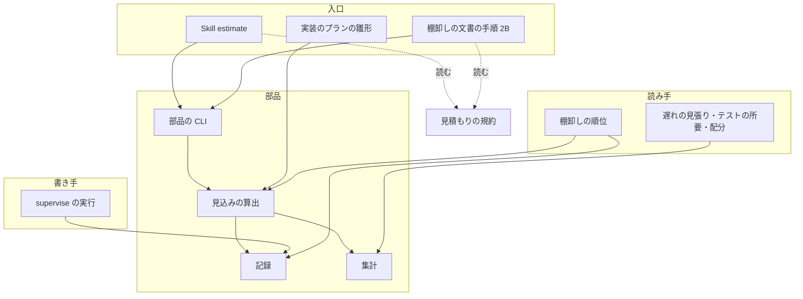
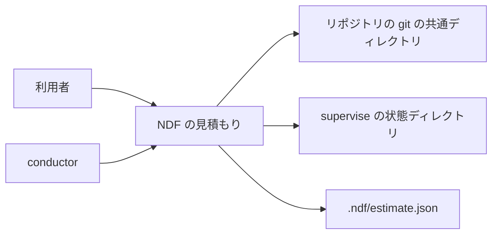
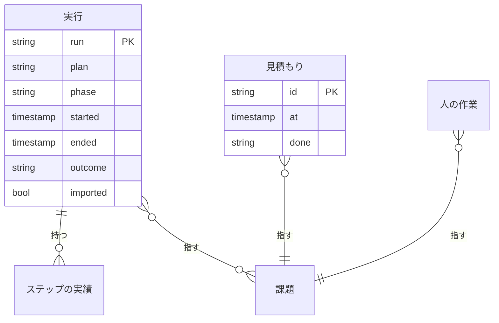
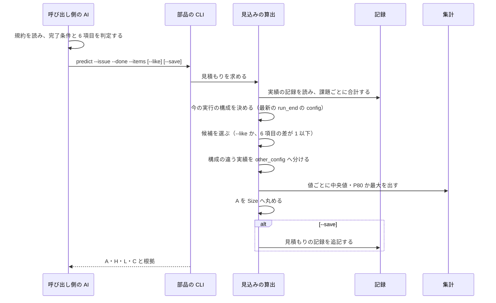
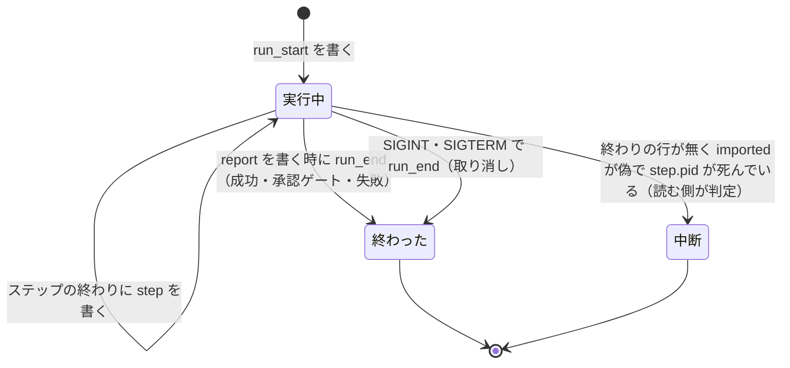
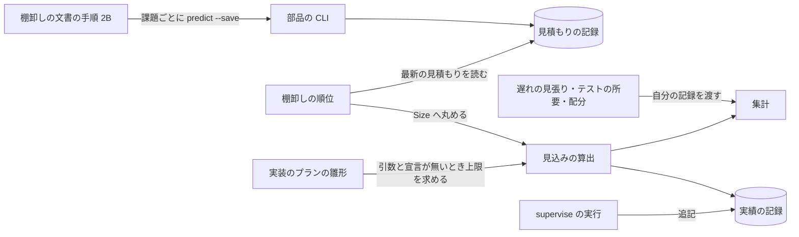

# 工数の見積もり: Skill ごとに別の材料・単位で見積もり、頼むと AI のいない時代の人の工数が返る → 1 つの部品が実績から A・H・L・C を分けて根拠付きで返し、どのリポジトリでも Skill として呼べる（#1856）

## 目的

- **何が壊れているか**: 棚卸しの Size・実装のステップの上限・テストの上限・cross-refactoring の配分は、同じ「AI が実施するとどれだけ掛かるか」を見積もる。それぞれが別々の材料と単位を使い、互いの実績を見ていない。実装の上限は実績を見ず 3600 秒の固定で、引継ぎ文書で毎回 5400 秒以上へ手で補っている。見積もりを AI に頼むと、AI エージェントのいない時代の人の工数で返る
- **誰が困るか**: 優先順位とスプリントの容量を決める利用者と conductor。ai-plugins 以外のプロジェクトで見積もりを使いたい利用者
- **直すと何が成り立つか**: 1 つの規約と 1 つの部品が、近い条件の実績から A（AI の実行量）・H（人の作業時間）・L（完了までの時間）・C（利用費用）を分けて根拠付きで返す。Size と実装の上限がその値から決まり、実績が無いときは「未校正」と分かる

## 適用範囲

- **働く範囲**: 配布先のどのリポジトリでも働く。記録の置き場はリポジトリごと（git の共通ディレクトリの下）で、NDF の記録が 1 件も無いリポジトリでも、すべての値に「未校正」か「材料なし」が付いた見込みを返す
- **プロジェクトごとに違うもの**: 窓の件数・判定に要る最少件数・Size 1 の基準・記録の置き場は `.ndf/estimate.json`（任意。無ければ既定）で受ける。見積もる対象（課題番号か作業の説明）と着手前の 6 項目は引数で受ける
- **当たるモード**: 部品と Skill はモードを問わない。実装の上限は `supervise.py new` の実装のプラン（`impl` とスプリント）に当たる

## あるべき姿の根拠

| 根拠 | 種類 | 何を示すか |
| --- | --- | --- |
| #1856 の利用者の原文「AIエージェントをもってしても『時間のかかる仕事』と『簡単にできる仕事』には明確な差があり…工数算出は今も変わらず重要」「ほかのプロジェクトで使う」 | 利用者の指示の原文 | AI が実施する前提の見積もりを、ほかのプロジェクトからも呼べる形で持つ |
| スプリント m1847 の実装プランで、実装のステップは既定の 3600 秒のまま、引継ぎ文書が `timeout: 5400` 以上を手で補った（要求の「具体例」） | 実測 | 固定値の上限が実績と合わず、同じ手当てが繰り返されている |
| 窓の大きさ 10 が `lib/slow_step.py:31`・`project_lib/measure_ci.py:27`・`refactor_lib/allocation.py:35` の 3 か所で別々に定義されている | 実測（コードの検索） | 集計が Skill ごとに分かれている |
| 使用量の帳簿は失敗・打ち切りを `status` 付きで残すが、`step-history.jsonl` は成功と承認ゲートで止まった実行だけ、配分の履歴は最終ゲートを通った実行だけを積む | 実測（コードと記録の実物） | 失敗・中断を除いた実績は、完了に要る費用を少なく見せる |

要求と受け入れ条件は #1856 の本文にある（コピーは `issues/issue-1856-requirements.md`）。この文書は「どう作るか」だけを扱う。決定の記録は [issue-1856-design-decisions.md](issue-1856-design-decisions.md) に分けた。

## 研究の一次資料の確認

**5 件とも一次資料（論文の本文・要旨か、著者の機関のページ）を開き、助言が示した数値はすべて一致した。** 確かめたのは 2026-10-15 で、WebFetch・WebSearch を使った。SSRN の要旨のページは 403 で開けなかったため、同じ論文の著者の機関のページ（Microsoft Research）で数値を照合した。HIE は Springer の本文を開き、書誌は Crossref でも確かめた。

| 研究 | 一次資料の出典 | 確かめた数値 | 採る知見 | 採らない知見と理由 |
| --- | --- | --- | --- | --- |
| HIE（Hybrid Intelligence Effort。Alaswad ほか「Hybrid intelligence effort for software effort estimation in LLM assisted development」Discover Computing 29 巻 424、2026-07-06） | https://link.springer.com/article/10.1007/s10791-026-10331-6 （本文を開けた） | 一致: 開発者 22 人・タスク 110 件（25 の OSS）・LLM 3 種（GPT-4o・Gemini 2.5 Flash・DeepSeek-R1）・330 回の実行。Story Points だけの R² 0.724 → 混成の変数を足した調整済み R² 約 0.80。1 Story Point ≒ 23 分。作業時間を最もよく説明するのは「検証で見つかった問題」と「手での修正」。LLM 3 種の差は有意でない | 人の作業時間を左右するのは検証と手直しである。H を A と分けて持つこと（I1）と、着手前の 6 項目に「検証のしやすさ」「手戻りの見込み」を置くことの裏付けにする | 係数・R²・「1 Story Point ≒ 23 分」の換算。説明に効いた指標（検証で見つかった問題・手での修正・プロンプトの回数）は実行の後にしか観測できず、着手前に予測できるかは検証されていない。人日・Story Points からの換算は I6 で採らない |
| ACEM（Agentic Cost Estimation Model。El-Ramly、arXiv 2608.02582、2026-08-03） | https://arxiv.org/abs/2608.02582 （要旨を開けた） | 一致: 費用を LLM・人の監督（HITL）・インフラの 3 つの足し算に分ける。Revision Factor（出力の差し戻しと再試行の上乗せ）・Context Factor（文脈の増大）・HITL Intensity Score（監督の 4 段階）。定数は記号のままで、実データでの校正を呼びかける初期の提案 | 差し戻しと再試行は費用そのものである。失敗・中断・再試行の実行を実績から除かない（I3）ことの裏付けにする。人の監督の費用を AI の実行の費用と分ける考え方は H と A・C を分ける形と同じ | 係数（論文に数値が無い）と、Use Case Points・Story Points・Function Points からトークン量への写像。実証が無く、人の工数の単位から換算しない規約（I6）に反する |
| METR の生産性実験（Becker ほか、arXiv 2507.09089、2025-07） | https://arxiv.org/abs/2507.09089 （要旨を開けた） | 一致: 経験のある OSS 開発者 16 人・246 タスク。AI を使うと完了時間が 19% 長くなった。着手前の本人の予想は 24% 短縮、終えた後の本人の見立ては 20% 短縮、経済学の専門家は 39%・ML の専門家は 38% の短縮を予想した | 人の予想（本人・専門家とも）は、効果の向きまで外れうる。見積もりを判断でなく類似の実績から出し、予測と実績の誤差を集計する（F7）ことの裏付けにする | 19% という効果量。2025 年前半の道具と、熟練者が慣れたリポジトリという条件の平均で、今の実行の構成に一律には当てられない |
| METR の 2026 年の更新 | https://metr.org/blog/2026-02-24-uplift-update/ （2026-02-24、開けた） | 2025-08 からの新しい実験の推定は、元の参加者 -18%（95% 信頼区間 -38%〜+9%）・新しい参加者 -4%（-15%〜+9%）。METR 自身が、AI 無しで働くのを嫌う開発者の不参加などの選択の偏りで信頼できないとし、複数のエージェントを同時に動かす開発者の作業時間の計測も信頼できないとする | 人が複数のエージェントを並べて動かすと、人の作業時間を経過時間から測れない。H を経過時間（L）から導かず、`estimate.py human` で別に記録することの裏付けにする | 推定値そのもの。METR が信頼できないとしており、信頼区間が 0 をまたぐ |
| METR の time horizon | https://metr.org/time-horizons/ （開けた） | 定義は「AI エージェントが所定の確率（50% など）で成功すると予測される、人の専門家の所要時間で測ったタスクの長さ」。FAQ は「タスクの難しさの尺度で、AI が完了に掛ける時間ではない」とし、成功したタスクでは AI は人より数倍速いことが多いと書く。16 時間を超える測定は信頼できない（2026-05-08）。2026-09-08 に更新の停止を明記 | time horizon は A でも L でもない。見積もりの値に使わない | 時間の地平の値と倍増の傾向。人の所要時間で測った能力の指標で、AI の実行量の見込みにはならない |
| Microsoft などの企業の実験（Cui・Demirer・Jaffe・Musolff・Peng・Salz「The Effects of Generative AI on High-Skilled Work: Evidence from Three Field Experiments with Software Developers」） | https://www.microsoft.com/en-us/research/?p=1148213 （開けた）。SSRN 4945566（https://papers.ssrn.com/sol3/papers.cfm?abstract_id=4945566 ）は 403 で開けなかった。検索の結果では Management Science（DOI 10.1287/mnsc.2025.00535）に載っている | 一致: Microsoft・Accenture・匿名の Fortune 100 企業の 3 つの無作為化実験、4,867 人の集計で完了タスク数が 26.08% 増えた（標準誤差 10.3%）。経験の浅い開発者ほど採用率と効果が大きい | 効果は人と条件で大きく違う（個々の実験はばらつきが大きいと著者自身が書く）。平均の効果量を一律に当てず、同じ構成の実績だけを比べる（I5）ことの裏付けにする | 26.08% という効果量。対象はコードの補完を提案する道具で、自律エージェントが作業を進める所要とは対象が違う |
| E3（Estimate, Execute, Expand。Yin・Feng「Do AI Agents Know When a Task Is Simple? Toward Complexity-Aware Reasoning and Execution」arXiv 2607.13034、2026-07-14） | https://arxiv.org/abs/2607.13034 （要旨を開けた。助言は出典を示しておらず、検索語「"Estimate, Execute, Expand" E3 LLM agent software effort arXiv 2026」で見つけた） | 一致: 121 件のコード編集のベンチマーク（MSE-Bench）で、最も強い比較対象と同じ成功率 100% のまま、文脈を最大に読む方針より費用 85%・トークン 91%・読んだファイル 92% を減らした。主な結果は能力を制御したシミュレーターのもので、実際の GPT-4o のエージェントでの確認は「効果は穏やかだが実在する」 | 同じ作業でも、エージェントの進め方（どこまで読むか）で A と C が大きく変わる。実行の構成が違う実績を比べず別の欄に出す（I5・E9）ことの裏付けにする | 85%・91% などの削減率。主にシミュレーターの結果で、実際のエージェントでは効果が小さい |

**設計は研究の数値に依存しない。** 規約が採るのは上の「採る知見」の定性の結論だけで、どれも要求が既に決めた形（4 つの値を分ける・類似の実績から見積もる・失敗と再試行を含める・構成で分ける・実績が無ければ未校正）を支える。研究の数値は 1 つも式・既定値・規約へ写さない（I6、決定 13）。

## ドメインモデル

### コンテキスト

| コンテキスト | 何の語が 1 つの意味に決まるか |
| --- | --- |
| 工数の見積もり（`ndf-estimate`） | A・H・L・C、実行の構成、類似の実績、未校正、見積もりの記録、実績の記録、着手前の 6 項目、尺度を超える |
| 課題の棚卸し（`ndf-issue-upkeep`） | Size（見積の段階）・容量・切り出しの境界 |
| 開発ワークフロー（`ndf-workflow`） | supervise のプラン・ステップ・実装の上限 |

関係は**公開された言語**とする。見積もりのコンテキストが結果 JSON（`step_result` の形）と記録の行の形を文書化し、棚卸しと supervise はその形だけを読む。受け手が 3 つ以上（Skill・`rank`・`supervise.py new`、後で cross-refactoring）あり、形を先に固めて互いに独立して変えるためである。

### 集約

| 集約 | 持ち主（書き換えてよいもの） | 根 | エンティティ | 値オブジェクト |
| --- | --- | --- | --- | --- |
| 実績の記録 | 実績の記録の書き手（`lib/estimate_records.py` の `append_actual`。呼ぶのは supervise の実行と `estimate.py human`・`import`） | 実行（`run`） | ステップの実績 | 終わり方・実行の構成・秒・USD |
| 見積もりの記録 | 見込みの算出（`lib/estimate_predict.py`。呼ぶのは `estimate.py predict --save`） | 見積もり（`estimate`） | — | 着手前の 6 項目・完了条件・見込み（値ごと）・根拠 |

どちらも**追記だけ**で、既存の行を書き換えない。実績の記録は見積もりの記録を参照せず、突き合わせは集計の時点で課題番号と時刻で行う。

### 不変条件

| # | 集約 | 条件 | 破れたときの扱い |
| --- | --- | --- | --- |
| I1 | 見積もりの記録 | A・H・L・C は別の欄に置き、足した値の欄を持たない | 書き手が足した値の欄を作れない形にする（行の形の検査で落とす） |
| I2 | 見積もりの記録 | どの値にも、印（`実績` / `未校正` / `材料なし`）が 1 つだけ付く。`実績` のときは比べた実績の識別子と実測値が 1 件以上ある | 印の無い値・根拠の無い `実績` を返そうとしたら `未校正` へ倒す |
| I3 | 実績の記録 | 実行の行は追記だけで、終わりの行が無い実行は、実行中（`step.pid` が生きている）と取り込んだ実行（`run_start` の `imported` が真）を除いて「中断」として数える。失敗・中断・取り消し・再試行の実行も実績から除かない | 終わりの行を書けないときも始まりの行は残る（中断として数えられる） |
| I4 | 見積もりの記録 | 着手前の 6 項目と完了条件は見積もりの時点で書いたものだけで、後から書き換えない | 追記だけの書き手しか持たない。同じ課題の見積もり直しは新しい行になる |
| I5 | 見積もりの記録 | 類似の実績に使うのは、今の実行の構成と同じ構成の実績だけで、構成の違う実績は別の欄に示す | 構成の違う実績は値の算出に入れない |
| I6 | 見積もりの記録 | 研究の倍率・人日からの換算を値の算出に使わない。実績が 0 件なら値は呼び出し側が渡した暫定の範囲か空で、印は `未校正` | 算出の関数は記録と引数だけを入力に取り、係数の定数を持たない |
| I7 | 見積もりの記録 | Size は A の見込みを Size 1 の基準との比で尺度へ丸めた値で、比が尺度の最大を超えたら「尺度を超える」で、最大へ潰さない | 丸めの関数が最大を超えた比に段階を返さない |

### ドメインイベント

| # | イベント | 発生元 | 受け手 |
| --- | --- | --- | --- |
| E1 | 見積もりを求められた | Skill `estimate`（利用者）・`backlog-refinement` の手順 2B・`supervise.py new` | 見込みの算出 |
| E2 | 作業の特徴（完了条件・6 項目・実行の構成）を決めた | 呼び出し側の AI（6 項目・完了条件）と見込みの算出（実行の構成） | 見込みの算出 |
| E3 | 類似の実績を選んだ | 見込みの算出 | 見込みの算出（E4） |
| E4 | A・H・L・C の見込みを根拠付きで返した | 見込みの算出 | 呼び出し側（Skill・`rank`・`supervise.py new`） |
| E5 | 見積もりの記録を保存した | 見込みの算出（`--save`） | 誤差の集計・`rank` |
| E6 | 作業を実行し、成功・承認ゲート・失敗・中断・取り消し・再試行のどれかで終えた | supervise の実行 | 実績の記録の書き手 |
| E7 | 実績を記録した | 実績の記録の書き手 | 見込みの算出・誤差の集計 |
| E8 | 予測と実績の誤差を集計した | `estimate.py errors`（利用者か振り返り） | 利用者 |
| E9 | 実行の構成が変わったことに気づいた | 見込みの算出（E3 で構成の違う実績を分けたとき） | 呼び出し側（結果の `other_config` と要約の文） |

### 用語

| 用語 | 意味 | 用語集への反映 |
| --- | --- | --- |
| 実績の記録 | supervise の実行ごとに、始まり・ステップの終わり・実行の終わりを追記する行の列。終わり方（成功・承認ゲート・失敗・取り消し）と秒・USD・実行の構成を持ち、終わりの行の無い実行は、実行中（`step.pid` が生きている）と取り込んだ実行（`run_start` の `imported` が真）を除いて中断として数える | 追加（`ndf-estimate`） |
| 着手前の 6 項目 | 要件の確定度・必要な情報の取得・変更の波及・検証のしやすさ・環境の準備・手戻りの見込み。それぞれ軽・重・判定できないの 3 値で、加点して時間へ換算せず、類似の実績を選ぶ材料と説明に使う | 追加（`ndf-estimate`） |
| 見積もりの完了条件 | 見積もる作業がどこまで終われば完了かを、supervise のフェーズの名前（設計・実装・検査・配布（開発版）・配布（本番））で表したもの | 追加（`ndf-estimate`） |
| 尺度を超える | A の見込みと Size 1 の基準との比が、尺度の最大を超えたときの Size の値。最大へ潰さず、分割を検討する印にする | 追加（`ndf-estimate`） |
| Size 1 の基準 | Size を A の見込みから丸めるときの単位の秒。宣言が無ければ、実績のある課題のうち A の小さい 4 分の 1 の中央値 | 追加（`ndf-estimate`） |

## 機能一覧

| # | 機能 | 誰が使うか |
| --- | --- | --- |
| F1 | 課題番号か作業の説明を渡して、A・H・L・C の見込みと根拠を受け取る | 利用者（Skill `estimate`）・棚卸しを進める AI |
| F2 | 見積もりの規約を読む（定義・6 項目・未校正の扱い・Size への換算） | 部品を使う Skill の手順を進める AI |
| F3 | 棚卸しの順位の表で、Size が A の見込みから決まり、H・L・C と比べた実績が別の列に出る | 利用者・conductor（`rank`） |
| F4 | 実装のプランを作ると、実装のステップの上限が実績から決まり、実績が無ければ 3600 秒と「未校正」が出る | conductor（`supervise.py new`） |
| F5 | supervise の実行が、失敗・中断・取り消し・再試行を含めて実績の記録に残る | supervise（自動） |
| F6 | 人の作業時間を実績として記録する | 利用者・conductor（`estimate.py human`） |
| F7 | 予測と実績の誤差・順位の一致を集計する | 利用者・振り返り（`estimate.py errors`） |
| F8 | 既存の supervise の記録から実績の記録を作り直す | 導入の初回の利用者（`estimate.py import`） |

## 構成要素

| 要素 | 責務 |
| --- | --- |
| 見積もりの規約（`skills/estimate/references/rules.md`。新設） | A・H・L・C・完了条件・実行の構成・着手前の 6 項目・類似の実績の選び方・実績が足りないときの扱い・Size への換算の規則の正本。人の工数の基準と AI の倍率を使わないことを書く。研究からは「研究の一次資料の確認」の採る知見だけを根拠として出典付きで書き、数値は写さない |
| Skill `estimate`（`skills/estimate/SKILL.md`。新設） | 利用者の入り口。6 項目と完了条件を AI が判定し、部品を呼び、見込みと根拠を規約の形で示す |
| 集計（`scripts/lib/estimate_stats.py`。新設） | 直近 N 件・中央値・分位（nearest-rank）・最大・Σ秒÷Σ件数の算出を 1 か所に持つ。窓の既定 10 を持つ。純粋な関数だけで、ファイルも終了コードも持たない |
| 記録（`scripts/lib/estimate_records.py`。新設） | 記録の置き場の解決、実績の記録と見積もりの記録の追記と読み出し、課題ごとの実績の合計（A・L・C・H）、既存の supervise の記録からの取り込み |
| 見込みの算出（`scripts/lib/estimate_predict.py`。新設） | 類似の実績の選択、構成で分けること、値ごとの見込みと印、Size への丸め、ステップの上限の見込み、誤差の集計 |
| 部品の CLI（`scripts/estimate.py`。新設） | `predict` / `human` / `import` / `errors` / `actuals` のサブコマンド。結果は `step_result` の形で返す |
| supervise の実行（`supervise_lib/engine.py`・`state.py`。変更） | 実行の始まり・ステップの終わり・実行の終わりで実績の記録へ 1 行ずつ追記する。取り消し（SIGINT・SIGTERM）を終わり方として残す |
| 実装のプランの雛形（`supervise_lib/templates.py`・`decl.py`。変更） | 引数と宣言に上限が無いとき、見込みの算出の上限を実装のステップの `timeout` にし、根拠をステップの `estimate` の欄と `new` の結果に書く |
| 棚卸しの順位（`skills/backlog-refinement/scripts/upkeep_rank*.py`。変更） | 課題ごとに最新の見積もりの記録を読み、Size を A から丸め、H・L・C と根拠の列を足す。尺度を超える課題を境界の外に置く |
| 棚卸しの文書（`backlog-refinement/SKILL.md`・`references/ranking.md`・`references/no-work.md`。変更） | 大きさの付け方を規約への参照と `estimate.py predict` の手順へ置き換える。定義は写さない |
| 遅れの見張り・テストの所要・配分（`lib/slow_step.py`・`project_lib/measure_ci.py`・`refactor_lib/allocation.py`。変更） | 中央値・直近 N 件・Σ÷Σ・最大の算出を集計の関数へ置き換える。値は変えない |
| 配布の一覧（`plugins/ndf/manifests/*-skills.txt`。変更） | 4 ランタイムに `estimate` を足す |



規約から点線で結んだのは文書を読む関係で、Skill の本文が規約を指す。配布の一覧は配置の変更だけのため図に含めない。

### 文脈



外部の系は手元のファイルだけである。**部品はネットワーク（`gh`・LLM）を呼ばない**（非機能の条件）。課題の題や本文が要るときは、呼び出し側の AI が読んで 6 項目を判定する。

### パッケージ・モジュール構成

```text
plugins/ndf/
├── manifests/{claude,codex,kiro,agy}-skills.txt      # 変更: estimate を足す
├── scripts/
│   ├── estimate.py                                   # 新設: 部品の CLI
│   ├── lib/
│   │   ├── estimate_stats.py                         # 新設
│   │   ├── estimate_records.py                       # 新設
│   │   ├── estimate_predict.py                       # 新設
│   │   └── slow_step.py                              # 変更: 集計を estimate_stats へ
│   ├── project_lib/measure_ci.py                     # 変更: 同上
│   ├── supervise_lib/{engine,state,templates,decl}.py # 変更
│   └── tests/test_estimate_*.py                      # 新設
└── skills/
    ├── estimate/                                     # 新設
    │   ├── SKILL.md
    │   └── references/rules.md
    ├── backlog-refinement/
    │   ├── SKILL.md・references/{ranking,no-work}.md  # 変更
    │   ├── scripts/upkeep_rank*.py                   # 変更
    │   └── tests/test_upkeep_rank*.py                # 変更
    └── cross-refactoring/scripts/refactor_lib/allocation.py  # 変更: 集計を estimate_stats へ
```

`lib/` は平らなモジュールの並びで、副パッケージを持たない（`ls -d plugins/ndf/scripts/lib/*/` は `__pycache__` だけ）。新設も同じ形にする。Skill のスクリプトから `lib` を読む方法は `lib/README.md` の規約（`Path(__file__).resolve().parents[…] / "scripts" / "lib"`）に従う。

## データ構造

### 置き場

| 記録 | 置き場 | 解決の順 |
| --- | --- | --- |
| 実績の記録 | `<dir>/actuals.jsonl` | `<dir>` は `NDF_ESTIMATE_DIR` → `.ndf/estimate.json` の `records_dir` → `<git の共通ディレクトリ>/ndf/estimate` → git でなければ `$XDG_STATE_HOME/ndf/estimate/<リポジトリの絶対パスの sha256 の先頭 12 文字>` |
| 見積もりの記録 | `<dir>/estimates.jsonl` | 同上 |

git の共通ディレクトリに置くのは `step-history.jsonl` と同じ理由で、worktree をまたいで 1 つのリポジトリに 1 つになり、コミットされない。

### ER 図



課題は記録に行を持たず、番号だけで指す（集約の外は ID で参照する）。作業の説明だけで見積もった見積もりは課題を指さない（`issue` が空）。

### テーブル定義

**実績の記録**は 4 種類の行を `kind` で分ける。すべての行に `schema: 1`・`kind`・`at`（UTC の ISO 8601）を持つ。

| kind | 列 | 型 | 空を許すか | 意味 |
| --- | --- | --- | --- | --- |
| `run_start` | `run` | string | 許さない | 実行の識別子。`<状態ディレクトリの実体の解決済みパスの sha256 先頭 12 文字>-<progress.jsonl の run の行の at>`（supervise と取り込みが同じ実行に同じ識別子を付ける） |
| | `plan` | string | 許さない | プランのパス |
| | `issues` | int[] | 許さない | プランの `課題`。空の配列は「課題を持たないプラン」 |
| | `phase` | string | 許す | プランの `フェーズ`。空は「宣言なし」 |
| | `from` | string | 許す | `--from` のステップ。空は最初からの実行。値があれば再試行 |
| | `attempt` | int | 許さない | 同じプランの何回目の実行か（1 から） |
| | `imported` | bool | 許さない | `estimate.py import` が既存の記録から作った行なら真、supervise が書いた行なら偽。真の実行は `run_end` を持たず、中断に数えない |
| `step` | `run`・`step`・`type` | string | 許さない | 実行・ステップの id・ステップの型 |
| | `exit` | int | 許す | 終了コード。空は「pr のステップなど終了コードを持たない」 |
| | `seconds` | number | 許す | 利用上限の待ちを引いた所要。空は「計らないステップ」 |
| | `cost_usd` | number | 許す | 空は「費用の取れない実行（claude -p 以外）」。0 とは区別する |
| | `runtime`・`models` | string・string[] | 許す | ステップを動かしたランタイムとモデル。空は不明 |
| | `retry` | int | 許さない | 遅れの見張りによる同じステップの打ち直しの回数（0 から） |
| `run_end` | `run` | string | 許さない | |
| | `outcome` | string | 許さない | `成功` / `承認ゲート` / `失敗` / `取り消し`（supervise の結果の文字列とシグナルから写す） |
| | `wall_seconds` | number | 許さない | 実行の始まりから終わりまでの経過 |
| | `config` | object | 許さない | 実行の構成 `{models, harness, review, test, parallel}`。各値の空は「不明」 |
| `human` | `issues`・`seconds`・`what` | int[]・number・string | `what` だけ許す | 人の作業時間。`estimate.py human` が書く |

**中断は行の種類として持たない。** `run_start` に対応する `run_end` が無く、`imported` が偽で、プランの状態ディレクトリの `step.pid` が生きていない実行を、読む側が中断として数える（I3）。書き手が落ちても数えられるためである。

**見積もりの記録**（`estimates.jsonl`）の 1 行:

| 列 | 型 | 空を許すか | 意味 |
| --- | --- | --- | --- |
| `schema`・`id`・`at` | int・string・string | 許さない | `id` は `<at>-<issue か説明の sha256 先頭 8 文字>` |
| `issue` | int | 許す | 空は「作業の説明で見積もった」 |
| `task` | string | 許す | 作業の説明。課題番号で見積もったときは空 |
| `done` | string | 許さない | 見積もりの完了条件 |
| `items` | object | 許さない | 着手前の 6 項目 `{requirements, information, spread, verification, environment, rework}`。値は `軽` / `重` / `判定できない` |
| `config` | object | 許さない | 見積もりの時点の実行の構成（実績の記録の `config` と同じ形） |
| `values` | object | 許さない | `{A, H, L, C}` の 4 つ。それぞれ下の「値」の形 |
| `size` | int / string | 許す | A を丸めた Size。`"尺度を超える"` か、空は「A が未校正で丸められない」 |

値の形:

```text
{"mark": "実績"|"未校正"|"材料なし", "kind": "P50/P80"|"通常/追加の調査", "typical": 秒か USD,
 "high": 秒か USD, "basis": [{"issue": 1601, "value": 5400}], "note": "…"}
```

`typical` と `high` は空を許し、空は「値を出せない」。`A`・`H`・`L` は秒、`C` は USD である。**足した値の欄は持たない**（I1）。

### 課題ごとの実績の合計

| 値 | 合計のしかた |
| --- | --- |
| A | 課題を指す実行の `step` の `seconds` の和。完了条件のフェーズまでのすべての実行（失敗・中断・取り消し・再試行を含む）を足す。2 つ以上の課題を指す実行は、課題の数で等分し、根拠に `shared` の印を付ける |
| L | 課題を指す最初の `run_start` から、完了条件のフェーズの `成功` の `run_end` までの経過 |
| C | 同じ範囲の `cost_usd` の和。空のステップがあれば `note` に「費用の取れない実行を含む」と書く |
| H | `human` の行の `seconds` の和。行が無ければ `材料なし` |

完了条件のフェーズが `成功` で終わっていない課題は、類似の実績の候補に入れない（完了していない作業の実測は、完了に要る量ではない）。

### CRUD 図

| 機能 | 実績の記録 | 見積もりの記録 | `.ndf/estimate.json` |
| --- | --- | --- | --- |
| F1 見積もる | R | C（`--save`） | R |
| F3 順位の表 | R | R | R |
| F4 実装の上限 | R | — | R |
| F5 実行を記録する | C | — | R |
| F6 人の作業時間 | C | — | R |
| F7 誤差の集計 | R | R | R |
| F8 取り込み | C | — | R |

U と D はどの機能にも無い（追記だけ）。

### 時系列の扱いと移行

**事象の記録を採る。** 実行の始まりと終わりを事象として積み、状態（課題の合計・中断）は読むときに導く。supervise の `state.json` は流し直すたびに上書きされるため、実績の正本にしない（決定 3）。

**移行**: `estimate.py import` が `run_start`・`step` の行を作る。材料は既存の `progress.jsonl`（プランの状態ディレクトリごと）と、プランの JSON の `課題`・`フェーズ` である。既存の記録に終わり方が無いため `run_end` は作らない。取り込んだ実行は `run_start` の `imported` を真とし、`run_end` の無い実行の中断の判定から外す。取り込みは `run` の識別子で重複を除き、何度流しても同じ結果になる。既存の記録（`progress.jsonl`・`step-history.jsonl`・配分の履歴・使用量の帳簿・`project.json`）の形は変えない。

**検査の手段**: 行の形は `pydantic` のモデル（`lib/estimate_records.py` の中）で書き込みの前に検査し、単体テストが形の違う行を落とす。

## 入出力の契約

### `estimate.py predict`

| 項目 | 書くこと |
| --- | --- |
| 入力 | `--issue N` か `--task "<説明>"`（どちらか 1 つは必須）、`--done <フェーズ>`（必須）、`--items requirements=軽,information=重,…`（省いた項目は `判定できない`）、`--like 1601,1631`（AI が選んだ比べる課題。任意）、`--provisional A=1800-5400`（実績が 0 件のとき AI が想定の手順と既知のテストの所要から出した暫定の範囲。任意）、`--save`（見積もりの記録へ書く）、`--batch <file>`（上の組を JSON の配列で渡す） |
| 出力（成功） | `status: ok`、終了コード 0。`items` に見積もり 1 件ずつ `{kind: "estimate", issue, task, done, items, config, values: {A, H, L, C}, size, other_config: [...], materials: {test_seconds, test_source}}`。`summary` は件数と未校正の数 |
| 出力（記録の無いリポジトリ） | 終了コード 0。すべての値の `mark` が `未校正` か `材料なし`（受け入れ条件 4） |
| 失敗の形 | 引数の誤り（`--issue` と `--task` の両方が無い・項目の値が 3 値の外）は `status: stopped`・終了コード 2。`--save` で書けないときは見込みを返し、`items` に `{kind: "warning", reason: "保存できなかった"}` を足して終了コード 0（E5 の失敗） |
| 互換性 | 新設のため無し |

### `estimate.py human` / `import` / `errors` / `actuals`

| コマンド | 入力 | 出力 |
| --- | --- | --- |
| `human --issue N --minutes M [--what 説明]` | 課題と分 | `human` の行を 1 行足す |
| `import [--sv-dir DIR]` | 既定は supervise の状態ディレクトリ（`sv_state_home()`） | 足した実行の数と、重複で飛ばした数 |
| `errors [--since 日付]` | 見積もりの記録と実績の記録 | `items` に組ごとの `{issue, predicted, actual, ratio}`（A・L・C）、`metrics` に `pairs`・値ごとの比の中央値・A の順位相関（Spearman）。組が 0 件なら `pairs: 0` で終了コード 0 |
| `actuals [--issue N]` | — | 課題ごとの実績の合計（上の表）と、その材料の実行 |

**`errors` の組の作り方**: 見積もりの記録の `issue` が完了条件のフェーズで `成功` した課題について、見積もりの `at` より後の実行だけで実績を合計する。見積もりの後の実行が無い課題は組にしない。作業の説明だけの見積もりは組にならない。

### `supervise.py new` の変わる約束

| 項目 | 変更 |
| --- | --- |
| 実装のステップの `timeout` | 引数 `--impl-timeout` → `.ndf/supervise.json` の `impl_timeout` → **見込みの算出の上限** → 3600 の順 |
| 実装のステップの `estimate` の欄（新設） | `{"source": "arg"|"decl"|"history"|"uncalibrated", "samples": n, "high": 秒, "basis": [実行の識別子...]}` |
| `new` の結果 | `items` のプランの行に `impl_timeout_source` を足す。`uncalibrated` のとき `summary` に「実装の上限は未校正（3600 秒）」を足す |
| 互換性 | 引数と宣言の意味は変えない。`estimate` の欄は読み手がいない新しい鍵で、プランの検査は知らない鍵を拒まない（未確認のまま残ること） |

**上限の見込み**: 材料は、同じ実行の構成でフェーズ `実装`・ステップ `impl` の `step` の行の直近 10 件（失敗を含む）である。その最大に、既存の `with_margin`（`verify_steps.py:46`）を掛ける。3 件未満なら `uncalibrated`。

### `rank` の変わる出力

| 項目 | 変更 |
| --- | --- |
| `milestones[].rows[]` | `size` の取り方を変え、`size_source`（`見積もり` / `付けた段階`）・`a`・`h`・`l`・`c`（値の形の `typical` と `mark`）・`size_basis`（比べた課題の番号）を足す |
| Size の取り方 | 課題の最新の見積もりの記録の `size` → 無ければ今の順（`--scores` → `estimates.json` → 前回の表）。前者のとき `size_source: 見積もり` |
| 尺度を超える | `size` が `"尺度を超える"` の行は、順位の値を丸める前の比で計算し、切り出しの境界に入れない。マイルストーンごとの `over_scale`（課題番号の配列）に出す |
| 表 | `| 順位 | 課題 | UBV | TC | RR/OE | Size | CoD | 順位の値 |` の後ろに `A | H | L | C` を足す。値は `typical` を分（C は USD）で、印が `実績` でなければ `未校正` か `—` |

## 処理の流れ



**類似の実績の選び方**（未決 4 の結論。規約にも書く）:

1. 候補は、完了条件のフェーズで `成功` した課題の実績の合計である
2. `--like` があれば、その課題だけを候補にする（どれが近いかの判断は AI が持つ）
3. `--like` が無ければ、見積もりの記録で着手前の 6 項目を持つ課題のうち、`判定できない` を除いて値の違う項目が 1 つ以下のものを、違いの少ない順・新しい順に最大 10 件選ぶ
4. 構成の違う候補は値の算出から外し、`other_config` に課題番号と構成の違う鍵を出す（E9）
5. 残った件数 n で値の形を決める。5 以上は `P50/P80`（中央値と 80 分位）、1〜4 は `通常/追加の調査`（中央値と最大）である。0 は `未校正` で、`--provisional` があればその範囲、無ければ値は空にする

**実行の構成の比べ方**: `models`（集合として）・`harness`・`review`・`test`・`parallel` の 5 つが一致すれば同じ構成とする。どちらかが空（不明）の鍵は比べず、`note` に「構成の一部が不明」と書く。

**supervise の実行が記録を書く順**:



**見込みを使う側の流れ**:



書き込みは `append_safely` と同じ追記（`O_APPEND`）で、**書けなくても実行の結果は変えない**（E7 の失敗）。書けなかったときは `progress.jsonl` に `{"kind": "estimate_record", "ok": false, "reason": …}` を残す。

## 非機能の実現方式

| 大項目 | 要求の条件 | 実現方式 | 確かめ方 |
| --- | --- | --- | --- |
| 性能・拡張性 | 部品の 1 回の見積もりは、手元の記録を読むだけで終わり、LLM を呼ばない | 部品は `subprocess` もネットワークも使わず、2 つの jsonl と `.ndf/` と `project.json` だけを読む | 単体テストで `subprocess.run` と `urllib` を呼ぶと落ちる差し替えを入れて `predict` を通す |
| 運用・保守性 | 中央値・直近 N 件などの集計は部品の 1 か所だけが持つ | `estimate_stats.py` に集め、`slow_step`・`measure_ci`・`allocation` から呼ぶ。窓の既定 10 もここだけに置く | `grep -rnE "statistics\.(median|quantiles)|\[-(WINDOW|RECORD_ROWS|cfg\.window|window) *:\]" ` を 3 ファイルに打って 0 件 |
| 移行性 | 既存の記録は形を変えずに読める。記録の形を足す場合も、足す前の行を読める | 既存の記録は読むだけ。新しい記録は `schema` を持ち、読む側は知らない鍵を無視し、`schema` の無い行を読み飛ばす | 取り込みの単体テストを、実物の形の `progress.jsonl` で通す |
| システム環境 | どのランタイムから呼んでも、部品の結果は同じになる | 部品は環境変数のうち `NDF_ESTIMATE_DIR`・`XDG_STATE_HOME` だけを読み、ランタイムの判定をしない。今の構成は実行の環境でなく記録から決める | 同じ記録に対して、ランタイムの環境変数（`CLAUDE_PLUGIN_ROOT` など）を変えて 2 回呼び、結果が一致する |

## 決定の記録

[issue-1856-design-decisions.md](issue-1856-design-decisions.md) に分けた。

## テスト設計

| 受け入れ条件・不変条件 | どの振る舞いで縛るか | どう壊したら落ちるべきか |
| --- | --- | --- |
| 受け入れ条件 1 | 設計文書の「研究の一次資料の確認」の表（レビューで見る。テストを書かない） | — |
| 受け入れ条件 2 | `rules.md` が定義を持ち、`ranking.md`・`no-work.md`・`estimate/SKILL.md` は参照だけを持つ（レビューで見る。`.md` の文言を照合するテストを書かない） | — |
| 受け入れ条件 3・I1・I2 | `predict` の結果の `values` が A・H・L・C の 4 鍵だけを持ち、各値に印が 1 つ、`実績` の値は `basis` が 1 件以上 | 足した値の鍵を足す、`basis` の空の `実績` を返すように壊すと落ちる |
| 受け入れ条件 4 | 一時ディレクトリに `git init` しただけのリポジトリで `predict` が終了コード 0、すべての印が `未校正` か `材料なし`。既定値の解決に ai-plugins のパスと課題番号が出ない | 記録の無いときに例外を投げる・既定のパスに `ai-plugins` を埋めると落ちる |
| 受け入れ条件 5・非機能（運用・保守性） | `rank` と `supervise.py new` の値が部品の関数から来る。3 ファイルが集計を自分で持たない | `rank` に中央値の算出を戻す・`slow_step` に `statistics.median` を戻すと落ちる（後者は上の grep を検査のテストにする） |
| 受け入れ条件 6・I7 | 実績を並べた記録で `rank` の Size が A の丸めになり、`size_basis`・H・L・C の列が出る。比が 20 を超える課題は `尺度を超える` で境界に入らない | 丸めの最大で切り詰める・尺度を超える行を境界に入れると落ちる |
| 受け入れ条件 7 | 引数・宣言なしで実績 3 件以上なら `timeout` が最大×余裕（3600 を下限）、0 件なら 3600 と `uncalibrated`、引数か宣言があればその値 | 見込みが引数を上書きする・未校正の印を出さないと落ちる |
| 受け入れ条件 8・I3 | `失敗`・`取り消し`・`run_end` の無い（中断）・`from` のある（再試行）実行の秒が課題の A に入る | 成功の実行だけを足すように壊すと落ちる |
| 受け入れ条件 9 | 見積もりの後に実行した課題で `errors` が組を作り、比と順位相関を出す。組が無いと `pairs: 0` で終了コード 0 | 見積もりの前の実行を実績に含める・組 0 件で例外を投げると落ちる |
| 受け入れ条件 10 | `estimate/SKILL.md`・`ranking.md` の手順（レビューで見る） | — |
| 受け入れ条件 11 | Skill の手順どおりに `predict --task` を記録の無いリポジトリで打つと見込みと根拠が返る（リリース後テストで他のプロジェクトで確かめる） | — |
| 受け入れ条件 12 | `slow_step.expected_for`・`measure_ci.ndf_record`・`allocation.build_table`・`allocation.scope_seconds` が、置き換えの前後で同じ入力に同じ値を返す（置き換えの前の値を期待値に固定する） | 窓の件数・中央値の取り方を変えると落ちる |
| 受け入れ条件 13 | 既存のテスト・`check-skill-frontmatter.py`・`claude plugin validate .` | — |
| I4 | 同じ課題を 2 回 `--save` すると 2 行になり、前の行が変わらない | 同じ課題の行を置き換えるように壊すと落ちる |
| I5 | 構成の違う実績は値に入らず `other_config` に出る | 構成を見ずに候補にすると落ちる |
| I6 | 実績 0 件で `--provisional` なしなら値は空・印は `未校正`。部品のモジュールに倍率の定数が無い | 既定の暫定値を返すと落ちる |
| 非機能（性能） | `predict` が `subprocess` とネットワークを呼ばない | 課題の本文を `gh` で読むように壊すと落ちる |
| 非機能（システム環境） | ランタイムの環境変数を変えても結果が同じ | 構成をランタイムの環境変数から決めるように壊すと落ちる |

## 設計の結果

| 課題 | 扱い | 取り込み先 | 触るファイル |
| --- | --- | --- | --- |
| #1856 | 実装する | — | `plugins/ndf/scripts/estimate.py`、`plugins/ndf/scripts/lib/`、`plugins/ndf/scripts/project_lib/measure_ci.py`、`plugins/ndf/scripts/supervise_lib/`、`plugins/ndf/scripts/tests/`、`plugins/ndf/skills/estimate/`、`plugins/ndf/skills/backlog-refinement/`、`plugins/ndf/skills/cross-refactoring/scripts/refactor_lib/allocation.py`、`plugins/ndf/manifests/`、`docs/glossary.md`、`docs/glossary/glossary.json` |

## 未確認のまま残ること

| 項目 | 内容 |
| --- | --- |
| 研究の一次資料 | 5 件とも一次資料で確かめた（「研究の一次資料の確認」）。SSRN の要旨のページだけは 403 で開けず、著者の機関のページで照合した。HIE の回帰の係数（表 5）は本文の取得で読めた範囲に無く、使わないため確かめていない |
| プランの知らない鍵 | 実装のステップに足す `estimate` の欄を、プランの検査と durable の再開が拒まないか。実装の最初のタスクで `supervise.py new` → `run` を通して確かめる。拒むなら `new` の結果だけに根拠を出す |
| 取り消しのシグナル | supervise はシグナルの処理を持たない（`grep -n "signal\." supervise_lib/*.py` は子の終了の `SIGKILL` だけ）。SIGINT・SIGTERM で `run_end` を書く処理が、子のプロセスグループの後始末と干渉しないか。干渉するなら取り消しを中断として数える |
| 実行の構成の取り方 | `review`（cross-review の席の組）と `test`（テストの戦略）を supervise の実行の終わりにどこから読むか。読めない鍵は空（不明）にし、比べない |
| A の内側の並列 | work のステップの秒はステップの経過で、中で並列に動いたサブエージェントの秒を足していない（帳簿のサブエージェントの行は `seconds: null`）。A を少なく見積もる。補う材料が帳簿に入るまで規約に限界として書く |
| 上限の見込みの粘り | 打ち切られた実装の秒は上限と同じ値で残るため、直近 10 件に打ち切りがある間は上限が下がらない（最大が打ち切り（終了コード 124）の標本なら余裕を足さず、上限は伸びもしない）。誤差の集計で見る |
| 未決 1 の後始末 | cross-refactoring の工程の予算と、実行計画・スプリントの大きさの L を部品へつなぐことは、このスプリントの外に置いた（決定 8）。承認ゲート 1 の後に別の課題として起こす |
