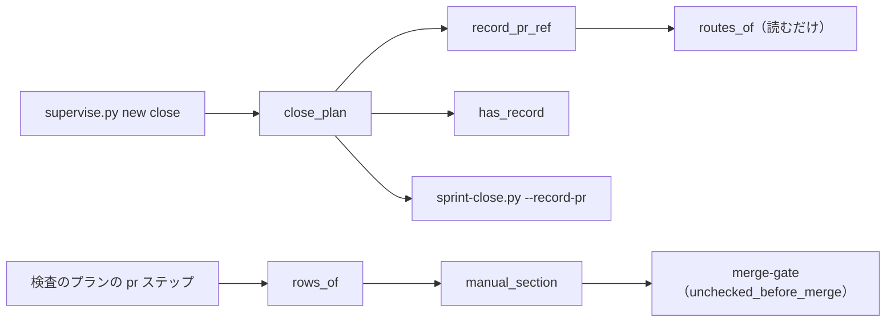
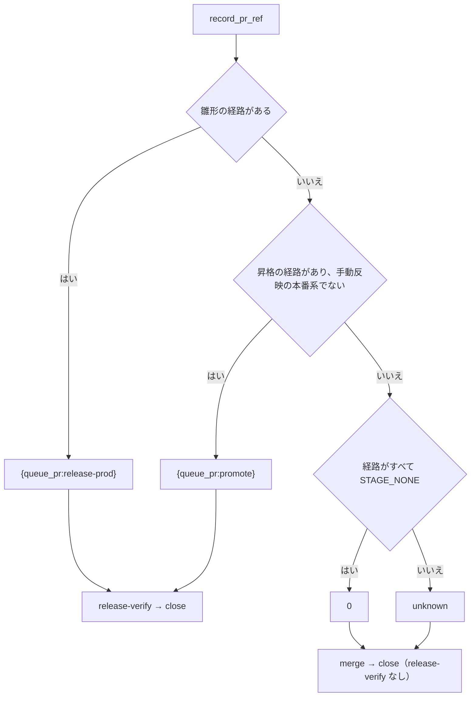

# スプリントの判定: merge・手動・検証の環境だけの経路で本番まで出たスプリントの課題が記録を見ずに閉じ、「手動確認は無い」と書いた課題が承認ゲートで止まる → 記録の置き場が分からないときは理由つきで開いたまま残し、「無し」の行は手動確認として数えない（#1875 #1675）

## 目的

- **何が壊れているか**: まとめの `close` が、記録の置き場を知らない経路でも「配布なし」と同じ `--record-pr 0` を受け、受け入れ条件を確かめずに課題を閉じる（#1875）。要求の「検証手段」に「手動確認（マージ前） | 無し」と書いた課題が、未確認の手動確認として PR 本文に載り、merge-gate が承認ゲートで止まる（#1675）
- **誰が困るか**: merge・手動・検証の環境だけの経路で配布する利用側のリポジトリの運用者。閉じた理由が結果から読めず、止まるたびに手で印を付けて流し直す（3 スプリント続けて起きた）
- **直すと何が成り立つか**: 記録の置き場が分からないスプリントの課題は、その理由つきで開いたまま返り、`summary` で「配布なしで閉じた」と区別できる。「無し」と書いた行は手動確認の行にならず、PR 本文に節が出ず、merge-gate も止まらない

## 適用範囲

- **働く範囲**: 配布先のリポジトリでも働く（`supervise.py new close` のまとめのプランと、検査のプランの pr ステップ・merge-gate）
- **プロジェクトごとに違うもの**: リリースの経路は今どおり `.ndf/project.json` の `delivery` と `.ndf/supervise.json` の `release.form` から決まる。新しい設定・引数は足さない（`sprint-close.py --record-pr` の受ける値が 1 つ増えるだけ）
- **当たるモード**: `standard`（スプリントのまとめと検査のプランを通るすべてのモード）

## あるべき姿の根拠

| 根拠 | 種類 | 何を示すか |
| --- | --- | --- |
| 利用側のリポジトリで 3 スプリント続けて merge-gate が「無し」の行で止まった（takemi-ohama/novel#88） | 実測 | 「無し」の行を手動確認として数えると、確かめる中身の無い承認が毎回求められる |
| #1875 の再確認（ndf 10.17.69、2026-10-10）: `record_pr_ref` が雛形・昇格以外のすべてに `"0"` を返す | 実測（コードの読み） | `0` が「配布なし」と「置き場を知らない」の 2 つの意味を兼ねている |

要求と受け入れ条件は #1875 の本文にある（コピーは `issues/issue-1875-requirements.md`）。#1675 の受け入れ条件も同じコピーの「#1675」の節にある。この文書は「どう作るか」だけを扱う。

## ドメインモデル

### コンテキスト

| コンテキスト | 何の語が 1 つの意味に決まるか |
| --- | --- |
| スプリントの進行（`ndf-workflow`） | まとめのプラン・`close` ステップ・手動確認の行・merge-gate |
| リリース（`ndf-release`） | リリースの経路・リリース記録 |

リリースが供給者、スプリントの進行が顧客の関係（顧客 / 供給者）。スプリントの進行はリリースの経路（`delivery.routes` の `Route.stage`）を読むだけで、経路の決め方は変えない。

### 集約

| 集約 | 持ち主（書き換えてよいもの） | 根 | エンティティ | 値オブジェクト |
| --- | --- | --- | --- | --- |
| まとめのプラン | `supervise_lib/sprint.py` の `close_plan`（記録の値は `sprint_routes.record_pr_ref` が決める） | プラン | ステップ（`close`・`release-verify`） | 記録の参照（`{queue_pr:…}` / `0` / `unknown`） |
| 課題を閉じる判定 | `sprint-close.py` | 1 回の `close` の実行 | 課題ごとの結果の項目 | 開いたまま残す理由（`reason`） |
| 手動確認の行 | `lib/manual_checks.py` の `rows_of` | 要求の「検証手段」の表 | — | `ManualRow`（課題・本文・マージ前か） |

### 不変条件

| # | 集約 | 条件 | 破れたときの扱い |
| --- | --- | --- | --- |
| I1 | まとめのプラン | 記録の参照が `0` になるのは、リリースの経路がすべて `STAGE_NONE`（届けない）のときだけ | テストが落ちる（経路ごとの値を固定する） |
| I2 | まとめのプラン | 記録の参照が `{queue_pr:…}` でないとき、プランに `release-verify` を置かず、merge の次は `close` | テストが落ちる |
| I3 | 課題を閉じる判定 | `--record-pr unknown` を受けた実行は、どの課題も閉じず、ボードも書かない（gh へ書き込まない） | テストが落ちる（gh の書き込みを呼ばないことを見る） |
| I4 | 課題を閉じる判定 | `--record-pr 0` の意味（閉じる条件を見ずに `--issues` を閉じる。`--issues` が無ければ終了コード 2）は変わらない | 既存テストが落ちる |
| I5 | 手動確認の行 | 2 列目が「無し」の形（決定 3）の行は `ManualRow` にならない。それ以外の空でない 2 列目は今どおり行になる | テストが落ちる |

### ドメインイベント

| # | イベント | 発生元 | 受け手 |
| --- | --- | --- | --- |
| E1 | まとめのプランが組まれた（`close` の記録の値が決まった） | `close_plan`（`record_pr_ref`） | `close` ステップ |
| E2 | 記録の置き場が分からないため、課題を開いたまま理由を返した | `sprint-close.py` | 振り返り（`retro`）・運用者 |
| E3 | 配布なしとして課題を閉じた | `sprint-close.py` | 振り返り・ボード |
| E4 | 要求から手動確認の行を読んだ（「無し」の行を落とした） | `rows_of` | PR 本文の組み立て（`manual_section`） |
| E5 | PR 本文の `## 手動確認` の節が作られた（行が 0 件なら置かない） | `manual_section` | merge-gate |
| E6 | merge-gate が未確認のマージ前の行を数えた | `unchecked_before_merge` | 承認ゲート（終了コード 10） |

### 用語

| 用語 | 意味 | 用語集への反映 |
| --- | --- | --- |
| 手動確認の行 | 要求の検証手段の表で、項目が「手動確認」で始まり、2 列目が「無し」の形（「無し」「なし」「不要」「ない」「-」「—」「―」の単独か、直後に括弧・句読点・空白が続く形）でない行。項目が「手動確認（マージ前）」ならマージ前、それ以外はリリース後テストに確かめる | 意味の変更（`ndf-workflow`） |
| 記録の置き場が分からない | まとめの `close` が読むリリース記録の PR を、プランが組まれた時点で決められない状態。`sprint-close.py --record-pr unknown` で渡し、課題を開いたまま残す | 追加（`ndf-workflow`） |

## 機能一覧

| # | 機能 | 誰が使うか |
| --- | --- | --- |
| F1 | 経路から記録の参照を決める（雛形・昇格・届けない・それ以外の 4 通り） | `supervise.py new close`（まとめのプラン） |
| F2 | `--record-pr unknown` を受け、課題を理由つきで開いたまま返す | まとめの `close` ステップ・運用者 |
| F3 | 「無し」と書いた検証手段の行を手動確認の行にしない | 検査のプランの pr ステップ（`materials.manual`）・merge-gate |

## 構成要素

| 要素 | 責務 |
| --- | --- |
| `supervise_lib/sprint_routes.py` の `record_pr_ref`（変える） | 経路から記録の参照を返す。届けない経路だけなら `"0"`、雛形・昇格以外の届ける経路があれば `"unknown"` |
| `supervise_lib/sprint_routes.py` の `RECORD_NONE` / `RECORD_UNKNOWN` / `has_record`（足す） | 記録の参照の 2 つの語と、「読む記録がある（`{queue_pr:…}`）か」の判定を 1 か所に置く |
| `supervise_lib/sprint.py` の `close_plan`（変える） | `record_pr == "0"` の 2 か所を `has_record(record_pr)` に置き換え、記録が無い 2 値のどちらでも `release-verify` を置かない |
| `sprint-close.py`（変える） | `--record-pr` に `unknown` を受け、閉じる条件を読まずに全課題を `kept_open` で返す。`summary` の先頭に理由を出す |
| `lib/manual_checks.py` の `rows_of`（変える） | 2 列目が「無し」の形の行を落とす（判定は同じモジュールの正規表現 `_NONE`） |



`routes_of`・`manual_section`・`unchecked_before_merge` は変えない（読む・受けるだけ）。

## 入出力の契約

### `sprint-close.py --record-pr`

| 値 | 意味 | `--issues` が無いとき | 読む記録 | 課題 | 終了コード |
| --- | --- | --- | --- | --- | --- |
| `<正の整数>` | リリース記録を置いた PR | 記録の `スプリント:` の行の PR から集める | 読む | 閉じる条件を満たせば閉じる | 今どおり |
| `0` | 本番の記録なし（配布なし） | 終了コード 2 で止まる | 読まない | 条件を見ずに閉じる | 今どおり |
| `unknown`（足す） | 記録の置き場が分からない | 終了コード 2 で止まる（`0` と同じ文の形で「`--record-pr unknown` は `--issues` と一緒に渡す」） | 読まない | 閉じない。ボードも書かない | 0 |

それ以外の文字列・負の数は今どおり呼び出しの誤り（終了コード 3）。

`unknown` の結果（`lib/step_result.py` の形の 1 行の JSON）:

```json
{
  "tool": "sprint-close",
  "status": "ok",
  "summary": "記録の置き場が分からないため閉じない（リリースの経路が雛形でも昇格でもない）: 閉じた 0 件・…・開いたまま 2 件（うち参照だけ 0 件）",
  "items": [
    {"kind": "issue", "repo": "owner/name", "number": 1875, "result": "kept_open",
     "reason": "配布の記録の置き場が分からない（リリースの経路が雛形でも昇格でもない。リリース記録を確かめて手で閉じる）"}
  ],
  "metrics": {"issues": 2, "kept_open": 2, "closed": 0, "...": 0},
  "next": "リリース記録とリリース後テストの記録を確かめ、受け入れ条件を満たした課題を手で閉じる"
}
```

`summary` の先頭の文「記録の置き場が分からないため閉じない」は `unknown` のときだけ付く。`0` のときの `summary` は今どおり（受け入れ条件 1875-5 の区別はこの先頭の文で付く）。

### `rows_of` の「無し」の形

2 列目（前後の空白を除いた文）が次の正規表現に当たる行を手動確認の行にしない。

```text
^(無し|なし|不要|ない|-|—|―)(?:$|[（(。、\s])
```

| 2 列目 | 手動確認の行か |
| --- | --- |
| `無し（AC はテストで確かめられる）` | ならない |
| `なし` / `不要。` / `-` / `— 自動で足りる` | ならない |
| `無しの場合は画面で見る` | なる（語の続きがある） |
| `画面で一覧の並びを見る` | なる |

## 処理の流れ



`sprint-close.py` の中の順序:

1. `cmd_close`: `record_pr` が `0` か `unknown` で `--issues` が無ければ終了コード 2 で止まる
2. `_read_sprint_record`: `0` と `unknown` は記録を読まず、PR の一覧を空で返す（`unknown` の段階は「記録の置き場が分からない」）
3. `_closing_blocker`: `unknown` なら `kept_all` に理由を入れて返す（`0` は今どおり条件を見ない）
4. `_close_item`: `kept_all` があるので全課題を `kept_open` で返す（gh へ書き込まない）
5. `cmd_close`: `unknown` のとき `summary` の先頭に理由の文と `next` を付けて `ok` で返す

## 決定の記録

### 決定 1: 「配布なし」と「置き場を知らない」を分けるため、`--record-pr` に語 `unknown` を足す

`--record-pr` は今 `type=int` で受けている。負の数（`-1`）では、結果とプランの `cmd` を読む人が意味を取れない。語なら結果とプランの `cmd` を読む人がそのまま意味を取れる。`0` の意味（配布なし）は変えず、既存の呼び出しと `test_record_zero_closes_the_given_issues_without_reading_a_record` を残す。

`0` の意味を「置き場を知らない」に変えて配布なしに別の値を足す形は採らない。手で `--record-pr 0` を打つ既存の手順の意味が黙って変わる。

根拠: Value 7 / Value 8 / C3（MVV 版 2）

### 決定 2: 閉じ損ねは直せるが誤って閉じた課題は見えないため、検証の環境だけの経路も `unknown` にする

本番の行の無い経路（`[STG]` だけ）・merge（`merged-by-check`）・手で届ける経路・手動反映の本番系の昇格は、どれも記録の置き場をプランが知らない。`0` を返すのは経路がすべて `STAGE_NONE` のときだけにする（I1）。開いたまま残った課題は人が 1 回の操作で閉じられるが、条件を見ずに閉じた課題は確かめていないことが結果から読めない（前提 2）。

検証の環境だけの経路を「配布なし」として `0` で閉じる形は採らない。要求の前提 2 の判断に反する。

根拠: 上位の原則 / Value 1（MVV 版 2）

### 決定 3: 「無し」の判定を 1 か所に置くため、`rows_of` の中で 2 列目の先頭の語を見る

PR 本文の節も merge-gate の数え方も `rows_of` の出力から作られる。読む入口で落とせば、`manual_section` は行が 0 件なら節を置かず（E5）、merge-gate は何も数えない。語の後に「（」「(」「。」「、」・空白・文末が来る形に限り、「無しの場合は〜」のような確認の文を誤って落とさない（前提 4）。

merge-gate（`unchecked_before_merge`）で「無し」の行を数えない形は採らない。PR 本文に未チェックの行が残り続け、読む人が確認の要る行と区別できない。要求の雛形の文を変える形も採らない（雛形に「無ければ行を消す」が既にある。前提 5）。

根拠: Value 6 / Value 2（MVV 版 2）

### 決定 4: 記録の有無の判定を分けないため、`close_plan` は `has_record` で分岐する

`close_plan` は今 `record_pr == "0"` で `release-verify` を置くかを決めている。`unknown` を足すと同じ比較が 2 値に増え、比較を写した箇所が漏れる。記録の参照の語と判定を `sprint_routes.py` に置き、`close_plan` はそれを呼ぶだけにする。

`close_plan` の中で `record_pr in ("0", "unknown")` と書く形は採らない。語の正本が 2 か所になる。

根拠: Value 6（MVV 版 2）

## テスト設計

| 受け入れ条件・不変条件 | どの振る舞いで縛るか | どう壊したら落ちるべきか |
| --- | --- | --- |
| 1875-1 / I1 | merge（`merged-by-check`）・手で届ける経路・手動反映の本番系の昇格のそれぞれで、`record_pr_ref` が `"unknown"` を返し、`close_plan` の `close` の `cmd` に `--record-pr unknown` が載る | `record_pr_ref` の最後を `"0"` に戻すと落ちる |
| 1875-2 / I1 | `production: false` の行だけの `delivery` で `"unknown"` を返す | 検証の環境の行を `0` へ回すと落ちる |
| 1875-3 / I1 | `delivery: []` で `"0"` を返し、`cmd` が `--record-pr 0` のまま | 「すべて `STAGE_NONE`」の判定を外すと落ちる |
| I2 | `0` と `unknown` のどちらでも、プランに `release-verify` が無く merge の `next` が `close` | `has_record` を `!= "0"` に戻すと `unknown` で落ちる |
| 1875-4 / I3 | `--record-pr unknown --issues 1,2` で、全課題が `kept_open`・`reason` に置き場が分からない旨・終了コード 0。gh の書き込み（ボード・閉じる）を一度も呼ばない | `_closing_blocker` で `unknown` を `0` と同じ扱いにすると落ちる |
| 1875-4 | `--record-pr unknown` に `--issues` が無ければ終了コード 2 | 確かめを外すと落ちる |
| 1875-5 | `unknown` の `summary` が `0` で閉じたときの `summary` と違い、先頭に「記録の置き場が分からない」を含む | 先頭の文を外すと落ちる |
| 1875-6 / I4 | 既存の `test_record_zero_closes_the_given_issues_without_reading_a_record` と、`0` に `--issues` が無いときの終了コード 2 のテストがそのまま通る。雛形・昇格の経路の値は `{queue_pr:release-prod}`・`{queue_pr:promote}` のまま | `0` の分岐を変えると落ちる |
| 1675-1 / I5 | 検証手段に「手動確認（マージ前） \| 無し（AC はテストで確かめられる）」だけがある要求で `rows_of` が 0 件、`manual_section` が空 | 判定を外すと 1 件返って落ちる |
| 1675-2 / I5 | 「無し」「なし」「不要」「ない」「-」「—」「―」の単独と、直後が括弧・句読点・空白の形を、「手動確認」「手動確認（マージ前）」の両方の項目で落とす | 語を 1 つ抜くと落ちる |
| 1675-3 | 1675-1 の要求から作った PR 本文で `unchecked_before_merge` が 0 件（merge-gate が 10 を返さない） | `rows_of` の判定を外すと落ちる |
| 1675-4 / I5 | 「無しの場合は画面で見る」と「画面で一覧の並びを見る」はマージ前の未チェック行として載り、`unchecked_before_merge` が数える | 正規表現の後続の条件を外す（前方一致だけにする）と落ちる |

## 設計の結果

| 課題 | 扱い | 取り込み先 | 触るファイル |
| --- | --- | --- | --- |
| #1875 | 実装する | — | `plugins/ndf/scripts/supervise_lib/sprint_routes.py`、`plugins/ndf/scripts/supervise_lib/sprint.py`、`plugins/ndf/scripts/sprint-close.py`、`plugins/ndf/scripts/tests/`、`plugins/ndf/skills/development-workflow/references/pace.md` |
| #1675 | 実装する | — | `plugins/ndf/scripts/lib/manual_checks.py`、`plugins/ndf/scripts/tests/`、`docs/glossary/glossary.json`、`docs/glossary.md` |

ほかの主題（#1263 #1944 #1513 / #1885 #1686 #1488）と同じファイルを触るときに重ならないよう、触る関数を次に限る。

| ファイル | 触る関数・名前 | 触らない（ほかの主題に任せる） |
| --- | --- | --- |
| `supervise_lib/sprint_routes.py` | `record_pr_ref`（本体）、足す `RECORD_NONE`・`RECORD_UNKNOWN`・`has_record` | `route_waves`・`manual_release_wave`・`manual_production_waves`・`routes_of`・`pace_verify` |
| `supervise_lib/sprint.py` | `close_plan` の `record_pr == "0"` の 2 か所と import の行 | `close_waves`・`_close_step`・`release_verify_step`・`_spec_pr_steps`・`_retro_refine_steps`・`plan_mvv_release`・`plan_fast_check` |
| `sprint-close.py` | モジュールの docstring、`_read_sprint_record`・`_closing_blocker`・`cmd_close`・`build_parser` | `read_record`・`verification_verdicts`・`sprint_issues`・`_close_summary` ほか |
| `skills/development-workflow/references/pace.md` | 「リリースの経路がテンプレートで組むものでなければ……`close` のステップは `--record-pr 0` になる」の文を「経路がすべて届けない経路なら `0`、それ以外は `unknown`（課題を開いたまま残す）」に改める | ほかの節 |
| `lib/manual_checks.py` | `rows_of` と、足す `_NONE` | `issue_rows`・`manual_section`・`unchecked_before_merge` |
| `supervise_lib/pr_materials.py`・`merged_lib/merge.py` | 触らない | #1885 #1686 #1488 の側 |

## 未確認のまま残ること

| 項目 | 内容 |
| --- | --- |
| リリース記録の PR を `close` へ渡す手段 | `unknown` の課題は手で閉じる。記録ステップで PR を受け渡す手段は範囲外の課題 #2044 で扱う（要求の S2・未決 2） |
| 既に作られた PR 本文に残る「無し」の行 | pr ステップを流し直すと節ごと作り直されて消える（前提 6）。流し直さない PR には残る |
| `unknown` を返す経路の利用側での頻度 | 利用側のリポジトリで、課題が開いたまま残る回数が増えたかは振り返りで数える |
