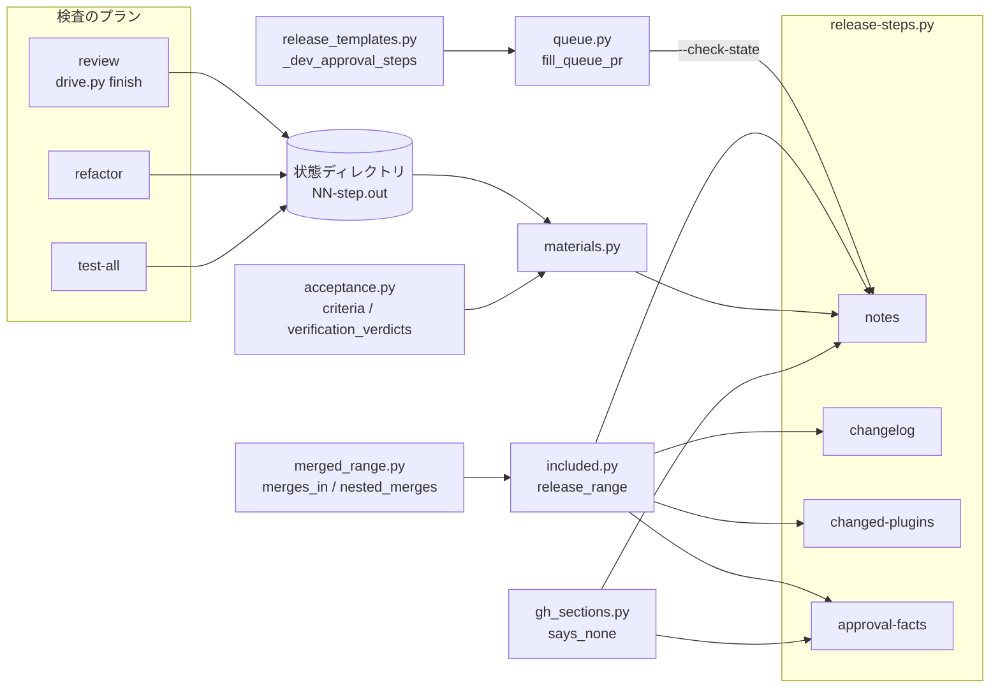
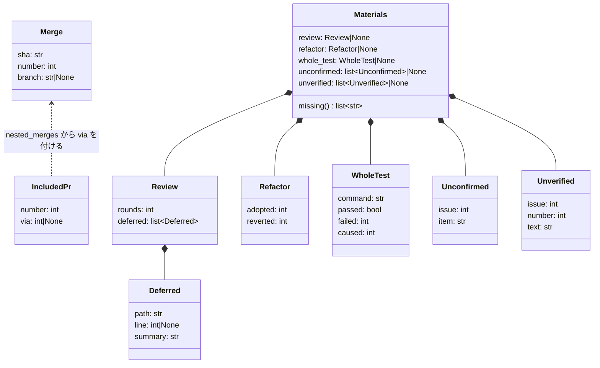
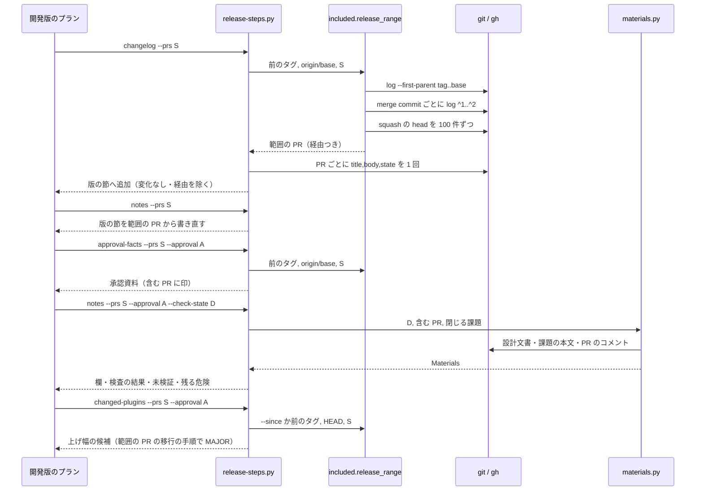

# 配布の材料: develop へ直接入った PR とスプリントの実装 PR が CHANGELOG と承認資料から漏れ、レビュー・リファクタリング・未確認の材料も承認資料に集まらない → 前の正式版からの変更の全体と未検証の材料が、手当て無しで CHANGELOG と承認資料にそろう（#1885 #1686 #1488）

## 目的

- **何が壊れているか**: 開発版のプランは CHANGELOG・「配る中身」・上げ幅の候補を `--prs`（スプリント PR）だけから作る。develop へ直接入った PR とスプリントブランチへ入った実装 PR が漏れ、承認資料の `## 未検証・残る危険` は PR の本文しか読まない
- **誰が困るか**: 承認ゲート 2 の承認者（中身と危険を見ないまま本番を決めうる）と、CHANGELOG で版を選ぶ利用者（互換の無い変更が PATCH で届く）。conductor は毎版 `--prs` と危険を手で足している
- **直すと何が成り立つか**: 前の正式版のタグからの変更の全体（範囲の PR）と、5 つの承認の材料が、プランを手で直さずに CHANGELOG と承認資料へ載る

## 適用範囲

- **働く範囲**: 配布先のリポジトリでも働く。`release-steps.py` の `changelog`・`notes`・`changed-plugins`・`approval-facts` と、`supervise.py new sprint` が書く開発版のプラン
- **プロジェクトごとに違うもの**: ベースブランチは宣言の `release.base`、配るプラグインは `release.plugin` から読む（今どおり）。検査のプランの状態の置き場は引数（`--check-state`）で受け、渡さないときはその材料を「無い材料」として書く
- **当たるモード**: `standard`

## あるべき姿の根拠

| 根拠 | 種類 | 何を示すか |
| --- | --- | --- |
| 10.17.69 で #1869 が CHANGELOG・承認資料に載らず、mcp-bigquery が PATCH で出た（承認資料 `issues/approval-ndf-v10.17.69.md`、PR 1883） | 実測 | `--prs` だけでは範囲の PR が漏れる |
| 10.17.71（#1911 ほか 4 本）・10.17.75（#1986〜#1990 の 5 本）で conductor が `--prs` を手で足した（#1885 の本文） | 実測 | 漏れは毎版起きる |
| `ndf--v10.17.75..origin/develop` の first-parent のマージは 15 本、その 2 つ目の親の側にさらに 9 本の `Merge pull request`（2026-10-17 に計測） | 実測 | スプリントブランチ経由の実装 PR は first-parent の外にある |
| 「#1488 は依頼の 5 つの材料をすべて対象にし、切り出さない」 | 利用者の指示の原文 | #1488 の範囲 |

要求と受け入れ条件は #1885 の本文にある（コピーは `issues/issue-1885-requirements.md`）。この文書は「どう作るか」だけを扱う。

## ドメインモデル

### コンテキスト

| コンテキスト | 何の語が 1 つの意味に決まるか |
| --- | --- |
| NDF のリリース（`ndf-release`） | 範囲の PR・スプリント経由の PR・承認資料・承認の材料・配る中身・配布物の変化なし |
| NDF の cross-review（`ndf-cross-review`） | ラウンドと見送り |
| NDF の cross-refactoring（`ndf-cross-refactoring`） | 採用と取り消し |

検査（cross-review・cross-refactoring と、検査のプランの全体テスト）が供給者、配布が顧客の関係（顧客 / 供給者）。配布は検査のプランが状態ディレクトリへ残した結果 JSON を読むだけで、検査の進め方を変えない。検査が供給するのは結果 JSON の項目の追加（見送った指摘の 1 件ごとの行）だけである。

### 集約

| 集約 | 持ち主（書き換えてよいもの） | 根 | エンティティ | 値オブジェクト |
| --- | --- | --- | --- | --- |
| 範囲 | `release_lib/included.py`（読むだけ。書き込み先を持たない） | 範囲（前のタグ・終点） | 範囲の PR | 経由（スプリント PR の番号か無し） |
| CHANGELOG の版の節 | `release-steps.py` の `changelog`・`notes` | 版の節 | — | 箇条・移行の手順の箇条 |
| 承認資料 | `release-steps.py` の `approval-facts`（作る・作り直す）・`notes --approval`（欄と節を書く） | 承認資料 | 含む PR の行 | 承認の材料・無い材料の名前 |
| 検査の結果 | 検査のプランの各ステップ（cross-review・cross-refactoring の駆動、全体テスト） | ステップの結果 JSON | 見送った指摘 | ラウンド数・採用 / 取り消しの件数・テストの合否 |

承認資料は 2 つのコマンドが書くが、書く節が重ならない（`approval-facts` は表と自前の節、`notes --approval` は 2 つの欄と `## 検査の結果`・`## 未検証・残る危険`・`## 移行の手順`）。今の分け方を保つ。

### 不変条件

| # | 集約 | 条件 | 破れたときの扱い |
| --- | --- | --- | --- |
| I1 | 範囲 | 範囲の PR は「前の正式版のタグから終点までにベースブランチへ入った PR」と「そのうち merge commit で入った PR の 2 つ目の親の側へ merge commit で入った PR」の和で、`--prs` を足しても同じ番号は 1 つ | — （組み立てで成り立たせる） |
| I2 | 範囲 | 版上げの PR（head が `release/` で始まる）と PR でない番号は範囲の PR に入らない | — |
| I3 | 範囲 | `merged_range.merges_in` の返す値は変わらない（`check-trigger.py` の検査の起動は今どおり） | — |
| I4 | CHANGELOG の版の節 | 版の節の PR の箇条は、範囲の PR のうち配布物の変化を持ち、スプリント経由でない PR から作る。同じ版の開発版を何度出し直しても、前の正式版からの PR の箇条がすべて残る | — |
| I5 | 承認資料 | 「含む PR」はスプリント経由の PR と配布物の変化の無い PR も 1 行ずつ持ち、行の頭は `#<番号>` のまま | `read_included` が読めず 2 で止まる（今どおり） |
| I6 | 承認資料・CHANGELOG | 同じ変化の箇条が「配る中身」と版の節に 2 回並ばない | — |
| I7 | 承認資料 | `## 未検証・残る危険` は、5 つの承認の材料と PR の本文の危険がすべて無いときだけ「記載が無い」の 1 行になり、そのときも無い材料の名前を並べる。一部が無いときは、ある材料の行の後に無い材料の名前を 1 行で書く | — |
| I8 | 承認資料 | 作り直しても承認の材料の行は作り直した時点の材料で入れ替わり、手で足した行と節は残る（#1834） | 前の承認資料が読めなければ書かずに止まる（今どおり） |
| I9 | 範囲・承認資料 | 1 つのコマンドの中で同じ PR を GitHub から 2 回読まない | — |
| I10 | 範囲 | GitHub か git を読めないときは結果 JSON に理由を書いて止まり、材料を黙って空にしない。検査の状態の置き場が無い・結果 JSON が読めないときだけは止まらず、その材料を無い材料として書く | 終了コード 1・2（今どおり） |

### ドメインイベント

| # | イベント | 発生元 | 受け手 |
| --- | --- | --- | --- |
| E1 | 前の正式版のタグを打った | 本番の配布 | 範囲（起点） |
| E2 | PR がベースブランチへ直接マージされた | 人か conductor | 範囲 |
| E3 | 実装 PR がスプリントブランチへマージされた | スプリントの実装 | 範囲（スプリント経由の PR） |
| E4 | 検査のプランが結果 JSON を状態ディレクトリに残した | 検査のプランの `refactor`・`review`・`test-all` | `notes --approval`（`## 検査の結果`） |
| E5 | スプリント PR がベースブランチへマージされた | 検査のプランの終わり | 範囲 |
| E6 | 開発版のプランが CHANGELOG の版の節を書いた | `changelog`・`notes` | 利用者（CHANGELOG） |
| E7 | 開発版を配り、導入を確かめた | `release`・`verify-install` | `notes --approval`（導入を確かめた欄） |
| E8 | 承認資料を書いた | `approval-facts`・`notes --approval` | 承認ゲート 2 |
| E9 | リリース後テストの結果の表を残した | `release-verification` | 次に承認資料を書く `notes --approval`（決定 7） |
| E10 | 同じ版の開発版を出し直した | 開発版のプランの再実行 | `changelog`・`notes`（I4）・`approval-facts`（I8） |
| E11 | 人が承認ゲート 2 で決めた | 本番の配布の前 | 本番のプラン |

### 用語

| 用語 | 意味 | 用語集への反映 |
| --- | --- | --- |
| 範囲の PR | 直前の正式版のタグから終点（承認したコミットか、ベースブランチの先端）までに、ベースブランチへ merge commit か squash merge で入った PR と、スプリント経由の PR の和。版上げの PR と PR でない番号は含まない | 意味の変更 |
| スプリント経由の PR | 範囲の PR のうち、merge commit でベースブランチへ入った PR の 2 つ目の親の側（スプリントブランチ）へ merge commit で入った PR。変化と移行の手順はスプリント PR の本文が集めて持つ | 追加 |
| 承認の材料 | 承認資料が集める 5 つの材料。レビュー（cross-review のラウンド数と見送った指摘）・リファクタリング（採用と取り消しの件数）・全体テスト（コマンド・合否・件数）・設計文書の未確認・未実施のリリース後テスト | 追加 |
| 配布物の変化なし | PR の本文の `## 利用者向けの変化` が「無し」だけを持つこと。節の無い本文（題名で代える）とは別に扱う | 追加 |

## 機能一覧

| # | 機能 | 誰が使うか |
| --- | --- | --- |
| F1 | 範囲の PR を 1 か所で求める（スプリント経由の PR を含む） | `changelog`・`notes`・`changed-plugins`・`approval-facts` |
| F2 | CHANGELOG の版の節を範囲の PR から作る（出し直しで前の開発版の PR を残す） | 開発版のプランの `changelog`・`notes` |
| F3 | 上げ幅の候補を範囲の PR の本文から出す | `changed-plugins --prs` |
| F4 | 「含む PR」にスプリント経由と配布物の変化なしの印を付ける | `approval-facts`、承認者 |
| F5 | 検査の結果（レビュー・リファクタリング・全体テスト）を承認資料へ書く | `notes --approval --check-state`、承認者 |
| F6 | 設計文書の未確認と未実施のリリース後テストを `## 未検証・残る危険` へ並べる | `notes --approval`、承認者 |
| F7 | 無い材料の名前を書く | `notes --approval`、承認者 |
| F8 | cross-review の結果 JSON に見送った指摘を 1 件ずつ載せる | 検査のプランの `review`、F5 |
| F9 | 開発版のプランへ検査のプランの状態の置き場を渡す | `new sprint` |

## 構成要素

| 要素 | 責務 |
| --- | --- |
| `lib/merged_range.py` の `nested_merges`（新設） | merge commit の `<sha>^1..<sha>^2` の first-parent のログから `Merge pull request #N` の PR を拾う。`merges_in`・`with_heads` は変えない（I3） |
| `release_lib/included.py` | `IncludedPr`（番号・経由）を足す。`release_range` が前のタグと終点を決めて範囲の PR を返し、`with_extra` が `--prs` との和を作る（I1・I2）。「含む PR」の行の組み立てと読み出しを持つ（I5） |
| `release_lib/materials.py`（新設） | 承認の材料を読む: 検査の状態ディレクトリの結果 JSON・設計文書の `## 未確認のまま残ること`・課題の受け入れ条件とリリース後テストの表。`## 検査の結果` と `## 未検証・残る危険` に書く行と、無い材料の名前を返す。終了コードも出力も持たない。gh・git が読めなければ `StepError` を投げ（止めるのは呼ぶ側）、検査の状態の置き場が無いときは材料を `None` にして返す（I10） |
| `lib/gh_sections.py` の `says_none`（新設） | 節があり「無し」だけを持つかを返す（配布物の変化なし） |
| `lib/acceptance.py` | `sprint-close.py` の `verification_verdicts`・`IssueRows` を移して受け持つ（材料と閉じる判定が同じ規則で表を読む） |
| `release-steps.py` | `changelog`・`notes`・`changed-plugins`・`approval-facts` が範囲の PR を使う。`notes --approval` が `--check-state` を受け、材料の節を書く |
| `skills/cross-review/scripts/drive.py` の `Drive.finish` | 結果 JSON の `items` に見送った指摘を `{"kind": "deferred", "path", "line", "summary"}` で足す |
| `supervise_lib/queue.py` の `fill_queue_pr` | `{queue_state:<名>}` を、前のステージの名前の一致するプランの状態ディレクトリで置き換える（無ければ空） |
| `supervise_lib/release_templates.py` の `_dev_approval_steps` | 出す PR が `{queue_pr:check}` のとき、`notes --approval` へ `--check-state {queue_state:check}` を足す |
| 用語集（`docs/glossary/glossary.json`・`docs/glossary.md`） | 用語の表の 4 語を反映する |



図は呼び出しと読む関係だけを描く。用語集と、`acceptance.py` へ移した関数を import する `sprint-close.py` は図に含めない。

## 構造



`Materials` の各欄の `None` は「材料が無い」（読む元が無い・読めない）、空の列は「材料はあり、項目が 0 件」を表す（I7 の区別）。どれも値オブジェクトで、作った後に書き換えない。

## 入出力の契約

### `release-steps.py`（引数と結果 JSON は足すだけ）

| コマンド | 変わること |
| --- | --- |
| `changelog --version V --prs P...` | 箇条にする PR = 範囲の PR（終点は `origin/<base>`）と `--prs` の和から、スプリント経由の PR と配布物の変化なしの PR を除いたもの。`metrics` に `range`（範囲の PR の数）・`since`（前のタグ）を足す |
| `notes --version V --prs P...`（`--approval` なし） | `changelog` と同じ PR から版の節を書き直す（I4） |
| `notes ... --approval A [--check-state D]` | PR は今どおり「含む PR」から読む（範囲を求め直さない。#1274）。スプリント経由の行は変化と移行の手順を足さず、危険だけを足す。配布物の変化なしの PR は「配る中身」に載せない。`## 検査の結果` と `## 未検証・残る危険` の材料の行を書く。`items` に `{"kind": "material", "name": <材料>, "result": "written"|"missing", "lines": N}` を 5 行足す |
| `changed-plugins --prs P...` | 候補を出す PR = 範囲の PR（起点は `--since` か前のタグ、終点は `HEAD`）と `--prs` の和 |
| `approval-facts` | 「含む PR」の行に印を足す（下）。PR を読む項目に `body` を足し、1 回で読む（I9） |

`--check-state` は `notes --approval` だけが受ける。`--approval` なしで渡すと引数の誤り（2）。値が空文字か、ディレクトリが無いときは、検査の 3 つの材料を無い材料として書いて進む（I10）。

### 「含む PR」の行

```text
#1996 スプリント m1982（MERGED・1a2b3c4d・CI 12/12）
#1993 スプリントの実装 A（MERGED・5e6f7a8b・CI 10/10・スプリント PR #1996 経由）
#1986 確定仕様化（MERGED・9c0d1e2f・CI 12/12・配布物の変化なし）
```

行の頭の `#<番号>` は今どおり（`read_included` は変えずに読める）。`read_included_rows` が括弧の中の `スプリント PR #<番号> 経由` と `配布物の変化なし` を読む。印の語は `release_lib/included.py` の定数 1 か所に置く。

### 承認資料に足す節と行

```markdown
## 検査の結果

- レビュー: cross-review 2 ラウンド、見送った指摘 1 件
  - `plugins/ndf/scripts/lib/body_findings.py:191` 再提出の照合に本文の一致を足す（要ユーザ判断）
- リファクタリング: 採用 1 件 / 取り消し 0 件
- 全体テスト: `uv run --frozen --project . --all-extras pytest . -q -n 4` 合格（落ちたテスト 1 件はすべて既存失敗・変更起因 0 件）

## 未検証・残る危険

- （PR の本文の箇条。今どおり）
- 設計の未確認 #1885: リリース後テストの記録の置き場が開発版で決まっていない
- 未実施のリリース後テスト #1885 の 1885-1: 前の正式版のタグの後に…（2026-10-17 12:00 JST 時点）
- 無い材料: リファクタリング（検査の状態に結果が無い）
```

| 規則 | 内容 |
| --- | --- |
| `## 検査の結果` の置き場 | `## 未検証・残る危険` の直前。`notes --approval` が節ごと書き直す（`others.put_section`）。`APPROVAL_OWN` には入れない（作り直しで残り、次の `notes --approval` が入れ替える） |
| 材料の行の持ち主 | `## 未検証・残る危険` の行のうち、頭が `- 設計の未確認 #`・`- 未実施のリリース後テスト #`・`- 無い材料:`・`- 記載が無い` のものは機械の行。書くたびに消してから入れ直す（`others.merge_lines` の `drop` に渡す）。それ以外の行（PR の本文と手で足した行）は残す（I8） |
| すべて無いとき | `- 記載が無い（無い材料: レビュー・リファクタリング・全体テスト・設計文書の未確認・未実施のリリース後テスト・PR の本文の未検証・残る危険）` の 1 行（I7）。今の `- PR の本文に記載が無い` は書かない（読むときの `drop` には残し、古い資料から消す） |
| 見送った指摘の行 | `` `<path>:<line>` <要旨> ``。行が無い指摘は `` `<path>` ``、path も無い指摘（レビュー本文の指摘）は要旨だけ |
| 未実施のリリース後テストの時点 | 行の末尾に、承認資料を書いた時刻を JST で添える（決定 7） |

### 材料を読む元

| 材料 | 読む元 | 無い材料になるとき |
| --- | --- | --- |
| レビュー | `<D>/NN-review.out` の最後の結果 JSON（`tool` が `cross-review-drive`）の `metrics.rounds` と `items` の `kind: deferred` | `--check-state` が無い・ファイルが無い・JSON が無い |
| リファクタリング | `<D>/NN-refactor.out` の最後の結果 JSON（`cross-refactoring-drive`）の `metrics` の採用と取り消しの件数 | 同上 |
| 全体テスト | `<D>/NN-test-all.out` の最後の結果 JSON（`test-run`）の `status`・`failed_tests`・`caused`。コマンドは `<D>/../<プラン名>.json` の `test-all` のステップの `cmd` から `git pull ... && ` を外したもの | 同上 |
| 設計文書の未確認 | 「含む PR」の各 PR が閉じる課題（`closingIssuesReferences`）について、`git show origin/<base>:issues/issue-<番号>-design.md` の `## 未確認のまま残ること` の表の行（`無し` だけの節は 0 件） | 閉じる課題のどれにも設計文書が無い |
| 未実施のリリース後テスト | 閉じる課題の本文の `## 受け入れ条件`（`acceptance.criteria`）から、`--prs` の PR のコメントの `## リリース後テスト` の表（`対象の版:` が版の基底と一致するもの。`acceptance.verification_verdicts`）に合格の行が無い条件 | 閉じる課題のどれにも受け入れ条件が無い |

`NN` は同じステップの `.out` が複数あるとき番号の最も大きいもの（再開で増える）。閉じる課題は、`notes --approval` が PR を読む 1 回の呼び出し（`pr_notes`）へ `closingIssuesReferences` を足して読む。課題の本文は課題ごとに 1 回読む（I9）。

### cross-review の結果 JSON（足すだけ）

`Drive.finish` の `items` へ、見送った指摘ごとに `{"kind": "deferred", "path": <str|null>, "line": <int|null>, "summary": <str>, "round": <int>}` を足す。読む元は各ラウンドの修正の結果ファイルと最終スイープの結果ファイルの `deferred[]`（`result_posts.fix_posts` が返信を作るのと同じ要素）。既存の `items[0]`（`report`）と `metrics` は変えない。

### プランの置き換えの語

`{queue_state:<名>}` は、前のステージの名前の一致するプランの状態ディレクトリ（`paths.state_dir_of`）の絶対パスに置き換わる。一致するプランが無ければ空文字（`{queue_pr:<名>}` が `0` に置き換わるのと同じ扱い）。

## 処理の流れ



`changelog` と `notes`（`--approval` なし）は bump の後・release の前に走るため、終点を `origin/<base>`（`git fetch` の後）にする。`approval-facts` は今どおり承認したコミット（`origin/<base>`）を終点にする。`changed-plugins` は今どおり `HEAD` を終点にする。

## 非機能の実現方式

| 条件 | 実現方式 |
| --- | --- |
| GitHub への問い合わせが範囲の PR の数に比例する（1 ステップで同じ PR を 2 回読まない） | 範囲は git だけで求め、squash の head は `gh_rest.pr_head_branches` で 100 件ずつ。PR の中身は各コマンドで 1 PR 1 回（`approval-facts` は `body` を同じ呼び出しへ足す）。課題の本文は課題ごとに 1 回 |
| 所要の増分 | 2026-10-17 の実測: 範囲 15 本の first-parent のログ 0.003 秒、入れ子の 15 回のログ 計 0.04 秒、`gh pr view` 1 回 0.40 秒。10.17.75 の後の範囲の PR は 24 本（15＋9）で、`changelog`・`notes`・`approval-facts`・`changed-plugins`・`notes --approval` の 5 ステップがそれぞれ約 23 本多く読むと、1 ステップ約 9 秒・プラン 1 本で約 46 秒の増分。材料は設計文書の `git show` と課題の本文で、閉じる課題 4 件なら約 2 秒 |
| 範囲の PR の処理を 1 か所に置く | `release_lib/included.py` の `release_range` だけが範囲を求め、4 コマンドが同じものを使う |
| 古いプランと承認資料を読める | 引数は足すだけで、`--check-state` の無いプランもそのまま流れる。印の無い「含む PR」の行は印なしとして読む |

## 決定の記録

### 決定 1: 漏れを 1 か所で直すため、範囲の PR を `release-steps.py` の中で求め、プランの `--prs` は変えない

漏れの根は「材料が `--prs` だけ」で、プランの雛形ではなく 4 つのコマンドの側にある。コマンドの中で範囲の PR と `--prs` の和を取れば、スプリントのプランも単発の配布も手で組んだプランも同じ振る舞いになる。範囲を求める処理は #1274 が `approval-facts` のために置いた `included.range_prs` を広げて使う。

雛形（`sprint_waves.plan_sprint_release`）で範囲の PR を組んで `--prs` へ渡す形は採らない。プランを書く時点ではスプリント PR がまだマージされておらず、範囲が決まらない。

根拠: Value 6 / Value 4（MVV 版 2）

### 決定 2: `check-trigger.py` の起動を変えないため、スプリント経由の PR は `merges_in` と別の関数で拾う

first-parent を外すと、`merges_in` を使う `check-trigger.py` の検査の起動の範囲まで変わる（未決 3）。merge commit で入った PR の `^1..^2` を first-parent でたどる `nested_merges` を足し、範囲の側だけが使う。拾うのは `Merge pull request #N` の件名だけにする。2 つ目の親の側の squash の件名 `(#N)` は課題番号を指すことが多く、スプリントブランチへの実装 PR は merge commit で入る（スプリントの規則）。

スプリント PR の本文の「集めた実装の PR」の行を読む形は採らない。本文は書き換えられるが、git の履歴は入った事実である。

根拠: Value 6（MVV 版 2）

### 決定 3: 同じ変化を 2 回並べないため、スプリント経由の PR の変化と移行の手順はスプリント PR の本文に任せる

スプリント PR の本文は `pr_materials.collect_changes` がスプリントブランチの実装 PR から変化と移行の手順を集めて持つ。スプリント経由の PR は「含む PR」に 1 行ずつ載せ（1686-1）、変化と移行の手順は足さない（1686-3）。危険（`## 未検証・残る危険`）は `collect_changes` が集めないため、スプリント経由の PR からも足す。

箇条の文面の一致で重複を消す形は採らない。`（#n）` の付き方と文面の差で一致しなくなり、#1637 で直した重複が戻る。

根拠: Value 6 / Value 2（MVV 版 2）

### 決定 4: 配布物の外の変更を利用者の更新案内に出さないため、「無し」だけの `## 利用者向けの変化` を配布物の変化なしとして扱う

今は「無し」の PR も節の無い PR も題名で代えて CHANGELOG へ載る。`gh_sections.says_none` で「節があり無しだけ」を見分け、その PR を CHANGELOG の版の節と「配る中身」から外し、「含む PR」の行に `配布物の変化なし` の印を付ける（前提 2・1686-2）。節の無い本文は今どおり題名で代える（書き忘れを黙って落とさない）。

変化なしを PR のラベルや変更したパスから決める形は採らない。PR の本文の節は `/ndf:pr` が必ず書かせており、書き手の判断が入る唯一の場所である。

根拠: Value 2 / Value 7（MVV 版 2）

### 決定 5: 承認の材料を検査の進め方を変えずに読むため、検査のプランの状態ディレクトリの結果 JSON を `notes --approval --check-state` で読む

検査の 3 つの材料は、検査のプランの各ステップが状態ディレクトリへ残す出力（`NN-<ステップ>.out`）の最後の結果 JSON にある。状態ディレクトリは `~/.local/state` の下にあり、cross-review のworktree（一時ディレクトリ）と違って配布の時点まで残る。置き場は `{queue_state:check}` でプランへ渡し、`release-steps.py` はスプリントの置き場の規則を持たない（Value 5）。危険の節を書くのは今も `notes --approval` なので、材料もそこで書く。

PR のコメントから読む形は採らない。見送りの返信は文面が自由（`entry.reply`）で、見送りかを機械で見分けられない。検査のプランに記録の工程を足す形も採らない（前提 5）。

根拠: Value 4 / Value 5（MVV 版 2）

### 決定 6: 見送った指摘を `パス:行` つきで渡すため、cross-review の結果 JSON の `items` に見送りを足す

今の結果 JSON は `metrics.deferred`（件数）だけで、場所を持たない。場所は各ラウンドの修正の結果ファイルの `deferred[]` にあり、worktreeと一緒に消える。`Drive.finish` が終わりの時点で集めて `items` へ足せば、状態ディレクトリの出力に残る。触るのは `Drive.finish` と、そこから呼ぶ集める関数だけで、#1263 が触る `Drive.finished` と再開の判定には触らない。

根拠: Value 4 / Value 6（MVV 版 2）

### 決定 7: 承認資料を書き直す工程を足さないため、未実施のリリース後テストは書いた時点の判定とし、時刻を添える（未決 1）

開発版の流れでは、承認資料（E8）は配布と導入の確認の直後に書かれ、リリース後テスト（E9）はふつう本番の後に行う。E9 が E8 より後・承認ゲート 2 より前に起きたときは、承認資料の行は書いた時点の判定のまま残し、行の末尾の時刻で古さを示す。次に開発版を出し直すか `notes --approval` を流し直すと、その時点の表で入れ替わる（I8）。

`release-verification` の後に承認資料を書き直すステップを足す形は採らない。工程が 1 つ増え、本番の配布の手順（範囲外）にも触れる。

根拠: Value 2 / Value 4（MVV 版 2）

### 決定 8: リリース後テストの表を 2 つの規則で読まないため、`verification_verdicts` を `lib/acceptance.py` へ移す

材料と `sprint-close.py` の閉じる判定は、同じ表を同じ規則（課題の参照・条件の番号・`合格` で始まる結果）で読む必要がある。`sprint-close.py` の `verification_verdicts` と `IssueRows` を `lib/acceptance.py` へ移し、`sprint-close.py` はそれを import する。`judge_acceptance` と `--record-pr` の扱い（#1875 が触る）はそのまま残す。

根拠: Value 6（MVV 版 2）

## テスト設計

テストは一時の git リポジトリと gh の代役で、コマンドの結果（CHANGELOG・承認資料の中身と結果 JSON）を見る。`.md` の文言を照合しない（行の有無と番号で見る）。

| 受け入れ条件・不変条件 | どの振る舞いで縛るか | どう壊したら落ちるべきか |
| --- | --- | --- |
| 1885-1 | タグの後に直接マージ 1 本とスプリント PR 1 本を置き、`changelog`・`notes`・`approval-facts`・`notes --approval` を `--prs <スプリント PR>` だけで打つと、版の節・「含む PR」・「配る中身」・`## 移行の手順` に両方の番号が出る | どれか 1 つのコマンドが `--prs` だけを使うように戻すと落ちる |
| 1885-2 | 直接マージの PR に移行の手順を持たせて別のプラグインを変え、`changed-plugins --prs <スプリント PR>` を打つと、そのプラグインの候補が MAJOR | 候補の PR を `--prs` だけにすると PATCH になり落ちる |
| 1885-3 / I4 | dev.1 を PR A で出した後、同じ版の dev.2 を `--prs B` だけで出すと、版の節に A と B の箇条が両方ある | 範囲を使わず `--prs` だけで節を書き直すと A が消えて落ちる |
| 1885-4 / I1 | `--prs` に範囲の PR と同じ番号を渡すと、版の節と「含む PR」に 1 回だけ並ぶ | 和を取らずに連結すると落ちる |
| 1885-5 / I2 | `release/v...` の head の PR が範囲の PR に入らない | 除外の規則を外すと落ちる |
| 1686-1 / I5 | スプリントブランチへ実装 PR 2 本を merge commit で入れ、スプリント PR を入れたリポジトリで `approval-facts` を打つと「含む PR」が 3 行で、実装 PR の 2 行に経由の印がある | `nested_merges` を呼ばないと 1 行になり落ちる |
| 1686-2 | `## 利用者向けの変化` が「- 無し」の PR が「含む PR」に印つきで載り、版の節と「配る中身」に載らない。節の無い PR は今どおり題名で載る | `says_none` を見ずに題名で代えると載って落ちる。節の無い PR まで外すと落ちる |
| 1686-3 / I6 | 実装 PR とスプリント PR が同じ変化を持つとき、版の節と「配る中身」にその変化が 1 回だけ並ぶ | スプリント経由の PR の変化を足すと 2 回になり落ちる |
| I3 | `merges_in` の返す PR が入れ子のマージを含まない | `merges_in` から `--first-parent` を外すと落ちる |
| 1488-1 | 見送り 1 件を持つ review の出力を置いた状態ディレクトリで `notes --approval --check-state` を打つと、`## 検査の結果` にラウンド数と `パス:行` の行が出る | `kind: deferred` を読まないと落ちる |
| 1488-1（供給側） | 見送りを持つ修正の結果ファイルで `Drive.finish` を通すと、結果 JSON の `items` に `kind: deferred` が path・line つきで出る | 集める関数を外すと落ちる |
| 1488-2 | refactor の出力から採用と取り消しの件数が出る | 件数を metrics から読まないと落ちる |
| 1488-3 | test-all の出力とプランから、コマンド・合否・件数が出る | コマンドの前置き（`git pull ... &&`）を外さないと落ちる |
| 1488-4 | 閉じる課題の設計文書の `## 未確認のまま残ること` の 2 行が、課題番号つきで `## 未検証・残る危険` に出る。`無し` の節は 0 行 | 設計文書を読まないと落ちる |
| 1488-5 | 受け入れ条件 3 つのうち 1 つに合格の行がある表を PR のコメントに置くと、残り 2 つが課題番号と条件の番号つきで出る。表が無ければ 3 つ出る | 表の合否を見ないと 3 つ出て落ちる |
| 1488-6 / I7 | 材料も PR の危険も無いと「記載が無い」の 1 行に無い材料の 6 つの名前。一部だけ無いと、ある材料の行の後に無い材料の行 | 今の `PR の本文に記載が無い` を出すと落ちる |
| 1488-7 | 雛形 `_dev_approval_steps` が `{queue_pr:check}` のとき `--check-state {queue_state:check}` を持ち、`fill_queue_pr` が名前の一致するプランの状態ディレクトリで埋める | どちらかを外すと落ちる |
| 1488-8 / I8 | `notes --approval` を 2 回打つ（間に材料を変える）と、材料の行は 2 回目の材料だけ、手で足した危険の行は残る | `drop` を渡さないと古い行が残り落ちる。危険の節を丸ごと書き直すと手の行が消え落ちる |
| I9 | `approval-facts` と `notes --approval` で、代役の gh が同じ PR を 2 回呼ばれない | `body` を別の呼び出しで読むと落ちる |
| 共通-2 / I10 | gh が失敗すると結果 JSON に理由を書いて 1 か 2 で止まる。`--check-state` のディレクトリが無いときは止まらず、検査の 3 つが無い材料になる | 例外を握り潰して空で書くと落ちる |
| I3 以外の既存の振る舞い（共通-1） | 既存の `release-steps.py`・`sprint-close.py`・cross-review の駆動のテストと全体テストが通る | — |

## 設計の結果

| 課題 | 扱い | 取り込み先 | 触るファイル |
| --- | --- | --- | --- |
| #1885 | 実装する | — | `plugins/ndf/scripts/release-steps.py`、`plugins/ndf/scripts/release_lib/included.py`、`plugins/ndf/scripts/release_lib/materials.py`、`plugins/ndf/scripts/lib/merged_range.py`、`plugins/ndf/scripts/lib/gh_sections.py`、`plugins/ndf/scripts/lib/acceptance.py`、`plugins/ndf/scripts/sprint-close.py`、`plugins/ndf/skills/cross-review/scripts/drive.py`、`plugins/ndf/scripts/supervise_lib/queue.py`、`plugins/ndf/scripts/supervise_lib/release_templates.py`、`plugins/ndf/scripts/tests/`、`plugins/ndf/skills/cross-review/scripts/tests/`、`docs/glossary/glossary.json`、`docs/glossary.md` |
| #1686 | 取り込む | #1885 | — |
| #1488 | 取り込む | #1885 | — |

3 つの課題は範囲の PR と承認資料の同じ関数を触るため、1 本の実装にまとめる。

### スプリント a2 のほかの主題と重なるファイルの切り分け

| ファイル | この主題が触る関数 | ほかの主題が触る関数（この主題は触らない） |
| --- | --- | --- |
| `plugins/ndf/scripts/sprint-close.py` | `verification_verdicts`・`IssueRows` を `lib/acceptance.py` へ移し、import に置き換える | #1875: `--record-pr` の受ける値・`_close_verified` を含む閉じる判定の経路・結果 JSON・使い方の文 |
| `plugins/ndf/skills/cross-review/scripts/drive.py` | `Drive.finish` と、見送りを集める新しい関数 | #1263: `Drive.finished` と再開の判定（`lib/loop_drive.py` の `rerun_reason` / `keep_finished`） |
| `plugins/ndf/scripts/supervise_lib/` | `queue.py` の `fill_queue_pr`、`release_templates.py` の `_dev_approval_steps` | #1875: `sprint.py` の `close_plan`・`sprint_routes.py` の `record_pr_ref`。#1263 は `supervise_lib/` を触らない |
| `plugins/ndf/scripts/supervise_lib/pr_materials.py` | 触らない（決定 3 は今の `collect_changes` に頼る） | #1875 も触らない |
| `plugins/ndf/scripts/lib/acceptance.py` | `verification_verdicts`・`IssueRows` を足す | #1675: `lib/manual_checks.py` の `rows_of`（別のファイル） |

## 未確認のまま残ること

| 項目 | 内容 |
| --- | --- |
| 修正の結果ファイルの見送りの要素の形 | `deferred[]` の要素が `path`・`line` を持つか、どの名前で持つかを読んでいない（`result_posts._reply_items` は `summary`・`thread_id`・`comment_id`・理由だけを使う）。持たない要素は `path`・`line` を null にして要旨だけを載せる。`tdd-cycle` で結果ファイルの実物を読んで決める |
| 各ラウンドの結果ファイルの置き場 | `Drive.finish` から各ラウンドの修正の結果ファイルをどの名前で引くか（`self.path(...)` の種類）を確かめていない |
| cross-refactoring の結果 JSON の件数の名前 | 要約の「採用 1・取り消し 0」は確かめたが、`metrics` の鍵の名前は読んでいない |
| 開発版のリリース後テストの記録の置き場 | 開発版の後にリリース後テストを行ったとき、表がどの PR のコメントに置かれるかは決まっていない。この設計は `--prs` の PR（スプリント PR）のコメントを読む。置き場が違えば、未実施として並ぶ（危険の側に倒れる） |
| スプリントブランチへの squash merge | 実装 PR をスプリントブランチへ squash で入れたとき、スプリント経由の PR として拾わない（決定 2）。今のスプリントの規則は merge commit である |
| 所要の増分 | 実測は 10.17.75 の後の範囲（24 本）の値。範囲の PR が多い版では、5 ステップの PR の読み出しがほぼ比例して増える |
