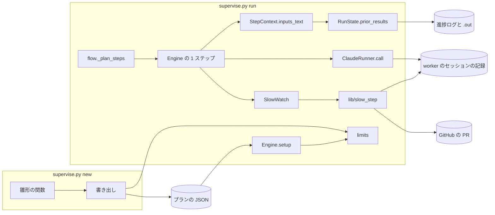
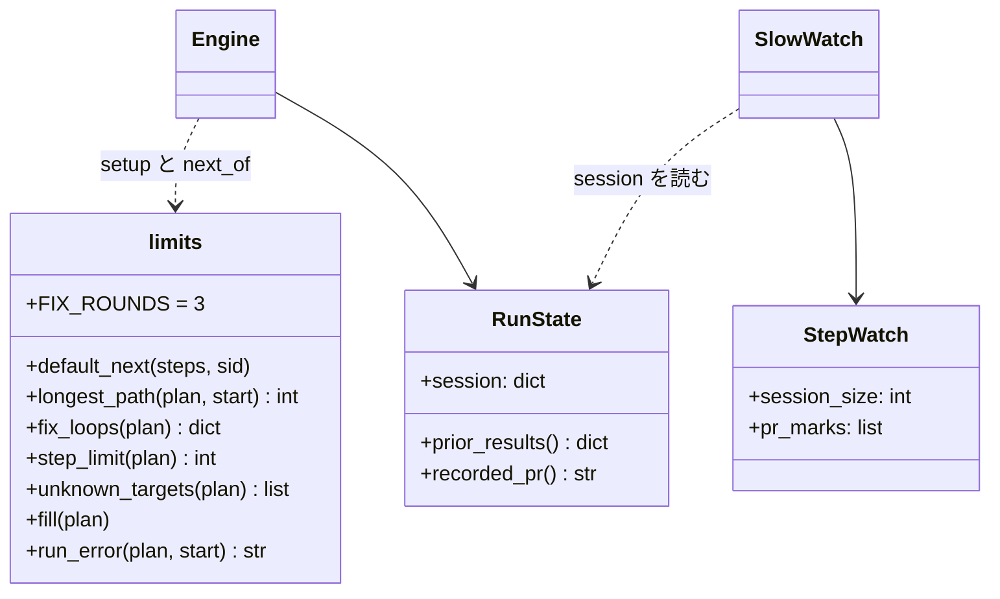
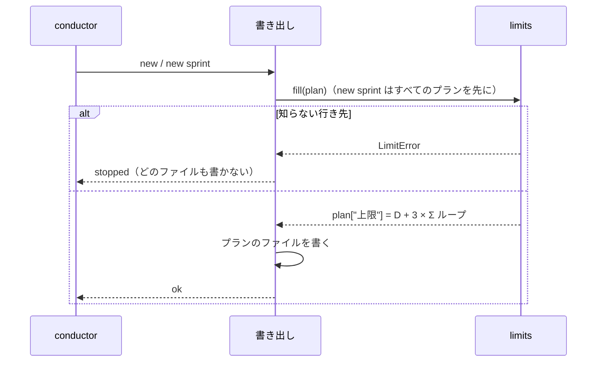
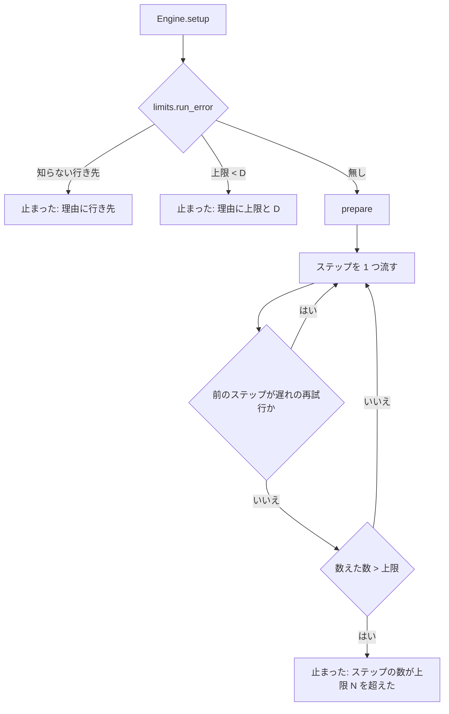
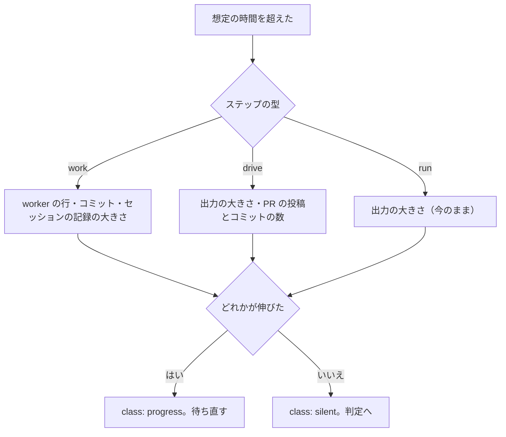

# 上限と見張り: 修正のループを数回通るプランが承認ゲートの手前で上限に当たって止まり、再開した judge は前の結果を読めず、遅れの見張りは進んでいる worker と cross-review を打ち切る → 上限を遷移から決めて承認ゲートか end まで届き、再開しても前の結果で判定し、進んでいる間は待ち直す（#1909 #1676 #1623 #1496）

## 目的

- **何が壊れているか**: `supervise.py` が組むプランの `上限` は雛形に書いた固定の数で、修正のループを 1〜3 回通る普通の経路より短い。止まったプランを `--from` で再開すると judge は前の実行の結果を読めず stop を返す。遅れの見張りは、コミットも worker の行も足さない要求・設計の worker と、段の出力へ書かない cross-review を、進んでいても打ち切る
- **誰が困るか**: スプリントを流す conductor と、手当てを待つ利用者。conductor は `--from merge-gate` / `--from ready` / `--from gate` / `record` を手で流している
- **直すと何が成り立つか**: 修正のループを数回通っても承認ゲートか end まで届く。再開した judge は前の実行の結果で判定し、進んでいる worker と cross-review は打ち切られない

## 適用範囲

- **働く範囲**: 配布先のどのリポジトリでも働く（`supervise.py` の `new` / `new sprint` / `run` / `queue`）
- **プロジェクトごとに違うもの**: 無い。上限はプランの遷移から決まり、設定も引数も足さない。手で書いたプランの `上限` は書いた値のまま効く
- **当たるモード**: すべてのモード（`supervise.py` が組むすべてのプランに当たる）

## あるべき姿の根拠

| 根拠 | 種類 | 何を示すか |
| --- | --- | --- |
| スプリント m1683 の #1833（PR #1903）: 全体テストの修正 1 回と doc-lint の修正 1 回で 20 本目の `ready` で上限 20 に達し、`--from merge-gate` で続けた | 実測 | 実装のプランの上限が、修正を 1 回ずつ通る経路より短い |
| スプリント m1982 の #1702（PR 1993）: 範囲テストの修正 3 回と doc-lint の修正 1 回で 23 本になり、`--from ready` で再開した | 実測 | 修正のループは 3 回通ることがある（前提 1 の出所） |
| スプリント m1910 の検査のプラン: 全体テストの修正 1 回で `record` の手前で上限 12 に達した | 実測 | 検査のプランも同じ形で止まる |
| #1676・スプリント m1847: 設計のプランが用語の修正を通って上限 12 を超え、`--from gate` の judge が「（入力なし）」で stop を返した | 実測 | 設計のプランの上限と、再開の入力の両方が足りない |
| devbasex/devbase#381（#1623）・volareinc/carmo-cdk PR #454（#1496）: 設計の worker と、4 ラウンドで収束した cross-review が「出力なし」で打ち切られた | 実測 | 見張りが出力の行とコミットだけで進みを見ている |
| 2026-10-16 の実測（claude 2.1.301）: `--output-format json` の claude -p は標準エラーへ 0 バイトしか書かず、`--session-id` で決めたセッションの記録（`<CLAUDE_CONFIG_DIR>/projects/<作業場所>/<id>.jsonl`）が 4 秒目から 24 秒目まで 247,156 → 367,366 バイトと伸び続けた。結果の `session_id` は渡した値と同じだった | 実測 | 要求・設計の worker の進みは、セッションの記録の大きさで見られる |
| 2026-10-16 の実測（gh 2.101.0）: `gh pr view 2024 --json comments,reviews,commits --jq '[(.comments\|length),(.reviews\|length),(.commits\|length)]'` が 0.84 秒で `[6,21,23]` を返し、無い PR は終了コード 1 で落ちた | 実測 | cross-review の投稿とコミットの伸びは、確認 1 回につき gh 1 回で見られる |

要求と受け入れ条件は #1909 の本文にある（コピーは `issues/issue-1909-requirements.md`）。この文書は「どう作るか」だけを扱う。決定の記録は [issue-1909-design-decisions.md](issue-1909-design-decisions.md) に分けた。

## ドメインモデル

### コンテキスト

| コンテキスト | 何の語が 1 つの意味に決まるか |
| --- | --- |
| 開発の工程（`ndf-workflow`） | プラン・ステップ・ステップの上限・修正のループ・遅れの見張り・前の実行 |

変更は 1 つのコンテキストに収まる。cross-review の駆動（`plugins/ndf/skills/cross-review/scripts/`）は変えない。見張りが GitHub から投稿とコミットの数を読むだけである（決定 9）。

### 集約

| 集約 | 持ち主（書き換えてよいもの） | 根 | エンティティ | 値オブジェクト |
| --- | --- | --- | --- | --- |
| プラン | `supervise.py new` / `new sprint` の書き出し（`templates.cmd_new`・`sprint.cmd_new_sprint`）。`上限` を書くのは書き出しの 1 か所だけ | プラン（JSON） | ステップ | 遷移・ステップの上限 |
| プランの実行 | `Engine`（流す前の照合）と `flow._plan_steps`（数えること） | 実行（`RunState`） | ステップの結果 | 数えたステップの数・前の実行の結果 |
| ステップの見張り | `SlowWatch` | `StepWatch` | — | 進みの印（出力の大きさ・worker の行とコミットの数・worker のセッションの記録の大きさ・PR の投稿とコミットの数） |

プランの実行はプランを ID（プランのパス）で参照し、プランのファイルを書き換えない。

### 不変条件

| # | 集約 | 条件 | 破れたときの扱い |
| --- | --- | --- | --- |
| I1 | プラン | 雛形が書く `上限` は、ループを通らない最長の経路に、修正のループのそれぞれを 3 回ずつ足した長さ以上である（L1） | 書き出しが遷移から計算するので起こらない。テストが雛形ごとに経路を流して確かめる |
| I2 | プラン | 雛形の関数は `上限` の数を持たない。ステップを足すと書き出しの計算が増やす（L2） | 雛形が `上限` を書いていても書き出しが計算の値で置き換える |
| I3 | プラン | 書き済みのプランの `上限` は、`run` も `queue` も書き換えない（前提 3・G2） | — |
| I4 | プラン | 遷移の行き先はプランのステップか特別な値（`end`・`stop` と、judge の `gate`・`stop`・`next`）である（L5） | `new` はプランを書かずに理由を返し、`run` は最初のステップを流す前に「止まった」で終わる |
| I5 | プランの実行 | `上限` が流し始めるステップからのループを通らない最長の経路より短ければ、最初のステップを流さない（L3） | 「止まった」で終わり、理由に `上限` と経路の長さを書く |
| I6 | プランの実行 | 上限と比べる数は、遅れの見張りの再試行を除いたステップの数である。`上限` は有限のまま（L4・1623-3） | 数を超えたら今と同じく「ステップの数が上限 N を超えた」で止まる |
| I7 | プランの実行 | ステップの `inputs` の結果は、今の実行の結果・前の実行の最後の結果・無い、の順に決まる（1676-2〜1676-4） | 無い入力は名前と理由を書いて渡す（「（入力なし）」の 1 語にまとめない） |
| I8 | プランの実行 | 前の実行は、`--from` を付けない最後の実行の始まりより後の記録である。Pull Request を戻す範囲と同じ切り方を使う（前提 4） | それより前の結果は渡さない |
| I9 | ステップの見張り | 進みの印のどれかが前の確認から伸びていれば、判定へ回さず待ち直す（1623-1・1496-1） | 一次の調査の `class` を `progress` にして待ち直す |
| I10 | ステップの見張り | どの印も伸びていなければ、今と同じく判定（retry / fix / stop / wait）へ回る（1623-2・1496-3） | — |

### ドメインイベント

| # | イベント | 発生元 | 受け手 |
| --- | --- | --- | --- |
| E1 | 雛形がプランを組み、ステップの上限を遷移から決めた | 書き出し（`limits.fill`） | プランのファイル（`run` が読む） |
| E2 | run がステップの上限とループを通らない最長の経路を照らした | `Engine.setup` | `flow._plan_steps`（止まったなら報告へ） |
| E3 | 前の実行の結果を読み戻した | `RunState.prior_results` | `StepContext.inputs_text`（judge と work の入力） |
| E4 | ステップが流れ、修正のループを通った | `flow._plan_steps` | 数えたステップの数 |
| E5 | 遅れの見張りが想定の時間を超えたのを見つけ、一次の調査を流した | `SlowWatch.check_slow` | `SlowWatch.slow_probe` |
| E6 | 一次の調査が進みを見つけ、待ち直した | `SlowWatch.slow_probe` | 進捗ログの `slow` の行 |
| E7 | 遅れの見張りがステップを打ち切り、再試行した | `Engine._next_after_slow` | `flow._plan_steps`（数に入れない） |
| E8 | ステップの上限に達して止まった | `flow._plan_steps` | フェーズレポート（`report.md`） |
| E9 | judge が入力を読んで次の手を決めた | `JudgeStep` | `Engine._next_after_judge` |

### 用語

| 用語 | 意味 | 用語集への反映 |
| --- | --- | --- |
| 失敗の遷移 | ステップが落ちたときの行き先。`on_fail`・`on_section_missing`・`on_exit` の 0 以外の終了コードの行き先 | 追加（`ndf-workflow`） |
| ループを通らない最長の経路 | プランの並びで後ろのステップへ行く遷移だけをたどった、最も長い経路。数はステップの数で、流し始めるステップを含む | 追加（`ndf-workflow`） |
| worker のセッションの記録 | 会話を残す claude -p（Skill を回す work のステップ）が `<CLAUDE_CONFIG_DIR>/projects/` の下へ書き足していく 1 本の JSONL。遅れの見張りが大きさの伸びを進みに数える | 追加（`ndf-workflow`） |
| ステップの上限 | 要求の意味のまま。雛形が書く値は遷移から求める | 変えない |
| 修正のループ | 要求の意味のまま。数え方は「上限の計算」の節 | 変えない |

## 機能一覧

| # | 機能 | 誰が使うか |
| --- | --- | --- |
| F1 | 雛形のプランへ、遷移から求めたステップの上限を書く。行き先の分からないプランは書かない | `supervise.py new` / `new sprint` を打つ conductor |
| F2 | 流す前に、プランの上限とループを通らない最長の経路を照らす | `supervise.py run` / `queue` |
| F3 | 遅れの見張りの再試行をステップの数に数えない | `supervise.py run` / `queue` |
| F4 | `--from` の再開で、ステップの入力へ前の実行の結果を渡す | judge と work のステップ |
| F5 | 要求・設計の worker のセッションの記録の伸びを、進みに数える | 遅れの見張り |
| F6 | cross-review などの drive のステップで、Pull Request への投稿とコミットの伸びを進みに数える | 遅れの見張り |

## 構成要素

| 要素 | 責務 |
| --- | --- |
| `supervise_lib/limits.py`（新規） | プランの遷移を読み、ループを通らない最長の経路・修正のループ・ステップの上限を求める純粋な計算。知らない行き先を見つける。既定の次のステップ（`next` が無いとき）の決め方を持つ |
| 書き出し（`templates.cmd_new`・`sprint.cmd_new_sprint`） | プランを書く前に `limits.fill` で `上限` を埋める。知らない行き先なら書かずに `stopped` を返す |
| 雛形の関数（下の「設計の結果」の表の 9 関数） | `上限` の数を書かない（1 行を消す） |
| `Engine` | `setup` で `limits.run_error` を照らす（L3・L5）。`next_of` は `limits.default_next` を使う |
| `flow._plan_steps` | 上限と比べる数を、遅れの再試行を除いて数える |
| `RunState` | 進捗ログの `step` の行へ出力ファイルの名前を足す。前の実行の結果を読む（`prior_results`）。前の実行の範囲の切り方を `recorded_pr` と共有する |
| `StepContext.inputs_text` | 今の実行 → 前の実行 → 無い（名前と理由）の順に入力を組む |
| `claude.py`（`claude_cmd`・`ClaudeRunner.call`） | 会話を残す claude -p に `--session-id` を渡し、セッションの id と設定の置き場を `RunState` へ残す |
| `SlowWatch`（`start_watch`・`slow_probe`） | work の一次の調査にセッションの記録の伸びを、drive の一次の調査に Pull Request の投稿とコミットの伸びを足す |
| `lib/slow_step.py` | セッションの記録の大きさを読む `session_size`、PR の数を読む `pr_marks`、それを含めて判定する `probe_worker`・`probe_drive` |

## 構造

`limits` はクラスでなくモジュールで、ファイルもプロセスも触らない。`LimitError`（知らない行き先）だけを投げる。

## 上限の計算

**プランの遷移を有向グラフとして読み、`上限 = D + 3 × Σ 修正のループの長さ` とする。** `D` はループを通らない最長の経路、3 は前提 1 の想定回数（`limits.FIX_ROUNDS`。値を持つのはこの 1 か所）である。`parts` を持つ work は `expand_parts` で展開した後のステップで数える（`Engine` が流す形と同じ）。

| 遷移 | 鍵 | 成功 / 失敗 |
| --- | --- | --- |
| 次のステップ | `next`（`end` は終わり）。無ければ `limits.default_next`（今の `Engine.next_of` の決め方を移したもの） | 成功 |
| judge の選択 | `choices` のうちステップの id。`next` は既定の次のステップ。`gate`・`stop` は終わり | 成功 |
| 飛ばす・承認ゲートの後 | `skip_to`・`gate_next` | 成功 |
| 終了コードの表 | `on_exit` の `0` の行き先 / 0 以外の行き先（`end`・`stop` は終わり） | 成功 / 失敗 |
| 落ちたとき | `on_fail`・`on_section_missing` | 失敗 |
| 直した後の戻り | `back_to_failed` の work から、その修正のループの検査のステップへ | 成功 |

- **D**: すべての遷移のうち、プランの並びで後ろのステップへ行くものだけをたどった最長の経路のステップの数（決定 2）。後ろのステップへ行く遷移だけのグラフは輪を持たないため、並びの逆順に 1 回たどれば求まる
- **修正のループ**: 検査のステップ `c` の失敗の遷移 `c → f` 1 本ごとに 1 つ。長さは、`c → f` から成功の遷移だけを通って `c` へ戻る単純な輪のうち、修正の work を 1 つ以上含む最も長いもののステップの数（決定 3）。修正の work は、`type` が `work` で `kind` が無いか「修正」のステップである。そういう輪が無ければループに数えない（例: 設計のプランの `glossary-recheck → push-glossary`）
- 輪の探索が 100,000 回の展開を超えたら、そのループの長さは「`f` から行けて `c` へ戻れるステップの数」で代える（多めに見る側）

今の雛形で計算した値を次に示す。2026-10-16 に `supervise.py new sprint`（pace: normal）と `new check` でプランを組み、この定義を写した手元のスクリプトで数えた。

| プラン | 今の上限 | D | 修正のループ（検査 → 失敗の行き先: 長さ） | 計算した上限 |
| --- | --- | --- | --- | --- |
| スプリントの設計 | 12 | 15 | 無し | 15 |
| 設計の結果・スプリントブランチ | 3 | 1 | 無し | 1 |
| スプリントの実装 | 20 | 13 | sync→fix-sync: 2、test-limited→judge: 3、pr→fix-push: 2、pr→judge: 7、test-all→judge: 8、doc-lint→fix-doc: 2 | 85 |
| スプリントの検査 | 12 | 12 | test-all→judge: 3 | 21 |
| `new check --pr` | 12 | 10 | test-all→judge: 3 | 19 |
| `new check --since-last` | 20 | 13 | test-all→judge: 3 | 22 |
| スプリントの開発版の配布 | 20 | 11 | bump・changelog・notes・sync→judge: 各 3、release→judge: 4、verify: 5、facts: 6、explain: 7、others: 8 | 137 |

要求の実測と照らすと、全体テストの修正 1 回は +8、doc-lint の修正 1 回は +2 で、#1909 の本文の数と一致する。要求の経路はどれも計算した上限に収まる。#1833（merge まで 22 本）と #1702（23 本）は 85 以内、m1910（13 本）は 21 以内、#1676（14 本）は 15 以内である。

## 入出力の契約

**プランの JSON の鍵と `supervise.py` の引数は変えない（G2）。** 変わるのは次の値と行である。

| 対象 | 今 | 変えた後 |
| --- | --- | --- |
| 雛形が書く `上限` | 雛形の関数ごとの固定の数 | `limits.step_limit` の値（上の表） |
| `上限` が無いプラン | 既定 30 | 変えない（前提 3） |
| `supervise.py new` / `new sprint` の結果（知らない行き先） | プランを書く | 書かない。`status: "stopped"`・`summary: "プランの遷移の行き先が知らないステップ: <ステップ> の <鍵> → <行き先>。プランを書かない"`・終了コード 2。`new sprint` はどのファイルも書かない |
| `run` の報告（L3） | 流し始め、途中で「ステップの数が上限 N を超えた」 | 最初のステップを流さず `結果: 止まった`・`理由: 上限 <N> がループを通らない最長の経路 <D> 本（<開始のステップ> から）より短い。上限を上げるか supervise.py new で書き直す` |
| `run` の報告（L5） | `on_exit` だけを照らし、ほかの行き先は流れた先で「知らないステップ」 | 最初のステップを流さず `理由: ステップ <id> の <鍵> の行き先が知らないステップ: <行き先>` |
| 上限で止まったときの理由（E8） | `ステップの数が上限 N を超えた` | `ステップの数が上限 N を超えた（遅れの再試行 <k> 回は数えていない）`。k が 0 なら括弧を付けない |
| 進捗ログの `step` の行 | `step`・`exit`・`summary` ほか | 鍵 `out`（`NN-<ステップ>.out` のファイル名）を足す |
| judge と work の入力の節 | 今の実行の結果だけ。無ければ全体を「（入力なし）」 | 入力ごとに `### ステップ <id>（exit=<N>）`、前の実行の結果は `### ステップ <id>（exit=<N>、前の実行）`、無ければ `### ステップ <id>（この実行でまだ流れていない）` か、`--from` の再開なら `（今の実行でまだ流れておらず、前の実行の記録にも無い）` |
| 進捗ログの `slow` の行の `probe` | `name`: `output` / `worker` | work は `name: worker` のまま、`summary` にセッションの記録の伸び（バイト）を足す。drive は `name: drive`、`summary` に出力の伸びと PR の投稿・コミットの増分を書く |

**会話を残す claude -p の起動（`full: true`）に `--session-id <uuid>` を足す。** `--resume` で起こし直すときは足さず、セッションの id は起こし直す id のままである。

## 処理の流れ

### プランを書く（`supervise.py new` / `new sprint`）

### プランを流す（`supervise.py run` / `queue`）

数えるのは「流すステップ」の回数で、直前のステップが遅れの見張りの再試行（`cur.slow.act == "retry"`）で同じステップへ戻ったときだけ数えない。耐久ステップの番号 `n`（`.out` の名前と耐久の記録の鍵）は今と同じくすべての回で増やす。

### 入力を組む（judge と work）

1. `inputs` の各ステップについて、今の実行の結果（`RunState.results`）があればそれを使う
2. 無ければ `RunState.prior_results()` を引く。進捗ログを 1 回だけ読み、`--from` を付けない最後の `run` の行より後の `step` の行のうち、そのステップの最後の行の `exit` と、`out` のファイルの末尾（`TAIL` 文字）を返す
3. どちらにも無ければ、名前と理由の 1 行を書く

`out` の鍵の無い行（この変更より前の記録）は、出力の本文を読まずに `exit` と `summary` だけを渡す。

### 遅れの見張りの一次の調査

- セッションの記録の大きさ: `RunState.session` から `<設定の置き場>/projects/*/<id>.jsonl` を探して大きさを読む。`RunState.session` は、`ClaudeRunner.call` が起動の前に入れる id と設定の置き場である。見つからなければ 0 として、ほかの印だけで判定する。設定の置き場は子へ渡す環境の `CLAUDE_CONFIG_DIR`、無ければ `~/.claude`
- PR の投稿とコミットの数: `gh pr view <PR> --json comments,reviews,commits` の 3 つの長さ。`start_watch` で 1 回、確認のたびに 1 回読む。PR がまだ無い・gh が落ちたときは数を比べず、出力の大きさだけで判定する

## 非機能の実現方式

| 大項目 | 条件 | 実現方式 |
| --- | --- | --- |
| 性能・拡張性 | ステップ 50 本のプランで 1 秒以内 | D は並びの逆順に 1 回たどる。ループの探索は検査のステップの失敗の遷移ごとに打ち切りの回数（100,000 回の展開）を持つ。今の雛形は手元のスクリプトで 1 本 0.001 秒未満だった |
| 運用・保守性 | 止まった理由に上限と経路の長さ、待ち直した根拠が載る | L3・L5・E8 の理由の文（「入出力の契約」）と、`slow` の行の `probe.summary` |
| 移行性 | 書き済みのプランを書き直さない | `run` はプランを読むだけ。L3 で止まった書き済みのプラン（例: 今の設計のプランの上限 12 は D 15 より短い）は、理由の文が `上限` を上げるか `new` で書き直すよう示す |

## 決定の記録

[issue-1909-design-decisions.md](issue-1909-design-decisions.md) に分けた。

## テスト設計

| 受け入れ条件・不変条件 | どの振る舞いで縛るか | どう壊したら落ちるべきか |
| --- | --- | --- |
| L1・I1 | 雛形ごと（impl・fix・check・`check --since-last`・release とスプリントの全プラン）に、D の経路に各修正のループを 3 回ずつ足した経路を、ステップの結果をスタブにして流すと上限で止まらない | `FIX_ROUNDS` を 1 にする・ループの長さを最短の輪にすると落ちる |
| L2・I2 | 実装の雛形の修正のループの中（範囲テストと PR の間）に run のステップを 1 本足すと、書いた `上限` が 3 以上増える | 書き出しが `上限` を埋めず、雛形の固定の数を残すと落ちる |
| L3・I5 | `上限` が D より短い手書きのプランを `run` すると、どのステップの `.out` も作られずに止まり、理由に上限と D が載る。`--from` では開始のステップからの D で照らす | 照合を消すと、最初のステップが流れて落ちる |
| L4・I6 | 範囲テストが落ち続け judge が毎回 fix を返すプランは「ステップの数が上限 N を超えた」で止まる | 数え方が修正のステップを数えないと止まらずに落ちる |
| L5・I4 | `next` の行き先が無いステップのプランは、`new` がファイルを書かずに終了コード 2、`run` が流す前に止まる。`limits` は例外で落ちない | 照合を `on_exit` だけに戻すと、`run` が途中まで流れて落ちる |
| I3 | `run` の前後でプランのファイルの中身が変わらない | `run` が `上限` を埋めると落ちる |
| 1909-1 | スプリントの実装のプランで #1833 の経路（20 本）が merge まで通る | 上限を 20 に戻すと落ちる |
| 1909-2 | 同じプランで #1702 の経路（範囲テストの修正 3 回と doc-lint の修正 1 回）が merge まで通る | 同上 |
| 1909-3 | スプリントの検査のプランで m1910 の経路が record まで通る | 上限を 12 に戻すと落ちる |
| 1676-1 | スプリントの設計のプランで、用語の修正を通る経路に design の再試行 1 回を足した経路が gate の judge まで届く | 上限を 12 に戻すか、再試行を数えると落ちる |
| 1676-2・I7 | 前の実行で review が approved のまま `--from gate` で再開すると、gate の judge の入力に review の結果（`前の実行` の印つき）が載る。同じステップが前の実行で 2 回流れていれば後の方が載る | `prior_results` を引かないと「まだ流れていない」になって落ちる |
| 1676-3 | 前の実行にも無い入力は、名前と「前の実行の記録にも無い」が載り、「（入力なし）」の 1 語にならない | 無い入力を飛ばすと落ちる |
| 1676-4・I8 | `--from` を付けない実行の前の結果は渡らない。今の実行で流れたステップは今の結果が載る | 切り方を「最初の行から」にする・今の結果より前の結果を先にすると落ちる |
| 1623-1・I9 | 要求・設計の work が、コミットも worker の行も足さずにセッションの記録を伸ばしている間、`slow` の行の `probe.class` が `progress` で、打ち切らない | セッションの記録を見ないと `silent` になって落ちる |
| 1623-2・I10 | セッションの記録も伸びない work は判定へ回る | 記録が見つからないのを「伸びた」と扱うと落ちる |
| 1623-3・I6 | 遅れの再試行が 2 回起きた設計のプラン（用語の修正を含む最長の経路）が gate まで届き、`max_retry` を超えた再試行は今と同じく止まる | 再試行を数えると上限で止まって落ちる |
| 1496-1 | drive のステップが段の出力へ書かずに PR の投稿かコミットを重ねている間、待ち直す | PR の数を見ないと `silent` になって落ちる |
| 1496-2 | 履歴 2 件・想定 900 秒の drive が、900 秒を超えて 4 ラウンドで収束するまで打ち切られず、ステップは 1 回で終わる（駆動と gh をスタブにする） | 同上 |
| 1496-3 | 出力も PR の数も伸びない drive は判定へ回る。gh が落ちたときも出力だけで判定する | gh の失敗を「伸びた」と扱うと落ちる |
| G1 | 既存のテストが通る | — |
| G2 | 書き済みのプラン（`上限` を持つ JSON）がそのまま読める | 鍵の名前を変えると落ちる |
| 決定 2 の前提 | 今のすべての雛形で、D（並びで後ろへ行く遷移だけの最長）が、すべての単純な経路を数えた最長と一致する | 雛形の並びが遷移と食い違うと落ちる |

## 設計の結果

| 課題 | 扱い | 取り込み先 | 触るファイル |
| --- | --- | --- | --- |
| #1909 | 実装する | — | `plugins/ndf/scripts/supervise_lib/limits.py`、`plugins/ndf/scripts/supervise_lib/templates.py`、`plugins/ndf/scripts/supervise_lib/sprint.py`、`plugins/ndf/scripts/supervise_lib/sprint_waves.py`、`plugins/ndf/scripts/supervise_lib/release_templates.py`、`plugins/ndf/scripts/supervise_lib/delivery_templates.py`、`plugins/ndf/scripts/supervise_lib/engine.py`、`plugins/ndf/scripts/supervise_lib/flow.py`、`plugins/ndf/scripts/supervise_lib/plan.py`、`plugins/ndf/scripts/supervise_lib/state.py`、`plugins/ndf/scripts/supervise_lib/steps.py`、`plugins/ndf/scripts/supervise_lib/claude.py`、`plugins/ndf/scripts/supervise_lib/slow.py`、`plugins/ndf/scripts/lib/slow_step.py`、`plugins/ndf/scripts/tests/`、`docs/specifications/ndf-backlog-refinement-stage.md` |
| #1676 | 取り込む | #1909 | — |
| #1623 | 取り込む | #1909 | — |
| #1496 | 取り込む | #1909 | — |

**ほかの 2 主題と同じファイルで触る関数は次に限る。** 起点の取り込み（#1917 #2003）と指示と整形（#1651 #1941 #1507）が雛形へステップを足しても、`上限` は書き出しが計算し直す。雛形の側で `上限` を触らなくてよい。

| ファイル | この主題が触る関数 | 触り方 |
| --- | --- | --- |
| `supervise_lib/templates.py` | `plan_to_merge`・`plan_check`・`plan_check_since` | プランの辞書の `"上限": N,` の 1 行を消すだけ。steps の並び・遷移・ほかの鍵は触らない |
| `supervise_lib/templates.py` | `cmd_new` | ファイルを書く前に `limits.fill` を呼び、`LimitError` なら書かずに `stopped` を返す |
| `supervise_lib/flow.py` | `_plan_steps` | 上限と比べる数を、遅れの再試行を除いた数にし、止まった理由に再試行の回数を足す |
| `supervise_lib/design_stage.py` | 触らない | — |

共有しないファイルで触る雛形の関数は次の 7 つである。`上限` の 1 行を消す関数は、上の 3 つと合わせて 9 つになる。

| ファイル | 関数 | 触り方 |
| --- | --- | --- |
| `supervise_lib/sprint.py` | `close_plan` | `"上限"` の 1 行を消す |
| `supervise_lib/sprint.py` | `cmd_new_sprint` | ファイルを書く前に、すべてのプランへ `limits.fill` を呼ぶ |
| `supervise_lib/sprint_waves.py` | `plan_sprint_design`・`plan_sprint_branch`・`plan_design_results` | `"上限"` の 1 行を消す |
| `supervise_lib/release_templates.py` | `plan_release_package_plugin` | `"上限"` の 1 行を消す |
| `supervise_lib/delivery_templates.py` | `release_plan` | `"上限"` の 1 行を消し、docstring の「上限 12」を直す |

## 未確認のまま残ること

| 項目 | 内容 |
| --- | --- |
| 想定回数 3 の釣り合い（前提 1） | 上の表のとおり、実装のプランは 20 → 85、開発版の配布のプランは 20 → 137 になる。ループが回り続けるとき、judge の「2 回直しても同じ失敗なら stop」が先に止めると見込むが、上限まで回ったときの費用は測っていない。値を変えるなら `limits.FIX_ROUNDS` の 1 か所を変える。承認ゲート 1 で利用者が決める |
| 走っている途中のスプリント | この版を入れた時点で書き済みの設計のプラン（上限 12）は L3 で流し始める前に止まる。理由の文が直し方を示すが、版を入れるのはスプリントの切れ目にするのが安全である |
| セッションの記録の置き場 | `<CLAUDE_CONFIG_DIR>/projects/<作業場所>/<id>.jsonl` は claude 2.1.301 での実測で、claude の版が置き場を変えると見つからず、今と同じく判定へ回る（悪くはならない） |
| GitHub の上限 | drive の確認ごとに gh を 1 回呼ぶ。確認は想定の時間（下限 300 秒）ごとなので 1 時間に十数回までと見込むが、並べた drive の数だけ増える |
| ループの探索の打ち切り | 100,000 回の展開を超える雛形は今は無い（実測で 0.001 秒未満）。超えたときに多めに見積もった上限が付く |
