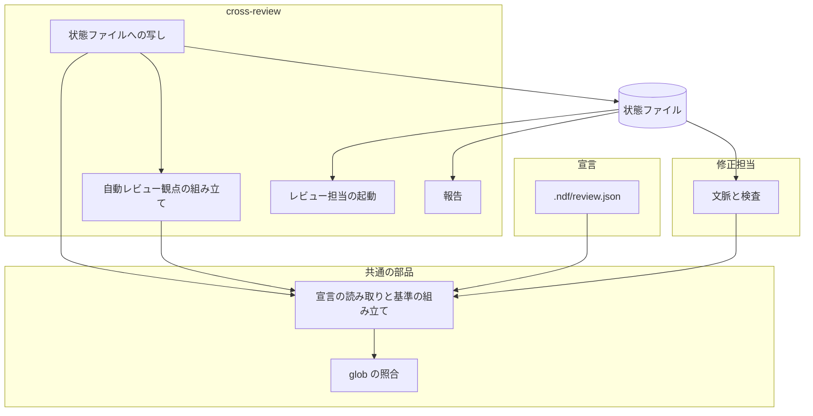
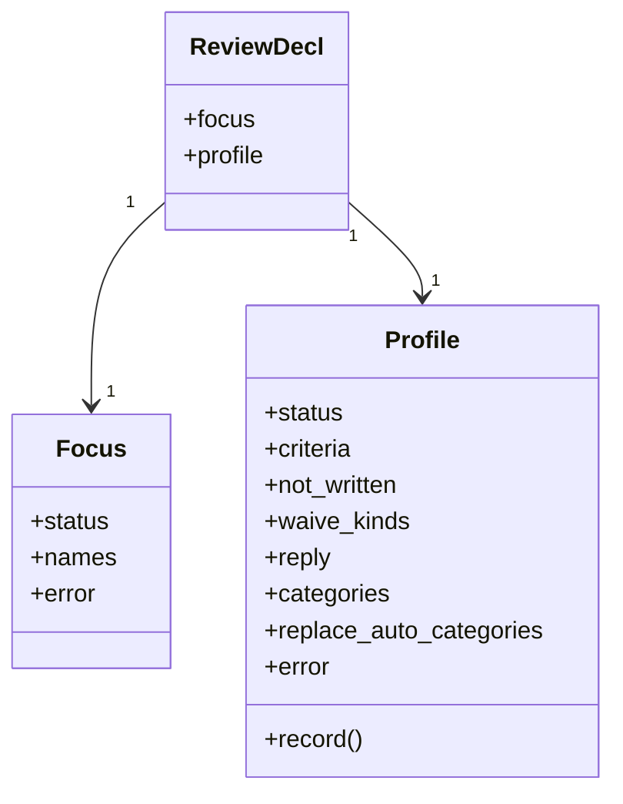
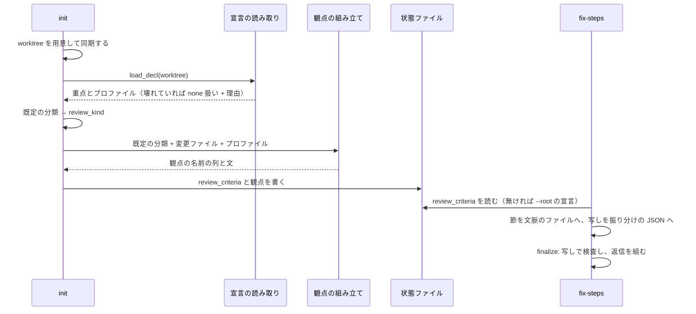

# cross-review: 小説の原稿のような成果物の PR では、言い回しや口調の指摘が「書かないもの」とされ、書かれても `wording` で見送られる → プロジェクトが `.ndf/review.json` のプロファイルで指摘の基準・見送り・自動レビュー観点を差し替えられ、秘密・認証の基準だけは残る（#1910）

## 目的

- **何が壊れているか**: 指摘の基準・書かないもの・見送りの種類・見送りの返信・自動レビュー観点が NDF の定数で、プロジェクトからは足すことしかできない。Markdown の原稿の PR では、主な指摘（言い回し・口調・設定との食い違い）が「書かないもの」に当たり、書かれても見送られる
- **誰が困るか**: システム開発以外の成果物（小説の原稿など）を cross-review の収束ループで通したい利用者。今はプロジェクトの Skill で同じ形のループを別に組んでいる
- **直すと何が成り立つか**: `.ndf/review.json` に `version: 2` の `profile` を書いたリポジトリでは、レビュー担当・修正担当への節と見送りの返信と自動レビュー観点がプロファイルから組まれる。書かないリポジトリでは 1 字も変わらない

## 適用範囲

- **働く範囲**: 配布先のリポジトリでも働く（`cross-review` と `/ndf:fix` の振る舞い）。このリポジトリの `.ndf/review.json` は書き換えない（C7）
- **プロジェクトごとに違うもの**: 基準・書かないもの・見送りの種類・返信・自動レビュー観点を、設定（`.ndf/review.json` の `profile`）で受ける。引数は足さない
- **当たるモード**: `standard`

## あるべき姿の根拠

| 根拠 | 種類 | 何を示すか |
| --- | --- | --- |
| 課題 #1910 の「背景」: 利用者のプロジェクトで、小説の原稿を 10 話ごとに PR にまとめて cross-review したいという求めが出た | 利用者の指示の原文（要約） | 差し替えの単位が「指摘の基準・見送り・自動観点」であること |
| `plugins/ndf/scripts/lib/review_criteria.py` の `CRITERIA` / `NOT_WRITTEN` / `WAIVE_KINDS` / `REPLY` と、`review_lib/categories.py` の `_classify_changed_files`（ndf 10.17.70 で読んだ） | 実測（コードの読み取り） | 今はどれも定数で、宣言は `focus` を基準 3 として足すことしかできないこと |
| NDF の共通原則の優先順位（上位の原則 > 利用者の承認 > プロジェクトの MVV）と C1〜C4 | 外部の一次情報（共通原則） | 秘密・認証・利用者のデータ・戻せない操作の基準は、プロジェクトの設定で消せない側に置くこと（決定 1） |

要求と受け入れ条件は #1910 の本文にある（コピーは `issues/issue-1910-requirements.md`）。この文書は「どう作るか」だけを扱う。

## ドメインモデル

### コンテキスト

| コンテキスト | 何の語が 1 つの意味に決まるか |
| --- | --- |
| NDF の cross-review（`ndf-cross-review`） | レビューのプロファイル・指摘の基準・外せない基準・見送りの種類・見送りの返信・自動レビュー観点・修正担当 |

1 つのコンテキストに収まる。`/ndf:fix` を単独で使うときも、同じ語と同じ部品（`review_criteria.py`）で読む。

### 集約

| 集約 | 持ち主（書き換えてよいもの） | 根 | エンティティ | 値オブジェクト |
| --- | --- | --- | --- | --- |
| レビューの宣言 | 利用者（`.ndf/review.json` を書く）。NDF は読むだけで、読み取りは `review_criteria.py` の `load_decl` だけが行う | 宣言（`.ndf/review.json`） | — | 重点（`Focus`）・プロファイル（`Profile`） |
| 状態ファイルの指摘の基準 | cross-review の `init`（新規と再開） | 状態ファイルの `review_criteria` | — | プロファイルの写し・レビュー担当への節 |
| 振り分け | 修正担当（`decision` を書く）と `fix-steps.py`（`context` が雛形と写しを書き、`finalize` が検査する） | 振り分けの JSON | 指摘ごとの振り分け | プロファイルの写し・見送りの返信 |

### 不変条件

| # | 集約 | 条件 | 破れたときの扱い |
| --- | --- | --- | --- |
| I1 | レビューの宣言 | プロファイルが無い（`none`）とき、レビュー担当・修正担当への節、見送りの返信、自動レビュー観点、状態ファイルの `review_criteria` は変更前と 1 字も変わらない | テストが落とす |
| I2 | レビューの宣言 | 外せない基準（基準 2）は、プロファイルがあっても両方の節に出て、振り分けで `criterion: 2` が許される | プロファイルの `criteria` が `"2"` を書けば壊れたプロファイルとして捨てる（I4） |
| I3 | レビューの宣言 | プロファイルの鍵は個別に効く。書いた鍵だけが既定を差し替え、書かない鍵は既定の値のまま | テストが落とす |
| I4 | レビューの宣言 | 壊れたプロファイルは丸ごと捨てて既定で続け、終了コードを変えない。理由を標準エラー（cross-review では報告）に出す。重点（`focus`）はプロファイルと独立に読む | 止めない |
| I5 | 振り分け | `finalize` が許す `criterion` と `waive_kind` は、`context` が修正担当へ渡した節と同じプロファイル（振り分けの JSON の写し）から組んだ集合である | 許さない値は `finalize` が `invalid` で止める |
| I6 | 状態ファイルの指摘の基準 | `review_kind`（設計 / コード）とラウンドの段は、既定の分類から決め、プロファイル（`replace_auto_categories` を含む）で変わらない | テストが落とす |
| I7 | 状態ファイルの指摘の基準 | 再開で状態ファイルの `review_criteria` と自動レビュー観点を書き直すのは、宣言から組んだ値が保存した値と違うときだけである | テストが落とす |
| I8 | 振り分け | 見送りの返信は、返信の雛形の `{inner}` を見送りの種類の名前に置き換えた文である。重点の句（「レビューの重点（…）にも当たりません」）は既定の雛形のときだけ足す | テストが落とす |

### ドメインイベント

| # | イベント | 発生元 | 受け手 |
| --- | --- | --- | --- |
| E1 | レビューの宣言（重点とプロファイル）を読んだ | `review_criteria.load_decl`（`init`・再開の `init`・`fix-steps.py context`・`review_criteria.py` の CLI） | `init`（E2・E3 へ）、`fix-steps.py context`（E5 へ） |
| E2 | 変更ファイルから自動レビュー観点を決めた | `init`（`review_focus._auto_review`） | 状態ファイル（E3） |
| E3 | 指摘の基準の節と観点を状態ファイルへ写した | `init` | `launch-reviewer.sh`（E4）、`fix-steps.py context`（E5） |
| E4 | レビュー担当がプロファイルの基準で指摘を書いた | `launch-reviewer.sh` が起動したレビュー担当 | 修正担当（E5） |
| E5 | 修正担当が指摘を直すか、プロファイルの見送りの種類で見送ると振り分けた | 修正担当（`context` の文脈のファイルを読む） | `fix-steps.py finalize`（E6） |
| E6 | 見送りの返信をプロファイルの返信の雛形から組んで戻り値ファイルへ書いた（`finalize` は投稿しない） | `fix-steps.py finalize` | 戻り値ファイルを読む側が投稿する: cross-review の中では `state.py merge-fix`、単独で呼んだときは `result_posts.py fix`。投稿の経路は今の 2 つのままで足さない |
| E7 | 再開のときにプロファイルを読み直し、変わっていれば状態ファイルを書き直した | 再開の `init` | `launch-reviewer.sh`（次のラウンドの E4） |

### 用語

| 用語 | 意味 | 用語集への反映 |
| --- | --- | --- |
| レビューのプロファイル | `.ndf/review.json` の `profile` に書く、指摘の基準・書かないもの・見送りの種類・見送りの返信・自動レビュー観点の差し替えの組。書いた鍵だけが既定を差し替える | 要求で追加済み（変更なし） |
| 自動レビュー観点 | 変更ファイルの分類から cross-review が両スロットへ渡す観点の文。プロファイルの分類の観点も含む | 要求で追加済み（変更なし） |
| 外せない基準 | 指摘の基準 2（秘密・認証認可・利用者のデータ・戻せない操作）。プロファイルがあっても消せず、番号 2 のまま出る | 追加（`ndf-cross-review`） |
| 指摘の基準 | 指摘として出してよいものを決める番号つきの条件。既定は 1・2・4 と宣言があるときの 3。プロファイルは 2・3 以外の番号を差し替える | 意味の変更（`ndf-cross-review`） |
| 見送りの種類 | 見送りの返信の括弧に書く、指摘の基準に当たらない理由の分類（`waive_kind`）。既定は 5 分類で、プロファイルの `waive_kinds` が差し替える | 意味の変更（`ndf-cross-review`） |
| 見送りの返信 | 修正担当が minor / nit の指摘を直さずに閉じるときに書く返信。雛形（既定か、プロファイルの `reply`）の `{inner}` に見送りの種類の名前を入れて組む | 意味の変更（`ndf-cross-review`） |

## 機能一覧

| # | 機能 | 誰が使うか |
| --- | --- | --- |
| F1 | `.ndf/review.json` の `version: 2` にプロファイルを書き、レビュー担当への指摘の基準と書かないものを差し替える | 利用者のプロジェクトの書き手 |
| F2 | プロファイルで見送りの種類と見送りの返信を差し替え、修正担当がその種類で見送る | 修正担当（`/ndf:fix`） |
| F3 | プロファイルの分類（パスの glob と観点の文）で自動レビュー観点を足し、既定の自動カテゴリを外す | cross-review のレビュー担当 |
| F4 | プロファイルがあるとき、修正担当への節を「コード」に限らない語で出す | 修正担当 |
| F5 | 壊れたプロファイルを知らせ、既定の基準で続ける | cross-review を回す利用者・`review_criteria.py` を打つ人 |
| F6 | 中断した cross-review の再開で、書き換えたプロファイルを次のラウンドから効かせる | cross-review を回す利用者 |

## 構成要素

| 要素 | 責務 |
| --- | --- |
| 宣言の読み取り（`scripts/lib/review_criteria.py` の `load_decl` / `Profile` / `profile_from`） | `.ndf/review.json` を 1 回読み、重点とプロファイルを独立に検査して返す。例外を上げない。写し（辞書）からプロファイルを組み直す |
| 基準の組み立て（同 `reviewer_block` / `fixer_block` / `waiver_reply` / `criterion_numbers` / `waive_kinds`） | 既定の定数とプロファイルから、節・返信・許す値の集合を組む。既定の値はここだけに置く |
| プロファイルの分類の照合（同 `profile_categories`） | 変更ファイルのパスをプロファイルの `categories` の glob で照らし、当たった分類の名前と観点の文を返す。glob の照合は `scripts/lib/pace.py` の `matches` を使う |
| 自動レビュー観点の組み立て（`review_lib/review_focus.py` の `_auto_review`） | 既定の分類の結果とプロファイルの分類を合わせ、`replace_auto_categories` に従って観点の名前の列と文を組む |
| 状態ファイルへの写し（`review_lib/commands/init.py`） | 新規では worktree を用意した後に宣言を読み、`review_kind` を既定の分類から、自動レビュー観点と `review_criteria` をプロファイル込みで組む。再開では同期の後に読み直し、違うときだけ書き直す |
| 報告（`review_lib/commands/report.py`） | プロファイルを読めなかったとき、その理由を出す |
| 修正担当の文脈と検査（`skills/fix/scripts/fix-steps.py`） | `context` で状態ファイルの写し（無ければ `--root` の宣言）からプロファイルを得て節を書き、振り分けの JSON へ写す。`finalize` は写しから許す値を組んで検査し、返信を組む |
| 文書（cross-review の `docs/04-contracts.md`・`docs/02-fix-and-rotation.md`・`references/design-principles.md`、`skills/fix/SKILL.md`、`scripts/lib/README.md`） | 宣言の形・状態ファイルの項目・修正担当の語を書く |



置き場所（変えるものだけ。新設のファイルは無い）:

```text
plugins/ndf/
├── scripts/lib/
│   ├── review_criteria.py      変える（宣言 v2・Profile・組み立て）
│   ├── pace.py                 変えない（matches を使う）
│   └── README.md               変える
├── skills/cross-review/
│   ├── scripts/review_lib/
│   │   ├── review_focus.py     変える（_auto_review）
│   │   └── commands/
│   │       ├── init.py         変える（読む時点・再開の書き直し）
│   │       └── report.py       変える（プロファイルの読めなかった理由）
│   ├── docs/04-contracts.md    変える
│   ├── docs/02-fix-and-rotation.md  変える
│   └── references/design-principles.md  変える
└── skills/fix/
    ├── scripts/fix-steps.py    変える
    └── SKILL.md                変える
```

**`launch-reviewer.sh` は変えない。** 状態ファイルの `review_criteria.reviewer_block` と `review_instructions` を読むだけで、プロファイルの差し替えはどちらも `init` が済ませている。

### 集合へ値を足すことで当たる既存の規則

宣言の版（`version`）に 2 を足し、自動カテゴリの集合にプロファイルの分類の名前を足す。既存の規則を集めて判定した結果、当てはまらないものを変える対象に載せた。

| 既存の規則 | 置き場 | 新しい値に当てはまるか | 扱い |
| --- | --- | --- | --- |
| `version != 1` は形が違うとして `unreadable` | `review_criteria.load_focus` | 当てはまらない（2 を読む） | `load_decl` へ置き換える |
| `review_kind` は自動カテゴリに `design` があり `code` が無ければ設計 | `classifications.review_kind` | 当てはまらない（プロファイルの分類で `design` が外れうる） | `init` が既定の分類の列を渡す（決定 5） |
| 再開は `auto_review_instructions` が無いときだけ観点を組み直す | `init._refresh_resume_state` | 当てはまらない（プロファイルの書き換えを拾わない） | 同期の後に組み直して比べる（決定 6） |
| 振り分けは `WAIVE_KINDS` と `CRITERION_NUMBERS` で検査 | `fix-steps._decision_problems` / `_criterion_problems` | 当てはまらない | `waive_kinds(profile)` / `criterion_numbers(focus, profile)` で検査する |
| 修正担当の節の返信の例は `doc_mismatch` | `review_criteria.fixer_block` | 当てはまらない（プロファイルに無い種類がある） | 有効な種類の先頭で例を組む |
| 報告は重点が `unreadable` のときだけ出す | `report._print_review_focus` | 当てはまらない | プロファイルの `unreadable` も出す |
| 契約の文書の自動カテゴリの一覧 | `docs/04-contracts.md` | 当てはまらない | プロファイルの分類と `replace_auto_categories` を書き足す |

## 構造



- `Profile` は `Focus` と同じ `NamedTuple` にする。`status` は `declared` / `none` / `unreadable`。書かなかった鍵は `None`（既定を使う）で、`replace_auto_categories` だけは真偽値（既定は偽）
- `ReviewDecl` は `load_decl(root)` の戻り値。既存の `load_focus(root)` は `load_decl(root).focus` を返す形で残し、呼び手を壊さない
- 基準の組み立ての関数は `profile` を最後の省略できる引数で受ける（省くと `NO_PROFILE`）。既存の呼び出しはそのまま I1 の出力になる

| 関数 | 入力 | 出力 |
| --- | --- | --- |
| `load_decl(root)` | worktree の根 | `ReviewDecl`。例外を上げない |
| `profile_from(record)` | 状態ファイル・振り分けの JSON の写し（辞書か `None`） | `Profile`。形が違えば `NO_PROFILE` |
| `reviewer_block(focus, mvv, profile)` / `fixer_block(focus, mvv, profile)` | — | 節の文字列 |
| `waiver_reply(kind, names, basis, profile)` | 見送りの種類 | 返信の文字列。許さない種類は `ValueError` |
| `criterion_numbers(focus, profile)` | — | 許す番号の昇順のタプル |
| `waive_kinds(profile)` | — | 種類 → 名前の辞書 |
| `profile_categories(profile, paths)` | 変更ファイルのパスの列 | `[(名前, 観点の文)]`。宣言の順 |
| `as_state(focus, mvv, profile)` | — | 状態ファイルの `review_criteria` |

## データ構造

永続するのは 2 つのファイルの項目である（状態ファイルと振り分けの JSON）。どちらも実行ごとの作業ファイルで、過去を残す要件は無いため上書きでよい（決定 9）。

### 状態ファイルの `review_criteria`（足す項目）

| 項目 | 型 | 空を許すか | 意味 |
| --- | --- | --- | --- |
| `profile_status` | 文字列 | 項目ごと省く | `declared` / `unreadable`。**プロファイルが無い（`none`）ときは、この表の 3 項目をすべて置かない**（I1） |
| `profile` | オブジェクト | `unreadable` では置かない | 検査を通ったプロファイルの写し。形は下の宣言の `profile` と同じ（鍵は書いたものだけ） |
| `profile_error` | 文字列 | `declared` では置かない | 読めなかった理由 |

既存の `status` / `focus` / `error` / `reviewer_block` / `project_mvv` / `mvv_block` は変えない。`reviewer_block` はプロファイル込みで組んだ節になる。

### 状態ファイルの観点（意味を変える項目）

| 項目 | 変わること |
| --- | --- |
| `auto_review_categories` | プロファイルの分類の名前を含む、そのレビューで観点を渡した分類の列。`replace_auto_categories` が真なら既定の分類の名前を含まない |
| `auto_review_instructions` / `review_instructions` / `review_instructions_by_stage.detail` | プロファイルの観点の文を含む |
| `review_kind` | 変えない。既定の分類から決める（I6） |

### 振り分けの JSON（足す項目）

| 項目 | 型 | 空を許すか | 意味 |
| --- | --- | --- | --- |
| `review_profile` | オブジェクト | 項目ごと省く | `context` が写したプロファイル（状態ファイルの `profile` と同じ形）。プロファイルが `declared` のときだけ置く。`finalize` はこれで検査し、返信を組む（I5） |

| 機能 | 宣言 | 状態ファイル | 振り分けの JSON |
| --- | --- | --- | --- |
| F1・F3・F5（`init`） | R | C / U | — |
| F6（再開の `init`） | R | U（違うときだけ） | — |
| F2・F4（`context`） | R（状態ファイルが無いとき） | R | C |
| F2（`finalize`） | — | — | R |

**移行**: 古い状態ファイル（プロファイルの項目が無い）は「プロファイルなし」として読み、再開で宣言を読み直して組む。宣言にプロファイルが無ければ組んだ値が保存した値と同じなので、書き直さない（I7）。

## 入出力の契約

### `.ndf/review.json`（`version: 2`）

| 鍵 | 型 | 必須 | 規則 |
| --- | --- | --- | --- |
| `version` | 数 | 必須 | `1` か `2`。`1` は今と同じ（`focus` 必須、ほかの鍵は無視）。ほかの値は宣言全体が読めない（重点を `unreadable`、プロファイルを `none`） |
| `focus` | 文字列の配列 | `2` では任意 | 今と同じ。形が違えば重点だけが `unreadable` |
| `profile` | オブジェクト | 任意 | 無いか `{}` ならプロファイルは `none`。下の鍵のどれか 1 つでも形が違えば、プロファイル全体を `unreadable` にする（I4） |
| `profile.criteria` | オブジェクト（番号の文字列 → 文） | 任意 | 鍵は 1 以上の整数の 10 進表記で、`"2"` と `"3"` を除く。値は空でない文字列。1 件以上。既定の基準 1・4 と置き換わり、基準 2（外せない基準）と、重点があるときの基準 3 はそのまま残る |
| `profile.not_written` | 文字列の配列 | 任意 | 各要素は空でない文字列。`[]` なら「書かないもの」の行を出さない |
| `profile.waive_kinds` | オブジェクト（種類 → 名前） | 任意 | 鍵は `^[a-z][a-z0-9_]*$`、値は空でない文字列。1 件以上 |
| `profile.reply` | 文字列 | 任意 | `{inner}` をちょうど 1 回含む。`{inner}` を種類の名前で置き換える（`str.format` は使わず、ほかの波括弧はそのまま残す） |
| `profile.categories` | オブジェクト（名前 → `{paths, instructions}`） | 任意 | 名前は `^[a-z][a-z0-9_]*$`。`paths` は空でない glob の文字列の配列（規則は決定 2）、`instructions` は空でない文字列 |
| `profile.replace_auto_categories` | 真偽値 | 任意 | 既定は偽 |

宣言の例（課題の「提案」の例の基準の番号を、外せない基準を避ける形に直したもの）:

```json
{
  "version": 2,
  "profile": {
    "criteria": {"1": "設定（人物・世界観・年表）と本文が食い違う", "4": "文が日本語として不自然で読み手が引っかかる", "5": "人物の口調・呼び方が設定とずれる"},
    "not_written": ["好みの文体", "設定に無い新しい案"],
    "waive_kinds": {"preference": "好みの文体", "out_of_scope": "設定を変える提案"},
    "reply": "直しません。{inner}に当たるためです。",
    "categories": {"manuscript": {"paths": ["works/*/chapters/*/text.md"], "instructions": "## 自動追加レビュー観点: 原稿\n- ..."}},
    "replace_auto_categories": true
  }
}
```

### レビュー担当・修正担当への節（プロファイルがあるとき）

| 部分 | 既定 | プロファイルがあるとき |
| --- | --- | --- |
| 基準の行 | `1.`・`2.`・（`3.`）・`4.` | `criteria` があれば、その番号と `2`・（`3`）を昇順に並べる。無ければ既定 |
| 書かないもの | 既定の 5 項目 | `not_written` があればそれを「・」で結ぶ（`[]` なら行を出さない）。無ければ既定 |
| 修正担当の見送りの句 | 「コードを変えずに」 | 「対象のファイルを変えずに」（決定 3） |
| 見送りの種類の一覧 | 既定の 5 種類 | `waive_kinds` があればそれ |
| 返信の例 | `doc_mismatch` で組む | 有効な種類の先頭で組む |

### コマンドの出力

| コマンド | 変わること | 失敗の形 |
| --- | --- | --- |
| `review_criteria.py reviewer\|fixer --root <根>` | 宣言にプロファイルがあれば節に効く | プロファイルが読めなければ標準エラーへ「レビューのプロファイルを読めないため、既定の基準で続ける: <理由>」を出し、終了コード 0 で既定の節を出す |
| cross-review の `init` | 出力の行に `REVIEW_PROFILE=<declared\|none\|unreadable>` を足す（既存の行は変えない）。読めなければ標準エラーへ同じ文を出す | 終了コードは変えない |
| cross-review の `report` | プロファイルが `unreadable` なら「## レビューのプロファイル: 読めなかった（既定の基準で続けた）: <理由>」を出す | — |
| `fix-steps.py context` | 文脈のファイルの節と、振り分けの JSON の `review_profile` | 今と同じ |
| `fix-steps.py finalize` | 許す値と返信がプロファイルに従う | 許さない値は今と同じく `invalid` の項目で止める |

**互換性**: `version: 1` の宣言・宣言の無いリポジトリ・古い状態ファイルはそのまま読める。`version: 2` の宣言を古い NDF が読むと、宣言全体を読めないとして基準 1・2・4 で続ける（止まらない）。

## 処理の流れ



図に含めない要素: 報告とレビュー担当の起動（状態ファイルを読むだけで、構成要素図にある）、文書（処理を持たない）。

- **新規の `init` は、worktree を用意した後に観点を組む。** 今は変更ファイルの取得と分類が worktree の用意より先に動くため、`_prepare_review_instructions` を `_prepare_worktree_and_comments` の後へ移し、読んだ宣言を観点と `review_criteria` の両方へ渡す（決定 6）
- **再開の `init` は、同期の後に宣言を読み直す。** 状態ファイルに保存した `changed_files` から既定の分類をやり直し、新しいプロファイルで観点を組む。`review_criteria`・`auto_review_categories`・`auto_review_instructions`・`review_instructions`・`review_instructions_by_stage.detail` のどれかが保存した値と違うときだけ、状態ファイルを読み直してから 1 回書く（I7。今の `_rewrite_review_criteria` と同じ読み直しの順）
- 宣言が読めないときは、どの経路も既定（プロファイルなし）の値で続ける。終了コードは変えない

## 非機能の実現方式

| 大項目 | 要求の条件 | 実現方式 | 確かめ方 |
| --- | --- | --- | --- |
| 運用・保守性 | 指摘の基準・見送りの種類・返信の既定の値は `scripts/lib/review_criteria.py` の 1 か所に残し、プロファイルの読み取りも同じ部品が持つ（cross-review と `/ndf:fix` で分けない） | 読み取り・検査・組み立て・分類の照合を `review_criteria.py` に置き、cross-review と `fix-steps.py` はその関数だけを呼ぶ。glob は `pace.matches` を使う | 単体テスト（`test_review_criteria.py`）と、`fix-steps.py` / `init` のテストが同じ宣言で同じ節を得る |
| 移行性 | 既存の `version: 1` の宣言は書き換えずにそのまま読める。移行の手順は要らない | `version: 1` の読み方を変えず、プロファイルが無いときは状態ファイルに新しい項目を置かない | 受け入れ条件 1 のテスト |
| セキュリティ | プロファイルは PR の head から読むため、PR の作り手が基準を変えられる。今の重点の宣言と同じ扱いで、新しい危険は足さない | 外せない基準（基準 2）はプロファイルで消せない（決定 1）。PR の作り手が変えられるのは、今の重点と同じく基準の追加と、基準 1・4 の差し替えまで | I2 のテスト |

## 決定の記録

### 決定 1: 秘密・認証・利用者のデータ・戻せない操作の指摘を成果物によらず残すため、基準 2 を外せない基準にし、番号 2 と 3 をプロファイルに使わせない

共通原則は上位の原則（人を守る）とプロジェクトの設定の優先順位を決め、C1〜C4 を設定で緩めない側に置く。プロファイルは PR の head から読むため、基準 2 を消せると PR の作り手がその PR の安全の基準を外せる。原稿のリポジトリでも、実在の人物の個人情報や秘密の混入は起こりうる。番号 2 を固定にすると、どのリポジトリでも `criterion: 2` が同じ意味になり、振り分けの記録を横断して数えられる。番号 3 は重点が後から足されても衝突しないよう、重点の有無によらず予約する。

プロファイルが基準 2 も差し替えられる形は採らなかった（課題の「提案」の例はこの形で、番号 2 に別の基準を書いている）。外せない基準を常に末尾へ別の番号で足す形も採らなかった。既定の出力と番号の意味がプロファイルの有無で変わる。

根拠: C1 / C2 / C3 / C4 / Value 1（MVV 版 2）

### 決定 2: glob の規則を 1 つにするため、プロファイルの `paths` を `.ndf/pace.json` の `areas` と同じ規則で照らし、`scripts/lib/pace.py` の `matches` を使う

`*` と `?` は `/` をまたがず、`**` はまたぎ、`**/` は 0 階層でもよい。`.ndf/` の宣言のパスの書き方が鍵ごとに違うと、書き手が覚え分けることになる。`fnmatch` は `*` が `/` をまたぐため、`works/*/chapters/*/text.md` が `works/a/x/chapters/011/text.md` にも当たる（`fnmatch.fnmatch` で `True`、`pace.matches` で `False` を実測）。

`fnmatch` や `pathlib.PurePath.match` で別に照らす形は採らなかった。同じ役割の関数が 2 つになる。

根拠: Value 6（MVV 版 2）

### 決定 3: 書き手が鍵を 1 つ覚えずに済むよう、修正担当の語はプロファイルの有無だけで「対象のファイル」に切り替え、呼び名の鍵を足さない

切り替わるのは修正担当の節の見送りの句 1 か所で、成果物の呼び名を変えても指示の意味は変わらない。`/ndf:fix` の手順（`SKILL.md`）は宣言を読まない文書なので、常にコードに限らない語（「対象のファイル」）で書く。

プロファイルに成果物の呼び名の鍵（例: `artifact`）を足す形は採らなかった。使い道が 1 か所の句だけで、検査する鍵が増える。

根拠: Value 1 / Value 5（MVV 版 2）

### 決定 4: 壊れた宣言で利用者の手を止めないため、壊れたプロファイルは丸ごと捨てて既定で続け、重点はプロファイルと独立に読む

鍵ごとに捨てると、`waive_kinds` だけが既定に戻り `reply` はプロファイルのまま、のような書き手の意図に無い組み合わせが生まれる。丸ごと捨てれば、出るのは既定かプロファイルかのどちらかで、報告の 1 行で状態が分かる。重点は今と同じ形の別の鍵なので、プロファイルが壊れても効かせる。

壊れた鍵だけを既定に戻す形は採らなかった。宣言を止める（終了コード 1）形も、今の重点の宣言の扱い（止めない）と食い違うため採らなかった。

根拠: Value 2（MVV 版 2）

### 決定 5: 設計 PR の収束の戦略をプロファイルで変えないため、`review_kind` は既定の分類から決め、観点を渡す分類の列とは分ける

`replace_auto_categories` が真のとき、観点の列から `design` が外れる。この列で `review_kind` を決めると、設計 PR が実装 PR の上限（12 ラウンド）で回る。`init` は既定の分類の列を `review_kind` に、合わせた列を `auto_review_categories` に使う。プロファイルの分類の名前が既定の名前と同じときは、列では 1 つにまとめ、観点の文は既定の後ろにプロファイルの文を足す。

状態ファイルに既定の分類の列を別の項目として持つ形は採らなかった。再開で `changed_files` から組み直せる。

根拠: Value 6（MVV 版 2）

### 決定 6: 書き換えたプロファイルを再開の次のラウンドから効かせるため、新規・再開とも worktree を同期した後に宣言を読み、観点も組み直して違うときだけ書く

宣言は PR の head の worktree にあり、新規では今の順序だと観点を組む時点で worktree がまだ無い。再開は今、観点を組み直すのが項目の無いときだけで、プロファイルの書き換えを拾わない。組み直しには保存した `changed_files` を使い、GitHub を呼び直さない。

再開のたびに変更ファイルを GitHub から取り直す形は採らなかった。今の再開は変更ファイルを取り直さず、この課題の範囲（観点の差し替え）を超える。

根拠: Value 6 / Value 4（MVV 版 2）

### 決定 7: 修正担当が見た基準と検査の基準を揃えるため、`context` がプロファイルを振り分けの JSON へ写し、`finalize` はその写しで検査して返信を組む

`finalize` が宣言を読み直すと、`context` の後に宣言が変わったとき、修正担当が使った種類を拒む。今の重点（`review_focus`）と同じ経路で写す。

`finalize` が状態ファイルか宣言を読み直す形は採らなかった。

根拠: Value 6（MVV 版 2）

### 決定 8: プロファイルの返信の文を書き手の書いたとおりに出すため、重点の句は既定の雛形のときだけ足す

重点の句（「。レビューの重点（…）にも当たりません」）は既定の雛形の括弧の中に合わせて作られており、プロファイルの雛形の `{inner}` に入れると文が崩れる（例: 「好みの文体。レビューの重点（…）にも当たりませんに当たるためです。」）。

重点の名前を入れる置き場（例: `{focus}`）を足す形は採らなかった。要求に無い。

根拠: Value 1（MVV 版 2）

### 決定 9: プロファイルの無いリポジトリの出力と状態ファイルを変えないため、状態ファイルと振り分けの JSON にはプロファイルがあるときだけ項目を置く

項目を常に置くと、古い状態ファイルからの再開で `review_criteria` の値が変わり、宣言を変えていないのに書き直しが起きる（I7）。項目が無いことを「プロファイルなし」と読む。

根拠: Value 1（MVV 版 2）

## テスト設計

| 受け入れ条件・不変条件 | どの振る舞いで縛るか | どう壊したら落ちるべきか |
| --- | --- | --- |
| 受け入れ条件 1・I1 | 宣言なし・`version: 1` のみの根で、`reviewer` / `fixer` の出力・`waiver_reply` の全種類・`_auto_review` の結果・`as_state` が、変更前の関数の出力と一致する | 既定の文を 1 字変える・プロファイルなしで新しい項目を状態に置くと落ちる |
| 受け入れ条件 2 | `criteria` と `not_written` を書いた根の `reviewer` 出力に、プロファイルの基準が番号つきで並び、基準 2 の文があり、既定の基準 1・4 の文と「字句や言い回し」が無い | `criteria` を読み捨てる・`not_written` を既定に足すと落ちる |
| 受け入れ条件 3・I8 | `waive_kinds` と `reply` を書いた振り分けで `finalize` の返信が `reply` の `{inner}` に種類の名前を入れた文になり、重点があっても重点の句が無い。既定の雛形では重点の句が付く | 既定の `REPLY` で組む・重点の句をプロファイルの雛形にも足すと落ちる |
| 受け入れ条件 4・I5 | プロファイルの写しを持つ振り分けで、プロファイルに無い `wording` と、`criteria` に無い番号を `finalize` が `invalid` で止め、`criterion: 2` と（重点があるとき）`3` は通す | 既定の `WAIVE_KINDS` で検査する・宣言を読み直して検査すると落ちる |
| 受け入れ条件 5 | `works/*/chapters/*/text.md` の分類が `works/novel-a/chapters/011/text.md` を含む変更で、名前が観点の列に入り観点の文が入る。`works/novel-a/x/chapters/011/text.md` には当たらない | `*` が `/` をまたぐ照合にすると落ちる |
| 受け入れ条件 6 | `replace_auto_categories` が真なら列に `common` / `docs_only` が無く文はプロファイルの分のみ、偽か無ければ既定の文の後ろにプロファイルの文 | 真でも既定を残す・偽で順を逆にすると落ちる |
| 受け入れ条件 7 | プロファイルがある根の `fixer` 出力と `context` の文脈のファイルに「コードを変え」が無く「対象のファイルを変えずに」がある（`/ndf:fix` の `SKILL.md` はレビューで見る） | プロファイルの有無で句を切り替えないと落ちる |
| 受け入れ条件 8・I4 | `reply` に `{inner}` が無い宣言で、`review_criteria.py` が終了コード 0・既定の節・標準エラーに理由を出し、`init` の状態ファイルが `profile_status: unreadable` と既定の `reviewer_block` を持ち、`report` が理由を出す。同じ宣言の `focus` は効く | 例外を上げる・重点まで捨てる・鍵ごとに捨てると落ちる |
| 受け入れ条件 9・I7 | 再開の前に宣言のプロファイルを書き換えると `reviewer_block` と `review_instructions` が新しい値になり、書き換えなければ状態ファイルの更新時刻が変わらない | 項目の無いときだけ組み直す今の形のままだと落ちる・毎回書くと落ちる |
| 受け入れ条件 10 | プロファイルがあっても `--focus` と `--extra-instructions-file` の文が観点の後ろに付く | 手動の観点をプロファイルの観点の前に置くと落ちる |
| 受け入れ条件 11 | `uv run --frozen --project . --all-extras pytest . -q -n 4` が通る | — |
| I2 | `criteria` に `"2"` か `"3"` を書いた宣言は `unreadable`。`criteria` を書いた節に基準 2 の文がある | 基準 2 を差し替え可能にすると落ちる |
| I3 | `criteria` だけの宣言で「書かないもの」と見送りの種類と返信が既定のまま | 1 つの鍵でほかの鍵の既定を消すと落ちる |
| I6 | `replace_auto_categories` が真で設計文書だけを変えた PR の `review_kind` が `design`、上限が 3 | 観点の列で `review_kind` を決めると落ちる |

## 設計の結果

| 課題 | 扱い | 取り込み先 | 触るファイル |
| --- | --- | --- | --- |
| #1910 | 実装する | — | `plugins/ndf/scripts/lib/review_criteria.py`、`plugins/ndf/scripts/lib/README.md`、`plugins/ndf/scripts/tests/test_review_criteria.py`、`plugins/ndf/skills/cross-review/scripts/review_lib/review_focus.py`、`plugins/ndf/skills/cross-review/scripts/review_lib/commands/init.py`、`plugins/ndf/skills/cross-review/scripts/review_lib/commands/report.py`、`plugins/ndf/skills/cross-review/docs/04-contracts.md`、`plugins/ndf/skills/cross-review/docs/02-fix-and-rotation.md`、`plugins/ndf/skills/cross-review/references/design-principles.md`、`plugins/ndf/skills/cross-review/tests/`、`plugins/ndf/skills/fix/scripts/fix-steps.py`、`plugins/ndf/skills/fix/SKILL.md`、`plugins/ndf/skills/fix/tests/` |

## 未確認のまま残ること

| 項目 | 内容 |
| --- | --- |
| 課題の「提案」の例との食い違い（確認済み） | 課題の「提案」の JSON は `criteria` の番号 2 に原稿の基準を書いている。決定 1 ではこの宣言を壊れたプロファイルとして扱う（既定の基準で続け、理由を出す）。外せない基準を置くこと自体（要求の未決 1）は、承認ゲート 1（2026-10-11）で利用者が決定 1 どおりと決めた。課題の本文の受け入れ条件 2 を基準 2 が出る形へ直し、「依頼（原文）」に例の番号 2 を別の番号へ移す注記を足した |
| 既定の観点名との重なり | プロファイルの分類の名前が既定の自動カテゴリの名前（例: `code`）と同じときの扱い（決定 5）は、利用の実例が無い。リリース後テストで見る |
| 実際の原稿の PR での効き目 | プロファイルの基準でレビュー担当が言い回し・口調の指摘を書くか、収束するラウンド数は、リリース後テスト（要求の「手動確認」）でしか分からない |
| `/ndf:fix` の手順の語 | `SKILL.md` の語の変更は `.md` の文言のテストを書かない方針のため、レビューで見る |
