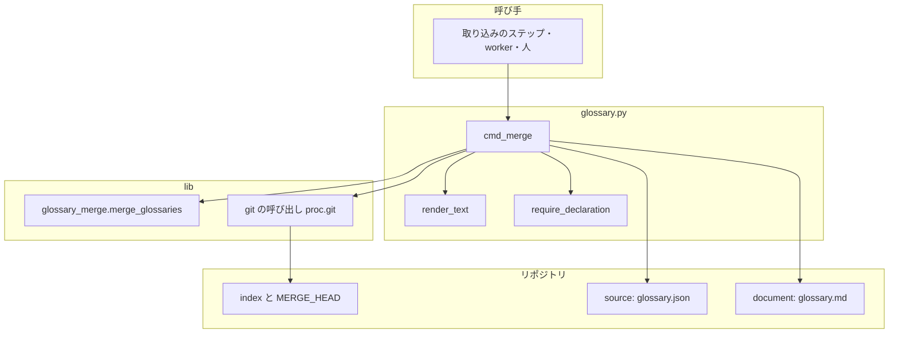
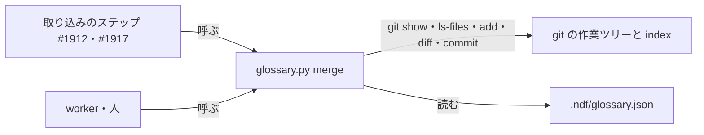
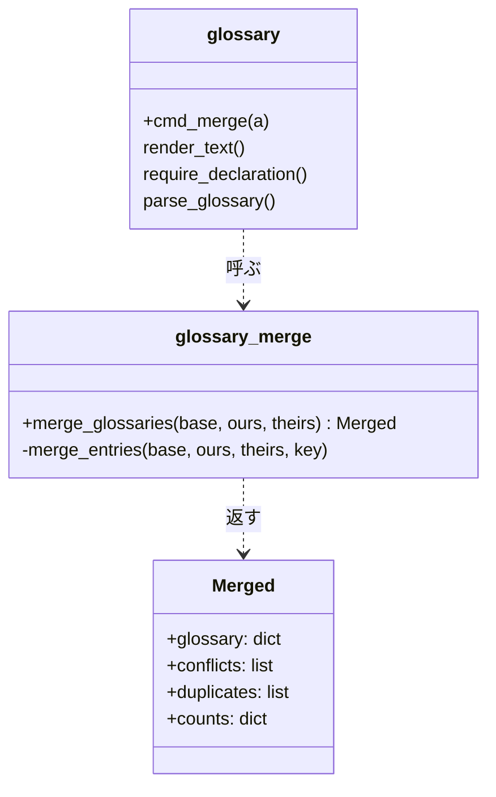
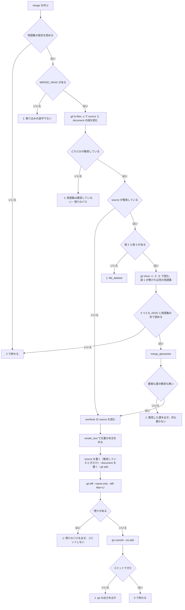

# 用語集: 並行の Pull Request が用語集へ語を足し合うと取り込みが衝突で止まり、LLM が手で両方の語を残している → 副命令が語の単位で両方を残し、文書を作り直して取り込みのコミットまで終える（#1913）

## 目的

- **何が壊れているか**: 同じスプリントで並行に出した Pull Request が `glossary.json` の同じ位置へ語を足すと、ベースブランチの取り込み（`git merge`）が衝突で止まる。解く手段がスクリプトに無い
- **誰が困るか**: 取り込みを進める worker と conductor。記録した 6 スプリント（m1693・m1385・m653・m1290・m1743・m1683）のすべてで、LLM が手で両方の語を残していた
- **直すと何が成り立つか**: 語の単位で重ならない衝突は `glossary.py merge` が解き、`glossary.md` を作り直して取り込みのコミットまで作る。同じ語の食い違いは今までどおり止まり、どの語かを出す

## 適用範囲

- **働く範囲**: 用語集の設定（`.ndf/glossary.json`）を置いた、配布先のどのリポジトリでも働く。呼んだときだけ働き、既存の 6 つの副命令の振る舞いは変えない
- **プロジェクトごとに違うもの**: 用語集と文書の置き場は用語集の設定の `source` と `document` から読む。引数は足さない
- **当たるモード**: どのモードでも、取り込みの途中に呼べる。呼び出しを取り込みのステップ・プランの雛形へ入れるのは #1912・#1917 である

## あるべき姿の根拠

| 根拠 | 種類 | 何を示すか |
| --- | --- | --- |
| 記録した 6 スプリントのすべてで、用語集の衝突を LLM が手で解いた（#1426 の「同じ形の箇所」の表の 3 行目） | 実測 | 判断の要らない手当てが繰り返されている |
| マージコミット ac09b6835 の衝突は両側の語の追加、e7a286e33 は片側の `pending_source` → `source` の書き換えと隣の追加 | 実測 | 衝突の 2 つの形は、どちらも語の単位では重ならない |
| `git show :1:<path>` / `:2:` / `:3:` で祖先・自分・相手の版が読め、`:N:./<path>` は今のディレクトリからのパスになる。片側が消したファイルはその段が無い。両側が足したファイルは段 1 が無い（一時リポジトリで実測。git の `gitrevisions` の `:<n>:<path>`） | 外部の一次情報・実測 | 3 つの版を git だけで読める |
| `git diff --name-only --diff-filter=U` は今のディレクトリに関わらず最上位からのパスで全ての衝突を出す。`git ls-files -u` は今のディレクトリの下だけを出す（一時リポジトリで実測） | 実測 | 残りの衝突の数え方を選ぶ根拠 |
| 取り込みの途中で `GIT_EDITOR=false git commit --no-edit` が用意された文で取り込みのコミットを作り、`MERGE_HEAD` が消える（一時リポジトリで実測） | 実測 | エディタを開かずにコミットできる |
| 今の `docs/glossary/glossary.json` を `json.dumps(ensure_ascii=False, indent=2) + "\n"` で書き直すと同じバイト列になる（実測） | 実測 | 書き直しで語の追加の外に差分が出ない |

要求と受け入れ条件は #1913 の本文にある（コピーは [issue-1913-requirements.md](issue-1913-requirements.md)）。この文書は「どう作るか」だけを扱う。

## ドメインモデル

### コンテキスト

| コンテキスト | 何の語が 1 つの意味に決まるか |
| --- | --- |
| プロジェクトの用語集（`project-glossary`） | 用語集・語・コンテキストと、それを取り込むときの語の衝突 |

1 つのコンテキストに収まる。git の段（祖先・自分・相手）は git の語をそのまま使い、用語集の語へ訳さない。

### 集約

| 集約 | 持ち主（書き換えてよいもの） | 根 | エンティティ | 値オブジェクト |
| --- | --- | --- | --- | --- |
| 用語集 | `glossary.py`（`init`・`render`・新しい `merge`）。`merge` は取り込みの途中だけ書く | 用語集（`glossary.json` の 1 ファイル） | 語（`(context, term)` で一意）・コンテキスト（`id` で一意） | 語の中身（`meaning`・`code`・`deprecated`・`source`・`pending_source` などの組） |

用語集の文書（`glossary.md`）は集約に入れない。用語集から `render_text` で導く投影であり、`merge` は書き換えずに作り直す。

### 不変条件

| # | 集約 | 条件 | 破れたときの扱い |
| --- | --- | --- | --- |
| I1 | 用語集 | 取り込んだ用語集で `(context, term)` が一意で、コンテキストの `id` が一意 | 3 つの版のどれかに同じ組が 2 回あれば、何も書かずに 1 で止まる |
| I2 | 用語集 | 片側だけが足した・書き換えた・消した語とコンテキストは、その側を採る。両側が同じ中身にしたものは 1 つにする | 採れないもの（語の衝突）が 1 件でもあれば、何も書かずに 1 で止まる |
| I3 | 用語集 | 止まったときは、用語集・文書・index のどれも呼ぶ前のまま | 書き込みは全ての判定の後に行う |
| I4 | 用語集 | 同じ 3 つの版から同じバイト列の `glossary.json` が出る | — （並びの規則が決定的な関数で決まる。決定 4） |
| I5 | 用語集 | 書いた `glossary.md` は、書いた `glossary.json` の `render_text` と一致する | 用語集を解いたときは、文書が衝突していなくても作り直す |
| I6 | 用語集 | 取り込みのコミットは、衝突が 1 件も残っていないときだけ作る | 残りがあればコミットせずに 1 で止まり、パスを出す |

### ドメインイベント

| # | イベント | 発生元 | 受け手 |
| --- | --- | --- | --- |
| E1 | ベースブランチを取り込み、衝突で止まった | 取り込みのステップ・worker の `git merge` | `merge` の呼び手（#1912・#1917 のステップ、worker、人） |
| E2 | 衝突を解く副命令が呼ばれた | 呼び手 | `glossary.py merge` |
| E3 | 用語集の 3 つの版を読んだ | `merge` | 3 方向の取り込み（`glossary_merge.merge_glossaries`） |
| E4 | 語の衝突が無いと判定した | 3 方向の取り込み | `merge`（書き込みへ進む） |
| E5 | 取り込んだ `glossary.json` を書き、index に載せた | `merge` | git の index |
| E6 | `glossary.md` を作り直し、index に載せた | `merge` | git の index |
| E7 | 残りの衝突を数えた | `merge` | 呼び手（1 のときはパスの一覧を読む） |
| E8 | 取り込みのコミットを作った | `merge` | 呼び手（0 を読んで次のステップへ進む） |

### 用語

| 用語 | 意味 | 用語集への反映 |
| --- | --- | --- |
| 用語集の取り込み | ベースブランチの取り込みで衝突した用語集を、共通の祖先・自分の側・相手の側の 3 つの版から語の単位で合わせ、文書を作り直して取り込みを終えること。`glossary.py merge` が行う | 追加（`project-glossary`） |
| 語の衝突 | 用語集の取り込みで、両側が同じ語（コンテキストと語の組）を違う中身にしたこと、または片側が消して片側が書き換えたこと。コンテキストの `id` でも同じ。スクリプトは解かずに止まる | 追加（`project-glossary`） |

## 機能一覧

| # | 機能 | 誰が使うか |
| --- | --- | --- |
| F1 | 衝突した `glossary.json` を語の単位で解き、両側の語を残す | 取り込みを進める worker・ステップ・人 |
| F2 | 解いた用語集から `glossary.md` を作り直す（文書だけが衝突したときも） | 同上 |
| F3 | 衝突が残っていなければ取り込みのコミットを作る | 同上 |
| F4 | 解けないときに、衝突した語か残りのパスを出して止まる | 同上（止まった後に判断する者） |

## 構成要素

| 要素 | 責務 |
| --- | --- |
| `glossary_merge.py`（新しい部品。`plugins/ndf/scripts/lib/`） | 3 つの版の用語集から、取り込んだ用語集と語の衝突の一覧と件数を返す純粋な処理。ファイルも git も触らない。例外は投げず、衝突と同じ組の重複は戻り値で返す |
| `glossary.py` の `cmd_merge`（新しい副命令 `merge`） | 用語集の設定を読み、取り込みの途中かと 2 ファイルの衝突を git で確かめ、3 つの版を読んで（語とコンテキストの鍵が文字列でない版は 2 で止める）`glossary_merge` へ渡し、書き込み・index・残りの数え・コミットを行う。結果の JSON と終了コードを持つ |
| `glossary.py` の `build_parser` と docstring | `merge` を足し、docstring の副命令の数と一覧を 7 つにする |
| `requirements-design` の `references/glossary-format.md` の「副命令」の表 | `merge` の行を足す |
| `plugins/ndf/scripts/lib/README.md` の部品の表 | `glossary_merge.py` の行を足す |
| `test_glossary.py` | 一時リポジトリで衝突を作る統合テストと、`glossary_merge` の単体テスト。境界を越えるパスで全ての副命令が 2 で止まるテストの並びに `merge` を足す |
| 確定仕様（`docs/specifications/ndf-ubiquitous-language.md` の「6 つの副命令」） | この変更では触らない。確定仕様化（`plan-to-spec`）が `merge` の節と合わせて書き換える |

副命令の集合へ値を足すため、全ての副命令に当たる規則を読んだ。宣言のパスの境界（`inside`）と宣言の読み込み（`require_declaration`）は `merge` にもそのまま当たる。当てはまらないのは上の表の docstring・形の説明・境界のテストの並び・確定仕様の数の 4 つで、表に載せた。

次の図と処理の流れは、動くときに現れる要素だけを描く。docstring・形の説明・部品の表・テスト・確定仕様は図に含めない。



### システムの文脈と配置



`merge` は取り込みを行う worktree の中で、呼び手と同じプロセスの子として動く。ネットワークには出ない。

### パッケージ・モジュール構成

```text
plugins/ndf/
├── scripts/
│   ├── glossary.py              # 変える: cmd_merge・build_parser・docstring
│   ├── lib/
│   │   ├── glossary_merge.py    # 足す: 3 方向の取り込み（純粋な処理）
│   │   └── README.md            # 変える: 部品の行
│   └── tests/
│       └── test_glossary.py     # 変える: merge のテスト
└── skills/requirements-design/references/
    └── glossary-format.md       # 変える: 副命令の表
```

## 構造

型は足さない。足すのはモジュールの関数で、関係を次に示す（既存のものは名前だけ）。



`Merged` は名前付きの組（`NamedTuple`）で、`glossary_merge.py` の中に置く。

### 3 方向の取り込みの規則

語は `(context, term)`、コンテキストは `id` を鍵にする。鍵ごとに祖先 `B`・自分 `O`・相手 `T` の中身（無ければ「無い」）を比べる。中身の比べ方は辞書の等しさ（キーの順は見ない）である。

| 条件 | 結果 | 件数の数え方 |
| --- | --- | --- |
| `O == T` | `O`（両側が同じに足した・同じに書き換えた・両側が消した） | 数えない |
| `O == B` | `T`（相手だけが足した・書き換えた・消した） | `added` / `changed` / `removed` |
| `T == B` | `O`（自分だけが変えた） | 数えない |
| どれでもない | 語の衝突 | `conflicts` へ入れる |

語の衝突の種類は 3 つである。`both_added`（祖先に無く、両側が違う中身で足した）・`both_changed`（両側が違う中身へ書き換えた）・`deleted_and_changed`（片側が消し、片側が書き換えた）。

**並びの規則（決定 4）**: 自分の側の並びを土台にし、残る鍵を結果の中身へ置き換え、消えた鍵を抜く。相手だけにある鍵は、相手の側の並びで直前にある鍵のうち結果にあるものの直後へ、相手の並びの順に差し込む。直前に結果の鍵が無ければ先頭に置く。

**`contexts` と `terms` の外の上位のキー**（`version` など）は、同じ 3 つの比較で値を決める。衝突したら語の衝突と同じに止め、`kind` は `key_changed` にする。上位のキーの並びは自分の側の順に、相手だけのキーを後ろへ足す。

## 入出力の契約

| 項目 | 内容 |
| --- | --- |
| 名前 | `python3 glossary.py merge [--root DIR]`（`--root` の既定は `.`。既存の副命令と同じ） |
| 入力 | 用語集の設定（`<root>/.ndf/glossary.json`）の `source` と `document`。git の取り込みの途中の状態（`MERGE_HEAD`・index の段 1〜3） |
| 出力 | 標準出力の最後の行に `lib/step_result.py` の形の JSON（`tool: "glossary"`）を 1 行 |
| 互換性 | 既存の 6 つの副命令の引数と出力は変わらない。`glossary.json` の形も変わらない |

### 結果と終了コード

| 場合 | 終了コード | `status` | `summary` | `items` | 書くもの |
| --- | --- | --- | --- | --- | --- |
| 解いて、取り込みのコミットを作った | 0 | `ok` | 足した・書き換えた・消した語の数と、コミットを作ったこと | `[{"name": <source>, "result": "merged"}, {"name": <document>, "result": "rendered"}]`（文書だけを解いたときは後者だけ） | 2 ファイル・index・コミット |
| 解いたが、用語集の外の衝突が残る | 1 | `stopped` | 用語集を解いたことと、残りの件数 | `[{"path": <最上位からのパス>, "result": "unresolved"}, ...]` | 2 ファイル・index（コミットしない） |
| 語の衝突がある | 1 | `stopped` | 語の衝突の件数 | `[{"kind": <種類>, "context": <id>, "term": <語 または null>}, ...]`（コンテキストの衝突は `term` が `null`、上位のキーは `context` も `null` で `key` を持つ） | 無し |
| 3 つの版のどれかに同じ鍵が 2 回ある | 1 | `stopped` | 同じ語が 2 回ある版 | `[{"kind": "duplicate", "side": "base" / "ours" / "theirs", "context": <id>, "term": <語>}, ...]` | 無し |
| 片側が `glossary.json` を消した | 1 | `stopped` | どちらの側が消したか | `[{"kind": "file_deleted", "side": "ours" / "theirs", "path": <source>}]` | 無し |
| 取り込みの途中でない（`MERGE_HEAD` が無い） | 1 | `stopped` | 取り込みの途中でない | `[]` | 無し |
| 取り込みの途中だが、用語集の 2 ファイルのどちらも衝突していない | 1 | `stopped` | 用語集は衝突していない | 残りの衝突のパス（形は 2 行目と同じ） | 無し |
| `git commit` が失敗した（hook が落とした など） | 1 | `stopped` | コミットを作れなかった | `[{"path": <source>, "result": "merged"}, ...]` と、git の標準エラーの先頭 300 字を `detail` に | 2 ファイル・index（コミットしない） |
| 用語集の設定が無い・壊れている・パスが境界を越える、版が JSON として読めない、語の鍵（`context`・`term`・`id`）が文字列でない | 2 | （`step_result` の既定） | 理由 | — | 無し |

止まったときに標準エラーへも 1 行ずつ出す（`check` と同じく、`ERROR: <kind>: <context>: <term>` か `ERROR: unresolved: <path>`）。

## 処理の流れ



- **書き込みは全ての判定の後に行う（I3）。** 取り込んだ用語集の本文と文書の本文を先に文字列として作り、`J` で初めてファイルへ書く
- 段の読み込みは `root` を今のディレクトリにして `:N:./<source>` で行う。`--root` が worktree の最上位でなくても、宣言のパスのまま読める
- 残りの衝突は 2 ファイルを index に載せた後に `git diff --name-only --diff-filter=U` で数える。載せた 2 ファイルは自然に一覧から外れ、パスの突き合わせが要らない
- `git commit` は `GIT_EDITOR=false` を環境に置き、`--no-edit` で git が用意した取り込みの文を使う
- `glossary.json` は `json.dumps(ensure_ascii=False, indent=2) + "\n"` で書く（`init` と同じ形）

## 非機能の実現方式

| 大項目 | 要求の条件 | 実現方式 | 確かめ方 |
| --- | --- | --- | --- |
| 運用・保守性 | 副命令は `glossary.py` の既存の結果の形と終了コードに従う（前提 5）。止まったときの出力だけで、どの語かどのパスかが分かる | `step_result` の `result` / `emit` で出し、止まったときの `items` に語の鍵（`context` と `term`）か最上位からのパスを入れる | 受け入れ条件 2・5 のテストが `items` の中身を見る |
| システム環境 | Python 3.11 と git だけで動く（新しい依存を足さない） | `glossary_merge.py` は標準ライブラリだけで書き、`deps.require` のグループを増やさない。git は既存の `proc.git` で呼ぶ | `glossary.py` の `deps.require` の引数が変わらないことを差分で見る |

## 決定の記録

### 決定 1: 既存の用語集と読む側を変えずに衝突を解くため、1 語 1 ファイルへ分けずに 3 方向の取り込みの副命令を足す

1 語 1 ファイルにしても、`render` が作る `glossary.md` は 1 ファイルのまま両側で書き換わり、文書の衝突は残る。文書を作り直す処理は結局要る。加えて、全ての副命令と `render` の読み込みの改修と、配布先のプロジェクトが持つ用語集の移行が要り、Size が 3 から 5 になる。

1 語 1 ファイルは、衝突そのものを無くせる点で採らなかった案の中で最も強いが、文書の衝突が残るため衝突を無くしきれない。未決 1 はこの決定で閉じ、前提 1 と受け入れ条件 1〜7 は書き換えない。

根拠: Value 1 / Value 5 / Value 6（MVV 版 2）

### 決定 2: クローンごとの登録を利用者に求めないため、git の merge driver に登録せず副命令として呼ぶ

merge driver は `.gitattributes` に加えて `git config` の登録がクローンごとに要り、登録していないクローン（CI・新しい worktree の外の環境・他の開発者）では黙って働かない。driver はファイル 1 つずつに呼ばれるため、取り込んだ用語集から文書を作り直す処理と、取り込みのコミットを作る処理を driver の中に置けない。

採らなかった driver は、`git merge` の中で自動で働く点が利点だが、利用者の git の設定を書き換える必要がある。呼び出しは #1912・#1917 が取り込みのステップへ入れる。未決 2 はこの決定で閉じ、`.gitattributes` は範囲に入れない。

根拠: Value 2 / Value 5 / C6（MVV 版 2）

### 決定 3: 何をする副命令かを git の語のまま読めるようにするため、名前を `merge` にする

`git merge` の途中で呼ぶ副命令であり、`resolve` や `union` より呼ぶ場面と結びつく。既存の `diff` も git の語をそのまま使っている。未決 3 の名前はこの決定で閉じる。

根拠: Value 8（MVV 版 2）

### 決定 4: 取り込みの後の差分を小さく保つため、並びを自分の側の順に相手だけの語を相手の側での直前の語の後へ差し込む

ベースブランチを Pull Request のブランチへ取り込むとき、自分は Pull Request、相手はベースブランチである。相手の語を相手の並びの位置へ差し込めば、Pull Request をベースブランチへ戻すときに、相手の語が動いた差分にならない。規則は 3 つの版だけで決まる関数なので、同じ入力から同じバイト列が出る（I4）。

採らなかった案は 2 つある。相手だけの語を末尾へ足す案は、ベースブランチの語が Pull Request の差分の上で末尾へ移ったように見え、次の取り込みでまた衝突しやすい。コンテキストと語で並べ替える案は、ファイル全体の並びが変わり、全行が差分になる。未決 3 の並びの規則はこの決定で閉じる。

根拠: Value 1 / Value 4（MVV 版 2）

### 決定 5: 判断の要らない衝突だけを機械で解くため、比べる単位を語の中身の全体にし、語の中のフィールドどうしは合わせない

両側が同じ語の別のフィールド（片側が `meaning`、片側が `pending_source` → `source`）を書き換えた場合も、語の衝突として止める。要求の前提 3 が語の単位を求めており、フィールドの単位で合わせると「意味を変えた語の正本を、変える前の意味のまま確定した」のような食い違いを機械が作りうる。

採らなかったフィールドの単位の取り込みは、止まる回数を減らせるが、記録した衝突の 2 つの形（語の追加どうし、書き換えと隣の追加）はどちらも語の単位で解けるため、要らない。

根拠: Value 1 / Value 6（MVV 版 2）

### 決定 6: 取り込みの部品を 1 か所で試せるようにし、`glossary.py` の行数の例外の上限を上げないため、3 方向の取り込みを `lib/glossary_merge.py` に置く

`glossary.py` は 805 行で、行数の例外（`scripts/script-structure-allow/plugins__ndf__scripts__glossary.py--lines.json`）は 869 行である。取り込みの処理をすべて足すと上限を超える。純粋な処理を部品へ分ければ、git を使わずに単体テストで規則を縛れる。`glossary.py` に残すのは `cmd_merge` と引数の 1 行と docstring の 1 行で、上限の中に収める。

採らなかった、例外の上限を上げる案は、例外リストがラチェット（載せた行数を超えたら落ちる）として持つ意図に反する。

根拠: Value 6（MVV 版 2）

### 決定 7: 取り込んだ結果の形の検査は既存の用語チェックに任せ、`merge` は語の衝突と同じ鍵の重複だけを止める

両側が別の語に同じ `code` を付けた、などの形の誤りは、取り込んだ後の用語集でしか起きない。これは Pull Request ごとに働く CI の `glossary-check`（`.github/workflows/glossary.yml` の `glossary.py check`）が拾い、判断の要る直しになる。`merge` に同じ検査を持たせると、形の規則の持ち主が 2 つになる。

採らなかった、取り込んだ後に `structure_findings` で止める案は、止める範囲が要求の「語の衝突だけを止める」を越える。

根拠: Value 6 / Value 7（MVV 版 2）

### 決定 8: 呼び手が「取り込みが終わったか」だけを終了コードで分けられるよう、何もしなかった場合も 1 で返す

取り込みの途中でないときと、用語集が衝突していないときは、取り込みが終わっていない（またはこの副命令の出番でない）。0 を「取り込みのコミットまで終えた」ことだけに使えば、#1912・#1917 のステップは 0 のときだけ次へ進み、1 のときは `items` のパスか語を worker へ渡すと決められる。

採らなかった、何もしなかったときを 0 にする案は、呼び手が `summary` の文を読み分ける必要があり、終了コードで分岐できない。

根拠: Value 4（MVV 版 2）

## テスト設計

| 受け入れ条件・不変条件 | どの振る舞いで縛るか | どう壊したら落ちるべきか |
| --- | --- | --- |
| 受け入れ条件 1 / I2 / I5 | 一時リポジトリで両側が別の語を足して `glossary.json` と `glossary.md` が衝突した取り込みの途中に打つと 0 で、両側の語が 1 回ずつあり、文書が `render_text` と一致し、`git diff --name-only --diff-filter=U` が空 | 相手の語を落とす・文書を作り直さない・`git add` しない |
| 受け入れ条件 2 / I3 | 同じ語を違う中身にした衝突と、消した側と書き換えた側の衝突で、1 で終わり、2 ファイルの中身と `git ls-files -u` が打つ前と同じで、`items` に `context` と `term` がある | 衝突のときにどちらかの側を採る・書いてから判定する |
| 受け入れ条件 3 | 片側が `pending_source` → `source` へ書き換え、片側が隣へ足した衝突で 0 になり、両方の変更を持つ | 片側だけの書き換えを語の衝突として扱う |
| 受け入れ条件 4 / I1 | 両側が同じ語を同じ中身で足すと 1 回だけあり、`check --rules structure` に `duplicate` が出ない。単体では、1 つの版に同じ鍵が 2 回あると `duplicates` が返る | `O == T` の行を `O == B` より後に判定する・重複を見ずに辞書へ畳む |
| 受け入れ条件 5 / I6 | 用語集の外のファイルも衝突していると、2 ファイルは解けて index に載り、`MERGE_HEAD` が残り、1 で `items` にそのパスがある | 残りを数えずにコミットする・残りのパスを出さない |
| 受け入れ条件 6 / I6 | 衝突が用語集の 2 ファイルだけなら、取り込みのコミットができ、`MERGE_HEAD` が無い | コミットを作らない・エディタを待って止まる |
| 受け入れ条件 7 | 取り込みの途中でないとき、用語集が衝突していないときはファイルを書かず 1 で、理由が `summary` にある。`glossary.md` だけが衝突していればworktree の用語集から作り直して解く | 途中でないのに書く・文書だけの衝突を取りこぼす |
| 受け入れ条件 8 | 用語集の設定の `source` を別の置き場へ置いた一時リポジトリで受け入れ条件 1 が通り、`glossary.py` と `glossary_merge.py` の足した行に `docs/glossary` が無い | 置き場を文字列で埋め込む |
| 受け入れ条件 9 / I4 | 単体で、同じ 3 つの版を 2 回取り込むと同じバイト列になり、相手だけの語が相手の並びの直前の語の後に入る | 集合（`set`）を経て並びが入力の順に依らなくなる・末尾へ足す |
| 受け入れ条件 10 | 全体テストが通る | 既存の副命令の振る舞いを変える |
| 境界（既存の不変条件） | 境界を越えるパスを持つ用語集の設定で `merge` が 2 で止まり、ファイルが変わらない（既存のテストの並びへ足す） | `merge` だけが宣言を読まずに git のパスで動く |

## 設計の結果

| 課題 | 扱い | 取り込み先 | 触るファイル |
| --- | --- | --- | --- |
| #1913 | 実装する | — | `plugins/ndf/scripts/glossary.py`、`plugins/ndf/scripts/lib/glossary_merge.py`、`plugins/ndf/scripts/lib/README.md`、`plugins/ndf/scripts/tests/test_glossary.py`、`plugins/ndf/skills/requirements-design/references/glossary-format.md` |

## 未確認のまま残ること

| 項目 | 内容 |
| --- | --- |
| 実際のスプリントの衝突で解けるか | 次のスプリントで並行の設計 PR が用語集で衝突し、#1912・#1917 のステップが `merge` を呼ぶようになってから、リリース後テストで確かめる |
| 配布先のリポジトリの commit hook | hook がある配布先では `git commit` が落ちうる。その場合は 1 で git の出力を出して止まり、呼び手が直す（決定 8 の形のまま）。hook のある配布先での実測は無い |
| `glossary.py` の行数 | `cmd_merge` を足した後に例外の上限（869 行）へ収まるかは実装で数える。収まらなければ、`cmd_merge` の git の手順を `glossary_merge.py` の隣の部品へ移す（決定 6 の範囲） |
