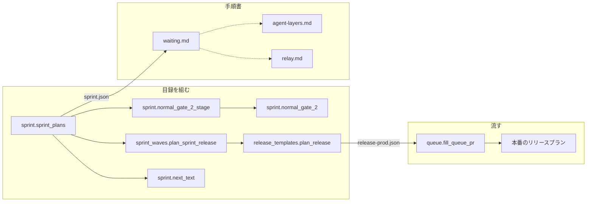
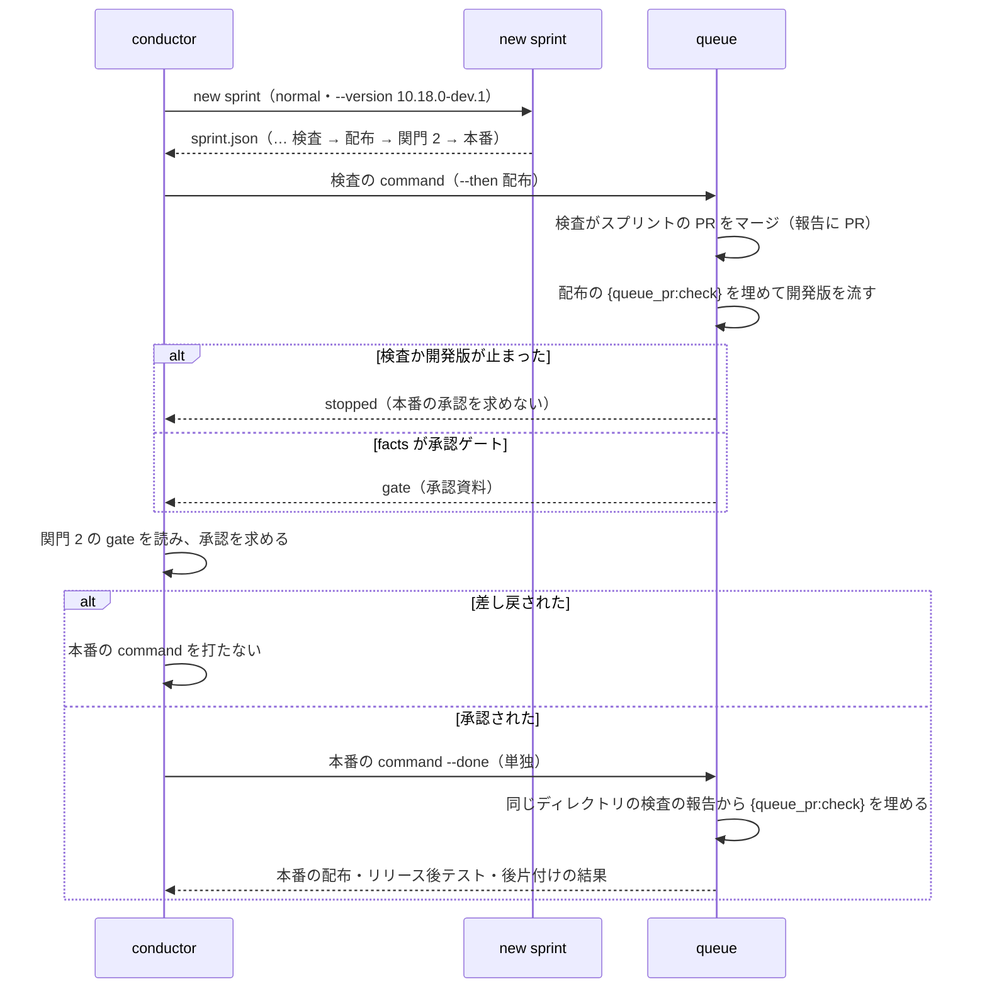

# pace: normal のスプリントでは承認ゲート 2 の後に conductor が本番のプランを手で作り、作る前にキューを打って空振りする → new sprint が承認ゲート 2 と本番のステージまで書き出し、承認の後は目録のコマンドを打つだけで本番が流れる（#1914）

## 目的

- **何が壊れているか**: `pace: normal` の `new sprint` は release の雛形の経路でも「配布」（開発版）で終わり、本番のプランを書き出さない。承認ゲート 2 の後に conductor が `supervise.py new release --channel prod` を版と PR 番号を埋めて組み立てる
- **誰が困るか**: スプリントを回す conductor と、それを見守る利用者。手当ては 5 スプリントで記録があり、1 回はプランを作る前にキューを打って空振りした（m1385）
- **直すと何が成り立つか**: 承認ゲート 2 の後に打つのは、目録（`sprint.json`）の「本番」のステージの `command` に `--done` を足したものと `wait` だけになる。組み立てるコマンドは 0 本になる

## 適用範囲

- **働く範囲**: 配布先のリポジトリでも働く（`plugins/ndf/scripts/supervise_lib/` の `new sprint`）。`pace: normal` で、`.ndf/supervise.json` に雛形のある `release.form` があり、本番のブランチ（`--production-branch` か `.ndf/worktree.json` の `production_branch`）が決まっているときだけ出力が変わる
- **プロジェクトごとに違うもの**: 配布の形・プラグイン名・本番のブランチは今の宣言（`.ndf/supervise.json` の `release`・`.ndf/worktree.json`）から読む。設定のキーと引数は足さない
- **当たるモード**: `standard`（安定版の `new sprint` の出力を変える）

## あるべき姿の根拠

| 根拠 | 種類 | 何を示すか |
| --- | --- | --- |
| #1914 の本文（m1693・m1385・m744・m653・m1683 の手当て） | 実測 | 本番のプランを手で作る手当てが 5 スプリントで繰り返され、1 回は空振りした |
| `pace: fast` / `auto` の `new sprint`（`sprint.py` の `fast_sprint_plans`・`auto_sprint_plans`） | 既存の形 | 同じ雛形の経路で「開発版」の後に計画名 `release-prod` の「本番」を置き、版は `prod_version` で接尾辞を外す |
| 2026-10-24 の試作の比較（下の決定 2） | 実測 | 雛形の本番のプランを `new sprint` の側で組んだものと、conductor が打っていた `new release --channel prod` の出力は、出す PR の欄と `課題` の欄を除いて一致する |

要求と受け入れ条件は #1914 の本文にある（コピーは [issue-1914-requirements.md](issue-1914-requirements.md)）。この文書は「どう作るか」だけを扱う。

## ドメインモデル

### コンテキスト

| コンテキスト | 何の語が 1 つの意味に決まるか |
| --- | --- |
| NDF の開発ワークフロー（`ndf-workflow`） | ステージ・承認ゲート・キュー・プラン・目録 |
| NDF のリリース（`ndf-release`） | 開発版・本番・承認資料・リリースプラン |

**`ndf-workflow` は `ndf-release` に対して順応者である。** `new sprint` は本番のプランを雛形（`release_templates.plan_release`）が組んだ形のまま受け取り、ステップを書き換えない。雛形が変われば、手で打つ `new release --channel prod` と同じ変化がそのまま目録へ入る。

### 集約

| 集約 | 持ち主（書き換えてよいもの） | 根 | エンティティ | 値オブジェクト |
| --- | --- | --- | --- | --- |
| スプリントの目録 | `supervise_lib/sprint.py`（`sprint_plans`・`cmd_new_sprint`） | `sprint.json` | ステージ（番号・名前・`command` / `then_of` / `gate`） | 承認ゲート 2 の文・ステージの並び |
| 本番のリリースプラン | `supervise_lib/release_templates.py`（`plan_release`） | `<番号>-release-prod.json` | ステップ | 版・チャネル・出す PR（`{queue_pr:check}`）・承認資料のパス |

**目録の持ち主は本番のリリースプランのステップを書き換えない。** 渡すのは版・チャネル・出す PR の 3 つの値だけで、組み立ては雛形が持つ（`sprint_waves.plan_sprint_release` が両者の間で値を渡す）。

### 不変条件

| # | 集約 | 条件 | 破れたときの扱い |
| --- | --- | --- | --- |
| I1 | スプリントの目録 | 「本番」のステージは `then_of` を持たず、どの queue の `--then` にも入らない。承認ゲート 2 を利用者が答える前に本番が流れない | テストで落とす |
| I2 | スプリントの目録 | 並びは「配布」→「`関門 2`」→「本番」で、間に他のステージが入らない | テストで落とす |
| I3 | 本番のリリースプラン | 版は `--version` から接尾辞を外したもの、チャネルは `prod`、出す PR は `{queue_pr:check}` | テストで落とす |
| I4 | 本番のリリースプラン | `--state` を渡しても MVV 判定のステップ（`mvv`・`note`・`handoff`）を持たない（`pace: normal` の承認ゲート 2 は利用者が答える） | テストで落とす |
| I5 | スプリントの目録 | 承認ゲート 2 の文は「`関門 2`」のステージの `gate` の 1 か所にだけあり、「配布」の `note` に重ねない | テストで落とす |
| I6 | スプリントの目録 | 本番のブランチが決まっていないときは「`関門 2`」と「本番」を置かず、出力は今と同じ（「配布」で終わる） | テストで落とす |

### ドメインイベント

| # | イベント | 発生元 | 受け手 |
| --- | --- | --- | --- |
| E1 | `new sprint` が配布・承認ゲート 2・本番のステージを `sprint.json` へ書き出した | `sprint.cmd_new_sprint` | conductor（ステージの番号の順に `command` を打つ） |
| E2 | 検査のプランがスプリントの PR をマージし、報告に PR を残した | 検査のプラン（`<番号>-check.json`） | 開発版の配布（`--then`）と、後で単独で流す本番のプラン（`{queue_pr:check}`） |
| E3 | 開発版の配布が承認資料を書き、承認ゲートを返した | 開発版のリリースプラン（`facts` のステップ） | conductor（「`関門 2`」のステージの `gate` を読んで承認を求める） |
| E4 | 利用者が本番への配布を承認した（`--state` があれば `sprint-state.py gate … "関門 2" --by user` を打った） | conductor | conductor（「本番」のステージの `command` を打つ） |
| E5 | 本番のプランの `{queue_pr:check}` が検査の報告の PR 番号に埋まった | `queue.fill_queue_pr`（同じディレクトリの報告を読む） | 本番のリリースプランのステップ（`changelog`・`notes`・`record`・`cleanup`） |
| E6 | 本番の配布・リリース後テスト・後片付けが終わった | 本番のリリースプラン | conductor（引継ぎ文書と次のセッション。`relay.md`） |

### 用語

| 用語 | 意味 | 用語集への反映 |
| --- | --- | --- |
| ステージ | 用語集のまま（`new sprint` がステージごとにプランを書き出す。設計・ゲート 1・実装・検査・開発版・本番） | 無し（`pace: normal` もゲート 2 と本番を持つようになり、用語集の並びと一致する） |
| 承認資料 | 用語集のまま。本番の承認は開発版の配布が書いた `issues/approval-<プラグイン>-v<正式版>.md` を示して求める | 無し |
| 本番 | 用語集のまま | 無し |

新しく足す語と意味を変える語は無い。ステージの名前の `関門 2` はコードの識別子（`関門 1` と同じ命名）で、文書の地の文では「承認ゲート 2」と書く。

## 機能一覧

| # | 機能 | 誰が使うか |
| --- | --- | --- |
| F1 | `pace: normal` の `new sprint` が、配布の後に承認ゲート 2 と本番のステージを書き出す | conductor |
| F2 | 承認ゲート 2 のステージが、承認資料の場所と、`--state` があれば助言の MVV 判定と答えを状態へ書くコマンドを示す | conductor・利用者 |
| F3 | 本番のステージの `command` を承認の後に単独で打つと、出す PR が検査の報告から埋まって本番の配布が流れる | conductor |
| F4 | 手順書（`waiting.md`・`agent-layers.md`・`relay.md`）が、本番を目録のステージとして流す手順を書く | conductor・supervisor |

## 構成要素

| 要素 | 責務 | 変え方 |
| --- | --- | --- |
| `sprint_waves.plan_sprint_release` | 雛形の配布のプランへ版・チャネル・出す PR（`{queue_pr:check}`）を渡す | 引数 `channel`（既定 `dev`）と `version`（既定 `a.version`）を足す。worktree とブランチは `release/v<version>`。助言の MVV 判定は `dev` のときだけ渡す |
| `sprint.sprint_plans`（normal） | ステージの並びを組む | 雛形の経路で本番のブランチがあれば、「配布」の後に「`関門 2`」（`gate`）と「本番」（`release-prod`、`then_of` なし）を足し、「配布」の `note` を外す。本番のブランチが無ければ今のまま（「配布」で終わり、`--state` なら `note` も残す） |
| `sprint.normal_gate_2_stage`（新設） | 承認ゲート 2 のステージの文を組む | 承認資料のパスと「承認の後に本番のステージの `command` を打つ」こと。`--state` があれば今の `normal_gate_2` の文を続ける |
| `sprint.normal_gate_2` | 助言の MVV 判定と答えを状態へ書くコマンドの文 | 変えない。`route_waves` の経路の `note` と新設の関数の両方が使う |
| `sprint.next_text` | `new sprint` の `next` の文 | `advise` の文の「配布のステージの note」を「承認ゲート 2 の文（`関門 2` のステージの `gate` か、配布の後のステージの `note`）」へ直す。本番のブランチが無くて本番を置かなかったときは、その理由を 1 文足す |
| `references/waiting.md` | normal の 1 スプリントを流すコマンド | 冒頭の並びと手順 8・9。手順 9 は「本番」のステージの `command` に `--done` を足して打つことと `wait` だけにする |
| `references/agent-layers.md` | フェーズとプラン・ステージの対応表 | 「仕上げ」の行のステージを「目録の『本番』のステージ。承認ゲート 2 の承認の後に単独の `command` で流す」へ、「リリース」の行を目録のステージ（単発は `new release`）へ直す |
| `references/relay.md` | 本番の後のカットポイントの例 | 本番のプランのパスを `sprint.json` の「本番」のステージのプラン（`$O/<番号>-release-prod.json`）にする |
| テスト（`tests/test_supervise.py`・`test_supervise_new.py`・`test_project_mvv_normal.py`・`test_release_check_state.py`） | 振る舞いを縛る | 「配布」で終わる・「配布」の `note` を読む期待を直し、下のテスト設計の行を足す |

`waiting.md` の「1 スプリントの流し方」（手順 1〜5）は `new sprint` を使わずにプランを並べる形で、本番のプランの作り方を書いていないため変えない。`release` の `release-steps.md`・`form-package-plugin.md` の `--channel prod` は単独のリリースの説明で、`pace: normal` のスプリントの手順ではないため変えない。

図にはテストを含めない（テストは上の要素の振る舞いを縛るだけで、呼び出しの関係を持たない）。

## 入出力の契約

**名前**: `supervise.py new sprint`（`pace: normal`、雛形の経路、本番のブランチあり）。入力の引数は変えない。

**出力**: `sprint.json` の `ステージ` の末尾が次の 3 つになる（設計の課題がある例。番号は前のステージの数で変わる）。

| `wave` | `name` | 持つキー | 中身 |
| --- | --- | --- | --- |
| 7 | `配布` | `plans`・`then_of: 検査` | 今と同じ。`note` は持たない（今は `--state` のとき持つ） |
| 8 | `関門 2` | `gate` | 承認ゲート 2 の文（下の表） |
| 9 | `本番` | `plans`・`command` | プランは `9-release-prod.json`。`command` は `python3 <supervise.py> queue <9-release-prod.json> --max 3` |

| `--state` | `関門 2` の `gate` の文 |
| --- | --- |
| 無し | 開発版の配布が書いた承認資料（`issues/approval-<プラグイン>-v<正式版>.md`）を示して本番への配布の承認を取り、承認の後に「本番」のステージの `command` を打つ。`sprint-state.py` のコマンドを含まない |
| 有り | 上の文に、今の `normal_gate_2` の文（承認資料の末尾の助言の MVV 判定と、`sprint-state.py gate <状態> "関門 2" --what <要約> --by user --outcome approved\|rejected`）を続ける |

本番のプラン `<番号>-release-prod.json` は、`new release --version <正式版> --prs {queue_pr:check} --channel prod --worktree <リポジトリの根>/.worktrees/release/v<正式版>` と同じ雛形の出力で、`課題` にスプリントの課題が入る。

**失敗の形**: 変えない。雛形の宣言の不足は今と同じく `DeclError` で止まる（終了コード 2）。本番のブランチが無いときは止めずに本番を置かない（決定 3）。

**互換性**: 追加のみ。既存のステージの名前・番号・`command`・プランのファイルは変わらない。変わるのは `--state` のときの「配布」の `note` が「`関門 2`」の `gate` へ移ることで、これを読むのは conductor（`next` の文が指す）だけである。既に書き出した目録で進行中のスプリントは、今までどおり単独の `new release --channel prod` で本番のプランを作れる。

## 処理の流れ

検査の報告が無い・PR が無いときは `{queue_pr:check}` が `0` に埋まり、開発版の配布（#1915）と同じ振る舞いになる。この課題で新しい扱いを足さない。承認の前に本番の `command` を打つことはスクリプトが強制しない（承認の記録を本番のプランの先頭に置くのは #1920）。

## 非機能の実現方式

| 大項目 | 条件 | 実現方式 |
| --- | --- | --- |
| 運用・保守性 | 承認ゲート 2 の後に conductor が組み立てるコマンドが 0 本 | 本番のプランの版・PR・worktreeを `new sprint` が決め、`command` を目録へ書く。手順書の手順 9 はその `command` と `wait` だけを書く |
| 移行性 | 進行中のスプリントは今までどおり本番のプランを作れる | 単独の `new release --channel prod` を残す。目録の形は追加のみ |

## 決定の記録

### 決定 1: 承認ゲート 2 の文の正本を 1 か所にするため、雛形の経路では文を `関門 2` のステージの gate へ移し、配布の note から外す

承認ゲート 2 のステージができると、承認の手順を書く場所が `gate` と「配布」の `note` の 2 つになる。2 つに置くと片方だけが直され、conductor が古い方を読む。`関門 1` が `gate` に助言の MVV 判定と答えを状態へ書くコマンドを持つ形とも揃う。雛形の無い経路（`route_waves`）は承認ゲート 2 のステージを持たないため、今の `note` のまま残す（受け入れ条件 5）。

「配布」の `note` に残して `gate` には承認資料だけを書く形は、承認の手順が 2 つのステージに分かれるため採らない。

根拠: Value 7 / Value 2（MVV 版 2）

### 決定 2: 配布のプランの組み立てを 1 つにするため、本番のプランは plan_sprint_release にチャネルと版を渡して作る

`plan_sprint_release` は出す PR を `{queue_pr:check}` に揃えた normal の配布の組み立てで、チャネルと版を引数にすれば本番にもそのまま使える。2026-10-24 に試作した本番のプランを、conductor が打っていた `new release --version 10.18.0 --prs 4242 --channel prod` の出力と比べると、出す PR の欄（`4242` と `{queue_pr:check}`）と `課題` の欄（手で打つ形は空）を除いて 13 ステップすべてが一致した。

`plan_mvv_release` を使う形は採らない。`plan_mvv_release` は `mvv=a.state` を雛形へ渡すため、`--state` を渡した normal では本番のプランの先頭に MVV 判定の承認ゲートが入り、利用者の承認の後にもう一度判定で止まる（I4）。MVV を外す引数を足すと、fast / auto 用の関数に normal の分岐が入る。

根拠: Value 6（MVV 版 2）

### 決定 3: 今の出力を壊さないため、本番のブランチが決まっていないときは承認ゲート 2 と本番のステージを置かない

雛形の本番のプランは本番のブランチ（`a.production_branch`）が無いと `DeclError` で組めない。normal の `new sprint` は今は本番のブランチを要さず、宣言に無いリポジトリでも開発版まで流せる。本番を組もうとして止めると、そのリポジトリの `new sprint` が開発版も含めて流せなくなる。本番のブランチが無ければ今と同じく「配布」で終え、`next` に本番を置かなかった理由を 1 文書く。本番のブランチを既定ブランチへ後退させないこと自体は #2097 が扱う。

本番のブランチが無いときに `new sprint` を止める形は、今まで流せたスプリントを止めるため採らない。

根拠: Value 2 / Value 1（MVV 版 2）

## テスト設計

| 受け入れ条件・不変条件 | どの振る舞いで縛るか | どう壊したら落ちるべきか |
| --- | --- | --- |
| 受け入れ条件 1・I2 | normal・雛形・本番のブランチありの `new sprint` の `ステージ` の名前が「… 検査・配布・`関門 2`・本番」の順で、「`関門 2`」が `gate` を持ち、「本番」のプランの名前が `release-prod` | 「本番」を足さない・「`関門 2`」を「本番」の後に置くと落ちる |
| 受け入れ条件 1・I3 | 「本番」のプランの `release` のステップのコマンドが `--channel prod` と `--version 10.18.0`（`--version 10.18.0-dev.1` を渡す）を持ち、`changelog` の `--prs` が `{queue_pr:check}` | `prod_version` を通さず `a.version` を渡す・チャネルを `dev` のままにすると落ちる |
| 受け入れ条件 2・I1 | 「本番」が `then_of` を持たず `command` を持ち、「検査」の `command` の `--then` に本番のプランが入らない | 「本番」に `then_of: 検査` を付けると落ちる |
| 受け入れ条件 3 | 一時ディレクトリに検査のプランとその報告（PR 番号つき）と本番のプランだけを置き、前のステージの結果を渡さずに `fill_queue_pr` を当てると、本番のプランの `{queue_pr:check}` がすべてその番号になる | 同じディレクトリの報告を読まない（`results_named` が `items` だけを見る）と `0` になって落ちる |
| 受け入れ条件 4・I5 | `--state` ありで「`関門 2`」の `gate` が `sprint-state.py` の `gate` のコマンド（`"関門 2"`・`--by user`）を含み、「配布」が `note` を持たない。`--state` なしで `gate` が `sprint-state.py` を含まない | 「配布」に `note` を残す・`--state` なしでも `normal_gate_2` を続けると落ちる |
| I4 | `--state` ありの normal の本番のプランが `mvv`・`note`・`handoff` のステップを持たない | 本番を `plan_mvv_release` で組むと落ちる |
| 受け入れ条件 5 | 雛形の無い経路（昇格・手で届ける）の normal の目録が今の並びと `note` のままで、fast / auto の目録が今の並びのまま（既存のテストの期待を変えない） | 雛形の無い経路にも「`関門 2`」を足す・`route_waves` の `note` を外すと落ちる |
| I6 | 本番のブランチの無い宣言（`plain_repo`）の normal の `new sprint` が成功し、最後のステージが「配布」 | 本番のブランチが無いのに本番を組もうとすると `DeclError` で落ちる |
| 受け入れ条件 6・7 | テストを書かない（`.md` の文言を照合しない。`AGENTS.md`）。手順 9 の形は、`new sprint` を一時ディレクトリへ打って「本番」のステージの `command` と一致すること、プランのファイルがあることを実装の中で 1 度確かめる（要求の前提 4。本番のキューは打たない） | — |
| 受け入れ条件 8 | `.ndf/project.json` の `test` の全体が通る | — |

## 設計の結果

| 課題 | 扱い | 取り込み先 | 触るファイル |
| --- | --- | --- | --- |
| #1914 | 実装する | — | `plugins/ndf/scripts/supervise_lib/sprint.py`、`plugins/ndf/scripts/supervise_lib/sprint_waves.py`、`plugins/ndf/scripts/tests/`、`plugins/ndf/skills/development-workflow/references/waiting.md`、`plugins/ndf/skills/development-workflow/references/agent-layers.md`、`plugins/ndf/skills/development-workflow/references/relay.md` |

## 未確認のまま残ること

| 項目 | 内容 |
| --- | --- |
| 本物の本番の配布 | 本番のプランを単独で流すのは、次の `pace: normal` のスプリントの承認ゲート 2 の後が最初になる。検査では本番へ配らない（要求の前提 3）。リリース後テストで確かめる |
| 本番のブランチの後退 | `worktree.json` に `production_branch` が無く既定ブランチを本番にするリポジトリでは、決定 3 により本番のステージが置かれない。直すのは #2097 |
| 承認の前に本番を打つこと | スクリプトは承認ゲート 2 の答えを確かめずに本番の `command` を流せる。承認の記録を本番のプランの先頭に置くのは #1920 |
