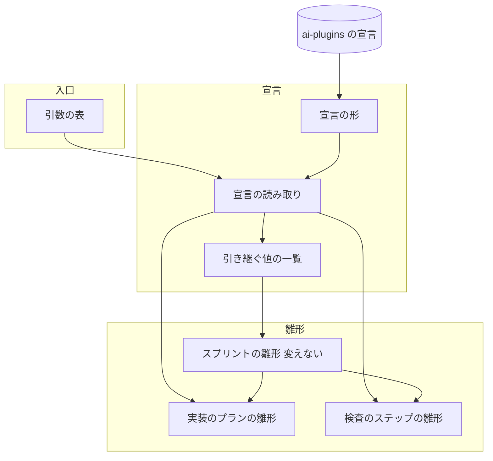
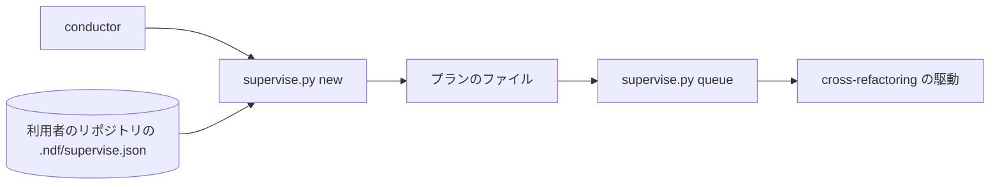
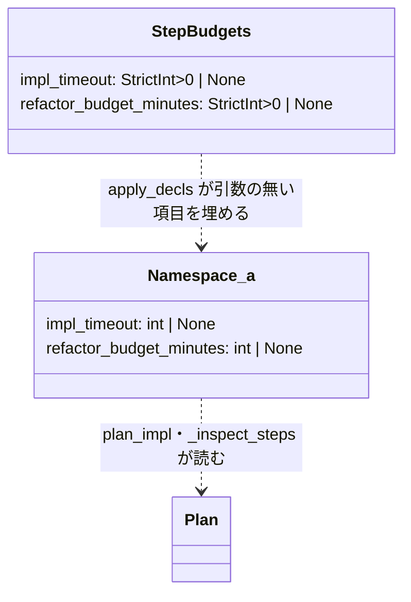
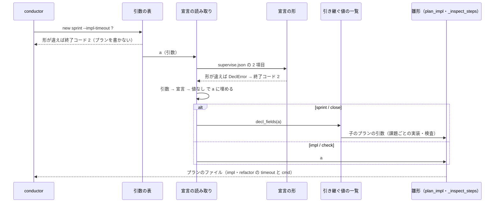

# supervise.py new: 実装とリファクタリングの時間の枠をスプリントのたびに jq で書き足し、リファクタリングが想定最大時間と同じ秒で打ち切られる → `.ndf/supervise.json` か引数の 1 か所で決まり、リファクタリングのステップは想定最大時間に余裕を足した秒まで待つ（#1916）

## 目的

- **何が壊れているか**: `supervise.py new` が書くプランの `impl` の `timeout`（3600 秒）と `refactor` の `timeout`（3600 秒）は固定値で、cross-refactoring の想定最大時間（`--budget-minutes`）も渡せない。conductor はスプリントのたびに jq で値を書き足しており（m1693・m1385 ほか計 9 回）、#1336 ではリファクタリングが 3600 秒ちょうどで exit=124 になり結果を失った（要求の「依頼」）
- **誰が困るか**: スプリントを回す conductor（毎回の手当て）と、打ち切りで検査をやり直す利用者
- **直すと何が成り立つか**: 値をプロジェクトの宣言か `new` の引数で 1 度決めれば、書き出すすべてのプランに同じ値が入り、リファクタリングのステップは想定最大時間より長く待つ

## 適用範囲

- **働く範囲**: NDF を使うすべてのリポジトリ（`supervise.py new` は配布物）。ai-plugins は自分の `.ndf/supervise.json` に値を書く利用者の 1 つ
- **プロジェクトごとに違うもの**: 実装の上限と想定最大時間の値。宣言（`.ndf/supervise.json`）か引数で受け、NDF の既定には持たない
- **当たるモード**: `supervise.py new impl` / `check` / `sprint` / `close` が書くプランを使うすべてのモード（リファクタリングのステップは工程表でリファクタリングを通るモードだけに現れる）

## あるべき姿の根拠

| 根拠 | 種類 | 何を示すか |
| --- | --- | --- |
| conductor が実装のプランへ `timeout` 3600 → 5400 を jq で書き足した記録（m1693・m1385・m744・m815・m653・m1290・m1743・m1847・m1683。#1334） | 実測 | 固定値ではプロジェクトの実装の所要に合わず、毎回の手当てになっている |
| #1336 のリファクタリングが 3600 秒ちょうどで exit=124（要求の「依頼」の記録） | 実測 | 想定最大時間を延ばしても `timeout` が固定のままでは、run が想定どおりに進んでも打ち切られる |
| merge・release のステップの `timeout` が `with_margin(上限)` を使う（`plugins/ndf/scripts/supervise_lib/verify_steps.py`） | 既存の形 | 上限のあるステップには余裕を足す形が既にある |

要求と受け入れ条件は #1916 の本文にある（コピーは `issues/issue-1916-requirements.md`）。この文書は「どう作るか」だけを扱う。
要求の「リファクタリングの予算」は、用語集の **想定最大時間**（cross-refactoring の `--budget-minutes`）と同じものを指す。この文書では想定最大時間と書く。

## ドメインモデル

### コンテキスト

| コンテキスト | 何の語が 1 つの意味に決まるか |
| --- | --- |
| NDF の工程（`ndf-workflow`） | プラン・ステップ・プロジェクトの宣言・実装の上限 |
| cross-refactoring（`ndf-cross-refactoring`） | 想定最大時間 |

工程が下流、cross-refactoring が上流の **順応者** の関係にする。プランは想定最大時間を cross-refactoring の意味（分・1 以上の整数・目安の上限）のまま受け、`--budget-minutes` へそのまま渡す。工程の側で配分や解釈を足さない（配分は #1385 で cross-refactoring の中に済んでいる）。

### 集約

| 集約 | 持ち主（書き換えてよいもの） | 根 | エンティティ | 値オブジェクト |
| --- | --- | --- | --- | --- |
| プランの入力（宣言から埋めた値） | 宣言の読み取り（`apply_decls`） | 1 回の `supervise.py new` の引数 | — | 実装の上限（秒）・想定最大時間（分） |
| プラン | プランの雛形（`plan_impl`・`_inspect_steps`） | プラン | ステップ（`impl`・`refactor`） | `timeout`・`cmd` |

プロジェクトの宣言（`.ndf/supervise.json`）は利用者のもので、NDF は読むだけである（C7）。プランの雛形はプランの入力を引数として読み、宣言を直接読まない。

### 不変条件

| # | 集約 | 条件 | 破れたときの扱い |
| --- | --- | --- | --- |
| I1 | プランの入力 | 値は「`new` の引数 → `.ndf/supervise.json` → 値なし」の順で 1 つに決まる | 起こさない（1 か所で決める。決定 4） |
| I2 | プランの入力 | 値は 1 以上の整数（JSON の数の整数。文字列・小数・真偽値・0・負は違う） | プランを書かずに終了コード 2 で止まり、違う項目の名前を出す |
| I3 | プラン | `impl` の `timeout` は、実装の上限があればその値、無ければ 3600 | — |
| I4 | プラン | `refactor` の cmd が `--budget-minutes N` を含むのは想定最大時間があるときだけで、N は想定最大時間に等しい | — |
| I5 | プラン | `refactor` の `timeout` は想定最大時間（無ければ cross-refactoring の既定 30 分）× 60 より大きい。想定最大時間があれば `with_margin(N × 60)`、無ければ 3600 | — |
| I6 | プラン | `new sprint` / `new close` が書く課題ごとの実装のプランと検査のプランは、同じプランの入力から作られ、I3〜I5 の値がそろう | — |

### ドメインイベント

| # | イベント | 発生元 | 受け手 |
| --- | --- | --- | --- |
| E1 | conductor が `supervise.py new <種別>` を打った | conductor | 引数の解釈（argparse） |
| E2 | 宣言から実装の上限と想定最大時間を読んだ | 宣言の読み取り（`apply_decls`） | プランの雛形 |
| E3 | プランの `impl` の `timeout` を決めた | 実装のプランの雛形（`plan_impl`） | プランのファイル（queue が流す） |
| E4 | プランの `refactor` の cmd と `timeout` を決めた | 検査のステップの雛形（`_inspect_steps`） | プランのファイル（queue が流す） |
| E5 | `new sprint` / `new close` が子のプランへ値を引き継いだ | スプリントの雛形（`decl_fields` を使う組み立て） | 実装のプランの雛形・検査のプランの雛形 |
| E6 | supervise.py が `refactor` を `timeout` で打ち切った | ステップの実行（engine） | conductor（`on_fail: abort` の報告。今と同じ） |

### 用語

| 用語 | 意味 | 用語集への反映 |
| --- | --- | --- |
| 実装の上限 | プランの `impl` のステップ（worker の実装）の `timeout`（秒）。`.ndf/supervise.json` の `impl_timeout` か `supervise.py new` の `--impl-timeout` で決め、無ければ 3600 | 追加（`ndf-workflow`） |

## 機能一覧

| # | 機能 | 誰が使うか |
| --- | --- | --- |
| F1 | 実装の上限を宣言か引数で決める（`new impl` / `new sprint`） | conductor・宣言を書く利用者 |
| F2 | 想定最大時間を宣言か引数で決め、リファクタリングのステップの cmd と `timeout` に入れる（`new check` / `new sprint` / `new close`） | conductor・宣言を書く利用者 |
| F3 | `new sprint` / `new close` が書くすべての子のプランへ同じ値を引き継ぐ | conductor |
| F4 | 値の形が違えば、プランを書かずに違う項目を示して止まる | conductor・宣言を書く利用者 |
| F5 | 新しい項目の説明を `supervise.py new <種別> --help` で読む | conductor・宣言を書く利用者 |

## 構成要素

| 要素 | 責務 |
| --- | --- |
| 引数の表（`new_args.py` の `NEW_ARGS`・`DECL_WORDS`） | `--impl-timeout`（`impl` `sprint`）と `--refactor-budget-minutes`（`check` `sprint` `close`）を受け、1 以上の整数でなければ argparse の誤りで止める。2 つの宣言の項目の値の出どころの 1 行を `DECL_WORDS` に足し、受ける種別の `--help` の「任意の設定」に出す |
| 宣言の形の正本（`plan.py` の docstring の「宣言」の節） | `supervise.json` の JSON の例に `impl_timeout`（1 以上の整数・秒）と `refactor_budget_minutes`（1 以上の整数・分）を足す（決定 6） |
| 宣言の形（`decl.py` の新しい形 `StepBudgets`） | `.ndf/supervise.json` の `impl_timeout` と `refactor_budget_minutes` を、1 以上の厳密な整数か null（無い）として検査する。違えば項目の名前を含む `DeclError` |
| 宣言の読み取り（`decl.py` の `apply_decls`） | 引数 → 宣言の順で `a.impl_timeout` と `a.refactor_budget_minutes` を 1 つに決める（I1）。宣言の形は引数の有無にかかわらず検査する |
| 引き継ぐ値の一覧（`decl.py` の `decl_fields`） | 2 つの値を子のプランの引数へ引き継ぐ一覧に足す（I6） |
| 実装のプランの雛形（`templates.py` の `plan_impl`） | `impl` の `timeout` を `a.impl_timeout` か 3600 にする（I3） |
| 検査のステップの雛形（`templates.py` の `_inspect_steps`） | `a.refactor_budget_minutes` があれば cmd に `--budget-minutes N` を足し、`timeout` を `with_margin(N × 60)` にする。無ければ今の cmd と 3600（I4・I5） |
| ai-plugins の宣言（`.ndf/supervise.json`） | `impl_timeout: 5400` と `refactor_budget_minutes: 60` を書く（決定 7） |
| 用語集（`docs/glossary/glossary.json` と `docs/glossary.md`） | 「実装の上限」を足す（この設計の変更に含める） |

変えないもの: スプリントの雛形（`sprint_waves.py` の `plan_sprint_impl`・`plan_sprint_check`・`plan_fast_impl`・`plan_fast_check`）は既に `**decl_fields(a)` で子のプランの引数を組むため、`decl_fields` に足せば引き継がれる。設計の結果のステージ（`design_stage.rewrite`）は `impl` の `prompt` だけを書き換え、`timeout` を残す。`with_margin` は `verify_steps.py` のものを使い、新しく作らない。



用語集は図に含めない（プランの組み立ての流れに乗らない）。

### 文脈



外部の系は利用者のリポジトリの宣言だけである。cross-refactoring は同じ配布物の中にあり、この変更では触らない（受け取る `--budget-minutes` の形は今のまま）。

### 配置

すべて利用者の端末の 1 プロセス（`supervise.py new`）の中で決まり、プランのファイルへ書かれる。境界をまたぐのは、プランのファイルを queue が読み、`refactor` の cmd を子プロセスとして起動する所だけで、流れるのは `--budget-minutes N` と `timeout` の秒である。配置は変わらない。

### パッケージ・モジュール構成

```text
plugins/ndf/scripts/
├── supervise_lib/
│   ├── decl.py        # 変える: StepBudgets を新設、apply_decls・decl_fields に 2 項目
│   ├── new_args.py    # 変える: NEW_ARGS に 2 行、DECL_WORDS に 2 項目、正の整数の型
│   ├── plan.py        # 変える: docstring の「宣言」の節に 2 項目の形
│   └── templates.py   # 変える: plan_impl・_inspect_steps
└── tests/
    └── test_supervise.py  # 足す: プランの値のテスト（置き場は tdd-cycle で決める）
.ndf/supervise.json        # 変える: ai-plugins の値
docs/glossary/glossary.json, docs/glossary.md  # この設計の変更で足す
```

## 構造



`StepBudgets` は `schema.Shape` を継ぐが、`.ndf/supervise.json` 全体ではなく 2 項目だけを取り出して検査する（`supervise_shape` が `test` と `sync_checks` だけを取り出すのと同じ形）。`extra="forbid"` は取り出した 2 項目にだけ効き、宣言の他の項目を拒まない。

## 入出力の契約

### `supervise.py new` の引数（コマンドの約束）

| 項目 | `--impl-timeout` | `--refactor-budget-minutes` |
| --- | --- | --- |
| 受ける種別 | `impl` `sprint` | `check` `sprint` `close` |
| 入力 | 1 以上の整数（秒）。任意 | 1 以上の整数（分）。任意 |
| 出力 | `impl` の `timeout` がその値になる | `refactor` の cmd に `--budget-minutes N`、`timeout` が `with_margin(N × 60)` |
| 渡さないとき | 宣言の `impl_timeout`、それも無ければ 3600 | 宣言の `refactor_budget_minutes`、それも無ければ cmd に足さず `timeout` 3600 |
| 失敗の形 | 整数でない・0 以下: argparse の誤り（終了コード 2、`argument --impl-timeout: …`）。プランを書かない | 同左（`argument --refactor-budget-minutes: …`） |
| 互換性 | 任意の引数の追加。既存の引数の意味は変えない | 同左 |

受けない種別（`fix` `release` と、`--impl-timeout` を受けない `check` `close`）では、argparse が知らない引数として止める（今の `NEW_ARGS` の表の振る舞い）。`fill_new_defaults` がその属性を None で埋めるため、雛形は種別をまたいで `getattr` で読める。

### `.ndf/supervise.json` の項目（宣言の約束）

```json
{
  "impl_timeout": 5400,
  "refactor_budget_minutes": 60
}
```

| 項目 | 型 | 無い・null | 違うとき |
| --- | --- | --- | --- |
| `impl_timeout` | 1 以上の整数（秒） | 値なし（3600） | `DeclError`（`supervise.json: impl_timeout: …`）→ `ap.error` で終了コード 2。プランを書かない |
| `refactor_budget_minutes` | 1 以上の整数（分） | 値なし（`--budget-minutes` を足さない） | 同左（`supervise.json: refactor_budget_minutes: …`） |

- 宣言の形は、`supervise.py new` のすべての種別で、引数の有無にかかわらず検査する（今の `test` の形の検査と同じ時点）
- 形の説明は `plan.py` の docstring の「宣言」の節に 1 か所だけ置き、`new_args.py` の `DECL_WORDS` は値の出どころの 1 行を受ける種別の `new <種別> --help` の「任意の設定」に出す（決定 6）
- 互換性: 任意の項目の追加。書かない利用者のプランは変わらない

## 処理の流れ



ai-plugins の宣言は「supervise.json の 2 項目」として宣言の形へ入る値で、参加者には置かない。用語集はプランの組み立てに乗らないため図に含めない。

順序の前提: 引数の形の検査（argparse）→ 宣言の形の検査 → 値の決定 → プランの書き出し。プランのファイルは最後に書くため、どちらの検査で止まってもファイルは残らない（`templates.cmd_new` と `sprint.cmd_new_sprint` は `apply_decls` の後に呼ばれる）。

## 非機能の実現方式

| 大項目 | 要求の条件 | 実現方式 | 確かめ方 |
| --- | --- | --- | --- |
| 運用・保守性 | 宣言の新しい項目は、宣言の書き方を持つ文書に 1 か所だけ説明を置き、写さずに指す（Value 7） | `.ndf/supervise.json` の形の正本は `plan.py` の docstring の「宣言」の節のため、そこへ 2 項目を足す。`new <種別> --help`（`DECL_WORDS`）は値の出どころの 1 行だけを出す。引数の help は「既定は .ndf/supervise.json の <項目>」とだけ書いて指す | `supervise.py new sprint --help` と `new check --help` を打ち、「任意の設定」に 2 項目が出ること。`supervise_lib.plan.__doc__` に 2 項目名が含まれること |
| 移行性 | 既存の `.ndf/` の宣言はそのまま読める（新しい項目は任意）。宣言を足さない利用者のプランは変わらない | 2 項目とも任意で、無い・null は値なしとして扱う。値なしの雛形は今の固定値と cmd を書く | 宣言も引数も無いときのプランの `impl` / `refactor` を、変更前の値と比べるテスト（テスト設計の AC8） |

## 決定の記録

### 決定 1: 解析の出力とプランの設定を混ぜないため、置き場を `.ndf/supervise.json` にする

`.ndf/supervise.json` は `supervise.py` の雛形が読む、利用者が手で書く設定（`test`・`sync_checks`・`queue`・`release`）の置き場で、実装の上限と想定最大時間はこの雛形にだけ効く。`.ndf/project.json` は解析が書くプロジェクトの形で、スキーマ（`project.schema.json`）が `additionalProperties: false` を持ち、再解析が項目を書き直す。

`.ndf/project.json` に置く案は採らない。スキーマの改訂が要り、解析の出力に利用者の運用の値が混ざる。新しいファイルを作る案は受け入れ条件 4 が除く。

根拠: Value 5 / C7（MVV 版 2）

### 決定 2: 引数と宣言で 1 つの語を使うため、項目名を `impl_timeout` / `refactor_budget_minutes`、引数を `--impl-timeout` / `--refactor-budget-minutes` にする

宣言の項目名と引数の `dest` を同じにし、`apply_decls` の「引数が無ければ宣言」を同じ名前で書ける。単位は名前に合わせ、ステップの `timeout` の秒と、cross-refactoring の `--budget-minutes` の分をそのまま使う。想定最大時間の側は、プランの中で何に効くかが読めるよう `refactor_` を付ける。

`--budget-minutes` をそのまま `new` の引数名にする案は採らない。`new sprint` は実装と検査の両方を書くため、何の時間かが名前から読めない。

根拠: Value 8（MVV 版 2）

### 決定 3: 想定どおりに終わる run を打ち切らないため、`refactor` の `timeout` を想定最大時間があれば `with_margin(N × 60)`、無ければ 3600 にする

想定最大時間を渡したときは、merge・release のステップと同じ `with_margin` で余裕を足す（60 分 → 3960）。ai-plugins の宣言（決定 7）では、検査のプランの `refactor` の `timeout` が今の手当ての 4200 秒から 3960 秒へ 240 秒縮む。想定最大時間は目安の上限で、cross-refactoring は実行中の CLI を止めないため、予算を超えて走った run は 3960 秒で打ち切られうる（#1336 の exit=124 と同じ形）。予算を超えた秒の実測は無く、3960 で足りるとは示せていないため、未確認のまま残すことに置き、リリース後テストで打ち切りが出ないかを見る。渡さないときは今の 3600 を保つ。cross-refactoring の既定 30 分（1800 秒）より 1800 秒長く、今通っている run の振る舞いを変えない（要求の前提 2・3。採否は承認ゲート 1 で利用者が決める）。

渡さないときも `with_margin(1800)` = 1980 にそろえる案は採らない。今は 3600 で通っている run が打ち切られうる。渡したときにも 3600 を下限に掛ける案は採らない。短い想定最大時間を渡した側の意図（早く打ち切る）を消す。

根拠: Value 1 / Value 3（MVV 版 2）

### 決定 4: 値を決める所を 1 つにするため、`apply_decls` が引数と宣言から決め、雛形は `a` だけを読む

`apply_decls` は既にベースブランチ・テストの宣言を「引数 → 宣言」で決めて `a` に載せ、`decl_fields` がスプリントの子のプランへ引き継ぐ。2 つの値も同じ経路に乗せれば、スプリントの雛形を変えずに課題ごとの実装のプランと検査のプランへ届く（I6）。

雛形（`plan_impl`・`_inspect_steps`）が宣言を直接読む案は採らない。スプリントが組む子の引数は宣言の場所を持たず、読む所が雛形の数だけ増える。

根拠: Value 6（MVV 版 2）

### 決定 5: 誤った値でプランを書かないため、宣言は厳密な 1 以上の整数だけを受け、引数があっても宣言の形を検査する

`schema.Shape` の既定（緩い整数）では `"60"`・`60.0`・`true` が整数として通る（pydantic で実測: `true` は 1 になる）。`StrictInt` に `gt=0` を掛け、JSON の整数だけを受ける。形の検査は今の `test` の形の検査と同じく、引数の有無にかかわらず `apply_decls` で行う。宣言の誤りを、引数を渡した回だけ見逃さないためである。

引数を渡したときは宣言を読まない案は採らない。壊れた宣言が、引数を省いた次の回まで見つからない。

根拠: Value 6（MVV 版 2）

### 決定 6: 説明の正本を 1 か所にするため、2 項目の形を `plan.py` の docstring の「宣言」の節に足し、`--help` からは 1 行で指す

`.ndf/supervise.json` の形（`test`・`sync_checks`・`release`）の正本は `plugins/ndf/scripts/supervise_lib/plan.py` の docstring の「宣言」の節にあり、`supervise.py` の epilog もそこを指す（`decl.py` の注釈の「DECLARATIONS の節」もこの節を指す）。`new_args.py` の `DECL_WORDS` は、項目ごとに「どこから値を取るか」の 1 行だけを持ち、`--help` の「要る設定」「任意の設定」に出す。この分担のまま、2 項目の形（型・単位・無いときの扱い）は「宣言」の節の JSON の例へ足し、`DECL_WORDS` には既存の項目と同じく値の出どころの 1 行（`--impl-timeout` か `.ndf/supervise.json` の `impl_timeout` など）を足す。形を書く所は 1 か所のままで、`--help` はそこを指す。`decl.py` の注釈は「`plan.py` の docstring の宣言の節」と書き直し、指す先を明らかにする。

`DECL_WORDS` だけへ足す案は採らない。形の正本の一覧に 2 項目が載らず、説明が 2 か所に分かれる。「宣言」の節を `--help` へ寄せて片方を消す案も採らない。`test`・`sync_checks`・`release` の形の移し替えが #1916 の範囲を超える。

`development-workflow` の参照（`agent-layers.md`）に説明の節を新しく置く案も採らない。`supervise.json` の他の項目の説明が無い所に 2 項目だけを置くと、正本が 2 か所に分かれる。

根拠: Value 7（MVV 版 2）

### 決定 7: conductor の jq の手当てを無くすため、ai-plugins の `.ndf/supervise.json` に `impl_timeout: 5400` と `refactor_budget_minutes: 60` を書く

目的の「手当てを無くす」は、ai-plugins が宣言を持って初めて成り立つ。値は conductor が手当てで使ってきた値（5400 秒・60 分）である。ただし `refactor` の `timeout` は手当ての 4200 秒を写さず、決定 3 の式で `with_margin(3600)` = 3960 秒になる（240 秒の短縮。打ち切りが出ないかは未確認のまま残すことに置く）。`.ndf/` の書き換えは C7 に当たるため、実装の Pull Request に含め、承認ゲート 2 で人が見る。NDF の既定（コード）には書かない（受け入れ条件 8）。

宣言を書かず、毎回 `new sprint` の引数で渡す案は採らない。手当ての場所が jq から引数へ移るだけになる。

根拠: Value 4 / Value 5 / C7（MVV 版 2）

## テスト設計

| 受け入れ条件・不変条件 | どの振る舞いで縛るか | どう壊したら落ちるべきか |
| --- | --- | --- |
| AC1・I3 | `new impl` / `new sprint` に実装の上限を宣言か引数で渡すと、プランの `impl` の `timeout` がその値。どちらも無ければ 3600 | 雛形が 3600 を固定のまま書く・値を読み捨てる |
| AC2・I4・I5 | 想定最大時間を宣言か引数（`new check` / `new sprint` / `new close`）で渡すと、`refactor` の cmd に `--budget-minutes N`、`timeout` が `with_margin(N × 60)`（60 → 3960） | cmd に足さない・`timeout` を N × 60 のままにする・3600 のままにする |
| AC3・I5 | 想定最大時間が無いと、`refactor` の cmd に `--budget-minutes` が無く、`timeout` が 3600 | 既定の 30 分を cmd へ書く・`with_margin(1800)` にする |
| AC4 | 値を既存の `.ndf/supervise.json` に書くとプランに入る（ほかのファイルを足さずに通る） | 読む宣言のファイルを取り違える |
| AC5・I6 | `new sprint`（normal と `--pace fast`）と `new close` が書く課題ごとの実装のプランの `impl` と、検査のプラン（最終の検査を含む）の `refactor` に同じ値が入る | `decl_fields` から 1 項目を外す |
| AC6・I1 | 引数と宣言の両方があると、引数の値が入る | 宣言を引数より先に効かせる |
| AC7・I2 | 0・負・小数・文字列・真偽値を引数か宣言で渡すと、プランのファイルを書かずに 0 以外で終わり、出力に項目名（`--impl-timeout` / `impl_timeout` など）が出る。宣言の誤りは引数があっても止まる | 緩い整数で検査する（`"60"`・`true` が通る）・検査の前にファイルを書く・引数があると宣言を検査しない |
| AC8 | 宣言も引数も無いときの `new impl` / `new check` / `new sprint` のプランの `impl` / `refactor` の `timeout` と cmd が、変更前と同じ | 既定に 5400 や 60 を書く・値なしでも cmd に足す |
| AC9 | 既存のテストが通る（`uv run --frozen --project . --all-extras pytest plugins/ndf/scripts/tests -q -n 4`） | — |
| 決定 6 | `new sprint --help` と `new check --help` の「任意の設定」に 2 項目が出る（出力に項目名が含まれること。`.md` の文言は照合しない） | `DECL_WORDS` に足さない・受ける種別の epilog に出さない・`plan.py` の「宣言」の節に足さない |

## 設計の結果

| 課題 | 扱い | 取り込み先 | 触るファイル |
| --- | --- | --- | --- |
| #1916 | 実装する | — | `plugins/ndf/scripts/supervise_lib/decl.py`、`plugins/ndf/scripts/supervise_lib/new_args.py`、`plugins/ndf/scripts/supervise_lib/plan.py`、`plugins/ndf/scripts/supervise_lib/templates.py`、`plugins/ndf/scripts/tests/`、`.ndf/supervise.json` |

## 未確認のまま残ること

| 項目 | 内容 |
| --- | --- |
| 前提 2・3 の採否 | 想定最大時間が無いときに 3600 を保ち、あるときは下限を掛けない（決定 3）。承認ゲート 1 で利用者が決める |
| 説明の置き場 | 要求の非機能の条件の「宣言の書き方を持つ文書」を `plan.py` の docstring の「宣言」の節と読み、そこへ形を足す（決定 6）。`.md` の文書を新設せず docstring に置き続けてよいかは承認ゲート 1 で利用者が決める |
| `refactor` の `timeout` の 4200 → 3960 の短縮で打ち切りが出ないか | 今の手当ては `timeout` 4200 秒だが、決定 3 の式では 3960 秒になる。cross-refactoring は予算を超えても実行中の CLI を止めないため、予算を超えた秒が 360 秒を超える run は打ち切られる。超えた秒の実測は無い。次のスプリントのリリース後テストで exit=124 が出ないかを見て、出れば予算か余裕の式を見直す |
| 5400 秒・60 分が ai-plugins に合うか | conductor の手当ての値を写すだけで、所要の実測から出した値ではない。次のスプリントのリリース後テストで、打ち切り（exit=124）が出ないかを見る |
| cross-refactoring が `--workflow-step` で `--budget-minutes` を受けて想定最大時間どおりに動くか | conductor の手当て（#1370・m1693・m1385）で渡して動いた記録はあるが、この設計では走らせていない。実装の範囲テストか、リリース後テストで確かめる |
