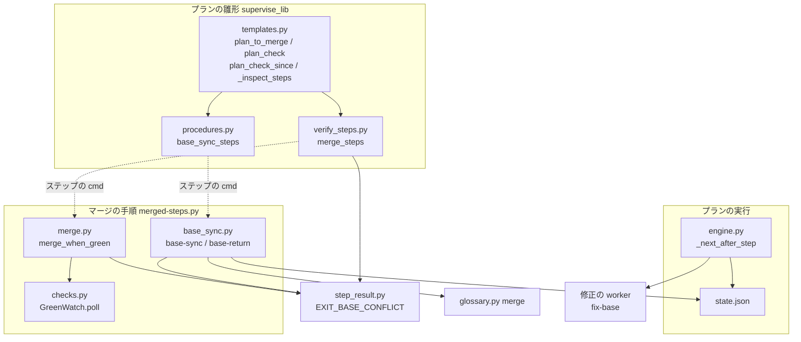
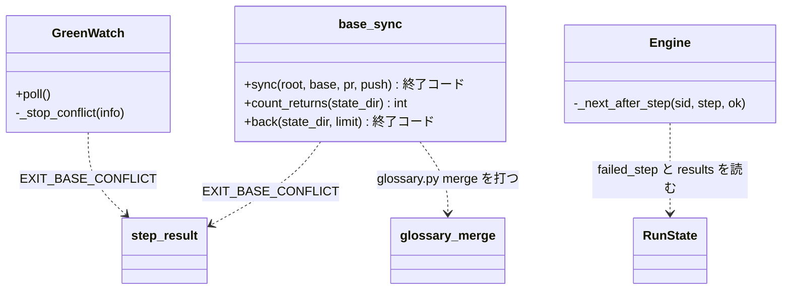
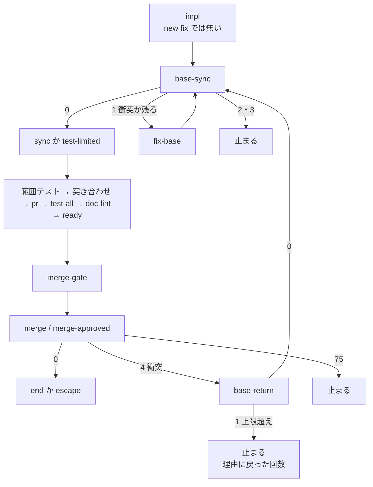
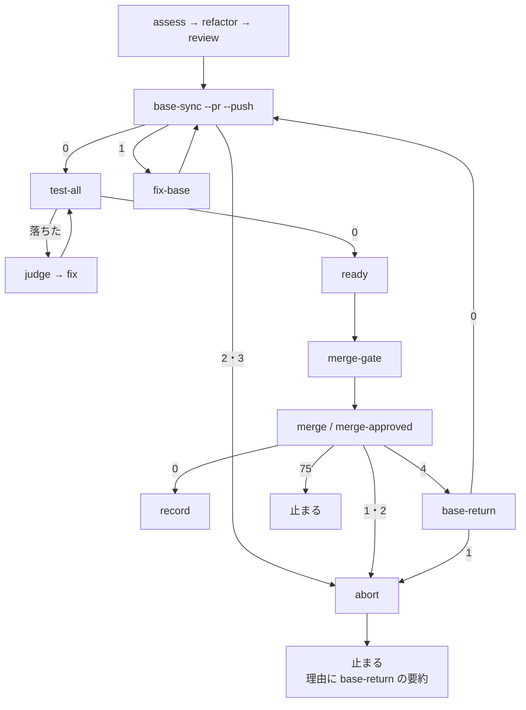
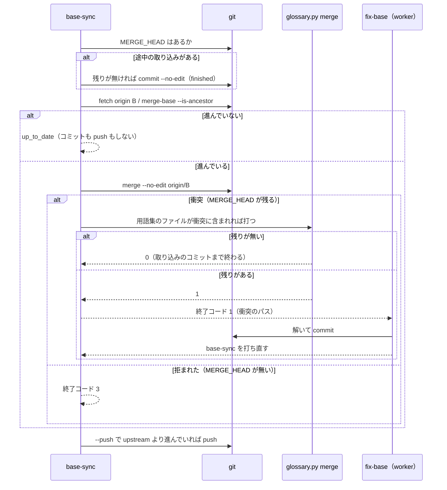

# プランの検査とマージ: ベースブランチが進むと検査はブランチ単独のまま走り、マージの直前の衝突でプランが止まる → 取り込んだ合成の上で検査し、衝突しても取り込みへ戻ってマージまで進む（#1917 #2003）

## 目的

- **何が壊れているか**: 実装のプランと検査のプランは、ベースブランチを取り込まずにブランチ単独で検査する。合成で初めて落ちるチェック（行数の上限・用語集・配布物の同期）は PR の CI まで見つからない（#2003、PR 1995）。マージの直前にベースブランチが進んで衝突すると、検査のプランは `abort` で止まる（#1917）
- **誰が困るか**: conductor。並行のスプリントの本番リリースで develop が進むたびに、取り込み・衝突の解消・全体テスト・`--from` での流し直しを手で打つ（セッション 26 で 3 回）
- **直すと何が成り立つか**: プランが自分でベースブランチを取り込み、用語集の衝突はスクリプトで、ほかの衝突は修正の worker で解き、合成の上で検査してマージまで進む。衝突が続くときだけ、戻った回数を添えて止まる

## 適用範囲

- **働く範囲**: NDF の 3 層でプランを流すすべてのリポジトリ（配布先を含む）。実装のプラン（`new impl`・`new fix`・スプリントの実装）、検査のプラン（`new check --pr`・スプリントの検査）、差分の検査（`new check --since-last`）
- **プロジェクトごとに違うもの**: ベースブランチの名前は引数（`--base`、無ければ `.ndf/worktree.json` の `base_branch`）か PR の宛先から読む。用語集の置き場所は用語集の設定から読む。どちらも ai-plugins の値を埋め込まない
- **当たるモード**: `standard` / `light` / `operation` / `legacy-refactor` / `documentation` のすべて（プランの雛形がモードを問わず同じ経路を組むため）

## あるべき姿の根拠

| 根拠 | 種類 | 何を示すか |
| --- | --- | --- |
| セッション 26 で conductor が develop の取り込み・衝突の解消・全体テストを 3 回打った（#1917 の要求） | 実測 | マージの直前の衝突は手当ての常連で、プランが持つべき手順である |
| PR 1995 はプランの `sync` と `doc-lint` を通ったのに、CI の `doc-line-limit-check` と `runtime-plugin-validate` で落ちた（run 38516089004、#2003） | 実測 | ブランチ単独の検査は、合成で初めて落ちるチェックを見逃す |
| 差分の検査（`plan_check_since`）の `test-all` は `git merge origin/<base>` を打ってから測り、上の見逃しを起こしていない | 実測（既存のプラン） | 合成の上で測る形は既にプランの中で働いている。共有の部品にすれば同じ形で直る |
| 一時リポジトリで `git merge` を打った結果（下の「決定 3」）: 衝突は終了コード 1 で `MERGE_HEAD` を残す。未コミットの変更と重なる取り込みは終了コード 1 で `MERGE_HEAD` を残さない。重ならない未コミットの変更は残したまま取り込む | 実測（2026-10-16） | 取り込みのステップは終了コードだけでなく `MERGE_HEAD` の有無で衝突と拒否を分けられる |

要求と受け入れ条件は #1917 の本文にある（コピーは `issues/issue-1917-requirements.md`）。#2003 の受け入れ条件も同じ本文に課題番号つきで載る。この文書は「どう作るか」だけを扱う。

## ドメインモデル

### コンテキスト

| コンテキスト | 何の語が 1 つの意味に決まるか |
| --- | --- |
| 開発の工程（`ndf-workflow`） | ベースブランチ・ベースブランチの取り込み・全体テスト・スプリントブランチ・プランのステップと行き先 |

1 つのコンテキストの中で閉じる。マージの読み（`merged_lib`）も同じコンテキストの語（ベースブランチ・衝突）を使う。

### 集約

| 集約 | 持ち主（書き換えてよいもの） | 根 | エンティティ | 値オブジェクト |
| --- | --- | --- | --- | --- |
| プラン | プランの雛形（`supervise_lib/templates.py`。部品は `supervise_lib/procedures.py` と `supervise_lib/verify_steps.py`） | プラン | ステップ | 行き先（`next`・`on_fail`・`on_exit`）・戻りの上限 |
| プランの実行 | エンジン（`supervise_lib/engine.py` と `supervise_lib/state.py`） | 実行の記録（`state.json`） | 終わったステップの記録 | 結果・理由 |
| 作業ブランチ | ベースブランチの取り込みのステップ（`merged-steps.py base-sync`）・修正の worker・`pr` のステップ | ブランチの先端 | コミット（取り込みのコミットを含む） | 衝突の残り（パスの組） |
| PR の状態 | GitHub（読むだけ。`merge-when-green` が読む） | PR | — | `mergeStateStatus`・宛先 |

**プランの集約の持ち主は雛形だけである。** エンジンはプランを読むだけで書き換えない。戻りの回数は
プランの実行の集約（`state.json` の記録）から数え、プランへ数を書き込まない。

### 不変条件

| # | 集約 | 条件 | 破れたときの扱い |
| --- | --- | --- | --- |
| I1 | プラン | 実装のプランでは、作業の後・`sync`（宣言が無ければ範囲テスト）の前にベースブランチの取り込みのステップが 1 つある。検査のプランと差分の検査では、全体テストの前に 1 つある | 雛形のテストが落ちる |
| I2 | プラン | ベースブランチの取り込みのステップは 1 つの関数（`base_sync_steps`）だけが組む。雛形がコマンドの文字列を自分で組まない | 雛形のテストが落ちる（`git merge` の文字列が雛形に残る） |
| I3 | 作業ブランチ | ベースブランチの取り込みはマージのコミットだけで行う。rebase・強制 push をしない | — （コマンドに無い。テストで `--force` と `rebase` が打たれないことを縛る） |
| I4 | 作業ブランチ | ベースブランチが進んでいなければ、取り込みのステップはコミットを作らず push もしない | 既存のプランの結果が変わる |
| I5 | 作業ブランチ | 用語集だけの衝突は LLM を起動せずに解く。用語集の外の衝突が 1 つでも残れば、取り込みを途中のまま（`MERGE_HEAD` を残して）修正の worker へ渡す | 用語集の衝突で worker が起動する／worker が衝突の印の無い worktree を受け取る |
| I6 | プランの実行 | `merge` / `merge-approved` から取り込みへ戻るのは 1 回の実行で 3 回まで。4 回目の衝突で中断し、理由に「ベースブランチが進み続けて衝突した」と戻った回数が載る | 衝突が続く間プランが回り続け、`上限` の歯止めだけで止まる |
| I7 | PR の状態 | `merge-when-green` は `mergeStateStatus` が `DIRTY` のときと、`gh pr merge` が衝突で拒んだときだけ衝突の終了コード（4）で終わる。`UNKNOWN` では待ちを続ける | 衝突でないマージの失敗が取り込みへ戻る／衝突が 1 のまま `abort` へ行く |
| I8 | プラン | 衝突の終了コードの行き先を持たない `merge-when-green` の呼び手は、今の失敗と同じ行き先へ進む | リリース・`promote`・設計 PR のマージの振る舞いが変わる |

### ドメインイベント

| # | イベント | 発生元 | 受け手 |
| --- | --- | --- | --- |
| E1 | ベースブランチを取り込んだ | `base-sync` | 次のステップ（実装: `sync` か範囲テスト／検査: 全体テスト） |
| E2 | 取り込みが衝突した | `base-sync`（`git merge` の衝突） | `base-sync` の中の用語集の取り込み（E3）か、`fix-base`（E4） |
| E3 | 用語集の衝突をスクリプトで解いた | `glossary.py merge`（`base-sync` が呼ぶ） | `base-sync`（取り込みのコミットまで終わる → E1 と同じ行き先） |
| E4 | 修正の worker が衝突を解いてマージのコミットを作った | `fix-base` | `base-sync`（打ち直して、進んでいなければそのまま次へ） |
| E5 | 取り込みを push した | `base-sync`（検査のプランと差分の検査だけ） | PR の CI |
| E6 | 合成の上で検査が走った | 実装: `sync`・範囲テスト・`doc-lint`・全体テスト／検査: 全体テスト | 今の judge → fix の経路 |
| E7 | `merge` が PR の衝突を見た | `merge-when-green`（終了コード 4） | `base-return` |
| E8 | ベースブランチの取り込みへ戻った / 上限を超えて中断した | `base-return` | 戻った: `base-sync`／中断: 実装は止まる、検査は `abort` |

### 用語

| 用語 | 意味 | 用語集への反映 |
| --- | --- | --- |
| ベースブランチの取り込み | ベースブランチの先端を作業ブランチへマージのコミットで取り込み、衝突を解いてから合成の上で検査を続けるプランのステップ。用語集だけの衝突は用語集の取り込みで解き、ほかは修正の worker へ回す | 追加（要求の工程で `ndf-workflow` に足した。`pending_source` は要求の写し） |
| ベースブランチ | worktree の分岐元と Pull Request の宛先 | 変更なし |
| 用語集の取り込み | 用語集の定義のとおり（`glossary.py merge`） | 変更なし |
| 全体テスト | 用語集の定義のとおり | 変更なし |

## 機能一覧

| # | 機能 | 誰が使うか |
| --- | --- | --- |
| F1 | 実装のプランが、作業の後にベースブランチを取り込み、合成の上で sync・範囲テスト・doc-lint・全体テストを走らせる | supervisor（実装のフェーズ） |
| F2 | 検査のプラン（単発とスプリント）が、全体テストの前にベースブランチを取り込んで push する | supervisor（検査のフェーズ） |
| F3 | 取り込みで用語集だけが衝突したら、スクリプトで解いて先へ進む | 同上（LLM を起動しない） |
| F4 | 取り込みで用語集の外が衝突したら、修正の worker が解き、取り込みを打ち直す | 同上 |
| F5 | `merge-when-green` が PR の衝突を、ほかの失敗と分けた終了コードで返す | プランの `merge` / `merge-approved`、手で打つ conductor |
| F6 | 実装のプランと検査のプランが、マージの直前の衝突で取り込みへ戻り、3 回を超えたら戻った回数を理由に載せて止まる | supervisor、フェーズレポートを読む conductor |
| F7 | 差分の検査が、全体テストのコマンドに埋め込んだ取り込みをやめ、同じ部品を使う | supervisor（差分の検査） |

## 構成要素

| 要素 | 責務 |
| --- | --- |
| `merged-steps.py base-sync`（新設。本体は `merged_lib/base_sync.py`） | ベースブランチを取り込む決まった手順。途中の取り込みの片付け → fetch → 進んでいるかの判定 → `git merge` → 用語集だけの衝突を `glossary.py merge` で解く → （`--push` なら）push。終了コードで「進めてよい / 衝突が残る / 拒まれた」を分ける |
| `merged-steps.py base-return`（新設。同じモジュール） | `merge` から取り込みへ戻る前に、この実行で戻った回数を `state.json` から数え、上限を超えたら理由を出して終了コード 1 で止まる |
| `merged_lib/checks.py` の `GreenWatch.poll` | 読みのたびに `mergeStateStatus` を見て、`DIRTY` なら衝突の終了コードで抜ける |
| `merged_lib/merge.py` の `merge_when_green` | `gh pr merge` が衝突で拒んだとき、衝突の終了コードで抜ける |
| `lib/step_result.py` | 衝突の終了コード `EXIT_BASE_CONFLICT = 4` を定め、`stopped` の終了コードに入れる |
| `supervise_lib/procedures.py` の `base_sync_steps`（新設）と `BASE_FIX_PROMPT`（新設） | ベースブランチの取り込みの 3 ステップ（`base-sync`・`fix-base`・`base-return`）を組む唯一の部品 |
| `supervise_lib/verify_steps.py` の `merge_steps` | 引数 `on_conflict` を受け、`merge` と `merge-approved` の `on_exit` に `"4": <on_conflict>` を足す。渡さない呼び手は今のまま |
| `supervise_lib/templates.py` の `plan_to_merge`・`plan_check`・`plan_check_since`・`_inspect_steps` | 部品を置く場所と、マージの衝突の行き先を決める |
| `supervise_lib/engine.py` の `_next_after_step` | 行き先の無い失敗で止まるとき、理由へそのステップの要約と、`on_fail` でそこへ回した直前の失敗の要約を添える |



`T` から `P`・`V` へは関数の呼び出し、`P`・`V` から `B`・`M` へはステップの `cmd` に書くコマンドである（点線）。
`base-return` は `state.json` を読むだけで書かない。

### パッケージ・モジュール構成

```text
plugins/ndf/scripts/
├── merged-steps.py              # base-sync・base-return のサブコマンドを足す
├── merged_lib/
│   ├── base_sync.py             # 新設: 取り込みと戻りの回数
│   ├── checks.py                # GreenWatch.poll に DIRTY の判定
│   └── merge.py                 # merge_when_green に衝突の拒否の判定
├── lib/step_result.py           # EXIT_BASE_CONFLICT
└── supervise_lib/
    ├── engine.py                # 止まったときの理由
    ├── procedures.py            # base_sync_steps・BASE_FIX_PROMPT
    ├── templates.py             # 部品の置き場所
    └── verify_steps.py          # merge_steps の on_conflict
```

## 構造



`base_sync` はクラスではなくモジュールの関数の組である。`step_result`・`glossary_merge`・`RunState` は名前だけを置く既存の型・モジュール。

## 入出力の契約

### `merged-steps.py base-sync`

| 項目 | 書くこと |
| --- | --- |
| 名前 | `python3 merged-steps.py base-sync (--base B \| --pr N) [--push] [--root DIR]` |
| 入力 | `--base`: ベースブランチの名前（実装のプラン）。`--pr`: PR の番号（検査のプラン。宛先 `baseRefName` を `gh pr view` で 1 回読む）。どちらか 1 つが必須。`--push`: 取り込みの結果が upstream より進んでいれば `git push -q` する |
| 出力（成功） | `status: ok`。`items` に `{kind: "base", name: B, result: "up_to_date" \| "merged" \| "glossary_merged" \| "finished"}`、push したら `{kind: "push", result: "pushed"}`。`metrics`: `{base, behind, pushed}` |
| 出力（衝突） | `status: stopped`。`items` に残った衝突のパス（`{kind: "conflict", path, result: "unresolved"}`）。取り込みは途中のまま（`MERGE_HEAD` を残す） |
| 失敗の形 | 0 = 進めてよい（進んでいない・きれいに取り込んだ・用語集を解いた・worker の解いた取り込みを閉じた）／ 1 = 衝突が残る・push 前の検査で拒まれた（worker へ）／ 2 = 読めない（fetch・`gh pr view`・`git` の失敗）／ 3 = 拒まれた（未コミットの変更が取り込みと重なり `git merge` が始まらない。`MERGE_HEAD` が無い） |
| 互換性 | 新設。既存の呼び手は無い |

手順の順序:

1. `MERGE_HEAD` があれば（worker が解いた後の打ち直し）、衝突の残りが無ければ `git commit --no-edit` で閉じて `finished`、残れば 1
2. `git fetch -q origin <B>`。`git merge-base --is-ancestor origin/<B> HEAD` が真なら取り込まない（`up_to_date`）
3. `git merge -q --no-edit origin/<B>`。0 なら `merged`
4. 1 で `MERGE_HEAD` が無ければ 3（拒まれた）。あれば衝突のパスを読み、用語集の設定の `source` か `document` を含めば `glossary.py merge --root .` を打つ。0 なら `glossary_merged`、それ以外は残りを返して 1。用語集の設定が無い・用語集のファイルが衝突に無ければ、`glossary.py` を打たずに 1
5. 0 のときだけ、`--push` があり `HEAD` が upstream より進んでいれば `git push -q`。push の失敗は 1（push 前の検査で拒まれたときも同じ。worker が直して打ち直す）

### `merged-steps.py base-return`

| 項目 | 書くこと |
| --- | --- |
| 名前 | `python3 merged-steps.py base-return --state DIR [--limit 3]` |
| 入力 | `--state`: プランの状態ディレクトリ（ステップの `cmd` では `{state_dir}`）。`--limit`: 戻りの上限（既定は `base_sync.RETURN_LIMIT = 3`） |
| 出力 | 成功: `status: ok`、`summary` は「ベースブランチの取り込みへ戻る（<k> 回目）」、`metrics: {returns: k, limit}`。上限超え: `status: stopped`、`summary` は「ベースブランチが進み続けて衝突した（マージの直前の衝突 <k> 回目。戻りの上限 <limit> 回）」 |
| 失敗の形 | 0 = 戻る ／ 1 = 上限を超えた ／ 2 = `state.json` を読めない |
| 数え方 | `state.json` の `log` のうち、`id` が `base-return` で `exit` が 0 の行の数を、この実行で戻った回数とする（`log` は実行ごとに空から始まる） |
| 互換性 | 新設 |

### `merged-steps.py merge-when-green` の終了コード

| 項目 | 書くこと |
| --- | --- |
| 変わる約束 | 終了コード 4（`EXIT_BASE_CONFLICT`）を足す。`GreenWatch.poll` が `mergeStateStatus == "DIRTY"` を読んだとき（承認ゲート 2 の判定と draft を外す処理の後）と、`gh pr merge` が失敗し、標準エラーに `cannot be cleanly created` を含むか、読み直した `mergeStateStatus` が `DIRTY` のとき。`summary` は「#N はベースブランチと衝突している（mergeStateStatus=DIRTY）」、`items` に `{kind: "pr", result: "conflict"}`、`next` に「ベースブランチを取り込んで push してから打ち直す」 |
| 変わらない約束 | `UNKNOWN`・`BEHIND`・`BLOCKED` は今のまま（待つか CI を読む）。CI の失敗は 1、基盤待ちは 75、承認ゲート 2 は 10 |
| 互換性 | 終了コードで分ける呼び手のうち、`release-steps.py` の `wait_and_merge` は 75 以外を 1 に読み替えるため変わらない。プランの `merge` / `merge-approved` は、`on_exit` に 4 が無ければ `on_fail`（あれば）へ、無ければ今と同じく止まる（I8）。`promote` も同じ |
| 検査の手段 | `gh` のスタブで `mergeStateStatus: DIRTY` を返すテストと、`gh pr merge` の拒否を返すテスト |

### プランのステップ（`base_sync_steps` が組む形）

```python
base_sync_steps(source: str, nxt: str, *, push: bool, on_error: str | None, returns: bool) -> list[dict]
```

| 引数 | 意味 |
| --- | --- |
| `source` | `--base <B>` か `--pr {pr}`（コマンドの引数の断片） |
| `nxt` | 取り込みの後に進むステップ |
| `push` | `--push` を付けるか |
| `on_error` | 取り込みが拒まれた・読めない・戻りが上限を超えたときの行き先。実装のプランは `None`（止まる）、検査のプランと差分の検査は `"abort"` |
| `returns` | `base-return` のステップを返すか |

| ステップ | 型 | `cmd` | 行き先 |
| --- | --- | --- | --- |
| `base-sync` | run（`stage` は呼び手の工程。`timeout` 600） | `python3 merged-steps.py base-sync <source>[ --push] --root .` | `next: nxt`、`on_exit: {"1": "fix-base"}`、`on_fail: on_error`（`None` なら持たない） |
| `fix-base` | work（`kind: 修正`、`inputs: ["base-sync"]`） | `BASE_FIX_PROMPT` | `next: base-sync` |
| `base-return` | run（`returns` のときだけ） | `python3 merged-steps.py base-return --state {state_dir}` | `next: base-sync`、`on_fail: on_error`（`None` なら持たない） |

`BASE_FIX_PROMPT`: 「入力はベースブランチの取り込みのステップの出力である。衝突が残っていれば、`git status` で
衝突したファイルを確かめ、両方の変更を残して衝突を解き、`git add` してマージのコミットを作る。push 前の検査で
拒まれていれば、指摘を直してコミットする。どちらも push しない（`git merge --abort`・rebase・強制 push をしない）。」

終了コード 1 は「worker が直せば進めるもの」（衝突の残り・push 前の検査の拒否）に限り、`fix-base` へ回す。

### 雛形ごとの置き場所

| 雛形 | `source` | `nxt` | `push` | `on_error` | `returns` | マージの衝突の行き先 |
| --- | --- | --- | --- | --- | --- | --- |
| `plan_to_merge`（`new impl`・`new fix`・スプリントの実装） | `--base <a.base>` | `sync`（宣言が無ければ `test-limited`） | しない（`pr` のステップが push する） | `None` | する | `merge_steps(a, next=…, on_conflict="base-return")` |
| `plan_check`（`new check --pr`。スプリントの検査も `plan_sprint_check` がこれを呼ぶ） | `--pr {pr}` | `test-all` | する | `"abort"` | する | `merge_steps(a, on_fail="abort", next="record", on_conflict="base-return")` |
| `plan_check_since`（差分の検査） | `--base <a.base>` | `test-all` | する | `"abort"` | しない | 今のまま（`on_fail: abort`） |

## 処理の流れ

### 実装のプラン（`plan_to_merge`）



戻った後は `sync` からやり直し、`pr` のステップが取り込みのコミットを push する（#2003-4）。
`merge-approved` から戻ったときも `merge-gate` を通り直す（決定 6）。

### 検査のプラン（`plan_check`。スプリントの検査は先頭に `collect` → `pr` が付く）



### 取り込みのステップの中（`base-sync`）



## 決定の記録

### 決定 1: 取り込みを 1 か所で直すため、取り込みの手順をスクリプトのサブコマンドにし、ステップは 1 つの関数で組む

取り込み・用語集の判定・push の要否は判断の要らない手順で、終了コードで行き先を分けられる。シェルの 1 行に
並べる今の差分の検査の形では、衝突と拒否を分けられず、用語集の取り込みを挟めない。3 つの雛形が同じ関数
`base_sync_steps` を呼べば、直す場所が 1 つになる。

採らなかった案: 雛形ごとにシェルのコマンドを組む形。同じ役割の文字列が 3 か所に分かれ、#2003 の見逃しと同じ
食い違いがまた起きる。

根拠: Value 4 / Value 6（MVV 版 2）

### 決定 2: サブコマンドの置き場を `merged-steps.py` にする

`merged-steps.py` は `merge-when-green` と衝突の終了コードの持ち主で、取り込みはその対になる手順である。
衝突の判定（`MERGE_HEAD`・`mergeStateStatus`）を同じモジュールの近くに置くと、衝突の意味が 1 つに揃う。

採らなかった案: `pr-steps.py` に置く形。`pr-steps.py` は PR を作る・更新する手順で、マージの読みを持たない。
新しいスクリプトを作る形は、同じ役割の入口を増やす。

根拠: Value 6（MVV 版 2）

### 決定 3: 衝突と拒否を `MERGE_HEAD` の有無で分け、拒否は worker へ回さない

一時リポジトリでの実測（2026-10-16）: 衝突した `git merge` は終了コード 1 で `MERGE_HEAD` と衝突のパスを残す。
未コミットの変更と重なる取り込みは、同じ終了コード 1 で何も始めず `MERGE_HEAD` を残さない。重ならない未コミットの
変更は残したまま終了コード 0 で取り込む。終了コードだけでは両者を分けられないため、`MERGE_HEAD` で分ける。
拒否は worker が解くべき衝突ではないため、終了コード 3 にして止まる（実装）か `abort`（検査）へ行く。

採らなかった案: `--autostash` で未コミットの変更を退避する形。退避の置き場は worktree の間で共有され、衝突のときに
戻せない退避が残る。

根拠: Value 3 / C4（MVV 版 2）

### 決定 4: 実装のプランの取り込みは push せず、検査のプランの取り込みは push する

実装のプランでは、取り込みの後の経路が必ず `pr` のステップを通り、そこで push する。最初の取り込みの時点では PR も
upstream も無い。検査のプランでは、取り込みの後に `pr` のステップを通らず、全体テストのコマンドが `git pull --rebase`
を打つ。取り込みのコミットを push しないまま rebase すると、マージのコミットが平らに書き換わる。`--push` は
「upstream より進んでいるときだけ push する」ため、進んでいないときは push しない（#2003-5）。

採らなかった案: 部品が PR の有無を調べて push を決める形。同じ雛形の中で振る舞いが実行の時点まで決まらず、雛形の
テストで縛れない。

根拠: Value 4 / Value 6 / C4（MVV 版 2）

### 決定 5: 戻りの回数は、戻るための専用のステップが `state.json` から数える

`merge` の `on_exit` で直接 `base-sync` へ戻ると、戻りと最初の取り込みを区別できず、回数を数える場所が無い。
戻りだけが通る `base-return` を置けば、この実行の `state.json` の `log` にある `base-return` の成功の行を数えるだけで
済み、プランにも状態ファイルにも数を書き足さない。`log` は実行ごとに空から始まるため、`--from` で流し直すと数え直す。
上限 3 は前提 2 の値で、`base_sync.RETURN_LIMIT` の 1 か所で変えられる。

採らなかった案: エンジンにステップごとの訪問回数の上限を足す形。すべてのプランの意味が変わり、#1909 の上限の
計算と重なる。取り込みのステップが自分の状態ファイルに数える形は、実行をまたいで数が残り、流し直しの直後に止まる。

根拠: Value 4 / Value 6（MVV 版 2）

### 決定 6: 承認ゲート 2 の後に戻ったときも `merge-gate` を通り直す

戻った後は取り込みのコミットが足され、承認した時点の内容と違う。`merge-approved` へ直接戻らず `ready` →
`merge-gate` を通れば、宛先が承認ゲート 2 に当たるプランは新しい内容でもう一度人の承認を求める。ai-plugins の
実装と検査の宛先（スプリントブランチ・develop）は承認ゲート 2 に当たらないため、止まる回数は増えない。

採らなかった案: 戻りの後に `merge-approved` へ進む形。人が見ていない取り込みのコミットまで、承認済みとして本番の
チャネルへ入る。

根拠: 上位の原則 / Value 2（MVV 版 2）

### 決定 7: 止まったときの理由に、直前の失敗の要約を添える（エンジン）

検査のプランは上限超えで `abort` を通り、記録を書いてから止まる。今の理由は「ステップ abort が失敗した（exit=1）」
だけで、なぜ `abort` へ来たかが読めない。エンジンが行き先の無い失敗で止まるとき、そのステップの結果 JSON の
`summary` と、直前のステップが `on_fail` でここへ回した失敗ならその要約を理由へ添える。実装のプランの `base-return`
は行き先を持たないため、自分の要約がそのまま理由に載る。どちらも #1917-7 の「戻った回数」が理由に載る。

採らなかった案: `check-trigger.py record --failed` の要約に落ちたステップの出力を写す形。記録のスクリプトが
エンジンの出力ファイルの置き場を知ることになる。`base-return` の上限超えを `on_exit` で `stop` へ送る形は、
検査の記録（`abort`）を飛ばす。

根拠: Value 7（MVV 版 2）

### 決定 8: `merge-when-green` の衝突の終了コードを 4 にし、`step_result.py` で定める

共通の契約は 0〜3 と 10〜29 を使い、`sysexits.h` の値（69・75）は意味が合うときだけ借りている。衝突に当たる
`sysexits.h` の値は無い。4 は `handoff.py` と `project-mvv.py` がスクリプトの中だけで使う値で、プランの `merge`
のステップから見て重ならない。プランの雛形（`verify_steps.py`）とマージの手順（`merged_lib`）が同じ名前
`EXIT_BASE_CONFLICT` を読み、値を 2 か所に書かない。`code_matches` の `stopped` に 4 を足す。

採らなかった案: 1 のまま、プランが `summary` の文言で衝突を見分ける形。文言の変更で経路が黙って変わる。

根拠: Value 6 / Value 8（MVV 版 2）

### 決定 9: 差分の検査は部品へ置き換えるが、マージの直前の衝突で戻らない

差分の検査は `finish` のステップで PR の宛先を付け替え、変更が無ければ `record` へ飛ぶ（`skip_to`）。戻りの経路が
`finish` を 2 度通ると、付け替え済みの PR で飛ばし先の判定が変わる恐れがあり、今の受け入れ条件は差分の検査の戻りを
求めない（#1917-5 は検査のプラン、#2003-3 は部品の共有）。全体テストの修正の後の行き先を `base-sync` にし、
「毎回取り込んでから測る」今の振る舞いを保つ。

採らなかった案: 差分の検査にも戻りを足す形。`finish` の再入を確かめる受け入れ条件が無いまま経路だけが増える。

根拠: 共通原則「判断の範囲は目の前の変更・操作に限る」 / Value 1（MVV 版 2）

### 決定 10: 検査のプランは PR の宛先から、実装のプランと差分の検査は引数からベースブランチを読む

単発の `new check --pr` は、引数の `--base`（無ければ `.ndf/worktree.json` の `base_branch`）が PR の宛先と一致する
とは限らない（スプリントブランチ宛の PR を検査するとき）。PR がある検査のプランは宛先を 1 回読む。実装のプランは
最初の取り込みの時点で PR が無く、差分の検査の PR の宛先は検査の間 `check-base/<名>` なので、どちらも引数を使う。

採らなかった案: すべてを引数にする形。宛先の違う PR へ別のブランチを取り込む。

根拠: Value 5（MVV 版 2）

## テスト設計

| 受け入れ条件・不変条件 | どの振る舞いで縛るか | どう壊したら落ちるべきか |
| --- | --- | --- |
| #1917-1・I1 | `new check --pr`・スプリントの検査で組んだプランで、`review` の次が `base-sync`、`base-sync` の次が `test-all`、`ready` より前にある | `_inspect_steps` の `review.next` を `test-all` に戻す |
| #1917-2・I5 | 一時リポジトリで用語集だけを衝突させて `base-sync` を打つと、終了コード 0 で取り込みのコミットができ、worker のステップに進まない | 用語集の衝突を 1 として返す／`glossary.py merge` を打たない |
| #1917-3・I5 | 用語集の外も衝突させると終了コード 1 で `MERGE_HEAD` と衝突の印が残る。解いてコミットした後に打ち直すと 0（`finished`）。検査のプランの `fix-base` の次が `base-sync`、その次が `test-all` | 衝突の後に `git merge --abort` する／打ち直しで `MERGE_HEAD` を見ない |
| #1917-4・I7 | `gh` のスタブが `mergeStateStatus: DIRTY` を返すと `merge-when-green` が 4 で終わる。`gh pr merge` が衝突の拒否を返したときも 4。`UNKNOWN` では待ち続ける。CI の失敗は 1 のまま | DIRTY の判定を外す／`UNKNOWN` を衝突と読む |
| #1917-5 | 検査のプランの `merge` と `merge-approved` の `on_exit` に `"4": "base-return"` があり、`base-return` の次が `base-sync` | `plan_check` が `on_conflict` を渡さない |
| #1917-6 | 実装のプラン（`new impl`・`new fix`）の `merge` と `merge-approved` も同じ | `plan_to_merge` が `on_conflict` を渡さない |
| #1917-7・I6 | `state.json` に `base-return` の成功が 3 行あると `base-return` が 1 で終わり、`summary` に回数が載る。エンジンのテストで、実装のプランの形は理由に `base-return` の要約が、検査のプランの形（`on_fail: abort`）は `abort` の理由に `base-return` の要約が載る | 数え方を実行をまたいで残す／理由に要約を添えない |
| #1917-8・I8 | `merge_steps` を `on_conflict` 無しで呼ぶと `on_exit` は `{"75": "stop"}` のまま。`wait_and_merge` は 4 を 1 として扱う | `merge_steps` が常に 4 の行き先を足す |
| #1917-9 | 全体テスト（`uv run --frozen --project . --all-extras pytest . -q -n 4`） | — |
| #2003-1・I1 | `new impl` で `impl` の次が `base-sync`、`base-sync` の次が `sync`（宣言が無ければ `test-limited`）。`new fix` では先頭が `base-sync` | `head[-1]["next"]` を `sync` のままにする |
| #2003-2 | 一時リポジトリでベースブランチ側と作業ブランチ側が同じ文書の別の行へ 1 行ずつ足し、合成で行数の上限を超える形で、取り込んだ後の `doc-lint`（か `sync`）が落ちる | `base-sync` を `sync` の後へ置く |
| #2003-3・I2 | 3 つの雛形の取り込みのステップが `base_sync_steps` の返す形と一致し、`plan_check_since` の `test-all` の `cmd` に `git merge` が無い | 雛形にコマンドの文字列を残す |
| #2003-4 | 実装のプランの `fix-base` の次が `base-sync`、`base-sync` の次が `sync` | `fix-base` の次を `test-limited` にする |
| #2003-5・I4 | ベースブランチが進んでいない一時リポジトリで `base-sync --push` を打つと、コミット数も upstream も変わらず `up_to_date` | 進んでいなくても `git merge` と push を打つ |
| I3 | `base-sync` が打つ git のコマンドに `rebase`・`--force` が無い（コマンドの記録で確かめる） | 拒否のときに rebase で取り込む |

## 設計の結果

| 課題 | 扱い | 取り込み先 | 触るファイル |
| --- | --- | --- | --- |
| #1917 | 実装する | — | `plugins/ndf/scripts/supervise_lib/templates.py`、`plugins/ndf/scripts/supervise_lib/procedures.py`、`plugins/ndf/scripts/supervise_lib/verify_steps.py`、`plugins/ndf/scripts/supervise_lib/engine.py`、`plugins/ndf/scripts/merged-steps.py`、`plugins/ndf/scripts/merged_lib/`、`plugins/ndf/scripts/lib/step_result.py`、`plugins/ndf/scripts/tests/` |
| #2003 | 取り込む | #1917 | — |

**#2003 は #1917 の実装に取り込む。** #2003 の受け入れ条件は同じ部品（`base_sync_steps`）と同じ雛形の変更で満たされ、
別の実装プランにすると同じ関数を 2 本のプランが触る。

### ほかの主題と重ならないように触る関数

同じスプリント a1 の主題「上限と見張り」（#1909 #1676 #1623 #1496）と「指示と整形」（#1651 #1941 #1507）が
同じファイルを触る。この主題が触るのは次の関数だけである。

| ファイル | この主題が触る関数・定数 | 触らない（ほかの主題が触る） |
| --- | --- | --- |
| `supervise_lib/templates.py` | `plan_to_merge`（`head[-1]["next"]`・`base_sync_steps` の挿入・`merge_steps` の `on_conflict`）、`plan_check`（`steps` の並び・`merge_steps` の `on_conflict`）、`plan_check_since`（`test-all` の `cmd`・`judge` の `question`・`fix` の `prompt` と `next`・`base_sync_steps` の挿入）、`_inspect_steps`（`review` の `next` だけ） | 各プランの `"上限"` の値（#1909）、`impl_prompt`・`IMPL_RULES`・`FIX_PROMPT`（#1651）、`RULE_IMPL`・`RULE_CHECK`・`RULE_CHECK_SINCE`・`judge_step`（この主題は変えない） |
| `supervise_lib/flow.py` | 触らない | `plan_workflow`（#1909・#1676） |
| `supervise_lib/design_stage.py` | 触らない | 全体（#1651・#1941） |
| `supervise_lib/sprint_waves.py` | 触らない（`plan_sprint_check` は `plan_check` の変更を受け継ぐ。`collect` は変えない） | `plan_sprint_design`（#1676） |
| `supervise_lib/procedures.py` | `base_sync_steps`・`BASE_FIX_PROMPT`（新設） | — |
| `supervise_lib/verify_steps.py` | `merge_steps`（引数 `on_conflict`） | — |
| `supervise_lib/engine.py` | `_next_after_step`（止まったときの理由） | 遅れの見張り（`_next_after_slow`）・上限の判定 |
| `merged_lib/` | `checks.py` の `GreenWatch.poll`（と新設の `_stop_conflict`）、`merge.py` の `merge_when_green`、新設の `base_sync.py` | — |
| `merged-steps.py` | `base-sync`・`base-return` のサブコマンドの登録と、冒頭の終了コードの説明 | — |
| `lib/step_result.py` | `EXIT_BASE_CONFLICT`・`code_matches` | — |

## 未確認のまま残ること

| 項目 | 内容 |
| --- | --- |
| `上限` との関係 | 実装のプランは修正の無い経路が 1 本、検査のプランも 1 本伸び、戻りのたびに実装は `base-sync` から `merge` までの 13 本前後、検査は 6 本が足される。前提 1 のとおり #1909 の「上限を経路から決める」形が先に入ることを前提にする。#1909 より先に実装へ入るときは、実装の計画で上限の扱いを決め直す |
| `gh pr merge` の拒否の文言 | 衝突の拒否の標準エラー（`cannot be cleanly created`）は要求の記録の文言で、この設計の時点では再現していない。読み直した `mergeStateStatus` でも判定するため、文言が変わっても `DIRTY` が読めれば 4 になる。実装の時点で `gh` の版の出力を確かめる |
| `DIRTY` を返す時点 | 取り込みを push した直後、GitHub は `mergeStateStatus` を `UNKNOWN` にしてから計算し直す。`UNKNOWN` の間は待つ（前提 4）ため衝突と読まないが、計算し直す前に古い `DIRTY` を読む時間があるかは実測していない |
| 検査のプランの `git pull --rebase` | 全体テストの `git pull -q --rebase` は、取り込みを push した後なら何もしない。全体テストの修正の worker が push しないまま終えた場合に、取り込みのコミットが rebase で平らになるかは実装で確かめる |
| 衝突を解く worker の質 | 両方の変更を残して解けるかは衝突の中身による。2 回続けて同じ衝突が残るときの扱いは、今の規則（judge の「2 回直しても同じなら止める」）に掛からない。`fix-base` → `base-sync` の繰り返しは `上限` で止まる |
| リリース後の確かめ | 次のスプリントで、並行の本番リリースで起点が進んだときに conductor の手当てが 0 件になったかを振り返りで数える（要求の「検証手段」の手動確認） |
