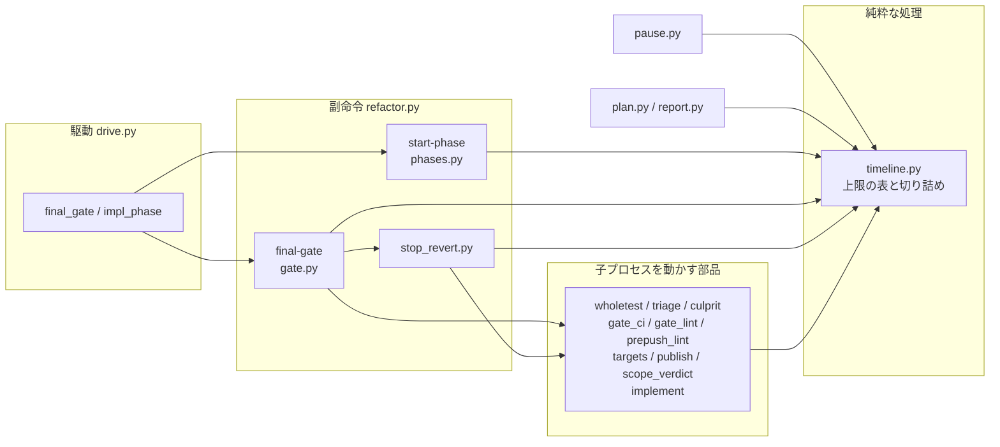
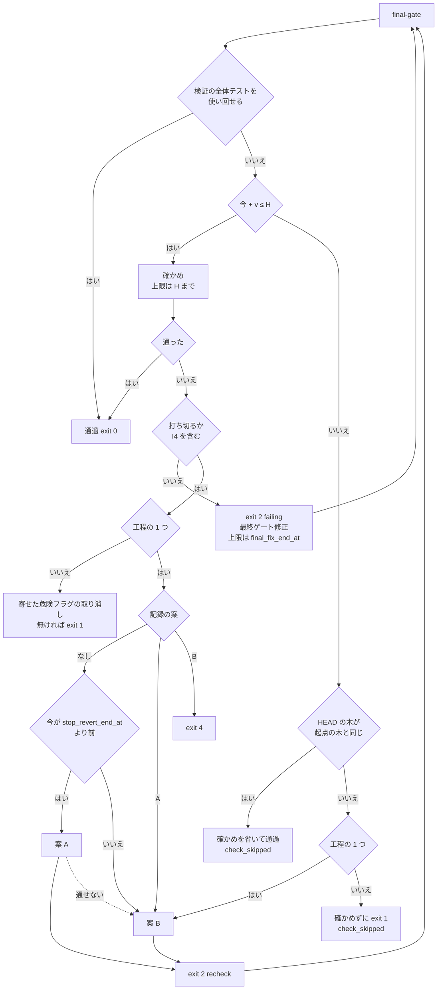

# cross-refactoring: 取り消しと確かめ直しが想定最大時間を超え、検査のプランの refactor のステップが打ち切られる → 最終ゲートの確かめは想定最大時間の終わりまでに入るときだけ始め、1 回の実行が想定最大時間の中で終わる（#1932）

## 目的

- **何が壊れているか**: cross-refactoring の想定最大時間 B が、実際の最大時間になっていない。最終ゲートの全体テストと最終ゲート修正・打ち切りの後の取り消し・取り消しの後の最終ゲートが、B の終わり（`started_at + B`）を越えて動く
- **誰が困るか**: 検査のプランを回す conductor と利用者。refactor のステップの `timeout` は `with_margin(B × 60)`（既定の B で 1980 秒）である。PR #1930 の実行（2107 秒）は、この上限なら exit 124 で打ち切られ、検査のプランが止まる
- **直すと何が成り立つか**: 1 回の実行は、動いていた時間で B × 60 秒と固定値（OS の後始末と通信の待ち）の中で終わる。呼ぶ側の `timeout` は `with_margin(B × 60)` のまま上乗せ無しで足りる

## 適用範囲

- **働く範囲**: cross-refactoring を使うすべてのリポジトリ（配布先を含む）。工程の 1 つとしての起動（`--workflow-step`）と単独の起動の両方
- **プロジェクトごとに違うもの**: 全体テストの所要 w と CI の壁時計 c は、今のまま宣言（`.ndf/project.json` の `test`）と着手前の実測から読む。B は `--budget-minutes` で受ける。新しい設定と引数は足さない
- **当たるモード**: `standard`

## あるべき姿の根拠

| 根拠 | 種類 | 何を示すか |
| --- | --- | --- |
| PR #1930 の状態ファイル（`/tmp/ndf-worktrees/devbasex--ai-plugins/rf1930/work/.cross_refactoring/cross-refactoring-rf1930-state.json`） | 実測 | 開始 22:58:42（UTC）・B = 30 分・w = 399 秒。検証の中の危険フラグの全体テスト（393 秒）が落ちて原因の項目を取り消したため、最終ゲートは全体テストを使い回せず、B の終わりの 125 秒前（23:26:37）に全体テスト（396 秒）を始めて 23:33:46 に終わった。取り消しの締め切り（`stop_revert_end_at`）には達していない |
| `docs/specifications/cross-refactoring-verify-and-final-gate.md` の運用の「時間の上限」 | 既存の確定仕様 | 取り消しと確かめ直しまで含めた所要は 1.2·B + 7 分（既定の B で 43 分）で、`with_margin(B × 60)` を超えうると今の決まりが自ら書いている |
| 承認ゲート 2（ndf v10.17.71）の利用者の指示「このまま出し、この課題を次の最優先にする」 | 利用者の指示の原文 | 呼ぶ側の `timeout` を延ばさず、cross-refactoring の側で B を守る向きを利用者が採った |

要求と受け入れ条件は #1932 の本文にある（コピーは `issues/issue-1932-requirements.md`）。この文書は「どう作るか」だけを扱う。

## ドメインモデル

### コンテキスト

| コンテキスト | 何の語が 1 つの意味に決まるか |
| --- | --- |
| cross-refactoring（`ndf-cross-refactoring`） | 想定最大時間・最終ゲート・最終ゲート修正・打ち切りの後の取り消し・上限の表の各時刻 |

1 つのコンテキストの中で閉じる。検査のプラン（`supervise`）の `timeout` の式は変えず、この変更は呼ぶ側との関係を変えない。

### 集約

| 集約 | 持ち主（書き換えてよいもの） | 根 | エンティティ | 値オブジェクト |
| --- | --- | --- | --- | --- |
| 実行の状態（`cross-refactoring-rf<番号>-state.json`） | `refactor.py` の副命令（`refactor_lib/commands/`） | 実行の状態 | 改善項目（`items[]`）・最終ゲート（`final_gate`） | 上限の表（`limits`）・打ち切りの後の取り消しの記録（`final_gate.stop_revert`）・確かめを省いた記録（`final_gate.check_skipped`） |

上限の表の値は `timeline.compute` が純粋な処理として出し、`init` と `merge-plan` が書き出す（今のまま）。この変更は上限の表の式と、副命令が上限の表を読んで手順を始めるかを決める判定を変える。

### 不変条件

H は想定最大時間の終わり（`limits.final_end_at` = `started_at + B`。中断して再開した実行では止まっていた分だけずれた値）、v は確かめの見込み（`limits.gate_seconds`）である。

| # | 集約 | 条件 | 破れたときの扱い |
| --- | --- | --- | --- |
| I1 | 実行の状態 | 上限の表のすべての時刻（`final_fix_end_at`・`stop_revert_end_at` を含む）は H 以前である | 書き出す前に `timeline.compute` が H で切る。旧い状態ファイルの H より後の値は、読む側（`timeline` の読み出し）が H で切る |
| I2 | 実行の状態 | 副命令が子プロセス（CLI の監視と CLI 自身・テスト・CI の待ち・落ちたテストの走らせ直し・指標の測定）へ渡す上限は、渡す時刻 + 上限 ≤ H である | `timeline` の 1 つの関数が切り詰める。切り詰めた結果が 0 以下なら、その子プロセスを始めない |
| I3 | 最終ゲート | 最終ゲートの確かめ（全体テストか CI の待ち）は、今 + v ≤ H のときだけ始める。検証の中の全体テストを使い回すときは確かめを走らせないので当たらない | 始めずに I5 か I6 の扱いへ進む |
| I4 | 最終ゲート | 最終ゲート修正は、今 + 1 回分（`final_fix_seconds`）≤ `final_fix_end_at` のときだけ起動し、監視の上限は `final_fix_end_at` までである。1 回目も同じで、決定 26 の「1 回目は必ず試みる」は `final_fix_end_at` の中に限る | 起動せずに打ち切りとして扱う（打ち切りの理由に「最終ゲート修正の後の確かめが想定最大時間の終わりまでに入らない」を残す） |
| I5 | 最終ゲート | 工程の 1 つとしての起動で確かめを始められないとき、確かめていない改善のコミットをブランチに残したまま `final_gate.status` を `passed` にしない。HEAD の木が起点の木（`plan.base_sha`）と同じなら確かめを省いて通し、違えば案 B を積んでから省いて通す | 省いた理由と時刻を `final_gate.check_skipped` に、案 B へ移った理由を `final_gate.stop_revert.fallback_reason` に残し、報告に載せる |
| I6 | 最終ゲート | 単独の起動で確かめを始められないとき、改善の項目を取り消さない | 確かめないまま終了コード 1（失敗として報告する。理由は `final_gate.check_skipped`） |
| I7 | 最終ゲート | 打ち切りの後の取り消しの案 A は、今 < `stop_revert_end_at` のときだけ始める | 始めずに案 B へ進む（`fallback_reason` は「打ち切りの後の取り消しの締め切りを過ぎた」） |
| I8 | 最終ゲート | 最終ゲートが 1 回目の確かめで通る実行と、取り消しに進まない実行は、確かめを H − v までに始められる限り、採る項目・取り消す項目・終了コードを変えない | 既存の cross-refactoring のテストで縛る |

### ドメインイベント

| # | イベント | 発生元 | 受け手 |
| --- | --- | --- | --- |
| E1 | 駆動が起動した | 検査のプランの refactor のステップか、利用者の `/ndf:cross-refactoring` | `init`（`started_at` を最初に取る） |
| E2 | 上限の表を書き出した（`init` と `merge-plan`） | `timeline.compute` | すべての副命令（上限を読む側） |
| E3 | 最終ゲートが落ちた | `final-gate` | `final-gate`（打ち切りの判定） |
| E4 | 最終ゲート修正を打ち切った | `final-gate`（`_final_fix_stop`） | 工程の 1 つ: 打ち切りの後の取り消し / 単独: 寄せた危険フラグの取り消しか終了コード 1 |
| E5 | 打ち切りの後に原因の項目を取り消した（案 A） | `stop_revert` | `final-gate`（取り消しの後の最終ゲート。`FINAL_GATE=recheck`） |
| E6 | 起点の木へ戻すコミットを積んだ（案 B） | `stop_revert` | `final-gate`（取り消しの後の最終ゲート） |
| E7 | 取り消しの後の最終ゲートが通った / 落ちた | `final-gate` | 駆動（`finalize` か終了コード 4） |
| E8 | 駆動が終わった | 駆動 | 検査のプラン / 利用者 |
| E9 | 確かめを省いた（追加） | `final-gate` | 駆動（`finalize` と報告） |

E9 は要求の E7 の前で起きうる。確かめを始められない（I3）とき、E7 の代わりに E9 が起きる。

### 用語

| 用語 | 意味 | 用語集への反映 |
| --- | --- | --- |
| 想定最大時間 | 利用者が与える所要の上限（分、`--budget-minutes`）。最終ゲートの確かめと最終ゲート修正・打ち切りの後の取り消しまで含めた 1 回の実行は、動いていた時間でこの中に収まる | 意味の変更 |
| 想定最大時間の終わり | `started_at` + 想定最大時間（`limits.final_end_at`）。中断して再開した実行では、止まっていた分だけずれる。子プロセスへ渡す上限はすべてこの時刻で切る | 追加 |
| 確かめの見込み | 最終ゲートの確かめ 1 回にかかる見込みの秒（`limits.gate_seconds`）。手元で全体テストを走らせるなら w、CI で見るなら c、どちらも測れていなければ 0 | 追加 |
| 最終ゲート修正の終わり | 最終ゲート修正の CLI を止める時刻（`limits.final_fix_end_at`）。想定最大時間の終わり − 確かめの見込み | 追加 |
| 打ち切りの後の取り消し | 工程の 1 つとして起動した cross-refactoring が、最終ゲート修正を打ち切った後か、最終ゲートの確かめを始められないときに、原因の項目を取り消すか（案 A）、着手前の木へ戻すコミットを積む（案 B）処理 | 意味の変更 |

**「確かめ直し」は使わない。** 用語集では、最終ゲートより前の取り消しの後に範囲テストで判定し直すことを指す。
`FINAL_GATE=recheck` で打ち直す最終ゲートは、この文書では「取り消しの後の最終ゲート」と書く。

## 機能一覧

| # | 機能 | 誰が使うか |
| --- | --- | --- |
| F1 | 1 回の実行が想定最大時間の終わりを越えて子プロセスを動かさない | 検査のプラン（refactor のステップ）と利用者 |
| F2 | 最終ゲートの確かめを、想定最大時間の終わりまでに入るときだけ始める | 同上 |
| F3 | 確かめを始められないとき、工程の 1 つでは起点の木へ戻して通し、単独では取り消さずに失敗として報告する | 同上 |
| F4 | 上限の表と報告が、変えた式どおりの時刻（最終ゲート修正の終わり・取り消しの締め切り・確かめの見込み）を出す | conductor と利用者（報告を読む人） |

## 構成要素

| 要素 | 責務 |
| --- | --- |
| `refactor_lib/timeline.py`（変える） | 締め切りの算術。`gate_seconds`（v）・`final_fix_end_at`（H − v）・`stop_revert_end_at`（H − v）を出す。`STOP_REVERT_SHARE` を消す。子の上限を H で切る関数 `clip_to_end(seconds, end, now)` と、確かめが入るかの判定 `gate_fits(state, now)` を置く。テストと CI の上限の読み出し（`state_test_timeout` / `state_whole_timeout` / `state_ci_wait_timeout`）は `now` を受けて H で切った値を返す。締め切りの読み出し（`stop_revert_end` / `final_fix_end`）は H で切った値を返す。純粋な処理のまま（今の時刻は引数） |
| `refactor_lib/commands/phases.py`（変える） | `start-phase` が返す監視の上限（`PHASE_TIMEOUT`）と CLI の上限（`cli_timeout`）を H で切る。`final-fix` の終わりは `final_fix_end_at`（無ければ H） |
| `refactor_lib/commands/gate.py`（変える） | 確かめの前に `gate_fits` を見る。入らなければ、木が起点と同じなら省いて通し、違えば工程の 1 つは案 B へ、単独は終了コード 1。`_final_fix_stop` に I4 の打ち切りの理由を足す |
| `refactor_lib/stop_revert.py`（変える） | 案 A を始める前に `stop_revert_end_at` を見る（I7）。確かめを始められないときに理由を受けて案 B を積む関数を持つ |
| 上限を読む呼び出し元（変える） | `wholetest.py`・`triage.py`・`culprit.py`・`gate_ci.py`・`gate_lint.py`・`prepush_lint.py`・`targets.py`・`publish.py`・`scope_verdict.py`・`commands/implement.py` が、上限の読み出しへ `clock.now()` を渡す。呼び出しの形だけを変え、判定は変えない |
| `refactor_lib/pause.py`（変える） | 中断して再開したときにずらす鍵（`SHIFT_KEYS`）へ `final_fix_end_at` を足す |
| `refactor_lib/plan.py`（変える） | 計画の上限の表の行へ「最終ゲート修正の終わり」と「確かめの見込み（秒）」を足し、「打ち切りの後の取り消し（案 A）の締め切り」の行の値を変えた式から出す |
| `refactor_lib/commands/report.py`（変える） | 確かめを省いた記録（`final_gate.check_skipped`）を報告の 1 行に出す |
| 確定仕様と Skill の文書（変える） | `docs/specifications/cross-refactoring-verify-and-final-gate.md`（運用の「時間の上限」・#1649 の決定 8・#933 の決定 26 の範囲）・`cross-refactoring-culprit-and-stop-revert.md`・`cross-refactoring-time-budget.md`・`ndf-supervise-step-budgets.md`（「予算を余裕より長く超える run」の行）・Skill の `docs/02-plan-and-implement.md` と `docs/04-verify-and-report.md` の締め切りの記述 |
| `plugins/ndf/scripts/supervise_lib/templates.py`（変えない） | refactor のステップの `timeout` は `with_margin((budget or default_refactor_budget_minutes()) * 60)` のまま |

## 処理の流れ

最終ゲートの 1 回の打ち方（`final-gate`）。駆動は終了コード 2 で `FINAL_GATE=failing` なら最終ゲート修正を起動し、
`recheck` なら修正を起動せずに打ち直す（今のまま）。図は判定の順だけを描き、上限を H で切る部品（`timeline.py`・
`phases.py`・上限を読む呼び出し元）・`pause.py`・`plan.py`・`report.py`・文書は含めない。それらの関係は構成要素図が持つ。

- 案 B の後に `recheck` で打ち直したとき、確かめが入れば今のとおり走らせ、落ちれば終了コード 4 で止まる（E7）。
  入らなければ、HEAD の木は起点の木と同じなので確かめを省いて通す
- 単独の起動の「寄せた危険フラグの取り消し」（`gate_ci.revert_deferred`）も締め切りは `stop_revert_end_at` を使い、
  取り消した後の打ち直しは同じ図を通る
- 確かめを省いて通したときの `final_gate.status` は `passed` で、`finalize` は今のとおり最終ゲートが通った実行として
  扱う。改善はすべて取り消されているため、採用は 0 件である

### 時刻の並び（既定の B = 30 分・このリポジトリの w = 400 秒で検算）

開始を S とする。条件は、工程の 1 つとしての起動・`local-full`・`--ci-check` なしである。

| 値 | 中身 |
| --- | --- |
| v | w = 400 秒 |
| F（最終ゲート修正 1 回分） | 82 秒（PR #1930 の配分テーブルの値） |
| 余裕 | 0.05·B = 90 秒 |

| 時刻 | 式 | 値 | 何が止まるか |
| --- | --- | --- | --- |
| `final_end_at`（H） | S + B | S + 1800 秒（30:00） | すべての子プロセスの上限・最終ゲートの確かめ・取り消しの後の最終ゲート |
| `final_fix_end_at` | H − v | S + 1400 秒（23:20） | 最終ゲート修正の CLI（監視と CLI 自身） |
| `stop_revert_end_at` | H − v | S + 1400 秒（23:20） | 案 A の取り消しと走らせ直し |
| 最終ゲート修正を起動できる最後 | `final_fix_end_at` − F | S + 1318 秒（21:58） | 最終ゲート修正の起動（I4） |
| 確かめを始められる最後 | H − v | S + 1400 秒（23:20） | 最終ゲートの確かめの開始（I3） |

最も長い経路でも、子プロセスはすべて S + 1800 秒までに止まる。H の後に動くのは次のものだけである。

- 案 B のコミット・push・`finalize`・報告
- 固定値（`gitfacts` の kill_grace 5 秒・`monitor.py` の SIGTERM の猶予 3 秒）

これらは `with_margin(1800)` = 1980 秒の余裕 180 秒が吸収する（要求の前提 4）。

PR #1930 を同じ規則で通すと、最終ゲートの確かめを始める時刻は 23:26:37（S + 1675 秒）である。
S + 1400 秒を過ぎているため、確かめを始めない。HEAD には採った I-002 が残っており起点の木と違うので、案 B を積んで確かめを省いて通す。
実行は約 28 分で終わり、採用は 1 件から 0 件になる。

## データ構造

状態ファイルの `limits` と `final_gate` に鍵を足す。旧い状態ファイルは読めるまま残す。

| 鍵 | 中身 | 書く時点 | 旧い状態ファイル |
| --- | --- | --- | --- |
| `limits.gate_seconds` | 確かめの見込み v（秒、整数）。`plan.reserve.final_whole_test`（分）× 60 を切り上げる。計画の前は `null` | `merge-plan`（採り直しでも書き直す） | 無ければ 0 として読む |
| `limits.final_fix_end_at` | 最終ゲート修正の終わり（H − v）。計画の前は `null` | `merge-plan` | 無ければ H として読む |
| `limits.stop_revert_end_at` | 打ち切りの後の取り消しの締め切り。式を `final_end_at + 0.20·B` から H − v へ変える | `merge-plan` | H より後の値は H で切って読む |
| `final_gate.check_skipped` | 確かめを省いた記録。`reason`（理由の文）・`left_seconds`（H までの残り）・`gate_seconds`（v）・`base_identity`（HEAD の木が起点の木と同じだったか）・`at`。無ければ省いていない | `final-gate` | 無ければ省いていない |
| `final_gate.stop_revert.fallback_reason` | 値を 1 つ足す: 「想定最大時間の終わりまでに最終ゲートの確かめが入らない」 | `final-gate` | — |

`pause.SHIFT_KEYS` に `final_fix_end_at` を足す。`gate_seconds` は秒の長さなのでずらさない。

## 非機能の実現方式

| 大項目 | 条件 | 実現方式 |
| --- | --- | --- |
| 性能・拡張性 | 1 回の実行の所要の上限は、動いていた時間で B × 60 秒 + 固定値以内 | 子プロセスの上限を H で切る（I2）。確かめと修正と案 A を、終わりの見込みが H に入るときだけ始める（I3・I4・I7）。H の後は git の操作・push・記録・報告だけになる |
| 運用・保守性 | 締め切りの係数は `timeline.py` の B に掛ける比率として持ち、秒や分の固定値を足さない | 新しい時刻は H と実測の v の差だけで出す。`STOP_REVERT_SHARE` を消し、係数を増やさない |

## 決定の記録

### 決定 1: 想定最大時間を超えずに終えるため、バッファに取り消しの分を足さず、手順を始める前に残りへ入るかで選ぶ

修正の後か取り消しの後の確かめ 1 回分を、バッファへ足す形を PR #1930 の値で比べる。1 回分はバッファの最終ゲートの
全体テストと同じ 6.98 分である。

| 値 | 今 | 足したとき |
| --- | --- | --- |
| 計画の後に要る見込み | 10.78 分 | 17.76 分 |
| リファクタリング計画の枠の終わり（23:14:40）に足した時刻 | 23:25:27 | 23:32:26 |

足したときは想定最大時間の終わり（23:28:42）を越え、既定の B = 30 分ではこのリポジトリの実行が提案の前に止まる。
始める前の判定なら、最終ゲートが 1 回目で通る実行の採れる項目を減らさず、落ちた経路だけが改善を手放して B の中で終わる。

バッファへ取り消しと取り消しの後の最終ゲートの分を足す形は、上の理由で採らない。

根拠: Value 1 / Value 2 / Value 3（MVV 版 2）

### 決定 2: 子プロセスの上限を 1 か所で決めるため、`timeline` の読み出しが想定最大時間の終わりで切った値を返す

上限を読んで子プロセスへ渡す部品は 10 ファイルある（構成要素の表の「上限を読む呼び出し元」）。呼び出し元ごとに切ると、切り忘れた所から B を越える。上限の読み出しが
`now` を受けて H で切った値を返せば、呼び出し元は時刻を渡すだけになる。`timeline` は純粋な処理のまま、今の時刻を
引数で受ける。

子プロセスを動かす部品（`gitfacts.run_with_timeout` など）で切る形は採らない。部品は状態ファイルを知らず、H を
渡す経路が呼び出し元ごとに増える。

根拠: Value 6（MVV 版 2）

### 決定 3: 取り消しの後の最終ゲートを H の中に入れるため、最終ゲート修正の終わりと取り消しの締め切りを H − v にし、`STOP_REVERT_SHARE` を消す

最終ゲート修正の後にも案 A の後にも、確かめが 1 回要る。終わりを H − v に置けば、終わりの時点で確かめ 1 回分が残る。
v は宣言と着手前の実測から出る値で、B の比率でも固定の秒でもない。0.20·B の窓は B の外へ時間を足すためにあり、
窓を H の中へ移すと v を差し引いた残りと二重になる。

取り消しの窓（0.20·B）を H − v からさらに前へ取る形は採らない。最終ゲート修正の終わりが H − v − 0.20·B（既定の B で
S + 1040 秒）まで早まり、実装の終わりより前になる実行が出る。

根拠: Value 3 / Value 5（MVV 版 2）

### 決定 4: 確かめていない改善を残して完了にしないため、工程の 1 つでは確かめを始められなければ案 B を積み、起点の木と同じ木は確かめを省いて通す

起点の木（`plan.base_sha`）と同じ木には改善の変更が無く、変更起因の失敗は定義から無い。確かめを省いても、
「全体テストを落とすコミットを残して完了にしない」は守られる。案 B は新しいコミットを 1 本積むだけで、push 済みの
履歴を書き換えない（C4 に当たらない）。#1669 決定 1 の「案 B はどの経路でも止まらずに終えることを保証する」を、
時間が足りない経路へ広げる。

確かめを走らせずに「判断が要る」（終了コード 4）で終える形は採らない。確かめていないコミットがブランチに残り、
検査のプランが止まって conductor の手作業（PR #1663 で約 15 分）が要る。案 B の後に時間が残れば今のとおり確かめ、
落ちれば終了コード 4 で止まる（E7）。

根拠: Value 1 / Value 2（MVV 版 2）

### 決定 5: 単独の起動の判断を Pull Request の読み手に残すため、確かめを始められなければ取り消さずに終了コード 1 で終える

単独の起動は、打ち切っても採った改善を取り消さない（#1669 決定 1）。確かめを始められないときも同じ扱いにし、
理由を `final_gate.check_skipped` に残す。

単独でも案 B を積む形は採らない。人が Pull Request を読んで取り消すかを決められる経路で、改善を機械が手放す
理由が無い。

根拠: Value 2 / Value 7（MVV 版 2）

### 決定 6: 確かめの見込みを宣言と実測から出すため、v にバッファの最終ゲートの全体テストの値を使い、測れていなければ 0 にする

バッファの `final_whole_test` は、手元なら w・CI なら c で、計画の時点に 1 度だけ決まる（#1334 決定 8）。同じ値を
使えば、計画が見込んだ最終ゲートと、始める前の判定が同じ見込みで動く。測れていなければ 0 とし、判定は常に通り、
H で切る上限（決定 2）だけで守る。

`whole_timeout`（3·w）を v に使う形は採らない。既定の B ではほぼすべての実行で確かめを始められなくなる。

根拠: Value 3 / Value 5（MVV 版 2）

### 決定 7: 最終ゲート修正の後の確かめを H の中に入れるため、1 回目の修正の下限（#933 決定 26）を最終ゲート修正の終わりの中に限る

決定 26 は「想定最大時間を使い切った後に落ちても 1 度は直しを試みる」ために、1 回目にバッファの最終ゲート修正 1 回分の長さを渡す。
H − v を過ぎて試みると、直した後の最終ゲートが H に入らず、直しは使われない。起動の前に 1 回分が
`final_fix_end_at` までに入るかを見て、入らなければ打ち切りとして扱う。

1 回目だけ H まで延ばして試みる形は採らない。直した後の確かめが入らず、決定 4 の案 B へ進むため、直しの時間が
無駄になる。

根拠: Value 3（MVV 版 2）

## テスト設計

| 受け入れ条件・不変条件 | どの振る舞いで縛るか | どう壊したら落ちるべきか |
| --- | --- | --- |
| AC1・I1 | `timeline.compute` の上限の表で、`final_fix_end_at`・`stop_revert_end_at` が `final_end_at` 以前になる。B = 30 分・w = 400 秒で `final_fix_end_at` と `stop_revert_end_at` が S + 1400 秒、`final_end_at` が S + 1800 秒 | `STOP_REVERT_SHARE` を残す・H − v の代わりに H + 0.20·B を書く |
| AC1・I1（旧い状態ファイル） | `final_end_at + 0.20·B` の `stop_revert_end_at` を持つ状態ファイルを読むと、締め切りの読み出しが H を返す | 読み出しで H を切らない |
| AC2・I2 | 工程の 1 つとして、最終ゲートが落ち → 最終ゲート修正 → 落ち → 打ち切り → 案 A → 取り消しの後の最終ゲート → 案 B と進む経路を、時計を差し替えて駆動で通すと、`PHASE_TIMEOUT`・`cli_timeout`・テストの上限・CI の待ちの上限・走らせ直しの上限のどれも、渡した時刻 + 上限 ≤ H である | 読み出しが `now` を受けずに表の値を返す・`start-phase` が余裕を H の後へ足す |
| AC3・I3 | 同じ経路で、案 A の後の残りが v より短いと、全体テストも CI の待ちも始めない（テストの実行器が呼ばれない） | 確かめの前の判定を外す |
| AC4・I5 | AC3 のとき、案 B を積み、`final_gate.check_skipped` と `stop_revert.fallback_reason` に理由が残り、`final_gate.status` が `passed` になるのは HEAD の木が起点の木と同じときだけである。報告にその行が出る | 案 B を積まずに `passed` にする・起点の木と違う木で省く |
| I4 | 最終ゲート修正の 1 回分が `final_fix_end_at` までに入らないと、1 回目でも起動せず打ち切りになり、打ち切りの理由が残る | 決定 26 の下限を `final_fix_end_at` で切らない |
| I6 | 単独の起動で確かめを始められないと、項目を取り消さずに終了コード 1 で終わる | 単独でも案 B を積む |
| I7 | `stop_revert_end_at` を過ぎて打ち切ると、案 A の取り消しを 1 件も行わずに案 B を積む | 案 A の前の判定を外す |
| AC5 | `supervise_lib.templates` の refactor のステップの `timeout` が `with_margin((budget or default_refactor_budget_minutes()) * 60)` のままである（`test_supervise_step_budgets.py` の既存の縛りを保つ） | 秒を足す・係数を変える |
| AC6・I8 | 既存の cross-refactoring のテスト（`plugins/ndf/skills/cross-refactoring/tests`・`plugins/ndf/scripts/tests`）が通る。最終ゲートが 1 回目で通る実行と、取り消しに進まない実行の採用・取り消し・終了コードが変わらない | 確かめの前の判定が、H − v より前に始める確かめも止める |
| AC7 | 確定仕様の更新（文書の検査 `doc-lint.py` と参照切れのチェックで見る。文言を照合するテストは書かない） | — |
| AC8 | `merge-plan` が書いた上限の表を報告の上限の表に出すと、「最終ゲート修正の終わり」「打ち切りの後の取り消し（案 A）の締め切り」「確かめの見込み（秒）」の行が上限の表の値と一致する | 報告の行を旧い式（H + 0.20·B）で組む |
| 中断と再開 | 止まっていた分だけ `final_fix_end_at` もずれ、`gate_seconds` はずれない | `SHIFT_KEYS` に足さない |

## 設計の結果

| 課題 | 扱い | 取り込み先 | 触るファイル |
| --- | --- | --- | --- |
| #1932 | 実装する | — | `plugins/ndf/skills/cross-refactoring/scripts/refactor_lib/`、`plugins/ndf/skills/cross-refactoring/tests/`、`plugins/ndf/skills/cross-refactoring/docs/02-plan-and-implement.md`、`plugins/ndf/skills/cross-refactoring/docs/04-verify-and-report.md`、`docs/specifications/cross-refactoring-verify-and-final-gate.md`、`docs/specifications/cross-refactoring-culprit-and-stop-revert.md`、`docs/specifications/cross-refactoring-time-budget.md`、`docs/specifications/ndf-supervise-step-budgets.md` |

## 未確認のまま残ること

| 項目 | 内容 |
| --- | --- |
| 改善を手放す実行の数 | 既定の B = 30 分と w ≈ 400 秒では、最終ゲートが落ちた実行の多くが、最終ゲート修正と案 A を試みずに案 B で終わる（バッファは最終ゲートの確かめ 1 回と修正 1 回しか持たず、修正の後の確かめが入らない）。PR #1930 は採用 1 件が 0 件になる。どの程度の割合になるかは、リリース後の検査のプランの実行で数える |
| `started_at` より前の時間 | `init` は処理の最初に `started_at` を取る（`commands/setup.py` の `cmd_init`）。駆動の起動から `init` までは耐久の記録を開くだけで、PR #1930 では指標の記録の開始と `started_at` が秒まで一致した。ほかのリポジトリでの差は測っていない |
| 案 B の後の同期 | 案 B の後の push の直前に、オーケストレーターの同期（`--sync-command`）がコミットを積むことがある。確かめを省く判定は案 B のコミットの木で行い、同期のコミットは判定に入れない。同期の生成物が起点の木と食い違う実行は確かめていない |
| v が実際より短い実行 | 実測の w より確かめが長くかかると、確かめは H で打ち切られて落ちた扱いになり、案 B へ進む。B の中で終わることは変わらない |
