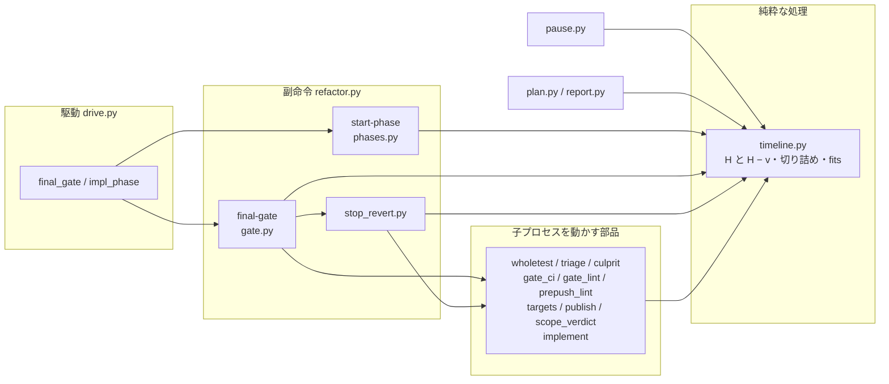
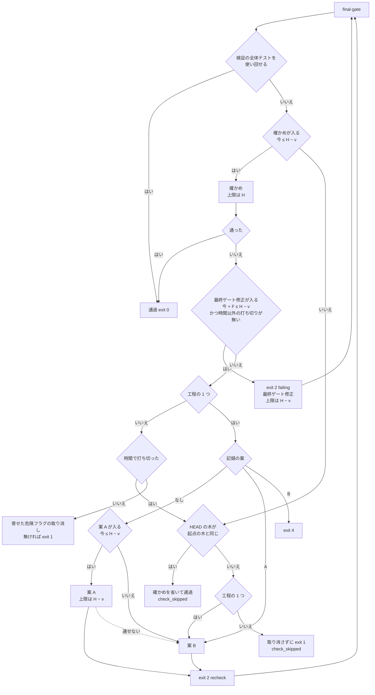

# cross-refactoring: 取り消しと確かめ直しが想定最大時間を超え、検査のプランの refactor のステップが打ち切られる → 想定最大時間を上限にし、最終ゲートの手順は締め切りまでに入るときだけ始める（#1932）

## 目的

- **何が壊れているか**: cross-refactoring の想定最大時間 B が、実際の最大時間になっていない。最終ゲートの全体テストと最終ゲート修正・打ち切りの後の取り消し・取り消しの後の最終ゲートが、B の終わり（`started_at + B`）を越えて動く
- **誰が困るか**: 検査のプランを回す conductor と利用者。refactor のステップの `timeout` は `with_margin(B × 60)`（既定の B で 1980 秒）である。PR #1930 の実行（2107 秒）は、この上限なら exit 124 で打ち切られ、検査のプランが止まる
- **直すと何が成り立つか**: 1 回の実行の子プロセスはすべて B の終わりまでに止まる。呼ぶ側の `timeout` は `with_margin(B × 60)` のまま上乗せ無しで足りる

## 大方針（4 原則）

打ち切りと余白について、これまで 7 つの考え方が混ざっていた。利用者が 2026-10-12 に承認した次の 4 原則に絞り、
この文書の決定・不変条件・処理の流れはすべてここから導く。H は想定最大時間の終わり（開始 + B。中断して再開すると、
止まっていた分だけずれる）、v は最終ゲートの確かめ 1 回の見込みである。

1. **想定最大時間 B は上限である。** 子プロセスはすべて H までに止まる。「目安の上限」という意味は捨てる
2. **余白は内側 1 つ・外側 1 つだけ。** 内側はバッファ R（計画の時点で B から引く）。外側は呼ぶ側の
   `with_margin(B × 60)`（10%・最低 30 秒）で、H の後の git・push・報告・プロセスの後始末だけを吸収する。
   手順ごとの余裕 0.05·B は残すが、締め切りで切られ B の外へ出ない。ほかに外側への上乗せは置かない
3. **時間の守り方は「入るときだけ始める」の 1 つ。** 最終ゲートの確かめ・最終ゲート修正・打ち切りの後の取り消しは、
   今 + 見込み ≤ 締め切りのときだけ始め、子プロセスの上限は締め切りで切る。例外は持たない。締め切りは
   **H** と **H − v** の 2 つだけで、最終ゲート修正と取り消しは同じ H − v を使う
4. **入らなかったときの扱いは 2 通りだけ。** 工程の 1 つ（`--workflow-step`）は、起点の木へ戻して（案 B）通し、
   報告する（木が起点と同じなら確かめを省いて通す）。単独の起動は、何も取り消さず、終了コード 1 で報告する

### 7 つの考え方のうち残すもの・廃止するもの

| # | 考え方 | 出所 | 扱い | 原則 |
| --- | --- | --- | --- | --- |
| 1 | B は目安の上限で、取り消しと確かめ直しの分は越えてよい | `cross-refactoring-verify-and-final-gate.md` の運用の「時間の上限」（1.2·B + 7 分） | **廃止**。B は上限 | 1 |
| 2 | バッファ R（計画の時点で B から引く） | `cross-refactoring-time-budget.md` | **残す**（内側の余白） | 2 |
| 3 | 手順ごとの余裕 0.05·B（`MARGIN_SHARE`） | #933 決定 24 | **残す**。ただし締め切り（H か H − v）で切る | 2 |
| 4 | 最終ゲート修正の 1 回目は時計で打ち切らない | #933 決定 26 | **廃止**。1 回目も入るときだけ始める | 3 |
| 5 | 取り消しの締め切り = B + 0.20·B（`STOP_REVERT_SHARE`） | #1649 の決定の記録の決定 8（コードのコメントでは「#1669 決定 8」） | **廃止**。取り消しの締め切りは H − v | 3 |
| 6 | 呼ぶ側の `with_margin(B × 60)`（+10%・最低 30 秒） | #1916・#1522 | **残す**（外側の余白。H の後の後始末だけ） | 2 |
| 7 | 入るときだけ始める | この課題 | **残す**（唯一の守り方） | 3 |

## 適用範囲

- **働く範囲**: cross-refactoring を使うすべてのリポジトリ（配布先を含む）。工程の 1 つとしての起動（`--workflow-step`）と単独の起動の両方
- **プロジェクトごとに違うもの**: 全体テストの所要 w と CI の壁時計 c は、今のまま宣言（`.ndf/project.json` の `test`）と着手前の実測から読む。B は `--budget-minutes` で受ける。新しい設定と引数は足さない
- **当たるモード**: `standard`

## あるべき姿の根拠

| 根拠 | 種類 | 何を示すか |
| --- | --- | --- |
| PR #1930 の状態ファイル（`/tmp/ndf-worktrees/devbasex--ai-plugins/rf1930/work/.cross_refactoring/cross-refactoring-rf1930-state.json`） | 実測 | 開始 22:58:42（UTC）・B = 30 分・w = 399 秒。検証の中の危険フラグの全体テスト（393 秒）が落ちて原因の項目を取り消したため、最終ゲートは全体テストを使い回せず、B の終わりの 125 秒前（23:26:37）に全体テスト（396 秒）を始めて 23:33:46 に終わった。取り消しの締め切り（`stop_revert_end_at`）には達していない |
| `docs/specifications/cross-refactoring-verify-and-final-gate.md` の運用の「時間の上限」 | 既存の確定仕様 | 取り消しと確かめ直しまで含めた所要は 1.2·B + 7 分（既定の B で 43 分）で、`with_margin(B × 60)` を超えうると今の決まりが自ら書いている |
| 承認ゲート 2（ndf v10.17.71）の利用者の指示「このまま出し、この課題を次の最優先にする」 | 利用者の指示の原文 | 呼ぶ側の `timeout` を延ばさず、cross-refactoring の側で B を守る向きを利用者が採った |
| 利用者の指摘（2026-10-12）「打ち切り、余白についていくつかの考え方が出ていて混乱します。大方針を整理して簡素化してください」と、4 原則の承認 | 利用者の指示の原文 | 大方針（4 原則）。この文書の決定はここから導く |

要求と受け入れ条件は #1932 の本文にある（コピーは `issues/issue-1932-requirements.md`）。この文書は「どう作るか」だけを扱う。

## ドメインモデル

### コンテキスト

| コンテキスト | 何の語が 1 つの意味に決まるか |
| --- | --- |
| cross-refactoring（`ndf-cross-refactoring`） | 想定最大時間・想定最大時間の終わり・確かめの見込み・確かめの開始の締め切り・最終ゲート修正・打ち切りの後の取り消し |

1 つのコンテキストの中で閉じる。検査のプラン（`supervise`）の `timeout` の式は変えず、この変更は呼ぶ側との関係を変えない。

### 集約

| 集約 | 持ち主（書き換えてよいもの） | 根 | エンティティ | 値オブジェクト |
| --- | --- | --- | --- | --- |
| 実行の状態（`cross-refactoring-rf<番号>-state.json`） | `refactor.py` の副命令（`refactor_lib/commands/`） | 実行の状態 | 改善項目（`items[]`）・最終ゲート（`final_gate`） | 上限の表（`limits`）・打ち切りの後の取り消しの記録（`final_gate.stop_revert`）・確かめを省いた記録（`final_gate.check_skipped`） |

上限の表の値は `timeline.compute` が純粋な処理として出し、`init` と `merge-plan` が書き出す（今のまま）。

### 不変条件

| # | 原則 | 集約 | 条件 | 破れたときの扱い |
| --- | --- | --- | --- | --- |
| I1 | 1・2 | 実行の状態 | 上限の表のすべての時刻と、副命令が子プロセス（CLI の監視と CLI 自身・テスト・CI の待ち・落ちたテストの走らせ直し・指標の測定）へ渡す上限は、H 以前である。手順ごとの余裕もこの中に入る | `timeline` の 1 つの関数が切り詰める。切り詰めた結果が 0 以下なら、その子プロセスを始めない。旧い状態ファイルの H より後の値は、読む側が H で切る |
| I2 | 3 | 最終ゲート | 最終ゲートの確かめ（全体テストか CI の待ち）・最終ゲート修正（1 回目を含む）・打ち切りの後の取り消しの案 A は、今 + 見込み ≤ H − v のときだけ始める。見込みは、確かめが 0（始めた後は H まで v 秒）・最終ゲート修正が F（`final_fix_seconds`）・案 A が 0 である。確かめの子プロセスは H で、最終ゲート修正と案 A の子プロセスは H − v で切る。検証の中の全体テストを使い回すときは確かめを走らせないので当たらない | 始めずに I3 の扱いへ進む。最終ゲート修正と案 A は打ち切りとして扱い、理由を残す |
| I3 | 4 | 最終ゲート | I2 で始められないとき、工程の 1 つは案 B を積んで通し、単独の起動は何も取り消さずに終了コード 1 で終える。どちらも HEAD の木が起点の木（`plan.base_sha`）と同じなら確かめを省いて通す。確かめていない改善のコミットを残したまま `final_gate.status` を `passed` にしない | 省いた理由と時刻を `final_gate.check_skipped` に、案 B へ移った理由を `final_gate.stop_revert.fallback_reason` に残し、報告に載せる |
| I4 | 1 | 最終ゲート | I2 で始められない経路に当たらない実行（確かめを H − v までに始められ、確かめが落ちたときの最終ゲート修正を H − v − F までに起動できる実行）は、採る項目・取り消す項目・終了コードを変えない | 既存の cross-refactoring のテストで縛る |

### ドメインイベント

| # | イベント | 発生元 | 受け手 |
| --- | --- | --- | --- |
| E1 | 駆動が起動した | 検査のプランの refactor のステップか、利用者の `/ndf:cross-refactoring` | `init`（`started_at` を最初に取る） |
| E2 | 上限の表を書き出した（`init` と `merge-plan`） | `timeline.compute` | すべての副命令（上限を読む側） |
| E3 | 最終ゲートが落ちた | `final-gate` | `final-gate`（打ち切りの判定） |
| E4 | 最終ゲート修正を打ち切った（I2 で入らないときを含む） | `final-gate`（`_final_fix_stop`） | 工程の 1 つ: 打ち切りの後の取り消し / 単独: 時間で打ち切ったなら終了コード 1、時間以外なら寄せた危険フラグの取り消し（今のまま） |
| E5 | 打ち切りの後に原因の項目を取り消した（案 A） | `stop_revert` | `final-gate`（取り消しの後の最終ゲート。`FINAL_GATE=recheck`） |
| E6 | 起点の木へ戻すコミットを積んだ（案 B） | `stop_revert` | `final-gate`（取り消しの後の最終ゲート） |
| E7 | 取り消しの後の最終ゲートが通った / 落ちた | `final-gate` | 駆動（`finalize` か終了コード 4） |
| E8 | 駆動が終わった | 駆動 | 検査のプラン / 利用者 |
| E9 | 確かめを省いた（追加） | `final-gate` | 駆動（`finalize` と報告） |

E9 は要求の E7 の前で起きうる。確かめを始められず、HEAD の木が起点の木と同じとき、E7 の代わりに E9 が起きる。

### 用語

| 用語 | 意味 | 用語集への反映 |
| --- | --- | --- |
| 想定最大時間 | 利用者が与える所要の上限（分、`--budget-minutes`）。1 回の実行の子プロセスは、最終ゲートの確かめ・最終ゲート修正・打ち切りの後の取り消しも含めて、すべて想定最大時間の終わりまでに止まる | 意味の変更 |
| 想定最大時間の終わり | `started_at` + 想定最大時間（`limits.final_end_at`、H）。中断して再開した実行では、止まっていた分だけずれる。子プロセスへ渡す上限はすべてこの時刻で切る | 追加 |
| 確かめの見込み | 最終ゲートの確かめ 1 回にかかる見込みの秒（`limits.gate_seconds`、v）。手元で全体テストを走らせるなら w、CI で見るなら c、どちらも測れていなければ 0 | 追加 |
| 確かめの開始の締め切り | 想定最大時間の終わり − 確かめの見込み（H − v。`timeline.gate_start_end`）。最終ゲートの確かめを始められる最後の時刻で、最終ゲート修正と打ち切りの後の取り消しもこの時刻までに止まる | 追加 |
| 打ち切りの後の取り消し | 工程の 1 つとして起動した cross-refactoring が、最終ゲート修正を打ち切った後か、最終ゲートの確かめを始められないときに、原因の項目を取り消すか（案 A）、着手前の木へ戻すコミットを積む（案 B）処理 | 意味の変更 |

**「確かめ直し」は使わない。** 用語集では、最終ゲートより前の取り消しの後に範囲テストで判定し直すことを指す。
`FINAL_GATE=recheck` で打ち直す最終ゲートは、この文書では「取り消しの後の最終ゲート」と書く。

## 機能一覧

| # | 機能 | 誰が使うか |
| --- | --- | --- |
| F1 | 1 回の実行が想定最大時間の終わりを越えて子プロセスを動かさない（原則 1・2） | 検査のプラン（refactor のステップ）と利用者 |
| F2 | 最終ゲートの確かめ・最終ゲート修正・案 A を、確かめの開始の締め切りまでに入るときだけ始める（原則 3） | 同上 |
| F3 | 入らないとき、工程の 1 つでは起点の木へ戻して通し、単独では取り消さずに終了コード 1 で報告する（原則 4） | 同上 |
| F4 | 上限の表と報告が、想定最大時間の終わり・確かめの開始の締め切り・確かめの見込みを出す | conductor と利用者（報告を読む人） |

## 構成要素

| 要素 | 責務 |
| --- | --- |
| `refactor_lib/timeline.py`（変える） | 締め切りの算術。`gate_seconds`（v）を書き出し、確かめの開始の締め切り（H − v）を読み出す関数 `gate_start_end(state)` を置く。`STOP_REVERT_SHARE` と `stop_revert_end_at` の書き出しを消す。`final_fix_timeout` の 1 回目の下限（#933 決定 26）を消す。子の上限を締め切りで切る関数 `clip_to_end(seconds, end, now)` と、入るかの判定 `fits(now, seconds, end)` を 1 つずつ置く。テストと CI の上限の読み出し（`state_test_timeout` / `state_whole_timeout` / `state_ci_wait_timeout`）は `now` を受けて H で切った値を返す。純粋な処理のまま（今の時刻は引数） |
| `refactor_lib/commands/phases.py`（変える） | `start-phase` が返す監視の上限（`PHASE_TIMEOUT`）と CLI の上限（`cli_timeout`）を、残り + 余裕を締め切りで切った値にする。締め切りは `final-fix` が H − v、ほかの手順が H |
| `refactor_lib/commands/gate.py`（変える） | 確かめの前と最終ゲート修正の起動の前に `fits` を見る。入らなければ、木が起点と同じなら省いて通し、違えば工程の 1 つは案 B へ、単独は終了コード 1 |
| `refactor_lib/stop_revert.py`（変える） | 案 A を始める前に `fits`（締め切りは H − v）を見る。入らないときと確かめを始められないときに、理由を受けて案 B を積む |
| 上限を読む呼び出し元（変える） | `wholetest.py`・`triage.py`・`culprit.py`・`gate_ci.py`・`gate_lint.py`・`prepush_lint.py`・`targets.py`・`publish.py`・`scope_verdict.py`・`commands/implement.py` が、上限の読み出しへ `clock.now()` を渡す。呼び出しの形だけを変え、判定は変えない。`gate_ci.revert_deferred` の締め切りは H − v |
| `refactor_lib/pause.py`（変える） | 中断して再開したときにずらす鍵（`SHIFT_KEYS`）から、書かなくなった `stop_revert_end_at` を外す。H − v は H と v から読み出すので、ずらす鍵は増えない |
| `refactor_lib/plan.py`（変える） | 計画の上限の表の「打ち切りの後の取り消し（案 A）の締め切り」の行を「確かめの開始の締め切り（最終ゲート修正と案 A もここまで）」に替え、「確かめの見込み（秒）」の行を足す |
| `refactor_lib/commands/report.py`（変える） | 確かめを省いた記録（`final_gate.check_skipped`）を報告の 1 行に出す |
| 確定仕様と Skill の文書（変える） | `docs/specifications/cross-refactoring-verify-and-final-gate.md`（運用の「時間の上限」・#1649 の決定 8・#933 の決定 26 の廃止）・`cross-refactoring-culprit-and-stop-revert.md`・`cross-refactoring-time-budget.md`（想定最大時間の意味）・`ndf-supervise-step-budgets.md`（「予算を余裕より長く超える run」の行）・Skill の `docs/02-plan-and-implement.md` と `docs/04-verify-and-report.md` の締め切りの記述 |
| `plugins/ndf/scripts/supervise_lib/templates.py`（変えない） | refactor のステップの `timeout` は `with_margin((budget or default_refactor_budget_minutes()) * 60)` のまま |

## 処理の流れ

最終ゲートの 1 回の打ち方（`final-gate`）。駆動は終了コード 2 で `FINAL_GATE=failing` なら最終ゲート修正を起動し、
`recheck` なら修正を起動せずに打ち直す（今のまま）。図は判定の順だけを描く。「入る」はすべて原則 3 の
今 + 見込み ≤ H − v で、入らなければ原則 4 の 2 通り（図の右下）へ進む。

- 案 B の後に `recheck` で打ち直したとき、確かめが入れば今のとおり走らせ、落ちれば終了コード 4 で止まる（E7）。
  入らなければ、HEAD の木は起点の木と同じなので確かめを省いて通す
- 単独の起動の時間以外の打ち切り（`no_relaunch` など）は今のまま「寄せた危険フラグの取り消し」（`gate_ci.revert_deferred`）へ
  進む。その取り消しの締め切りも H − v で、取り消した後の打ち直しは同じ図を通る
- 確かめを省いて通したときの `final_gate.status` は `passed` で、`finalize` は今のとおり最終ゲートが通った実行として
  扱う。改善はすべて取り消されているため、採用は 0 件である

### 時刻の並び（既定の B = 30 分・このリポジトリの w = 400 秒で検算）

開始を S とする。条件は、工程の 1 つとしての起動・`local-full`・`--ci-check` なしである。v = w = 400 秒、
F（最終ゲート修正 1 回分）= 82 秒（PR #1930 の配分テーブルの値）である。

| 時刻 | 式 | 値 | 何が止まるか・始められないか |
| --- | --- | --- | --- |
| H（`final_end_at`） | S + B | S + 1800 秒（30:00） | すべての子プロセス（最終ゲートの確かめ・取り消しの後の最終ゲートを含む） |
| 確かめの開始の締め切り | H − v | S + 1400 秒（23:20） | 最終ゲートの確かめの開始・案 A の開始。最終ゲート修正と案 A の子プロセスはここで止まる |
| 最終ゲート修正を起動できる最後 | H − v − F | S + 1318 秒（21:58） | 最終ゲート修正の起動（1 回目を含む） |

最も長い経路でも、子プロセスはすべて S + 1800 秒までに止まる。H の後に動くのは、案 B のコミット・push・`finalize`・報告と、
固定値（`gitfacts` の kill_grace 5 秒・`monitor.py` の SIGTERM の猶予 3 秒）だけである。これらは外側の余白
`with_margin(1800)` = 1980 秒の 180 秒が吸収する（原則 2・要求の前提 4）。

**振る舞いの帰結（PR #1930 を同じ規則で通す）**: 最終ゲートの確かめを始める時刻は 23:26:37（S + 1675 秒）で、
S + 1400 秒を過ぎているため確かめを始めない。HEAD には採った I-002 が残っており起点の木と違うので、案 B を積んで
確かめを省いて通す。実行は約 28 分で終わり、採用は 1 件から 0 件になる。

## データ構造

状態ファイルの `limits` と `final_gate` に鍵を足し、書かなくなる鍵を 1 つ消す。旧い状態ファイルは読めるまま残す。
締め切りの時刻の鍵は増やさない（H − v は H と v から読み出す）。

| 鍵 | 中身 | 書く時点 | 旧い状態ファイル |
| --- | --- | --- | --- |
| `limits.gate_seconds`（足す） | 確かめの見込み v（秒、整数）。`plan.reserve.final_whole_test`（分）× 60 を切り上げる。計画の前は `null` | `merge-plan`（採り直しでも書き直す） | 無ければ 0 として読む（H − v = H） |
| `limits.stop_revert_end_at`（書かなくなる） | 取り消しの締め切りは確かめの開始の締め切り（H − v）に一本化する | — | 残っていても読まない |
| `limits.final_fix_seconds`（意味だけ変わる） | 最終ゲート修正 1 回の見込み F。起動の前の `fits` に使う。1 回目に必ず渡す長さとしては使わない | `merge-plan`（今のまま） | 今のまま |
| `final_gate.check_skipped`（足す） | 確かめを省いた記録。`reason`（理由の文）・`left_seconds`（H までの残り）・`gate_seconds`（v）・`base_identity`（HEAD の木が起点の木と同じだったか）・`at`。無ければ省いていない | `final-gate` | 無ければ省いていない |
| `final_gate.stop_revert.fallback_reason`（値を足す） | 「確かめの開始の締め切りまでに入らない」 | `final-gate` | — |

`pause.SHIFT_KEYS` から `stop_revert_end_at` を外す。`gate_seconds` は秒の長さなのでずらさない。

## 非機能の実現方式

| 大項目 | 条件 | 実現方式 |
| --- | --- | --- |
| 性能・拡張性 | 1 回の実行の所要の上限は、動いていた時間で B × 60 秒 + 固定値以内 | 子プロセスの上限を H で切る（I1）。最終ゲートの手順を、入るときだけ始める（I2）。H の後は git の操作・push・記録・報告だけになる |
| 運用・保守性 | 締め切りの係数は `timeline.py` の B に掛ける比率として持ち、秒や分の固定値を足さない | 締め切りは H と H − v の 2 つで、v は実測から出す。`STOP_REVERT_SHARE` を消し、係数を増やさない |

## 決定の記録

### 決定 1: 想定最大時間を上限にするため、子プロセスの上限を `timeline` の読み出しが H で切る（原則 1）

上限を読んで子プロセスへ渡す部品は 10 ファイルある（構成要素の表の「上限を読む呼び出し元」）。呼び出し元ごとに切ると、
切り忘れた所から B を越える。上限の読み出しが `now` を受けて H で切った値を返せば、呼び出し元は時刻を渡すだけになる。
`timeline` は純粋な処理のまま、今の時刻を引数で受ける。

子プロセスを動かす部品（`gitfacts.run_with_timeout` など）で切る形は採らない。部品は状態ファイルを知らず、H を
渡す経路が呼び出し元ごとに増える。

B を上限にした帰結として、確かめや修正を始められない実行では終了コードも変わりうる（I4 の範囲の外）。要求の受け入れ条件 6 は、
この帰結を条件の文に含める形へ書き直した（課題 #1932 の本文と `issues/issue-1932-requirements.md`）。
条件 6 を元のまま守る形は採らない。H − v を過ぎて確かめや修正を始めると H を越え、受け入れ条件 1〜3 と両立しない。

根拠: Value 6 / Value 7（MVV 版 2）

### 決定 2: 余白を内側と外側の 1 つずつにするため、バッファへ取り消しの分を足さず、`STOP_REVERT_SHARE` を消す（原則 2）

修正の後か取り消しの後の確かめ 1 回分を、バッファへ足す形を PR #1930 の値で比べる。1 回分はバッファの最終ゲートの
全体テストと同じ 6.98 分である。

| 値 | 今 | 足したとき |
| --- | --- | --- |
| 計画の後に要る見込み | 10.78 分 | 17.76 分 |
| リファクタリング計画の枠の終わり（23:14:40）に足した時刻 | 23:25:27 | 23:32:26 |

足したときは H（23:28:42）を越え、既定の B = 30 分ではこのリポジトリの実行が提案の前に止まる。内側の余白は今のバッファ R
の 1 つで足り、確かめが入らない経路は原則 3・4 で扱う。

取り消しの窓 0.20·B は B の外へ時間を足す 3 つ目の余白で、原則 2 に反するので消す。窓を H の中へ移して H − v からさらに前へ
取る形も採らない。最終ゲート修正の締め切りが H − v − 0.20·B（既定の B で S + 1040 秒）まで早まり、実装の終わりより前になる
実行が出る。手順ごとの余裕 0.05·B は残すが、締め切りで切るので B の外へ出ない。

根拠: Value 1 / Value 2 / Value 3（MVV 版 2）

### 決定 3: 守り方を 1 つにするため、確かめ・最終ゲート修正・案 A を同じ H − v で判定し、#933 決定 26 を廃止する（原則 3）

最終ゲート修正の後にも案 A の後にも、確かめが 1 回要る。締め切りを H − v に置けば、締め切りの時点で確かめ 1 回分が残る。
確かめを始めるときの判定も今 ≤ H − v で、3 つの手順が同じ時刻 1 つで判定できる。状態ファイルには v だけを書き、
H − v は読み出すときに出す。最終ゲート修正と取り消しに別々の時刻の鍵を持たせる形は採らない。中断して再開したときに
ずらす鍵が増え、2 つの値が食い違う余地が生まれる。

#933 決定 26 は「想定最大時間を使い切った後に落ちても 1 度は直しを試みる」ために、1 回目にバッファの最終ゲート修正 1 回分の長さを渡す。
H − v を過ぎて試みると、直した後の確かめが H に入らず、直しは使われないまま原則 4 の扱いへ進む。1 回目だけ H まで延ばして
試みる形は、時間を使って結果を変えないので採らない。

根拠: Value 3 / Value 5（MVV 版 2）

### 決定 4: 入らなかったときの扱いを 2 通りにするため、工程の 1 つは案 B で通し、単独は取り消さずに終了コード 1 で終える（原則 4）

工程の 1 つ: 起点の木（`plan.base_sha`）と同じ木には改善の変更が無く、変更起因の失敗は定義から無い。確かめを省いても、
「全体テストを落とすコミットを残して完了にしない」は守られる。案 B は新しいコミットを 1 本積むだけで、push 済みの
履歴を書き換えない（C4 に当たらない）。#1669 決定 1 の「案 B はどの経路でも止まらずに終えることを保証する」を、
時間が足りない経路へ広げる。確かめを走らせずに「判断が要る」（終了コード 4）で終える形は採らない。確かめていない
コミットがブランチに残り、検査のプランが止まって conductor の手作業（PR #1663 で約 15 分）が要る。

単独の起動: 打ち切っても採った改善を取り消さない（#1669 決定 1）。確かめを始められないときも同じ扱いにし、理由を
`final_gate.check_skipped` に残す。HEAD の木が起点の木と同じとき（改善をすべて取り消し済みなど）は確かめる差分が無いので、
確かめを省いて通す（終了コード 0）。単独でも案 B を積む形は採らない。人が Pull Request を読んで取り消すかを決められる経路で、
改善を機械が手放す理由が無い。

根拠: Value 1 / Value 2 / Value 7（MVV 版 2）

### 決定 5: 確かめの見込みを宣言と実測から出すため、v にバッファの最終ゲートの全体テストの値を使い、測れていなければ 0 にする

バッファの `final_whole_test` は、手元なら w・CI なら c で、計画の時点に 1 度だけ決まる（#1334 決定 8）。同じ値を
使えば、計画が見込んだ最終ゲートと、始める前の判定が同じ見込みで動く。測れていなければ 0 とし、判定は常に通り、
H で切る上限（決定 1）だけで守る。

`whole_timeout`（3·w）を v に使う形は採らない。既定の B ではほぼすべての実行で確かめを始められなくなる。

根拠: Value 3 / Value 5（MVV 版 2）

## テスト設計

| 受け入れ条件・不変条件 | どの振る舞いで縛るか | どう壊したら落ちるべきか |
| --- | --- | --- |
| AC1・I1 | `timeline.compute` の上限の表のすべての時刻が `final_end_at` 以前になり、`stop_revert_end_at` を書かない。B = 30 分・w = 400 秒で `gate_seconds` が 400、`gate_start_end` が S + 1400 秒、`final_end_at` が S + 1800 秒 | `STOP_REVERT_SHARE` を残す・H + 0.20·B を書く |
| AC1・I1（旧い状態ファイル） | `final_end_at + 0.20·B` の `stop_revert_end_at` を持ち `gate_seconds` の無い状態ファイルを読むと、取り消しの締め切りの読み出しが H を返す | 旧い `stop_revert_end_at` を読む |
| AC2・I1 | 工程の 1 つとして、最終ゲートが落ち → 最終ゲート修正 → 落ち → 打ち切り → 案 A → 取り消しの後の最終ゲート → 案 B と進む経路を、時計を差し替えて駆動で通すと、`PHASE_TIMEOUT`・`cli_timeout`・テストの上限・CI の待ちの上限・走らせ直しの上限のどれも、渡した時刻 + 上限 ≤ H である。最終ゲート修正と案 A の上限は H − v 以前である | 読み出しが `now` を受けずに表の値を返す・`start-phase` が余裕を締め切りの後へ足す |
| AC3・I2 | 同じ経路で、案 A の後の残りが v より短いと、全体テストも CI の待ちも始めない（テストの実行器が呼ばれない） | 確かめの前の判定を外す |
| I2（最終ゲート修正） | 今 + F が H − v を越えると、1 回目でも最終ゲート修正を起動せず打ち切りになり、理由が残る | #933 決定 26 の下限を残す |
| I2（案 A） | 確かめの開始の締め切りを過ぎて打ち切ると、案 A の取り消しを 1 件も行わずに案 B を積む | 案 A の前の判定を外す |
| AC4・I3（工程の 1 つ） | AC3 のとき、案 B を積み、`final_gate.check_skipped` と `stop_revert.fallback_reason` に理由が残り、`final_gate.status` が `passed` になるのは HEAD の木が起点の木と同じときだけである。報告にその行が出る | 案 B を積まずに `passed` にする・起点の木と違う木で省く |
| I3（単独） | 単独の起動で確かめか最終ゲート修正が入らず、HEAD の木が起点の木と違うと、項目を取り消さずに終了コード 1 で終わる。木が起点と同じなら確かめを省いて通る | 単独でも案 B を積む・寄せた危険フラグを取り消す・木が起点と同じなのに終了コード 1 にする |
| AC5 | `supervise_lib.templates` の refactor のステップの `timeout` が `with_margin((budget or default_refactor_budget_minutes()) * 60)` のままである（`test_supervise_step_budgets.py` の既存の縛りを保つ） | 秒を足す・係数を変える |
| AC6・I4 | 既存の cross-refactoring のテスト（`plugins/ndf/skills/cross-refactoring/tests`・`plugins/ndf/scripts/tests`）が通る。I2 で始められない経路に当たらない実行の採用・取り消し・終了コードが変わらない | 確かめの前の判定が、H − v より前に始める確かめも止める・H − v − F より前の最終ゲート修正を止める |
| AC7 | 確定仕様の更新（文書の検査 `doc-lint.py` と参照切れのチェックで見る。文言を照合するテストは書かない） | — |
| AC8 | `merge-plan` が書いた上限の表を報告の上限の表に出すと、「確かめの開始の締め切り」「確かめの見込み（秒）」の行が `gate_start_end` と `gate_seconds` と一致する | 報告の行を旧い式（H + 0.20·B）で組む |
| 中断と再開 | 止まっていた分だけ H がずれ、`gate_seconds` はずれず、確かめの開始の締め切りも同じ分だけずれる | `gate_seconds` をずらす |

## 設計の結果

| 課題 | 扱い | 取り込み先 | 触るファイル |
| --- | --- | --- | --- |
| #1932 | 実装する | — | `plugins/ndf/skills/cross-refactoring/scripts/refactor_lib/`、`plugins/ndf/skills/cross-refactoring/tests/`、`plugins/ndf/skills/cross-refactoring/docs/02-plan-and-implement.md`、`plugins/ndf/skills/cross-refactoring/docs/04-verify-and-report.md`、`docs/specifications/cross-refactoring-verify-and-final-gate.md`、`docs/specifications/cross-refactoring-culprit-and-stop-revert.md`、`docs/specifications/cross-refactoring-time-budget.md`、`docs/specifications/ndf-supervise-step-budgets.md` |

## 未確認のまま残ること

| 項目 | 内容 |
| --- | --- |
| 改善を手放す実行の数 | 既定の B = 30 分と w ≈ 400 秒では、最終ゲートが落ちた実行の多くが、最終ゲート修正と案 A を試みずに案 B で終わる（バッファは最終ゲートの確かめ 1 回と修正 1 回しか持たず、修正の後の確かめが入らない）。PR #1930 は採用 1 件が 0 件になる。どの程度の割合になるかは、リリース後の検査のプランの実行で数える |
| `started_at` より前の時間 | `init` は処理の最初に `started_at` を取る（`commands/setup.py` の `cmd_init`）。駆動の起動から `init` までは耐久の記録を開くだけで、PR #1930 では指標の記録の開始と `started_at` が秒まで一致した。ほかのリポジトリでの差は測っていない |
| 案 B の後の同期 | 案 B の後の push の直前に、オーケストレーターの同期（`--sync-command`）がコミットを積むことがある。確かめを省く判定は案 B のコミットの木で行い、同期のコミットは判定に入れない。同期の生成物が起点の木と食い違う実行は確かめていない |
| v が実際より短い実行 | 実測の w より確かめが長くかかると、確かめは H で打ち切られて落ちた扱いになり、原則 4 の扱いへ進む。B の中で終わることは変わらない |
| 案 A の見込み | 案 A は見込みを持たず（0）、子プロセスを H − v で切るだけで守る。取り消しの走らせ直しが H − v で切られると案 B へ移る |
