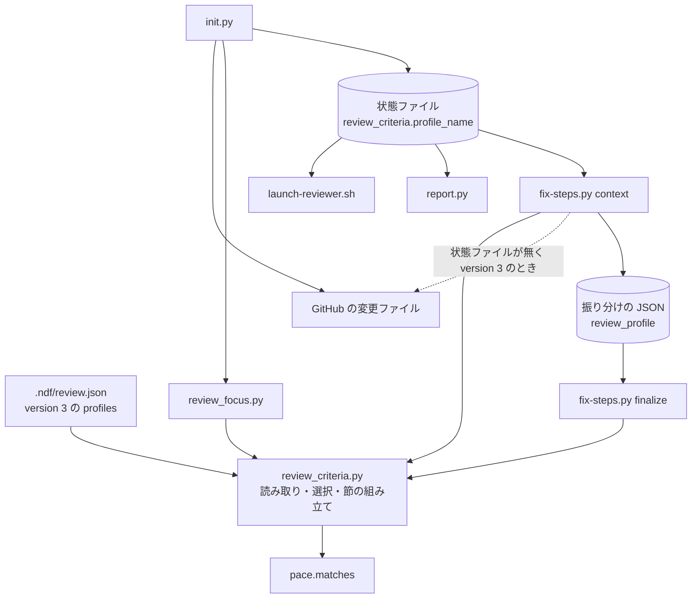
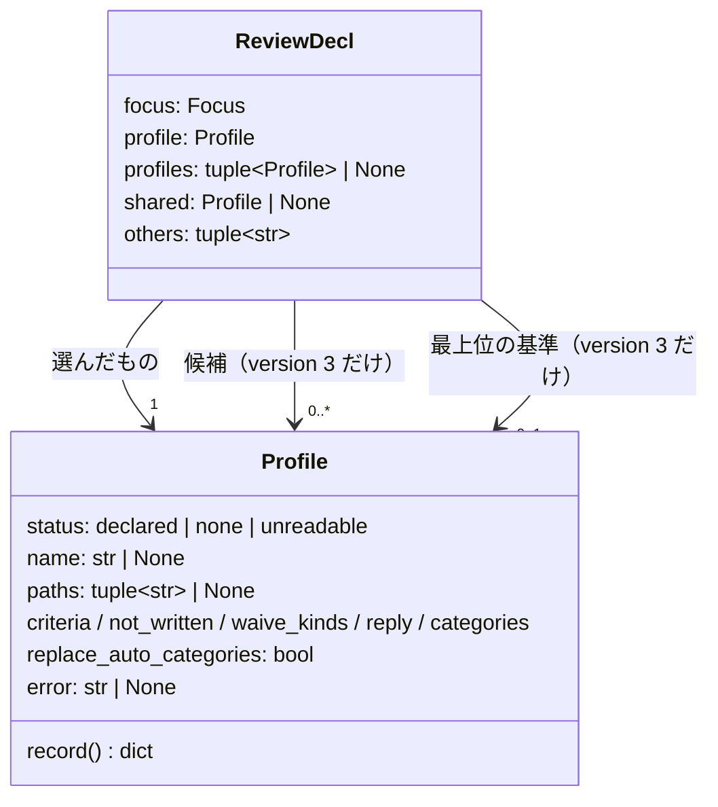
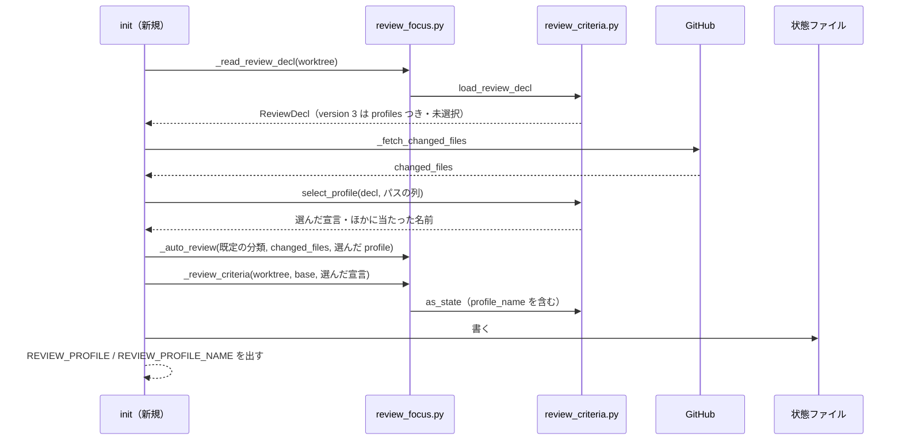
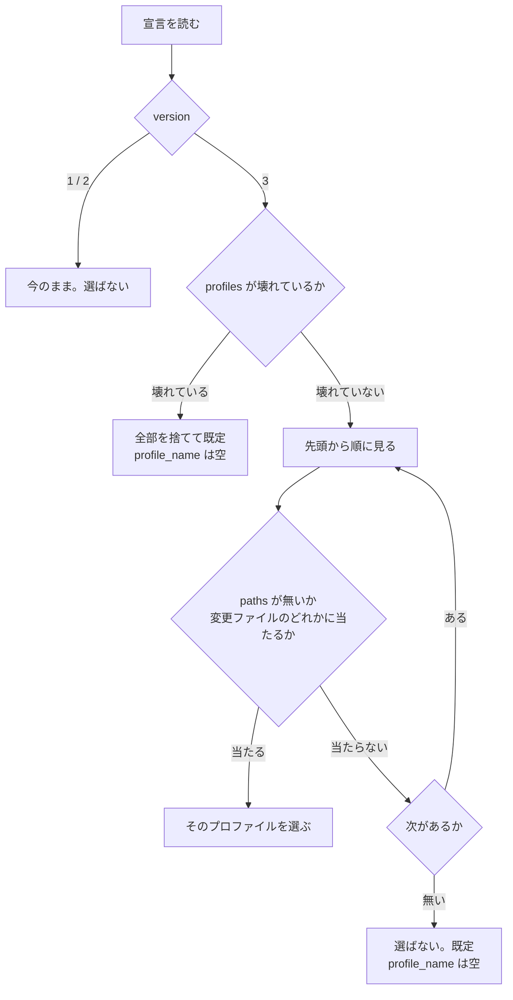

# cross-review: レビューのプロファイルがリポジトリに 1 つしか持てず、原稿の PR と仕組みの PR で基準・書かないもの・見送りを分けられない → 宣言に書いた順で変更ファイルのパスに最初に当たったプロファイル 1 つだけが、その PR のレビューと修正に効く（#1942）

## 目的

- **何が壊れているか**: `.ndf/review.json` のプロファイルはリポジトリに 1 つで、性質の違う PR（小説の原稿の PR と、スクリプト・テスト・文書の PR）に同じ基準・書かないもの・見送りの種類・返信が効く
- **誰が困るか**: 1 つのリポジトリで原稿と仕組みの両方を cross-review に通す利用者。当たらない基準で指摘が出る・当たる指摘が抜ける・原稿の指摘を仕組みの見送りの種類（`wording`）で見送れてしまう
- **直すと何が成り立つか**: 宣言に名前つきのプロファイルを並べ、PR の変更ファイルのパスで 1 つを選ぶ。選んだプロファイルの組だけがレビュー担当・修正担当・振り分けの検査・見送りの返信・自動レビュー観点に効き、選んだ名前が `init` の出力・状態ファイル・`report` の要約に残る。どの PR にも効かせたい基準は、宣言の最上位に 1 か所だけ書けば、選んだどの組にも足される

## 適用範囲

- **働く範囲**: NDF を入れたどのリポジトリでも働く（cross-review・その中の `/ndf:fix`・単独の `/ndf:fix`）。`.ndf/review.json` に `version: 3` を書いたリポジトリでだけ振る舞いが変わる
- **プロジェクトごとに違うもの**: プロファイルの名前・パス・中身は、各プロジェクトの `.ndf/review.json`（設定）で受ける。NDF に既定のプロファイル名やパスを埋め込まない
- **当たるモード**: 全モード（cross-review を通すすべての PR）

## あるべき姿の根拠

| 根拠 | 種類 | 何を示すか |
| --- | --- | --- |
| 課題 #1942 の依頼の原文「プロファイルはリポジトリ全体で1つしか持てません。これはai-pluginsに改修issueを上げてください。優先度高めで依頼。」 | 利用者の指示の原文 | プロファイルを複数持てる形にすることそのもの |
| 利用者の確認のコメント（https://github.com/devbasex/ai-plugins/issues/1942#issuecomment-6125366462）の「足してほしい点 1・2」 | 利用者の指示の原文 | どのプロファイルにも効く基準を 1 か所に書けること（決定 7）と、選んだ名前を `report` の要約に出すこと（決定 8） |
| `.ndf/pace.json` の `areas`（`[{"name", "paths"}]` の配列。`scripts/lib/pace.py` の `read_pace`） | 既存の形 | `.ndf/` の宣言で「名前とパスの glob の組を並べる」形の前例。同じ形に揃えると書き手が覚え分けない |
| `gh api repos/devbasex/ai-plugins/pulls/1938/files --paginate --jq '.[] \| .filename, (.previous_filename // empty)'` が 1 行 1 パスで返り、終了コード 0（2026-10-12 実測） | 実測 | 単独の `/ndf:fix` が 1 回の呼び出しで、cross-review と同じパスの集合（新しい名前と、名前を変えたときの前の名前）を取れる |

要求と受け入れ条件は #1942 の本文にある（コピーは `issues/issue-1942-requirements.md`）。この文書は「どう作るか」だけを扱う。

## ドメインモデル

### コンテキスト

| コンテキスト | 何の語が 1 つの意味に決まるか |
| --- | --- |
| NDF の cross-review（`ndf-cross-review`） | レビューのプロファイル・プロファイルの選択・指摘の基準・外せない基準・見送りの種類・見送りの返信・自動レビュー観点・レビューの状態ファイル |

1 つのコンテキストに収まる。`/ndf:fix` は単独で使うときも同じ語と同じ部品（`review_criteria.py`）で読む（#1910 と同じ）。

### 集約

| 集約 | 持ち主（書き換えてよいもの） | 根 | エンティティ | 値オブジェクト |
| --- | --- | --- | --- | --- |
| レビューの宣言 | 利用者（`.ndf/review.json`）。NDF は読むだけ | 宣言 | プロファイル（名前で区別する） | 重点・パスの glob の組・指摘の基準・書かないもの・見送りの種類・見送りの返信の雛形・分類 |
| レビューの状態ファイル | cross-review の `init`（`review_lib/commands/init.py`） | 状態 | — | 指摘の基準の写し（`review_criteria`。選んだプロファイルの名前・ほかに当たった名前・写しを含む）・変更ファイル（`changed_files`） |
| 振り分けの JSON | `fix-steps.py context`（雛形を書く）と修正担当（判定を書く） | 振り分け | 指摘ごとの判定 | プロファイルの写し（`review_profile`） |

選んだプロファイルの名前と写しを書いてよいのは、状態ファイルでは `init` だけ、振り分けの JSON では `context` だけである。`finalize` と `launch-reviewer.sh` は写しを読むだけで、宣言を読み直さない。

### 不変条件

| # | 集約 | 条件 | 破れたときの扱い |
| --- | --- | --- | --- |
| I1 | レビューの状態ファイル | 1 回の cross-review で効くプロファイルは 1 つで、2 つ以上のプロファイルの鍵を混ぜた組を作らない | テストが落とす |
| I2 | レビューの宣言 | 選ぶのは、宣言の `profiles` の先頭から見て、変更ファイルのどれか 1 つに `paths` が当たる最初のプロファイルである。`paths` を持たないプロファイルはどの PR にも当たる | テストが落とす |
| I3 | レビューの宣言 | `paths` を持たないプロファイルは高々 1 つで、`profiles` の末尾にある | 宣言のプロファイルを全部捨てる（I6） |
| I4 | レビューの状態ファイル | 外せない基準（基準 2）は、どのプロファイルを選んでも両方の節に出て、振り分けで `criterion: 2` が通る | プロファイルの `criteria` に `"2"` を書くと、そのプロファイルは壊れている（I6） |
| I5 | レビューの状態ファイル | `version: 1`・`version: 2` の宣言では、`reviewer` / `fixer` の出力・見送りの返信・自動レビュー観点・状態ファイルの `review_criteria`・選び方に関わる項目は変更前と 1 字も変わらない | テストが落とす |
| I6 | レビューの宣言 | `profiles` のどれか 1 つでも形が壊れていれば、宣言のプロファイルを全部捨てて既定で続け、終了コードを変えない。理由を標準エラー（cross-review では報告）に出す。重点はプロファイルと独立に読む | 止めない |
| I7 | レビューの状態ファイル | 再開で `review_criteria` と自動レビュー観点を書き直すのは、保存した `changed_files` と宣言から組んだ値が保存した値と違うときだけである | テストが落とす |
| I8 | 振り分けの JSON | `finalize` が許す `criterion` と `waive_kind` は、`context` が修正担当へ渡した節と同じプロファイル（写し）から組む | 許さない値は `finalize` が `invalid` で止める |
| I9 | レビューの状態ファイル | `version: 3` の宣言では、状態ファイルの `review_criteria` に `profile_name` が必ずあり、選ばなかったときは空文字である | テストが落とす |
| I10 | レビューの宣言 | `version: 3` の最上位の `criteria` は、どのプロファイルを選んでも（選ばなかったときは既定の組にも）両方の節に出て、振り分けでその番号が通る。番号は、選びうる組（各プロファイルの `criteria`、書かないプロファイルと、どれも選ばれない PR では既定の 1・4）と外せない基準 2・重点の 3 のどれとも重ならない | 重なれば宣言のプロファイルと最上位の基準を全部捨てる（I6） |
| I11 | レビューの状態ファイル | `report` の要約は、`review_criteria.profile_name` があるときだけプロファイルの行を出し、空文字なら「既定」と出す。`profile_others` があるときはその名前も同じ行に出す | テストが落とす |

### ドメインイベント

| # | イベント | 発生元 | 受け手 |
| --- | --- | --- | --- |
| E1 | レビューの宣言を読んだ | `init`（新規は worktree を用意した後、再開は同期した後）・単独の `fix-steps.py context` | プロファイルの選択（E3） |
| E2 | PR の変更ファイルを取った | 新規の `init`（GitHub）。再開は保存した `changed_files`。単独の `context` は GitHub（`version: 3` のときだけ） | プロファイルの選択（E3） |
| E3 | プロファイルを 1 つ選んだ（または、どれにも当たらなかった） | `review_criteria.select_profile` | 自動レビュー観点の組み立て・`review_criteria` の組み立て（E4）・単独の `context`（E6） |
| E4 | 選んだ名前と中身を状態ファイルへ書き、`init` の出力に名前を出した | `init` | `launch-reviewer.sh`（E5）・`context`（E6）・`report` |
| E5 | レビュー担当へ選んだプロファイルの節と観点を渡した | `launch-reviewer.sh` | レビュー担当 |
| E6 | 修正担当の文脈のファイルと振り分けの JSON に、選んだプロファイルの節と写しを書いた | `fix-steps.py context` | 修正担当・`finalize`（E7） |
| E7 | 振り分けを写したプロファイルで検査し、見送りの返信を組んだ | `fix-steps.py finalize` | GitHub のスレッド |
| E8 | 再開で選び直し、違うときだけ状態ファイルを書き直した | 再開の `init` | `launch-reviewer.sh`（次のラウンド） |

### 用語

| 用語 | 意味 | 用語集への反映 |
| --- | --- | --- |
| レビューのプロファイル | プロジェクトが `.ndf/review.json` に書く、指摘の基準・書かないもの・見送りの種類・見送りの返信・自動レビュー観点の差し替えの組。`version: 2` では `profile` に 1 つ、`version: 3` では `profiles` に名前つきで複数を書き、PR ごとに 1 つが効く。書いた鍵だけが既定を差し替える。`version: 3` の最上位の `criteria`・`not_written` は、選んだ組に足す。文中では「プロファイル」と略す | 意味の変更（`ndf-cross-review`） |
| プロファイルの選択 | PR の変更ファイルのパスから、その PR に効かせるレビューのプロファイルを 1 つ決めること。宣言の `profiles` の先頭から見て、変更ファイルのどれかに `paths` が当たる最初のものを選ぶ。`paths` を持たないものはどの PR にも当たる。選んだ名前を `init` の出力とレビューの状態ファイルに残す | 意味の変更（`ndf-cross-review`。要求で足した語の意味に選び方を足す） |

## 機能一覧

| # | 機能 | 誰が使うか |
| --- | --- | --- |
| F1 | 宣言に名前つきのプロファイルをパスの glob とともに複数書く | プロジェクトの書き手 |
| F2 | PR の変更ファイルからプロファイルを 1 つ選び、その組だけでレビュー担当への節と自動レビュー観点を組む | cross-review の `init` |
| F3 | 選んだプロファイルの名前を `init` の出力と状態ファイルに残し、再開で選び直す | cross-review の利用者・`report` |
| F4 | 選んだプロファイルの組で修正担当への節を書き、振り分けを検査し、見送りの返信を組む | `/ndf:fix`（cross-review の中と単独） |
| F5 | 壊れたプロファイルを含む宣言で、プロファイルを全部捨てて既定で続け、理由を知らせる | cross-review・`/ndf:fix`・`review_criteria.py` |
| F6 | どの PR にも効かせる基準と書かないものを、宣言の最上位に 1 か所だけ書く | プロジェクトの書き手 |
| F7 | どのプロファイルで見たかと、ほかに当たったプロファイルを `report` の要約の 1 行で読む | cross-review の利用者 |

## 構成要素

| 要素 | 責務 |
| --- | --- |
| `plugins/ndf/scripts/lib/review_criteria.py` | `version: 3` の `profiles` と最上位の `criteria`・`not_written` を読んで検査する（I3・I6・I10）。`select_profile` で変更ファイルのパスから 1 つを選び（I2）、最上位の基準を足し、選んだプロファイルの名前を `as_state` で状態の `profile_name` へ、ほかに当たった名前を `profile_others` へ写す（I9）。`context_decl` は状態ファイルが無いとき、`version: 3` に限って変更ファイルを受け取って選ぶ。CLI に `--changed-file` を足す。冒頭の説明に `version: 3` の形を足す |
| `plugins/ndf/scripts/lib/review_criteria_decl.py` | プロファイル（`version: 2` の `profile`・`version: 3` の `profiles` の各要素）の形の検査と `Profile` の型。`review_criteria.py` が 500 行の上限を超えないよう、形の検査だけをここへ分ける（`project_mvv.py` と `project_mvv_decl.py` の分け方と同じ） |
| `cross-review` の `review_lib/commands/report.py` | 要約に、選んだプロファイルの名前とほかに当たった名前の行を出す（I11・決定 8） |
| `cross-review` の `review_lib/review_focus.py` | 選んだ後の宣言（`ReviewDecl`）から観点と `review_criteria` を組む。複数のプロファイルに当たったときの知らせ（`info`）を出す。`_changed_file_paths` を選択の入力にも使う |
| `cross-review` の `review_lib/commands/init.py` | 新規: 変更ファイルを取った直後に選び、選んだ宣言を観点と `review_criteria` の両方へ渡す。再開: 状態ファイルを読んでから保存した `changed_files` で選び直す（I7）。出力に `REVIEW_PROFILE_NAME=` を足す |
| `fix` の `scripts/fix-steps.py` | `context` が状態ファイルを持たないとき、`version: 3` に限り PR の変更ファイルを 1 回取り（`gh api repos/<repo>/pulls/<PR>/files --paginate`）、`context_decl` に渡す。取れなければ空の列で選ぶ（前提 8）。`context_decl` の戻り値（`ReviewDecl`）を 2 つに分解している所（`focus, profile = ...`）を、属性で読む形に直す |
| `cross-review` の `docs/02-fix-and-rotation.md` | 「レビューの宣言」の節に `version: 3`・`profiles`・選び方・壊れたときの範囲・`profile_name`・`REVIEW_PROFILE_NAME=` を書く（宣言の鍵と規則の正本） |
| `cross-review` の `docs/04-contracts.md` | `init` の出力の一覧に `REVIEW_PROFILE_NAME=` を足し、`report` の要約のプロファイルの行を書き、正本（02）を指す |
| `cross-review` の `SKILL.md` | 作業完了報告に、`report` の要約のプロファイルの行を写すことを足す |
| `cross-review` の `references/design-principles.md`・`fix` の `SKILL.md`・`scripts/lib/README.md` | 「`version: 2` のプロファイル」と書いた所を、`version: 2` と `version: 3` の両方を指す語に直す（値の集合へ `3` を足したことによる） |
| `docs/glossary/glossary.json`・`docs/glossary.md` | 用語の表の 2 語の意味を直し、`glossary.py render` で作り直す |

文書の要素（`docs/`・`references/`・`SKILL.md`・`README.md`・用語集）は処理の流れに現れないため、下の図には載せない。

`launch-reviewer.sh`・`fix-steps.py finalize` は変えない。どれも状態ファイルか振り分けの JSON の写し（`reviewer_block`・`profile`・`review_profile`）を読むだけで、選択と最上位の基準の足し込みは写しを書く前に済んでいる。`report.py` は状態ファイルの `profile_name`・`profile_others` を読むだけで、宣言を読み直さない。



## 構造

変更が触る型だけを載せる。



| 型・関数 | 変更 |
| --- | --- |
| `Profile` | `name`（`version: 3` で選んだ名前。`version: 1`・`2` は `None`）と `paths`（候補の glob。`None` はどの PR にも当たる）を足す。`record()` は両方を写さない（状態の `profile` と振り分けの JSON の `review_profile` の形を変えない。I5） |
| `ReviewDecl` | `profiles`（`version: 3` の候補。`version: 1`・`2` は `None`）・`shared`（最上位の `criteria`・`not_written`。書かなければ `None`）・`others`（選ばなかったが当たった名前）を足す。`version: 3` を読んだ直後の `profile` は「選ぶ前」を表す `Profile("none", name="")` |
| `select_profile(decl, paths) -> tuple[ReviewDecl, tuple[str, ...]]` | 新設。`decl.profiles` が `None` か、`profile` が `unreadable`（壊れた `version: 3`）なら `decl` をそのまま返す（I5・I6）。そうでなければ I2 で選び、最上位の基準を足した（I10）`profile` と `others` を差し替えた宣言と、選ばなかったが `paths` が当たったプロファイルの名前（`paths` を持たないものは数えない）を返す |
| `load_review_decl` | `version: 3` を読む。`profiles` か最上位の `criteria`・`not_written` が壊れていれば（番号の重なりを含む）`profile = Profile("unreadable", name="", error=…)`・`profiles = ()`・`shared = None` を返す（I6・I9・I10） |
| `ReviewDecl` を 2 つに分解している所（`focus, profile = decl`。`review_focus._review_criteria`・`review_criteria.main`・`fix-steps.py cmd_context`） | 3 つ目の項目を足すため、属性で読む形に直す |
| `as_state(focus, mvv, profile, others=())` | `profile.name` が `None` でなければ `profile_name` を置く（I9）。`others` が空でなければ `profile_others` を置く（決定 8）。ほかの項目は今のまま |
| `context_decl(state_path, root_of, paths_of=None)` | 状態ファイルの写しがあれば今のまま。無ければ宣言を読み、`profiles` が `None` でないときだけ `paths_of()` を呼んで選ぶ |

最上位の基準を足すときは、選んだプロファイルの `criteria`（書いていなければ既定の 1・4）に最上位の番号を足し、`not_written` は最上位 → プロファイル（書いていなければ既定の書かないもの）の順に並べて同じ文を 1 つにする。足した後の組は `declared` で、状態ファイルの `profile` と振り分けの JSON の `review_profile` へそのまま写るので、`finalize` は最上位の番号も通す（I8・I10）。最上位を書かない宣言では足さない。

選んだプロファイルの中身に差し替えの鍵が 1 つも無い（`name` と `paths` だけ）ときは、`status` を `none` にする。`version: 2` の `profile: {}` と同じ扱いで、節・返信・状態ファイルのプロファイルの項目は既定のまま（名前だけが `profile_name` に残る）。こうしないと、写しを読む側（`profile_from({})` が `NO_PROFILE` を返す）と選んだ側とで、修正担当への節の見送りの句（「コード」と「対象のファイル」）が食い違う。

## 入出力の契約

### 宣言（`.ndf/review.json`）の `version: 3`

```json
{
  "version": 3,
  "focus": ["..."],
  "criteria": {"9": "取得したデータとその分析の中身を、公開の置き場や外部の API へ出す"},
  "not_written": ["好みの文体"],
  "profiles": [
    {
      "name": "manuscript",
      "paths": ["works/*/chapters/*/text.md"],
      "criteria": {"5": "人物の口調・呼び方が設定とずれる"},
      "not_written": ["好みの文体"],
      "waive_kinds": {"taste": "好みの文体"},
      "reply": "直しません。章を読んで困る所ではないためです（{inner}）。",
      "categories": {"manuscript": {"paths": ["works/*/chapters/*/text.md"], "instructions": "## 自動追加レビュー観点: 原稿\n- ..."}},
      "replace_auto_categories": true
    },
    {
      "name": "system",
      "criteria": {"1": "利用者が普通に使う経路で、誤動作する・止まる・データを壊す"},
      "waive_kinds": {"wording": "字句や言い回しの修正"},
      "reply": "直しません。この指摘は、使って困る不具合ではないためです（{inner}）。"
    }
  ]
}
```

| 鍵 | 型 | 規則 |
| --- | --- | --- |
| `version` | 数 | `3`。`1`・`2` は今のまま読む |
| `focus` | 文字列の配列 | `version: 2` と同じ（任意。どのプロファイルを選んでも効く。前提 5） |
| `criteria`（最上位） | オブジェクト | 任意。宣言の側で外せない基準。形は `profile` の `criteria` と同じ（2 と 3 は使えない）。選んだプロファイルの組（選ばなかったときは既定の組）に足す。番号が選びうる組と重なれば壊れている（I10） |
| `not_written`（最上位） | 文字列の配列 | 任意。選んだ組の書かないものの前に足す（同じ文は 1 つにする） |
| `profiles` | 配列 | 無いか `[]` なら、どのプロファイルも選ばない（状態の `profile_name` は空文字）。要素の形が 1 つでも違えば全部を捨てる（I6） |
| `profiles[].name` | 文字列 | 必須。英小文字・数字・`_`（`waive_kinds` の種類と同じ規則）。宣言の中で重複しない |
| `profiles[].paths` | 文字列の配列 | 任意。書くなら空でない glob の配列で、`.ndf/pace.json` の `areas` と同じ規則（前提 4）。書かないプロファイルは高々 1 つで、末尾に置く（I3） |
| `profiles[]` のほかの鍵 | — | `version: 2` の `profile` の鍵（`criteria`・`not_written`・`waive_kinds`・`reply`・`categories`・`replace_auto_categories`）と同じ形と規則。知らない鍵があれば壊れている |
| `profile` | — | `version: 3` では書かない。書けば壊れている（`profiles` に移すよう理由に書く） |

宣言の 2 つ目の要素（`system`）は `paths` を持たないので、原稿のパスに当たらない PR はすべて `system` になる。原稿と仕組みの両方を変えた PR は、先に書いた `manuscript` になる。最上位の基準 9 と書かないもの「好みの文体」は、どちらを選んでも足される（`manuscript` の `not_written` にも同じ文があれば 1 つにまとまる）。

### `init` の出力

`REVIEW_PROFILE=` の後に 1 行足す。新規と再開で同じ形である。

| 行 | 値 |
| --- | --- |
| `REVIEW_PROFILE_NAME=<名前>` | `version: 3` で選んだプロファイルの名前。選ばなかったとき・`version: 1`・`2`・宣言が無いときは空 |

`REVIEW_PROFILE=` の値（`declared` / `none` / `unreadable`）は今のまま、選んだプロファイルの状態を出す。

### 状態ファイルの `review_criteria`

| 項目 | 置くとき | 値 |
| --- | --- | --- |
| `profile_name` | 宣言が `version: 3` のとき（壊れたときも） | 選んだ名前。選ばなかった・壊れていたときは空文字 |
| `profile_others` | 選ばなかったプロファイルの `paths` も変更ファイルに当たったときだけ | 当たった名前の配列（宣言の順） |
| `profile_status`・`profile`・`profile_error` | 今のまま（選んだプロファイルについて） | 今のまま |

`version: 1`・`2` の状態ファイルには `profile_name` を置かない（I5）。

### 単独の `/ndf:fix`

`fix-steps.py context` の引数は変えない。状態ファイル（`CROSS_REVIEW_STATE`）が無く、worktree の宣言が `version: 3` のときだけ、変更ファイルを `gh api repos/<repo>/pulls/<PR>/files --paginate --jq '.[] | .filename, (.previous_filename // empty)'` で取る。終了コードが 0 以外なら空の列で選び、理由を標準エラーへ出して続ける。

### `review_criteria.py` の CLI

`reviewer` / `fixer` に `--changed-file <パス>`（繰り返し可）を足す。`version: 3` の宣言ではこれで選び、省けば空の列で選ぶ（`paths` を持たないプロファイルか、既定）。`version: 1`・`2` では無視する。

### `report` の要約

`version: 3` の宣言（状態ファイルに `profile_name` がある）のときだけ、次の 1 行を出す。作業完了報告はこの行を写す。

| 状態 | 行 |
| --- | --- |
| 選んだ | `## レビューのプロファイル: <名前>` |
| 選ばなかった・壊れていた（`profile_name` が空文字） | `## レビューのプロファイル: 既定` |
| ほかにも当たった（`profile_others` がある） | `## レビューのプロファイル: <名前>（ほかに <名前>, … にも当たった。先に書いた <名前> を使った）` |

### 知らせの文

| いつ | どこへ | 文 |
| --- | --- | --- |
| 選ばなかったプロファイルの `paths` も変更ファイルに当たった | cross-review は `info`、単独の `fix` と CLI は標準エラー | `⚠️ 変更ファイルが複数のプロファイル（<選んだ名前>, <ほかの名前>…）に当たるため、先に書いた <選んだ名前> を使う` |
| 宣言のプロファイルが壊れている | 今の `PROFILE_WARNING` と同じ経路（標準エラー・`info`・`report`） | 今の `PROFILE_WARNING` の文。理由の頭に `profiles[<番号>]（<名前>）:` を付ける。最上位の基準が壊れているときは `最上位の` を付け、番号の重なりは重なった番号を並べる |

## 処理の流れ



再開では、`_rewrite_review_criteria` が先に状態ファイルを読み、保存した `changed_files` のパスで `select_profile` を呼んでから `review_criteria` と観点を組み直す。今は宣言を読んでから状態ファイルを読む順で、選択に `changed_files` が要るため順序を入れ替える。組み直した値が保存した値と同じなら書かない（I7）。

`fix-steps.py context` は、状態ファイルの `review_criteria` があれば今のまま写しを使う（選択は `init` が済ませている）。無ければ宣言を読み、`profiles` が `None` でないときだけ変更ファイルを取って選ぶ。



## 非機能の実現方式

| 大項目 | 実現方式 |
| --- | --- |
| 性能・拡張性 | 新規の `init` は既に取っている `changed_files`、再開は保存した `changed_files` で選び、GitHub の呼び出しを増やさない。単独の `/ndf:fix` は、状態ファイルが無く宣言が `version: 3` のときだけ 1 回（`--paginate` のページ数ぶん）増える。`version: 1`・`2` では増えない |
| 運用・保守性 | 選んだ名前を `REVIEW_PROFILE_NAME=`・状態ファイルの `profile_name`・`report` の要約に残す。複数に当たったときは選ばなかった名前も知らせ、`profile_others` と `report` の行に残す。どの PR にも効く基準は最上位の 1 か所に書き、プロファイルごとの写しを持たない |
| 移行性 | `version: 1`・`2` は読み方を変えない（I5）。`version: 3` を古い NDF が読むと `version` の値で宣言全体を読めないとして基準 1・2・4 で続く（今の `load_review_decl` が `1`・`2` 以外を拒む） |
| セキュリティ | 宣言は PR の head から読むため、PR の作り手が選ばれるプロファイルを変えられる。どれを選んでも基準 2 は残り（I4）、#1910 と同じ範囲に収まる |

## 決定の記録

### 決定 1: 古い NDF が新しい形を黙って半分だけ読まないよう、宣言を `version: 3` にして `profiles` を配列で書く

`version: 2` に `profiles` を足すと、古い NDF は知らない鍵を無視して `profile`（または既定）をすべての PR に効かせ、原稿の PR に仕組みの基準が効く。`version: 3` にすれば、古い NDF は `1`・`2` 以外を拒んで宣言全体を既定で続け、要求の移行性の条件（止まらず既定で続く）をそのまま満たす。配列にするのは、選ぶ順を書いた順として形に持たせるためで、`.ndf/pace.json` の `areas`（名前とパスの組の配列）と同じ形になる。

名前を鍵にしたオブジェクト（課題の例の形）は採らない。選ぶ順がオブジェクトの鍵の並びに頼ることになり、JSON の仕様では順序が保証されない。`version: 2` の `profile` を「当たらないときのもの」として残す形も採らない。古い NDF がそれを全 PR に効かせる。

根拠: Value 5 / Value 6（MVV 版 2）

### 決定 2: 原稿の PR に原稿の基準が必ず効くよう、またがる PR では宣言に書いた順で最初に当たったプロファイルを選ぶ

選び方を宣言だけから読めるようにする。書き手は「先に書いたものが勝つ」だけを覚えればよく、原稿のパスを 1 つでも変えた PR を原稿のプロファイルで見たいなら原稿を先に書く。選ばなかったプロファイルに当たったことは `init` が知らせるので、意図しない選択に気づける。cross-review は止まらない（前提 2）。

当たった変更ファイルの多い方は採らない。同数のときの決め方が別に要り、10 話の原稿に設定の文書 1 つを足しただけで選び方が変わりうる。すべての変更ファイルが当たるものに限る案も採らない。原稿の PR がスクリプトを 1 行直すと、原稿が仕組みのプロファイルで見られ、言い回しの指摘が `wording` で見送られる（課題の「起きていること」の 4 がそのまま残る）。

根拠: Value 2（MVV 版 2）

### 決定 3: 当たらないときのプロファイルを別の鍵にせず、`paths` を持たない要素を `profiles` の末尾に 1 つだけ置ける形にする

`paths` を持たない要素は「どの PR にも当たる」ので、決定 2 の規則 1 つで当たらないときの受け皿になり、選び方の規則が 2 つに分かれない。末尾以外に置くと後ろの要素が永久に選ばれないため、壊れた宣言として捨てる（I3）。名前は書き手が付け、NDF は `default` のような名前を予約しない。

当たらないときのものを別の鍵（例: `default_profile`）にする案は採らない。同じ形のプロファイルを 2 か所で検査することになり、受け皿を先頭で当てたい書き手の書き方と食い違う。

根拠: Value 5 / Value 6（MVV 版 2）

### 決定 4: 書き手の意図に無い組で回らないよう、壊れたプロファイルが 1 つでもあれば `profiles` を全部捨てて既定で続ける

壊れたものだけを捨てると、選ばれるはずだったプロファイルが消え、次に当たるもの（多くは `paths` を持たない受け皿）が選ばれる。原稿の PR が仕組みのプロファイルで見られ、課題が直したい状態が黙って戻る。全部を捨てれば、出るのは既定かプロファイルかのどちらかで、#1910 の決定 4（プロファイルを丸ごと捨てる）と同じ読み方になる。重点（`focus`）は今のまま独立に読む。

壊れたものだけを捨てる案と、宣言を止める案（今の止めない扱いと食い違う）は採らない。

根拠: Value 2 / Value 6（MVV 版 2）

### 決定 5: 選んだ名前を状態ファイルの `review_criteria.profile_name` に置き、`version: 3` のときだけ置く

`review_criteria` は再開のたびに宣言から組み直して保存した値と比べる（I7）ので、名前もここに置けば、宣言か変更ファイルが変わって選び直したときだけ書き直しが起き、追加の比べ方が要らない。`version: 1`・`2` で置かないのは、#1910 の決定 9 と同じく、古い状態ファイルからの再開で値が変わって書き直しが起きないようにするためである。選ばなかったときは空文字にし、項目が無い（`version: 1`・`2`）と区別する。

状態ファイルの最上位に別の項目を置く案は採らない。再開の比べ方を 1 つ足すことになる。`profile`（写し）の中へ名前を入れる案も採らない。写しは振り分けの JSON の `review_profile` へそのまま渡り、`_parse_profile` が知らない鍵として拒む。

根拠: Value 7 / Value 6（MVV 版 2）

### 決定 6: 単独の `/ndf:fix` で余分な呼び出しを増やさないよう、変更ファイルは `version: 3` の宣言のときだけ取る

`context_decl` は変更ファイルを返す関数（`paths_of`）を受け取り、宣言が `profiles` を持つときだけ呼ぶ。`version: 1`・`2` と宣言の無いリポジトリでは GitHub の呼び出しが変わらない。取るのは cross-review の `changed_files` と同じ集合（新しい名前と、名前を変えたときの前の名前）で、同じ PR なら cross-review の中と外で同じプロファイルが選ばれる。

`pr_for_fix` の `gh pr view --json` に `files` を足す案は採らない。呼び出しは増えないが、GraphQL の `files` は 100 件で打ち切られ、cross-review（REST の `--paginate`）と選ぶ結果が食い違いうる。

根拠: Value 3 / Value 6（MVV 版 2）

### 決定 7: どの PR にも効く基準の写しがずれないよう、`version: 3` の最上位の `criteria`・`not_written` を選んだ組へ足し、番号の重なりは壊れた宣言にする

利用者のリポジトリには、PR の種類によらず効かせたい基準（取得したデータとその分析の中身を、公開の置き場や外部の API へ出していないか）がある。プロファイルごとに写して書くと、写しのどれかを直し忘れたとき黙って基準がずれる。最上位に 1 か所だけ書き、外せない基準 2（I4）の延長として「宣言の側で外せない基準」として扱えば、選んだどの組にも同じ文が効く。選ばなかった PR（既定の組）にも足す。足した組はそのまま写しになるので、`finalize` も同じ番号を通す（I8）。

番号の重なりは、プロファイルの側を勝たせる案を採らない。どちらの文が効くかが PR の種類で変わり、書き手が重なりに気づけない。重なれば決定 4 と同じく、プロファイルも最上位の基準も全部捨てて既定で続ける。重なりを見る相手は、選びうるすべての組（各プロファイルの `criteria`、`criteria` を書かないプロファイルと、`paths` を持たない受け皿の無い宣言では既定の 1・4）で、選ばれた PR でだけ壊れる宣言を作らない。`not_written` は文の並びなので重なりを壊れたとせず、最上位 → プロファイルの順の和にして同じ文を 1 つにする。`version: 1`・`2` には足さない（I5）。

利用者の決定（2026-10-12、AskUserQuestion で確認）: このスプリントで入れる。番号の重なりは壊れた宣言として既定で続ける。プロファイルを選ばなかった PR にも最上位の基準を足す。

根拠: Value 6 / Value 2（MVV 版 2）

### 決定 8: 利用者が読む報告で選択を確かめられるよう、選んだプロファイルの名前とほかに当たった名前を `report` の要約の 1 行に出す

利用者は多くの場合、プランのステップの最後の報告（`report` の要約と、それを写した PR のコメント）しか読まず、`init` の出力の `REVIEW_PROFILE_NAME=` は目に入らない。`report` は状態ファイルの `review_criteria.profile_name` を読んで 1 行を出し、決定 2 の知らせ（ほかのプロファイルにも当たった）も同じ行に出す。そのため、ほかに当たった名前を `review_criteria.profile_others` に置く。名前は保存した `changed_files` と宣言だけで決まるので、再開の比べ方（I7）は変わらず、当たらないときは項目を置かないので、ほかに当たらない状態ファイルは今と同じ形のままである。`version: 1`・`2` では `profile_name` が無いので行を出さない。

状態ファイルの最上位に置く案は、決定 5 と同じ理由で採らない。

根拠: Value 2 / Value 7（MVV 版 2）

## テスト設計

| 受け入れ条件・不変条件 | どの振る舞いで縛るか | どう壊したら落ちるべきか |
| --- | --- | --- |
| 受け入れ条件 1 | 例の宣言（原稿が先・仕組みは `paths` なし）で原稿のパスだけを変えた PR の `init` の `reviewer_block` と、`context` の文脈のファイルの節に「口調のずれ」・`taste` があり、「誤動作」・`wording` が無い | 選択を飛ばして先頭の要素を常に使う／全要素を和にする |
| 受け入れ条件 2 | 仕組みのパスだけを変えた PR で 1 の逆になる | 先頭の要素を常に使う |
| 受け入れ条件 3・I8 | 原稿の PR の振り分けで `finalize` が `wording` と原稿の `criteria` に無い番号を `invalid` で拒み、`taste` を通す | `finalize` が宣言を読み直す／写しに全プロファイルの和を入れる |
| 受け入れ条件 4・I4 | 原稿と仕組みのどちらを選んでも両方の節に基準 2 の文があり、`criterion: 2` が通る。`profiles` の 1 つの `criteria` に `"2"` を書くと I6 の扱いになる | 選んだプロファイルの `criteria` で基準 2 を上書きできる |
| 受け入れ条件 5 | 原稿の PR の見送りの返信が原稿の `reply` に種類の名前を入れた文になる | 仕組みの `reply` が使われる |
| 受け入れ条件 6 | 原稿の PR で、仕組みのプロファイルの `categories` のパスが当たっても観点に足されない | `_auto_review` に全プロファイルの分類を渡す |
| 受け入れ条件 7・I1・I2 | 両方のパスを変えた PR で先に書いた原稿が選ばれ、`REVIEW_PROFILE_NAME=manuscript` が出て、仕組みの名前の知らせが出る。cross-review の `init` が 0 で終わる。順を入れ替えた宣言では仕組みが選ばれる | 当たった数で選ぶ／またがると止める／知らせが出ない |
| 受け入れ条件 8 | 原稿に当たらない PR で `paths` の無い仕組みが選ばれ、名前が出る | `paths` の無い要素を当たらないものとして扱う |
| 受け入れ条件 9 | `paths` を持たない要素の無い宣言で当たらない PR の節・返信が、宣言が無いとき（`focus` を書いていればそれを含む）の出力と一致し、`profile_name` が空文字 | 当たらないとき末尾の要素を使う／`focus` を落とす |
| 受け入れ条件 10・I5 | `version: 1` と `version: 2`（`profile` あり・なし）の根で、`reviewer` / `fixer`・返信・観点・`as_state` が変更前の出力と一致し、`profile_name` が無い | `version: 2` でも `profile_name` を置く／`record()` に `name` を写す |
| 受け入れ条件 11・I9 | `version: 3` の新規の `init` の状態ファイルに `profile_name`（選ばなかったときは空文字）があり、`init` の出力に `REVIEW_PROFILE_NAME=` が出る | 選ばなかったとき項目ごと落とす |
| 受け入れ条件 12・I7 | 宣言と `changed_files` を変えずに再開すると状態ファイルが書き直されない。宣言の順を入れ替えて再開すると保存した `changed_files` で選び直され、`profile_name` と `reviewer_block` が変わる。再開で GitHub の変更ファイルを取らない | 再開で状態ファイルより先に選び空の列で選ぶ／再開で変更ファイルを取り直す |
| 受け入れ条件 13 | 状態ファイルの無い `context` が、`version: 3` の宣言で変更ファイルを 1 回取り、同じ規則で選んだ節と写しを書く。取得が失敗しても終了コードを変えず空の列で選ぶ。`version: 2` の宣言では変更ファイルを取らない | 単独では選ばず先頭を使う／`version: 2` でも取る／取得の失敗で止まる |
| 受け入れ条件 14・I3・I6 | 名前の重複・`paths` の無い要素が末尾以外・知らない鍵・`profile` を書いた `version: 3` のそれぞれで、`review_criteria.py` が終了コード 0・既定の節・標準エラーに理由を出し、`init` の状態ファイルが `profile_status: unreadable`・`profile_name: ""` を持ち、同じ宣言の `focus` は効く | 壊れたものだけを捨てて次を選ぶ／例外で止まる |
| 受け入れ条件 15 | 既存のテストが通る（`uv run --frozen --project . --all-extras pytest . -q -n 4`） | — |
| 受け入れ条件 16・I10・決定 7 | 最上位の基準が原稿の PR・仕組みの PR・どれも選ばない PR の両方の節に出て、写しから組んだ `criterion_numbers` と `finalize` がその番号を通す。`not_written` が最上位 → プロファイルの順の和で、同じ文が 1 つ。`version: 2` に書いても効かない | 選んだプロファイルにだけ足さない／写しに入れず `finalize` が拒む／`version: 2` でも足す |
| 受け入れ条件 17・I10・I6 | 最上位の番号が原稿・仕組みの `criteria`・基準 2 と重なる宣言、既定の 1・4 が選ばれうる宣言で 4 と重なる宣言、最上位の形が違う宣言で、プロファイルも最上位の基準も捨てて既定で続き、`init` が `REVIEW_PROFILE=unreadable` を出し、重点は効く | プロファイルの側を勝たせる／最上位の基準だけ残す |
| 受け入れ条件 18・I11・決定 8 | `report` の要約に `## レビューのプロファイル: <名前>`・`既定`・ほかに当たった名前つきの行が出て、`profile_name` の無い状態では出ない。またがる PR の `init` の状態に `profile_others` があり、宣言と変更ファイルを変えない再開で書き直さない | `version: 2` でも行を出す／`profile_others` の比べ方で再開のたびに書き直す |
| 中身の無いプロファイル | `name` と `paths` だけの要素を選ぶと `profile_status` が無く、`fixer` の見送りの句が「コード」のまま、`profile_name` に名前が残る | `declared` のまま空の写しを書き、cross-review の中と外で句が食い違う |

## 設計の結果

| 課題 | 扱い | 取り込み先 | 触るファイル |
| --- | --- | --- | --- |
| #1942 | 実装する | — | `plugins/ndf/scripts/lib/review_criteria.py`、`plugins/ndf/scripts/lib/review_criteria_decl.py`、`plugins/ndf/skills/cross-review/scripts/review_lib/commands/report.py`、`plugins/ndf/skills/cross-review/SKILL.md`、`plugins/ndf/scripts/lib/README.md`、`plugins/ndf/scripts/tests/test_review_criteria.py`、`plugins/ndf/skills/cross-review/scripts/review_lib/review_focus.py`、`plugins/ndf/skills/cross-review/scripts/review_lib/commands/init.py`、`plugins/ndf/skills/cross-review/tests/`、`plugins/ndf/skills/cross-review/docs/02-fix-and-rotation.md`、`plugins/ndf/skills/cross-review/docs/04-contracts.md`、`plugins/ndf/skills/cross-review/references/design-principles.md`、`plugins/ndf/skills/fix/scripts/fix-steps.py`、`plugins/ndf/skills/fix/SKILL.md`、`plugins/ndf/skills/fix/tests/`、`docs/glossary/glossary.json`、`docs/glossary.md` |

## 未確認のまま残ること

| 項目 | 内容 |
| --- | --- |
| 実際の原稿のリポジトリでの効き目 | 原稿の PR と仕組みの PR でレビュー担当の指摘・修正担当の見送りが PR の種類に合うかは、リリース後テスト（利用者のリポジトリ）でしか分からない |
| 名前を変えたファイルの前の名前で当たる場合 | 選択の入力に前の名前も含める（cross-review の `changed_files` と同じ集合）。前の名前だけが原稿のパスに当たる PR（原稿を外へ移す PR）が原稿のプロファイルになるが、利用の実例は無い |
