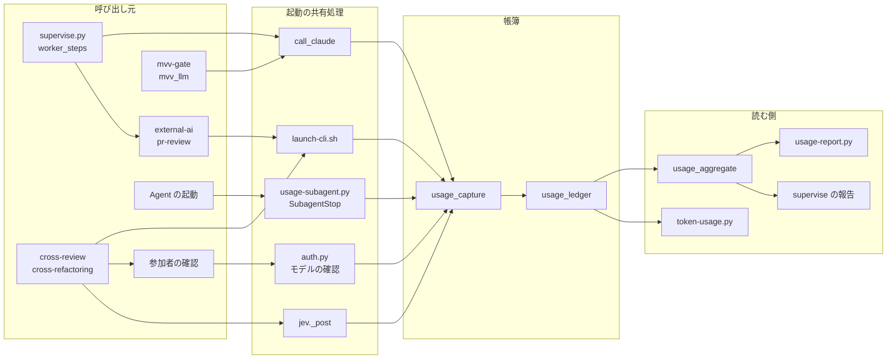
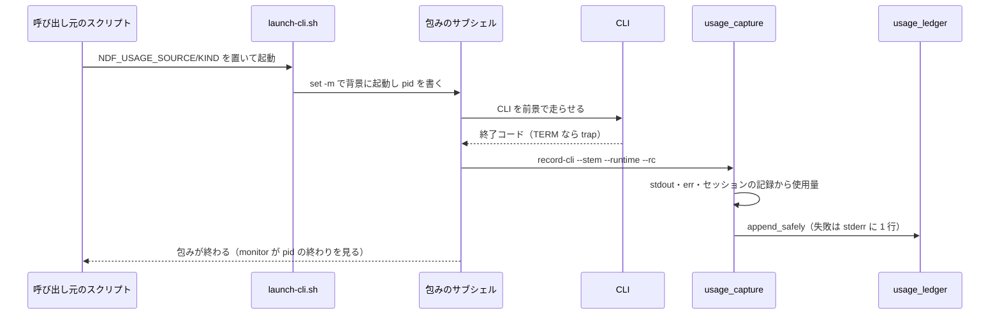
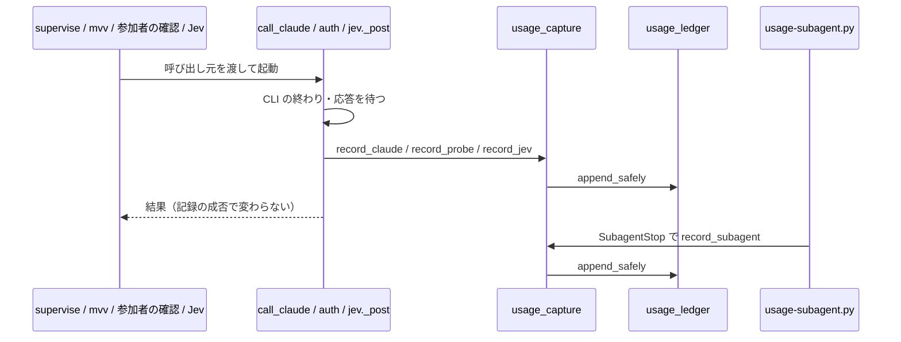

# トークン消費の計測: サブエージェントしか数えず、claude -p・codex・kiro・agy・Jev の呼び出しが集計から漏れて「減ったように見えて総量は同じ」を見分けられない → NDF が起動した呼び出しはすべて、起動の経路を問わずランタイムごとの帳簿に 1 行ずつ残り、帳簿ごとに期間・スプリント・呼び出し元で集計できる（#1953）

## 目的

- **何が壊れているか**: 使用量の数え方が経路ごとに 3 つ（会話の記録のサブエージェント・`claude -p` の帳簿・supervise のステップの記録）に分かれ、どれも全体を覆わない。`launch-cli.sh` を通る起動・Jev・参加者の確認・codex / kiro / agy は帳簿に 1 行も残らない
- **誰が困るか**: トークン削減（マイルストーン 17）の効果を測る人。処理をサブエージェントから `claude -p` や他の CLI へ移すと、移した分が計測の外へ出て、#845 のように「サブエージェント内は −86%、総量は同じ」を値から読めない
- **直すと何が成り立つか**: NDF が起動した呼び出しは 1 回 1 行でそのランタイムの帳簿（Claude・codex・kiro・agy・jev）に残る。集計のコマンドが帳簿ごとに期間・スプリント・呼び出し元の合計と閉じた課題の数を出し、Claude の帳簿では「サブエージェントだけ」と「全体」を並べる

## 適用範囲

- **働く範囲**: NDF を入れたどのリポジトリでも働く。帳簿は利用者の手元の帳簿のディレクトリ（#1142 の `ledger_dir`）に置き、リポジトリごとのファイルに分ける
- **プロジェクトごとに違うもの**: 課題の置き場（閉じた課題の数を GitHub Issues から数えられるか）は `.ndf/project.json` の `issues.primary` で受け、`github` でなければ `unknown` と出す。集計の期間・スプリントは引数で受ける。ai-plugins の形（リポジトリ名・`docs/metrics/`）を既定に埋め込まない
- **当たるモード**: 全モード（NDF のスクリプトと Skill が LLM を起動するすべての工程）

## あるべき姿の根拠

| 根拠 | 種類 | 何を示すか |
| --- | --- | --- |
| 課題 #1953 の本文「求めること」の帳簿の表（Claude はサブエージェントと `claude -p` を 1 つにまとめ、codex・kiro・agy を分ける） | 起票者の推定（承認ゲート 1 で利用者が確かめる） | 帳簿をランタイムごとに分け、単位を足し合わせないこと |
| #845 の受け入れ条件 3 の測り直し（サブエージェント内は −86%、`claude -p` を足すと移行前と同じ程度） | 実測 | サブエージェントだけの値では削減の効果を判定できないこと |
| #1871 で数えた約 99 万トークン（supervise.py が起動した `claude -p` が Skill の本文を読み込んだ量） | 実測 | `claude -p` の読み込みが今の数え方の外にあること |
| `claude -p --output-format json` の結果の実測（2026-10-13、Claude Code 2.1.296、Agent を 1 回使う呼び出し）: `usage` は親の会話だけ（cache write 22,347）、`modelUsage` は親とサブエージェントの合計（43,955 = 22,347 + 21,608） | 実測 | `claude -p` の行の `usage` だけを足すと、中で起動したサブエージェントの分が落ちること（決定 5） |
| SubagentStop の hook の入力の実測（同上）: `agent_id`・`agent_type`・`agent_transcript_path`・`session_id` を持つ | 実測 | サブエージェント 1 回を hook で 1 行にできること（決定 4） |
| codex・kiro-cli の実測（同上）: codex は stderr に `session id: <uuid>` と `tokens used` の合計を出す。kiro は stdout に使用量を出さず、`~/.kiro/sessions/cli/<id>.json` に `cwd`・`created_at`・`metering_usage`（credit）を残し、トークン数の欄は 0 | 実測 | ランタイムごとに使用量の取り出し方と単位が違うこと（決定 3） |

要求と受け入れ条件は #1953 の本文にある（コピーは `issues/issue-1953-requirements.md`）。この文書は「どう作るか」だけを扱う。決定の記録は `issues/issue-1953-design-decisions.md` に分けた。

## ドメインモデル

### コンテキスト

| コンテキスト | 何の語が 1 つの意味に決まるか |
| --- | --- |
| NDF の開発ワークフロー（`ndf-workflow`） | 使用量の帳簿・呼び出し元・Claude の帳簿の全体・集計 |
| NDF の外部 CLI 委譲（`ndf-agent-cli`） | ランタイム・起動の共有処理 |

**関係は公開された言語である。** 起動の共有処理（`ndf-agent-cli`）は帳簿の行の形（下の「データ構造」）だけを介して帳簿へ書き、帳簿を読む側（集計・supervise の報告・`token-usage.py`）は起動の仕組みを知らない。受け手が 3 つあり、行の形を先に固めて互いに独立して変えるためである。

### 集約

| 集約 | 持ち主（書き換えてよいもの） | 根 | エンティティ | 値オブジェクト |
| --- | --- | --- | --- | --- |
| 使用量の帳簿 | `lib/usage_ledger.py`（追記だけ。ほかの構成要素は `append_safely` を通してだけ書く） | 帳簿（ランタイム × リポジトリの 1 ファイル） | 帳簿の行（呼び出し 1 回） | 呼び出し元（source・kind・plan・step）・使用量（ランタイムごとの形、または `unknown`）・終わり方（`status`） |
| 使用量の取り出し | `lib/usage_capture.py`（CLI の出力・記録から使用量を読む。帳簿へは書かず、行を作って `usage_ledger` へ渡す） | 取り出しの結果 | — | ランタイムごとの使用量 |
| 集計 | `lib/usage_aggregate.py`（読むだけ。帳簿と会話の記録を書き換えない） | 集計の結果（帳簿 1 つ × 期間） | 呼び出し元ごとの合計 | 期間・閉じた課題の数・Claude の 2 つの値 |

### 不変条件

| # | 集約 | 条件 | 破れたときの扱い |
| --- | --- | --- | --- |
| I1 | 使用量の帳簿 | NDF のコードが起動した LLM の呼び出し 1 回につき、行がちょうど 1 行、そのランタイムの帳簿にある（Jev は `jev`、サブエージェントは `claude`） | 起動の共有処理を通らない起動は静的な検査が落とす。起動の共有処理が書き損ねたときは I5 に従う |
| I2 | 使用量の帳簿 | 行の `runtime` と、行を置いたファイルのランタイムのディレクトリが一致する。ある帳簿の行が別の帳簿のファイルに入らない | 書く関数が `runtime` からパスを決める。呼び手はパスを渡せない |
| I3 | 使用量の帳簿 | 使用量を取れなかった行は `usage` が `"unknown"` で、0 の数値を書かない | 取り出しが例外・空・形の違いを返したら `"unknown"` に落とす |
| I4 | 使用量の帳簿 | 既存の行を書き換えない（追記だけ。#1142 の I8） | 書く関数は追記の開き方しか持たない |
| I5 | 使用量の帳簿 | 帳簿への追記が失敗しても、呼び出しの結果と呼び出し元の処理の結果は変わらない | `append_safely` が例外を捕まえて stderr に 1 行を出し、False を返す。シェルの記録は終了コードを捨てる |
| I6 | 使用量の帳簿 | 行にプロンプトの本文・環境変数の値・認証情報を書かない | 行の鍵は決まった一覧だけ。取り出しは使用量・モデル・セッション ID だけを読む |
| I7 | 集計 | 集計の出力は帳簿ごとに分かれ、帳簿をまたぐ合計を持たない | 集計は帳簿を 1 つだけ引数に取る |
| I8 | 集計 | 同じ呼び出しを 2 回数えない（帳簿の行と会話の記録・`claude -p` とその中のサブエージェント） | 突き合わせの鍵（セッション ID・`agent_id`）で 1 回にする（決定 5） |
| I9 | 使用量の帳簿 | テストの実行は本物の帳簿へ書かない | テストの書いた行は印を持ち、テストの終わりの検査が本物の帳簿に印の付いた行を見つけたら落ちる（決定 9） |

### ドメインイベント

| # | イベント | 発生元 | 受け手 |
| --- | --- | --- | --- |
| E1 | NDF がエージェントの呼び出しを起動した | 起動の共有処理（`launch-cli.sh`・`call_claude`・`auth.py` のモデルの確認・`jev._post`）、Agent の起動 | 起動の共有処理自身（終わりを待つ） |
| E2 | 呼び出しが使用量を返した | CLI の終了・SubagentStop の hook・Jev の応答 | `usage_capture`（使用量を読む） |
| E3 | 帳簿へ 1 行を追記した | `usage_ledger.append_safely` | 集計・supervise の報告・`token-usage.py` |
| E4 | サブエージェントが終わった | Claude Code の SubagentStop | `usage-subagent.py`（hook。E2 → E3 へつなぐ） |
| E5 | 起動の共有処理を通らない起動が足された | NDF のコードの変更 | 静的な検査（テストが落ちる） |
| E6 | 集計を求められた | 利用者・振り返り・supervise の報告 | `usage_aggregate` |
| E7 | テストが帳簿へ書こうとした | pytest の実行 | テストの終わりの検査（I9） |

### 用語

| 用語 | 意味 | 用語集への反映 |
| --- | --- | --- |
| 使用量の帳簿 | NDF が起動したエージェントの呼び出し 1 回ごとに 1 行を追記する jsonl。ランタイムごとのディレクトリにリポジトリごとのファイルを置く（`<帳簿のディレクトリ>/<ランタイム>/<owner>__<repo>.jsonl`） | 意味の変更（置き場の形を足す） |
| 呼び出し元 | 行の `source`（Skill またはスクリプト）と `kind`（そのステップの役割）の組。表示は `source:kind`（例: `supervise:work`・`cross-review:review`） | 意味の変更（行の鍵との対応を足す） |
| 起動の共有処理 | LLM の CLI と Jev を起動する処理を集めた 4 か所（`launch-cli.sh`・`supervise_lib/claude.py` の `call_claude`・`lib/auth.py` のモデルの確認・`lib/jev.py` の `_post`）。起動の後に使用量の帳簿へ 1 行を書く | 意味の変更（4 か所に限る） |
| 会話の記録だけの呼び出し | 帳簿に行が無く、Claude Code の会話の記録（`~/.claude/projects/`）にだけ残る `claude -p` の会話とサブエージェント。帳簿ができる前の分と、NDF のコードの外で打った `claude -p` が当たる | 追加 |

## 機能一覧

| # | 機能 | 誰が使うか |
| --- | --- | --- |
| F1 | NDF が起動した `claude -p`・codex・kiro-cli・agy・Jev の呼び出しを、ランタイムの帳簿へ 1 行ずつ残す | NDF のスクリプト・Skill（利用者は意識しない） |
| F2 | Agent で起動したサブエージェントを Claude の帳簿へ 1 行ずつ残す | Claude Code の hook |
| F3 | 帳簿を 1 つ選び、期間・スプリント・呼び出し元ごとの合計と閉じた課題の数を出す | トークン削減の効果を測る人・振り返り |
| F4 | Claude の帳簿で「サブエージェントだけ」と「全体」と「会話の記録だけ」を並べる | 同上 |
| F5 | supervise の報告の「LLM の使用量」に、drive と `runtime` を指定した work の中の CLI の分をランタイムごとに載せる | supervise の報告を読む conductor・利用者 |
| F6 | 起動の共有処理を通らない LLM の起動を足すと落ちる検査 | NDF の開発者 |
| F7 | テストが本物の帳簿へ書いたら落ちる検査 | NDF の開発者 |

## 構成要素

| 要素 | 変更 | 責務 |
| --- | --- | --- |
| `plugins/ndf/scripts/lib/usage_ledger.py` | 変える | 行の形（版 2）・置き場（`<dir>/<runtime>/<repo>.jsonl`）・追記・読み出し（旧い置き場の行を `claude` として読む）。行に `pytest` の印を付ける |
| `plugins/ndf/scripts/lib/usage_capture.py` | 作る | ランタイムごとに使用量を取り出して行を作り、`usage_ledger.append_safely` へ渡す。CLI `record-cli`（`launch-cli.sh` から）と関数 `record_claude`・`record_probe`・`record_jev`・`record_subagent` |
| `plugins/ndf/scripts/lib/launch-cli.sh` | 変える | CLI を包みのサブシェルで起動し、終わり（TERM を含む）に `usage_capture.py record-cli` を打つ。agy を `--output-format json` で起動する |
| `plugins/ndf/scripts/supervise_lib/claude.py` | 変える | `call_claude` が終わりに `usage_capture.record_claude` を呼ぶ（呼び出し元を引数で受ける）。`ClaudeRunner.record_usage` は帳簿へ書かず、報告の数え上げ（`state.add_usage`）だけを持つ |
| `plugins/ndf/scripts/mvv-gate.py` | 変える | `claude -p` を `call_claude` で起動する（`NDF_MVV_CLAUDE` は起動するコマンドの差し替えとして残す）。自前の追記を消す |
| `plugins/ndf/scripts/project_lib/mvv_llm.py` | 変える | 自前の追記を消し、`call_claude` へ呼び出し元を渡す |
| `plugins/ndf/scripts/lib/auth.py` | 変える | モデルの確認の 1 回ごとに `usage_capture.record_probe` を呼ぶ（`kind=probe`） |
| `plugins/ndf/scripts/lib/jev.py` | 変える | `_post` の 1 回ごとに `usage_capture.record_jev` を呼ぶ |
| `plugins/ndf/scripts/usage-subagent.py` | 作る | SubagentStop の hook。入力の `agent_transcript_path` を読み、`usage_capture.record_subagent` で 1 行を書く。常に終了コード 0 |
| `plugins/ndf/hooks/claude.json` | 変える | SubagentStop に `usage-subagent.py` を足す |
| 呼び出し元を名乗るスクリプト（`cross-review/scripts/launch-reviewer.sh`・`critique.sh`、`cross-refactoring/scripts/launch-cli.sh`、`external-ai/scripts/external-ai.py`、`pr-review/scripts/pr-review-steps.py`、`supervise_lib/worker_steps.py`） | 変える | 起動の前に `NDF_USAGE_SOURCE`・`NDF_USAGE_KIND` を決める（入力の契約 C2） |
| `plugins/ndf/skills/external-ai/scripts/external-ai.py` の `read_stdout` | 変える | agy の stdout を JSON として読み、`response` を本文にする |
| `plugins/ndf/scripts/supervise_lib/worker_steps.py` | 変える | drive と `runtime` を指定した work のステップで `NDF_USAGE_PLAN`・`NDF_USAGE_STEP` を子へ渡し、終わりに帳簿からそのステップの行をランタイムごとに集めて `cur["llm_runtimes"]` へ置く。`runtime` を指定した work は Claude の行を書かない |
| `plugins/ndf/scripts/supervise_lib/state.py` | 変える | 報告の「LLM の使用量」にランタイムごとの行を足す |
| `plugins/ndf/scripts/lib/usage_aggregate.py` | 作る | 帳簿 1 つ × 期間の集計。Claude の帳簿では会話の記録（`transcript_agents`）を突き合わせて 3 つの値を出す。閉じた課題の数を `gh` で数える |
| `plugins/ndf/scripts/usage-report.py` | 作る | 集計の CLI（入出力の契約 C3）。`usage_aggregate` を呼んで JSON と表を出す |
| `plugins/ndf/conftest.py` | 作る | 帳簿・supervise の状態・DBOS のディレクトリを一時ディレクトリへ向ける autouse の fixture と、テストの終わりの検査（I9）。根の `conftest.py` から同じ fixture を消す |
| `plugins/ndf/scripts/tests/test_launch_sites.py` | 作る | 起動の共有処理を通らない LLM の起動を落とす静的な検査（F6） |
| `scripts/token-usage.py`・`scripts/measure/claude-p-usage.py` | 変える | 帳簿を `usage_ledger.read_ledger(runtime="claude")` で読む（新しい置き場と旧い置き場の両方） |
| `docs/specifications/ndf-context-window-metrics.md` | 変える | 数える範囲・帳簿の分け方・トークン削減の課題の受け入れ条件を Claude の帳簿の全体で書くこと |

**値の集合へ値を足す規則の判定。** ランタイムの集合に `jev` を、`kind` の集合に `subagent`・`probe`・`evaluate` と Skill の役割（`review` など）を足す。当てはまらない規則は次の 4 つで、上の表の行で変える。

| 既存の規則 | 当てはまらない理由 | 変える行 |
| --- | --- | --- |
| `usage_ledger.read_all` は帳簿のディレクトリの直下の `*.jsonl` だけを読む | ランタイムのディレクトリの下の行が読まれない | `usage_ledger.py`（`read_ledger` に置き換える） |
| `UsageRecord` は `usage` が dict でなければ `{}` に直す | `"unknown"` が `{}`（0 と区別できない）になる | `usage_ledger.py` |
| `claude-p-usage.py` は `<root>/<repo_key>.jsonl` の 1 ファイルを読む | `claude/` の下の行を読まない | `claude-p-usage.py` |
| `state.add_usage` は `runtime` を指定した work も `llm["work"]`（claude -p）に数える | 外部の CLI を claude -p として数える | `worker_steps.py`・`state.py` |

`token-usage.py` の `LEDGER_LAYER`（`work`・`judge`・`slow`・`pr`・`mvv` だけを読む）は新しい `kind` を読まず、会話の記録から数える席・サブエージェントと 2 回数えないため、当てはまる（変えない）。

### 構成要素図



図に含めない要素: 登録だけを変える `hooks/claude.json`、agy の本文の読み手 `read_stdout`、版 1 の置き場を読み直す `claude-p-usage.py`、テスト（`conftest.py`・`test_launch_sites.py`）と文書。

### 配置

| 実行の単位 | 何が動くか | 境界をまたぐもの |
| --- | --- | --- |
| `launch-cli.sh` の包みのサブシェル（プロセスグループの先頭） | CLI と、その後の `usage_capture.py record-cli` | `<stem>-stdout.log`・`<stem>-err.log`・`<stem>-launch.json` と、codex・kiro のセッションの記録（読むだけ） |
| supervise.py などの Python のプロセス | `call_claude`・`auth.py`・`jev._post` と、その後の記録 | なし（同じプロセスで書く） |
| Claude Code の hook のプロセス | `usage-subagent.py` | hook の入力（標準入力の JSON）と会話の記録（読むだけ） |
| 利用者の手元 | 帳簿のディレクトリ（`usage_ledger.ledger_dir` の決め方を変えない） | なし。帳簿の内容をどこへも送らない |

## データ構造

### 置き場

```text
<ledger_dir>/                       # NDF_USAGE_DIR → $CLAUDE_PLUGIN_DATA/usage → … （#1142 のまま）
├── <owner>__<repo>.jsonl           # 版 1 の行（#1142）。読むだけ。Claude の行として読む
├── claude/<owner>__<repo>.jsonl    # 版 2: claude -p とサブエージェント
├── codex/<owner>__<repo>.jsonl
├── kiro/<owner>__<repo>.jsonl
├── agy/<owner>__<repo>.jsonl
└── jev/<owner>__<repo>.jsonl
```

**時系列は事象の記録で持つ。** 呼び出し 1 回を 1 行として積み、合計は読む側が出す。状態を上書きしない（I4）。

### 帳簿の行（版 2）

版 1 の 13 の鍵をそのまま持ち、7 つ（`schema`・`runtime`・`status`・`parent_session_id`・`agent_type`・`agent_id`・`pytest`）を足す。

| 鍵 | 型 | 空を許すか | 意味 |
| --- | --- | --- | --- |
| `schema` | int | 許さない | `2`。鍵が無い行は版 1 |
| `runtime` | str | 許さない | `claude` / `codex` / `kiro` / `agy` / `jev`。置き場のディレクトリと一致する（I2）。版 1 の行は読むときに `claude` とみなす |
| `source` | str | 許さない | 呼び出し元のスクリプトか Skill（`supervise`・`mvv-gate`・`project-mvv`・`cross-review`・`cross-refactoring`・`external-ai`・`pr-review`・`subagent`）。名乗りが無ければ `unknown` |
| `kind` | str | 許さない | 呼び出しの役割（`work`・`full`・`judge`・`slow`・`pr`・`mvv`・`mvv-vet`・`mvv-propose`・`review`・`critique`・cross-refactoring の工程名・`run`・`probe`・`evaluate`・`subagent`）。名乗りが無ければ `unknown` |
| `plan` / `step` | str | 空を許す | supervise の中で起動したときのプランとステップ。空は「supervise の外」 |
| `model` | str | 空を許す | 実際に動いたモデル。空は「取れなかった」 |
| `usage` | object または `"unknown"` | 許さない | ランタイムごとの形（下の表）。`"unknown"` は取れなかった（I3）。版 1 の `{}` は読むときに `"unknown"` とみなす |
| `model_usage` | object | null を許す | claude の `modelUsage` をそのまま。null は claude 以外か取れなかった |
| `status` | str | 許さない | 呼び出しの終わり方: `ok`（終了コード 0）・`error`（0 以外）・`timeout`・`killed`（TERM で止めた）。版 1 の行は読むときに `ok` |
| `session_id` | str | null を許す | ランタイムのセッション ID（claude・codex・kiro）。突き合わせの鍵（I8） |
| `parent_session_id` | str | null を許す | サブエージェントの行だけ。親の会話のセッション ID |
| `agent_type` / `agent_id` | str | null を許す | サブエージェントの行だけ |
| `pytest` | str | 無いことを許す | テストの中で書いた行だけ、`PYTEST_CURRENT_TEST` のテストの名前（I9） |
| `cost_usd` / `turns` / `seconds` / `at` / `ndf_version` | — | — | 版 1 のまま |

**ランタイムごとの `usage` の形。** 帳簿の間で単位を足さない（I7）ため、鍵の名前はランタイムの記録の名前のままにする。

| ランタイム | `usage` の鍵 | 出所 |
| --- | --- | --- |
| claude | `input_tokens`・`cache_read_input_tokens`・`cache_creation_input_tokens`・`cache_creation.ephemeral_5m_input_tokens`・`cache_creation.ephemeral_1h_input_tokens`・`output_tokens`（加工しない） | `claude -p` の結果の JSON の `usage`。サブエージェントは会話の記録の assistant の `message.usage` を `message.id` ごとに 1 回足したもの |
| codex | `input_tokens`・`cached_input_tokens`・`output_tokens`・`reasoning_output_tokens`・`total_tokens` | `$CODEX_HOME/sessions/**/rollout-*-<session id>.jsonl` の最後の `token_count` の `info.total_token_usage`。記録が無ければ stderr の `tokens used` の次の行の合計だけを `total_tokens` に置く |
| kiro | `credits`・`turns` | `~/.kiro/sessions/cli/*.json` のうち `cwd` が作業ディレクトリと一致し `created_at` が起動の時刻より後のもの 1 つの `metering_usage`（unit が `credit`）の和。候補が 0 か 2 つ以上なら `"unknown"` |
| agy | `input_tokens`・`output_tokens`・`thinking_tokens`・`cache_read_tokens`・`total_tokens` | `--output-format json` の stdout の `usage` |
| jev | `requests`・`questions` と、応答に `usage` があればその中身 | 要求の本文の問いの数と応答 |

### 機能とデータ

| 機能 | 版 1 の行 | claude | codex・kiro・agy | jev | 会話の記録 |
| --- | --- | --- | --- | --- | --- |
| F1 起動を記録する | — | C | C | C | R（kiro・codex のセッション） |
| F2 サブエージェントを記録する | — | C | — | — | R |
| F3・F4 集計する | R | R | R | R | R |
| F5 supervise の報告 | — | R | R | — | — |

**移行は行わない。** 版 1 の行はそのまま読み、新しい行は版 2 の置き場へ書く。本物の帳簿に既に混ざったテストの行（`test_*__origin.jsonl`・`unknown.jsonl`）は消さず、集計の既定が今のリポジトリのファイルだけを読むことで外す（`--all-repos` で含める）。

## 入出力の契約

### C1: `usage_capture.py record-cli`（`launch-cli.sh` から打つ）

| 項目 | 内容 |
| --- | --- |
| 入力 | `--stem <パス>`（必須。`-stdout.log`・`-err.log`・`-launch.json` を読む）・`--runtime <claude\|codex\|kiro\|agy>`（必須）・`--rc <終了コード>`・`--status <ok\|error\|timeout\|killed>`（省けば `--rc` から）。呼び出し元は環境変数（C2） |
| 出力 | 帳簿へ 1 行。標準出力には何も出さない |
| 失敗の形 | 常に終了コード 0。追記に失敗したら stderr に 1 行（I5） |

### C2: 呼び出し元の環境変数

| 変数 | 決める者 | 意味 |
| --- | --- | --- |
| `NDF_USAGE_SOURCE` | Skill の起動のスクリプト（cross-review・cross-refactoring・pr-review は上書き、external-ai は無いときだけ置く）、supervise の worker | 行の `source` |
| `NDF_USAGE_KIND` | 同上（`review`・`critique`・工程名・`run`・`work`） | 行の `kind` |
| `NDF_USAGE_PLAN` / `NDF_USAGE_STEP` | supervise の drive と work のステップ | 行の `plan` / `step`。入れ子の Skill の起動にも渡る |

Python の起動の共有処理（`call_claude`・`record_probe`・`record_jev`）は呼び出し元を引数で受け、引数が無いときに環境変数を読む。

### C3: `usage-report.py`

```text
usage-report.py --ledger <claude|codex|kiro|agy|jev>
                [--since YYYY-MM-DD] [--until YYYY-MM-DD] [--milestone <番号|名前>]
                [--by caller|day|plan] [--repo <owner/repo> | --all-repos] [--format json|table]
```

| 項目 | 内容 |
| --- | --- |
| 期間 | `--since`・`--until`（JST の日付、両端を含む）。`--milestone` を渡すとマイルストーンの `created_at` から `closed_at`（開いていれば今）を期間にする。どちらも無ければ帳簿の全期間 |
| 出力（JSON） | `{ledger, repo, period:{since,until}, groups:[{key, calls, unknown_calls, usage:{…}}], totals:{calls, unknown_calls, usage}, closed_issues:<int\|"unknown">, claude?:{subagent_only, total, transcript_only, uncountable_note}}`。`usage` の鍵は「データ構造」のランタイムごとの `usage` の形の鍵。帳簿をまたぐ鍵を持たない（I7） |
| 閉じた課題の数 | `.ndf/project.json` の `issues.primary` が `github` のとき、`--milestone` なら そのマイルストーンの閉じた課題、期間なら `closed:<since>..<until>` の課題を `gh` で数える。それ以外・`gh` の失敗は `"unknown"` |
| 失敗の形 | 引数の誤りは終了コード 2。帳簿が無い・空は 0 件を出して終了コード 0（E6） |

### C4: SubagentStop の hook

入力は Claude Code の SubagentStop の JSON（`session_id`・`agent_id`・`agent_type`・`agent_transcript_path`）。出力は無く、常に終了コード 0（hook の失敗で会話を止めない）。`source=subagent`・`kind=subagent`・`parent_session_id=session_id`・`session_id=agent_id`。

**互換性。** 版 1 の行は読めるまま残る（受け入れ条件 7）。`launch-cli.sh` の引数・出力ファイルの名前・終了コードは変えない。変わるのは agy の stdout が JSON になることと、`<stem>.pid` が CLI ではなく包みのサブシェルを指すことで、どちらも読み手を同じ変更で合わせる（決定 3・決定 6）。

## 処理の流れ

### `launch-cli.sh` を通る起動



### Python の起動の共有処理と hook



### Claude の帳簿の集計（決定 5）

| 値 | 求め方 |
| --- | --- |
| サブエージェントだけ | `kind=subagent` の行 + 会話の記録の `subagents/agent-*.jsonl` のうち `agent_id` が帳簿に無いもの |
| 全体 | `claude -p` の行（`kind≠subagent`）の `usage` + サブエージェントの行（すべて）+ `claude -p` の行ごとの `modelUsage` の和から `usage` と親を同じくするサブエージェントの行を引いた残り（0 未満は 0。hook の効かない `claude -p` の中のサブエージェント）+ 会話の記録だけの `claude -p` の会話（`entrypoint=sdk-cli`、セッション ID が帳簿に無いもの） |
| 会話の記録だけ | 全体のうち、会話の記録から足した分（内訳として別に出す） |
| 数えられない | 会話の記録も行も残さない呼び出し。値は出さず、帳簿の最初の行の時刻を添えて「この時刻より前の会話を残さない `claude -p` は含まない」と出す |

利用者が自分で開いた会話（conductor）の親の会話は数えない（要求の前提 1）。その中で起動したサブエージェントは数える。

### supervise のステップ

drive と `runtime` を指定した work のステップは、起動の前に `NDF_USAGE_PLAN`・`NDF_USAGE_STEP` を子の環境へ置き、終わった後に `usage_aggregate.step_rows(plan, step, since=ステップの開始)` でランタイムごとに合計して `cur["llm_runtimes"]` へ置く。報告の「LLM の使用量」は、今の claude -p の行の下に「CLI（drive・work の中）」としてランタイムごとの行を足す。

## 非機能の実現方式

| 大項目 | 要求の条件 | 実現方式 | 確かめ方 |
| --- | --- | --- | --- |
| 運用・保守性 | 帳簿は追記だけで既存の行を書き換えない。集計は読むだけで送らない | `UsageLedger.append` は `"a"` で開くだけ。`usage_aggregate` は書き込みの関数を持たない | 単体テスト（既存の行のバイト列が変わらない） |
| 移行性 | 既存の行はそのまま読め、移す手順を求めない | 版 1 の置き場を `read_ledger(runtime="claude")` が読む | 版 1 の行だけの帳簿で集計が値を出すテスト |
| セキュリティ | 行にプロンプト・秘密を書かない | 行の鍵を固定し、取り出しは使用量・モデル・セッション ID だけを読む | 秘密とプロンプトの文字列を入れた偽の CLI の出力から作った行に、その文字列が無いテスト |
| 性能・拡張性 | 記録のために LLM の呼び出しもネットワークの通信も足さない | 記録は手元のファイルを読んで 1 行を追記するだけ。`gh` を打つのは集計の閉じた課題の数だけ | 偽の CLI でネットワークを持たない環境のまま記録が通るテスト |

## 決定の記録

決定の記録は `issues/issue-1953-design-decisions.md` に分けた。

## テスト設計

| 受け入れ条件・不変条件 | どの振る舞いで縛るか | どう壊したら落ちるべきか |
| --- | --- | --- |
| 1・11 / I1 | `call_claude` を通る呼び出し元（supervise の work・full・judge・slow・pr、mvv-gate、`mvv_llm`）から偽の claude を 1 回起動すると、`claude/` に 1 行増え `source`・`kind` が呼び出し元を指す | `call_claude` の記録を消す・呼び出し元を渡し忘れる |
| 1・9 / I1 | `launch-cli.sh` を 4 ランタイムの偽の CLI で 1 回ずつ起動すると、そのランタイムの帳簿に 1 行増える。TERM で止めても `status=killed` の 1 行が残る | 包みの記録を消す・trap を消す |
| 1 | 参加者の確認のモデルを呼ぶ確認で、ランタイムごとに `kind=probe` の 1 行 | `auth.py` の記録を消す |
| 2 | SubagentStop の入力と会話の記録の見本を `usage-subagent.py` に渡すと、`kind=subagent`・`agent_type` 付きの 1 行。会話の記録が読めなくても終了コード 0 で `usage="unknown"` | hook の記録を消す・例外で 0 以外を返す |
| 3 / I2 | codex の行は `codex/` にだけ入り、`claude/` に増えない | パスを `runtime` 以外から決める |
| 4 / I3 | 使用量を出さない偽の CLI の行は `usage="unknown"` で、数値の 0 を持たない。claude の行は 5 分と 1 時間の書き込みを分けて持つ | 取れないときに `{}` か 0 を書く |
| 5 | `jev._post` を偽の応答で 1 回呼ぶと `jev/` に 1 行 | Jev の記録を消す |
| 6 | `runtime` を指定した work は `claude/` に行を書かず、そのランタイムの帳簿に `source=supervise`・`kind=work`・`step` 付きの 1 行 | worker_steps の `record_usage` を戻す |
| 7 | 版 1 の行だけの帳簿を集計すると Claude の行として値が出る | 旧い置き場を読まない |
| 8 / I5 | 帳簿のディレクトリを書けなくしても、`call_claude` の戻り値と `launch-cli.sh` の結果ファイル・終了コードが書けるときと同じ | 追記の例外を外へ出す |
| 10 / I1 | `plugins/ndf/` の `scripts/`・`skills/`・`hooks/` のテスト以外のコードに、起動の共有処理の 4 か所と除外一覧の外で `claude -p`・`codex exec`・`kiro-cli chat`・`agy … -p` の起動を足すと落ちる。除外一覧（LLM を呼ばない `claude plugin`・`claude auth`・`codex login`・版の確認）は検査の側に置く | 検査の対象のディレクトリを狭める・除外一覧に起動を足す |
| 12 | mvv-gate を偽の claude で 1 回走らせると `claude/` に `kind=mvv` の行が 1 行増える | mvv-gate の起動を `call_claude` の外へ戻す |
| 13 / I7 | 2 つのランタイムの帳簿を置いて `--ledger codex` で集計すると、claude の行が合計に入らない。`--by caller` で呼び出し元ごとの合計が出る。期間の両端の行が入る | 帳簿を混ぜて読む・期間の端を外す |
| 14 | 偽の `gh` が数を返すと `closed_issues` に出る。`issues.primary` が `github` でない・`gh` が失敗すると `"unknown"` | `gh` の失敗で落ちる・0 を出す |
| 15 / I8 | full の `claude -p` の行と、その中のサブエージェントの行・会話の記録を置くと、`claude -p` の `usage` は全体に入りサブエージェントだけには入らない。同じサブエージェントを行と会話の記録の両方に置いても 1 回だけ数える | 突き合わせを外す・`modelUsage` の残りを引かない |
| 16 | codex の偽の CLI がセッションの記録に `token_count` を残すと、`--ledger codex` の集計に入力トークンが 0 より大きく出る（会話への結び付けを使わない） | rollout の読み出しを外す |
| 17 | drive のステップの中で偽の CLI が 2 つのランタイムで起動されると、報告の「LLM の使用量」にランタイムごとの行が出る | ステップの集め直しを外す |
| 18 | 確かめるのは手動（文書の記述）。`.md` の文言を照合するテストは書かない | — |
| 19 / I9 | `NDF_USAGE_DIR` を外したテストが帳簿へ書くと、テストの終わりの検査が本物の帳簿の中の `pytest` の印の付いた行を見つけて落ち、テストの名前を出す | 印を付けない・終わりの検査を外す |
| 20 / I6 | 偽の CLI の出力と環境に秘密とプロンプトの文字列を置いても、行に現れない | 取り出しが出力の全文を行に入れる |
| I4 | 追記の前後で既存の行のバイト列が変わらない | 書き直しの開き方にする |

## 設計の結果

| 課題 | 扱い | 取り込み先 | 触るファイル |
| --- | --- | --- | --- |
| #1953 | 実装する | — | `plugins/ndf/scripts/lib/usage_ledger.py`、`plugins/ndf/scripts/lib/usage_capture.py`、`plugins/ndf/scripts/lib/usage_aggregate.py`、`plugins/ndf/scripts/lib/launch-cli.sh`、`plugins/ndf/scripts/lib/auth.py`、`plugins/ndf/scripts/lib/jev.py`、`plugins/ndf/scripts/supervise_lib/`、`plugins/ndf/scripts/mvv-gate.py`、`plugins/ndf/scripts/project_lib/mvv_llm.py`、`plugins/ndf/scripts/usage-subagent.py`、`plugins/ndf/scripts/usage-report.py`、`plugins/ndf/hooks/claude.json`、`plugins/ndf/skills/cross-review/scripts/`、`plugins/ndf/skills/cross-refactoring/scripts/`、`plugins/ndf/skills/external-ai/scripts/`、`plugins/ndf/skills/pr-review/scripts/`、`plugins/ndf/conftest.py`、`conftest.py`、`plugins/ndf/scripts/tests/`、`scripts/token-usage.py`、`scripts/measure/claude-p-usage.py`、`docs/specifications/ndf-context-window-metrics.md` |

## 未確認のまま残ること

| 項目 | 内容 |
| --- | --- |
| agy の JSON 出力の実物 | この環境の agy は認証が切れており、`--output-format json` は失敗の形（`usage` の鍵は 5 つ、値は 0）までしか確かめていない。成功の形は `external-ai/references/cli-agy.md` の実測例に拠る。実装で認証の通る環境で 1 回確かめる |
| codex の rollout の `token_count` の鍵 | 今回の実測は `--ephemeral` で記録を残さず、鍵は `scripts/token-usage.py` の読み出しに拠る。実装で `launch-cli.sh` の形の起動を 1 回走らせて確かめる |
| SubagentStop が `claude -p` の中で起きるか | 最小構成の `claude -p`（`--setting-sources` を絞る起動）でプラグインの hook が読まれるかは未確認。読まれなくても、全体の値は `modelUsage` の残りで数える（決定 5）。サブエージェントだけの値には入らない |
| 包みのサブシェルが SIGKILL で止められたとき | trap が走らず行が残らない。`monitor` が TERM の後に KILL を送るまでの猶予で足りるかは実装で確かめる |
| 監査の「外部 CLI の記録が会話に結び付かず落ちる」の原因 | `link_external` の結び付け先が無いという推定は再現していない。この設計は結び付けに頼らない（受け入れ条件 16）ため、原因の特定は `token-usage.py` の課題として残す |
| 監査の「relay の `claude -p`」 | relay は `claude -p` を自分で起動せず、`-p` の起動を本物の claude へパススルーする（`relay_lib/claude.py` の `needs_no_relay`・`passthrough`）。パススルーされる `-p` は起動した側の共有処理が記録する。NDF のコードの外で打った `claude -p` は帳簿に入らず、会話の記録が残れば「会話の記録だけ」に出る。要求の前提 6 に従い、原因の記述をこの形に直す |
| mvv-gate の行が直近 10 日に 0 行だった理由 | 呼ばれていないのか書き損ねたのかは確かめていない。受け入れ条件 12 のテストで書く側を縛る |
| 配布物に `plugins/ndf/conftest.py` が入るか | プラグインのキャッシュは `plugins/ndf/` の中身を写すと見ているが、根の直下のファイルが入るかは版を出した後に確かめる（`release-verification`） |
