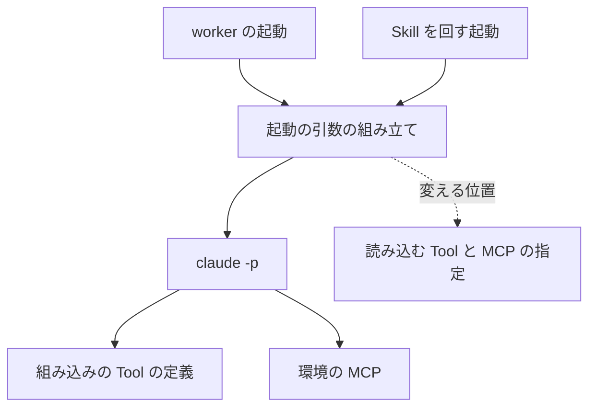
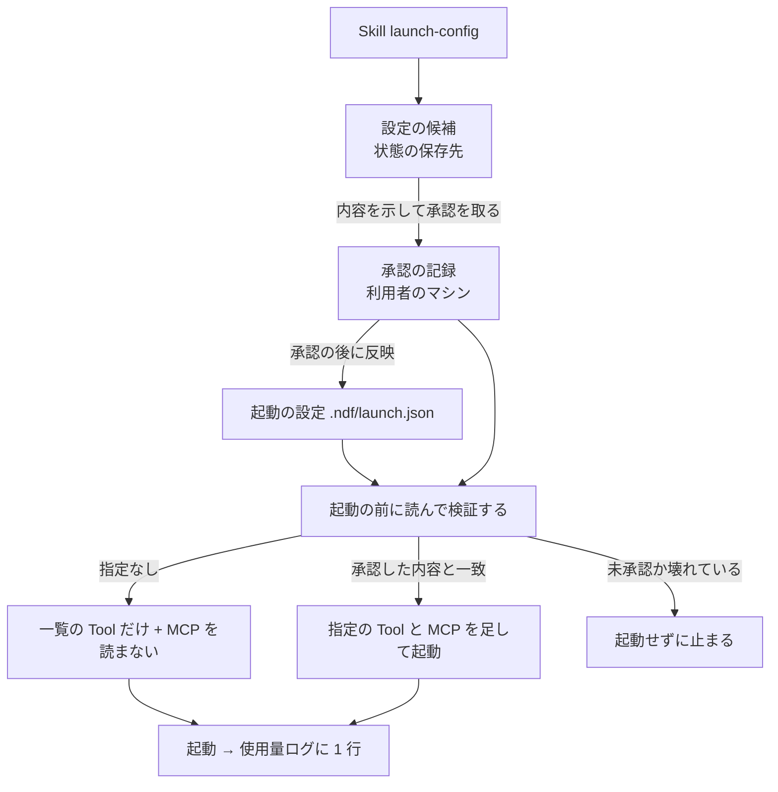
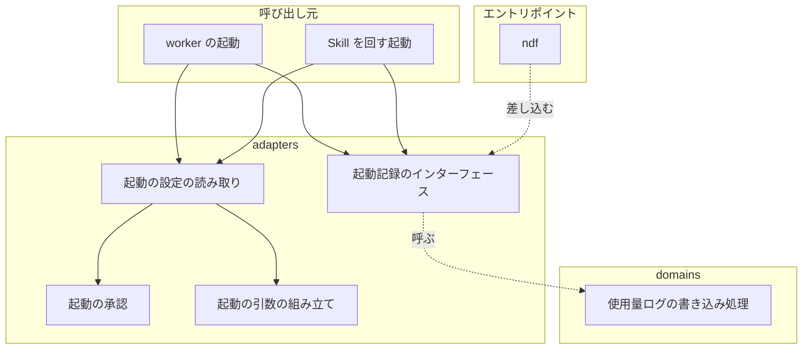
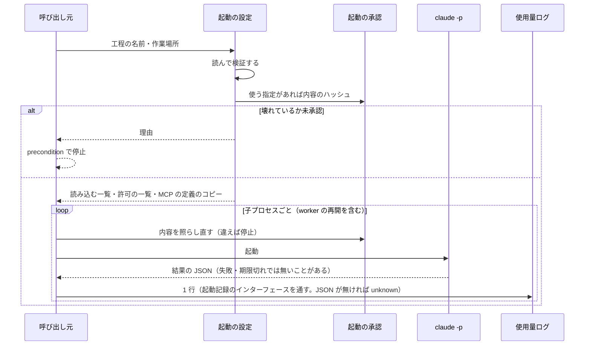

# claude -p の full の起動と起動の許可: 承認した Tool と MCP だけで起動できる（#1959）

これまで、工程を流す `claude -p` は使わない Tool と MCP の定義を毎回読み直し、どの Tool を使えるかと安全装置を外すかは、手順書とコードが決め打ちしていた。この文書の「full の起動」は、利用者の設定・プラグイン・hook をそのまま読み込み、Skill とサブエージェントが使える `claude -p` の起動である（要求仕様の「全部入り」）。この設計の改善の案では、full の起動は読み込む組み込みの Tool を一覧に絞り、MCP の読み込みを止める。Tool と MCP を足す指定と安全装置を外す指定は、設定を作る・直す Skill が利用者の承認を取り、承認した内容と一致する起動は都度の承認なしで動く。採らなかった案は「決定の記録」に、調べた標準・製品・ライブラリは末尾の「外部の調査」にある。

## 今の姿

何が起きたか・目的・受け入れ条件は要求仕様（[issue-1959-requirements.md](./issue-1959-requirements.md)、正は #1959 の本文）にある。この文書は「どう解くか」と「なぜその解き方か」だけを書く。



これまでの状態は次のとおりである。この設計が変えるのは表の 4 点で、図の点線の位置は 1 行目に当たる。

| これまで | この設計の改善の案 |
| --- | --- |
| 読み込む定義は環境にある全部 | 一覧の Tool だけ。MCP は読まない |
| 工程で使う MCP と Tool を指定する場所が無い | 起動の設定（`.ndf/launch.json`）に書き、利用者が承認する |
| 非対話の起動は、作業ブランチの `.mcp.json` のサーバを尋ねずに起動する（末尾の「外部の調査」の STD4） | 承認した内容だけを起動する |
| 相手役（レビューなどを頼むほかの AI の CLI）と委譲の起動は、安全装置を外す指定をコードと手順書が決め打ちする | サンドボックスが使えない環境で、利用者がそのマシンで承認した場合だけ付ける |

- 2 つの起動は、どちらも起動の引数の組み立て（`adapters/claude.py`）を通る。許す Tool の一覧は渡すが、読み込む Tool と MCP は絞っていない
- 使用量ログ（使ったトークンを 1 起動 1 行で追記する記録）へ `claude -p` の行を書く関数はあるが、呼ぶ所が無い

### 実測: 読み込む定義の量

2026-11-26 に Claude Code 2.1.332 を、今の full と同じ引数と、引数を足した形で起動して比べた。入力は同じ短い依頼で、値は文脈のトークン数である。

| 起動の形 | 1 回目の応答の前 | MCP の接続の後 | `mcp__` の Tool |
| --- | ---: | ---: | ---: |
| 今の full | 29,851〜29,921 | 32,995 | 38 個（claude.ai のコネクタ 5 つ） |
| `--tools` で一覧に絞る | 24,401〜24,471 | 27,533 | 38 個 |
| `--tools` と `--strict-mcp-config` | 24,401〜24,471 | 24,637 | 0 個 |

- 1 回目で 5,450、MCP の接続の後で約 8,400 トークン減る
- **MCP は最初の応答の後に接続する。** 起動の最初の記録（stream-json の `system/init`）には、今の full でも `mcp__` の Tool が 1 件も出ない。`mcp_servers` が `pending` で並ぶ
- `--disallowed-tools "mcp__*"` は Tool を外すが、MCP のサーバの指示文が文脈に残る
- 利用者の設定・プラグイン・Skill・サブエージェントの数は、3 つの形で同じだった（Skill 79・サブエージェント 17）
- **`--tools` は、知らない名前と許可の記法を黙って捨てる。** 2026-11-27 に Claude Code 2.1.332 を `--tools "Read,NoSuchTool,Bash(ls:*)"` で起動した。終了コード 0 で、`system/init` の Tool は `Read` だけだった

### 実測: 空白を含む許可の指定の渡し方

2026-11-26 に Claude Code 2.1.332 を、作り物の git リポジトリで 3 回起動した。引数は `-p --setting-sources "" --strict-mcp-config --permission-mode acceptEdits --tools "Bash,Read"` である。依頼は `git commit --allow-empty -m probe` と `git tag probe-tag` を 1 回ずつ打つことである。

| `--allowed-tools` の渡し方 | `git commit` | `git tag` |
| --- | --- | --- |
| 1 つの引数 `"Read,Bash(git commit --allow-empty:*)"` | 実行された | 拒否された |
| 2 つの引数 `"Read"` `"Bash(git commit --allow-empty:*)"` | 実行された | 拒否された |
| `"Read"` だけ（比較） | 拒否された | 拒否された |

この実測の設定では、どちらの渡し方でも空白を含む指定が有効になり、`git tag probe-tag` は拒否された。この実測は `--setting-sources ""` で利用者とリポジトリの設定を読んでいない。本番の full の起動は設定を読むので、`--allowed-tools` に無い操作でも、その `permissions` が許すものは実行される。

### 安全装置を外す指定の今の姿

| 起動 | 指定 | 付ける条件 |
| --- | --- | --- |
| cross-review などの Codex の相手役（`core/converge/participants.py`） | `--dangerously-bypass-approvals-and-sandbox` | ユーザー名前空間を作れない環境で自動 |
| Codex への委譲（`external-ai`・`corder`・`qa-security-scan` の手順書） | 同上 | 手順書の起動の例は条件を付けていない。`references/cli-codex.md` の説明は、外で隔離された環境でのみ使うとする |
| Kiro・agy への委譲（`external-ai` の手順書） | `--trust-all-tools`・`--dangerously-skip-permissions` | 手順書の起動の例が付ける |

### 実測: 工程が呼んだ MCP の Tool

2026-11-26 に、直近 30 日の会話の記録のうち非対話の起動（`sdk-cli`）を、最初の入力で工程に分けて数えた。このマシンの記録だけで、対象のリポジトリは ai-plugins と非公開の数件である。

NDF 11 系の worker（`ndf worker run`。2026-11-24〜11-26。222 会話）:

| 作業 | 会話数 | 作業 | 会話数 |
| --- | ---: | --- | ---: |
| design | 39 | release | 13 |
| requirements | 24 | backlog-refinement | 13 |
| worktree | 21 | retrospective | 13 |
| impl | 19 | quality-gates | 13 |
| implementation-plan | 16 | release-verification | 12 |
| design-detail | 14 | fix-base | 9 |
| fix-push | 7 | plan-to-spec | 7 |
| ci-fix | 2 | — | — |

**どの作業も、呼んだ MCP の Tool は 0 件である。**

NDF 10 系の起動（2026-10-30〜11-18。今は無い起動の形）の記録:

| 工程 | 会話数 | MCP を呼んだ会話 | 呼んだ Tool と回数 |
| --- | ---: | ---: | --- |
| design の Skill | 277 | 2 | claude.ai の Claude Docs の `guide` 2・`read` 1 |
| requirements-design の Skill | 209 | 2 | 同 `guide` 1・`read` 2 |
| ほかの Skill（backlog-refinement・document-rebuild・plan-to-spec・release-verification・retrospective・restart） | 555 | 0 | — |
| 実装 | 235 | 77 | serena の 9 種類。`find_symbol` 145・`get_symbols_overview` 122・`replace_content` 91 ほか |

- Claude Docs の呼び出しは、課題が claude.ai の文書を指していた 2 件の課題（#2172・#2173）の設計と要求である
- serena は利用者が入れていたプラグインの MCP で、2026-11-26 の `claude mcp list` と `claude plugin list` には無い
- 非対話の起動が呼んだ組み込みの Tool のうち、今の一覧に無いものは `TaskStop`・`ScheduleWakeup`・`ListAgents` である
- `ListAgents` は今の起動の形でも呼ばれている。文書を組み直す worker（`ndf worker run`。NDF 11.0.36、Claude Code 2.1.332）の 2 会話が 1 回ずつ呼んだ（2026-11-26 に会話の記録で確認）

もう一方の起動の経路である Skill を回す起動（`progress/invoke.py`）は、件数を数えられる記録が無い。

- 同梱の工程の定義とプランのテンプレートに、この経路（`ndf.skill`）を呼ぶものは無い。2026-11-26 に `git grep -n 'ndf\.skill' -- plugins` で検索し、当たったのは `progress/invoke.py` だけだった
- このマシンの直近 30 日の非対話の会話の記録に、この経路の起動（最初の入力が `/ndf:<名前>` と `入力（JSON）:`）は 0 件だった

そのため、この経路については「MCP を使っていない」ではなく「記録が無い」と扱う。

## 文脈と制約

- Tool と MCP を絞る対象は、`claude -p` の full の起動（要求仕様の「全部入り」）だけである。最小構成の起動（判定・相手役・修正担当）は、すでに MCP を読まない。安全装置を外す指定の承認は、相手役と委譲の起動にも使う（決定 9）
- `--tools` は組み込みの Tool だけを絞る。MCP の Tool には効かない
- MCP の Tool を呼ぶ許可は、利用者とリポジトリの Claude Code の設定（`permissions`）が決める。full の起動は `acceptEdits` なので、許可の無い MCP の Tool は今も拒否される
- claude.ai のコネクタ（Claude Docs など）は接続の定義がファイルに無く、`--mcp-config` で渡し直せない
- 利用者の設定ファイルは書き換えない
- 利用者の方針（2026-11-27）: Tool の実行と安全装置を外すことの可否は、起動のたびに判断しない。設定を作る・直す Skill で承認を取り、その設定で起動する限り都度の承認は要らない（原文は要求仕様の「リクエスト（原文）」）
- 承認の仕組みが防ぐのは、うっかりの書き換えと、承認していない人の変更（取得したブランチやほかの人のリポジトリ）である。AI が意図して承認者になりすます場合は扱わない
- 承認の対象は、起動の設定の指定と MCP の定義ファイルまでである。MCP の定義の引数などの中身は AI への出力に出さない（2026-11-27、設計の承認の回答。範囲の外は「受け入れる限界」）

## 解き方の全体像



- full の起動は、指定の無い工程では `--tools` の一覧と `--strict-mcp-config` を付ける
- 利用先は `.ndf/launch.json` の `permissions` に指定を書く。書くのは、工程ごとの MCP・読み込みに足す Tool・尋ねずに使ってよい Tool と、安全装置を外してよいランタイムである
- Skill `launch-config` は設定の候補を状態の保存先に作り、`permissions` の内容を示して承認を取る。承認されると利用者のマシンに内容のハッシュを残し、候補を `.ndf/launch.json` へ反映する。起動の前と、子プロセスを起動する直前に、同じ計算をして一致を確かめる
- 起動 1 回ごとに、工程・使用量・費用を使用量ログへ 1 行書く

## ドメインモデル

### コンテキスト

コンテキストは、語の意味が 1 つに決まる範囲である。名前は用語集（[docs/glossary.md](../docs/glossary.md)）の区分に合わせる。

| コンテキスト | 何の語が 1 つの意味に決まるか |
| --- | --- |
| AI の CLI の起動（`ndf-agent-cli`） | AI の CLI を起動する引数、起動の設定、起動の承認 |
| 文脈と使用量（`ndf-context`。「文脈」は AI が読む入力の量を指す） | 使用量ログの行 |

起動する側が行を作って渡し、使用量ログは受け取った行を追記する（DDD の顧客 / 供給者の関係で、起動が供給者）。渡すのは、`claude -p` の子プロセスが終わるたびの 1 行である。成功した起動だけでなく、失敗・期限切れ・回答の無い起動も渡す。行の中身は「使用量ログの行」に書く。

### 集約

| 集約 | オーナー（書き換えてよいもの） | 根 | エンティティ | 値オブジェクト |
| --- | --- | --- | --- | --- |
| 起動の設定 | 利用者（Skill `launch-config` の承認の後の反映か、手の編集。起動の処理は読むだけ） | 設定のファイル | 工程の指定 | MCP の指定・読み込む Tool・尋ねずに使ってよい Tool・安全装置を外すランタイム |
| 起動の承認 | `ndf launch-config approve`・`revoke` | 承認の記録の行（追記だけ） | — | リポジトリのキー・内容のハッシュ・操作の種類・承認を確定した人 |
| 使用量ログ | 使用量ログの書き込み処理 | 行 | — | 使用量・費用 |

### 不変条件

| # | 集約 | 条件 | 破れたときの扱い |
| --- | --- | --- | --- |
| I1 | 起動の設定 | 指定の無い工程の full の起動は、MCP を 1 つも読まない | — |
| I2 | 起動の設定 | 読めない・形が違う指定では起動しない。指す定義ファイルが、無い・リポジトリの外を指す・JSON でない・MCP サーバの定義の形でない場合も起動しない | 理由と直す場所を示し、前提の不足（`precondition`）で止まる |
| I3 | 起動の設定 | 起動の処理は、起動の設定と利用者の設定ファイルを書き換えない。NDF が起動の設定を書くのは、利用者が呼んだ Skill の候補を反映するときだけである | — |
| I4 | 使用量ログ | full の起動で動かした `claude -p` の子プロセス 1 つにつき 1 行。会話の再開も 1 行。書き込みが途中で失敗して同じ起動の記録をもう一度書き、行が 2 つになっても、`launch_id` で 1 回に数える | 書けなければ警告を出し、工程は止めない |
| I5 | 起動の承認 | 許可を広げる指定を使う起動と、安全装置を外す起動は、いまの内容のハッシュが承認の記録にある場合だけ動く。子プロセスを起動する直前に、内容を照らし直す | 起動せずに `precondition` で止まる |
| I6 | 起動の承認 | 承認の記録は、利用者の NDF の状態の保存先にだけ置く。リポジトリのファイルは承認の根拠にしない | — |
| I7 | 起動の承認 | 承認の行は、人の確認（端末での入力か、承認の問いへの人の答え）がある場合だけ書く。承認と取り消しの行は、NDF が非対話で起動した AI の中からは書けない | コマンドが拒む |
| I8 | 起動の設定 | MCP の定義のコピーは所有者だけが読め、そのコピーを使う起動が終われば残らない | 次の起動が、持ち主のプロセスが無いコピーを消す |

### ドメインイベント

| # | イベント | 発生元 | 受け手 |
| --- | --- | --- | --- |
| E1 | MCP の利用回数を数えた | この設計の実測 | 決定 3 |
| E2 | 工程が使う MCP を決めた | 起動の設定の読み取り | 起動の引数の組み立て |
| E3 | 絞った定義で工程を起動した | worker・Skill を回す起動 | プランのステップの結果 |
| E4 | 起動の使用量を記録した | 起動の呼び出し元 | 使用量ログ |
| E5 | 前後の費用を比べて残した | リリース後の確認 | 確定仕様 |
| E6 | 利用者が起動の設定を承認した | Skill `launch-config` | 起動の設定の読み取り |

## 構成要素

| 要素 | 責務 |
| --- | --- |
| 起動の設定の読み取り（新設） | `.ndf/launch.json` と、工程が指す MCP の定義ファイルを読んで検証し、工程の名前から MCP・読み込む Tool・尋ねずに使ってよい Tool を返す。承認が要る指定は、承認の確認を通してから返す |
| 起動の承認（新設） | 承認の対象の内容からハッシュを計算し、承認の記録を読み書きし、承認した候補を起動の設定へ反映する |
| 承認の答えの記録（新設の hook） | 承認の問いへの利用者の答えを記録する（「人の確認」） |
| `ndf launch-config`（新設） | `draft`（候補を作る）・`show`（承認の対象と状態）・`approve`・`revoke` |
| `ndf delegate-run`（新設） | 委譲の CLI に安全装置の引数を足し、承認を読み直してから起動する |
| Skill `launch-config`（新設） | 起動の設定の候補を作り、承認の対象を利用者に示して承認を取る |
| 相手役の起動の引数（変更） | 安全装置を外す引数は、承認がある場合にだけ付ける |
| `external-ai`・`corder`・`qa-security-scan` の手順（変更） | 決め打ちの安全装置を外す指定をやめ、`ndf delegate-run` を通して起動する |
| 起動の引数の組み立て（変更） | full の起動に `--tools` を付け、指定に応じて `--strict-mcp-config`・`--mcp-config` を付ける。起動の結果に、使用量・モデルごとの使用量・累計の費用を持たせて呼び出し元へ返す |
| プランの実行（変更） | `run_id`・ステップの id・そのステップの何回目の実行かを、環境変数（「子へ渡す環境変数」）で子へ渡す。回数はステップごとに数える |
| worker の起動（変更） | 作業の名前と作業場所を渡して指定を取得し、子の環境に NDF が起動したことを示すフラグ（「子へ渡す環境変数」）を付け、起動の後に使用量ログの行を書かせる。MCP の定義のコピーを持ち、起動の終わりに消す |
| Skill を回す起動（変更） | 工程の名前で同じことをする |
| 起動記録のインターフェース（新設） | 呼び出し元（worker の起動と Skill を回す起動）から、上の層にある使用量ログの書き込み処理を呼べるよう、エントリポイントで差し込む |
| 使用量ログの書き込み処理（変更） | `claude -p` の行を書く。行の欄を足す。使用量ログは読まない |
| 起動の費用を求める関数（新設） | 同じ会話の行の累計から、起動 1 回の費用を求める。集計が使う |

### 起動の前の確認と記録の呼び出し関係

次の図は、起動の前の確認と起動の記録の呼び出し関係だけを描く。承認を取る側（Skill と `ndf launch-config`）、安全装置を外す指定を使う側、費用の計算、プランの実行は含めない。



層は下から contracts・adapters・core・progress・domains の順で、下の層は上の層を読まない。起動記録のインターフェースは、中継のチェック（`set_relay_checks`）と同じ差し込みの形にする。中継（`ndf relay`）は、対話の Claude Code のセッションを NDF が子プロセスとして起動し、会話の切れ目で次のセッションに切り替える仕組みである。中継のチェックは、その中継が `claude` の起動の前に確かめる処理を差し込んだものである。

## データ構造

### 起動の設定（`.ndf/launch.json`）

置かなくてよい。スキーマは `contracts/schemas/ndf-settings/launch.schema.json`（新設）。許可を広げる指定は、すべて `permissions` の下に置く。承認の対象をこの 1 か所に閉じるためである（[#2944 の設計](./issue-2944-design.md)が足す実験の指定は、承認の対象にしない）。

```json
{
  "version": 1,
  "permissions": {
    "steps": {
      "*": {"load": ["LSP"]},
      "design": {"mcp": "inherit"},
      "impl": {"mcp": [".ndf/mcp/search.json"], "allow": ["mcp__search__query"]}
    },
    "unsandboxed": ["codex"]
  }
}
```

| キー | 型 | 意味 |
| --- | --- | --- |
| `permissions.steps.<工程>` | オブジェクト | `<工程>` は worker の作業の名前か Skill の名前。`*` はすべての工程 |
| `mcp` | `"inherit"` か、パスの空でない配列 | 配列は Claude Code の `--mcp-config` の形（`mcpServers`）のファイルで、リポジトリの根からの相対パス。`"inherit"` は環境の MCP をすべて読む |
| `load` | 文字列の配列 | 読み込みに足す組み込みの Tool の名前（`--tools`） |
| `allow` | 文字列の配列 | 尋ねずに使ってよい許可の指定（`--allowed-tools`）。Tool の名前、`Bash(git log:*)` の形の記法、`mcp__<サーバ>__<Tool>` |
| `permissions.unsandboxed` | `claude` 以外のランタイムの名前の配列 | サンドボックスが使えない環境で、安全装置を外して起動してよいランタイム。利用者は承認するときに、このマシンが外側で隔離されていることを自分で確かめる |

- 工程の指定にあるキーは、`*` の指定の同じキーを置き換える。無いキーは `*` の指定を使う
- **読み込む指定と、尋ねずに使ってよい指定は別である。** `load` に足した Tool は、`allow` にも書くか Claude Code の `permissions` が許すまで、非対話の起動では使えない場合がある。読むだけの Tool は許可なしで動く
- 要求の受け入れ条件 12 の「読み込みに足しただけでは、尋ねずに使えるようにならない」は、**NDF が許可を足さない**ことを指すと読む（設計承認ゲートで確かめる）。`load` の名前は `--allowed-tools` に入れない。Claude Code が元から尋ねずに動かす読むだけの Tool と、利用者とリポジトリの `permissions` が許す操作は、この指定と関係なくそのまま動き、NDF は止めない
- 工程の名前が実在するかは検証しない。利用先の独自の Skill の名前も書けるようにするためである

#### 起動の前の検証

起動の前に次を検証する。1 つでも当たれば起動せずに `precondition` で止まり、文にファイルと壊れた箇所を載せる。

| 対象 | 止まる条件 |
| --- | --- |
| `.ndf/launch.json`（ファイル全体） | JSON でない。スキーマに合わない |
| `load` の要素 | 英字だけの名前（`^[A-Za-z]+$`）でない。許可の記法・`mcp__` の名前・区切りのカンマは書けない。CLI が黙って捨てる値を、指定の誤りとして知らせる |
| `allow` の要素 | 空か、名前・`名前(指定子)`・`mcp__` の名前のどの形でもない。指定子が秘密の形に当たる（下の「起動の承認」） |
| `mcp` のパス | 絶対パス。`..` やシンボリックリンクをたどった先がリポジトリの根の外 |
| 工程が指す定義ファイル | 無い。JSON のオブジェクトでない。`mcpServers` がオブジェクトでない。サーバの定義が、文字列の `command` も `url` も持たない |

サーバが起動できるか・接続できるかは、起動の前には検証しない。`load` の名前が実在するかも検証しない（Claude Code の Tool の一覧を NDF がコピーして持つと、バージョンが上がるたびに食い違う）。

### 起動の承認

**承認の対象**は、`permissions` の全体と、そこから読み込む MCP の定義ファイルの中身である。

| 含めるもの | 理由 |
| --- | --- |
| `permissions` の全体 | 読み込む Tool、尋ねずに使える操作、安全装置を外すランタイムが変わる |
| `mcp` の配列が指す定義ファイルの中身 | 起動されるコマンドと引数が変わる |
| どれかの工程が `inherit` のときの、リポジトリの `.mcp.json` の中身 | 非対話の起動は `.mcp.json` のサーバを尋ねずに起動する（STD4）。作業ブランチの変更でコマンドが変わる |

対象をキーの順にそろえた JSON にして SHA-256 を取る。書式だけの変更（字下げ・キーの順）では、承認は外れない。定義が呼ぶリポジトリ内のスクリプトの中身は、対象に含めない。

**MCP の定義の中身は出力に出さない。** 定義の引数・`env`・`headers`・URL には資格情報が書かれうる。`show` の JSON、承認の問い、停止の文、ログが MCP について出すのは次の 4 つだけで、中身は利用者がファイルを開いて読む。

| 出すもの | 中身 |
| --- | --- |
| サーバ名 | `mcpServers` のキー |
| コマンド名 | `command` の最初の語の、パスを除いた名前。`url` のサーバは「url」とだけ出し、接続先は出さない |
| 定義ファイルの場所 | リポジトリの根からの相対パス |
| ハッシュ | 定義ファイルごとの SHA-256 と、承認の対象全体の SHA-256 |

定義の形の誤りを知らせる文にも、値は載せずファイルとキーの位置だけを載せる。Skill は MCP の定義ファイルと `.mcp.json` を読まず、作成も編集もしない。利用者が自分で書く。

**`allow` の指定子に秘密を書いた起動の設定は、起動の前の検証で止める。** `allow` の指定子は `--allowed-tools` の引数になり、起動中のプロセスの一覧を読める利用者や監視のプロセスから見える。表示を伏せても引数には残るので、書くこと自体を拒む。

| 項目 | 内容 |
| --- | --- |
| 判定 | `ndf project` が出力を伏せるときの表（トークンの形と、`token=…` のような代入の形）に当たる指定子。代入の値が `$` で始まる環境変数の参照（`token=$API_TOKEN`）は、値が引数に現れないので当てない |
| 当たったとき | `precondition` で止まる。文にはファイルとキーの位置だけを載せ、値は載せない。`show`・`approve`・起動の前の検証が同じ扱いにする |
| 資格情報が要るコマンド | 環境変数で渡し、指定子には変数の参照だけを書く。Skill の手順にも書く |

表に無い形の秘密は見分けられない（「受け入れる限界」）。

**承認の記録**は、利用者の NDF の状態の保存先（`identity.load().state_dir`）の `launch-approvals.jsonl`（追記だけ。所有者だけが読める）に置く。保存先の根は、環境変数 `NDF_STATE_HOME`、`XDG_STATE_HOME`、`~/.local/state` の順に最初に値があるものである。ファイルは `<根>/ndf/launch-approvals.jsonl` になる。

| 欄 | 中身 |
| --- | --- |
| `at` | 日時 |
| `repo` | リポジトリのキー（下の「リポジトリのキー」） |
| `sha256` | 承認の対象のハッシュ |
| `action` | `approve` か `revoke` |
| `approver` | 承認を確定した人の名前（下の「人の確認」で得る）。`revoke` の行には置かない |
| `request_id` | 承認の問いで確認した場合の、承認の依頼の識別子。この行がある依頼の答えは使用済みである。端末の確認と `revoke` の行には置かない |

`approver` はコマンドの引数では受けない。人が確認した事実の記録で、本人の認証ではない（なりすましは「文脈と制約」のとおり扱わない）。

#### 設定の候補と反映

承認の問いに「承認しない」と答えた場合に、書き換えた設定が残らないようにする。同じリポジトリの worktree は承認の記録を共有し、並行して設定を直すこともある。そのため、候補は依頼ごとに別のファイルにし、候補を作った後に反映先が変わっていたら上書きしない。

1. Skill は `ndf launch-config draft` を打つ。コマンドは、状態の保存先の `launch-candidates/<リポジトリのキーのハッシュ>/<一意な値>/` に、今の `.ndf/launch.json` の写し（無ければ `{"version": 1}`）を候補として作り、パスを返す。同じディレクトリに、**反映先**（その worktree の `.ndf/launch.json` の絶対パス）と**反映元の版**（そのときの反映先の中身の SHA-256。ファイルが無ければ「無し」）を記録する。候補のパスは AI が選ばない
2. Skill は返された候補を直す。リポジトリのファイルはこの時点で変えない
3. `show`・`show --question approve`・`approve` は、`--candidate <候補>` を受けると、候補の `permissions` を承認の対象にする。MCP の定義ファイルはリポジトリのものを読む。承認の依頼には、反映先と反映元の版も記録する
4. `approve --candidate` は、承認の記録のロックの中で反映先の今の中身を照らし、下の表のとおりに進める。承認されなければ置き換えない
5. 候補の承認の対象が空か承認済みなら、`approve --candidate` は問いを求めずに、同じ表のとおりに置き換える。許可は広がらないためである。この場合は承認の行を書かない。`NDF_AI_CHILD` がある環境では、この場合も拒む（NDF が起動した AI に、起動の設定を書き換えさせないためである）

| 反映先の今の中身 | 扱い |
| --- | --- |
| 反映元の版と同じ | 承認の行を書き（要る場合）、下の「置き換えの手順」で候補を反映する |
| 候補と同じ | 反映は済んでいる。反映先を書き換えずに成功にする（中断の後の打ち直し） |
| どちらでもない | 承認の行を足さず、`refused` で止まる。文に、設定が別の作業で変わったことと、候補を作り直すことを載せる |

**置き換えの手順。** 利用者の手の保存はロックを取らないので、中身を照らした直後に保存されることがある。その保存を上書きしないように、反映先をいったん退避し、退避した中身をもう一度照らしてから置く。

1. 反映先を、同じディレクトリの `launch.json.reflecting` へ名前を変える（反映先が無ければ飛ばす）
2. 退避した中身が反映元の版と違えば、元の名前に戻して `refused` で止まる
3. 候補を、反映先がまだ無い場合にだけ成功する方法（一時ファイルからの `os.link`）で置く。この間に保存されたファイルがあれば置かずに、そのファイルを残して `refused` で止まる
4. もう一度退避した中身を照らす。反映元の版と違えば（開いたままのエディタが書き込んだ場合）、退避したファイルを反映先へ戻して `refused` で止まる。同じなら消す

- 退避したファイルを戻すのは、反映先が無いか、置いた候補のままの場合だけである。反映先に別の保存がある場合は反映先を変えない。そのとき、退避した中身が反映元の版と違えば消さずに残し、文にパスを載せる。同じなら消す
- 手順 4 で照らした後に、開いたままのエディタが退避した側へ書いた内容は残らない。照らしてから消すまでの間だけである
- 手順の途中で中断すると `launch.json.reflecting` が残る。次の `approve` が、反映先が無ければ戻してから始める。起動の側は、反映先が無く `launch.json.reflecting` がある場合、指定なしとは扱わず `precondition` で止まる
- 手順 3 や 4 で止まった場合、承認の行は残る。承認したのは示した内容だけなので、許可はほかへ広がらない

**反映の完了の記録。** 反映できたら、候補を消す前に、完了の記録を状態の保存先の `launch-reflected/<反映先のパスのハッシュ>.json` に書く。中身は、候補の識別子、反映先、反映した中身の SHA-256、承認の対象のハッシュ、依頼の識別子（あれば）である。反映先ごとに 1 件で、次の反映が上書きする。

候補が無い `approve --candidate`（反映の直後に応答を受け取れず、打ち直した場合など）は、この記録で判断する。何も書き換えない。

| 完了の記録 | 扱い |
| --- | --- |
| 候補の識別子と `--sha256`（と `--request`）が一致し、反映先の中身が反映した中身と同じ | 反映は済んでいるとして成功にする |
| 一致するが、反映先の中身が変わっている | `refused`。反映の後に設定が変わったことを載せる |
| 一致する記録が無い | `refused`。候補を作り直すことを載せる |

反映の後は、同じ反映先のほかの候補のうち、反映元の版が合わなくなったものも消す。`draft` は、反映先の worktree が無くなった候補と完了の記録、「承認しない」と答えた依頼の候補を消す。

利用者は `.ndf/launch.json` を手で直してもよい。その内容は、`--candidate` を付けない `approve` で承認するまで、許可を広げる起動に使えない。

#### 人の確認

承認を確定するのは人だけである。`approve` は、AI が自分だけでは作れない次のどちらかの確認がある場合にだけ記録する。

| 経路 | 確認の取り方 | `approver` |
| --- | --- | --- |
| 端末 | 標準入力と標準出力が端末の場合に、コマンドが承認の対象を表示する。人は名前と、ハッシュの先頭 8 文字を打つ | 打った名前 |
| Skill の問い | Skill が利用者へ承認の問い（`AskUserQuestion`）を出し、利用者が承認の選択肢を選ぶ。その答えを hook が記録し、コマンドはその記録を読む | 承認の選択肢に出た名前 |

Skill の問いの経路は次のとおり動く。

1. `ndf launch-config show --question approve` が、**承認の依頼**を 1 件作る。依頼は、一意な識別子、リポジトリのキー、操作の種類、対象のハッシュ、反映先、反映元の版、候補（あれば）、問いを出す会話の id（`CLAUDE_CODE_SESSION_ID`）、作った日時を持つ。問いの中身は、依頼の識別子、リポジトリ、操作（承認）、承認の対象の一覧、ハッシュと、2 つの選択肢である。承認の対象に `unsandboxed` があれば、下の「承認を取る」の警告の 1 文もコマンドが問いに入れる。選択肢は「承認する（承認者: <名前>）」と「承認しない」で、名前の候補は `git config user.name` である。コマンドは依頼と問いの中身のハッシュを状態の保存先に残す。答えが記録されない会話（会話の id が取れないか、下の環境変数がある）では問いを作らず、端末で打つコマンドを返す
2. Skill はその中身のまま `AskUserQuestion` を呼ぶ。文を足さず、変えない（変えると 3 の一致の確認で答えが記録されない）。利用者が、承認者の名前が違うと答えたら、名前を替えて依頼を作り直す
3. 新設の hook が `AskUserQuestion` の後（PostToolUse）に動く。問いの中身が 1 で作ったものと一致し、hook が受け取る会話の id が依頼の会話の id と同じ場合だけ、`launch-answers.jsonl`（所有者だけが読める）に追記する。追記するのは、依頼の識別子・答え・名前・問いの id である
4. `approve --sha256 <値> --request <依頼の識別子>` は、下の表の条件がすべて成り立つ場合にだけ承認の行を書く。承認の行には依頼の識別子を残す

| 条件 | 無効にするもの |
| --- | --- |
| その依頼の識別子の答えが「承認する」である | 未回答と「承認しない」 |
| 依頼のリポジトリのキー・操作の種類・対象のハッシュが、いまの承認と一致する | 別のリポジトリ・操作・内容への流用 |
| 同じ反映先に、より新しい依頼が無い | 前の設定変更で使わずに残った答え |
| 反映先の今の中身が、依頼の反映元の版か候補と同じである | 利用者が確かめた後に設定が変わった場合の上書き |
| 依頼の後に、同じ内容の `revoke` が無い | 取り消しの前の答え |

**答えに時間の期限は置かない。** 古い答えが使えなくなる理由は、内容か反映先が変わった、取り消した、新しい依頼を作った、のどれかであり、どれも上の表が確かめる。時間で切ると、何も変わっていないのに利用者の回答が失われる。依頼から長くたってから答えた場合も、hook は同じように記録する。

**答えを使ったことは、承認の行そのもので表す。** 使用済みの行を別に書くと、2 つの書き込みの間で中断したときに答えだけが失われる。同じ依頼の識別子の承認の行がすでにあり、その内容が承認済みなら、`approve` は行を足さずに、残りの処理（候補の反映）を行う。そのため、版上げ・再起動・セッションの入れ替えで中断しても、同じコマンドを打ち直せば続きから終わる。打つコマンドが会話に残っていなくてもよいように、`show` は、その反映先に「承認する」と答えがあり反映が済んでいない依頼があれば、続きを行う `approve` のコマンド（`--sha256`・`--request`・`--candidate`）を結果に載せる。会話の id を照らすのは hook が答えを記録するときだけで、`approve` を打つ会話は問わない。

次の場合、hook は答えを記録しない。答えを人でなく AI が返しうるためである。

- NDF が非対話で起動した AI（`NDF_AI_CHILD` がある）と、人のいない実行（`NDF_FACTORY_RUN` がある）
- 質問をオーガナイザー（複数の作業をまとめる AI の会話）が受けうる会話（`NDF_RELAY_PLAN` か `NDF_ORGANIZER_DIR` がある）

これらの場合と、`AskUserQuestion` の無いランタイム（Codex など）では、人が端末で打つ。プランを流す会話もここに当たる。

| 項目 | 内容 |
| --- | --- |
| 端末で打つコマンド | 対象の worktree で `ndf launch-config approve --sha256 <値>`。候補があれば `--candidate <候補>` を足す。表示された内容を読み、名前とハッシュの先頭 8 文字を打つ |
| 案内する側 | `show --question approve` と、起動を止める文。どちらもコマンドを、ハッシュと候補を埋め、`ndf` の実行ファイルの絶対パスで出す（利用者の端末の PATH に `ndf` が無くても打てる） |
| Skill の扱い | 問いが返らなければ、そのコマンドを利用者に伝え、打ち終えた後に `show` で承認を確かめる。AI は代わりに打たない |

`approve --sha256 <値>` は、次のどれかで拒む。

- いまの内容のハッシュが `<値>` と違う（利用者に示した内容と違うものを承認しない）
- NDF が起動した AI の中で呼ばれた（環境変数 `NDF_AI_CHILD` がある）
- 「人の確認」のどちらの確認も無い

`revoke --sha256 <値>` は、承認を取り消す。取り消しは許可を狭めるだけなので、人の確認を求めない。`NDF_AI_CHILD` がある場合は拒む。

**リポジトリのキー**は、git の共通管理ディレクトリ（`git rev-parse --git-common-dir`）の実体の絶対パスである。今の `adapters/git.py` の `common_dir` を使う。

- リンクされた worktree は同じキーになる
- 別のクローンと別のリポジトリは、同じリモートや同じ名前でも別のキーになる。承認はほかへ流用されない
- git の外では、`.ndf/launch.json` を置いたディレクトリの実体の絶対パスをキーにする
- クローンを移すか作り直してパスが変わると、承認し直しになる

同じ `repo` と `sha256` の最後の行が `approve` なら承認済みである。ハッシュごとに持つので、指定の違うブランチを行き来しても、承認し直さなくてよい。

**承認の確認**は、起動のたびに次の順で行う。

| 状況 | 扱い |
| --- | --- |
| その起動で使う指定が空（`load`・`allow`・`mcp` が無く、安全装置も外さない） | 承認を調べずに起動する。許可は広がらないためである |
| 指定があり、いまのハッシュが承認済み | そのまま起動する。都度の承認は求めない |
| 指定があり、承認済みでない（書き換え・作業ブランチでだけ NDF の起動の設定を変えた・このマシンで未承認） | 起動せずに `precondition` で止まる。文に、承認の対象の一覧と、`/ndf:launch-config` を呼ぶことを載せる。答えが記録されない会話向けに、端末で打つ `approve` のコマンドも載せる |

**起動の直前の照らし直し。** 承認の確認の後、子プロセスを起動する直前に（worker の会話の再開を含めて子プロセスごとに）、承認の対象を読み直してハッシュを取る。最初の確認の値と違うか、承認が取り消されていれば、起動せずに `precondition` で止まる。`inherit` の起動では `claude` が `.mcp.json` を自分で読むので、照らし直しから読み込みまでの短い間の書き換えは見分けられない。

**git の起動。** 起動の設定を読む位置（リポジトリの根）は、作業場所から親へたどって `.git`（ディレクトリかファイル）を持つディレクトリを探して決め、git のプロセスは起動しない。`.ndf/launch.json` を使わない利用者の起動で、プロセスは増えない。git を起動するのは、指定を使う起動がリポジトリのキー（`git rev-parse --git-common-dir`）を取るときだけである。

**読み直しの回数と費用。** 指定を使う起動は、最初の確認で 1 回、子プロセスごとに 1 回、承認の対象（`.ndf/launch.json`、全工程の定義ファイル、`inherit` があれば `.mcp.json`）を読む。子が N 個なら N+1 回で、指定が空の起動は定義ファイルを読まない。2026-11-26 に、作り物の定義ファイルの読み取り・解析・ハッシュの計算を 101 回ずつ測った（8 コアの Linux、Python 3.14.4）。

| 定義ファイル | 合計の大きさ | 1 回の中央値 |
| ---: | ---: | ---: |
| 1 | 約 1 KB | 0.02 ms |
| 5 | 約 12 KB | 0.14 ms |
| 20 | 約 229 KB | 2.4 ms |

| 読み直しを減らす案 | 減る量 | 採否 |
| --- | --- | --- |
| 毎回すべて読み直す | — | 採る。増える時間は `claude -p` の 1 回の起動（秒の単位）に比べて小さい |
| 更新日時と大きさが同じファイルは前の値を使う | 2 回目以降の読み取りと解析 | 採らない。中身を変えて日時を戻した書き換えを見分けられない |
| その工程が使う定義ファイルだけを読む | 使わないファイルの分 | 採らない。承認は対象全体の 1 つのハッシュなので、承認の記録をファイルごとのハッシュに分ける必要がある。減る時間は上の表の一部である |

`mcp` の配列の定義は、確認で読んだ中身を状態の保存先へ書き出し、そのファイルを `--mcp-config` に渡す。定義の中の `${VAR}` は展開せずに渡す。定義には接続情報や資格情報が書かれうるので、コピーは次のとおり扱う。

| 項目 | 内容 |
| --- | --- |
| 保存先 | 状態の保存先の `launch-mcp/<起動の呼び出し元の PID>-<一意な値>/`。リポジトリと共有の一時ディレクトリには置かない |
| 権限 | ディレクトリは 0700、ファイルは 0600 |
| 持ち主 | 起動の呼び出し元（worker の起動か Skill を回す起動）。worker の再開ループは、全部の子プロセスで同じコピーを使う |
| 消す時点 | 呼び出し元が起動を終える時。成功・失敗・期限切れ・例外のどれでも消す |
| 消し残り | 呼び出し元が強制終了された分は、次にコピーを作る処理が、持ち主の PID が生きていないディレクトリを消す |

#### 子へ渡す環境変数

名前は次の表で固定し、`contracts/domains/env.json` に足す。書く側と読む側は、名前をこの表から引く。どれも中継が起動する対話のセッションへは渡さない。

| 名前 | 値 | 付ける側と条件 | 読む側 | 無いとき |
| --- | --- | --- | --- | --- |
| `NDF_AI_CHILD` | `1`（読む側は空でないかだけを見る） | NDF が非対話で起動する AI の子すべて（worker・Skill を回す起動・判定・相手役・修正担当）。手順書の委譲は `ndf delegate-run` が付ける | `approve`・`revoke` | NDF が起動した AI の中ではない |
| `NDF_PLAN_RUN_ID` | プランの実行の id | プランの実行が、ステップの子へ | 使用量ログの `run_id` | プランの外。欄を省く |
| `NDF_STEP_ID` | ステップの id | 同上 | 同 `step` | 同上 |
| `NDF_STEP_ATTEMPT` | 1 以上の整数（「使用量ログの行」の `attempt`） | 同上 | 同 `attempt` | 同上 |

プランの実行の id に `NDF_RUN_ID` は使わない。`NDF_RUN_ID` は実行ログ（`adapters/run_log.py`）が親の実行を指すために使っていて、`child_process_env` が子の環境を実行ログの値で上書きする。`NDF_RUN_ID`・`NDF_RUN_LOG` の意味と、実行ログの親子の関係は変えない。

`NDF_AI_CHILD` は、非対話の子がうっかり承認のコマンドを打つのを早く拒むフラグである。人が確認したことは、このフラグでなく「人の確認」で確かめる。AI が意図してフラグを外すことは防がない（「文脈と制約」）。

### 安全装置を外す指定

相手役の起動と委譲は、同じ処理で安全装置の引数を取得する。`review` は cross 系の相手役（読むだけの起動）、`delegate` は手順書に従う作業の委譲である。引数の値は、ランタイムの表 `contracts/domains/runtimes.json` の行が持つ（外す引数は `unsandboxed_args`、サンドボックスの引数は `sandbox_args`。委譲の引数の欄はこの表に足す）。

**承認は「サンドボックスが使えない環境で外してよい」という意味である。** サンドボックスが使える環境では、承認があってもサンドボックスの引数を使う。下の表の「承認あり」は、`unsandboxed` にランタイムがあり、いまの内容が承認済みであることを指す。「停止」は、起動せずに `precondition` で止まり、承認の手順を示すことである。サンドボックスが使えるかは、今の相手役の起動と同じ確認（ユーザー名前空間を作れるか）で決める。サンドボックスの引数を持たないランタイム（Kiro・agy の委譲）は、使えない環境と同じに扱う。

| ランタイム | 使い方 | サンドボックスが使える | 使えず、承認あり | 使えず、承認なし |
| --- | --- | --- | --- | --- |
| codex | `review` | `-s read-only` | `--dangerously-bypass-approvals-and-sandbox` | 停止 |
| codex | `delegate` | `-s workspace-write` | 同上 | 停止 |
| kiro | `review` | 今の読むだけの指定 `--trust-tools=fs_read` | 同左 | 同左 |
| kiro | `delegate` | — | `--trust-all-tools` | 停止（外さないと非対話で動かない） |
| agy | `review` | 停止（読むだけの起動が無く、今も相手役にしない） | 同左 | 同左 |
| agy | `delegate` | — | `--dangerously-skip-permissions` | 停止（外さないと非対話で動かない） |
| claude | どちらも | 引数なし | 引数なし | 引数なし |

Claude Code の安全装置を外す指定は、NDF は今も使わない。

**安全装置を外す起動も、子プロセスを起動する直前に照らし直す。** cross-review は担当全員の起動の引数を先に組んでから並べて起動し、同時起動の枠が空くまで待つこともある。そのため、引数を組んだ時点の確認だけでは、待っている間の取り消しを見分けられない。安全装置を外す引数を持つ起動は、確認で読んだハッシュを持ち、相手役を起動する処理が起動の直前に承認の対象を読み直す。内容が違うか承認が取り消されていれば、起動せず、その担当は結果の無い担当になる。手順書の委譲も同じ照らし直しをするために、引数の取得と起動を 1 つのコマンドにまとめる。

```bash
timeout 1320 ndf delegate-run --runtime codex -- codex exec '{args}' -C "$PWD" < "$TMP/prompt.md"
```

| `ndf delegate-run` の項目 | 内容 |
| --- | --- |
| 入力 | `--runtime codex\|kiro\|agy` と、`--` の後の CLI のコマンド。先頭の語はそのランタイムの CLI の実行ファイル名で、NDF の引数を入れる位置の `{args}` を 1 つだけ持つ |
| 処理 | 安全装置の引数を取得し、起動の直前に承認の対象を読み直してから、同じプロセスを CLI に置き換える（`exec`）。子の環境に `NDF_AI_CHILD=1` を足す |
| 失敗 | 使い方の誤り、起動できない状況、読み直しでの食い違いは、CLI を起動せず、理由を標準エラーに出して 0 以外で終える |
| 入出力 | 標準入力・標準出力・終了コードは CLI のものになる。外側の `timeout` はそのまま効く |

安全装置の引数だけを返すコマンドは作らない。引数を受け取ってから別に起動する形は、取得の後の取り消しを確かめられないためである。

### 使用量ログの行

行を書く単位は `claude -p` の子プロセス 1 つである。worker の起動は、結果ファイルが書かれるまで同じ会話を再開するので、1 つの作業が複数の行になる。

| 欄 | 中身 | 結果の JSON が得られなかった場合 |
| --- | --- | --- |
| `launch_id` | 呼び出し元が子プロセスごとに作る一意な値 | 同じ |
| `name`（足す） | 工程の名前（`.ndf/launch.json` の `steps` のキーと同じ） | 同じ |
| `run_id`・`step`・`attempt` | プランの実行の id・ステップの id・そのプランの実行でそのステップを実行した何回目か（最初が 1）。打ち直しと、遷移でステップに戻った実行の両方で 1 増える。プランの外の起動では無し | 同じ |
| `session_id` | 会話の id。取得元は下の「会話の id と順番」 | 呼び出し元が id を指定していなければ欄を置かない |
| `session_seq`（足す） | その会話の中で何番目の起動か（最初が 0） | 同じ |
| `usage` | 結果の使用量 | `unknown` |
| `session_cost_usd`（足す） | 結果の `total_cost_usd` | 欄を置かない |
| `model` | 主モデルの名前。決め方は下の「モデルの欄」 | 欄を置かない |
| `model_usage` | 結果の `modelUsage` の、モデルごとのトークン数 | 欄を置かない |
| `seconds`・`launched_at`・`repo` | 呼び出し元が測る値 | 同じ |

子プロセスを起動できなかった場合（CLI のバージョンが下限より古い、同時起動のスロットが取れないなど）は、使った量が無いので行を書かない。

**会話の id と順番。** worker の起動は呼び出し元が id を指定する（`--session-id`、再開は `--resume`）ので、その値を書く。Skill を回す起動は id を指定しないので、結果の JSON の `session_id` を書く。どちらからも取得できなければ欄を省く。

`session_seq` は、呼び出し元が持って渡す。#1959 の範囲で同じ会話を再開するのは worker の再開ループだけで、このループは会話の最初の起動から順に回数を持っている。Skill を回す起動は常に 0 である。番号が 1 つ飛べば、ログへの追記に失敗した起動があると分かる。

**モデルの欄。** 1 回の起動で複数のモデルが動くことがある。`model` は、結果の `modelUsage` のうち、トークン数の和が最も大きいモデルである。和に入れるのは `inputTokens`・`outputTokens`・`cacheReadInputTokens`・`cacheCreationInputTokens` の 4 つである。同じ和なら `contextWindow` が小さいほうを選ぶ。`claude.py` の `context_window` が主モデルを選ぶ規則と同じなので、1 つの関数を両方が使う。`modelUsage` が無いか空なら、欄を省く。`model_usage` には、モデルごとに上の 4 つの値を入れる。

#### 起動の費用の求め方

`session_cost_usd` は、同じ会話の起動をまたいだ累計である。起動 1 回の費用は累計の差で求め、書き込みの時でなく集計の時に計算する。

| 行 | 起動 1 回の費用 |
| --- | --- |
| 値があり、`session_seq` が 0（`session_id` の無い行を含む） | その行の値 |
| 値があり、番号が 1 つ前の行にも値がある | その行の値 − 前の行の値 |
| ほか（値の無い行、番号が 1 つ前の値が無い、差が負） | 不明 |

- 不明の起動は 0 として足さず、件数を数える
- 前の行は、使用量ログの同じ `session_id` の行から取る。集計期間より前の行も参照する
- 同じ `launch_id` の行が複数ある場合は、値を持つ行のうち最初に書かれた 1 行を数える。値を持つ行が無ければ、最初の 1 行を数える

ステータスラインの費用の表示と、その元の費用のジャーナル（`print-costs.jsonl`）は変えない。

## 入出力のコントラクト

| 名前 | 入力 | 出力 | 失敗の形 |
| --- | --- | --- | --- |
| full の起動の引数 | 工程の名前・作業場所 | `--tools <読み込む一覧> --allowed-tools <指定 1> <指定 2> … --strict-mcp-config`。許可の指定は 1 件を 1 つの引数にし、カンマで連結しない。`--allowed-tools` は複数の値を取る。後に続くプロンプトを値として読ませないよう、プラグインの引数が空のときも、後ろに `--append-system-prompt` を置く。`mcp` が配列なら `--mcp-config <書き出した定義>...` を足し、`inherit` なら `--strict-mcp-config` を付けない | 壊れた指定か未承認なら起動せず、`precondition` の停止 |
| `ndf launch-config draft` | 作業場所 | 結果の JSON。作った候補のパス | 反映先を読めなければ `precondition`。`NDF_AI_CHILD` があれば拒む |
| `ndf launch-config show` | 作業場所。`--candidate <候補>`・`--question approve` を足せる | 結果の JSON。承認の対象の一覧（MCP はサーバ名・コマンド名・定義ファイルの場所・ハッシュ）、全体のハッシュ、承認済みか、答えがあって反映が済んでいない依頼の続きのコマンド | 読めなければ `precondition` |
| `ndf launch-config approve` | `--sha256 <値>`。承認の問いで確認した場合は `--request <依頼の識別子>`。`--candidate <候補>` を足せる | 承認の記録へ 1 行。候補があれば起動の設定へ反映 | 上の「人の確認」の条件か、反映先が変わっていれば拒む |
| `ndf launch-config revoke` | `--sha256 <値>` | 承認の記録へ 1 行 | `NDF_AI_CHILD` があれば拒む |
| `ndf delegate-run --runtime <名前> -- <CLI のコマンド>` | ランタイムと、`{args}` を持つ CLI のコマンド | CLI の出力そのまま | 起動できない状況なら CLI を起動せず `precondition` |

`--tools` は読み込む組み込みの Tool を絞る。`--allowed-tools` は尋ねずに実行できる操作を追加するもので、実行できる操作の全体を決める一覧ではない。利用者とリポジトリの Claude Code の設定による許可も、引き続き適用される。

| 一覧 | 中身 |
| --- | --- |
| 読み込む一覧（同梱） | これまでの 13 個に `TaskStop`・`NotebookEdit`・`ListAgents` を足した 16 個。指定の `load` を足す |
| 許可の一覧（同梱） | **これまでの 13 個のまま変えない。** 指定の `allow` を足す |

互換性: 利用先が工程の中で MCP か一覧に無い組み込みの Tool を使っていた場合は、指定を書いて承認するまで使えなくなる。サンドボックスが使えない環境の cross-review と、Kiro・agy への委譲も、承認するまで起動しない。従来どおり環境の MCP を読み込むには、次を書いて Skill で承認する。一覧から外れた Tool は `load` で足す。

```json
{"version": 1, "permissions": {"steps": {"*": {"mcp": "inherit"}}}}
```

## 処理の流れ

### 起動の前の確認



### 承認を取る（Skill `launch-config`）

1. `ndf launch-config show` で、いまの指定と承認の状態を読む。答えがあって反映が済んでいない依頼があれば、返された `approve` を先に打つ。起動の設定か定義ファイルが壊れていると `precondition` で止まるが、手順はそこで終えない。止まった文のファイルと位置を利用者に伝え、元のファイルは変えずに次へ進む。壊れているのが `.ndf/launch.json` なら、Skill がその中身を読んで直した候補を作る。MCP の定義ファイルか `.mcp.json` なら、利用者が直してから 1 をやり直す。`--candidate` を付けた `show` と `approve` は、今の `.ndf/launch.json` を設定として解析せず、版を照らすハッシュだけを取るので、壊れていても候補を検証して承認を取れる
2. `ndf launch-config draft` で候補を作り、利用者の依頼に合わせて直す。MCP の定義ファイルは利用者が書く
3. `show --candidate` を打ち、承認の対象の一覧（MCP はサーバ名・コマンド名・定義ファイルの場所・ハッシュ、`load`・`allow` の指定、安全装置を外すランタイム）を利用者に示す。MCP の定義の中身は、ファイルを開いて読むよう伝える
4. `show --question approve --candidate` の中身で承認の問いを出す。利用者が承認すれば `approve --sha256 <値> --request <依頼の識別子> --candidate <候補>` を打ち、起動の設定へ反映する。承認しなければ記録も反映もせず、設定は変わっていないことを伝える。問いが返らない会話では、返された端末のコマンドを利用者に伝える（「人の確認」）

承認の対象に `unsandboxed` がある場合、`show --question approve` が作る問いと端末の `approve` の表示は、次の警告の 1 文を含む。問いの 1 文は、記録する問いの中身のハッシュにも入る。Skill は文を足さない。

> 外で隔離されていないマシンで `unsandboxed` を承認すると、サンドボックスが使えないときに、AI がそのマシンの任意のコマンドを確認なしで打てる。

CI やコンテナのように状態の保存先が作り直される環境では、環境を作る手順の中で人が 1 回承認するか、状態の保存先を残す。

## 決定の記録

各決定の根拠に書く「Value n」はプロジェクトの判断基準（[.ndf/mvv.md](../.ndf/mvv.md)、バージョン 11）の項目である。「C2」は [NDF の共通原則](./ndf-common-principles.md)の「必ず人の承認が要る操作」の行である。

### 決定 1: 使わない定義を読まないため、full の起動は Tool を一覧に絞り MCP の読み込みを止める

- **質問**: 要求の未決。MCP の読み込みを止めて一覧に絞るか、工程ごとに要る MCP の設定だけを渡すか
- **選んだ案**: 両方を重ねる。指定の無い工程は `--tools` と `--strict-mcp-config` で起動し、指定のある工程だけが MCP を読む
- 採らなかった案: `--disallowed-tools "mcp__*"` で MCP の Tool を外す（サーバの指示文が文脈に残る）
- 採らなかった案: `--tools` だけを足す（MCP の接続の後の約 2,900 トークンが残る）
- 採らなかった案: 最小構成（`--setting-sources ""`）へ寄せる（利用者の設定・プラグイン・hook が読まれず、受け入れ条件 6 に反する）
- **代償**: 工程の中で MCP を使っていた利用先は、指定を足すまで使えない
- 作り方: ライブラリやサービスを使う
- 比べた候補: STD1 / STD2 / PRD1
- 根拠: Value 2 / Value 12（MVV バージョン 11）。使わない定義の費用を減らすため（Value 2「安く使える」）、Claude Code の起動の引数で読み込みを絞る。絞り方は自作せず、CLI が持つ引数を使う（Value 12「調べて分析した、実績のある最新のやり方で作られる」）

### 決定 2: claude.ai のコネクタも使い続けられるよう、MCP の指定は定義ファイルの列か「環境をすべて読む」にする

- **質問**: 要求の未決。利用先が MCP を指定する場所と形
- **選んだ案**: 場所は `.ndf/launch.json` の `permissions.steps` の工程ごとの行。形は `--mcp-config` に渡す定義ファイルの列か `"inherit"`
- 採らなかった案: サーバの名前で指定し、`allowedMcpServers` を `--settings` で足す（許可の一覧は設定の層をまたいで足し合わさり、利用者の絞り込みを広げうる。表示名に空白のあるコネクタは名前で許可できない）
- 採らなかった案: 名前で指定し、ほかのサーバを拒否の一覧に並べる（起動のたびにサーバの一覧を読む必要がある。拒否したサーバ以外の指示文は残る）
- 採らなかった案: 環境変数で指定する（工程ごとの指定をリポジトリで共有できない）
- **代償**: コネクタを使う工程は `"inherit"` になり、その工程では削減が `--tools` の分だけになる。1 つのコネクタだけを選べない。`inherit` を承認すると、`.mcp.json` が変わるたびに承認し直す
- 作り方: 自前で作る・標準に倣う
- 比べた候補: STD1 / STD3
- 根拠: Value 4（MVV バージョン 11）。どの利用先の MCP も指定して使えるようにする（Value 4「どのプロジェクトでもそのまま使える」）

### 決定 3: 実測に合わせるため、NDF の既定はどの工程にも MCP を指定しない

- **質問**: 受け入れ条件 4 の「使うと分かった工程」はどれか
- **選んだ案**: 今の起動の形（11 系の worker）の記録で 1 回でも呼ばれた工程を「使う」とする。結果は 0 件なので、NDF の既定にも ai-plugins の設定にも指定を置かない。Skill を回す起動は記録が無いが、同梱の定義に呼ぶ工程が無いので、同じ扱いにする。この経路を独自の定義で使う利用先は、起動の設定で指定する
- **数え直し**: 次の条件で数え直し、呼んだ工程があればこのリポジトリの `.ndf/launch.json` に指定を足す

| 項目 | 内容 |
| --- | --- |
| 担当と時点 | #1959 を実装する worker が、PR を作る前に数える。結果は PR の本文に書く |
| 対象期間 | 2026-11-24 から数える日まで |
| 比較元 | 変更を入れる前のバージョンで起動した会話だけ。MCP を止めた後の会話は呼びたくても呼べないので数えない |
| worker の起動の識別 | 最初の入力に `結果ファイル（応答を終える前にここへ書く）:` がある非対話の会話 |
| Skill を回す起動の識別 | 最初の入力が `/ndf:<名前>` と `入力（JSON）:` を持つ非対話の会話 |
| 0 件の経路 | 「使っていない」と書かず「記録が無い」と書く |

- 採らなかった案: 10 系の記録の工程（design・requirements・実装）を `"inherit"` にする（費用の大きい工程の削減がほぼ無くなる。呼ばれたのは、今は入っていないプラグインと、2 件の課題が指した文書だけである）
- 採らなかった案: claude.ai の Claude Docs を NDF の既定で読ませる（定義ファイルで渡せず、利用者のアカウントに依存する）
- **代償**: 課題が claude.ai の文書を指す場合、指定が無いと worker はその文書を読めない
- 根拠: Value 2 / Value 13（MVV バージョン 11）。使わない定義の費用を払わない（Value 2「安く使える」）。使うかどうかは実測で決める（Value 13「確かめたことだけが済んだとされる」）

### 決定 4: 許可の広がりを人が確かめるため、尋ねずに使ってよい指定は `allow` に分けて承認を取る

- **質問**: 指定した MCP の Tool や足した組み込みの Tool を、`--allowed-tools` にも入れるか
- **選んだ案**: 自動では入れない。尋ねずに使ってよい指定は `allow` に別に書き、`load` と `mcp` と一緒に承認の対象にする。同梱の許可の一覧は、これまでの 13 個のまま変えない
- 採らなかった案: `load` や指定した MCP を自動で許可する（読み込みを足しただけで、尋ねずに呼べる操作が増える）
- 採らなかった案: NDF は許可を足さず、Claude Code の `permissions` に任せる（工程で要る許可を、利用者が Claude Code の設定へ別に書くことになる。`.claude/settings.json` の `permissions` は作業ブランチの内容がそのまま効き、NDF の承認を通らない）
- **代償**: 工程で MCP を呼ぶ利用先は、`mcp` と `allow` の 2 つを書く。利用者の Claude Code の `permissions` にある許可は、これまでどおり効く
- 作り方: 自前で作る・標準に倣う
- 比べた候補: STD1 / STD3 / PRD1
- 根拠: C2 / Value 1（MVV バージョン 11）。誰が何をできるかは人が決める（C2「認証・認可を変える」）。人の判断は設定を変える時の 1 回にまとめる（Value 1「人の判断を、読み切れる量の大事な所だけにする」）

### 決定 5: 工程ができることを保つため、利用先が組み込みの Tool も足せるようにする

- **質問**: `--tools` で消える組み込みの Tool（`LSP` など）をどう扱うか
- **選んだ案**: 読み込む一覧に `TaskStop`・`NotebookEdit`・`ListAgents` を足し、ほかは起動の設定の `load` で足す。`ListAgents` は今の起動の形の worker が呼んでいるので、外すと今できることが減る。`load` は名前の形を検証する
- 採らなかった案: 記録で呼ばれた Tool をすべて一覧に入れる（残る `ScheduleWakeup` は、非対話の起動では予約する次の回が無い）
- 採らなかった案: 一覧を固定して足す手段を持たない（`LSP` などを使う利用先が工程の中で使えなくなる）
- 採らなかった案: Claude Code の Tool の名前の一覧を NDF が持って突き合わせる（バージョンが上がるたびに食い違い、新しい Tool を足せなくなる）
- **代償**: 名前の打ち間違いは、形が合えば検証を通り、CLI が黙って捨てる
- 根拠: Value 4（MVV バージョン 11）。どの利用先の工程でも、今できることを保つ（Value 4「どのプロジェクトでもそのまま使える」）

### 決定 6: 費用を前後で比べられるよう、起動の呼び出し元が使用量ログへ 1 行書く

- **質問**: `claude -p` の使用量を、どこで、何を記録するか
- **選んだ案**: worker と Skill を回す起動が、子プロセスが終わるたびに、差し込んだ書き込み処理で 1 行書く。直す前と比べる値は、測るものごとに次の比較元を使う

| 測る値 | 比較元（直す前） | 直した後 |
| --- | --- | --- |
| 読み込む定義の量（文脈のトークン） | 「実測: 読み込む定義の量」の表の「今の full」 | 同じ短い依頼を、直したバージョンの full で起動する |
| 工程の初回の文脈と費用 | 同じ工程・入力・モデルを、変更前の full の引数で起動した値 | 同じ工程・入力・モデルを、変更後の full の引数で起動した値 |
| MCP の呼び出しの件数 | 「実測: 工程が呼んだ MCP の Tool」の表と、上の数え直し | 費用の比較には使わない |

- 採らなかった案: 起動の共通の関数の中で必ず書く（工程の名前と実行の識別子を下の層へ渡す必要があり、判定の起動まで形が変わる。全部の起動の記録は #2944 が足す）
- 採らなかった案: 会話の記録を後から読んで集計する（記録が消えると比べられず、工程との対応を毎回推定することになる）
- **代償**: 直す前の行は使用量ログに無い
- 作り方: 自前で作る
- 比べた候補: PRD1 / LIB1
- 根拠: Value 13 / Value 11（MVV バージョン 11）。費用の下がり幅は実測で示す（Value 13「確かめたことだけが済んだとされる」）。記録の保存先は今の使用量ログの 1 か所にする（Value 11「重複と冗長が無い」）

### 決定 7: 都度の承認をなくすため、承認は設定を作る Skill で取り、内容のハッシュを利用者のマシンに残す

- **質問**: 利用者の方針の「Skill で承認を採る」を、何を単位に、どこへ残すか
- **選んだ案**: `permissions` と MCP の定義ファイルの中身をまとめてハッシュにし、利用者の NDF の状態の保存先に追記する。起動の前と子プロセスの起動の直前に、同じ計算をして一致を確かめる。承認を待つ内容は候補として状態の保存先に置き、承認の後で起動の設定へ反映する。対象を定義ファイルまでにするのは、定義が呼ぶスクリプトの範囲を機械で決められないためである
- 採らなかった案: 承認の記録をリポジトリに置き、既定ブランチから読む（MVV の承認の記録と同じ形。ほかの人のリポジトリを取得すると、その人の記録で、自分のマシンでコマンドが起動する。サンドボックスを外してよいかはマシンの隔離で決まり、リポジトリでは決められない。承認した指定を使うには、先に既定ブランチへマージする必要もある）
- 採らなかった案: 起動のたびに問う（利用者の方針に反し、非対話の起動では問えない）
- 採らなかった案: ファイルの更新日時やコミットの署名で見分ける（取得し直しで日時が変わる。署名は利用先の運用に依存する）
- **代償**: 承認は利用者とマシンごとに要る。チームの 1 人が承認しても、ほかの人は自分で承認する
- 作り方: 自前で作る・標準に倣う
- 比べた候補: PRD3 / STD4
- 採らなかった案: 起動の設定を先に書き換えて承認を問う（承認しない場合に、未承認の設定が残って工程が止まる）
- 根拠: C2 / Value 1 / Value 3（MVV バージョン 11）。実行の可否はコマンドが動くマシンの人が決める（C2）。承認は設定を変える時だけにする（Value 1）。判定はハッシュの一致なので、実行ごとにばらつかない（Value 3「同じ手順は毎回同じ結果になる」）。direnv の許可と Claude Code の `.mcp.json` の承認が同じ形を使う

### 決定 8: 黙って違う権限で動かさないため、承認していない内容を使う起動は止める

- **質問**: 承認と違う内容を見分けたとき、どう扱うか
- **選んだ案**: 起動せずに `precondition` で止まり、承認の対象の一覧と承認の手順を示す。指定を使わない起動は、そのまま動く
- 採らなかった案: 指定を外して絞った形で起動し、警告を出す（MCP や Tool が無いまま工程が進み、成果物が欠けたことに後で気づく。受け入れ条件 5 の「黙って MCP なしで起動しない」と反する）
- 採らなかった案: 未承認の内容で起動して後で報告する（承認の意味がなくなる）
- **代償**: 指定を変えるブランチでは、承認するまで自動の工程が止まる
- 根拠: C2 / Value 1（MVV バージョン 11）。AI が決められないことは、理由を添えて人へ戻す（Value 1）

### 決定 9: 安全装置を外すのは隔離を確かめた人の判断にするため、相手役と委譲の起動にも同じ承認を使う

- **質問**: 条件なしに付けている `--dangerously-bypass-approvals-and-sandbox` などを、どう扱うか
- **選んだ案**: サンドボックスが使えない環境で、`unsandboxed` に書いて承認したマシンでだけ付ける。使える環境では承認があってもサンドボックスの引数を使う。使えず承認も無ければ止まる。承認を「使えないときに外してよい」の意味にするのは、承認しただけで、レビューの読むだけの制限が外れる環境を作らないためである
- 採らなかった案: 承認があれば常に外す（サンドボックスで足りる環境でも、レビューの相手役が書き込めるようになる）
- 採らなかった案: 手順書に「隔離された環境でのみ」と書くだけにする（今の説明がそうで、起動の例は条件を付けていない。守られたかを機械で確かめられない）
- 採らなかった案: 隔離を自動で判定する（コンテナの中かは分かっても、その隔離で足りるかは決められない）
- **代償**: サンドボックスが使えない環境の利用者は、更新の後に 1 回承認するまで cross-review が起動しない。サンドボックスが使える環境では、サンドボックスで足りない委譲（`workspace-write` の外の操作が要る作業）は承認があっても動かない
- 根拠: C2（MVV バージョン 11）。利用者の方針の「安全装置回避の可否」と、`external-ai` の「外部で隔離された環境でのみ」の既存の約束を、人の承認の記録で確かめる

## 影響と危険

- **働く範囲**: NDF を入れたすべてのリポジトリの、プランの worker と Skill を回す起動に効く。安全装置の承認は、相手役の起動と委譲の手順にも効く。対話のセッションとサブエージェントの起動には効かない
- **プロジェクトごとに違うもの**: 工程で使う MCP と Tool、許可の指定。`.ndf/launch.json` で受ける。安全装置を外せるかはマシンごとに違い、承認の記録で受ける
- **当たるモード**: プランで worker か Skill を回すすべてのモード
- **壊れうる箇所**:
  - 工程の中で MCP を使っていた利用先。リリースの変更点に、戻し方の 1 行を載せる
  - サンドボックスが使えない環境の cross-review は、承認するまで止まる。リリースの変更点に承認の手順を載せる
  - `--tools` に無い Tool を本文で指示する Skill。実装で `plugins/ndf/skills/` の本文を検索し、工程の中で使うものがあれば一覧に足す
  - #2944 と同じファイル（起動の引数・使用量ログ・起動の設定）を触る。#1959 を先に実装する

### 受け入れる限界

| 限界 | 起きうること |
| --- | --- |
| 承認の対象は MCP の定義ファイルまで | 定義が呼ぶリポジトリ内のスクリプトの書き換えは見分けない。Claude Code の `.mcp.json` の承認と同じ範囲である |
| 作業ブランチの `.claude/settings.json` の hook と許可は、NDF の承認の対象外 | Claude Code がこれまでどおり読み、ブランチの hook と許可がそのまま効く。受け入れ条件 11 の「作業ブランチだけの変更」は、NDF の起動の設定の変更を指す |
| `inherit` の起動は `claude` が定義を自分で読む | 直前の照らし直しから読み込みまでの短い間の書き換えは、そのまま起動する |
| 承認の画面に MCP の引数を出さない | 利用者がファイルを開かずに承認すると、引数の中身を読まないまま承認する |
| `allow` の指定子の秘密の検査は、秘密の形の表による | 表に無い形の資格情報を指定子に書くと、起動の引数としてプロセスの一覧に出て、承認の画面とツールの出力にもそのまま出る |
| `ndf delegate-run` を通さずに CLI を直接打つことは止めない | 手順書に従わない起動は、承認を確かめない。意図したなりすましと同じく扱わない |
| MCP の定義ファイルを読ませないのは Skill の手順である | Skill の外で AI がファイルを読むことは、NDF は止めない |
| 取り消し（`revoke`）に人の確認が無い | 対話の AI が取り消せる。起きるのは起動の停止で、許可は広がらない |
| ステータスラインの費用の表示は変えない | 再開した起動は会話の累計をそのまま足すので、表示額に重複が出る（今と同じ） |
| 意図したなりすまし | AI が端末の入力を代行する、答えの記録を直接書くなどの操作は防がない |

### 代表のリポジトリでの振る舞い

| 代表のリポジトリ | 設定の要点 | 直した後に起きること | この種類で扱えなくなること |
| --- | --- | --- | --- |
| Web サービス | 社内の検索やデータベースの MCP を使うことがある | `mcp` と `allow` を書いて承認した工程だけが使う | 無し |
| モバイルアプリ | シミュレータの MCP や `LSP` を使うことがある | `mcp` と `load` で指定して承認する | 無し |
| 業務文書だけ | claude.ai などのコネクタで文書を読むことがある | `"mcp": "inherit"` を指定して承認する | 無し |

### このリポジトリだけの事情

| 値 | 置く所 | 持つ Issue |
| --- | --- | --- |
| 工程で使う MCP は無し（決定 3） | 置かない（`.ndf/launch.json` を作らない） | #1959 |

## 用語

| 用語 | 意味 | 用語集への反映 |
| --- | --- | --- |
| 起動の設定 | NDF が AI を起動するときの、リポジトリごとの指定を持つ `.ndf/launch.json`。工程ごとの MCP と Tool の指定、安全装置を外すランタイムを持つ | 追加 |
| 起動の承認 | 起動の設定の許可を広げる指定を、利用者がそのマシンで認めた記録。内容のハッシュで持つ | 追加 |

次の語は、この文書で次の意味で使う。

- 「プラン」: 工程の手順（ステップ）を順に並べた実行の定義
- 「テンプレート」: プランの元になる定型（`contracts/templates/`）
- 「遷移」: あるステップの結果に応じて次のステップへ進むこと

## テスト設計

| 受け入れ条件・不変条件 | どの振る舞いで縛るか | どう壊したら落ちるべきか |
| --- | --- | --- |
| 条件 1 | 「実測: 工程が呼んだ MCP の Tool」の表が確定仕様に移る | テストは置かない（記録） |
| 条件 2・I1 | 指定の無い工程の full の起動の引数に `--tools` と `--strict-mcp-config` がある | どちらかを外すと落ちる |
| 条件 2 | 手動: 実際の起動の `system/init` の `mcp_servers` が空で、2 回目以降の応答でも `mcp__` の Tool が無い。同じ起動の組み込みの Tool の一覧に、同梱の一覧と `load` で足した名前があり、一覧に無い Tool（`ScheduleWakeup` など）が無い | `mcp__` の Tool の有無だけを最初の記録で見ると、今の形でも通ってしまう |
| 条件 4・5・6 | 手動: `allow` に書いて承認した MCP の Tool を、定義ファイルの指定と `inherit` の両方の起動で実際に呼ぶ。絞った一覧の full で、Skill の実行・サブエージェントの起動・ファイルの編集を実行する | MCP の接続だけ、引数だけを見ると、呼び出しが拒まれる実装が通ってしまう |
| 条件 2・4・6 | 手動: 上の 2 行を、`cli-floors.json` の claude の最低バージョンでも確認する。通らなければ、通るバージョンへ最低バージョンを上げる | 手元の新しいバージョンだけで確認すると、最低バージョンで起動できない一覧が通ってしまう |
| 条件 3・E4・I4 | 子プロセス 1 つで、工程・使用量・費用を持つ行が 1 つ増える。再開した worker は子プロセスの数だけ増え、JSON の無い失敗は `usage` が `unknown` の行になる | 書き込み処理を差し込まないか、最後の結果だけを書くと落ちる |
| 条件 3 | 手動: 同じ入力で直す前後を起動し、文脈と費用を確定仕様に残す | — |
| 条件 4・5 | 定義ファイルを指定した工程の引数に `--mcp-config` があり、`inherit` の工程には `--strict-mcp-config` が無い | 指定を無視すると落ちる |
| 条件 5・I2 | JSON でない・形が違う指定、定義ファイルが無い・リポジトリの外を指す・JSON でない・サーバの定義の形でない指定で、起動を一度も呼び出さずに停止する | 壊れた指定を空として扱うか、パスの存在だけを確かめると落ちる |
| 条件 12 | `load` の名前は `--tools` だけに、`allow` の指定は `--allowed-tools` だけに入る。`load` に `Bash(...)` や `mcp__` の名前を書くと起動を呼ばずに止まる | `load` を許可の一覧にも足すか、記法を通すと落ちる |
| 条件 9・10・11・I5・I6 | 承認の記録が無い・`permissions` を書き換えた・定義ファイルを書き換えた・`inherit` で `.mcp.json` を書き換えた起動は、起動を呼ばずに止まる。字下げとキーの順だけの変更と、指定を使わない工程は起動する。別のブランチへ移って戻っても承認は残る | ファイルの更新日時で判定するか、定義ファイルをハッシュに含めないと落ちる |
| 条件 11 | `--mcp-config` に渡るのは、確認で読んだ中身のコピーである | 元のパスを渡すと落ちる |
| 条件 11・I5 | 確認の後に定義ファイルか `.mcp.json` を書き換えると、次の子プロセス（再開を含む）は起動を呼ばずに止まる | 最初の 1 回だけ確認すると落ちる |
| 条件 9 | 候補の承認の前と、「承認しない」の後は、`.ndf/launch.json` が変わらない。承認の後は候補の内容になる | 候補を先に反映すると落ちる |
| 条件 9 | 2 つの worktree と、同じ worktree の 2 つの候補は別のファイルになる。候補を作った後に反映先が変わると、`approve` は承認の行を足さず、反映先を変えない | 候補をリポジトリごとの 1 ファイルにするか、版を照らさないと落ちる |
| 条件 3 | 実行ログを開いたプランの実行の子でも、使用量ログの `run_id` はプランの実行の id になり、実行ログの `parent_id` は変わらない | プランの id を `NDF_RUN_ID` で渡すと落ちる |
| 条件 14・I7 | 示したハッシュと違う内容の `approve` と、`NDF_AI_CHILD` がある環境の `approve`・`revoke` は拒まれ、記録が増えない。NDF の起動の子の環境に `NDF_AI_CHILD` がある | どちらかの確認を外すか、書く側と読む側で名前がずれると落ちる |
| 条件 9・I7 | 端末でなく、答えの記録も無い `approve` は拒まれる。答えが「承認しない」、問いの中身が違う、ハッシュが違う、別のリポジトリの答え、使用済みの答えでも拒まれる。同じ答えで 2 つの `approve` を並べて打つと、承認の行は 1 つだけになる | 引数で名前を受けるか、照合と消費を別のロックにすると落ちる |
| 条件 9・I2 | 秘密の形を持つ `Bash(...)` の指定子がある設定は、起動を呼ばずに止まり、文に値が出ない。`token=$API_TOKEN` の形は通る | 表示だけを伏せて起動の引数に渡すと落ちる |
| 条件 9・I7 | 別の会話の答えは記録されない。同じ反映先により新しい依頼がある、取り消しの前の依頼の答えでは承認の行が増えない。依頼から 24 時間を超えた答えでも、内容と反映先が同じなら承認でき、`show` が続きのコマンドを返す。承認の行を書いた後の打ち直しは、行を足さずに候補を反映する | 依頼の識別子を照らさないか、使用済みの行を承認の行より先に書くと落ちる |
| 条件 11・13・I5 | 引数を組んだ後、起動の前に承認を取り消すと、安全装置を外す相手役は起動しない。`delegate-run` は、読み直しが理由を返せば CLI に置き換わらない | 引数を組む時点でだけ確かめると落ちる |
| 条件 9 | `unsandboxed` を含む対象の問いには警告の 1 文があり、その問いのままの答えが記録される | 文を問いのハッシュの外で足すと落ちる |
| 条件 9 | 反映して候補を消した後の同じ `approve --candidate` は成功し、何も書き換えない。反映先を変えた後の打ち直しは拒む | 候補の有無だけで判断すると落ちる |
| 条件 9 | 照らした後、置き換えの前に反映先が保存された場合（保存を差し込んで再現する）、保存した中身が残り、`approve` は拒む。`launch.json.reflecting` だけがある起動は止まる | 照らした後に `os.replace` すると落ちる |
| 条件 9 | 4 つの環境変数のある会話の `show --question approve` は、問いでなく端末のコマンドを返し、停止の文にも同じコマンドがある | 問いを返すと落ちる |
| 起動の費用 | `.ndf/launch.json` の無いリポジトリの起動の準備は、git を起動しない | 根の解決に `git rev-parse` を打つと落ちる |
| 条件 14・I7 | hook は、`NDF_AI_CHILD`・`NDF_FACTORY_RUN`・`NDF_RELAY_PLAN`・`NDF_ORGANIZER_DIR` のある会話の答えを記録しない | AI が返した答えを記録すると落ちる |
| 条件 9 | MCP の定義の引数・`env`・`headers`・URL の値が、`show` の出力・承認の問い・止まったときの文に出ない。その値だけを変えるとハッシュが変わる | 定義の中身を出力へ渡すか、出す 4 項目からハッシュを取ると落ちる |
| I5・I6 | 同じクローンの worktree では承認が効き、同じ内容の別のクローンでは止まる | 作業場所のパスかリモートの URL をキーにすると落ちる |
| I8 | MCP の定義のコピーは 0700 のディレクトリの 0600 のファイルで、起動の成功・失敗・例外の後に残らない。持ち主の PID が無い消し残りは次の起動で消える | 後片付けを成功の経路だけに置くと落ちる |
| 条件 12 | 手動: `load` にだけ書いた書き込みの Tool は、非対話の起動で拒否される。`load` にだけ書いた読むだけの Tool の扱いを、起動して記録する | `load` を許可の一覧へ足すと、書き込みが通る |
| 条件 13 | kiro の `review` は承認の有無に関わらず `--trust-tools=fs_read` で起動し、agy の `review` は停止する | 委譲の停止の規則をレビューに当てると落ちる |
| 条件 13 | サンドボックスが使える環境では、承認があっても安全装置を外す指定が付かない。使えない環境では、承認があれば付き、無ければ起動を呼ばずに止まる | 承認だけで外すか、これまでの自動の切り替えのままだと落ちる |
| 条件 9 | 手動: Skill `launch-config` が MCP のサーバ名・コマンド名・ファイルの場所・ハッシュを示し、承認の後の起動が動き、手で書き換えると止まる | — |
| 条件 6 | 引数に `--setting-sources` が無く、一覧に `Skill`・`Agent`・`Edit`・`Write` がある。手動で Skill とサブエージェントの数を比べる | 最小構成へ寄せると落ちる |
| 条件 7 | 手動: MCP の無い設定ディレクトリで起動して終わる | — |
| 条件 8・I3 | 起動の前後で設定のファイルが変わらない | 指定を設定ファイルへ書く実装にすると落ちる |
| I4 | 使用量ログへ書けないとき、工程の結果は変わらず警告が出る | 例外を外へ出すと落ちる |
| 条件 3 | 再開した起動の費用は累計の差になる。番号が 1 つ前の値が無い行は不明になる。同じ `launch_id` の行は 1 回だけ数える | 累計をそのまま起動 1 回分にするか、離れた行との差を取ると落ちる |
| 条件 3 | 呼び出し元が id を指定しない起動は結果の `session_id` を書き、複数のモデルがある結果はトークンの和が最大のモデルを `model` にする | 指定値だけを書くか、先頭のモデルを選ぶと落ちる |

## 設計の結果

| 課題 | 扱い | 統合先 | 触るファイル |
| --- | --- | --- | --- |
| #1959 | 実装する | — | `plugins/ndf/src/ndf/adapters/claude.py`、`plugins/ndf/src/ndf/adapters/launch_settings.py`（新設）、`plugins/ndf/src/ndf/adapters/launch_approval.py`（新設）、`plugins/ndf/src/ndf/adapters/secret_forms.py`（新設）、`plugins/ndf/src/ndf/domains/project/secret.py`、`plugins/ndf/src/ndf/domains/hooks/guards/launch_answer.py`（新設。hook の登録の定義も足す）、`plugins/ndf/src/ndf/domains/settings/launch_config_cli.py`（新設）、`plugins/ndf/src/ndf/domains/settings/delegate_run_cli.py`（新設）、`plugins/ndf/src/ndf/cli.py`、`plugins/ndf/src/ndf/core/converge/participants.py`、`plugins/ndf/contracts/domains/runtimes.json`、`plugins/ndf/contracts/domains/locations.json`、`plugins/ndf/contracts/domains/env.json`、`plugins/ndf/src/ndf/adapters/agents.py`、`plugins/ndf/manifests/skills.json`、`plugins/ndf/skills/launch-config/SKILL.md`（新設）、`plugins/ndf/skills/external-ai/SKILL.md`、`plugins/ndf/skills/external-ai/references/cli-codex.md`、`plugins/ndf/skills/external-ai/references/cli-agy.md`、`plugins/ndf/skills/external-ai/references/cli-kiro.md`、`plugins/ndf/skills/qa-security-scan/03-report-template.md`、`plugins/ndf/agents/corder.md`、`plugins/ndf/tests/adapters/test_launch_approval.py`（新設）、`plugins/ndf/src/ndf/core/worker.py`、`plugins/ndf/src/ndf/progress/invoke.py`、`plugins/ndf/src/ndf/core/plan/runner.py`、`plugins/ndf/src/ndf/__main__.py`、`plugins/ndf/src/ndf/domains/records/usage.py`、`plugins/ndf/src/ndf/domains/records/usage_decide.py`、`plugins/ndf/contracts/schemas/ndf-settings/launch.schema.json`（新設）、`plugins/ndf/contracts/schemas/internal/usage.schema.json`、`plugins/ndf/contracts/domains/ndf-files.json`、`plugins/ndf/contracts/domains/entrypoints.json`、`plugins/ndf/contracts/domains/cli-floors.json`、`plugins/ndf/skills/worktree/references/ndf-settings.md`、`plugins/ndf/tests/adapters/test_claude_args.py`、`plugins/ndf/tests/adapters/test_launch_settings.py`（新設）、`plugins/ndf/tests/progress/test_invoke.py`、`plugins/ndf/tests/core/test_worker_launch.py`（新設）、`plugins/ndf/tests/domains/records/test_usage.py`、`plugins/ndf/src/ndf/core/plan/steps.py`、`plugins/ndf/src/ndf/core/plan/transition_decide.py`、`plugins/ndf/src/ndf/domains/crossreview/seats.py`、`plugins/ndf/contracts/hooks/guards.json`、`plugins/ndf/contracts/domains/skill-io.json`、`plugins/ndf/.codex-plugin/plugin.json`（生成）、`plugins/ndf/contracts/schemas/io/launch-config.args.schema.json`（生成）、`plugins/ndf/contracts/schemas/io/launch-config.result.schema.json`（新設）、`plugins/ndf/docs/contracts/`（生成）、`plugins/ndf/skills/cross-review/SKILL.md` |

## 未確認のまま残ること

| 項目 | 内容 |
| --- | --- |
| 1 工程あたりの費用の下がり幅 | 往復の回数に依る。リリース後の工程の使用量ログと、直す前の実測を比べて分かる |
| 削減の目標値 | 要求に合否の値が無い。前後の値を残すだけにする |
| 再開した起動の `usage` と `modelUsage` | 起動 1 回分か会話の累計かを確認していない（`total_cost_usd` が累計になることは [#2944 の設計](./issue-2944-design.md)の実測で分かっている）。実装で再開の起動を 1 回測り、累計なら費用と同じ求め方にする |
| 利用先の MCP の使い方 | このマシンの記録からは分からない。リリース後の不具合の報告で分かる |
| サンドボックスの引数（`-s workspace-write`）の委譲が、利用者の環境で手順どおり終わるか | サンドボックスが動く環境で、実装で 1 回起動して確かめる |
| `inherit` の工程で最初の応答の前に MCP の接続が間に合うか | Claude Code は非対話でも接続を待たないことがある。2.1.332 では 2 回目の応答から使えた |

## 外部の調査

| 種類 | 調べるか | 理由 |
| --- | --- | --- |
| 標準・仕様 | 調べる | 読み込む Tool と MCP の指定と、非対話の起動の承認は Claude Code の CLI と設定が定める |
| 主要な製品 | 調べる | 非対話の起動で MCP を絞る形と、設定の内容を人が承認する形を比べる |
| ライブラリとサービス | 調べる | 使用量の記録に既存の仕組みを使えるかを確認する |

### 標準・仕様

| # | 標準・仕様 | 何を定めているか | 設計への反映 | 出典 |
| --- | --- | --- | --- | --- |
| STD1 | Claude Code の CLI の引数 | `--tools` は組み込みの Tool だけを絞り MCP に効かない。`--strict-mcp-config` は `.mcp.json`・利用者の設定・プラグインの MCP を読まない。`-p` では `--mcp-config` の接続を待つ | 決定 1・2 | https://code.claude.com/docs/en/cli-reference （2026-11-26） |
| STD2 | Claude Code の Tool の後読み | MCP の Tool は名前だけを先に読み、定義は後から読む | 削減の見積は実測で行う | https://code.claude.com/docs/en/mcp （2026-11-26） |
| STD3 | 管理された MCP の設定 | 許可の一覧は設定の層をまたいで足し合わさる。許可の `serverName` は英数字・ハイフン・下線だけ | 決定 2 | https://code.claude.com/docs/en/managed-mcp （2026-11-26） |
| STD4 | Claude Code のプロジェクトの MCP の承認 | 対話では `.mcp.json` のサーバごとに承認を求め、取得したリポジトリは自分のサーバを承認できない。`-p` では承認の画面を出せず、プロジェクトのサーバを尋ねずに読み込む。`--strict-mcp-config` は `.mcp.json` を読まない | 決定 7・8、承認の対象に `.mcp.json` を含める | https://code.claude.com/docs/en/mcp （2026-11-27） |

### 主要な製品

| # | 製品 | どう解いているか | 設計への反映 | 出典 |
| --- | --- | --- | --- | --- |
| PRD1 | claude-code-action（GitHub Actions） | 非対話の起動に `--mcp-config` と許す Tool の一覧を引数で渡す。MCP の Tool は明示の許可が要る | 決定 1・4 | https://code.claude.com/docs/en/github-actions （2026-11-26。検索の要約で確かめた） |
| PRD2 | Codex CLI のカスタムエージェント | エージェントの定義ごとに `mcp_servers` を持つ。省けば親を継ぐ | 工程ごとの指定という単位の参考 | https://developers.openai.com/codex/subagents.md （2026-11-26。検索の要約） |
| PRD3 | direnv の `allow` | 利用者が許可した `.envrc` だけを読み込む。許可は利用者のデータの保存先（`$XDG_DATA_HOME/direnv/allow`）に置き、取得したリポジトリは自分を許可できない | 決定 7（承認の記録をリポジトリの外に置く） | https://direnv.net/man/direnv.1.html （2026-11-27） |

### ライブラリとサービス

| # | 候補 | バージョン | ライセンス | 最後のリリースの日付 | 終了のアナウンス | 要件を満たすか | 出典 |
| --- | --- | --- | --- | --- | --- | --- | --- |
| LIB1 | ccusage（会話の記録から使用量と費用を集計する CLI。npm） | 20.1.2 | MIT | 2026-11-25（登録簿の最終更新） | 無し（`npm view` に非推奨の表示が無い） | 会話の記録の集計はできるが、NDF の工程の名前と実行の識別子を持てない。使わない | `npm view ccusage version license time.modified deprecated`（2026-11-26） |

### 確かめられなかったこと

| 対象 | 試した手段 | 結果と理由 |
| --- | --- | --- |
| LIB1 が起動ごとの工程の名前を受け取れるか | 登録簿の情報だけを読んだ | 会話の記録を読む形のため持てないと判断した。本文の仕様は取得していない |
| direnv が内容の変更で許可を外す条件の記述 | PRD3 の手引きを読んだ | 手引きに記述が見つからない。この設計は内容のハッシュで自分で定める |
| claude.ai のコネクタを定義ファイルで渡す方法 | 文書（STD1・STD3）を読んだ | 記述が見つからない |

調べた量: 候補 8 件・取得の試み 11 回。
