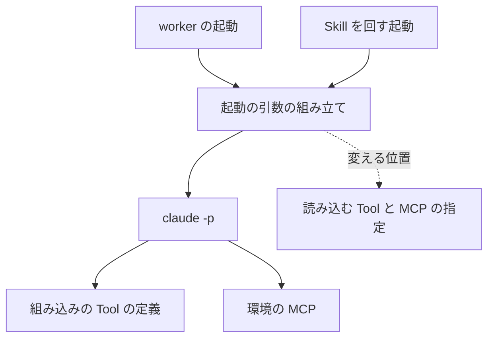
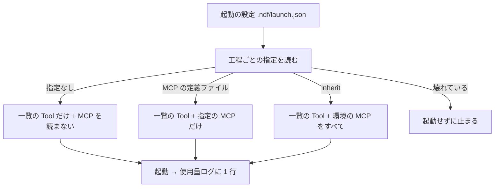
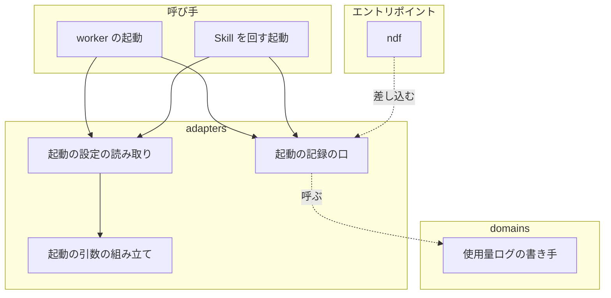
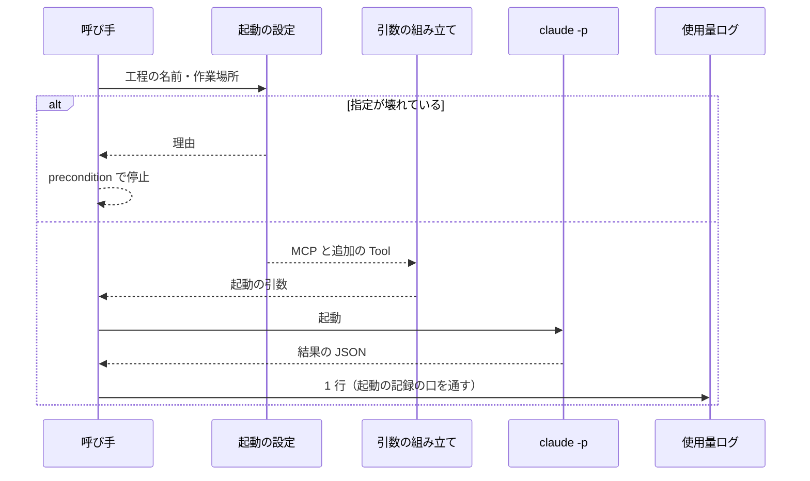

# claude -p の full の起動: 使う Tool と MCP の定義だけを読んで起動できる（#1959）

工程を流す `claude -p` が、使わない Tool と MCP の定義を毎回読み直して費用がかかっている。full の起動は、読み込む組み込みの Tool を一覧に絞り、MCP の読み込みを止める。MCP や追加の Tool が要る工程は、利用先のリポジトリの設定（`.ndf/launch.json`、起動の設定）で指定する。実測の値と採らなかった案は「今の姿」と「決定の記録」にある。

## 今の姿

何が起きたか・目的・受け入れ条件は要求仕様（[issue-1959-requirements.md](./issue-1959-requirements.md)、正は #1959 の本文）にある。この文書は「どう解くか」と「なぜその解き方か」だけを書く。



- 2 つの起動は、どちらも起動の引数の組み立て（`adapters/claude.py`）を通る。許す Tool の一覧は渡すが、読み込む Tool と MCP は絞っていない
- 使用量ログ（使ったトークンを 1 起動 1 行で追記する記録）へ `claude -p` の行を書く関数はあるが、呼ぶ所が無い

### 実測: 読み込む定義の量

2026-11-26 に Claude Code 2.1.332 を、今の full と同じ引数と、引数を足した形で起動して比べた。入力は同じ短い依頼で、値は文脈のトークン数である。

| 起動の形 | 1 回目の応答の前 | MCP の接続の後 | `mcp__` の Tool |
| --- | ---: | ---: | ---: |
| 今の full | 29,851〜29,921 | 32,995 | 38 個（claude.ai のコネクタ 5 つ） |
| `--tools` で一覧に絞る | 24,401〜24,471 | 27,533 | 38 個 |
| `--tools` と `--strict-mcp-config` | 24,401〜24,471 | 24,637 | 0 個 |

- 1 回目で 5,450、MCP の接続の後で約 8,400 トークン減る
- **MCP は最初の応答の後に接続する。** 起動の最初の記録（stream-json の `system/init`）には、今の full でも `mcp__` の Tool が 1 件も出ない。`mcp_servers` が `pending` で並ぶ
- `--disallowed-tools "mcp__*"` は Tool を外すが、MCP のサーバの指示文が文脈に残る
- 利用者の設定・プラグイン・Skill・サブエージェントの数は、3 つの形で同じだった（Skill 79・サブエージェント 17）

### 実測: 工程が呼んだ MCP の Tool

2026-11-26 に、直近 30 日の会話の記録のうち非対話の起動（`sdk-cli`）を、最初の入力で工程に分けて数えた。このマシンの記録だけで、対象のリポジトリは ai-plugins と非公開の数件である。

11 系の worker（`ndf worker run`。2026-11-24〜11-26。222 会話）:

| 作業 | 会話数 | 作業 | 会話数 |
| --- | ---: | --- | ---: |
| design | 39 | release | 13 |
| requirements | 24 | backlog-refinement | 13 |
| worktree | 21 | retrospective | 13 |
| impl | 19 | quality-gates | 13 |
| implementation-plan | 16 | release-verification | 12 |
| design-detail | 14 | fix-base | 9 |
| fix-push | 7 | plan-to-spec | 7 |
| ci-fix | 2 | — | — |

**どの作業も、呼んだ MCP の Tool は 0 件である。**

10 系の起動（2026-10-30〜11-18。今は無い起動の形）の記録:

| 工程 | 会話数 | MCP を呼んだ会話 | 呼んだ Tool と回数 |
| --- | ---: | ---: | --- |
| design の Skill | 277 | 2 | claude.ai の Claude Docs の `guide` 2・`read` 1 |
| requirements-design の Skill | 209 | 2 | 同 `guide` 1・`read` 2 |
| ほかの Skill（backlog-refinement・document-rebuild・plan-to-spec・release-verification・retrospective・restart） | 555 | 0 | — |
| 実装 | 235 | 77 | serena の 9 種類。`find_symbol` 145・`get_symbols_overview` 122・`replace_content` 91 ほか |

- Claude Docs の呼び出しは、課題が claude.ai の文書を指していた 2 件の課題（#2172・#2173）の設計と要求である
- serena は利用者が入れていたプラグインの MCP で、2026-11-26 の `claude mcp list` と `claude plugin list` には無い
- 非対話の起動が呼んだ組み込みの Tool のうち、今の一覧に無いものは `TaskStop`・`ScheduleWakeup`・`ListAgents` である

## 文脈と制約

- 対象は `claude -p` の full の起動だけである。最小構成の起動（判定・相手役・修正担当）は、すでに MCP を読まない
- `--tools` は組み込みの Tool だけを絞る。MCP の Tool には効かない
- MCP の Tool を呼ぶ許可は、利用者とリポジトリの Claude Code の設定（`permissions`）が決める。full の起動は `acceptEdits` なので、許可の無い MCP の Tool は今も拒否される
- claude.ai のコネクタ（Claude Docs など）は接続の定義がファイルに無く、`--mcp-config` で渡し直せない
- 利用者の設定ファイルは書き換えない

## 解き方の全体像



- full の起動は、指定の無い工程では `--tools` の一覧と `--strict-mcp-config` を付ける
- 利用先は `.ndf/launch.json` で、工程ごとに MCP と追加の Tool を指定する
- 起動 1 回ごとに、工程・使用量・費用を使用量ログへ 1 行書く

## ドメインモデル

### コンテキスト

| コンテキスト | 何の語が 1 つの意味に決まるか |
| --- | --- |
| 担当の起動（`ndf-agent-cli`） | AI の CLI を起動する引数と、起動の設定 |
| 文脈（`ndf-context`） | 使用量ログの行 |

起動が供給者、使用量ログが顧客の関係（顧客 / 供給者）である。ログは起動の「終わった」だけを受ける。

### 集約

| 集約 | オーナー（書き換えてよいもの） | 根 | エンティティ | 値オブジェクト |
| --- | --- | --- | --- | --- |
| 起動の設定 | リポジトリの人（NDF は読むだけ） | 設定のファイル | 工程の指定 | MCP の指定・追加の Tool |
| 使用量ログ | 使用量ログの書き手 | 行 | — | 使用量・費用 |

### 不変条件

| # | 集約 | 条件 | 破れたときの扱い |
| --- | --- | --- | --- |
| I1 | 起動の設定 | 指定の無い工程の full の起動は、MCP を 1 つも読まない | — |
| I2 | 起動の設定 | 読めない・形が違う・指す定義ファイルが無い指定では起動しない | 理由と直す場所を示し、前提の不足（`precondition`）で止まる |
| I3 | 起動の設定 | NDF は起動の設定と利用者の設定ファイルを書き換えない | — |
| I4 | 使用量ログ | full の起動 1 回につき 1 行 | 書けなければ警告を出し、工程は止めない |

### ドメインイベント

| # | イベント | 発生元 | 受け手 |
| --- | --- | --- | --- |
| E1 | MCP の利用回数を数えた | この設計の実測 | 決定 3 |
| E2 | 工程が使う MCP を決めた | 起動の設定の読み取り | 起動の引数の組み立て |
| E3 | 絞った定義で工程を起動した | worker・Skill を回す起動 | プランのステップの結果 |
| E4 | 起動の使用量を記録した | 起動の呼び手 | 使用量ログ |
| E5 | 前後の費用を比べて残した | リリース後の確認 | 確定仕様 |

## 構成要素

| 要素 | 責務 |
| --- | --- |
| 起動の設定の読み取り（新設） | `.ndf/launch.json` を読んで確かめ、工程の名前から MCP と追加の Tool の指定を返す |
| 起動の引数の組み立て（変更） | full の起動に `--tools` を付け、指定に応じて `--strict-mcp-config`・`--mcp-config` を付ける |
| worker の起動（変更） | 作業の名前と作業場所を渡して指定を引き、起動の後に使用量ログの行を書かせる |
| Skill を回す起動（変更） | 工程の名前で同じことをする |
| 起動の記録の口（新設） | 下の層の起動から使用量ログの書き手を呼べるよう、エントリポイントで差し込む |
| 使用量ログの書き手（変更） | `claude -p` の行を書く。行の欄を足す |



層は下から contracts・adapters・core・progress・domains の順で、下の層は上の層を読まない。起動の記録の口は、中継の確かめ（`set_relay_checks`）と同じ差し込みの形にする。

## データ構造

### 起動の設定（`.ndf/launch.json`）

置かなくてよい。スキーマは `contracts/schemas/ndf-settings/launch.schema.json`（新設）。

```json
{
  "version": 1,
  "steps": {
    "*": {"tools": ["LSP"]},
    "design": {"mcp": "inherit"},
    "impl": {"mcp": [".ndf/mcp/search.json"]}
  }
}
```

| キー | 型 | 意味 |
| --- | --- | --- |
| `steps.<工程>` | オブジェクト | `<工程>` は worker の作業の名前か Skill の名前。`*` はすべての工程 |
| `mcp` | `"inherit"` か、パスの空でない配列 | 配列は Claude Code の `--mcp-config` の形（`mcpServers`）のファイルで、リポジトリの根からの相対パス。`"inherit"` は環境の MCP をすべて読む |
| `tools` | 文字列の配列 | 一覧に足す組み込みの Tool の名前 |

- 工程の行にあるキーは、`*` の行の同じキーを置き換える。無いキーは `*` の行を使う
- 工程の名前が実在するかは確かめない。利用先の独自の Skill の名前も書けるようにするためである

### 使用量ログの行に足す欄

`launch_id`・`step`・`run_id`・`session_id`・`model`・`model_usage`・`seconds`・`repo` は今のスキーマにある。足すのは `session_cost_usd`（結果の `total_cost_usd`）の 1 つである。この値は同じ会話の起動の累計なので、費用を出す側は会話ごとに差を取る。

## 入出力のコントラクト

| 項目 | 内容 |
| --- | --- |
| 名前 | full の起動の引数 |
| 入力 | 工程の名前・作業場所 |
| 出力 | 指定なし: `--tools <一覧> --allowed-tools <一覧> --strict-mcp-config`。配列: それに `--mcp-config <絶対パス>...`。`inherit`: `--strict-mcp-config` を付けない |
| 失敗の形 | 指定が壊れていれば起動せず、`precondition` の停止。文に `.ndf/launch.json` と壊れた箇所を載せる |
| 互換性 | 利用先が工程の中で MCP を使っていた場合は、指定を足すまで使えなくなる。指定なしで今と同じ形に戻すには `{"version":1,"steps":{"*":{"mcp":"inherit"}}}` |

一覧は、今の 13 個に `TaskStop`（背景の作業を止める）と `NotebookEdit`（ノートブックの編集）を足した 15 個とする。

## 処理の流れ



## 決定の記録

### 決定 1: 使わない定義を読まないため、full の起動は Tool を一覧に絞り MCP の読み込みを止める

- **質問**: 要求の未決。MCP の読み込みを止めて一覧に絞るか、工程ごとに要る MCP の設定だけを渡すか
- **選んだ案**: 両方を重ねる。指定の無い工程は `--tools` と `--strict-mcp-config` で起動し、指定のある工程だけが MCP を読む
- 採らなかった案: `--disallowed-tools "mcp__*"` で MCP の Tool を外す（サーバの指示文が文脈に残る）
- 採らなかった案: `--tools` だけを足す（MCP の接続の後の約 2,900 トークンが残る）
- 採らなかった案: 最小構成（`--setting-sources ""`）へ寄せる（利用者の設定・プラグイン・hook が読まれず、受け入れ条件 6 に反する）
- **代償**: 工程の中で MCP を使っていた利用先は、指定を足すまで使えない
- 作り方: ライブラリやサービスを使う
- 比べた候補: STD1 / STD2 / PRD1
- 根拠: Value 2 / Value 12（MVV バージョン 11）

### 決定 2: claude.ai のコネクタも使い続けられるよう、MCP の指定は定義ファイルの列か「環境をすべて読む」にする

- **質問**: 要求の未決。利用先が MCP を指定する場所と形
- **選んだ案**: 場所は `.ndf/launch.json` の工程ごとの行。形は `--mcp-config` に渡す定義ファイルの列か `"inherit"`
- 採らなかった案: サーバの名前で指定し、`allowedMcpServers` を `--settings` で足す（許可の一覧は設定の層をまたいで足し合わさるため利用者の絞り込みを広げうる。表示名に空白のあるコネクタは名前で許可できない）
- 採らなかった案: 名前で指定し、ほかのサーバを拒否の一覧に並べる（起動のたびにサーバの一覧を読む必要がある。拒否したサーバ以外の指示文は残る）
- 採らなかった案: 環境変数で指定する（工程ごとの指定をリポジトリで共有できない）
- **代償**: コネクタを使う工程は `"inherit"` になり、その工程では削減が `--tools` の分だけになる。1 つのコネクタだけを選べない
- 作り方: 自前で作る・標準に倣う
- 比べた候補: STD1 / STD3
- 根拠: Value 4（MVV バージョン 11）

### 決定 3: 実測に合わせるため、NDF の既定はどの工程にも MCP を指定しない

- **質問**: 受け入れ条件 4 の「使うと分かった工程」はどれか
- **選んだ案**: 今の起動の形（11 系の worker）の記録で 1 回でも呼ばれた工程を「使う」とする。結果は 0 件なので、NDF の既定にも ai-plugins の設定にも指定を置かない。実装の完了判定で数え直し、呼んだ工程があればこのリポジトリの `.ndf/launch.json` に指定を足す
- 採らなかった案: 10 系の記録の工程（design・requirements・実装）を `"inherit"` にする（呼んだのは今は入っていないプラグインと、2 件の課題が指した文書だけで、費用の大きい工程の削減がほぼ無くなる）
- 採らなかった案: claude.ai の Claude Docs を NDF の既定で読ませる（定義ファイルで渡せず、利用者のアカウントに依存する）
- **代償**: 課題が claude.ai の文書を指す場合、指定が無いと worker はその文書を読めない
- 根拠: Value 2 / Value 13（MVV バージョン 11）

### 決定 4: 許可の持ち主を増やさないため、NDF は MCP の読み込みだけを決め、呼ぶ許可は Claude Code の設定に任せる

- **質問**: 指定した MCP の Tool を、NDF が `--allowed-tools` にも足すか
- **選んだ案**: 足さない。許可は今と同じく利用者とリポジトリの `permissions` が決める
- 採らなかった案: 指定したサーバを自動で許可する（リポジトリの設定の 1 行で、尋ねずに呼べる操作が増える）
- **代償**: 指定しても `permissions` に無い Tool は拒否される。手順書にこのことを書く
- 根拠: C2 / Value 1（MVV バージョン 11）

### 決定 5: 工程ができることを保つため、利用先が組み込みの Tool も足せるようにする

- **質問**: `--tools` で消える組み込みの Tool（`LSP` など）をどう扱うか
- **選んだ案**: 一覧に `TaskStop` と `NotebookEdit` を足し、ほかは起動の設定の `tools` で足す
- 採らなかった案: 記録で呼ばれた Tool をすべて一覧に入れる（`ScheduleWakeup` は非対話の起動では次の回が無い）
- 採らなかった案: 一覧を固定して足す口を持たない（`LSP` などを使う利用先が工程の中で使えなくなる）
- **代償**: Claude Code に新しい Tool が増えても、一覧に足すまで工程では使えない
- 根拠: Value 4（MVV バージョン 11）

### 決定 6: 費用を前後で比べられるよう、起動の呼び手が使用量ログへ 1 行書く

- **質問**: `claude -p` の使用量を、どこで、何を記録するか
- **選んだ案**: worker と Skill を回す起動が、結果を受けた後に、差し込んだ書き手で 1 行書く。直す前の値は会話の記録の実測（この文書の表）と、受け入れ条件 3 の確認で取る同じ入力の 2 通りの起動にする
- 採らなかった案: 起動の共通の関数の中で必ず書く（工程の名前と実行の識別子を下の層へ渡す必要があり、判定の起動まで形が変わる。全部の起動の記録は #2944 が足す）
- 採らなかった案: 会話の記録を後から読んで集計する（記録が消えると比べられず、工程との対応を毎回推定することになる）
- **代償**: 直す前の行は使用量ログに無い
- 作り方: 自前で作る
- 比べた候補: PRD1 / LIB1
- 根拠: Value 13 / Value 11（MVV バージョン 11）

## 影響と危険

- **働く範囲**: NDF を入れたすべてのリポジトリの、プランの worker と Skill を回す起動に効く。対話のセッションとサブエージェントの起動には効かない
- **プロジェクトごとに違うもの**: 工程で使う MCP と追加の Tool。`.ndf/launch.json` で受ける
- **当たるモード**: プランで worker か Skill を回すすべてのモード
- **壊れうる箇所**:
  - 工程の中で MCP を使っていた利用先。リリースの変更点に、戻し方の 1 行を載せる
  - 起動の設定は、作業場所のブランチのファイルを読む。定義ファイルはコマンドを指定できるため、信用の水準は `.ndf/supervise.json` のテストのコマンドと同じである
  - `--tools` に無い Tool を本文で指示する Skill。実装で `plugins/ndf/skills/` の本文を検索し、工程の中で使うものがあれば一覧に足す
  - #2944 と同じファイル（起動の引数・使用量ログ・起動の設定）を触る。#1959 を先に実装する

### 代表のリポジトリでの振る舞い

| 代表のリポジトリ | 設定の要点 | 直した後に起きること | この種類で扱えなくなること |
| --- | --- | --- | --- |
| Web サービス | 社内の検索やデータベースの MCP を使うことがある | 指定した工程だけが読む。指定が無ければ使えない | 無し |
| モバイルアプリ | シミュレータの MCP や `LSP` を使うことがある | `mcp` と `tools` で指定する | 無し |
| 業務文書だけ | claude.ai などのコネクタで文書を読むことがある | `"mcp": "inherit"` を指定する | 無し |

### このリポジトリだけの事情

| 値 | 置く所 | 持つ Issue |
| --- | --- | --- |
| 工程で使う MCP は無し（決定 3） | 置かない（`.ndf/launch.json` を作らない） | #1959 |

## 用語

| 用語 | 意味 | 用語集への反映 |
| --- | --- | --- |
| 起動の設定 | NDF が AI を起動するときの、リポジトリごとの指定を持つ `.ndf/launch.json`。工程ごとの MCP と追加の Tool を持つ | 追加 |

## テスト設計

| 受け入れ条件・不変条件 | どの振る舞いで縛るか | どう壊したら落ちるべきか |
| --- | --- | --- |
| 条件 1 | 「実測: 工程が呼んだ MCP の Tool」の表が確定仕様に移る | テストは置かない（記録） |
| 条件 2・I1 | 指定の無い工程の full の起動の引数に `--tools` と `--strict-mcp-config` がある | どちらかを外すと落ちる |
| 条件 2 | 手動: 実際の起動の `system/init` の `mcp_servers` が空で、2 回目以降の応答でも `mcp__` の Tool が無い | `mcp__` の Tool の有無だけを最初の記録で見ると、今の形でも通ってしまう |
| 条件 3・E4 | full の起動 1 回で、工程・使用量・費用を持つ行が 1 つ増える | 書き手を差し込まないと落ちる |
| 条件 3 | 手動: 同じ入力で直す前後を起動し、文脈と費用を確定仕様に残す | — |
| 条件 4・5 | 定義ファイルを指定した工程の引数に `--mcp-config` があり、`inherit` の工程には `--strict-mcp-config` が無い | 指定を読み捨てると落ちる |
| 条件 5・I2 | JSON でない・形が違う・定義ファイルが無い指定で、起動の呼び出しが 0 回のまま停止する | 壊れた指定を空として扱うと落ちる |
| 条件 6 | 引数に `--setting-sources` が無く、一覧に `Skill`・`Agent`・`Edit`・`Write` がある。手動で Skill とサブエージェントの数を比べる | 最小構成へ寄せると落ちる |
| 条件 7 | 手動: MCP の無い設定ディレクトリで起動して終わる | — |
| 条件 8・I3 | 起動の前後で設定のファイルが変わらない | 指定を設定ファイルへ書く実装にすると落ちる |
| I4 | 使用量ログへ書けないとき、工程の結果は変わらず警告が出る | 例外を外へ出すと落ちる |

## 設計の結果

| 課題 | 扱い | 統合先 | 触るファイル |
| --- | --- | --- | --- |
| #1959 | 実装する | — | `plugins/ndf/src/ndf/adapters/claude.py`、`plugins/ndf/src/ndf/adapters/launch_settings.py`（新設）、`plugins/ndf/src/ndf/core/worker.py`、`plugins/ndf/src/ndf/progress/invoke.py`、`plugins/ndf/src/ndf/__main__.py`、`plugins/ndf/src/ndf/domains/records/usage.py`、`plugins/ndf/contracts/schemas/ndf-settings/launch.schema.json`（新設）、`plugins/ndf/contracts/schemas/internal/usage.schema.json`、`plugins/ndf/contracts/domains/ndf-files.json`、`plugins/ndf/contracts/domains/entrypoints.json`、`plugins/ndf/contracts/domains/cli-floors.json`、`plugins/ndf/skills/worktree/references/ndf-settings.md`、`plugins/ndf/tests/adapters/test_claude_args.py`、`plugins/ndf/tests/adapters/test_launch_settings.py`（新設）、`plugins/ndf/tests/progress/test_invoke.py`、`plugins/ndf/tests/core/test_worker_launch.py`（新設）、`plugins/ndf/tests/domains/records/test_usage.py` |

## 未確認のまま残ること

| 項目 | 内容 |
| --- | --- |
| 1 工程あたりの費用の下がり幅 | 往復の回数に依る。リリース後の工程の使用量ログと、直す前の実測を比べて分かる |
| 削減の目標値 | 要求に合否の値が無い。前後の値を残すだけにする |
| 利用先の MCP の使い方 | このマシンの記録からは分からない。リリース後の不具合の報告で分かる |
| `inherit` の工程で最初の応答の前に MCP の接続が間に合うか | Claude Code は非対話でも接続を待たないことがある。2.1.332 では 2 回目の応答から使えた |

## 外部の調査

| 種類 | 調べるか | 理由 |
| --- | --- | --- |
| 標準・仕様 | 調べる | 読み込む Tool と MCP の指定は Claude Code の CLI と設定が定める |
| 主要な製品 | 調べる | 非対話の起動で MCP を絞る既存の形を比べる |
| ライブラリとサービス | 調べる | 使用量の記録に既存の仕組みを使えるかを確かめる |

### 標準・仕様

| # | 標準・仕様 | 何を定めているか | 設計への反映 | 出典 |
| --- | --- | --- | --- | --- |
| STD1 | Claude Code の CLI の引数 | `--tools` は組み込みの Tool だけを絞り MCP に効かない。`--strict-mcp-config` は `.mcp.json`・利用者の設定・プラグインの MCP を読まない。`--mcp-config` の `-p` は接続を待つ | 決定 1・2 | https://code.claude.com/docs/en/cli-reference （2026-11-26） |
| STD2 | Claude Code の Tool の後読み | MCP の Tool は名前だけを先に読み、定義は後から読む | 削減の見積は実測で行う | https://code.claude.com/docs/en/mcp （2026-11-26） |
| STD3 | 管理された MCP の設定 | 許可の一覧は設定の層をまたいで足し合わさる。許可の `serverName` は英数字・ハイフン・下線だけ | 決定 2 | https://code.claude.com/docs/en/managed-mcp （2026-11-26） |

### 主要な製品

| # | 製品 | どう解いているか | 設計への反映 | 出典 |
| --- | --- | --- | --- | --- |
| PRD1 | claude-code-action（GitHub Actions） | 非対話の起動に `--mcp-config` と許す Tool の一覧を引数で渡す。MCP の Tool は明示の許可が要る | 決定 1・4 | https://code.claude.com/docs/en/github-actions （2026-11-26。検索の要約で確かめた） |
| PRD2 | Codex CLI のカスタムエージェント | エージェントの定義ごとに `mcp_servers` を持つ。省けば親を継ぐ | 工程ごとの指定という単位の参考 | https://developers.openai.com/codex/subagents.md （2026-11-26。検索の要約） |

### ライブラリとサービス

| # | 候補 | バージョン | ライセンス | 最後のリリースの日付 | 終了のアナウンス | 要件を満たすか | 出典 |
| --- | --- | --- | --- | --- | --- | --- | --- |
| LIB1 | ccusage（会話の記録から使用量と費用を集計する CLI。npm） | 20.1.2 | MIT | 2026-11-25（登録簿の最終更新） | 無し（`npm view` に非推奨の表示が無い） | 会話の記録の集計はできるが、NDF の工程の名前と実行の識別子を持てない。使わない | `npm view ccusage version license time.modified deprecated`（2026-11-26） |

### 確かめられなかったこと

| 対象 | 試した手段 | 結果と理由 |
| --- | --- | --- |
| LIB1 が起動ごとの工程の名前を受け取れるか | 登録簿の情報だけを読んだ | 会話の記録を読む形のため持てないと判断した。本文の仕様は取得していない |
| claude.ai のコネクタを定義ファイルで渡す方法 | 文書（STD1・STD3）を読んだ | 記述が見つからない |

調べた量: 候補 6 件・取得の試み 9 回。
