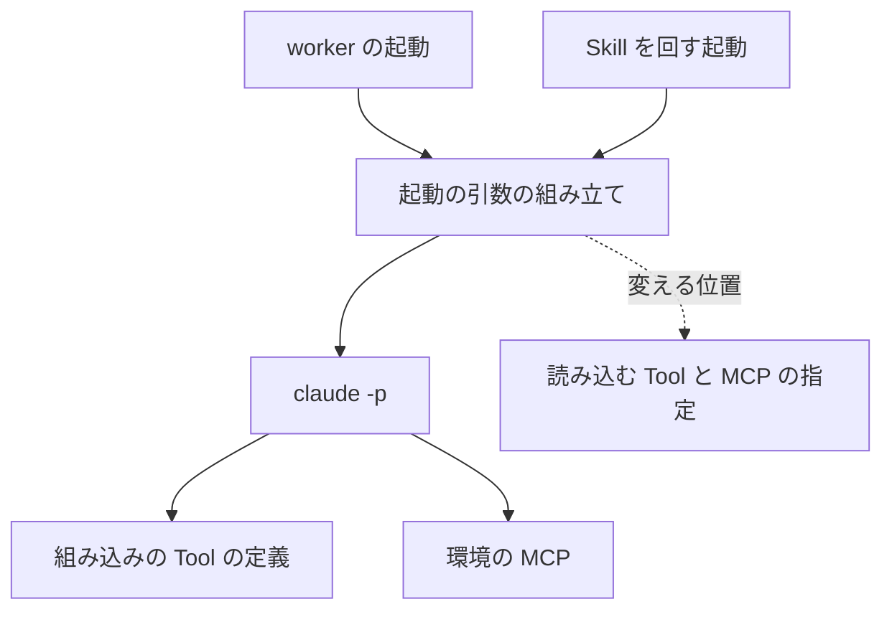
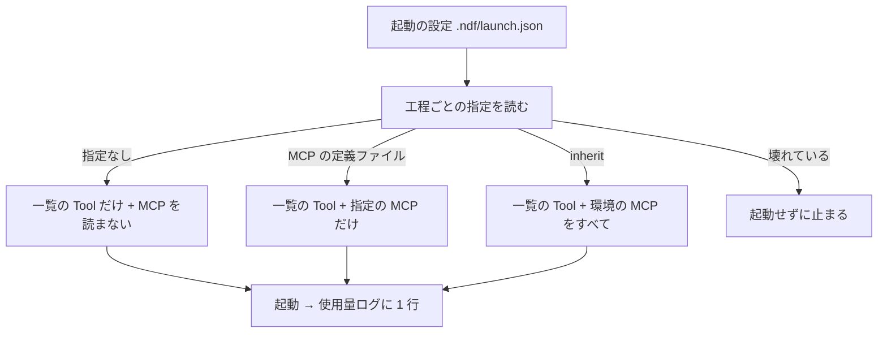
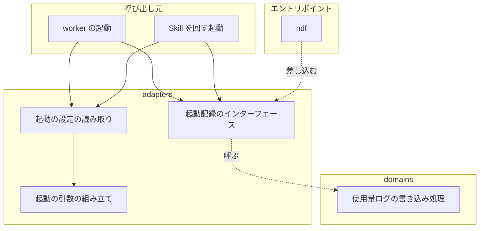
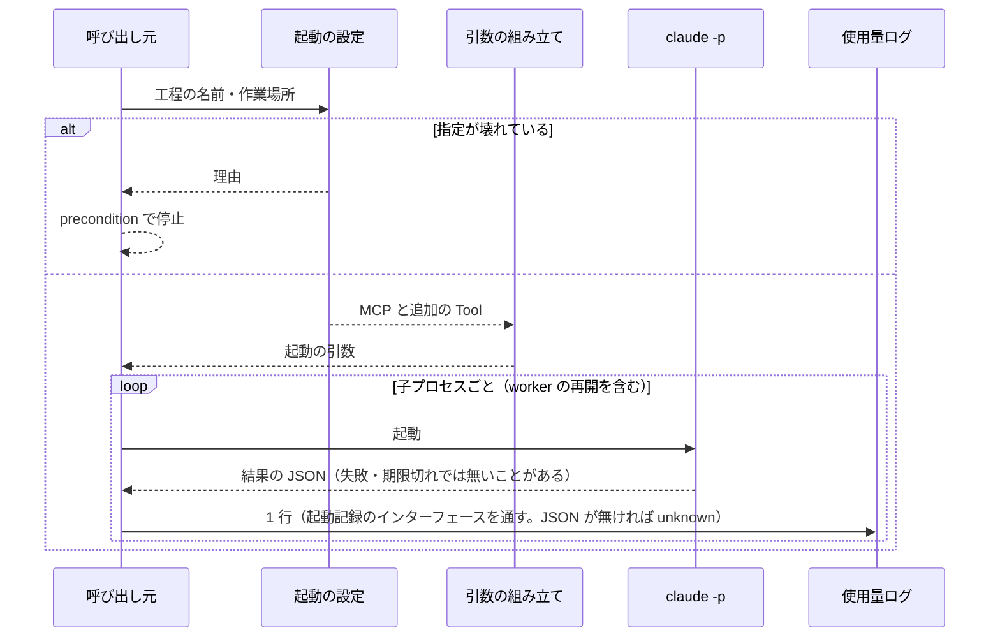

# claude -p の full の起動: 使う Tool と MCP の定義だけを読んで起動できる（#1959）

工程を流す `claude -p` は、使わない Tool と MCP の定義を毎回読み直し、その分の費用がかかっている。full の起動は、読み込む組み込みの Tool を一覧に絞り、MCP の読み込みを止める。MCP や追加の Tool が要る工程は、利用先のリポジトリの設定（`.ndf/launch.json`、起動の設定）で指定する。実測の値と採らなかった案は「今の姿」と「決定の記録」にある。

## 今の姿

何が起きたか・目的・受け入れ条件は要求仕様（[issue-1959-requirements.md](./issue-1959-requirements.md)、正は #1959 の本文）にある。この文書は「どう解くか」と「なぜその解き方か」だけを書く。



- 2 つの起動は、どちらも起動の引数の組み立て（`adapters/claude.py`）を通る。許す Tool の一覧は渡すが、読み込む Tool と MCP は絞っていない
- 使用量ログ（使ったトークンを 1 起動 1 行で追記する記録）へ `claude -p` の行を書く関数はあるが、呼ぶ所が無い

### 実測: 読み込む定義の量

2026-11-26 に Claude Code 2.1.332 を、今の full と同じ引数と、引数を足した形で起動して比べた。入力は同じ短い依頼で、値は文脈のトークン数である。

| 起動の形 | 1 回目の応答の前 | MCP の接続の後 | `mcp__` の Tool |
| --- | ---: | ---: | ---: |
| 今の full | 29,851〜29,921 | 32,995 | 38 個（claude.ai のコネクタ 5 つ） |
| `--tools` で一覧に絞る | 24,401〜24,471 | 27,533 | 38 個 |
| `--tools` と `--strict-mcp-config` | 24,401〜24,471 | 24,637 | 0 個 |

- 1 回目で 5,450、MCP の接続の後で約 8,400 トークン減る
- **MCP は最初の応答の後に接続する。** 起動の最初の記録（stream-json の `system/init`）には、今の full でも `mcp__` の Tool が 1 件も出ない。`mcp_servers` が `pending` で並ぶ
- `--disallowed-tools "mcp__*"` は Tool を外すが、MCP のサーバの指示文が文脈に残る
- 利用者の設定・プラグイン・Skill・サブエージェントの数は、3 つの形で同じだった（Skill 79・サブエージェント 17）

### 実測: 工程が呼んだ MCP の Tool

2026-11-26 に、直近 30 日の会話の記録のうち非対話の起動（`sdk-cli`）を、最初の入力で工程に分けて数えた。このマシンの記録だけで、対象のリポジトリは ai-plugins と非公開の数件である。

NDF 11 系の worker（`ndf worker run`。2026-11-24〜11-26。222 会話）:

| 作業 | 会話数 | 作業 | 会話数 |
| --- | ---: | --- | ---: |
| design | 39 | release | 13 |
| requirements | 24 | backlog-refinement | 13 |
| worktree | 21 | retrospective | 13 |
| impl | 19 | quality-gates | 13 |
| implementation-plan | 16 | release-verification | 12 |
| design-detail | 14 | fix-base | 9 |
| fix-push | 7 | plan-to-spec | 7 |
| ci-fix | 2 | — | — |

**どの作業も、呼んだ MCP の Tool は 0 件である。**

NDF 10 系の起動（2026-10-30〜11-18。今は無い起動の形）の記録:

| 工程 | 会話数 | MCP を呼んだ会話 | 呼んだ Tool と回数 |
| --- | ---: | ---: | --- |
| design の Skill | 277 | 2 | claude.ai の Claude Docs の `guide` 2・`read` 1 |
| requirements-design の Skill | 209 | 2 | 同 `guide` 1・`read` 2 |
| ほかの Skill（backlog-refinement・document-rebuild・plan-to-spec・release-verification・retrospective・restart） | 555 | 0 | — |
| 実装 | 235 | 77 | serena の 9 種類。`find_symbol` 145・`get_symbols_overview` 122・`replace_content` 91 ほか |

- Claude Docs の呼び出しは、課題が claude.ai の文書を指していた 2 件の課題（#2172・#2173）の設計と要求である
- serena は利用者が入れていたプラグインの MCP で、2026-11-26 の `claude mcp list` と `claude plugin list` には無い
- 非対話の起動が呼んだ組み込みの Tool のうち、今の一覧に無いものは `TaskStop`・`ScheduleWakeup`・`ListAgents` である
- `ListAgents` は今の起動の形でも呼ばれている。文書を組み直す worker（`ndf worker run`。NDF 11.0.36、Claude Code 2.1.332）の 2 会話が 1 回ずつ呼んだ（2026-11-26 に会話の記録で確認）

もう一方の入口である Skill を回す起動（`progress/invoke.py`）は、件数を数えられる記録が無い。

- 同梱の工程の定義とプランのテンプレートに、この入口（`ndf.skill`）を呼ぶものは無い（2026-11-26 に `git grep -n 'ndf\.skill' -- plugins` で検索し、当たったのは `progress/invoke.py` だけ）
- このマシンの直近 30 日の非対話の会話の記録に、この入口の起動（最初の入力が `/ndf:<名前>` と `入力（JSON）:`）は 0 件だった

そのため、この入口については「MCP を使っていない」ではなく「記録が無い」と扱う。

## 文脈と制約

- 対象は `claude -p` の full の起動（要求仕様の「全部入り」）だけである。最小構成の起動（判定・相手役・修正担当）は、すでに MCP を読まない
- `--tools` は組み込みの Tool だけを絞る。MCP の Tool には効かない
- MCP の Tool を呼ぶ許可は、利用者とリポジトリの Claude Code の設定（`permissions`）が決める。full の起動は `acceptEdits` なので、許可の無い MCP の Tool は今も拒否される
- claude.ai のコネクタ（Claude Docs など）は接続の定義がファイルに無く、`--mcp-config` で渡し直せない
- 利用者の設定ファイルは書き換えない

## 解き方の全体像



- full の起動は、指定の無い工程では `--tools` の一覧と `--strict-mcp-config` を付ける
- 利用先は `.ndf/launch.json` で、工程ごとに MCP と追加の Tool を指定する
- 起動 1 回ごとに、工程・使用量・費用を使用量ログへ 1 行書く

## ドメインモデル

### コンテキスト

コンテキストは、語の意味が 1 つに決まる範囲である。名前は用語集（[docs/glossary.md](../docs/glossary.md)）の区分に合わせる。

| コンテキスト | 何の語が 1 つの意味に決まるか |
| --- | --- |
| AI の CLI の起動（`ndf-agent-cli`） | AI の CLI を起動する引数と、起動の設定 |
| 文脈と使用量（`ndf-context`。「文脈」は AI が読む入力の量を指す） | 使用量ログの行 |

起動する側が行を作って渡し、使用量ログは受け取った行を追記する（DDD の顧客 / 供給者の関係で、起動が供給者）。渡すのは、`claude -p` の子プロセスが終わるたびの 1 行である。成功した起動だけでなく、失敗・期限切れ・回答の無い起動も渡す。行の中身は「使用量ログの行」に書く。

### 集約

| 集約 | オーナー（書き換えてよいもの） | 根 | エンティティ | 値オブジェクト |
| --- | --- | --- | --- | --- |
| 起動の設定 | リポジトリの人（NDF は読むだけ） | 設定のファイル | 工程の指定 | MCP の指定・追加の Tool |
| 使用量ログ | 使用量ログの書き込み処理 | 行 | — | 使用量・費用 |

### 不変条件

| # | 集約 | 条件 | 破れたときの扱い |
| --- | --- | --- | --- |
| I1 | 起動の設定 | 指定の無い工程の full の起動は、MCP を 1 つも読まない | — |
| I2 | 起動の設定 | 読めない・形が違う指定では起動しない。指す定義ファイルが、無い・リポジトリの外を指す・JSON でない・MCP サーバの定義の形でない場合も起動しない | 理由と直す場所を示し、前提の不足（`precondition`）で止まる |
| I3 | 起動の設定 | NDF は起動の設定と利用者の設定ファイルを書き換えない | — |
| I4 | 使用量ログ | full の起動で動かした `claude -p` の子プロセス 1 つにつき 1 行。会話の再開も 1 行。同じ記録の打ち直しで行が重なっても、`launch_id` で 1 回に数える | 書けなければ警告を出し、工程は止めない |

### ドメインイベント

| # | イベント | 発生元 | 受け手 |
| --- | --- | --- | --- |
| E1 | MCP の利用回数を数えた | この設計の実測 | 決定 3 |
| E2 | 工程が使う MCP を決めた | 起動の設定の読み取り | 起動の引数の組み立て |
| E3 | 絞った定義で工程を起動した | worker・Skill を回す起動 | プランのステップの結果 |
| E4 | 起動の使用量を記録した | 起動の呼び出し元 | 使用量ログ |
| E5 | 前後の費用を比べて残した | リリース後の確認 | 確定仕様 |

## 構成要素

| 要素 | 責務 |
| --- | --- |
| 起動の設定の読み取り（新設） | `.ndf/launch.json` と、工程が指す MCP の定義ファイルを読んで検証し、工程の名前から MCP と追加の Tool の指定を返す |
| 起動の引数の組み立て（変更） | full の起動に `--tools` を付け、指定に応じて `--strict-mcp-config`・`--mcp-config` を付ける。起動の結果に、使用量・モデルごとの使用量・累計の費用を持たせて呼び出し元へ返す |
| 前の行の引き継ぎ（変更。worker の起動の再開ループ） | 使用量ログに書けた行のうち、累計の費用を持つ最後の行の `session_seq`・`session_cost_usd`・`at` を持ち、次の起動の記録に渡す |
| プランの実行（変更） | `run_id`・ステップの id・ステップを実行した何回目かを、環境変数で子へ渡す。回数はステップごとに数える |
| worker の起動（変更） | 作業の名前と作業場所を渡して指定を取得し、起動の後に使用量ログの行を書かせる |
| Skill を回す起動（変更） | 工程の名前で同じことをする |
| 起動記録のインターフェース（新設） | 呼び出し元（worker の起動と Skill を回す起動）から、上の層にある使用量ログの書き込み処理を呼べるよう、エントリポイントで差し込む |
| 使用量ログの書き込み処理（変更） | `claude -p` の行を書く。行の欄を足す。呼び出し元が渡す前の行の値から起動で増えた費用を求め、費用のジャーナルへ足す。使用量ログは読まない |
| 起動の費用を求める関数（新設） | 同じ会話の行の累計から、起動 1 回の費用と区間の合計を求める。ジャーナルへの追記と集計が同じ関数を使う |
| ステータスラインの費用の表示（変更） | ジャーナルの同じ `launch_id` を 1 回だけ数え、1 時間の境をまたぐ区間を別に表示する |



層は下から contracts・adapters・core・progress・domains の順で、下の層は上の層を読まない。起動記録のインターフェースは、中継のチェック（`set_relay_checks`）と同じ差し込みの形にする。

## データ構造

### 起動の設定（`.ndf/launch.json`）

置かなくてよい。スキーマは `contracts/schemas/ndf-settings/launch.schema.json`（新設）。

```json
{
  "version": 1,
  "steps": {
    "*": {"tools": ["LSP"]},
    "design": {"mcp": "inherit"},
    "impl": {"mcp": [".ndf/mcp/search.json"]}
  }
}
```

| キー | 型 | 意味 |
| --- | --- | --- |
| `steps.<工程>` | オブジェクト | `<工程>` は worker の作業の名前か Skill の名前。`*` はすべての工程 |
| `mcp` | `"inherit"` か、パスの空でない配列 | 配列は Claude Code の `--mcp-config` の形（`mcpServers`）のファイルで、リポジトリの根からの相対パス。`"inherit"` は環境の MCP をすべて読む |
| `tools` | 文字列の配列 | 一覧に足す組み込みの Tool の名前 |

- 工程の指定にあるキーは、`*` の指定の同じキーを置き換える。無いキーは `*` の指定を使う
- `tools` に書いた名前は、読み込む Tool（`--tools`）と、尋ねずに使ってよい Tool（`--allowed-tools`）の両方に加える。片方だけでは、非対話の起動で許可を求められて拒否される
- 工程の名前が実在するかは検証しない。利用先の独自の Skill の名前も書けるようにするためである

起動の設定の読み取りは、起動の前に次を検証する。1 つでも当たれば起動せずに `precondition` で止まり、文にファイルと壊れた箇所を載せる。

| 対象 | 止まる条件 |
| --- | --- |
| `.ndf/launch.json`（ファイル全体） | JSON でない。スキーマに合わない |
| `mcp` のパス | 絶対パス。`..` やシンボリックリンクをたどった先がリポジトリの根の外 |
| 工程が指す定義ファイル | 無い。JSON のオブジェクトでない。`mcpServers` がオブジェクトでない。サーバの定義が、文字列の `command` も `url` も持たない |

サーバが起動できるか・接続できるかは、起動の前には検証しない。

定義ファイルは MCP サーバの起動コマンドを持てて、`--mcp-config` で渡すと利用者の承認を挟まずに起動される。そのため、起動の設定と定義ファイルを置くのは、信頼する作業場所のブランチに限る。full の起動は今もそのブランチの `.claude/settings.json` の hook を読んで実行するので、求める信頼の範囲は広がらない。他者の信頼できない変更を作業場所にして worker を起動することは、受け入れる範囲に含めない。

### 使用量ログの行

行を書く単位は `claude -p` の子プロセス 1 つである。worker の起動は、結果ファイルが書かれるまで同じ会話を再開するので、1 つの作業が複数の行になる。

| 欄 | 中身 | 結果の JSON が得られなかった場合 |
| --- | --- | --- |
| `launch_id` | 呼び出し元が子プロセスごとに作る一意な値 | 同じ |
| `name`（足す） | 工程の名前（`.ndf/launch.json` の `steps` のキーと同じ） | 同じ |
| `run_id`・`step`・`attempt` | プランの実行の id・ステップの id・そのプランの実行でそのステップを実行した何回目か（最初が 1）。打ち直しと、遷移でステップに戻った実行の両方で 1 増える。プランの外の起動では無し | 同じ |
| `session_id` | 会話の id。取得元は下の「会話の id と順番」 | 呼び出し元が id を指定していなければ欄を置かない |
| `session_seq`・`session_started_at`（足す） | その会話の中で何番目の起動か（最初が 0）と、会話の最初の起動の時刻 | 同じ |
| `usage` | 結果の使用量 | `unknown` |
| `session_cost_usd`（足す） | 結果の `total_cost_usd` | 欄を置かない |
| `model` | 主モデルの名前。決め方は下の「モデルの欄」 | 欄を置かない |
| `model_usage` | 結果の `modelUsage` の、モデルごとのトークン数 | 欄を置かない |
| `seconds`・`launched_at`・`repo` | 呼び出し元が測る値 | 同じ |

子プロセスを起動できなかった場合（CLI のバージョンが下限より古い、起動の枠が取れないなど）は、使った量が無いので行を書かない。

**会話の id と順番。** worker の起動は呼び出し元が id を指定する（`--session-id`、再開は `--resume`）ので、その値を書く。Skill を回す起動は id を指定しないので、結果の JSON の `session_id` を書く。どちらからも取得できなければ欄を省く。

`session_seq` と、費用を求める元になる前の行の値（下の「起動の費用の求め方」）は、呼び出し元が持って渡す。#1959 の範囲で同じ会話を再開するのは worker の再開ループだけで、このループは会話の最初の起動から順に回数を持っている。Skill を回す起動は常に 0 である。番号が 1 つ飛べば、ログへの追記に失敗した起動があると分かる。

**モデルの欄。** 1 回の起動で複数のモデルが動くことがある。`model` は、結果の `modelUsage` のうち、`inputTokens`・`outputTokens`・`cacheReadInputTokens`・`cacheCreationInputTokens` の和が最も大きいモデルである。同じ和なら `contextWindow` が小さいほうを選ぶ。`claude.py` の `context_window` が主モデルを選ぶ規則と同じなので、1 つの関数を両方が使う。`modelUsage` が無いか空なら、欄を省く。`model_usage` には、モデルごとに上の 4 つの値を入れる。

#### 起動の費用の求め方

`session_cost_usd` は、同じ会話の起動をまたいだ累計である。費用は累計の差で求める。差が起動 1 回分になるのは、番号が 1 つ前の起動の累計がある場合だけである。その起動が失敗して値を持たないか、ログへの追記に失敗して行が無い場合、差は複数の起動の合計（区間の合計）になる。

下の表の「前の行」は、同じ会話で番号がより小さく、値を持つ行のうち最後の 1 行である。表の規則は 1 つの関数が持ち、前の行の取り方は呼ぶ側で違う。

| 呼ぶ側 | 前の行の取り方 |
| --- | --- |
| ジャーナルへの追記（起動の終了ごと） | 呼び出し元が、使用量ログに書けた前の行の `session_seq`・`session_cost_usd`・`at` を持って渡す。書き込み処理は使用量ログを読まない |
| 集計 | 使用量ログの行を `session_id` ごとに `session_seq` の順に並べて取る。集計期間より前の行も参照する |

書き込みの側が使用量ログを読まないのは、ログが削除されずに増え続けるためである。起動の終了のたびに全体を読むと、10 万行で 68 MB の読み取りになり、同時に終わった worker は書き込みのロックを順に待つ。同じ会話を続けて起動するのは worker の再開ループと、[#2944 の設計](./issue-2944-design.md)の修正担当の会話の再開だけで、どちらも前の値を自分で持てる。

| 行 | 前の行 | 起動 1 回の費用 | 区間の合計 |
| --- | --- | --- | --- |
| 値があり、`session_seq` が 0 | — | その行の値 | — |
| 値があり、`session_seq` が 1 以上 | 番号が 1 つ前 | その行の値 − 前の行の値 | — |
| 値があり、`session_seq` が 1 以上 | 番号が 2 つ以上前 | 不明 | その行の値 − 前の行の値 |
| 値があり、`session_seq` が 1 以上 | 無い | 不明 | その行の値（会話の最初からの累計） |
| 値の無い行（`unknown`） | — | 不明 | — |
| 差が負 | — | 不明 | — |

区間には両端の時刻がある。始まりは前の行の `at`（前の行が無ければ `session_started_at`）、終わりはその行の `at` である。

- 不明の起動は 0 として足さず、件数を数える
- 区間の合計は、どの起動の費用にも割り当てない。区間の両端が集計期間の中にあれば、工程の費用に足す。worker の再開は同じ工程なので、これに当たる。期間の境をまたぐ区間は期間の費用に足さず、別に表示する
- `session_id` の無い行は、`session_seq` が 0 なのでその行の値を使う
- 同じ `launch_id` の行が複数ある場合は、値を持つ行のうち最初に書かれた 1 行を数える。値を持つ行が無ければ、最初の 1 行を数える

#### ステータスラインの費用との関係

起動の費用の元になる記録は使用量ログの 1 つにし、ステータスラインが読む費用のジャーナル（`print-costs.jsonl`）には、使用量ログから求めた値を写す。

今は、`claude -p` を起動するたびに、`adapters/run_log.py` の `record_cost` が結果の `total_cost_usd` をジャーナルに追記する。ステータスラインは、直近 1 時間の行をそのまま足して表示する。再開した起動では累計を足すため、前の起動の分が重複する。

full の起動（worker と Skill を回す起動）は、次のように変える。判定と相手役の起動は #1959 では変えず、使用量ログに行を書くようになる [#2944 の設計](./issue-2944-design.md)で同じ処理に移す。

| 項目 | コントラクト |
| --- | --- |
| 書く側 | 起動の関数はジャーナルへ書かない。使用量ログの書き込み処理が、行の追記と同じ錠の中で、呼び出し元が渡した前の行の値に上の表の規則を当て、ジャーナルへ 1 行足す |
| ジャーナルの行 | 今の欄に `launch_id` を足す。`usd` は起動 1 回の費用か区間の合計。区間の合計の行は、区間の始まりの時刻 `from` も持つ（終わりは `at`） |
| 不明の起動 | ジャーナルに何も足さない |
| 同じ起動の記録を打ち直した場合 | 重複を調べずに、使用量ログとジャーナルの両方へ追記する。集計もステータスラインも同じ `launch_id` を 1 回だけ数えるので、費用は 1 回分になる |
| 区間の合計の表示 | `from` と `at` が直近 1 時間に収まれば、表示額に足す。1 時間の境をまたぐ区間は、そのうち直近 1 時間の金額が分からないので表示額に足さず、`（ほかに区間 $<額>）` と別に表示する |
| 使用量ログへ書けない | ジャーナルにも足さず、警告を出す。次の起動の番号が飛ぶので、その分は区間の合計に入る |

**ジャーナルに写す理由。** ステータスラインは費用の合計を 30 秒ごとに数え直す。使用量ログは削除せずに増え続けるが、ジャーナルは 5 MB を超えると直近 1 日の行だけに切り詰める。2026-11-26 に、合成した行で両方の読み方の処理時間を測った（8 コアの Linux、7 回の中央値）。

| 行数 | ジャーナルを jq で合計（写す案） | 使用量ログから求める（Python の起動を含む。写さない案） |
| ---: | ---: | ---: |
| 1,000 | 5 ms（62 KB） | 23 ms（0.7 MB） |
| 10,000 | 34 ms（0.6 MB） | 72 ms（6.8 MB） |
| 100,000 | 293 ms（6.2 MB） | 535 ms（68 MB） |

写さない案は、対話の費用を持つジャーナルの読み取りに加えて、使用量ログの読み取りが毎回かかる。その時間は使用量ログとともに増え続ける。写す案の書き込みは、使用量ログとジャーナルへの 1 行ずつの追記だけで、起動の終了ごとの読み取りは増えない。

## 入出力のコントラクト

| 項目 | 内容 |
| --- | --- |
| 名前 | full の起動の引数 |
| 入力 | 工程の名前・作業場所 |
| 出力 | 指定なし: `--tools <一覧> --allowed-tools <一覧> --strict-mcp-config`。配列: それに `--mcp-config <絶対パス>...`。`inherit`: `--strict-mcp-config` を付けない。`<一覧>` は同梱の一覧に、指定の `tools` を足したもので、2 つの引数に同じ値を渡す |
| 失敗の形 | 指定が壊れていれば起動せず、`precondition` の停止。文に `.ndf/launch.json` と壊れた箇所を載せる |
| 互換性 | 利用先が工程の中で MCP か一覧に無い組み込みの Tool を使っていた場合は、指定を足すまで使えなくなる。すべての工程で従来どおり環境の MCP を読み込む設定は `{"version":1,"steps":{"*":{"mcp":"inherit"}}}` である。この設定は組み込みの Tool の絞り込みを解かないので、一覧から外れた Tool は `tools` で足す（例: `{"mcp":"inherit","tools":["LSP"]}`） |

同梱の一覧は、今の 13 個に `TaskStop`（背景の作業を止める）・`NotebookEdit`（ノートブックの編集）・`ListAgents`（起動中のエージェントの一覧）を足した 16 個とする。

## 処理の流れ



## 決定の記録

各決定の根拠に書く「Value n」はプロジェクトの判断基準（[.ndf/mvv.md](../.ndf/mvv.md)、バージョン 11）の項目、「C2」は [NDF の共通原則](./ndf-common-principles.md)の「必ず人の承認が要る操作」の行である。

### 決定 1: 使わない定義を読まないため、full の起動は Tool を一覧に絞り MCP の読み込みを止める

- **質問**: 要求の未決。MCP の読み込みを止めて一覧に絞るか、工程ごとに要る MCP の設定だけを渡すか
- **選んだ案**: 両方を重ねる。指定の無い工程は `--tools` と `--strict-mcp-config` で起動し、指定のある工程だけが MCP を読む
- 採らなかった案: `--disallowed-tools "mcp__*"` で MCP の Tool を外す（サーバの指示文が文脈に残る）
- 採らなかった案: `--tools` だけを足す（MCP の接続の後の約 2,900 トークンが残る）
- 採らなかった案: 最小構成（`--setting-sources ""`）へ寄せる（利用者の設定・プラグイン・hook が読まれず、受け入れ条件 6 に反する）
- **代償**: 工程の中で MCP を使っていた利用先は、指定を足すまで使えない
- 作り方: ライブラリやサービスを使う
- 比べた候補: STD1 / STD2 / PRD1
- 根拠: Value 2 / Value 12（MVV バージョン 11）。使わない定義の費用を減らすため（Value 2「安く使える」）、Claude Code の起動の引数で読み込みを絞る。絞り方は自作せず、CLI が持つ引数を使う（Value 12「調べて分析した、実績のある最新のやり方で作られる」）

### 決定 2: claude.ai のコネクタも使い続けられるよう、MCP の指定は定義ファイルの列か「環境をすべて読む」にする

- **質問**: 要求の未決。利用先が MCP を指定する場所と形
- **選んだ案**: 場所は `.ndf/launch.json` の工程ごとの行。形は `--mcp-config` に渡す定義ファイルの列か `"inherit"`
- 採らなかった案: サーバの名前で指定し、`allowedMcpServers` を `--settings` で足す（許可の一覧は設定の層をまたいで足し合わさり、利用者の絞り込みを広げうる。表示名に空白のあるコネクタは名前で許可できない）
- 採らなかった案: 名前で指定し、ほかのサーバを拒否の一覧に並べる（起動のたびにサーバの一覧を読む必要がある。拒否したサーバ以外の指示文は残る）
- 採らなかった案: 環境変数で指定する（工程ごとの指定をリポジトリで共有できない）
- **代償**: コネクタを使う工程は `"inherit"` になり、その工程では削減が `--tools` の分だけになる。1 つのコネクタだけを選べない
- 作り方: 自前で作る・標準に倣う
- 比べた候補: STD1 / STD3
- 根拠: Value 4（MVV バージョン 11）。どの利用先の MCP も指定して使えるようにする（Value 4「どのプロジェクトでもそのまま使える」）

### 決定 3: 実測に合わせるため、NDF の既定はどの工程にも MCP を指定しない

- **質問**: 受け入れ条件 4 の「使うと分かった工程」はどれか
- **選んだ案**: 今の起動の形（11 系の worker）の記録で 1 回でも呼ばれた工程を「使う」とする。結果は 0 件なので、NDF の既定にも ai-plugins の設定にも指定を置かない。Skill を回す起動は記録が無いが、同梱の定義に呼ぶ工程が無いので、同じ扱いにする。この入口を独自の定義で使う利用先は、起動の設定で指定する
- **数え直し**: 次の条件で数え直し、呼んだ工程があればこのリポジトリの `.ndf/launch.json` に指定を足す

| 項目 | 内容 |
| --- | --- |
| 担当と時点 | #1959 を実装する worker が、PR を作る前に数える。結果は PR の本文に書く |
| 対象期間 | 2026-11-24 から数える日まで |
| 比較元 | 変更を入れる前の版で起動した会話だけ。MCP を止めた後の会話は呼びたくても呼べないので数えない |
| worker の起動の識別 | 最初の入力に `結果ファイル（応答を終える前にここへ書く）:` がある非対話の会話 |
| Skill を回す起動の識別 | 最初の入力が `/ndf:<名前>` と `入力（JSON）:` を持つ非対話の会話 |
| 0 件の入口 | 「使っていない」と書かず「記録が無い」と書く |
- 採らなかった案: 10 系の記録の工程（design・requirements・実装）を `"inherit"` にする（費用の大きい工程の削減がほぼ無くなる。呼ばれたのは、今は入っていないプラグインと、2 件の課題が指した文書だけである）
- 採らなかった案: claude.ai の Claude Docs を NDF の既定で読ませる（定義ファイルで渡せず、利用者のアカウントに依存する）
- **代償**: 課題が claude.ai の文書を指す場合、指定が無いと worker はその文書を読めない
- 根拠: Value 2 / Value 13（MVV バージョン 11）。使わない定義の費用を払わない（Value 2「安く使える」）。使うかどうかは実測で決める（Value 13「確かめたことだけが済んだとされる」）

### 決定 4: 許可の管理元を増やさないため、NDF は MCP の読み込みだけを決め、呼ぶ許可は Claude Code の設定に任せる

- **質問**: 指定した MCP の Tool を、NDF が `--allowed-tools` にも足すか
- **選んだ案**: 足さない。許可は今と同じく利用者とリポジトリの `permissions` が決める
- 採らなかった案: 指定したサーバを自動で許可する（リポジトリの設定の 1 行で、尋ねずに呼べる操作が増える）
- **代償**: 指定しても `permissions` に無い Tool は拒否される。手順書にこのことを書く
- 根拠: C2 / Value 1（MVV バージョン 11）。誰が何をできるかは人が決める（C2「認証・認可を変える」）。「必ず人の承認が要る操作」は人の手に残す（Value 1「人の判断を、読み切れる量の大事な所だけにする」）

### 決定 5: 工程ができることを保つため、利用先が組み込みの Tool も足せるようにする

- **質問**: `--tools` で消える組み込みの Tool（`LSP` など）をどう扱うか
- **選んだ案**: 一覧に `TaskStop`・`NotebookEdit`・`ListAgents` を足し、ほかは起動の設定の `tools` で足す。`ListAgents` は今の起動の形の worker が呼んでいるので、外すと今できることが減る
- 採らなかった案: 記録で呼ばれた Tool をすべて一覧に入れる（残る `ScheduleWakeup` は、非対話の起動では予約する次の回が無い）
- 採らなかった案: 一覧を固定して足す手段を持たない（`LSP` などを使う利用先が工程の中で使えなくなる）
- **代償**: Claude Code に新しい Tool が増えても、一覧に足すまで工程では使えない
- 根拠: Value 4（MVV バージョン 11）。どの利用先の工程でも、今できることを保つ（Value 4「どのプロジェクトでもそのまま使える」）

### 決定 6: 費用を前後で比べられるよう、起動の呼び出し元が使用量ログへ 1 行書く

- **質問**: `claude -p` の使用量を、どこで、何を記録するか
- **選んだ案**: worker と Skill を回す起動が、子プロセスが終わるたびに、差し込んだ書き込み処理で 1 行書く。直す前と比べる値は、測るものごとに次の比較元を使う

| 測る値 | 比較元（直す前） | 直した後 |
| --- | --- | --- |
| 読み込む定義の量（文脈のトークン） | 「実測: 読み込む定義の量」の表の「今の full」 | 同じ短い依頼を、直した版の full で起動する |
| 工程の初回の文脈と費用 | 同じ工程・入力・モデルを、変更前の full の引数で起動した値 | 同じ工程・入力・モデルを、変更後の full の引数で起動した値 |
| MCP の呼び出しの件数 | 「実測: 工程が呼んだ MCP の Tool」の表と、上の数え直し | 費用の比較には使わない |
- 採らなかった案: 起動の共通の関数の中で必ず書く（工程の名前と実行の識別子を下の層へ渡す必要があり、判定の起動まで形が変わる。全部の起動の記録は #2944 が足す）
- 採らなかった案: 会話の記録を後から読んで集計する（記録が消えると比べられず、工程との対応を毎回推定することになる）
- **代償**: 直す前の行は使用量ログに無い
- 作り方: 自前で作る
- 比べた候補: PRD1 / LIB1
- 根拠: Value 13 / Value 11（MVV バージョン 11）。費用の下がり幅は実測で示す（Value 13「確かめたことだけが済んだとされる」）。記録の置き場は今の使用量ログの 1 か所にする（Value 11「重複と冗長が無い」）

## 影響と危険

- **働く範囲**: NDF を入れたすべてのリポジトリの、プランの worker と Skill を回す起動に効く。対話のセッションとサブエージェントの起動には効かない
- **プロジェクトごとに違うもの**: 工程で使う MCP と追加の Tool。`.ndf/launch.json` で受ける
- **当たるモード**: プランで worker か Skill を回すすべてのモード
- **壊れうる箇所**:
  - 工程の中で MCP を使っていた利用先。リリースの変更点に、戻し方の 1 行を載せる
  - 起動の設定は、作業場所のブランチのファイルを読む。定義ファイルはコマンドを指定できるため、受け入れる範囲は信頼する作業場所のブランチに限る（「起動の設定」の検証と信頼の範囲）
  - `--tools` に無い Tool を本文で指示する Skill。実装で `plugins/ndf/skills/` の本文を検索し、工程の中で使うものがあれば一覧に足す
  - #2944 と同じファイル（起動の引数・使用量ログ・起動の設定）を触る。#1959 を先に実装する

### 代表のリポジトリでの振る舞い

| 代表のリポジトリ | 設定の要点 | 直した後に起きること | この種類で扱えなくなること |
| --- | --- | --- | --- |
| Web サービス | 社内の検索やデータベースの MCP を使うことがある | 指定した工程だけが読む。指定が無ければ使えない | 無し |
| モバイルアプリ | シミュレータの MCP や `LSP` を使うことがある | `mcp` と `tools` で指定する | 無し |
| 業務文書だけ | claude.ai などのコネクタで文書を読むことがある | `"mcp": "inherit"` を指定する | 無し |

### このリポジトリだけの事情

| 値 | 置く所 | 持つ Issue |
| --- | --- | --- |
| 工程で使う MCP は無し（決定 3） | 置かない（`.ndf/launch.json` を作らない） | #1959 |

## 用語

| 用語 | 意味 | 用語集への反映 |
| --- | --- | --- |
| 起動の設定 | NDF が AI を起動するときの、リポジトリごとの指定を持つ `.ndf/launch.json`。工程ごとの MCP と追加の Tool を持つ | 追加 |

## テスト設計

| 受け入れ条件・不変条件 | どの振る舞いで縛るか | どう壊したら落ちるべきか |
| --- | --- | --- |
| 条件 1 | 「実測: 工程が呼んだ MCP の Tool」の表が確定仕様に移る | テストは置かない（記録） |
| 条件 2・I1 | 指定の無い工程の full の起動の引数に `--tools` と `--strict-mcp-config` がある | どちらかを外すと落ちる |
| 条件 2 | 手動: 実際の起動の `system/init` の `mcp_servers` が空で、2 回目以降の応答でも `mcp__` の Tool が無い。同じ起動の組み込みの Tool の一覧に、同梱の一覧と `tools` で足した名前があり、一覧に無い Tool（`ScheduleWakeup` など）が無い | `mcp__` の Tool の有無だけを最初の記録で見ると、今の形でも通ってしまう |
| 条件 4・5・6 | 手動: 許可（`permissions`）した MCP の Tool を、定義ファイルの指定と `inherit` の両方の起動で実際に呼ぶ。絞った一覧の full で、Skill の実行・サブエージェントの起動・ファイルの編集を実行する | MCP の接続だけ、引数だけを見ると、呼び出しが拒まれる実装が通ってしまう |
| 条件 2・4・6 | 手動: 上の 2 行を、`cli-floors.json` の claude の最低版でも確認する。通らなければ、通る版へ最低版を上げる | 手元の新しい版だけで確認すると、最低版で起動できない一覧が通ってしまう |
| 条件 3・E4・I4 | 子プロセス 1 つで、工程・使用量・費用を持つ行が 1 つ増える。再開した worker は子プロセスの数だけ増え、JSON の無い失敗は `usage` が `unknown` の行になる | 書き込み処理を差し込まないか、最後の結果だけを書くと落ちる |
| 条件 3 | 手動: 同じ入力で直す前後を起動し、文脈と費用を確定仕様に残す | — |
| 条件 4・5 | 定義ファイルを指定した工程の引数に `--mcp-config` があり、`inherit` の工程には `--strict-mcp-config` が無い | 指定を無視すると落ちる |
| 条件 5・I2 | JSON でない・形が違う指定、定義ファイルが無い・リポジトリの外を指す・JSON でない・サーバの定義の形でない指定で、起動を一度も呼び出さずに停止する | 壊れた指定を空として扱うか、パスの存在だけを確かめると落ちる |
| 条件 5 | `tools` に足した名前が、`--tools` と `--allowed-tools` の両方に入る | 片方だけに足すと落ちる |
| 条件 6 | 引数に `--setting-sources` が無く、一覧に `Skill`・`Agent`・`Edit`・`Write` がある。手動で Skill とサブエージェントの数を比べる | 最小構成へ寄せると落ちる |
| 条件 7 | 手動: MCP の無い設定ディレクトリで起動して終わる | — |
| 条件 8・I3 | 起動の前後で設定のファイルが変わらない | 指定を設定ファイルへ書く実装にすると落ちる |
| I4 | 使用量ログへ書けないとき、工程の結果は変わらず警告が出る | 例外を外へ出すと落ちる |
| 条件 3 | 失敗（値なし）の後に再開した行と、`session_seq` が飛んだ行は、起動 1 回の費用が不明になり、差は区間の合計になる。同じ `launch_id` の行は 1 回だけ数える | 直前の行との差をそのまま起動 1 回分にすると落ちる |
| 条件 3 | 再開した full の起動で、費用のジャーナルに足す値が累計でなく増えた分になる | 起動の関数が累計をそのまま足すと落ちる |
| 条件 3 | 同じ起動の記録を 2 回打っても、集計とステータスラインの合計は 1 回分になる | `launch_id` を見ずに足すと落ちる |
| 条件 3 | ジャーナルへ足す値は、呼び出し元が渡した前の行の値だけで決まる。使用量ログに別の内容があっても変わらない | 書き込みのたびに使用量ログを読んで前の行を探すと落ちる |
| 条件 3 | 1 時間の境をまたぐ区間の行は、ステータスラインの合計に足されず、別に表示される | 終了の時刻だけで足すと落ちる |
| 条件 3 | 呼び出し元が id を指定しない起動は結果の `session_id` を書き、複数のモデルがある結果はトークンの和が最大のモデルを `model` にする | 指定値だけを書くか、先頭のモデルを選ぶと落ちる |

## 設計の結果

| 課題 | 扱い | 統合先 | 触るファイル |
| --- | --- | --- | --- |
| #1959 | 実装する | — | `plugins/ndf/src/ndf/adapters/claude.py`、`plugins/ndf/src/ndf/adapters/launch_settings.py`（新設）、`plugins/ndf/src/ndf/core/worker.py`、`plugins/ndf/src/ndf/progress/invoke.py`、`plugins/ndf/src/ndf/core/plan/runner.py`、`plugins/ndf/src/ndf/__main__.py`、`plugins/ndf/src/ndf/domains/records/usage.py`、`plugins/ndf/src/ndf/domains/records/usage_decide.py`、`plugins/ndf/src/ndf/adapters/run_log.py`、`plugins/ndf/src/ndf/domains/statusline/statusline.sh`、`plugins/ndf/contracts/schemas/ndf-settings/launch.schema.json`（新設）、`plugins/ndf/contracts/schemas/internal/usage.schema.json`、`plugins/ndf/contracts/domains/ndf-files.json`、`plugins/ndf/contracts/domains/entrypoints.json`、`plugins/ndf/contracts/domains/cli-floors.json`、`plugins/ndf/skills/worktree/references/ndf-settings.md`、`plugins/ndf/tests/adapters/test_claude_args.py`、`plugins/ndf/tests/adapters/test_launch_settings.py`（新設）、`plugins/ndf/tests/progress/test_invoke.py`、`plugins/ndf/tests/core/test_worker_launch.py`（新設）、`plugins/ndf/tests/domains/records/test_usage.py` |

## 未確認のまま残ること

| 項目 | 内容 |
| --- | --- |
| 1 工程あたりの費用の下がり幅 | 往復の回数に依る。リリース後の工程の使用量ログと、直す前の実測を比べて分かる |
| 削減の目標値 | 要求に合否の値が無い。前後の値を残すだけにする |
| 再開した起動の `usage` と `modelUsage` | 起動 1 回分か会話の累計かを確認していない（`total_cost_usd` が累計になることは [#2944 の設計](./issue-2944-design.md)の実測で分かっている）。実装で再開の起動を 1 回測り、累計なら費用と同じ求め方にする |
| 利用先の MCP の使い方 | このマシンの記録からは分からない。リリース後の不具合の報告で分かる |
| `inherit` の工程で最初の応答の前に MCP の接続が間に合うか | Claude Code は非対話でも接続を待たないことがある。2.1.332 では 2 回目の応答から使えた |

## 外部の調査

| 種類 | 調べるか | 理由 |
| --- | --- | --- |
| 標準・仕様 | 調べる | 読み込む Tool と MCP の指定は Claude Code の CLI と設定が定める |
| 主要な製品 | 調べる | 非対話の起動で MCP を絞る既存の形を比べる |
| ライブラリとサービス | 調べる | 使用量の記録に既存の仕組みを使えるかを確認する |

### 標準・仕様

| # | 標準・仕様 | 何を定めているか | 設計への反映 | 出典 |
| --- | --- | --- | --- | --- |
| STD1 | Claude Code の CLI の引数 | `--tools` は組み込みの Tool だけを絞り MCP に効かない。`--strict-mcp-config` は `.mcp.json`・利用者の設定・プラグインの MCP を読まない。`-p` では `--mcp-config` の接続を待つ | 決定 1・2 | https://code.claude.com/docs/en/cli-reference （2026-11-26） |
| STD2 | Claude Code の Tool の後読み | MCP の Tool は名前だけを先に読み、定義は後から読む | 削減の見積は実測で行う | https://code.claude.com/docs/en/mcp （2026-11-26） |
| STD3 | 管理された MCP の設定 | 許可の一覧は設定の層をまたいで足し合わさる。許可の `serverName` は英数字・ハイフン・下線だけ | 決定 2 | https://code.claude.com/docs/en/managed-mcp （2026-11-26） |

### 主要な製品

| # | 製品 | どう解いているか | 設計への反映 | 出典 |
| --- | --- | --- | --- | --- |
| PRD1 | claude-code-action（GitHub Actions） | 非対話の起動に `--mcp-config` と許す Tool の一覧を引数で渡す。MCP の Tool は明示の許可が要る | 決定 1・4 | https://code.claude.com/docs/en/github-actions （2026-11-26。検索の要約で確かめた） |
| PRD2 | Codex CLI のカスタムエージェント | エージェントの定義ごとに `mcp_servers` を持つ。省けば親を継ぐ | 工程ごとの指定という単位の参考 | https://developers.openai.com/codex/subagents.md （2026-11-26。検索の要約） |

### ライブラリとサービス

| # | 候補 | バージョン | ライセンス | 最後のリリースの日付 | 終了のアナウンス | 要件を満たすか | 出典 |
| --- | --- | --- | --- | --- | --- | --- | --- |
| LIB1 | ccusage（会話の記録から使用量と費用を集計する CLI。npm） | 20.1.2 | MIT | 2026-11-25（登録簿の最終更新） | 無し（`npm view` に非推奨の表示が無い） | 会話の記録の集計はできるが、NDF の工程の名前と実行の識別子を持てない。使わない | `npm view ccusage version license time.modified deprecated`（2026-11-26） |

### 確かめられなかったこと

| 対象 | 試した手段 | 結果と理由 |
| --- | --- | --- |
| LIB1 が起動ごとの工程の名前を受け取れるか | 登録簿の情報だけを読んだ | 会話の記録を読む形のため持てないと判断した。本文の仕様は取得していない |
| claude.ai のコネクタを定義ファイルで渡す方法 | 文書（STD1・STD3）を読んだ | 記述が見つからない |

調べた量: 候補 6 件・取得の試み 9 回。
