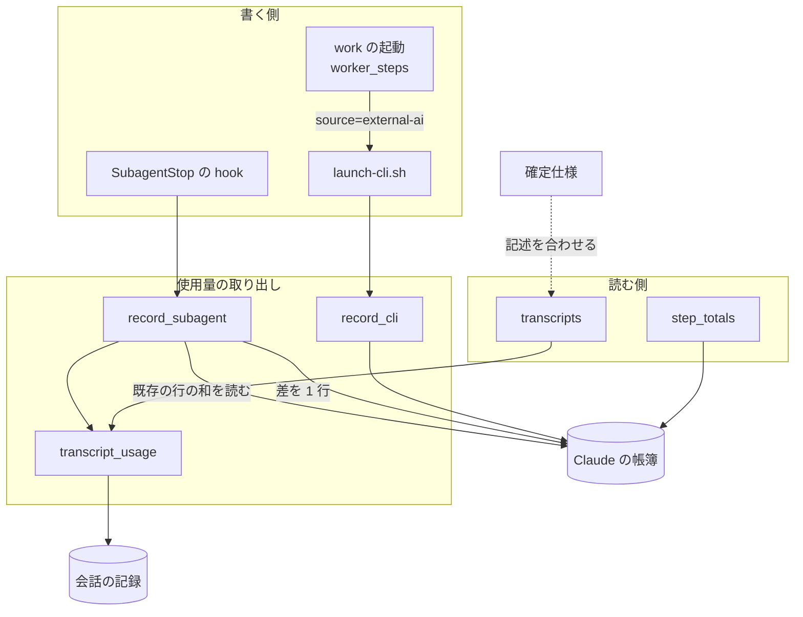
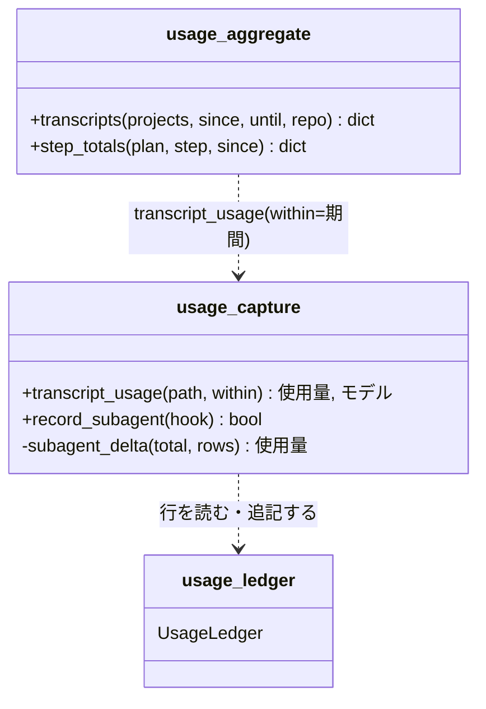
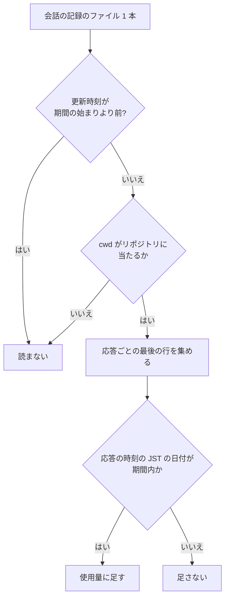
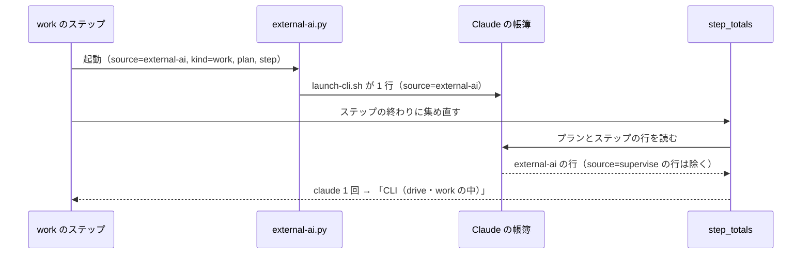

# 使用量の帳簿: Claude の値を会話の記録の合計と一致させる（#1979）

## 目的

- **今どうなっているか**: 使用量の帳簿の Claude の値が、次の 4 つの経路で会話の記録の合計とずれる。同じ応答の最後の使用量を捨てて少なく数える。続けたサブエージェントを 2 回数える。期間を指定した集計で、日をまたぐ会話を丸ごと採るか落とす。supervise の work で起動した claude の使用量が、報告のどの欄にも載らない。手元の帳簿では、902 件のサブエージェントのうち 35 件が同じ識別子で 2 行以上を持つ（2026-11-05 の実測）
- **誰に効くか**: トークン削減の効果を帳簿で測る人と、スプリントの振り返りで使用量を読む人
- **変えると何が成り立つか**: 帳簿・`usage-report.py`・supervise のフェーズレポートの Claude の値が、会話の記録を応答ごとに数えた値と一致する

## 適用範囲

- **働く範囲**: NDF を入れたすべてのリポジトリ。帳簿は利用者の手元にあり、直すのは配布物の取り出し・集計・supervise の起動の 3 か所だけである
- **プロジェクトごとに違うもの**: 無し（帳簿の置き場と期間は既存の引数と環境変数のまま受ける）
- **当たるモード**: `standard`

## あるべき姿の根拠

| 根拠 | 種類 | 何を示すか |
| --- | --- | --- |
| `scripts/token-usage.py:223` の `scan_file` は「message.id で重複を除き、最後の usage を取る」 | 実測（既存の集計の実装） | 同じ応答の行が複数あるとき、正しい値は最後の行の使用量である |
| #1979 の本文の「再現の記録」（2026-11-05、d51159151） | 実測 | 4 件とも今のコードで期待と違う値が出る |
| 手元の帳簿（プラグインのデータの置き場の `devbasex__ai-plugins.jsonl`、993 行）で、`kind=subagent` の行の識別子 902 件のうち 35 件が 2 行以上 | 実測 | 続けたサブエージェントの 2 回目以降の停止は実際に起きており、今は会話の記録の累計を毎回書く |
| 確定仕様 `docs/specifications/ndf-usage-ledger-by-runtime.md` の「supervise の報告」: 「supervise 自身の `claude -p`（`source=supervise` の Claude の行）は報告が別に数えるため除く」 | 既存の仕様 | `source=supervise` の Claude の行は supervise 自身の呼び出しだけ、という前提で集め直しが書かれている |

要求と受け入れ条件は #1979 の本文にある（コピーは `issues/issue-1979-requirements.md`）。この文書は「どう作るか」だけを扱う。

## ドメインモデル

### コンテキスト

| コンテキスト | 何の語が 1 つの意味に決まるか |
| --- | --- |
| NDF の開発工程（`ndf-workflow`） | 使用量の帳簿・呼び出し元・起動の共有処理・Claude の帳簿の全体・会話の記録だけの呼び出し |

1 つのコンテキストに収まる。Claude Code の会話の記録は外部の系で、NDF は読むだけである（確定仕様の「CLI の記録を読むだけ」）。

### 集約

| 集約 | 持ち主（書き換えてよいもの） | 根 | エンティティ | 値オブジェクト |
| --- | --- | --- | --- | --- |
| 使用量の帳簿（1 ランタイム × 1 リポジトリ） | 帳簿の部品（`usage_ledger.py`）。追記だけで、既存の行を書き換えない | 帳簿のファイル | 帳簿の行（呼び出し 1 回、またはサブエージェントの停止 1 回） | 使用量（入力・cache read・cache write の 5 分と 1 時間・出力）・呼び出し元（`source` と `kind` の組） |

行を作るのは使用量の取り出し（`usage_capture.py`）で、追記は帳簿の部品を通す。集計（`usage_aggregate.py`）と supervise の報告は読むだけである。会話の記録は集約の外にあり、応答の使用量の出所として読む。

### 不変条件

| # | 集約 | 条件 | 破れたときの扱い |
| --- | --- | --- | --- |
| I1 | 使用量の帳簿 | 会話の記録 1 本から読む使用量は、同じ `message.id` の応答ごとに、最後の行の使用量を 1 回だけ数える | 取り出しのテストが落ちる |
| I2 | 使用量の帳簿 | 同じ `agent_id` のサブエージェントの行の使用量の和は、最後の停止の時点の会話の記録の合計に等しい（1 回目の行が書けなかったときも） | hook のテストが落ちる。帳簿へ書けないときは今どおり hook は落ちない |
| I3 | 使用量の帳簿 | 期間を指定した集計で、会話の記録から足す分には、応答の時刻が期間内の応答だけが入る | 集計のテストが落ちる |
| I4 | 使用量の帳簿 | Claude の帳簿の `source=supervise` の行は、supervise 自身が `call_claude` で起動した呼び出しだけである | supervise の報告のテストが落ちる |
| I5 | 使用量の帳簿 | 帳簿へ書けないとき・会話の記録を読めないときに、hook と起動の共有処理は落ちない（確定仕様の I5） | 既存のテストが落ちる |

### ドメインイベント

要求の番号を引き継ぐ。E1・E3 は NDF の外で起き、NDF は記録を読むだけである。

| # | イベント | 発生元 | 受け手 |
| --- | --- | --- | --- |
| E1 | 会話の記録へ応答の行を書いた（同じ `message.id` の行が複数ある） | Claude Code | 使用量の取り出し（hook）、集計 |
| E2 | サブエージェントが止まり、帳簿へ 1 行書いた | SubagentStop の hook | 帳簿、集計 |
| E3 | 同じサブエージェントを SendMessage で続けた | 親の会話 | （NDF は受けない。E4 の前提） |
| E4 | 続けたサブエージェントがもう一度止まり、前回までの行との差を 1 行書いた | SubagentStop の hook | 帳簿、集計 |
| E5 | supervise の work（`runtime: claude`）が claude を起動し、起動の共有処理が帳簿へ 1 行書いた | `launch-cli.sh`（external-ai.py 経由） | 帳簿、ステップの集め直し |
| E6 | ステップの終わりに、そのステップの帳簿の行をランタイムごとに集めた | supervise の work と drive のステップ | フェーズレポート |
| E7 | フェーズレポートを書いた | supervise | conductor・利用者 |
| E8 | 期間を受けて Claude の 3 つの値を出した | `usage-report.py` | 利用者・振り返り |

E3 は NDF のどの部品も受けない。E4 の「続けた後の停止」が起きる前提として残す。

### 用語

| 用語 | 意味 | 用語集への反映 |
| --- | --- | --- |
| 使用量の帳簿 | 用語集のとおり | 変更なし |
| 呼び出し元 | 用語集のとおり。supervise の `runtime` を指定した work の行は `external-ai:work` になる（例の `supervise:work` は supervise 自身の work の呼び出しを指したまま） | 変更なし |
| 起動の共有処理 | 用語集のとおり | 変更なし |
| Claude の帳簿の全体 | 用語集のとおり | 変更なし |
| 会話の記録だけの呼び出し | 用語集のとおり | 変更なし |

この文書で使う「応答」は、会話の記録の assistant の行のうち同じ `message.id` を持つものの組を指す。「応答の時刻」は、その組の最後の行の `timestamp` である。

## 機能一覧

| # | 機能 | 誰が使うか |
| --- | --- | --- |
| F1 | サブエージェントの会話の記録から、応答ごとの最後の使用量で合計を読む | SubagentStop の hook・`usage-report.py` |
| F2 | 続けたサブエージェントの 2 回目以降の停止で、前回までの行との差だけを帳簿へ書く | SubagentStop の hook |
| F3 | 期間を指定した集計で、会話の記録から足す分を応答の時刻で絞る | `usage-report.py` を打つ人・振り返り |
| F4 | supervise の `runtime` を指定した work の claude の使用量を、フェーズレポートの「CLI（drive・work の中）」に 1 回だけ載せる | フェーズレポートを読む conductor・利用者 |

## 構成要素

| 要素 | 置き場所 | 責務 | 変えること |
| --- | --- | --- | --- |
| 会話の記録の取り出し（`transcript_usage`） | `plugins/ndf/scripts/lib/usage_capture.py` | 会話の記録 1 本の使用量と主なモデルを返す | 応答ごとに最後の行の使用量を取る。応答の時刻で絞る判定を任意の引数で受ける（F1・F3） |
| サブエージェントの行の書き込み（`record_subagent`） | 同上 | SubagentStop の入力 1 回を帳簿へ 1 行書く | 同じ `agent_id` の既存の行の和を会話の記録の合計から引き、差を書く（F2） |
| 会話の記録の読み込み（`transcripts`） | `plugins/ndf/scripts/lib/usage_aggregate.py` | 期間とリポジトリで会話の記録を選び、`claude -p` の会話とサブエージェントの使用量を返す | 最初の行の時刻で会話を選ぶのをやめ、応答の時刻で絞った使用量を返す（F3） |
| work の起動（`WorkStep.call_worker`） | `plugins/ndf/scripts/supervise_lib/worker_steps.py` | `runtime` を指定した work を external-ai.py で起動する | 子の環境の呼び出し元を `source=external-ai`・`kind=work` にする（F4） |
| ステップの集め直し（`step_totals`） | `plugins/ndf/scripts/lib/usage_aggregate.py` | ステップの帳簿の行をランタイムごとに合計する。`source=supervise` の Claude の行を除く | 変えない。I4 が成り立つことで、claude の work の行が入る |
| 確定仕様 | `docs/specifications/ndf-usage-ledger-by-runtime.md` | 帳簿の仕様の正本 | 取り出し・期間・集め直し・呼び出し元の名乗りの記述を、F1〜F4 の振る舞いへ合わせる |



## 構造

触る型は無く、変えるのはモジュールの関数である。関数の引数と呼び出しの関係だけを示す。



| 関数 | 引数・戻り値の変更 |
| --- | --- |
| `transcript_usage(path, within=None)` | `within` は応答の時刻（`timestamp` の文字列。無ければ None）を受けて真偽を返す関数。None なら絞らない。絞った結果の応答が 0 件なら今と同じく `"unknown"` を返す |
| `subagent_delta(total, rows)`（新設） | 会話の記録の合計と、同じ `agent_id` の既存の行の一覧から、鍵ごとの差（0 未満は 0）を返す純粋な関数。`usage` が `"unknown"` の行は 0 として扱う |
| `record_subagent(hook)` | 引数と戻り値は変えない |
| `transcripts(...)` | 引数と戻り値の形は変えない |

## データ構造

帳簿の行の項目は足さず、消さない（版 2 のまま）。値の意味が変わるのはサブエージェントの行の `usage` だけである。

| 鍵 | 変わる前の意味 | 変わった後の意味 |
| --- | --- | --- |
| `usage`（`kind=subagent` の行） | 停止の時点の会話の記録の累計（応答ごとに最初の行の使用量） | 停止の時点の会話の記録の合計（応答ごとに最後の行の使用量）から、同じ `agent_id` の既存の行の `usage` の和を引いた差。1 回だけ止まったサブエージェントでは合計そのもの |
| `source`（supervise の `runtime` を指定した work が起動した行） | `supervise` | `external-ai` |

**時系列の扱いは事象の記録のまま。** 行は停止 1 回・呼び出し 1 回の事象で、合計は読む側が和として導く。差を書く形は、同じ `agent_id` の行の和がいつでもその時点の合計になるため、和を取る既存の集計（`summarize`・`claude_views`）を変えずに済む。

**移行は行わない。** 配布の前に書かれた行（2 回数えた行・最初の行の使用量の行・`supervise:work` の claude の行）はそのまま残る（要求の前提 2）。配布の後に、配布の前の行を持つサブエージェントが止まると、既存の行の和を引くため、前の行が多すぎた分だけ差が 0 に寄る（0 未満は 0）。

**新しい値が通る規則を判定した結果。** `source` の値の集合へ、Claude の帳簿の `external-ai`（`kind=work`）が加わる。

| 規則 | 置き場所 | 当てはまるか |
| --- | --- | --- |
| `step_totals` の「`source=supervise` の Claude の行を除く」 | `usage_aggregate.py:343` | 当てはまる（除かれず、ステップの集め直しに入る。F4 の狙い） |
| 集計の `--by caller` の見出し（`source:kind`） | `usage_aggregate.py` の `usage_group_key` | 当てはまる（`external-ai:work` の見出しが 1 つ増える） |
| `scripts/token-usage.py` の帳簿の層（`kind` が `work` の行を worker の層へ） | `scripts/token-usage.py:590` | 当てはまる（`kind` は変えないため、今と同じ層に入る） |
| `claude_views` の `claude -p` の行（`kind≠subagent`）とセッション ID の突き合わせ | `usage_aggregate.py:206-209` | 当てはまる（`source` を見ない） |
| 確定仕様の「呼び出し元の名乗り」の表と、冒頭の例の `supervise:work`（codex の行） | 確定仕様 | 当てはまらない。構成要素の表の「確定仕様」で書き直す |

検索は次のコマンドで行った（テストを除く）。

```bash
grep -rn '"supervise"\|supervise:work\|get("source")' plugins scripts docs/specifications
```

| 当たり | 何をしているか |
| --- | --- |
| `usage_aggregate.py:343` | 帳簿の行の `source` を読む（上の表の 1 行目） |
| `usage_ledger.py:303` | 帳簿の行の `source` を読み、テストの印の一覧を作る（値で分岐しない） |
| `whole_runs.py:81`・`check-service-boundary.py:200`・`validate_manifests.py:252`・cross-refactoring と ask の部品 | 別の記録の `source` を読む |
| `supervise_lib/claude.py:332` | 名乗りを書く（supervise 自身） |
| `worker_steps.py:91` | 名乗りを書く（直す箇所） |

帳簿の行の `source` を読むのは、この表の上の 2 か所だけだった。

## 処理の流れ

### サブエージェントの停止（F1・F2）


帳簿を読めないのに書ける場合は、合計をそのまま書く。I2 は崩れうるが、行が無いよりも近い値になる。この場合は「未確認のまま残ること」に置く。

### 期間を指定した集計（F3）



更新時刻の判定は、親の会話のファイルとサブエージェントのファイルで 1 本ずつ行う（親の会話の更新時刻が古くても、サブエージェントのファイルは読む）。期間を指定しないときは、どのファイルも読み、どの応答も足す（今と同じ）。時刻を読めない応答は、期間を指定したときだけ足さない（今の `in_period` の扱いと同じ）。

### supervise の work（`runtime: claude`）（F4）



work の結果の使用量は今どおり空で、「LLM の使用量」の欄には入らない。

## 非機能の実現方式

| 大項目 | 要求の条件 | 実現方式 | 確かめ方 |
| --- | --- | --- | --- |
| 運用・保守性 | hook と起動の共有処理は、帳簿へ書けないとき・会話の記録を読めないときに落ちない（帳簿の契約の I5 を保つ） | 既存の行を読む処理は例外を捕まえて空の一覧にし、追記は今どおり `append_safely` を通す。hook の本体（`usage-subagent.py`）は変えない | 帳簿のディレクトリを読めなくして hook を 1 回動かし、終了コード 0 と 1 行の追記を見る。会話の記録を消して `"unknown"` の行を見る |
| 移行性 | 帳簿の行の既存の項目を消さず、意味を変えない。項目を足すときは、足す前の行を読んでも集計が落ちない | 項目を足さない。`usage` の意味の変化はサブエージェントの行の差に限り、和を取る集計はそのまま読める | 既存の集計のテスト（`test_usage_aggregate.py`）がすべて通る |

hook の時間の上限は 10 秒である。既存の行を読む処理は帳簿 1 本を読むだけで、手元の最も大きい帳簿（2.3 MB・1490 行）を Python の起動から読み終えるまで 0.08 秒だった（2026-11-05）。

## 決定の記録

### 決定 1: 応答の正しい値を取るため、同じ `message.id` の最後の行の使用量を使う

ストリーミングの途中の行は、出力のトークン数がまだ少ない。最後の行が応答の確定した使用量で、既存の集計（`scripts/token-usage.py` の `scan_file`）とも一致する。主なモデルの数え方も応答ごとに 1 回とし、最後の行のモデルで数える。

応答の行ごとに鍵の最大値を取る形は採らない。正しさの基準が既存の集計の「最後の行」であり、別の基準を足すと 2 つの集計が一致しなくなる。

根拠: Value 4 / Value 7（MVV 版 5）

### 決定 2: 2 回数えないため、サブエージェントの行には同じ `agent_id` の既存の行の和との差を書き、前回の値は帳簿から求める

帳簿は追記だけの事象の記録で、和を取れば合計になる。差を書けば、同じ `agent_id` の行の和がいつでも会話の記録の合計に等しくなり、和を取る集計を変えずに済む。前回の値を帳簿の行から求めるため、1 回目の行が書けなかったときは差が合計そのものになり、受け入れ条件 3 が成り立つ。

前回の値を別の控えのファイルに置く形は採らない。帳簿と控えの片方だけが書けたときに食い違い、書き手と置き場が 1 つ増える。行に累計を書いて集計で同じ `agent_id` の最後の行だけを取る形も採らない。行の和が合計という帳簿の前提が崩れ、`summarize` と `claude_views` と `scripts/token-usage.py` の 3 つの読み手を直すことになる。

根拠: Value 5 / Value 7（MVV 版 5）

### 決定 3: 期間外の応答を入れないため、会話の記録から足す分を応答ごとの時刻で絞る

会話の最初の時刻で会話を丸ごと採るか捨てると、日をまたぐ会話の片方の日の分が必ず誤る。応答の時刻はその応答の最後の行の `timestamp` とし、JST の日付で期間と比べる（帳簿の行の `at` と同じ比べ方）。帳簿の行は今どおり行の時刻で期間に入れ、行の中の応答を分けない（要求の前提 4）。

時刻で絞る判定は集計の側が持ち、取り出しの関数は判定の関数を引数で受ける。取り出しの側に JST や期間の知識を持たせないためである。

根拠: Value 7（MVV 版 5）

### 決定 4: supervise 自身の呼び出しと work の CLI を見分けるため、`runtime` を指定した work の行の呼び出し元を `external-ai:work` にする

`source` は「呼び出しを起動したスクリプト」を表し、`runtime` を指定した work で claude を起動するのは external-ai.py である。`source=supervise` を supervise 自身の `call_claude` の行だけにする。そうすれば、ステップの集め直しの規則（`source=supervise` の Claude の行を除く）がそのまま正しくなる。supervise の中の起動であることは `plan`・`step` が持つ。`kind` は `work` のまま残し、`scripts/token-usage.py` の層の割り当てを変えない。codex・kiro・agy の work の行も同じく `external-ai:work` にし、ランタイムで名乗りを変えない。

帳簿の行に起動の経路を表す項目を足す形は採らない。書き手 5 か所すべてに値を足すことになり、既存の項目で見分けられるものに項目を増やすことになる。`kind` を分ける形も採らない。`scripts/token-usage.py` の層の割り当て（`kind` で決まる）が変わり、要求の対象範囲（`token-usage.py` を変えない）を外れる。

根拠: Value 5 / Value 7（MVV 版 5）

### 決定 5: 帳簿を読めないときも行を残すため、既存の行を読めなければ空として扱い合計を書く

帳簿を読めないのに書ける状態はまれで、そのときに差を取らずに合計を書くと 2 回数えうる。行を書かずに捨てると、その停止の使用量が帳簿から消え、会話の記録が消えた後は戻らない。多く数える誤りは帳簿を読み直せば見つけられるが、消えた行は見つけられないため、書く方を選ぶ。

根拠: Value 1 / Value 4（MVV 版 5）

## テスト設計

| 受け入れ条件・不変条件 | どの振る舞いで縛るか | どう壊したら落ちるべきか |
| --- | --- | --- |
| 受け入れ条件 1・I1 | 同じ `message.id` の行が 2 行（出力 1 → 50）ある会話の記録を取り出すと、4 つの値が最後の行の値になり、`scripts/token-usage.py` の `scan_file` で読んだ合計と一致する | 最初の行を取る（今のコード）と落ちる |
| 受け入れ条件 2・I2 | 同じ `agent_id` で hook を 2 回動かし（2 回目の前に会話の記録へ応答を足す）、その `agent_id` の行の使用量の和が 2 回目の時点の会話の記録の合計に等しい | 会話の記録の累計を毎回書く（今のコード）と落ちる |
| 受け入れ条件 3・I2 | 1 回目の行を帳簿に置かずに 2 回目の hook を動かすと、行の和が会話の記録の合計に等しい | 前回の値を帳簿以外から取る、または前回の停止を前提に差を取ると落ちる |
| I2（0 未満の扱い） | 既存の行の和が会話の記録の合計より大きいとき、差の鍵は 0 になり負の値を書かない | 0 で切らないと落ちる |
| 受け入れ条件 4・I3 | 応答が期間の前日（JST 23:50）と期間内（翌日 00:10）にある `claude -p` の会話とサブエージェントで、期間を前日にすると前日の分だけ、翌日にすると翌日の分だけが会話の記録の分に入る | 最初の行の時刻で会話を選ぶ（今のコード）と落ちる |
| 受け入れ条件 5 | 期間を指定しない集計の 3 つの値が、同じ `message.id` の行が 1 行ずつの記録で今と同じ値になる | 期間を指定しないときにも時刻で絞ると落ちる |
| 受け入れ条件 6・I4 | `runtime: claude` の work のステップを偽の claude で動かすと、フェーズレポートの「CLI（drive・work の中）」に claude 1 回が載り、「LLM の使用量」は 0 のまま | work の環境の `source` を `supervise` に戻すと落ちる |
| 受け入れ条件 7・I4 | supervise 自身の work・judge の呼び出し（`runtime` なし）の行は「CLI（drive・work の中）」に載らない | `step_totals` の除外をやめると落ちる |
| I5 | 帳簿のディレクトリを読めなくしても hook は終了コード 0 で、会話の記録を読めなければ `"unknown"` の行を書く | 既存の行を読む処理の例外を捕まえないと落ちる |
| 受け入れ条件 8 | 上の 1・2・3・4・6 のテストは今の develop（d51159151）で失敗し、7 は通る | — |
| 受け入れ条件 9 | 確定仕様の「使用量の取り出し」のサブエージェントの行・「集計」の 3 つの値・「supervise の報告」・「呼び出し元の名乗り」の記述を、実装の後に F1〜F4 と突き合わせる（文言のテストは書かない） | — |

`plugins/ndf/scripts/tests/test_usage_ledger.py:245` の既存のテストは、`runtime` を指定した work の行を `("supervise", "work", …)` と見る。このテストは、決定 4 に合わせて `external-ai` を見る形へ直す。

## 設計の結果

| 課題 | 扱い | 取り込み先 | 触るファイル |
| --- | --- | --- | --- |
| #1979 | 実装する | — | `plugins/ndf/scripts/lib/usage_capture.py`、`plugins/ndf/scripts/lib/usage_aggregate.py`、`plugins/ndf/scripts/supervise_lib/worker_steps.py`、`plugins/ndf/scripts/tests/test_usage_capture.py`、`plugins/ndf/scripts/tests/test_usage_aggregate.py`、`plugins/ndf/scripts/tests/test_usage_ledger.py`、`docs/specifications/ndf-usage-ledger-by-runtime.md` |

## 未確認のまま残ること

| 項目 | 内容 |
| --- | --- |
| 続けたサブエージェントの会話の記録が 1 本に追記されるか | 要求の前提 5。実際に SendMessage で続けた後の hook の入力を、リリース後テストで確かめる。別のファイルを指すなら、差の取り方は変わらないが会話の記録の合計が 2 回目の分だけになり、差が 0 に寄る |
| 帳簿を読めないのに書ける状態 | 決定 5 で合計を書くため、その停止では 2 回数えうる。起きる条件は確かめていない |
| 帳簿の置き場が書き手ごとに分かれていること | hook は `CLAUDE_PLUGIN_DATA` の下へ、supervise などのスクリプトは `~/.local/state/ndf/usage` へ書く（手元の実測: 前者にサブエージェントの行 993 行、後者に 0 行）。この変更の範囲外として #2575 に起票した。差の取り方は hook が書く帳簿と同じ置き場を読むため、この変更の振る舞いには影響しない |
| `scripts/token-usage.py` での `runtime: claude` の work の扱い | `launch-cli.sh` の claude は会話を残す起動で、`token-usage.py` は帳簿の `kind=work` の行と会話の記録の両方を数えうる。この変更は `kind` を変えないため振る舞いは変わらない。2 回数えているかは確かめていない |
| API を呼ばずに書かれた応答（合成応答）の扱い | `scripts/token-usage.py` の `scan_file` は合成応答（モデルが `<synthetic>`）の使用量を数えず、取り出しは数える。合成応答の使用量が 0 なら受け入れ条件 1 の一致に影響しない。0 かは確かめていない。テストは合成応答を含まない記録で一致を見る |
| 会話の記録を時刻で絞ったときの集計の時間 | 最初の行の時刻で読まずに済んでいたファイル（期間の前に始まり、期間中に更新されたもの）を読むようになる。手元の会話の記録で集計の秒数は測っていない |
