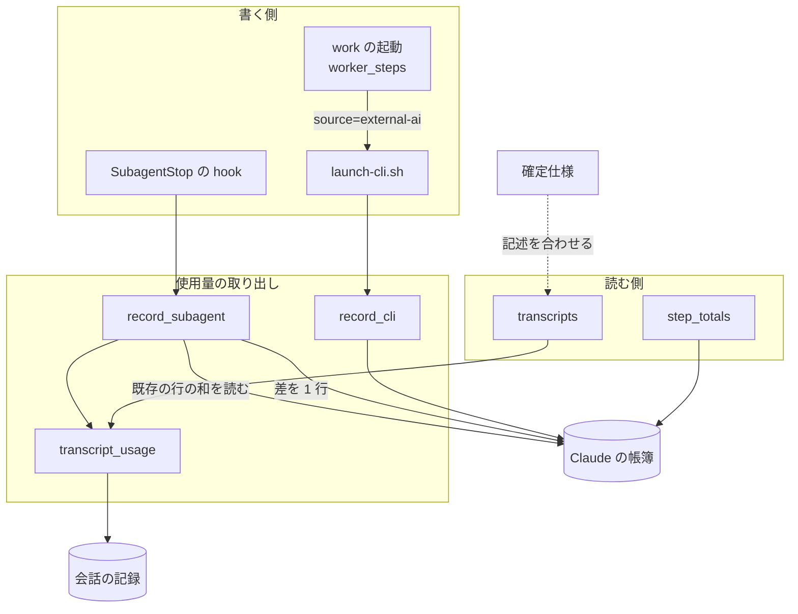
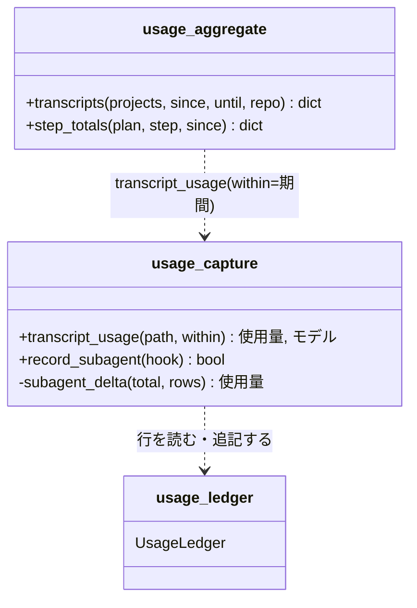
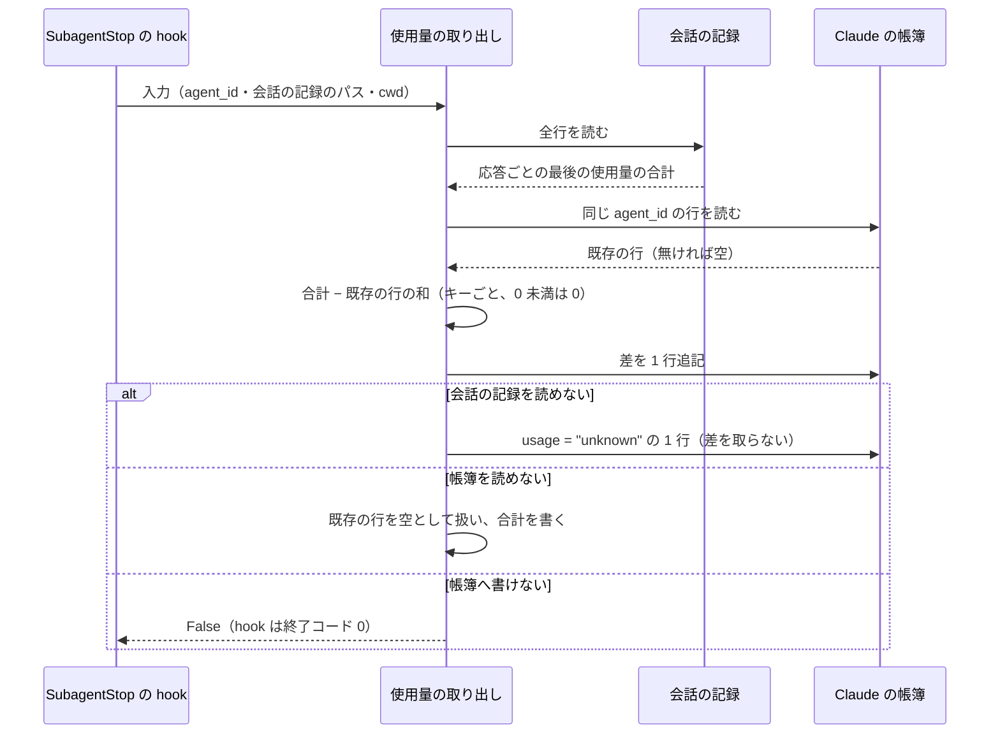
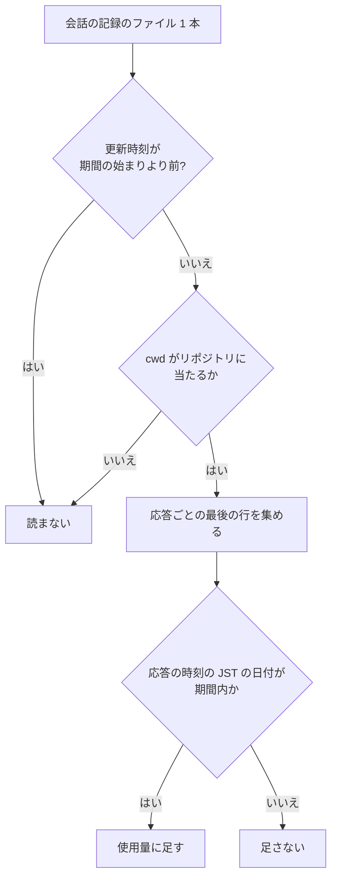
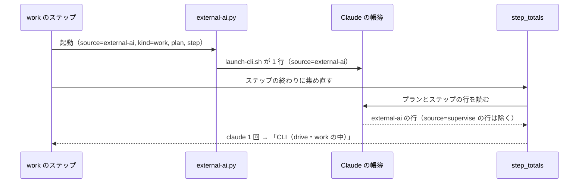

# 使用量の帳簿: Claude の値を会話の記録の合計と一致させる（#1979）

## 目的

- **今どうなっているか**: 使用量の帳簿の Claude の値が、次の 4 つの経路で会話の記録の合計とずれる。同じ応答の最後の使用量を捨てて少なく数える。続けたサブエージェントを 2 回数える。期間を指定した集計で、日をまたぐ会話を丸ごと採るか落とす。supervise の work で起動した claude の使用量が、報告のどの欄にも載らない。手元の帳簿では、903 件のサブエージェントのうち 35 件が同じ識別子で 2 行以上を持つ（2026-11-05 の実測）
- **誰に効くか**: トークン削減の効果を帳簿で測る人と、スプリントの振り返りで使用量を読む人
- **変えると何が成り立つか**: 帳簿・`usage-report.py`・supervise のフェーズレポートの Claude の値が、会話の記録を応答ごとに数えた値と一致する。一致は、帳簿の行を書く側と読む側が同じ置き場を見る範囲（決定 6）と、配布の後の版が書いた行（決定 7）で成り立つ。hook が読んだ時点で会話の記録にまだ書かれていない最後の応答は、この一致の外にある（「未確認のまま残ること」）

## 適用範囲

- **働く範囲**: NDF を入れたすべてのリポジトリ。帳簿は利用者の手元にあり、直すのは配布物の取り出し・集計・supervise の起動の 3 か所だけである
- **プロジェクトごとに違うもの**: 無し（帳簿の置き場と期間は既存の引数と環境変数のまま受ける）
- **当たるモード**: `standard`

## あるべき姿の根拠

| 根拠 | 種類 | 何を示すか |
| --- | --- | --- |
| `scripts/token-usage.py:223` の `scan_file` は「message.id で重複を除き、最後の usage を取る」 | 実測（既存の集計の実装） | 同じ応答の行が複数あるとき、正しい値は最後の行の使用量である |
| #1979 の本文の「再現の記録」（2026-11-05、d51159151） | 実測 | 4 件とも今のコードで期待と違う値が出る |
| 手元の帳簿（プラグインのデータの置き場の `devbasex__ai-plugins.jsonl`、994 行）で、`kind=subagent` の行の識別子 903 件のうち 35 件が 2 行以上 | 実測 | 続けたサブエージェントの 2 回目以降の停止は実際に起きており、今は会話の記録の累計を毎回書く |
| 確定仕様 `docs/specifications/ndf-usage-ledger-by-runtime.md` の「supervise の報告」: 「supervise 自身の `claude -p`（`source=supervise` の Claude の行）は報告が別に数えるため除く」 | 既存の仕様 | `source=supervise` の Claude の行は supervise 自身の呼び出しだけ、という前提で集め直しが書かれている |

要求と受け入れ条件は #1979 の本文にある（コピーは `issues/issue-1979-requirements.md`）。この文書は「どう作るか」だけを扱う。決定の記録は [issue-1979-design-decisions.md](issue-1979-design-decisions.md) にある。

## ドメインモデル

### コンテキスト

| コンテキスト | 何の語が 1 つの意味に決まるか |
| --- | --- |
| NDF の開発工程（`ndf-workflow`） | 使用量の帳簿・呼び出し元・起動の共有処理・Claude の帳簿の全体・会話の記録だけの呼び出し |

1 つのコンテキストに収まる。Claude Code の会話の記録は外部の系で、NDF は読むだけである（確定仕様の「CLI の記録を読むだけ」）。

### 集約

| 集約 | 持ち主（書き換えてよいもの） | 根 | エンティティ | 値オブジェクト |
| --- | --- | --- | --- | --- |
| 使用量の帳簿（1 ランタイム × 1 リポジトリ） | 帳簿の部品（`usage_ledger.py`）。追記だけで、既存の行を書き換えない | 帳簿のファイル | 帳簿の行（呼び出し 1 回、またはサブエージェントの停止 1 回） | 使用量（入力・cache read・cache write の 5 分と 1 時間・出力）・呼び出し元（`source` と `kind` の組） |

行を作るのは使用量の取り出し（`usage_capture.py`）で、追記は帳簿の部品を通す。集計（`usage_aggregate.py`）と supervise の報告は読むだけである。会話の記録は集約の外にあり、応答の使用量の出所として読む。

### 不変条件

| # | 集約 | 条件 | 破れたときの扱い |
| --- | --- | --- | --- |
| I1 | 使用量の帳簿 | 会話の記録 1 本から読む使用量は、同じ `message.id` の応答ごとに、最後の行の使用量を 1 回だけ数える | 取り出しのテストが落ちる |
| I2 | 使用量の帳簿 | 同じ `agent_id` のサブエージェントの行の使用量の和は、最後の停止の時点の会話の記録の合計に等しい（1 回目の行が書けなかったときも） | hook のテストが落ちる。帳簿へ書けないときは今どおり hook は落ちない |
| I3 | 使用量の帳簿 | 期間を指定した集計で、会話の記録から足す分には、応答の時刻が期間内の応答だけが入る | 集計のテストが落ちる |
| I4 | 使用量の帳簿 | Claude の帳簿の `source=supervise` の行は、supervise 自身が `call_claude` で起動した呼び出しだけである | supervise の報告のテストが落ちる |
| I5 | 使用量の帳簿 | 帳簿へ書けないとき・会話の記録を読めないときに、hook と起動の共有処理は落ちない（確定仕様の I5） | 既存のテストが落ちる |

### ドメインイベント

要求の番号を引き継ぐ。E1・E3 は NDF の外で起き、NDF は記録を読むだけである。

| # | イベント | 発生元 | 受け手 |
| --- | --- | --- | --- |
| E1 | 会話の記録へ応答の行を書いた（同じ `message.id` の行が複数ある） | Claude Code | 使用量の取り出し（hook）、集計 |
| E2 | サブエージェントが止まり、帳簿へ 1 行書いた | SubagentStop の hook | 帳簿、集計 |
| E3 | 同じサブエージェントを SendMessage で続けた | 親の会話 | （NDF は受けない。E4 の前提） |
| E4 | 続けたサブエージェントがもう一度止まり、前回までの行との差を 1 行書いた | SubagentStop の hook | 帳簿、集計 |
| E5 | supervise の work（`runtime: claude`）が claude を起動し、起動の共有処理が帳簿へ 1 行書いた | `launch-cli.sh`（external-ai.py 経由） | 帳簿、ステップの集め直し |
| E6 | ステップの終わりに、そのステップの帳簿の行をランタイムごとに集めた | supervise の work と drive のステップ | フェーズレポート |
| E7 | フェーズレポートを書いた | supervise | conductor・利用者 |
| E8 | 期間を受けて Claude の 3 つの値を出した | `usage-report.py` | 利用者・振り返り |

E3 は NDF のどの部品も受けない。E4 の「続けた後の停止」が起きる前提として残す。

### 用語

下の表の「用語集」は [docs/glossary.md](../docs/glossary.md) を指す（5 語とも登録済み。199・291〜294 行目）。

| 用語 | 意味 | 用語集への反映 |
| --- | --- | --- |
| 使用量の帳簿 | 用語集のとおり | 変更なし |
| 呼び出し元 | 用語集のとおり。supervise の `runtime` を指定した work の行は `external-ai:work` になる（例の `supervise:work` は supervise 自身の work の呼び出しを指したまま） | 変更なし |
| 起動の共有処理 | 用語集のとおり | 変更なし |
| Claude の帳簿の全体 | 用語集のとおり | 変更なし |
| 会話の記録だけの呼び出し | 用語集のとおり | 変更なし |

この文書で使う「応答」は、会話の記録の assistant の行のうち同じ `message.id` を持つものの組を指す。「応答の時刻」は、その組の最後の行の `timestamp` である。

この文書だけで使う語と記号・番号で指す要求の項目・根拠に挙げる Value は、末尾の「付録: この文書で使う語と番号」にある。

## 機能一覧

| # | 機能 | 誰が使うか |
| --- | --- | --- |
| F1 | サブエージェントの会話の記録から、応答ごとの最後の使用量で合計を読む | SubagentStop の hook・`usage-report.py` |
| F2 | 続けたサブエージェントの 2 回目以降の停止で、前回までの行との差だけを帳簿へ書く | SubagentStop の hook |
| F3 | 期間を指定した集計で、会話の記録から足す分を応答の時刻で絞る | `usage-report.py` を打つ人・振り返り |
| F4 | supervise の `runtime` を指定した work の claude の使用量を、フェーズレポートの「CLI（drive・work の中）」に 1 回だけ載せる | フェーズレポートを読む conductor・利用者 |

## 構成要素

| 要素 | 置き場所 | 責務 | 変えること |
| --- | --- | --- | --- |
| 会話の記録の取り出し（`transcript_usage`） | `plugins/ndf/scripts/lib/usage_capture.py` | 会話の記録 1 本の使用量と主なモデルを返す | 応答ごとに最後の行の使用量を取る。応答の時刻で絞る判定を任意の引数で受ける（F1・F3） |
| サブエージェントの行の書き込み（`record_subagent`） | 同上 | SubagentStop の入力 1 回を帳簿へ 1 行書く | 同じ `agent_id` の既存の行の和を会話の記録の合計から引き、差を書く（F2） |
| 会話の記録の読み込み（`transcripts`） | `plugins/ndf/scripts/lib/usage_aggregate.py` | 期間とリポジトリで会話の記録を選び、`claude -p` の会話とサブエージェントの使用量を返す | 最初の行の時刻で会話を選ぶのをやめ、応答の時刻で絞った使用量を返す。サブエージェントには、時刻で絞らない会話の記録の全体の使用量も添えて返す（F3） |
| 帳簿にある `claude -p` の残りの計算（`claude_views` の `residual` へ渡す子） | 同上 | 帳簿にある `claude -p` の行の `modelUsage` の和から、同じ親の会話のサブエージェントを引く | 引く子の使用量を期間で絞らない。帳簿に行のあるサブエージェントは期間外も含めた全行、帳簿に行の無いサブエージェントは会話の記録の全体を引く（F3） |
| work の起動（`WorkStep.call_worker`） | `plugins/ndf/scripts/supervise_lib/worker_steps.py` | `runtime` を指定した work を external-ai.py で起動する | 子の処理の環境変数の呼び出し元を `source=external-ai`・`kind=work` にする（F4） |
| ステップの集め直し（`step_totals`） | `plugins/ndf/scripts/lib/usage_aggregate.py` | ステップの帳簿の行をランタイムごとに合計する。`source=supervise` の Claude の行を除く | 変えない。I4 が成り立つことで、claude の work の行が入る |
| 確定仕様 | `docs/specifications/ndf-usage-ledger-by-runtime.md` | 帳簿の仕様の正本 | 取り出し・期間・集め直し・呼び出し元の名乗りの記述を、F1〜F4 の振る舞いへ合わせる |

### 要素のつながり



## 構造

触る型は無く、変えるのはモジュールの関数である。関数の引数と呼び出しの関係だけを示す。



| 関数 | 引数・戻り値の変更 |
| --- | --- |
| `transcript_usage(path, within=None)` | `within` は応答の時刻（`timestamp` の文字列。無ければ None）を受けて真偽を返す関数。None なら絞らない。絞った結果の応答が 0 件なら今と同じく `"unknown"` を返す |
| `subagent_delta(total, rows)`（新設） | 会話の記録の合計と、同じ `agent_id` の既存の行の一覧から、キーごとの差（0 未満は 0）を返す純粋な関数。`usage` が `"unknown"` の行は 0 として扱う |
| `record_subagent(hook)` | 引数と戻り値は変えない。既存の行は、追記先と同じファイル（`UsageLedger(cwd).records()`）から読む（決定 6） |
| `transcripts(...)` | 引数と戻り値の形は変えない |

## データ構造

帳簿の行の項目は足さず、消さない（版 2 のまま）。値の意味が変わるのはサブエージェントの行の `usage` だけである。

### 値の意味が変わるキー

| キー | 変わる前の意味 | 変わった後の意味 |
| --- | --- | --- |
| `usage`（`kind=subagent` の行） | 停止の時点の会話の記録の累計（応答ごとに最初の行の使用量） | 停止の時点の会話の記録の合計（応答ごとに最後の行の使用量）から、同じ `agent_id` の既存の行の `usage` の和を引いた差。1 回だけ止まったサブエージェントでは合計そのもの |
| `source`（supervise の `runtime` を指定した work が起動した行） | `supervise` | `external-ai` |

### サブエージェントの行を足す読み手

**時系列の扱いは事象の記録のまま。** 行は停止 1 回・呼び出し 1 回の事象で、合計は読む側が和として導く。差を書く形は、同じ `agent_id` の行の和がいつでもその時点の合計になるため、和を取る既存の集計を変えずに済む。サブエージェントの行を足す読み手は 3 つで、どれも行ごとに足す。

| 読み手 | 置き場所 | 足し方 |
| --- | --- | --- |
| `summarize` | `usage_aggregate.py:111` | 行ごとに足す |
| `claude_views` | `usage_aggregate.py:202` | `kind=subagent` の行ごとに足す |
| `_add_ledger` | `plugins/ndf/scripts/context-policy.py:144` | 行の識別（`session_id`・`at`・`step`）ごとに 1 回足す。同じ `agent_id` の行は `at` が違うため、どれも足す |

### 配布の前に書かれた行

**移行は行わない。** 配布の前に書かれた行（2 回数えた行・最初の行の使用量の行・`supervise:work` の claude の行）はそのまま残る（要求の前提 2）。配布の前の行を持つサブエージェントが配布の後に止まったときの値は、次のとおりになる（キーごと）。

| 配布の前の行の和（P）と、配布の後の停止の時点の会話の記録の合計（T） | 配布の後に書く差 | 行の和 | 会話の記録との一致 |
| --- | --- | --- | --- |
| P ≦ T（最初の行の使用量で少なく数えていた） | T − P | T | 一致する |
| P ＞ T（続けたサブエージェントを 2 回数えていた） | 0 | P | 一致しない。多い分は戻らない |

期間を指定した集計は、行の時刻（`at`）で行を選ぶ（要求の前提 4）。期間が配布の前後をまたぐと、配布の前の行の値がそのまま入るため、会話の記録と一致しない。一致を約束する範囲は決定 7 に書く。

### 新しい `source` の値が通る規則

**新しい値が通る規則を判定した結果。** `source` の値の集合へ、Claude の帳簿の `external-ai`（`kind=work`）が加わる。 規則を洗い出した検索は、末尾の「付録: 規則を洗い出した検索」にある。

| 規則 | 置き場所 | 当てはまるか |
| --- | --- | --- |
| `step_totals` の「`source=supervise` の Claude の行を除く」 | `usage_aggregate.py:343` | 当てはまる（除かれず、ステップの集め直しに入る。F4 の狙い） |
| 集計の `--by caller` の見出し（`source:kind`） | `usage_aggregate.py` の `usage_group_key` | 当てはまる（`external-ai:work` の見出しが 1 つ増える） |
| `scripts/token-usage.py` の帳簿の層（`kind` が `work` の行を worker の層へ） | `scripts/token-usage.py:590` | 当てはまる（`kind` は変えないため、今と同じ層に入る） |
| `claude_views` の `claude -p` の行（`kind≠subagent`）とセッション ID の突き合わせ | `usage_aggregate.py:206-209` | 当てはまる（`source` を見ない） |
| 確定仕様の「呼び出し元の名乗り」の表と、冒頭の例の `supervise:work`（codex の行） | 確定仕様 | 当てはまらない。構成要素の表の「確定仕様」で書き直す |

## 処理の流れ

### サブエージェントの停止（F1・F2）



帳簿を読めないのに書ける場合は、合計をそのまま書く（決定 5）。この状態は、帳簿のファイルに読む権限が無く書く権限だけがあるときに起きる。2026-11-05 に今のコードで確かめた結果は次のとおりである（利用者 ID 1000。root は権限を無視するため、この状態にならない）。

| 状態 | `read_rows`（ファイルをパスで読む） | `read_usage_ledger`（ディレクトリを一覧して読む） | 追記 |
| --- | --- | --- | --- |
| 帳簿のファイルがモード 0200 | 0 行（例外を捕まえて空にする） | 0 行 | 書ける |
| 帳簿のディレクトリがモード 0300（一覧できず、名前で開ける） | 2 行（全部） | 0 行 | 書ける |

既存の行を追記先のファイルからパスで読むため、ディレクトリの権限だけが欠けた状態では差を正しく取れる。読めないのはファイルそのものの権限が欠けたときだけである。手元の帳簿のファイルはすべてモード 0644 だった。

### 期間を指定した集計（F3）



更新時刻の判定は、親の会話のファイルとサブエージェントのファイルで 1 本ずつ行う（親の会話の更新時刻が古くても、サブエージェントのファイルは読む）。期間を指定しないときは、どのファイルも読み、どの応答も足す（今と同じ）。時刻を読めない応答は、期間を指定したときだけ足さない（今の `in_period` の扱いと同じ）。

時刻で絞るのは、会話の記録から足す分だけである。帳簿にある `claude -p` の行の残り（`modelUsage` の和から子を引いた値）を求めるときに引く子は、時刻で絞らない。`modelUsage` はその会話の全体の値で、日をまたいだサブエージェントの分も含むためである。期間内の分だけを引くと、期間外の分が `claude -p` の行の日の残りに入り、その分は別の日の期間でもサブエージェントとして数えられ、日ごとの合計の和が会話の記録の合計を超える。引く子は次のとおりにする。

| 子 | 引く使用量 |
| --- | --- |
| 帳簿に行のあるサブエージェント | 同じ親の会話（`parent_session_id`）の行を、期間外のものも含めてすべて足した値 |
| 帳簿に行の無いサブエージェント | 会話の記録の全体の値。更新時刻が期間の始まりより前のファイルも、期間内の `claude -p` の行の会話の下にあれば読む |

サブエージェントとして数える分（サブエージェントだけ・全体・会話の記録だけ）は、今までどおり期間内の行と、時刻で絞った会話の記録の分である。

### supervise の work（`runtime: claude`）（F4）



work の結果の使用量は今どおり空で、「LLM の使用量」の欄には入らない。

## 非機能の実現方式

| 大項目 | 要求の条件 | 実現方式 | 確かめ方 |
| --- | --- | --- | --- |
| 運用・保守性 | hook と起動の共有処理は、帳簿へ書けないとき・会話の記録を読めないときに落ちない（帳簿の契約の I5 を保つ） | 既存の行を読む処理は例外を捕まえて空の一覧にし、追記は今どおり `append_safely` を通す。hook の本体（`usage-subagent.py`）の処理は変えない（docstring の数え方の記述だけ直す） | 帳簿のファイルをモード 0200 にして hook を 1 回動かし、終了コード 0 と、合計の 1 行の追記を見る。会話の記録を消して `"unknown"` の行を見る |
| 移行性 | 帳簿の行の既存の項目を消さず、意味を変えない。項目を足すときは、足す前の行を読んでも集計が落ちない | 項目を足さない。`usage` の意味の変化はサブエージェントの行の差に限り、和を取る集計はそのまま読める | 既存の集計のテスト（`test_usage_aggregate.py`）がすべて通る |

hook の時間の上限は 10 秒である（`plugins/ndf/hooks/claude.json` の SubagentStop の `timeout`）。既存の行を読む処理は、そのリポジトリの帳簿 1 本を読み、同じ `agent_id` の行を足すだけである。行が増えたときの時間を、手元のサブエージェントの帳簿の行（1 行あたり約 500 バイト）を繰り返して作った帳簿で測った。測った日は 2026-11-05、処理系は Python 3.14.4 で、Python の起動から終わりまでの 3 回の最短を採った。

| 帳簿の行数 | 大きさ | 時間 |
| ---: | ---: | ---: |
| 0（import だけ） | — | 0.043 秒 |
| 994（手元の今の行数） | 484 KB | 0.050 秒 |
| 10,000 | 4.8 MB | 0.115 秒 |
| 100,000 | 48 MB | 0.553 秒 |
| 1,000,000 | 473 MB | 5.843 秒 |

hook 1 回の全体の時間も、今のコード（d51159151）で測った。hook の設定と同じ `sh -c` のコマンドを、hook の入力の JSON を標準入力に渡して 5 回打ち、最短と最長を採った（2026-11-05、帳簿は手元の 994 行のコピー）。会話の記録は、手元のサブエージェントの会話の記録 1,823 本の中央値（671 KB）に近いものと、最大のものを使った。

| 会話の記録 | 大きさ | 時間（最短〜最長） |
| --- | ---: | ---: |
| 中央値に近いもの | 599 KB | 0.052〜0.063 秒 |
| 最大のもの | 29 MB | 0.326〜0.361 秒 |

直した後の hook は、これに既存の行の読み込み（上の表の import を除いた分）が足される。最大の会話の記録と 1,000,000 行の帳簿が重なっても、0.36 + 5.80 ≒ 6.2 秒で上限の 10 秒に収まる見込みである。直した後のコードでは測っていない（実装の後に同じ手順で測る）。

時間は行数にほぼ比例する。手元の帳簿は 2026-10-25 から 2026-11-05 の 12 日で 994 行（1 日あたり約 83 行）増えた。この速さでは 100,000 行まで約 3 年かかり、そのときの読み込みは 0.6 秒である。上限の 10 秒に近づくのは 1,000,000 行を超えたときで、この速さでは 30 年を超える。上限を超えた hook がその停止の行を書き終えるかは確かめていない（「未確認のまま残ること」）。確定仕様の帳簿の節に、この測定と見通しを書く。

## 決定の記録

決定 1〜11 の結論・理由・採らなかった案は [issue-1979-design-decisions.md](issue-1979-design-decisions.md) にある。

## テスト設計

| 受け入れ条件・不変条件 | どの振る舞いで縛るか | どう壊したら落ちるべきか |
| --- | --- | --- |
| 受け入れ条件 1・I1 | 同じ `message.id` の行が 2 行ある会話の記録（下の表の入力 1）を取り出すと、帳簿の使用量の 5 つの項目（入力・cache read・cache write の 5 分と 1 時間・出力）が最後の行の値になり、`scripts/token-usage.py` の `scan_file` の同じ 5 つの値（`inp`・`read`・`w5`・`w1h`・`out`）と一致する。受け入れ条件の「4 つの値」は cache write を 1 つに数えたもので、cache write の合計（`cache_creation_input_tokens`）が 5 分と 1 時間の和になることも見る | 最初の行を取る（今のコード）と落ちる |
| 受け入れ条件 2・I2 | 同じ `agent_id` で hook を 2 回動かし（2 回目の前に会話の記録へ応答を足す）、その `agent_id` の行の使用量の和が 2 回目の時点の会話の記録の合計に等しい | 会話の記録の累計を毎回書く（今のコード）と落ちる |
| 受け入れ条件 3・I2 | 1 回目の行を帳簿に置かずに、複数行の応答を含む会話の記録（下の表の入力 3）で 2 回目の hook を動かすと、行の和が会話の記録の合計に等しい | 前回の値を帳簿以外から取る、前回の停止を前提に差を取る、または最初の行を取る（今のコード）と落ちる |
| I2（0 未満の扱い） | 既存の行の和が会話の記録の合計より大きいとき、差のキーの値は 0 になり負の値を書かない | 0 で切らないと落ちる |
| 受け入れ条件 4・I3 | 期間の境界をまたぐ `claude -p` の会話と、境界の前に始まった親の会話の下のサブエージェント（下の表の入力 4）で、期間を前日にすると前日の分だけ、翌日にすると翌日の分だけが会話の記録の分に入る | 最初の行の時刻で会話を選ぶ（今のコード）、または応答の最初の行の時刻で比べると落ちる |
| 受け入れ条件 4・I3（残りの計算） | 帳簿に行のある `claude -p` の会話（`modelUsage` あり、行の時刻は境界の翌日）の下で、境界の前日に始まり翌日に終わる、帳簿に行の無いサブエージェントを置く。期間を前日にした集計と翌日にした集計の「全体」の和が、期間を指定しない集計の「全体」に等しい | 残りの計算で引く子を時刻で絞った値にすると、前日の分が 2 回数えられて落ちる |
| 受け入れ条件 5 | 期間を指定しない集計の 3 つの値が、同じ `message.id` の行が 1 行ずつの記録で今と同じ値になる | 期間を指定しないときにも時刻で絞ると落ちる |
| 受け入れ条件 6・I4 | `runtime: claude` の work のステップを偽の claude で動かすと、フェーズレポートの「CLI（drive・work の中）」に claude 1 回が載り、「LLM の使用量」は 0 のまま | work の環境変数の `source` を `supervise` に戻すと落ちる |
| 受け入れ条件 7・I4 | supervise 自身の work・judge の呼び出し（`runtime` なし）の行は「CLI（drive・work の中）」に載らない | `step_totals` の除外をやめると落ちる |
| I2（0 の差の行・決定 9） | 会話の記録が前回の停止から増えていないとき、差がすべて 0 の行を 1 行書き、`summarize` の回数が停止の回数に等しい | 差が 0 のときに書かないと落ちる |
| I2（壊れた行・決定 8） | 同じ `agent_id` の既存の行の 1 つを JSON として壊して 2 回目の hook を動かすと、`read_rows` で読める行の和が会話の記録の合計に等しく、hook は終了コード 0 | 壊れた行で例外を投げるか、壊れた行を推して数えると落ちる |
| I5 | 帳簿のファイルをモード 0200 にしても hook は終了コード 0 で合計の 1 行を書き、会話の記録を読めなければ `"unknown"` の行を書く。root で動くときは権限が効かないため、このテストを飛ばす | 既存の行を読む処理の例外を捕まえないと落ちる |
| 決定 6 | 帳簿のディレクトリをモード 0300 にして 2 回目の hook を動かすと、行の和が会話の記録の合計に等しい | 既存の行をディレクトリの一覧から読む（`read_usage_ledger`）と落ちる |
| 受け入れ条件 8 | 上の 1・2・3・4・6 のテストは今の develop（d51159151）で失敗し、7 は通る。失敗する入力と値は下の表のとおり | — |
| 受け入れ条件 9 | 確定仕様の「使用量の取り出し」のサブエージェントの行・「集計」の 3 つの値・「supervise の報告」・「呼び出し元の名乗り」の記述を、実装の後に F1〜F4 と突き合わせる（文言のテストは書かない） | — |

### 今のコードで失敗する入力

受け入れ条件 8 を満たすため、テストの入力は今のコードで値が食い違う形にする。下の値は、2026-11-05 に今のコード（d51159151）の関数へこの入力を通して得た。時刻は会話の記録の UTC で、括弧の中が JST である。

| # | 受け入れ条件 | 入力 | 今のコードの値 | 期待する値 |
| --- | --- | --- | --- | --- |
| 1 | 1 | 応答 `m1` の 2 行。1 行目は出力 1・5 分の書き込み 0・1 時間の書き込み 0、2 行目は出力 50・5 分 20・1 時間 7 | 出力 1・5 分 0・1 時間 0 | 出力 50・5 分 20・1 時間 7（`scan_file` も同じ） |
| 2 | 2 | 要求の「再現の記録」の指摘 2（1 回目の停止で応答 1 件、2 回目で応答 2 件） | 行の出力の和 17 | 12 |
| 3 | 3 | 帳簿は空。会話の記録は応答 `r1` の 2 行（出力 1 → 5）と応答 `r2` の 2 行（出力 2 → 7） | 行の出力の和 3 | 12 |
| 4 | 4 | `entrypoint=sdk-cli` の会話 `s1`: 応答 `q1` 14:50:00（11-01 23:50）出力 100、応答 `q2` の 2 行 14:59:59（11-01 23:59:59）出力 1 と 15:00:01（11-02 00:00:01）出力 30、応答 `q3` 15:10:00（11-02 00:10）出力 7。親の会話 `c1`（`entrypoint=cli`、最初の行 14:40:00 = 11-01 23:40）の下のサブエージェント `sub1`: 応答 15:20:00（11-02 00:20）出力 9 | 期間 11-01: `s1` 108・`sub1` 9。期間 11-02: どちらも無し | 期間 11-01: `s1` 100・`sub1` 無し。期間 11-02: `s1` 37・`sub1` 9 |
| 6 | 6 | 要求の「再現の記録」の指摘 4 | `step_totals` が `{}` | Claude の行が 1 回 |

入力 3 は、応答を 1 行ずつにすると今のコードでも和が 12 になり、テストが通る（同じ日に確かめた）。今のコードは 1 回目の行が無ければ累計をそのまま書き、その累計が会話の記録の合計に等しいためである。受け入れ条件 3 のテストは、複数行の応答を必ず含める。

入力 4 の `q2` は、1 つの応答の行が日の境界をまたぐ。応答の時刻を最後の行で決めることを、この応答で縛る。`sub1` は親の会話の最初の行が前日にあり、今のコードは親の会話ごと期間で選ぶため、サブエージェントの日がずれる。

### 直す既存のテスト

| テスト | 今の見方 | 直し方 |
| --- | --- | --- |
| `plugins/ndf/scripts/tests/test_usage_ledger.py:245` | `runtime: codex` の work の行を `("supervise", "work", …)` と見る | 決定 4 に合わせて `external-ai` を見る |
| `plugins/ndf/scripts/tests/test_usage_capture.py:261` | 同じ `message.id` の 2 行を 1 回だけ数える。2 行の使用量は同じ | 変えない。最初の行と最後の行のどちらを取っても値が同じで、1 回だけ数えることを縛り続ける |
| `plugins/ndf/scripts/tests/test_usage_aggregate.py:188` | `source=supervise` の Claude の行を除く | 変えない。受け入れ条件 7 の退行を防ぐテストとして残す |

## 設計の結果

| 課題 | 扱い | 取り込み先 | 触るファイル |
| --- | --- | --- | --- |
| #1979 | 実装する | — | `plugins/ndf/scripts/lib/usage_capture.py`、`plugins/ndf/scripts/lib/usage_aggregate.py`、`plugins/ndf/scripts/supervise_lib/worker_steps.py`、`plugins/ndf/scripts/usage-subagent.py`（docstring の数え方の記述だけ）、`plugins/ndf/scripts/tests/test_usage_capture.py`、`plugins/ndf/scripts/tests/test_usage_aggregate.py`、`plugins/ndf/scripts/tests/test_usage_ledger.py`、`docs/specifications/ndf-usage-ledger-by-runtime.md` |

## 未確認のまま残ること

| 項目 | 内容 |
| --- | --- |
| 続けたサブエージェントの会話の記録が 1 本に追記されるか | 要求の前提 5。手元の帳簿の 35 組で裏付けた（決定 11）。hook の入力の `agent_transcript_path` そのものは、リリース後テストで SendMessage で続けた後に確かめる。別のファイルを指すなら、会話の記録の合計が 2 回目の分だけになり、差が 0 に寄る |
| 停止の時点で書かれていない最後の応答 | 2026-11-05 に手元の帳簿で、会話の記録の残っているサブエージェント 204 件の最後の行の `output_tokens` を、今の会話の記録（今のコードと同じく応答ごとに最初の行で数えた値）と比べた。195 件で、帳簿の値がちょうど最後の応答 1 件の分だけ少なかった（一致は 8 件、その他 1 件。出力の和は帳簿が 16.8% 少ない）。SubagentStop の hook が会話の記録を読む時点で、最後の応答の行がまだ書かれていないためと見られる。1 回だけ止まったサブエージェントでは最後の応答が帳簿に入らない。続けたサブエージェントでは、前の停止で抜けた応答が次の停止の差に入る（決定 2）。受け入れ条件の外で、この変更は扱わない。直し方は別の課題 #2576 で比べて決める |
| 帳簿のファイルに読む権限が無くなる頻度 | 起きる条件（ファイルのモードから読む権限が外れる）は確かめた（「処理の流れ」の表）。その停止では決定 5 で合計を書くため 2 回数えうる。実際に起きた例は手元に無い（手元の帳簿のファイルはすべてモード 0644） |
| 帳簿の置き場を 1 つに揃えること | 決定 6 のとおり、この変更の値は 1 つの置き場の中で閉じる。`usage-report.py` で読まなかった置き場にだけある、会話の記録を残さない `claude -p` の行は数えられない。#2575（使用量の帳簿が書き手ごとに別の置き場へ書かれる）が扱う |
| hook の時間の上限を超えたときの行 | 帳簿が 1,000,000 行を超えると、既存の行の読み込みが 10 秒の上限に近づく（「非機能の実現方式」の測定。最大の会話の記録と重なった hook 全体の見込みは約 6.2 秒）。上限を超えた hook がその停止の行を書き終えるかは確かめていない。今の増え方では 30 年を超える先である |
| 同じ `agent_id` の停止の hook の `cwd` | 差は `repo_key(cwd)` で決めたファイルの中で取る。続けたサブエージェントの 2 回の停止で、hook の入力の `cwd` が別のリポジトリを指すことがあるかは確かめていない。指せば別のファイルに分かれ、2 回目の差が合計そのものになる |
| `scripts/token-usage.py` での `runtime: claude` の work の扱い | `launch-cli.sh` の claude は会話を残す起動で、`token-usage.py` は帳簿の `kind=work` の行と会話の記録の両方を数えうる。この変更は `kind` を変えないため振る舞いは変わらない。2 回数えているかは確かめていない |
| API を呼ばずに書かれた応答（合成応答）の扱い | `scripts/token-usage.py` の `scan_file` は合成応答（モデルが `<synthetic>`）の使用量を数えず、取り出しは数える。手元の会話の記録から合成応答の行を 200 件取り出すと、使用量の数値の和はすべて 0 だった（2026-11-05）。0 なら受け入れ条件 1 の一致に影響しない。すべての合成応答が 0 かは確かめていない。テストは合成応答を含まない記録で一致を見る |
| 会話の記録を時刻で絞ったときの集計の時間 | 最初の行の時刻で読まずに済んでいたファイル（期間の前に始まり、期間中に更新されたもの）を読むようになる。手元の会話の記録で集計の秒数は測っていない |

## 付録: この文書で使う語と番号

この文書だけで使う語と記号は次のとおりである。

| 語 | 意味 |
| --- | --- |
| 版 2 | 帳簿の行の形の版（行の `schema` の値）。版 1 は #1142 の形で、ランタイムのディレクトリを持たない |
| 不変条件 I1〜I5 | この文書の番号。「確定仕様の I5」は確定仕様 `ndf-usage-ledger-by-runtime.md` の I5（帳簿への追記が失敗しても、呼び出しの結果は変わらない）を指し、この文書の I5 はそれを hook と起動の共有処理へ当てたもの |
| `entrypoint` | 会話の記録の行が持つ起動の形。`sdk-cli` は `claude -p` で起動した会話、`cli` は対話の Claude Code の会話 |
| supervise | `supervise.py`。プランのステップを順に動かし、フェーズの終わりにフェーズレポートを書く |
| work・drive・judge | supervise のステップと呼び出しの種類。work は worker に作業を 1 つさせる、drive は Skill の収束ループを回す、judge は supervise 自身が判断だけを `claude -p` に問う |
| 「LLM の使用量」の欄 | フェーズレポートの欄。supervise 自身が受け取った `claude -p` の結果の使用量 |
| 「CLI（drive・work の中）」の欄 | フェーズレポートの欄。ステップの中で起動の共有処理が帳簿へ書いた行を、ランタイムごとに集めたもの（`step_totals`） |

**番号で指す要求の項目**（正は `issues/issue-1979-requirements.md`）:

| 番号 | 要旨 |
| --- | --- |
| 受け入れ条件 1 | 同じ `message.id` が複数行の記録で、帳簿の値が最後の行の使用量になり `scan_file` と一致する |
| 受け入れ条件 2 | 同じ `agent_id` が 2 回止まっても、行の和が 2 回目の時点の会話の記録の合計と一致する |
| 受け入れ条件 3 | 2 で 1 回目の行が帳簿に無くても、行の和が一致する |
| 受け入れ条件 4 | 期間を指定した集計で、会話の記録から足す分は応答の時刻が期間内のものだけになる |
| 受け入れ条件 5 | 期間を指定しない値は、1 の数え方のほかは変わらない |
| 受け入れ条件 6 | `runtime: claude` の work の使用量が「CLI（drive・work の中）」に 1 回だけ載る |
| 受け入れ条件 7 | supervise 自身の `claude -p` は「CLI（drive・work の中）」に載らない |
| 受け入れ条件 8 | 1・2・3・4・6・7 を再現するテストがあり、7 以外は今の develop で失敗する |
| 受け入れ条件 9 | 確定仕様の記述が 1〜7 の振る舞いと一致する |
| 前提 1 | 4 件の指摘は今の develop で再現した |
| 前提 2 | 既に書かれた行は直さない |
| 前提 3 | `runtime: claude` の work の使用量は「CLI（drive・work の中）」に載せる |
| 前提 4 | 帳簿の行は行の時刻（`at`）で期間に入れ、1 行の中の応答を分けない |
| 前提 5 | 続けたサブエージェントの会話の記録は 1 本のファイルに追記される |

**根拠に挙げる Value**（`.ndf/mvv.md` の版 5）:

| Value | 要旨 |
| --- | --- |
| Value 1 | 小さく出して使って確かめる。人を害する・利用者のデータ・戻せない操作に関わるものは効率に寄与しなくても直す |
| Value 4 | 外の利用で測って決める。効果は実測で示す |
| Value 5 | 決まった手順はスクリプトに。決まりを足すより要らない決まりを減らす |
| Value 7 | 根本原因の場所で直す。共通の層へ寄せてから設計する |

## 付録: 規則を洗い出した検索

検索は 2 回に分けて行った（テストを除く）。1 回目で帳簿の行を読むファイルを洗い出し、2 回目でそのファイルの `source` の読み方を、`row["source"]` と `.get("source")` の両方の形で拾う。

```bash
grep -rlnE "read_usage_ledger|read_rows|ledger_files|UsageLedger|usage_ledger|ledger_dir|NDF_USAGE_DIR" plugins scripts factory | grep -v /tests/
grep -rnE "\[[\"']source[\"']\]|get\([\"']source[\"']|\"source\"|'source'|\.source\b|NDF_USAGE_SOURCE" plugins scripts --include=*.py --include=*.sh | grep -v /tests/
```

1 回目に当たった 15 本のうち、帳簿の行を読むか置き場所を使うのは次の 7 本（8 か所）である。

| 帳簿の行を読む箇所 | 帳簿の行の `source` を読むか |
| --- | --- |
| `usage_aggregate.py:108`（`usage_group_key`） | 読む。`--by caller` の見出しにする（規則の表の 2 行目） |
| `usage_aggregate.py:343`（`step_totals`） | 読む。値が `supervise` の Claude の行を除く（規則の表の 1 行目） |
| `usage_ledger.py:303`（`marked_rows`） | 読む。テストの印の一覧へ写すだけで、値で分岐しない |
| `plugins/ndf/conftest.py:49-53` | 読まない（`marked_rows` を呼ぶ） |
| `plugins/ndf/scripts/context-policy.py:329` | 読まない（`parent_session_id`・`at` で選ぶ） |
| `scripts/token-usage.py:608` | 読まない（`kind` で層を決める） |
| `scripts/measure/claude-p-usage.py:245` | 読まない（`kind` で選ぶ）。同じファイルの `r["source"]`（543・553・651・701 行目）は、行の出所（`ledger`・`report`）を表す自分の記録の項目である |
| `scripts/token-usage-snapshot.py:368` | 読まない（置き場所の既定値だけを使う） |

残りの 8 本は次のとおりだった。

| 帳簿の行を読まないもの | ファイル |
| --- | --- |
| 書き手 | `usage_capture.py` |
| 帳簿の部品の関数（`cache_writes`・`now_utc`・`repo_key`）だけを使うもの | `context_calibrate.py`・`context_decisions.py`・`supervise_lib/state.py` |
| 集計を呼ぶだけのもの | `usage-report.py` |
| パスを文字列で持つもの | `run_state_kinds.py`・`scripts/contract-allow/` の例外リスト |
| 名前だけが同じ関数 | `estimate_records.py` の `_read_rows` |

2 回目で当たった名乗りを書く箇所は 2 つである。

| 当たり | 何をしているか |
| --- | --- |
| `supervise_lib/claude.py:332` | 名乗りを書く（supervise 自身） |
| `worker_steps.py:91` | 名乗りを書く（直す箇所）。`external-ai.py:256` は呼び出し元が名乗っていなければ `external-ai` を入れるため、ここで `external-ai` を名乗っても、名乗りを外しても行の値は同じになる。設計は明示する方を採る |

帳簿の行の `source` を読むのは、読む箇所の表の 3 か所だけだった。値で振る舞いを変えるのは `step_totals` と `usage_group_key` の 2 か所で、どちらも規則の表で判定した。`factory/` は帳簿を読まない（1 回目の検索で 0 件）。
