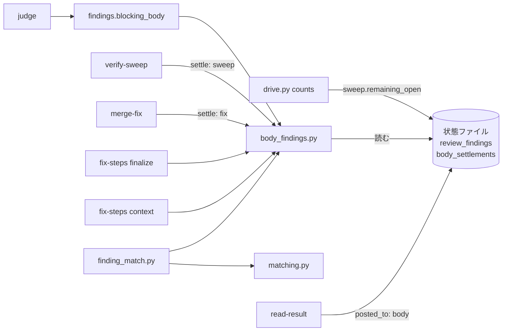
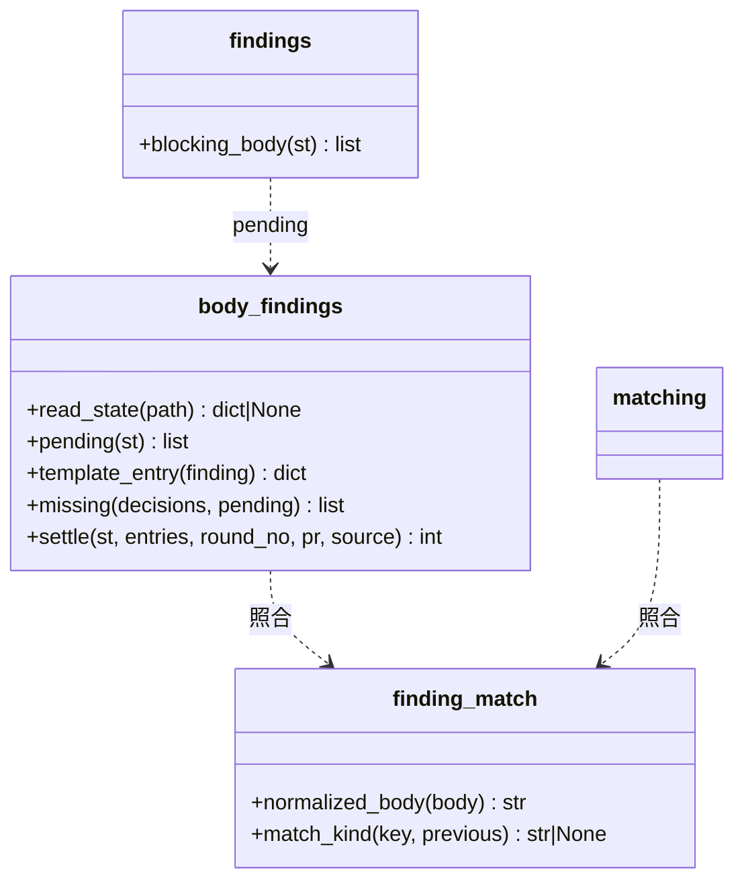
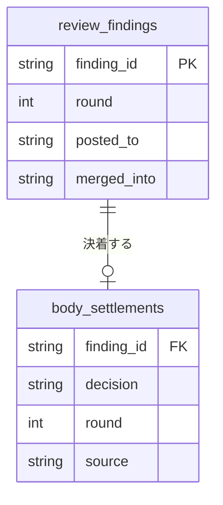
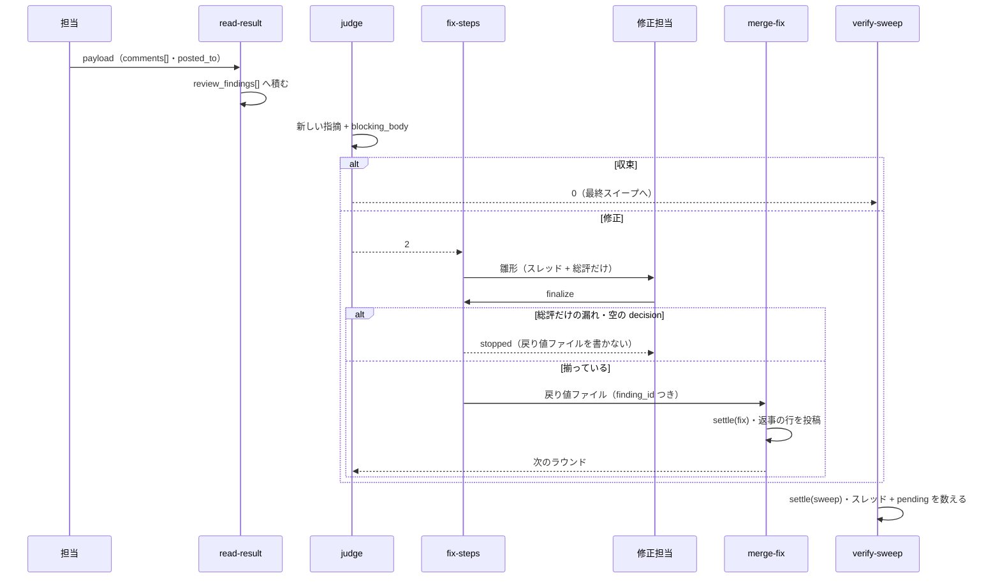
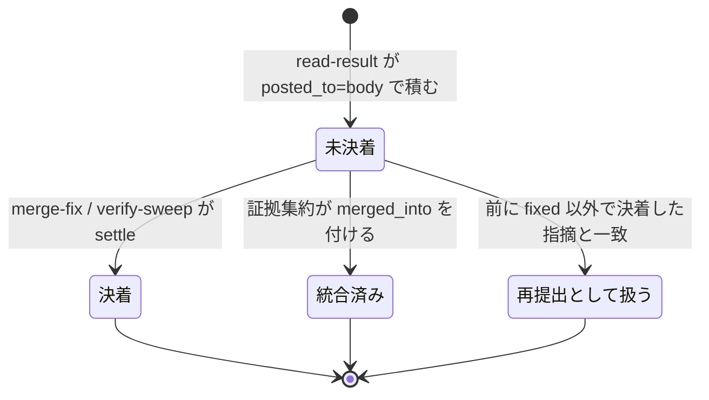

# cross-review: レビュー本文にだけ書かれた重大な指摘が修正されず件数にも入らないまま収束し、本番へ出る → 総評だけの指摘も修正担当が必ず振り分け、決着するまで収束せず、まとめの件数に入る（#1980）

## 目的

- **何が壊れているか**: 担当がレビュー本文（総評）にだけ書いた指摘は、修正担当が対象を未解決のスレッドだけで決めるため、直されも見送られもせず、まとめの件数にも入らないまま収束する
- **誰が困るか**: cross-review を通した PR を承認する人と、その版の利用者。スプリント PR 1973 では `major` 5 件が落ち、4 件の不具合が 10.17.74 へ出た（#1979）
- **直すと何が成り立つか**: 総評だけの指摘は修正担当の雛形へスクリプトが入れ、振り分けの漏れは `finalize` が止める。決着は状態ファイルに残り、決着していない重大な指摘がある間は収束せず、最終スイープの残数とまとめの `unresolved` に数えられる

## 適用範囲

- **働く範囲**: 配布先のリポジトリでも働く。cross-review の中で `/ndf:fix` を呼んだとき（環境変数 `CROSS_REVIEW_STATE` が状態ファイルを指すとき）だけで、単独で呼んだ `/ndf:fix` は今のまま
- **プロジェクトごとに違うもの**: 無し（状態ファイルと担当の指摘ファイルだけを読み、設定も引数も増やさない）
- **当たるモード**: cross-review を通すすべてのモード（`light` / `standard` / `legacy-refactor` / `operation`）

## あるべき姿の根拠

| 根拠 | 種類 | 何を示すか |
| --- | --- | --- |
| https://github.com/devbasex/ai-plugins/pull/1973#pullrequestreview-5498384762 | 実測 | codex がラウンド 1 で `major` 5 件を本文にだけ書いた |
| `~/.local/state/ndf/sv/sprint-m1953/6-check-state/05-review.out` | 実測 | 修正担当は未解決のスレッド 0 件のため何も直さず `fix_commit: null` で返した |
| `run-6-review.log` のまとめ（`findings 3 / fixed 3 / unresolved 0`） | 実測 | 5 件がまとめの件数に入らなかった |
| コミット 974e50bba（設計 PR 1970） | 実測 | 同じ形の指摘を修正担当が拾った回もあり、拾うかどうかが修正担当（LLM）の読み方で揺れている |

要求と受け入れ条件は #1980 の本文にある（コピーは [issue-1980-requirements.md](issue-1980-requirements.md)）。この文書は「どう作るか」だけを扱う。

## ドメインモデル

### コンテキスト

| コンテキスト | 何の語が 1 つの意味に決まるか |
| --- | --- |
| `ndf-cross-review` | 総評だけの指摘・決着・決着の記録・収束・最終スイープ |
| 修正（`/ndf:fix`。用語集のコンテキストは `ndf-cross-review` を共有する） | 振り分けの雛形・戻り値ファイル |

関係は**公開された言語**。修正の側は cross-review の状態ファイル（形は `docs/04-contracts.md`）を読むだけで、書くのは cross-review の側だけである。今も `fix-steps.py context` は同じ状態ファイルの `review_criteria` を読んでおり、読む項目が 2 つ（`review_findings` と `body_settlements`）増える。

### 集約

| 集約 | 持ち主（書き換えてよいもの） | 根 | エンティティ | 値オブジェクト |
| --- | --- | --- | --- | --- |
| レビューの状態（PR ごとの状態ファイル） | `review_findings[]` は取り込み（`read-result`）と証拠集約。`body_settlements[]` は `body_findings.settle`（`merge-fix` と `verify-sweep` から呼ぶ） | 状態ファイル | 指摘（`review_findings[]` の要素） | 決着の記録（`body_settlements[]` の要素） |
| 振り分けの雛形（`fix-pr<PR>-decisions.json`） | `fix-steps.py context` が書き、修正担当が `decision` と理由を埋める | 振り分けの JSON | — | 振り分け（`decisions[]` の要素） |

**決着の記録は追記だけで、書き換えない。** 同じ `finding_id` の記録が既にあれば足さない。

### 不変条件

| # | 集約 | 条件 | 破れたときの扱い |
| --- | --- | --- | --- |
| I1 | 振り分けの雛形 | 状態ファイルを読めるとき、`context` の時点で決着していない総評だけの指摘は、`finalize` の時点の `decisions[]` にすべて同じ `finding_id` で入り、`decision` が 5 つのどれかである | `finalize` が `stopped` で止まり、戻り値ファイルを書かない |
| I2 | レビューの状態 | 1 つの `finding_id` の決着の記録は高々 1 件で、書き換えない | `settle` が重ねて足さない（打ち直しても件数が増えない） |
| I3 | レビューの状態 | 収束を妨げる総評だけの指摘（決着していない・`critical` / `major`・反証で棄却されていない）が 1 件以上ある間、`judge` は収束（終了コード 0）を返さない | 修正のラウンド（終了コード 2）へ回す |
| I4 | レビューの状態 | `verify-sweep` の `REMAINING_OPEN` は、未解決のスレッドの件数（取れなければ申告）に、決着していない総評だけの指摘の件数を足した値である | 1 件以上なら終了コード 6 |
| I5 | レビューの状態 | 総評だけの指摘が 0 件のとき、雛形・`finalize`・`judge`・`verify-sweep` の出力は今と同じである | 新しい行と鍵は件数が 1 以上のときだけ出す |
| I6 | レビューの状態 | `posted_to` を持たない指摘は総評だけの指摘として数えない | `inline` として扱う（前提 3） |

### ドメインイベント

| # | イベント | 発生元 | 受け手 |
| --- | --- | --- | --- |
| E1 | 担当が指摘を本文にだけ書いてレビューを投稿した | 担当・`result_posts.post_review` | 取り込み（`read-result`） |
| E2 | 取り込みが指摘を `posted_to: body` で `review_findings[]` に積んだ | `read-result` | `judge`・`fix-steps.py context` |
| E3 | 判定が修正のラウンドへ回した | `judge` | 駆動（`drive.py`） |
| E4 | 修正担当が、未解決のスレッドと総評だけの指摘を並べた雛形を受け取った | `fix-steps.py context` | 修正担当 |
| E5 | 修正担当が総評だけの指摘を振り分け、`finalize` が戻り値ファイルを書いた | `fix-steps.py finalize` | `merge-fix` |
| E6 | 取り込みが総評だけの指摘の決着を記録し、まとめに返事の行を載せた | `merge-fix` | `judge`・`verify-sweep` |
| E7 | 判定が、収束を妨げる総評だけの指摘の件数を見て収束かを決めた | `judge` | 駆動 |
| E8 | 最終スイープの結果の決着を記録し、残数を数えた | `verify-sweep` | 駆動（`counts`） |
| E9 | 駆動がまとめの件数（`findings` / `unresolved`）を出した | `drive.py` | conductor・supervisor |

### 用語

| 用語 | 意味 | 用語集への反映 |
| --- | --- | --- |
| 総評だけの指摘 | インラインのスレッドを持たず、総評にだけ書かれた指摘（`posted_to` が `body`） | 要求で追加済み |
| 決着 | 指摘が直した・見送った・却下したのどれかに振り分けられ、取り込みが記録したこと | 要求で追加済み |
| 決着の記録 | 状態ファイルの `body_settlements[]` の 1 要素。総評だけの指摘 1 件の振り分けと、記録したラウンドと経路（修正のラウンドか最終スイープか）を持つ | 追加（`ndf-cross-review`） |

## 機能一覧

| # | 機能 | 誰が使うか |
| --- | --- | --- |
| F1 | 決着していない総評だけの指摘を、振り分けの雛形と文脈のファイルへ入れる | 修正担当 |
| F2 | 総評だけの指摘の振り分けの漏れを `finalize` が止める | 修正担当 |
| F3 | 総評だけの指摘の決着を状態ファイルに記録する（修正のラウンドと最終スイープ） | 取り込み（`merge-fix` / `verify-sweep`） |
| F4 | 収束を妨げる総評だけの指摘がある間は収束させない | 収束ループ（`judge`） |
| F5 | 決着していない総評だけの指摘を最終スイープの残数とまとめの `unresolved` に数える | 駆動・承認する人 |

## 構成要素

| 要素 | 変更 | 責務 |
| --- | --- | --- |
| `plugins/ndf/scripts/lib/body_findings.py` | 新規 | 総評だけの指摘の判定の唯一の置き場。状態ファイルの読み込み・決着していない指摘の抽出（`pending`）・雛形の要素（`template_entry`）・振り分けの漏れ（`missing`）・決着の記録（`settle`） |
| `plugins/ndf/scripts/lib/finding_match.py` | 新規（移動） | 指摘の照合（`normalized_body`・`match_kind` と 3 つの定数）。`review_lib/matching.py` から移し、cross-review と fix が同じ照合を使う |
| `plugins/ndf/skills/cross-review/scripts/review_lib/matching.py` | 変更 | 移した 2 関数と定数を `finding_match` から読み込む（振る舞いは変えない） |
| `plugins/ndf/skills/fix/scripts/fix-steps.py` | 変更 | `context` が F1、`finalize` が F2。`ENTRY` と `fixed` の写しに `finding_id` を足す |
| `plugins/ndf/skills/cross-review/scripts/review_lib/commands/merge_fix.py` | 変更 | `_record_fix_history` で `body_findings.settle(..., source="fix")` を呼ぶ（F3） |
| `plugins/ndf/skills/cross-review/scripts/review_lib/findings.py` | 変更 | 収束を妨げる総評だけの指摘を返す `blocking_body`（`pending` を重要度と `_classify_finding` で絞る） |
| `plugins/ndf/skills/cross-review/scripts/review_lib/commands/judge.py` | 変更 | `_evaluate_convergence` に `blocking_body` を足す（F4）。件数が 1 以上のときだけ `BODY_BLOCKING=` を出す |
| `plugins/ndf/skills/cross-review/scripts/review_lib/commands/report.py` | 変更 | `cmd_verify_sweep` がスイープの結果を `settle(..., source="sweep")` で記録し、残数に足す（F3・F5） |
| `plugins/ndf/skills/cross-review/scripts/drive.py` | 変更 | `fix_prompt` の「対象は reviewThreads を数え直して決める」に、雛形に入る総評だけの指摘を添える。件数の数え方（`counts`）は変えない |
| `plugins/ndf/skills/fix/SKILL.md` | 変更 | 雛形の `finding_id` を持つ要素の扱い（消さない・`finding_id` を変えない・重要度の判定は同じ規則） |
| `plugins/ndf/skills/cross-review/docs/02-fix-and-rotation.md`・`04-contracts.md`・`06-evidence.md` | 変更 | Step 5・Step 7.5・状態ファイルの `body_settlements`・戻り値ファイルの `finding_id`・総評だけへ書いた指摘の行き先 |
| `docs/glossary/glossary.json`・`docs/glossary.md` | 変更 | 「決着の記録」を足して `glossary.py render` |
| テスト（`skills/fix/tests/test_fix_steps.py`・`skills/cross-review/tests/test_body_findings.py` ほか） | 新規・変更 | 「テスト設計」の各行 |



`SKILL.md` と `docs/` の 3 文書・用語集・テストは書き換える先で、図に入れない。

## 構造



`body_findings` は状態ファイルの dict を受けて返す純粋な関数だけを持つ（`read_state` を除く）。終了コードも出力も持たない。止めるか・何を出すかは呼ぶ側（`fix-steps.py`・`judge`・`verify-sweep`）が決める。

### `pending(st)` の規則

決着していない総評だけの指摘を、`review_findings[]` の並びの順で返す。次のすべてを満たす要素である。

| # | 条件 | 理由 |
| --- | --- | --- |
| 1 | `posted_to` が `body`（無ければ `inline` と読む） | I6 |
| 2 | `merged_into` を持たない | 同じラウンドの 2 担当の同じ指摘は、証拠集約が 1 件へ束ねている（決定 5） |
| 3 | `finding_id` の決着の記録が無い | I2 |
| 4 | 前のラウンドで `fixed` 以外に決着した総評だけの指摘と、`finding_match.match_kind` で一致しない | 見送り・却下した指摘の再提出を毎ラウンド振り分け直さない（決定 6） |

ラウンドは最後のラウンドに限らず、状態ファイルのすべてのラウンドを見る（決定 1）。

### `settle(st, entries, round_no, pr, source)` の規則

`entries` は戻り値ファイル（またはスイープの結果ファイル）の `resolved_threads` / `deferred` / `rejected` の要素を並べたものである。`finding_id` を持ち、その `finding_id` が `review_findings[]` にあり、決着の記録がまだ無い要素だけを記録する。振り分けは要素の場所と鍵から決める。

| 要素の場所 | 鍵 | 記録する `decision` |
| --- | --- | --- |
| `resolved_threads` | — | `fixed` |
| `deferred` | `waived` を持つ | `waived` |
| `deferred` | `issue` を持つ | `separate_pr` |
| `deferred` | どちらも無い | `deferred` |
| `rejected` | — | `rejected` |

戻り値は足した件数。知らない `finding_id` は記録せず、件数を標準エラーへ出す。

## データ構造

### ER 図



### `body_settlements[]`（状態ファイルの新しい鍵）

| 鍵 | 型 | 空を許すか | 意味 |
| --- | --- | --- | --- |
| `finding_id` | 文字列 | 許さない | 決着した総評だけの指摘（`review_findings[].finding_id`）。この配列の中で一意 |
| `decision` | 文字列 | 許さない | `fixed` / `deferred` / `waived` / `separate_pr` / `rejected` |
| `reason` | 文字列 | 許す | 見送り・却下の理由（`reason_for_deferral` / `reason_for_rejection` の写し）。`fixed` は空 |
| `issue` | 文字列 | 許す | `separate_pr` で起票した課題の番号。ほかは空 |
| `round` | 整数 | 許さない | 記録したラウンド（`rounds[-1].round`） |
| `pr` | 整数 | 許さない | 記録したときの PR（巻き直しの後は新しい PR） |
| `source` | 文字列 | 許さない | `fix`（修正のラウンドの `merge-fix`）か `sweep`（`verify-sweep`） |
| `recorded_at` | 文字列 | 許さない | 記録した時刻（ISO 8601） |

**鍵の無い既存の状態ファイルは空の配列として読む。** `init` は空の配列を置く。過去の記録は書き直さない（移行は無い）。後から「どのラウンドのどの総評だけの指摘が、どう振り分けられたか」は、`review_findings[]` と `body_settlements[]` を `finding_id` で結べば状態ファイルだけで辿れる。

### CRUD 図

| 機能 | `review_findings[]` | `body_settlements[]` | `sweep` |
| --- | --- | --- | --- |
| F1 雛形 | R | R | — |
| F2 漏れの検査 | R | R | — |
| F3 決着の記録 | R | C | — |
| F4 収束の判定 | R | R | — |
| F5 残数と件数 | R | C・R | U（`remaining_body` を足す） |

F5 が 2 つを書くのは、スイープの結果は `merge-fix` を通らず、`verify-sweep` が唯一の取り込み口だからである（決定 3）。

## 入出力の契約

### `fix-steps.py context`

| 項目 | 変更 |
| --- | --- |
| 雛形の `decisions[]` | 未解決のスレッドの要素の後に、`pending` の要素を 1 件ずつ足す。形は下 |
| 文脈のファイル | 「未解決のスレッド」の節の後に `## 総評だけの指摘（N 件）` を置き、1 件ごとに `finding_id`・ラウンド・担当・重要度・`path:line`・本文を載せる |
| `metrics` | `body_findings`（件数）を、1 件以上のときだけ足す。`unresolved` は今のまま（スレッドの件数） |
| `items` | 状態ファイルを指しているのに読めないとき `{"name": "body-findings", "result": "unreadable", "reason": ...}` を足し、`status` は `ok` のまま |
| `summary` | 1 件以上のときだけ「総評だけ N 件」を足す |

雛形の要素（総評だけの指摘）:

```json
{"thread_id": null, "finding_id": "codex-r1-0", "comment_id": null, "path": "a.py", "line": 3,
 "severity": "major", "category": "", "summary": "<本文の 1 行目>", "decision": "", "reason": "", "mvv_basis": []}
```

`severity` は担当の指摘の値を入れておく（スレッドの要素は空のまま）。修正担当は今の「重要度の判定」で付け直してよい。

### `fix-steps.py finalize`

| 項目 | 変更 |
| --- | --- |
| 検査 | 状態ファイルを読めるとき、`pending` の各 `finding_id` が `decisions[]` に無ければ `{"finding_id": ..., "result": "missing", "reason": "総評だけの指摘が decisions に無い"}` を誤りに足す。`decision` が空の要素は今の検査が `invalid` にする。誤りが 1 件でもあれば `stopped`（今と同じ終了コード）で、戻り値ファイルを書かない |
| 戻り値ファイル | `resolved_threads[]` / `deferred[]` / `rejected[]` の要素に `finding_id` を写す（`ENTRY` と `fixed` の写しに足す）。スレッドの要素は `finding_id` を持たないため鍵を出さない |
| 読めないとき | `items` に `body-findings: unreadable` を足し、検査を飛ばして今の振る舞いで進む |

**戻り値ファイルの変更は鍵を 1 つ足すだけで、互換がある。** `merge-fix` の正規化と `result_posts.fix_posts` は知らない鍵を読まない。

### `state.py judge`

| 項目 | 変更 |
| --- | --- |
| 収束の条件 | 今の条件に「`blocking_body` が 0 件」を足す。破れたら `verdict = changes_requested` で終了コード 2。モデルレビュー（`stage: model`）でも同じで、`MODEL_CONFIRMED` を出さない |
| 標準出力 | 1 件以上のときだけ `BODY_BLOCKING=<件数>` |
| 標準エラー | 1 件以上で収束させないとき「→ 決着していない総評だけの指摘が N 件ある。修正へ。」 |

`blocking_body` は `pending` のうち、`severity` が `critical` / `major` で、`findings._classify_finding` が `rejected` を返さないものである（決定 2）。`_classify_finding` は区分を要素へ書かない関数で、証拠集約を通っていないラウンドの記録を書き換えない。

### `state.py verify-sweep`

| 項目 | 変更 |
| --- | --- |
| 記録 | 結果ファイルの `resolved_threads` / `deferred` / `rejected` を `settle(..., source="sweep")` で記録してから数える |
| 残数 | `REMAINING_OPEN` = 未解決のスレッドの件数（取れなければ申告の件数）＋ `len(pending(st))`。1 件以上なら終了コード 6 |
| 標準出力 | 総評だけの残りが 1 件以上のときだけ `REMAINING_BODY=<件数>` |
| 状態ファイル | `sweep.remaining_body` を常に置く。`remaining_reason` が空で総評だけの残りがあれば「決着していない総評だけの指摘 N 件」を入れる |

### `state.py merge-fix`

`_record_fix_history` が `resolved_threads` / `deferred` / `rejected` の要素を `settle(..., source="fix")` へ渡す。段階 `recorded` の保存に含まれるため、投稿の途中で止まった打ち直しでは記録し直さない。`fix_commit` が `null` の打ち直しは段階を持たずに記録へ戻るが、`settle` が同じ `finding_id` を重ねない（I2）。

返事の行（「レビュー本文の指摘への返事」）は、`thread_id` の無い要素から今の `result_posts._reply_items` が組む。変えない。

## 処理の流れ



### 総評だけの指摘 1 件の状態



決着した記録は書き換えないため、`決着` から戻る遷移は無い。`fixed` に決着した指摘と同じ箇所が次のラウンドで再び出たときは、別の `finding_id` の新しい `未決着` として扱う（直したはずの指摘が残っている）。

## 既存の規則への当てはめ

総評だけの指摘を、修正担当の対象の集合（今は未解決のスレッドだけ）へ足す。その集合を前提にした規則を、集合の名前（`threads`・`unresolved`・`thread_id`）で検索し、修正担当の手順と最終スイープの手順を読んで集めた。当てはまらない規則だけを変える対象として構成要素の表へ載せた。

| 規則 | 置き場 | 当てはまらない点 | 扱い |
| --- | --- | --- | --- |
| 修正担当の対象は未解決のスレッドから数え直す | `drive.py` の `fix_prompt`・`02-fix-and-rotation.md` の Step 5 | 総評だけの指摘はスレッドを持たない | 雛形に入る総評だけの指摘を添える |
| 最終スイープは open review thread を 1 件も残さない | `02-fix-and-rotation.md` の Step 7.5・`drive.py` の `sweep_prompt` | スレッドの無い指摘は Resolve の対象にならない | Step 7.5 に、雛形の総評だけの指摘も振り分けて結果ファイルへ入れることを足す（`sweep_prompt` は `/ndf:fix` と状態ファイルを渡しており、雛形は自動で入る） |
| `remaining` は見送り・却下の外の未解決のスレッドで止まる | `fix-steps.py remaining` | スレッドではない | 変えない。総評だけの残りは `verify-sweep` が数える |
| `fixed` は `critical` / `major` だけ・`waived` は `minor` / `nit` だけ | `fix-steps.py _decision_problems` | 当てはまる | 変えない |
| まとめの `findings` は各ラウンドの直した・見送った・却下したの和 | `drive.py counts` | 当てはまる（総評だけの要素も戻り値ファイルの配列に入る） | 変えない |

## 非機能の実現方式

| 大項目 | 実現方式 |
| --- | --- |
| 運用・保守性 | 決着は `body_settlements[]` に追記だけで残し、`finding_id`・ラウンド・経路を持つ。`review_findings[]` と結べば状態ファイルだけで辿れる |
| 移行性 | `body_settlements` の無い状態ファイルは空として読む。`posted_to` の無い指摘は `inline` と読む。過去の状態ファイルを書き直さない |

## 決定の記録

### 決定 1: 収束の前に積み残した指摘も拾うため、雛形へ入れる総評だけの指摘を全ラウンドの未決着にする

最後のラウンドだけに絞ると、全員が `APPROVE` で修正のラウンドを通らなかったラウンドの `minor` と、状態ファイルを読めずに漏れた指摘が、以後の修正のラウンドにも最終スイープにも入らない。決着の記録があるため、全ラウンドを見ても決着済みの指摘は二度入らない。状態ファイルを指しているのに読めないときは `context` と `finalize` を止めず、`items` に出して今の振る舞いで進める。`judge` と `verify-sweep` が同じ状態ファイルから数え直すため、漏れは収束と残数で必ず見える。

`context` を止める案は採らなかった。状態ファイルを読めない原因は修正担当の手元では直せず、スレッドの修正まで止まる。

根拠: Value 1 / Value 4（MVV 版 2）

### 決定 2: 軽微な指摘のためにラウンドを増やさないため、収束を妨げるのは重大以上で棄却されていない総評だけの指摘に限る

受け入れ条件 7 の「決着していない総評だけの指摘」を、前提 1 と同じく `critical` / `major` に読む。`minor` / `nit` で収束を止めると、修正担当が見送りの返信を付けるだけのために修正とレビューの 1 往復が増える。インラインの `minor` も収束を止めず最終スイープが片づけており、同じ扱いになる。反証で棄却された（`_classify_finding` が `rejected`）指摘も止めない。新しい指摘の数え方と同じ区分を使う。止めない指摘も雛形には入り、最終スイープの残数には数えられる（受け入れ条件 8 は重要度を問わない）。

すべての重要度で止める案は採らなかった。止めた後の振り分けは `waived` に決まっており、ラウンドを足しても結果が変わらない。

根拠: Value 1 / Value 6（MVV 版 2）

### 決定 3: 決着の過去を失わないため、決着を指摘の要素へ書き込まず `body_settlements[]` へ追記する

`review_findings[]` の要素はすでに取り込みと証拠集約（統合・反証・実行検証）が書いており、さらに `merge-fix` と `verify-sweep` が書くと持ち主が増える。別の配列にすれば、書くのは `body_findings.settle` 1 つで、記録の時刻と経路を上書きせずに残せる。最終スイープの結果は `merge-fix` を通らないため、`verify-sweep` が同じ `settle` を呼ぶ。

指摘の要素に `settled` を書く案は採らなかった。打ち直しで値が上書きされ、どの経路で決着したかが消える。

根拠: Value 7（MVV 版 2）

### 決定 4: 総評だけの指摘と戻り値ファイルの要素を取り違えないため、結ぶ鍵を `finding_id` にする

`finding_id` は取り込みが採番する一意の値で、担当・ラウンド・索引を含む。`comment_id`・`path`・`line` の組は、総評だけの指摘の `comment_id` がレビューの ID でそのレビューの全件に共通するうえ、同じ行への 2 件の指摘で一致してしまう。戻り値ファイルの要素へ `finding_id` を 1 つ足すが、読む側は知らない鍵を読まないため互換がある。

根拠: Value 6（MVV 版 2）

### 決定 5: 同じ指摘を 2 回振り分けさせないため、2 担当の重複は証拠集約の統合（`merged_into`）に従う

同じラウンドで 2 担当が同じ指摘を本文へ書いたとき、証拠集約が通っていれば一方が `merged_into` を持つ。新しい重複の判定を持たず、統合済みの要素を `pending` から外す。証拠集約を通っていないラウンドでは 2 件のまま入り、修正担当がそれぞれ振り分ける（数えすぎの側へ倒す）。

根拠: Value 6（MVV 版 2）

### 決定 6: 却下した指摘の再提出で収束が止まり続けないため、前に見送り・却下した総評だけの指摘と一致する再提出は振り分け直さない

担当は起動時のスナップショットを読むが、本文の指摘への返事はまとめのコメントにしか無く、同じ指摘を次のラウンドで再び書くことがある。再提出は新しい `finding_id` になるため、そのままでは毎ラウンド収束を止める。一致の判定は、新しい指摘の数え方と振動の検知が使う `match_kind`（位置・近傍・本文）をそのまま使い、cross-review と fix で同じ照合にするため `scripts/lib/finding_match.py` へ移す。`fixed` に決着した指摘との一致は除く。直したはずの指摘が残っているので、もう一度振り分ける。

インラインの却下と同じく何もしない案は採らなかった。インラインの再提出は新しい指摘として数えられない限り収束を止めないが、総評だけの指摘は I3 で収束を止めるため、照合が無いと終わらない。

根拠: Value 6（MVV 版 2）

### 決定 7: 総評だけの指摘が無い PR の出力を変えないため、新しい行と鍵は件数が 1 以上のときだけ出す

受け入れ条件 10 は、総評だけの指摘が 0 件のときの出力が今と変わらないことを求める。`BODY_BLOCKING=` / `REMAINING_BODY=` / `metrics.body_findings` は件数が 1 以上のときだけ出す。状態ファイルの `sweep.remaining_body` だけは常に置く。標準出力ではなく、後から辿る記録だからである。

根拠: Value 1（MVV 版 2）

## テスト設計

| 受け入れ条件・不変条件 | どの振る舞いで縛るか | どう壊したら落ちるべきか |
| --- | --- | --- |
| AC1 | PR 1973 のラウンド 1 の形（スレッド 0・`posted_to: body` の `major` 5 件）の状態ファイルで `context` を打つと、雛形に 5 件が `thread_id: null` と `finding_id`・`path`・`line`・`severity`・`summary` を持って入る | `pending` を最後のラウンドのスレッドだけにする・`severity` を空にする |
| AC2 | 同じ入力で `metrics.body_findings` が 5、`metrics.unresolved` が 0、文脈のファイルに 5 件の節がある | 総評だけの件数を `unresolved` へ足す |
| AC3・I1 | 総評だけの要素の `decision` を空にする・要素を消すと `finalize` が `stopped` で戻り値ファイルが無い | 漏れの検査（`missing`）を外す |
| AC4 | `deferred` / `separate_pr` / `waived` / `rejected` の総評だけの要素を取り込むと、まとめの「レビュー本文の指摘への返事」に `summary` と理由が 1 行ずつ載り、`separate_pr` の行が課題の番号を持つ | `_reply_items` が `thread_id` の無い要素を飛ばす |
| AC5 | 5 件を `fixed` 3・`deferred` 1・`rejected` 1 で取り込むと、駆動の `counts` が `findings` 5・`fixed` 3 | 戻り値ファイルから総評だけの要素を落とす |
| AC6 | 決着していない総評だけの指摘を 2 件残して `verify-sweep` を通すと、`counts.unresolved` が 2 以上 | `verify-sweep` が `pending` を足さない |
| AC7・I3 | 全員 `APPROVE`・新しい指摘 0 件・決着していない `major` の総評だけの指摘 1 件で `judge` が 2 を返す。同じ指摘が `minor` か、反証で棄却されていれば 0 を返す | `_evaluate_convergence` から `blocking_body` を外す・重要度で絞らない |
| AC8・I4 | スレッド 0 件・決着していない総評だけの指摘 1 件で `verify-sweep` が `REMAINING_OPEN=1` と終了コード 6。スイープの結果に同じ `finding_id` があれば 0 | 残数に `pending` を足さない・スイープの結果を記録しない |
| AC9 | 上の各行が PR 1973 のラウンド 1 の形の入力を共有する | — |
| AC10・I5 | 総評だけの指摘 0 件で、雛形・`finalize`・`judge`・`verify-sweep` の出力に新しい行と鍵が無い。既存のテストがすべて通る | 件数 0 でも `BODY_BLOCKING=0` を出す |
| AC11 | スレッドの要素の返信・決着・件数が今と同じ（既存のテスト） | `ENTRY` の変更でスレッドの要素に `finding_id: null` が出る |
| I2 | 同じ戻り値ファイルを 2 回 `settle` しても記録は 1 件ずつ | 追記の前に既存の `finding_id` を見ない |
| I6 | `posted_to` を持たない指摘は `pending` に入らない | 既定を `body` にする |
| 決定 6 | 前のラウンドで `rejected` に決着した指摘と同じ位置の再提出は `pending` に入らず、`fixed` に決着した指摘と同じ位置の再提出は入る | 照合を外す・`fixed` も一致の対象にする |
| 照合の移動 | 振動の検知と新しい指摘の数え方の既存テストが、移した後も通る | 移した関数の振る舞いを変える |

## 設計の結果

| 課題 | 扱い | 取り込み先 | 触るファイル |
| --- | --- | --- | --- |
| #1980 | 実装する | — | `plugins/ndf/scripts/lib/body_findings.py`、`plugins/ndf/scripts/lib/finding_match.py`、`plugins/ndf/skills/fix/`、`plugins/ndf/skills/cross-review/`、`docs/glossary/glossary.json`、`docs/glossary.md` |

## 未確認のまま残ること

| 項目 | 内容 |
| --- | --- |
| 本番での振る舞い | 本文にだけ `major` が残る PR の cross-review を本番の版で 1 回通し、まとめの返事の行と `findings` / `unresolved` を見る（リリース後テスト） |
| 再提出の照合の幅 | `match_kind` の近傍の幅（3 行）は振動の検知の値をそのまま使う。総評だけの指摘は差分の外を指すことが多く、この幅で十分かの実測は無い |
| 更新前の状態ファイルで再開したとき | 更新前に修正担当がまとめで返事をした総評だけの指摘は決着の記録を持たず、再開後の最初の修正のラウンドでもう一度振り分ける。件数は増えるが、取りこぼしは起きない |
| 戻り値ファイルの契約 | 要求の「影響」は戻り値ファイルの形が変わらないとしたが、要素に任意の鍵 `finding_id` を足す（決定 4）。読む側の互換はあり、承認ゲート 1 で確かめる |
