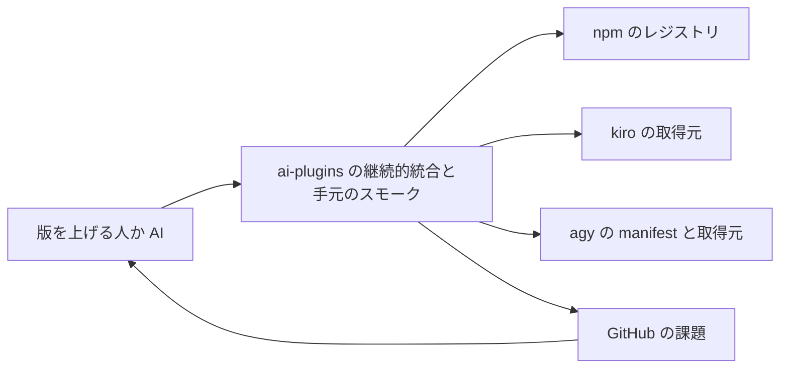
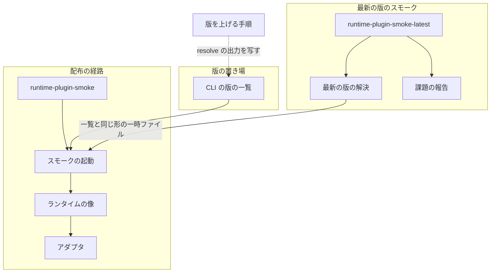
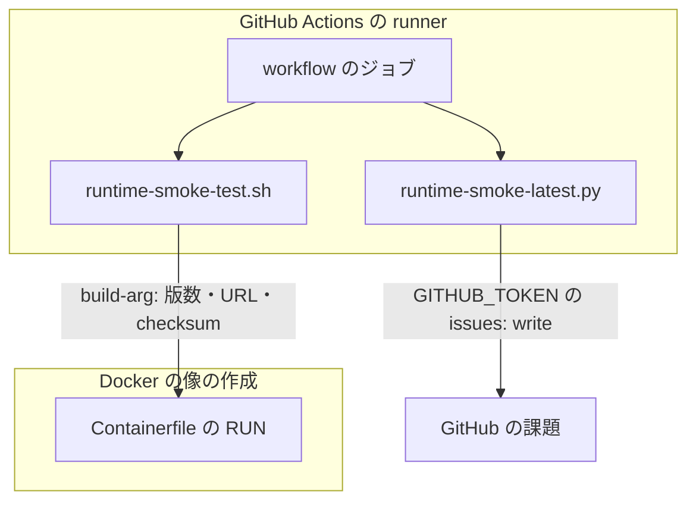
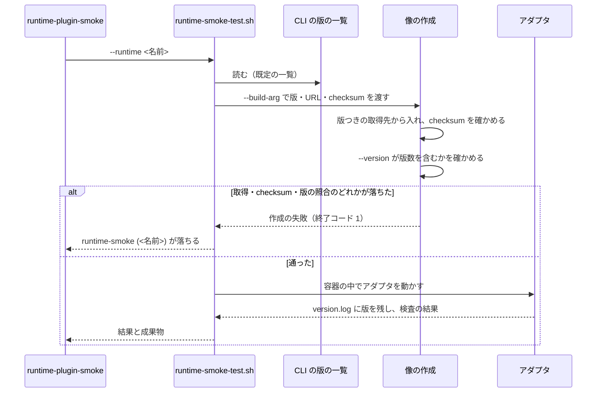
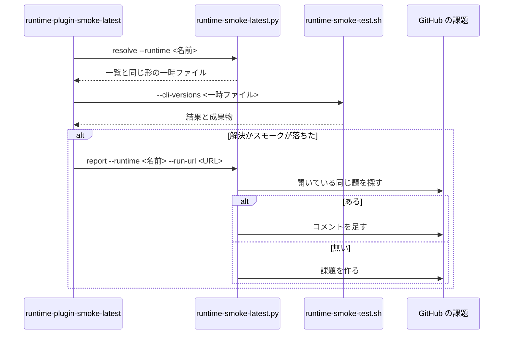

# 継続的統合のスモーク: 外部の CLI の版上げだけで本番の配布の継続的統合が落ちる → 配布の経路はリポジトリに書いた版の CLI だけを入れ、最新の版は毎日別の workflow で試して落ちたら課題に残る（#1982）

## 目的

- **何が壊れているか**: 継続的統合のスモークが 4 ランタイムの CLI を版を決めずに最新で入れる。2026-10-13 の本番 10.17.74 では、agy 1.3.4 の出力の変化だけで main 宛の PR 1976 の `runtime-smoke (agy)` が落ちた
- **誰が困るか**: 配布を承認する利用者（承認ゲート 2 の出し直しが要った）と、本番のプランを回す conductor（7 回打ち直して上限で止まった。#1983）
- **直すと何が成り立つか**: 配布の可否は、こちらの変更とリポジトリに書いた版だけで決まる。新しい版との食い違いは配布の経路の外で毎日試され、落ちたら課題として残る

## 適用範囲

- **働く範囲**: このリポジトリ（ai-plugins）の継続的統合と、手元の `scripts/runtime-smoke-test.sh` だけ。NDF の配布物（`plugins/`）は変えない
- **プロジェクトごとに違うもの**: 無し（ai-plugins の継続的統合の中だけの仕組みで、他のリポジトリへ配らない）
- **当たるモード**: `standard`

## あるべき姿の根拠

| 根拠 | 種類 | 何を示すか |
| --- | --- | --- |
| PR 1976 の run 38353378585 で `runtime-smoke (agy)` が agy 1.3.4 の出力の変化だけで落ちた | 実測 | 版を固定しないと、こちらの変更と関係なく配布の経路が落ちる |
| develop への push の run 38354639580 の `version.log`（2026-10-13 取得）で、kiro だけ `kiro-cli is not available; using installer fallback` | 実測 | `\|\| true` で取得の失敗を読み飛ばすと、CLI が入らないまま通る。kiro は今まで一度も入っていない |
| node:22-bookworm-slim の中で kiro 2.30.0 の glibc 版の `install.sh` が「glibc 2.39 以上が要る」で止まり、musl 版は `kiro-cli 2.30.0` を返した（2026-10-13、aarch64 で実測） | 実測 | kiro は musl 版の tarball で入れる |
| `https://prod.download.cli.kiro.dev/stable/<版>/manifest.json` が 403、tarball は 200（2.29.0・2.30.0） | 実測 | kiro の版ごとの checksum は取得元から引けない。こちらで持つ |
| agy の manifest（`.../manifests/linux_amd64.json`・`linux_arm64.json`）は最新の `version`・`url`・`sha512` だけを返し、`url` は版とビルド番号を含む | 実測 | agy の固定は版ごとの `url` と `sha512` を持てば成り立つ |
| `@openai/codex@0.162.1` を npm で入れ、`codex --version` が `codex-cli 0.162.1` を返した | 実測 | codex は版つきの npm の取得先で入れられる |
| GitHub Actions の文書「GITHUB_TOKEN で起こしたイベントは新しい workflow の実行を作らない」 | 外部の一次情報 | workflow が作った PR では必須のチェックが走らず、そのままマージできない |
| リポジトリの可視性は PUBLIC（`gh repo view` で 2026-10-13 に確認） | 実測 | 毎日の定期の起動の分の実行時間は課金されない。60 日動きが無いと定期の起動が止まる規則が当たる |

要求と受け入れ条件は #1982 の本文にある（コピーは `issues/issue-1982-requirements.md`）。この文書は「どう作るか」だけを扱う。

## ドメインモデル

### コンテキスト

| コンテキスト | 何の語が 1 つの意味に決まるか |
| --- | --- |
| このリポジトリの開発の検査（`repo-dev-checks`） | スモークが入れる CLI の版、配布の経路のスモーク、最新の版のスモーク |

1 つのコンテキストに収まる。外部の CLI の配布元（npm・kiro と agy の取得元）は変えられない外部の系で、アダプタ（`tests/runtime-smoke/adapters/`）が出力の形の違いを吸収する。

### 集約

| 集約 | 持ち主（書き換えてよいもの） | 根 | エンティティ | 値オブジェクト |
| --- | --- | --- | --- | --- |
| CLI の版の一覧 | 版を上げる PR（人か AI が出す）。workflow は書き換えない | 一覧のファイル `tests/runtime-smoke/cli-versions.env` | ランタイムごとの組（claude・codex・kiro・agy） | 版数・取得先の URL・checksum |
| 最新の版のスモークの失敗の課題 | `scripts/runtime-smoke-latest.py report` | 課題（ランタイムごとに 1 件） | 課題へ足すコメント | 落ちたランタイム・入れた版・実行の URL |

### 不変条件

| # | 集約 | 条件 | 破れたときの扱い |
| --- | --- | --- | --- |
| I1 | CLI の版の一覧 | 配布の経路のスモークの像に入った CLI の `--version` の出力は、一覧の版数を含む | 像の作成が落ち、スモークが落ちる |
| I2 | CLI の版の一覧 | Containerfile が宣言する `ARG` の名前の集合と、一覧のキーの集合が一致し、どの値も空でなく、`ARG` は既定値を持たない | 検査のテストが落ちる。手元と継続的統合では、値の無い `ARG` で像の作成が落ちる |
| I3 | CLI の版の一覧 | 配布の経路の取得先は、版数を含む取得先だけ（`latest`・版を受けないインストーラを使わない） | 検査のテストが落ちる |
| I4 | 最新の版のスモークの失敗の課題 | 同じランタイムの開いている失敗の課題は高々 1 件 | 2 度目以降はコメントを足し、新しい課題を作らない |
| I5 | 最新の版のスモークの失敗の課題 | 最新の版のスモークは PR と push で起動せず、書き込みの権限は `issues: write` だけ | 検査のテストが落ちる |

### ドメインイベント

| # | イベント | 発生元 | 受け手 |
| --- | --- | --- | --- |
| E1 | リポジトリに CLI の版を書いた | 固定を入れる PR・版を上げる PR | 配布の経路のスモーク（push の絞り込み `tests/runtime-smoke/**` と PR の起動） |
| E2 | 配布の経路のスモークが書いた版の CLI を入れた | `scripts/runtime-smoke-test.sh`（像の作成） | アダプタ（`version.log` に版を残す） |
| E3 | 配布の経路のスモークが結果を返した | `runtime-plugin-smoke.yml` の `runtime-smoke (<ランタイム>)` | ruleset の必須のチェック |
| E4 | 最新の版のスモークが起動した | 定期の起動（毎日）・手での起動 | `runtime-plugin-smoke-latest.yml` |
| E5 | 最新の版のスモークが各ランタイムの最新の CLI を入れて結果を返した | `runtime-smoke-latest.py resolve` と `runtime-smoke-test.sh` | 実行のまとめ（step summary）と成果物 |
| E6 | 最新の版のスモークの失敗が課題として残った | `runtime-smoke-latest.py report` | 人か AI（版を上げる PR かアダプタの修正を出す） |
| E7 | 人か AI が版を上げる PR を出した | 人か AI | E1 と同じ |

### 用語

| 用語 | 意味 | 用語集への反映 |
| --- | --- | --- |
| CLI の版の一覧 | スモークの像へ入れる 4 ランタイムの CLI の版数と取得先と checksum を書いたファイル（`tests/runtime-smoke/cli-versions.env`）。版を上げるときに書き換える唯一の場所 | 追加（`repo-dev-checks`） |

「配布の経路」と「最新の版のスモーク」は要求の前提 0 のとおり、この課題の中だけの言い方として使い、用語集へ足さない。

## 機能一覧

| # | 機能 | 誰が使うか |
| --- | --- | --- |
| F1 | 配布の経路のスモークが、CLI の版の一覧に書いた版の CLI を 4 ランタイムとも入れる | 継続的統合（develop・main 宛の PR と push）、手元の実行、認証つきのスモーク |
| F2 | 書いた版と違う CLI が入ったら、像の作成が落ちる | 継続的統合、手元の実行 |
| F3 | 最新の版のスモークが、その時点の最新の版を解決して同じ手順で走り、入れた版を残す | 定期の起動（毎日）、手で起動する人 |
| F4 | 最新の版のスモークが落ちたら、ランタイムごとに 1 件の課題を作るか、開いている課題へコメントを足す | 版を上げる人か AI |
| F5 | 最新の版を CLI の版の一覧の形で出し、版を上げるときに写せる | 版を上げる人か AI |

## 構成要素

| 要素 | 責務 |
| --- | --- |
| CLI の版の一覧（`tests/runtime-smoke/cli-versions.env`、新設） | 4 ランタイムの版数・取得先・checksum を `KEY=VALUE` の行で持つ。ランタイムごとにキーの接頭辞（`CLAUDE_CODE_`・`CODEX_`・`KIRO_CLI_`・`AGY_`）で 1 か所にまとまる |
| ランタイムの像（`tests/runtime-smoke/Containerfile.{claude,codex,kiro,agy}`、変更） | 既定値の無い `ARG` で版を受け、版数を含む取得先から入れ、`--version` の出力が版数を含むことを作成の中で確かめる |
| スモークの起動（`scripts/runtime-smoke-test.sh`、変更） | 一覧を読み、各行を `--build-arg` として像の作成へ渡す。`--cli-versions <パス>` で別の一覧を受ける（既定は `tests/runtime-smoke/cli-versions.env`） |
| アダプタ（`tests/runtime-smoke/adapters/kiro.sh`・`agy.sh`、変更） | CLI が無いときに読み飛ばす分岐を外す。kiro の版は `kiro-cli --version` で残す |
| 最新の版の解決と課題の報告（`scripts/runtime-smoke-latest.py`、新設） | `resolve` が取得元の最新の版を一覧と同じ形で出す。`report` が失敗の課題を作るか、開いている課題へコメントを足す |
| 最新の版のスモーク（`.github/workflows/runtime-plugin-smoke-latest.yml`、新設） | 毎日と手で起動し、develop を取り出して `resolve` → スモーク → 失敗なら `report` をランタイムごとに回す |
| 版を上げる手順（`tests/runtime-smoke/README.md`、変更） | どのファイルのどの行を書き換え、何で確かめるかを書く。「版の固定なしで導入する」の記述を消す |
| 確定仕様（`docs/specifications/runtime-plugin-container-smoke.md`、変更） | 「継続的統合は最新版を導入する」の記述を、固定した版を入れる形へ直す |
| 検査のテスト（`scripts/tests/test_runtime_smoke_versions.py`・`test_runtime_smoke_latest.py`、新設） | I2・I3・I5 を静的に、I4 と `resolve` の解釈を偽の応答で縛る |

下の図には、処理の流れに加わらない確定仕様と検査のテストを含めない。

変えないもの: `runtime-plugin-smoke.yml`（ジョブ名・matrix・`ci-scope` の判定）、`runtime-plugin-authenticated-smoke.yml`（既定の一覧を読むため変更が要らない）、`Containerfile.base`、`scripts/ci-heavy-skip.py`、`scripts/required-checks-allow.json`、`.ndf/`。

### 文脈



### 構成要素の関係



### 配置



### 置き場所

```text
.github/workflows/
├── runtime-plugin-smoke.yml          （変えない）
└── runtime-plugin-smoke-latest.yml   （新設）
scripts/
├── runtime-smoke-test.sh             （変更: --cli-versions）
├── runtime-smoke-latest.py           （新設: resolve / report）
└── tests/
    ├── test_runtime_smoke_versions.py（新設）
    └── test_runtime_smoke_latest.py  （新設）
tests/runtime-smoke/
├── cli-versions.env                  （新設）
├── Containerfile.{claude,codex,kiro,agy}（変更）
├── README.md                         （変更）
└── adapters/{kiro,agy}.sh            （変更）
```

## 入出力の契約

### CLI の版の一覧（`tests/runtime-smoke/cli-versions.env`）

| 項目 | 書くこと |
| --- | --- |
| 形 | 1 行 1 つの `KEY=VALUE`。`#` で始まる行と空行は読み飛ばす。値は引用符で囲まない |
| キー | 下の表の 10 個。`ARG` の名前と同じ |
| 失敗の形 | キーが欠ける・値が空 → 像の作成が落ちる（`ARG` に既定値が無い）。検査のテストも落ちる |
| 互換性 | 新設。既存の呼び出し側は無い |

| キー | 値 | 2026-10-13 の候補 |
| --- | --- | --- |
| `CLAUDE_CODE_VERSION` | npm の `@anthropic-ai/claude-code` の版数 | `2.1.296` |
| `CODEX_VERSION` | npm の `@openai/codex` の版数 | `0.162.1` |
| `KIRO_CLI_VERSION` | kiro の版数 | `2.30.0` |
| `KIRO_CLI_SHA256_X86_64` / `KIRO_CLI_SHA256_AARCH64` | `kirocli-<arch>-linux-musl.tar.gz` の sha256 | 最新の manifest の値 |
| `AGY_VERSION` | agy の版数 | `1.3.4` |
| `AGY_URL_X86_64` / `AGY_URL_AARCH64` | manifest の `url` | `.../1.3.4-5524158944247808/linux-x64/cli_linux_x64.tar.gz` ほか |
| `AGY_SHA512_X86_64` / `AGY_SHA512_AARCH64` | manifest の `sha512` | 最新の manifest の値 |

arch の名前は `uname -m` の値（`x86_64` / `aarch64`）に揃える。継続的統合の runner は x86_64、手元の Docker は aarch64 で動く（2026-10-13 に確認）。

候補は 2026-10-13 の develop の push の run 38354639580 で claude・codex・agy が通った版と、kiro の最新である。前提 3 のとおり、実装で 4 ランタイムのスモークが通る版を採る。

### `scripts/runtime-smoke-test.sh` に足す引数

| 項目 | 書くこと |
| --- | --- |
| 名前 | `--cli-versions <パス>`（`--cli-versions=<パス>` も受ける） |
| 入力 | CLI の版の一覧の形のファイル。省くと `tests/runtime-smoke/cli-versions.env` |
| 出力 | 各行を `--build-arg KEY=VALUE` として各ランタイムの像の作成へ渡す。読んだ一覧を成果物の `cli-versions.env` に写す |
| 失敗の形 | ファイルが無い・読めない → 終了コード 2（既存の引数の誤りと同じ）。値の欠けは像の作成の失敗として 1 |
| 互換性 | 既存の呼び出し（`runtime-plugin-smoke.yml`・認証つきのスモーク・手元）は引数を変えずに固定した版を入れる |

### `scripts/runtime-smoke-latest.py`

| 副命令 | 入力 | 出力 | 失敗の形 |
| --- | --- | --- | --- |
| `resolve --runtime <claude\|codex\|kiro\|agy\|all>` | 取得元の最新（claude・codex は npm の `dist-tags.latest`、kiro は `stable/latest/manifest.json`、agy は `manifests/linux_amd64.json` と `linux_arm64.json`） | 標準出力へ、そのランタイムのキーを一覧と同じ形で出す | 取得元に届かない・形が読めない → 終了コード 1、標準エラーへ取得元の URL |
| `report --runtime <名前> --run-url <URL> [--versions <パス>] [--repo <owner/name>]` | 落ちたランタイム・実行の URL・入れた版の一覧（解決に失敗したときは無い） | 題が `最新の版のスモークが落ちた: <ランタイム>` の開いている課題があればコメントを足し、無ければ作る。本文とコメントにランタイム・入れた版（無ければ「解決できなかった」）・実行の URL を書く | `gh` が失敗 → 終了コード 1（workflow の実行が失敗として残る。E6 の失敗） |

課題の本文に GitHub の closing keywords（`Closes` などの後に番号を書くと、マージで課題を閉じる機能）は書かない。

### `.github/workflows/runtime-plugin-smoke-latest.yml`

| 項目 | 書くこと |
| --- | --- |
| 起動 | `schedule`（毎日 21:00 UTC = 06:00 JST）と `workflow_dispatch`（入力 `ref`、既定 `develop`）だけ。`pull_request` と `push` を持たない |
| 権限 | `contents: read`・`issues: write` だけ。秘密は渡さない |
| ジョブ | `runtime-smoke-latest`、matrix `runtime: [claude, codex, kiro, agy]`、`fail-fast: false`。チェックの名前は `runtime-smoke-latest (<ランタイム>)` で、必須のチェック `runtime-smoke (<ランタイム>)` と重ならない |
| 同時の実行 | `concurrency` で 1 つずつ並べ、取り消さない（定期と手の起動が重なっても課題が 2 件にならない） |
| 残すもの | 解決した一覧を step summary と成果物（`runtime-smoke-latest-<ランタイム>`）へ。成果物には `version.log` も入る |

## 処理の流れ

### 配布の経路



### 最新の版のスモーク



### 版を上げる手順（README に書く形）

1. `python3 scripts/runtime-smoke-latest.py resolve --runtime <名前>` を打つ（失敗の課題に載った版でもよい）
2. 出力の行で `tests/runtime-smoke/cli-versions.env` の同じ接頭辞の行を置き換える
3. 手元で `bash scripts/runtime-smoke-test.sh --runtime <名前> --with-secrets=off` を打ち、`tmp/runtime-smoke/<名前>/version.log` の版を見る
4. PR を出し、`runtime-smoke (<名前>)` が通ることを見る。落ちたらアダプタの修正を同じ PR か先の PR で入れる。失敗の課題はその PR で閉じる

## 非機能の実現方式

| 大項目 | 要求の条件 | 実現方式 | 確かめ方 |
| --- | --- | --- | --- |
| 可用性 | 外部の CLI の版上げだけで、配布の経路のスモークが落ちない | 配布の経路は CLI の版の一覧の版数を含む取得先だけから入れ、像の作成で版を照合する | 検査のテスト（I3）。固定を入れた PR の `version.log` の版が一覧と一致する |
| 運用・保守性 | 版を上げるときに書き換える場所は、ランタイムごとに 1 か所である | 版は一覧のファイルにだけ書き、ランタイムごとに接頭辞でまとまった行の組にする。Containerfile は版を持たない | 検査のテスト（I2）。README の手順で 1 ランタイムを上げ、差分が一覧の該当の行だけになる |
| セキュリティ | 最新の版のスモークの workflow に与える書き込みの権限は、課題か PR を作るのに要るものだけにする。秘密は今の認証なしのスモークと同じく渡さない | `permissions` を `contents: read`・`issues: write` に限り、`secrets` を参照せず `--with-secrets=off` で走らせる。kiro と agy の取得物は一覧の checksum で確かめる | 検査のテスト（I5）。手で起動した実行の権限の表示 |

`issues: write` を与えるのは認可の変更（共通原則の C2）に当たる。承認ゲート 2 で人が見る。

## 決定の記録

### 決定 1: 版を上げるときに書き換える場所を 1 つにするため、4 ランタイムの版を 1 つの一覧のファイルに置き、スモークの起動が build-arg で渡す

最新の版のスモークは、Containerfile を書き換えずにすべての版を差し替える必要がある。一覧を 1 つのファイルにすると、解決した最新の版を同じ形のファイルに書いて `--cli-versions` で渡すだけで同じ手順を通せ、版を上げる作業も解決の出力を写すだけになる。kiro と agy は版のほかに arch ごとの checksum と URL を持つため、Containerfile の 1 行の `ARG` では収まらない。

各 Containerfile の `ARG` の既定値に版を書く形は採らなかった。最新の版のスモークが既定値を上書きするため、版の出所が既定値と上書きの 2 つになる。

根拠: Value 6 / Value 4（MVV 版 2）

### 決定 2: 最新の版のスモークと配布の経路で同じ取得の手順を通すため、最新の版は先に具体的な版へ解決し、Containerfile は具体的な版だけを受ける

Containerfile に「`latest` なら公式のインストーラを使う」分岐を持たせると、配布の経路が通らない取得の手順が残り、受け入れ条件 3 の「`latest` を使わない」を手順の上で示せない。先に解決すれば、最新の版のスモークが入れた版は一覧の形でそのまま残り（受け入れ条件 7）、落ちた版を版を上げる PR へ写せる。

根拠: Value 6 / Value 3（MVV 版 2）

### 決定 3: 取得先が版を受けるようにするため、claude と codex は npm の版つきの取得先、kiro と agy は版つきの tarball と一覧に持つ checksum で入れ、公式のインストーラを使わない

codex・kiro・agy の公式のインストーラは版の無い URL から取る。kiro のインストーラは版を受けず、bookworm の glibc 2.36 では glibc 版が入らない（musl 版は入る。実測）。agy のインストーラは最新の manifest だけを読む。codex のインストーラは `--release` を受けるが、インストーラ自体が版の無い URL にある。kiro の版ごとの manifest は 403 で checksum を引けないため、kiro と agy の checksum は一覧に持ち、解決の副命令が最新の manifest から書く。

codex をインストーラの `--release` で固定する形は採らなかった。インストーラの中身が版を変えずに変わりうる。

根拠: Value 3（MVV 版 2）

### 決定 4: 書いた版が入らないまま通らないよう、取得の失敗を読み飛ばさず像の作成を落とし、作成の中で `--version` を一覧の版数と照らす（未決 2）

`|| true` のままでは、kiro が今まで一度も入らずに通っていた（run 38354639580 の `version.log`）。取得・checksum・版の照合のどれかが落ちれば像の作成が落ち、スモークが落ちる。これで CLI が無い状態は配布の経路で起こらないため、アダプタ（kiro・agy）の「CLI が無ければ読み飛ばす」分岐を外し、`version.log` には必ず版が載る。kiro の版は `kiro-cli --version` で残す（今の `--help` では版が読めない）。

`|| true` を残して `version.log` の照合だけを足す形は採らなかった。取得に失敗したまま検査の大半が読み飛ばされ、何を試したかが分からない結果が通る。

根拠: Value 1（MVV 版 2）

### 決定 5: 権限を最小にし、作ったものがそのまま使えるようにするため、最新の版のスモークが落ちたら課題を作り、PR は作らない（未決 1）

最新の版で落ちたときに要るのは、多くの場合アダプタの修正である。版だけを上げる PR は自分の必須のチェックで落ちる。workflow が `GITHUB_TOKEN` で作った PR では `pull_request` の workflow が走らず、必須のチェックの結果が返らないままになる（GitHub Actions の文書）。PR を作るには `contents: write` と `pull-requests: write` が要り、課題の `issues: write` より広い。

版を上げる PR を自動で作る形は採らなかった。上の 3 つの理由による。

根拠: Value 4 / C2（MVV 版 2）

### 決定 6: 同じ失敗を 1 件に集めるため、課題はランタイムごとの題で探し、開いていればコメントを足し、通っても閉じない

ランタイムごとに落ちる原因も直す PR も別であるため、ランタイムごとに 1 件にする。探すのは開いている課題の題の完全一致で、ラベルを使わない（ラベルを先に作る手順が増える）。閉じるのは、直す PR（版を上げる PR かアダプタの修正）である。通ったことを理由に閉じると、版を上げないまま課題が消える。

根拠: Value 4（MVV 版 2）

### 決定 7: 新しい版との食い違いを配布の前に見つけるため、最新の版のスモークは develop を毎日 1 回走らせる

次に配布するのは develop の中身であるため、develop の上で試す。claude は 2026-09-13〜10-13 の 30 日に 25 版を 21 日に分けて出しており（npm の `time` で実測）、週 1 回では本番の配布の日までに気づけない日がある。リポジトリは公開のため、毎日 4 ジョブの実行時間は課金されない。

main を試す形は採らなかった。main は配布が済んだ中身で、次の配布の前に気づく目的に合わない。

根拠: Value 1 / Value 3（MVV 版 2）

### 決定 8: 仕組みを増やさないため、定期の起動が止まったことに気づく仕組みは持たない（未決 3）

定期の起動が止まるのは、公開のリポジトリで 60 日動きが無いときである。このリポジトリは develop へ毎日のように push があり、当たる見込みが小さい。止まったことに気づく仕組みも定期の起動に頼るため、同じ条件で止まる。

根拠: Value 1（MVV 版 2）

### 決定 9: 判断の要らない手順をテストできる形で持つため、最新の版の解決と課題の報告を 1 本の Python スクリプトの 2 つの副命令にする

取得元ごとの JSON の読み方と、開いている課題を探して作るかコメントするかの分岐は、workflow の YAML に書くとテストできない。標準ライブラリと `gh` だけで書き、偽の応答でテストする。版を上げる手順も同じ `resolve` を使い、解決の書き手を 1 つにする。

根拠: Value 4 / Value 6（MVV 版 2）

## テスト設計

| 受け入れ条件・不変条件 | どの振る舞いで縛るか | どう壊したら落ちるべきか |
| --- | --- | --- |
| 1・I2 | 一覧のキーの集合と、4 つの Containerfile の `ARG` の名前の集合が一致し、値が空でなく、`ARG` が既定値を持たない | 一覧から 1 行を消す・`ARG` に既定値を足す・値を空にすると、検査のテストが落ちる |
| 2・I1 | 像の作成が `--version` の出力に一覧の版数を含むことを確かめる。固定を入れた PR の `version.log` が 4 ランタイムとも一覧の版を示す | 一覧の版数だけを別の実在する版に変えて checksum を合わせない、または版数を存在しない値にすると、像の作成が落ちる |
| 3・I3 | Containerfile の取得の行が一覧の値（`${...}`）を含む取得先だけを使い、`latest` と公式のインストーラの URL を含まない | Containerfile を `curl ... install.sh \| bash` や `@anthropic-ai/claude-code`（版なし）へ戻すと、検査のテストが落ちる |
| 4 | 固定を入れた PR で `runtime-smoke (<ランタイム>)` が 4 件とも通る | — （PR の継続的統合で見る） |
| 5・6・I5 | 最新の版のスモークの `on` が `schedule` と `workflow_dispatch` だけで、`permissions` が `contents: read`・`issues: write` だけ。`required-checks-check` が知らせを出さない | `on` に `pull_request` を足す・`permissions` に `contents: write` を足すと、検査のテストが落ちる |
| 7 | `resolve` が取得元の応答から一覧と同じ形の行を出す（4 ランタイム。kiro と agy は 2 つの arch） | 偽の応答の版数を変えると出力の版数が変わる。応答の形を壊すと終了コード 1 |
| 8 | `report` が開いている同じ題の課題が無いとき、ランタイム・版・実行の URL を書いた課題を作る | 偽の `gh` が作成の呼び出しを受けない、または本文に 3 つが無いと落ちる |
| 9・I4 | `report` が開いている同じ題の課題があるとき、作らずにコメントを足す。別のランタイムの題では作る | 題の比較を部分一致に変えると、別のランタイムの課題へコメントして落ちる |
| 10 | — （README の手順を手で 1 回通して確かめる。文言のテストは書かない） | — |
| 11 | `runtime-plugin-smoke.yml` を変えず、既存の `test_ci_heavy_skip.py`・`test_check_required_checks.py` が通る | ジョブ名を変えると `required-checks-check` が「消えた必須」で落ちる |
| `--cli-versions` | 無いパスを渡すと終了コード 2。省くと既定の一覧を読む | 既定のパスを変えると、認証つきのスモークの像の作成が落ちる |

マージ前の手動確認は要求の検証手段のとおり、ブランチの上で最新の版のスモークを手で起動し、取得か検査を一時的に落とした起動で課題ができること、2 度目で増えないことを見る。

## 設計の結果

| 課題 | 扱い | 取り込み先 | 触るファイル |
| --- | --- | --- | --- |
| #1982 | 実装する | — | `tests/runtime-smoke/cli-versions.env`、`tests/runtime-smoke/Containerfile.claude`、`tests/runtime-smoke/Containerfile.codex`、`tests/runtime-smoke/Containerfile.kiro`、`tests/runtime-smoke/Containerfile.agy`、`tests/runtime-smoke/adapters/kiro.sh`、`tests/runtime-smoke/adapters/agy.sh`、`tests/runtime-smoke/README.md`、`scripts/runtime-smoke-test.sh`、`scripts/runtime-smoke-latest.py`、`scripts/tests/test_runtime_smoke_versions.py`、`scripts/tests/test_runtime_smoke_latest.py`、`.github/workflows/runtime-plugin-smoke-latest.yml`、`docs/specifications/runtime-plugin-container-smoke.md` |

## 未確認のまま残ること

| 項目 | 内容 |
| --- | --- |
| codex を npm で入れたときのスモーク | `codex --version` は通った。公式のインストーラで入れた今の形と、プラグインの導入と hooks の検査の結果が同じかは、実装でスモークを走らせて決める。違えば GitHub の releases の版つきの tarball で入れる |
| kiro の CLI が入った状態のスモーク | 今まで kiro の CLI は入っていなかった。入った状態で kiro のアダプタと検査が通るかは、実装でスモークを走らせて決める |
| 実行中の自動更新 | Claude Code は `DISABLE_AUTOUPDATER=1` を像に置いて止める。agy と codex が実行中に自分を更新するかは確かめていない。`version.log` の版が一覧と違えば、実装で止め方を足す |
| 定期の起動の最初の実行 | 定期の起動は既定ブランチ（main）の workflow で動くため、配布で main に載るまで走らない。マージ後の最初の定期の起動はリリース後テストで確かめる |
| `.ndf/project.json` の継続的統合の一覧 | 新しい workflow は `ci.workflows` に載らない。解析を走らせ直すまでの食い違いで、`.ndf/` の書き換え（C7）はこの変更に含めない |
