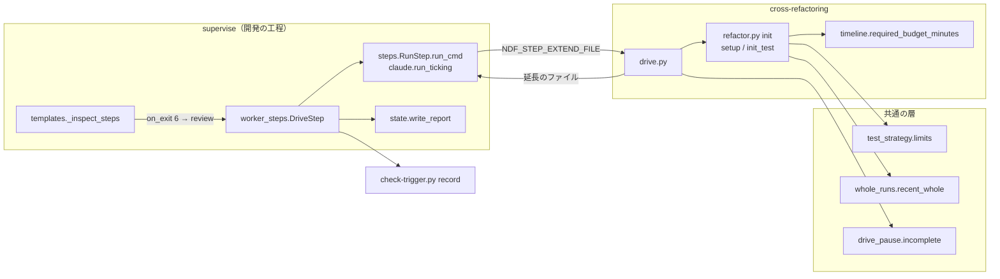
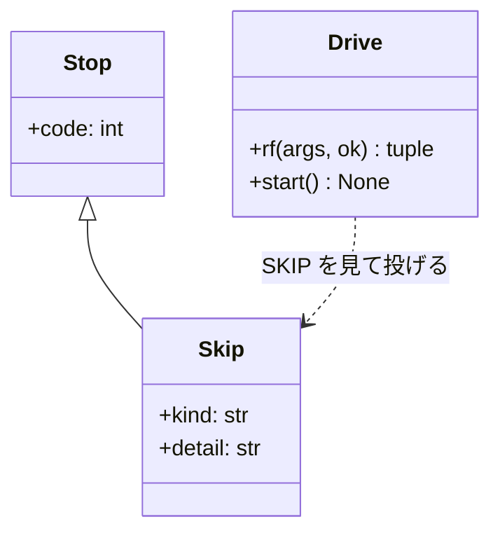
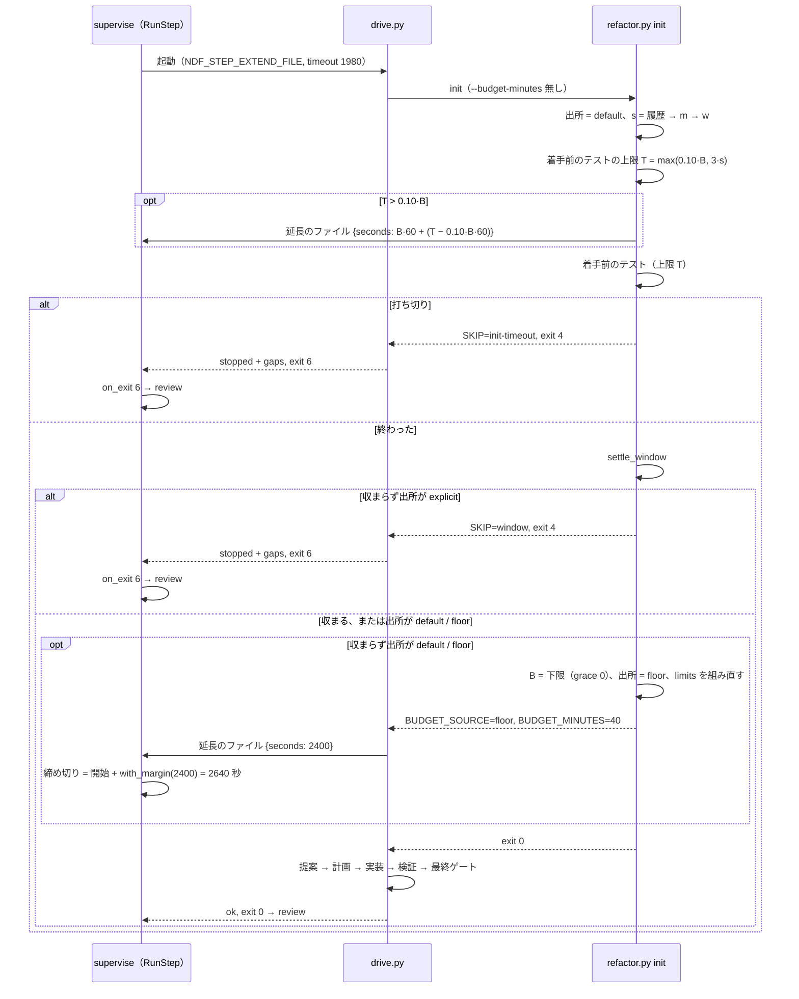

# 検査のプラン: 想定最大時間を省いてもリファクタリングが下限の時間で通り、収まらないときはコードレビューへ進む（#2047）

## 目的

- **何が壊れているか**: 検査のプランのリファクタリング（`refactor`）が、既定の想定最大時間 30 分と、想定最大時間の 10% で決まる着手前のテストの初回の上限（180 秒）のせいで、`refactor.py init` の終了コード 4 で落ちて abort へ進む。#2047 の本文には 2026-10-17 から 2026-10-31 までに 7 本の PR（#2043・#2053・#2103・#2152・#2250・#2268・#2283）の事例が積まれ、多くは conductor がプランを書き直して流し直した
- **誰が困るか**: 無人のキューで検査を流す開発者と conductor。検査の記録が「落ちた」になり、リファクタリングもコードレビューも行われない
- **直すと何が成り立つか**: 着手前のテストの初回の上限が既知の所要から決まる。想定最大時間を省いたプランは下限まで上げてリファクタリングを通し、明示した想定最大時間に収まらないときはリファクタリングを飛ばしてコードレビューへ進む。検査の記録とフェーズレポートには飛ばした理由が残る

## 適用範囲

- **働く範囲**: NDF の配布物（`cross-refactoring` の init と駆動、`supervise.py` の検査の雛形・駆動のステップ・検査の記録）。配布先のリポジトリの検査のプランでも同じに働く
- **プロジェクトごとに違うもの**: 想定最大時間は今どおり `--refactor-budget-minutes` か `.ndf/supervise.json` の `refactor_budget_minutes` で受ける。テストの所要は `.ndf/project.json` の `test_duration` と手元の全体テストの実測（`whole_runs`）から読む。新しい設定は足さない
- **当たるモード**: `standard`

## あるべき姿の根拠

| 根拠 | 種類 | 何を示すか |
| --- | --- | --- |
| PR #2250 の検査で、着手前のテストの上限が 180 → 540 → 1,620 秒と打ち切りのたびに 3 倍になり、2 回の打ち切りで約 13 分を失った。`.ndf/project.json` の `test_duration` は 1,518 秒を持っていた（#2047 の本文「発生の記録（2026-10-31、開発ループ l20261031 の周回 2）」） | 実測 | 初回の上限が既知の所要を読まないことが打ち切りの原因である |
| `refactor_lib/commands/setup.py` の `_verify_init` は、CI に任せる戦略で範囲テストの履歴が無いと `init_test_timeout = 0.10·B` にする（`init_test.resolve_scope_seconds` が `None` を返す） | 実測（コードを読んだ） | 履歴の無い初回は、B = 30 分で 180 秒に決まる |
| 着手前のテスト 335 秒で「`--budget-minutes` を 43 以上に」で止まった（#2047 の本文「再発（2026-10-25）」）。`timeline.required_budget_minutes(335, 19.5)` は 43、`(495, 19.5)` は 47、打ち直しの見込み 300 秒を引いた `(195, 19.5)` は 40 を返す（2026-10-31 に打って確かめた） | 実測 | 既定の 30 分は、全体テストが数分かかるリポジトリで下限に届かない。人が打ち直さないなら 300 秒の見込みは要らない |
| `supervise_lib/steps.py` の `fill_test_limit` は、テストのステップの上限をプランを書いた時点でなく流し始めた時点の実測から広げる（#1631 の決定 3） | 実測（コードを読んだ） | ステップの timeout を書いた後の実測で広げる前例がある（決定 4） |
| `supervise_lib/templates.py` の `review` のステップは、収束しなかった終わり（終了コード 6 と `gaps`）を `on_exit` で後続へ進める（#2227 の決定 1） | 実測（コードを読んだ） | 欠けの残る結果を abort へ回さずに進める経路が既にある（決定 3） |

要求と受け入れ条件は #2047 の本文にある（コピーは `issues/issue-2047-requirements.md`）。この文書は「どう作るか」だけを扱う。受け入れ条件の番号はコピーの「受け入れ条件」の 1〜8 を指す。

## ドメインモデル

### コンテキスト

| コンテキスト | 何の語が 1 つの意味に決まるか |
| --- | --- |
| cross-refactoring（`ndf-cross-refactoring`） | 想定最大時間・想定最大時間の下限・着手前のテスト・手順の枠・想定最大時間の出所・時間の枠の不足 |
| 開発の工程（`ndf-workflow`） | プラン・ステップ・欠け・欠けの残る結果・検査の記録・フェーズレポート・ステップの延長 |

関係は公開された言語である。cross-refactoring の駆動（`drive.py`）は、共通の結果 JSON の形（`lib/step_result.py`。`status`・`gaps`・終了コード 6）とステップの延長のファイルの形（決定 4）で開発の工程へ伝える。開発の工程は cross-refactoring の状態ファイルを読まない。

### 集約

| 集約 | 持ち主（書き換えてよいもの） | 根 | エンティティ | 値オブジェクト |
| --- | --- | --- | --- | --- |
| リファクタリングの実行 | `refactor.py init`（`refactor_lib/commands/setup.py`・`refactor_lib/init_test.py`） | 状態ファイル（`state.json`） | 着手前のテスト（`baseline_test`） | 想定最大時間と出所（`budget_minutes`・`budget_source`・`budget_floor`）・時間の上限の表（`limits`） |
| 駆動の結果 | `cross-refactoring/scripts/drive.py` | 結果 JSON | 欠け（`gaps` の 1 件） | 終了コード・件数（`metrics`） |
| プランの実行 | `supervise.py run`（`supervise_lib/engine.py`・`worker_steps.py`・`steps.py`・`claude.py`） | 実行の状態（`state.json` の `log`） | ステップの試行 | ステップの締め切り・延長の記録（`cur.extended_timeout`）・欠け（`cur.gaps`） |
| 検査の記録 | `check-trigger.py record` | 検査の行（`kind: check`） | — | 件数（`findings`） |

プランの雛形（`supervise_lib/templates.py` の `_inspect_steps`）はプランの実行の集約へ入る前の書き出しで、`refactor` のステップの `on_exit` を持つ。

### 不変条件

| # | 集約 | 条件 | 破れたときの扱い |
| --- | --- | --- | --- |
| I1 | リファクタリングの実行 | 着手前のテストの上限は、想定最大時間 B があれば `max(0.10·B, 3·s)`。s は「同じ範囲の配分の履歴（CI に任せる戦略だけ）→ 手元の全体テストの直近の実測 m → 宣言の w → 無し」の順に採り、無しなら `0.10·B` | 単体テストで落とす |
| I2 | リファクタリングの実行 | `budget_source` が `explicit` の実行では、`init` は `budget_minutes` を渡された値から変えない | `init` のテストで落とす |
| I3 | リファクタリングの実行 | `budget_source` が `default` か `floor` の実行で手順の枠が収まらないとき、`init` は `budget_minutes` を `required_budget_minutes(o, after, grace=0)` へ上げ、`budget_source` を `floor` にして `limits` を組み直す。組み直した `limits` で `window_problem` は `None` になる | `init` のテストで落とす |
| I4 | リファクタリングの実行 | `init` が `SKIP=<種類>` を出すのは、着手前のテストの打ち切り（`init-timeout`）と、`budget_source` が `explicit` で手順の枠が収まらないとき（`window`）の 2 つだけで、どちらも終了コード 4 のまま終わる。ほかの中断は `SKIP` を出さない | `init` のテストで落とす |
| I5 | 駆動の結果 | 駆動は `init` が `SKIP` を出した中断だけを欠けの残る結果（`stopped`・`gaps` 1 件・終了コード 6）で返す。ほかの中断は今どおり終了コード 1 で返す | 駆動のテストで落とす |
| I6 | プランの実行 | 雛形の書く `refactor` のステップは `on_exit` に `"6": "review"` だけを持つ。終了コード 1 は今どおり `on_fail` の `abort` へ行く | 雛形のテストで落とす |
| I7 | プランの実行 | ステップの延長は締め切りを後ろへずらすだけで、前へずらさない。延長した締め切りは「試行の開始 + `with_margin`（延長のファイルの秒）」で、今の締め切り（プランの `timeout` から決まるものか、それまでに延ばしたもの）より前なら使わない | 単体テストで落とす |
| I8 | 検査の記録 | リファクタリングを飛ばした検査の行は `findings.refactor_skipped` に種類と理由を持ち、飛ばしたことだけを理由に `result` を `failed` にしない。飛ばして進んだ後の工程（`review` など）が実際に失敗して abort した検査は、今どおり `failed` を記録する | `check-trigger.py` のテストで落とす |

### ドメインイベント

| # | イベント | 発生元 | 受け手 |
| --- | --- | --- | --- |
| E1 | 検査のプランを書いた（`refactor` のステップの `on_exit` と timeout が決まった） | `supervise.py new check` / `new sprint` / `new close`（`_inspect_steps`） | プランの実行 |
| E2 | リファクタリングのステップを始めた（延長のファイルの置き場を子へ渡した） | `supervise_lib/steps.py` の `RunStep.run_cmd` | 駆動（`drive.py`） |
| E3 | 着手前のテストの上限を決めた | `refactor.py init`（`_verify_init`） | 着手前のテスト（`baseline.run_baseline`）・延長のファイル（上限 T が `0.10·B` を超えるとき、テストを始める前に `init` が書く） |
| E4 | 着手前のテストが終わった / 打ち切られた | `baseline.run_baseline` | `init`（打ち切りなら E7 の飛ばした経路） |
| E5 | 想定最大時間が決まった（明示のまま / 下限まで上げた） | `init_test.settle_window` | 状態ファイル・標準出力・駆動（`BUDGET_SOURCE=floor` なら延長のファイルを書く） |
| E6 | 手順の枠が想定最大時間に収まった / 収まらなかった | `init_test.settle_window` | `init`（明示で収まらなければ E7 の飛ばした経路） |
| E7 | リファクタリングを終えた / 時間の枠に収まらず飛ばした | 駆動（`drive.py`） | プランの実行（終了コード 0 か 6 で `review` へ、1 で `abort` へ） |
| E8 | 検査がコードレビューへ進み、検査の記録にリファクタリングの結果を残した | プランの実行・`check-trigger.py record` | 検査の記録・フェーズレポート |

### 用語

| 用語 | 意味 | 用語集への反映 |
| --- | --- | --- |
| 想定最大時間の出所 | その実行の想定最大時間をどこから決めたか。`explicit`（引数か宣言で渡した）・`default`（省いて既定の 30 分を使った）・`floor`（省いて想定最大時間の下限まで上げた）の 3 つ。状態ファイルの `budget_source` | 追加（`ndf-cross-refactoring`） |
| 時間の枠の不足 | 着手前のテストが上限で打ち切られたか、明示した想定最大時間が想定最大時間の下限に届かないこと。`init` は `SKIP=init-timeout` / `SKIP=window` を出して終了コード 4 で止まり、駆動はリファクタリングを飛ばした欠けの残る結果を返す | 追加（`ndf-cross-refactoring`） |
| ステップの延長 | drive のステップの子孫（駆動と、駆動が起動した `init`）が、自分の見込みの秒を延長のファイル（環境変数 `NDF_STEP_EXTEND_FILE` の指すパス）へ書き、エンジンがその試行の締め切りを `with_margin` を足して後ろへずらすこと。前へはずらさない | 追加（`ndf-workflow`） |
| 着手前のテストの初回の上限 | 同じ範囲の打ち切りと実測が配分の履歴に無いときの、着手前のテストの上限（秒）。`max(0.10·B, 3·s)` で、s は手元の全体テストの直近の実測 m → 宣言の w の順に採る | 意味の変更（`ndf-cross-refactoring`。決め方を足した） |
| 範囲テストの所要 | CI に任せる戦略で、着手前に走らせる範囲テストの所要の見込み（秒）。同じ範囲の履歴の実測 → 手元の全体テストの直近の実測 m → 宣言の w の順に採る（w は範囲が全体テストを覆うかを問わない） | 意味の変更（`ndf-cross-refactoring`。出所に m を足し、w の条件を外した） |

## 機能一覧

| # | 機能 | 誰が使うか |
| --- | --- | --- |
| F1 | 着手前のテストの上限を、履歴が無いときは既知の所要（m → w）から決める | `refactor.py init` |
| F2 | 想定最大時間を省いた実行で、手順の枠が収まらなければ下限まで上げて続け、出所を状態と標準出力に残す | `refactor.py init` |
| F3 | 時間の枠の不足を `SKIP` で知らせ、駆動が欠けの残る結果に変える | `refactor.py init`・`drive.py` |
| F4 | 検査の雛形の `refactor` のステップが、欠けの残る結果（6）をコードレビューへ進める | `supervise.py new check` / `new sprint` / `new close` |
| F5 | 駆動の子が書いた見込みの秒で、drive のステップの締め切りを延ばす | `supervise.py run` |
| F6 | 検査の記録とフェーズレポートに、飛ばしたことと理由を残す | `check-trigger.py record`・`supervise.py run` の報告 |

## 構成要素

| 要素 | 責務 | 変える中身 |
| --- | --- | --- |
| `plugins/ndf/scripts/lib/test_strategy.py` の `limits` | 予算があるときの `init_test_timeout` を出す | 戦略を問わず、`scope_seconds` を渡されたら `max(0.10·B, 3·s)` にする（今は CI に任せる戦略だけ）。`whole_timeout`・`test_timeout`・`ci_wait_timeout` と予算なしの表は変えない |
| `refactor_lib/init_test.py` の `resolve_scope_seconds` | 着手前のテストの所要の見込み s と出所を決める | I1 の順に変える。出所に `recent`（m）を足し、`whole`（w）は置き場所が全体テストを覆うかを問わずに使う。CI に任せる戦略でなければ履歴を読まず m → w を採る |
| `refactor_lib/init_test.py` の `settle_window`（新設。`stop_if_window_short` を置き換える） | 手順の枠を確かめ、出所に応じて上げるか止める | I3 と I4。上げたら `budget_floor` を書いて保存し、`ℹ` の 1 行を出す。明示で収まらなければ `SKIP=window` を出してから今の文で止まる |
| `refactor_lib/init_test.py` の `abort_timed_out` | 着手前のテストの打ち切りで止める | 止まる前に `SKIP=init-timeout` と `SKIP_DETAIL` を出す |
| `refactor_lib/timeline.py` の `required_budget_minutes` | 想定最大時間の下限を出す | 引数 `grace_seconds`（既定 `RESUME_GRACE_SECONDS`）を足す。`settle_window` の上げる経路だけ 0 を渡す |
| `refactor_lib/commands/setup.py` の `cmd_init`・`_resume`・`_build_initial_state`・`_emit_init` | `init` の順序と状態の組み立て | 既定を埋める前に出所を決めて状態へ書く。`_verify_init` が m を読み、上限 T が `0.10·B` を超えたら、着手前のテストを始める前に延長のファイル（環境変数 `NDF_STEP_EXTEND_FILE` があるときだけ）へ `B·60 + (T − 0.10·B·60)` を書く。2 か所の `stop_if_window_short` を `settle_window` に替える。`_emit_init` に `BUDGET_SOURCE` を足す |
| `refactor_lib/plan.py` の上限の節（計画のコメントの「入力:」の行）と `_verify_init` の `info` の行 | s と出所を読み手へ示す | 「範囲テストの所要 s」の呼び名を「着手前のテストの所要の見込み s」に替え、出所の `recent` を表示できるようにする（ほかの戦略でも s が入るため） |
| `refactor_lib/allocation.py` の `build_row` | 実行の行を配分の履歴へ書く | `budget_source` の列を足す |
| `refactor_lib/commands/report.py` | 実行の報告 | 想定最大時間の行に出所を添える（`floor` なら「下限から決めた」と既定の分） |
| `cross-refactoring/scripts/drive.py` | 1 回の実行を進めて結果 JSON を返す | `rf` が `SKIP` を見て `Skip` を投げ、`refactor_drive` がそれを欠けの残る結果に変える。`start` の後、`BUDGET_SOURCE=floor` なら延長のファイルを書く |
| `plugins/ndf/scripts/lib/drive_pause.py` | 駆動の結果の形と終了コード | 欠けを 1 件持つ中断の結果を組む `incomplete(tool, summary, metrics, gap)` を足す（終了コード 6） |
| `supervise_lib/templates.py` の `_inspect_steps` | 検査の assess・refactor・review を書く | `refactor` に `"on_exit": {"6": "review"}` を足す。`timeout` と `cmd` は変えない |
| `supervise_lib/steps.py` の `RunStep.run_cmd` と `supervise_lib/claude.py` の `run_ticking` | ステップのコマンドを締め切りまで待つ | drive のステップだけ、試行ごとに延長のファイルのパスを環境変数で渡し（前の試行のファイルは消す）、待ちの周期ごとに読んで締め切りを延ばす（I7）。延ばしたら `cur.extended_timeout` と進捗ログの 1 行に残す |
| `supervise_lib/worker_steps.py` の `DriveStep.execute` | drive のステップの結果を控える | 欠けの残る結果の `gaps` を `cur.gaps` に控える |
| `supervise_lib/state.py` の `write_report` | フェーズレポート | `- 欠けを残して進んだステップ: <id>（<種類>: <理由>）` の行を足す（`cur.gaps` を持つ試行。無ければ「無し」） |
| `plugins/ndf/scripts/check-trigger.py` の `findings_of` | 検査の行の件数 | `refactor` の件数の `skipped`（種類と理由）を `findings.refactor_skipped` へ写す |
| `cross-refactoring/SKILL.md`・`cross-refactoring/docs/01-state-and-propose.md` | 引数の既定と駆動の終了コードの表を利用者へ示す | `--budget-minutes` の既定の欄を「省けば 30。手順の枠が収まらなければ下限まで上げる」にし、駆動の終了コードの表に 6（時間の枠の不足で飛ばした）の行を足す。`init` の順序に `settle_window` を書く |



## 構造

型は増やさない。足すのは状態ファイルの欄・駆動の例外 1 つ・関数 2 つ（`settle_window`・`incomplete`）である。



`Skip` は `Stop` を継ぐ。`refactor_drive` の `except Stop` より前で `Skip` を捕まえ、`drive_pause.incomplete` で返す。捕まえ損ねても `Stop` として今の中断（終了コード 1）に落ちるため、abort へ進む今の振る舞いより悪くならない。

## データ構造

### 状態ファイルに足す欄（`refactor_lib` の `state.json`）

既存の欄は消さず、意味も変えない。`budget_minutes` は上げた後の値を持つ。

| 置き場 | 欄 | 型 | 中身 | 書く者 | 読む者 |
| --- | --- | --- | --- | --- | --- |
| 根 | `budget_source` | str | `explicit` / `default` / `floor` | `cmd_init`（新規）・`_resume`（引数を渡したら `explicit`）・`settle_window`（上げたら `floor`） | `settle_window`・`_emit_init`・`build_row`・`report` |
| 根 | `budget_floor` | dict / 無し | 上げたときだけ: `from_minutes`（上げる前）・`minutes`（上げた後）・`offset_seconds`（o）・`after_plan_minutes`・`at` | `settle_window` | `report` |
| `baseline_test` | `scope_source` | str / null | 出所に `recent` を足す（`history` / `recent` / `whole` / null） | `_verify_init` | `timeline.test_limits`・計画のコメントの「入力:」の行 |

`budget_source` を持たない状態ファイル（この変更より前に作った実行）は `explicit` として読む。今の振る舞い（止まる）に倒すためである。

### 配分の履歴の実行の行（`allocation.build_row`）

| 列 | 型 | 中身 |
| --- | --- | --- |
| `budget_source` | str | 状態の `budget_source`。列を持たない旧い行は読む側で `null` として扱い、集計（`build_table`）には使わない |

`init_test` の行は変えない。上げる前の B で走らせたため、`budget_minutes` は上げる前の値のまま残る。

### 延長のファイル（`NDF_STEP_EXTEND_FILE` の指すパス）

| 項目 | 型 | 中身 |
| --- | --- | --- |
| `seconds` | int | 子孫が見込む、この試行の開始からの所要の上限（秒）。`init` は着手前のテストの前に `B·60 + (T − 0.10·B·60)`（T は E3 で決めた上限）を、駆動は想定最大時間を上げた後に `budget_minutes × 60` を書く。後から書いた値が今の締め切りより小さければ締め切りは変わらない（I7） |
| `reason` | str | 1 行の理由（例: `想定最大時間を下限の 40 分へ上げた`） |

置き場はプランの状態ディレクトリの `<試行の番号>-<ステップ>.extend.json`。書くのは `init`（E3）と駆動（E5）、読むのはエンジンだけで、試行の開始で消す。

### 検査の行（`check-trigger.py` の `findings`）

| 鍵 | 型 | 中身 |
| --- | --- | --- |
| `refactor_skipped` | dict / 無し | 飛ばしたときだけ: `kind`（`window` / `init-timeout`）・`reason`（`SKIP_DETAIL` の 1 行） |

## 入出力の契約

### `refactor.py init` の出力

| 鍵 | 出す時 | 値 |
| --- | --- | --- |
| `BUDGET_SOURCE` | 新規・再開の `_emit_init` | `explicit` / `default` / `floor` |
| `BUDGET_MINUTES` | 同上（今もある） | 上げた後の値 |
| `SKIP` | 時間の枠の不足で止まる直前 | `init-timeout` / `window` |
| `SKIP_DETAIL` | 同上 | 1 行の理由。`window` は「要る下限 N 分 > 想定最大時間 B 分（着手前のテスト x 秒）」で、N は打ち直しの見込みを足さない下限（決定 2 と同じ `grace_seconds=0`。人へ出す `❌` の文は今どおり 300 秒を足した値）、`init-timeout` は「着手前のテストが上限 T 秒で終わらなかった」 |

終了コードは変えない（0 / 4）。`SKIP` を読まない呼び手（手順書どおりの単独起動・この変更より前の駆動）は今どおり中断として扱う。

上げたときの標準エラーの 1 行（`statefile.info`）:

```text
ℹ 想定最大時間を省いたため、下限の 40 分へ上げました（既定 30 分では提案とリファクタリング計画の枠と計画の後の見込み 19.5 分が収まらない。着手前のテスト 495 秒）
```

### `drive.py` の結果 JSON（時間の枠の不足）

```json
{"tool": "cross-refactoring-drive", "status": "stopped",
 "summary": "時間の枠に収まらずリファクタリングを飛ばした: 要る下限 36 分 > 想定最大時間 30 分（着手前のテスト 335 秒）",
 "items": [], "metrics": {"skipped": {"kind": "window", "reason": "要る下限 36 分 > 想定最大時間 30 分（着手前のテスト 335 秒）"}, "exit": 4},
 "gaps": [{"kind": "refactor", "name": "window", "reason": "時間の枠に収まらず飛ばした: 要る下限 36 分 > 想定最大時間 30 分（着手前のテスト 335 秒）"}]}
```

終了コード 6。`metrics` は状態ファイルがあれば今の件数（`counts()`）に `skipped` を足し、無ければ（打ち切りは状態を保存する前）`skipped` と `exit` だけを持つ。summary と `reason` に「落ちた」「失敗」の語を入れない（進捗ログの `PROGRESS_FAIL` に当てない）。

### プランの `refactor` のステップ

```json
{"id": "refactor", "type": "drive", "drive": "cross-refactoring", "timeout": 1980,
 "cmd": "...", "on_exit": {"6": "review"}, "on_fail": "abort", "next": "review"}
```

`timeout` は今どおり（想定最大時間を省けば `with_margin(30 × 60)` = 1,980 秒）。延長はステップの延長が実行の時点で行う。

## 処理の流れ



図に含めない要素: 書き出しの時点に働く `templates._inspect_steps`（`on_exit` を書く）、`init` の中の `test_strategy.limits`・`whole_runs.recent_whole`・`timeline.required_budget_minutes`、終わった後に働く `allocation.build_row`・`report`・`plan.py` の上限の節・`worker_steps.DriveStep`（`cur.gaps`）・`state.write_report`・`check-trigger.py record`、利用者向けの文書（`SKILL.md`・`docs/01-state-and-propose.md`）、結果を組む `drive_pause.incomplete`。

時間の枠と関係の無い中断（起動の失敗・認証・最終ゲートの失敗・テンプレートの試走の不備）は `SKIP` を出さず、駆動は終了コード 1 を返し、`on_fail` の `abort` へ進む（受け入れ条件 7）。

再開（`_resume`）では、計画の前なら `settle_window` を同じに通す。引数で想定最大時間を渡せば出所は `explicit` になり、渡さなければ状態の出所のまま判定する。

## 非機能の実現方式

| 大項目 | 条件 | 実現方式 |
| --- | --- | --- |
| 性能・拡張性 | 初回の上限の延びは既知の所要の 3 倍まで | I1 の式。m・w が無ければ今と同じ `0.10·B` |
| 運用・保守性 | 上げたこと・飛ばしたことを記録だけで追える | 状態の `budget_source`・`budget_floor`、`init` の `ℹ` の 1 行、配分の履歴の `budget_source`、ステップの `cur.extended_timeout` と進捗ログ、フェーズレポートの「欠けを残して進んだステップ」、検査の行の `findings.refactor_skipped` |
| 移行性 | 書き出し済みのプランは書き直さない | プランの `on_exit` が無い旧いプランでは、欠けの残る結果（6）は今どおり `on_fail` の `abort` へ行く。`budget_source` の無い状態ファイルは `explicit` として読む |

## 決定の記録

### 決定 1: 初回の上限を既知の所要から決めるため、着手前のテストの所要の見込みを「履歴 → m → w」で全戦略に引く

着手前のテストの上限は `max(0.10·B, 3·s)` の 1 本にし、s の出所を `resolve_scope_seconds` の 1 か所で決める。CI に任せる戦略は範囲テストの履歴を先に採り、無ければ手元の全体テストの直近の実測 m、無ければ宣言の w を採る。範囲テストは全体テストの部分なので、全体テストの所要は上限の見込みとして上側に倒れる。ほかの戦略は今も `max(0.10·B, 3·w)` で、w の前に m を採るだけになる。

w を置き場所が全体テストを覆うときだけ使う今の条件は外す。覆わないときに s を無しにすると、#2250 と同じく 180 秒から 3 倍ずつ上がる。上限を `max(0.10·B, 3·m, 3·w)` にする形は採らない。w が CI の step の合計（1,518 秒）のとき、手元の 620 秒の実測があっても上限が 77 分になり、テストが固まったときの待ちが 3 倍の上限を大きく超える。

根拠: Value 3 / Value 6（MVV 版 3）

### 決定 2: 想定最大時間を省いた実行を止めないため、init が下限まで上げて続け、出所を状態に残す

想定最大時間を省いたとき（出所が `default`）、`init` は手順の枠が収まらなければ `budget_minutes` を下限へ上げ、出所を `floor` にして続ける。上げた下限には人が打ち直すまでの 300 秒を足さない。打ち直さずにその場で続けるため、o は着手前のテストの実測のまま伸びない（例: x = 495 秒・計画の後の見込み 19.5 分なら 40 分。今の案内は 47 分）。

プランを書く時点で supervise が想定最大時間を決める形は採らない。下限は着手前のテストの実測 x と計画の後の見込み（cross-refactoring の配分の履歴）から決まり、プランを書く時点ではどちらも分からない。式を supervise へ写すと、同じ役割の式が 2 か所に分かれる。

上げた後に組み直す `limits` の `init_test_timeout` は、上げた B から出した値になり、走らせたときの上限と食い違いうる（確定仕様の I9 は上げなかった実行だけに掛かる）。着手前のテストは 1 回の実行で 1 度しか走らないため、組み直した値は使われない。

想定最大時間を省いたときに上げる幅に上限を設けない（前提 2）。費用の上限を持ちたい利用者は `refactor_budget_minutes` を書けば、決定 3 の経路になる。

根拠: Value 2 / Value 6（MVV 版 3）

### 決定 3: 明示した想定最大時間を利用者の上限として守るため、収まらないときはリファクタリングを飛ばした欠けの残る結果として返し、コードレビューへ進める

出所が `explicit` で手順の枠が収まらないときと、着手前のテストが打ち切られたときは、`init` が `SKIP` を出して今どおり終了コード 4 で止まる。駆動はこの中断だけを欠けの残る結果（`stopped`・`gaps`・終了コード 6）に変え、検査の雛形は `on_exit` の `"6": "review"` でコードレビューへ進める。想定最大時間は黙って上げない。

時間の枠の不足を `refactor.py` の新しい終了コードで分ける形は採らない。`refactor.py` の終了コードは手順書と単独起動の呼び手が分岐に使っており、増やすと呼び手の分岐をすべて見直すことになる。`ABORT_DETAIL` と同じ KEY=VALUE の出力なら、読まない呼び手は今どおり中断として扱う。駆動の終了コード 6 は共通の結果 JSON の契約（`lib/step_result.py`）で「欠けの残る結果」の意味を既に持ち、エンジンも `on_exit` で読める。

根拠: Value 10 / Value 2 / Value 6（MVV 版 3）

### 決定 4: ステップの timeout で切られないため、想定最大時間を上げた駆動がステップの締め切りを実行の時点で延ばす

想定最大時間を省いたプランの `refactor` のステップは、`timeout` を今どおり既定の 30 分から書く。駆動は `init` が想定最大時間を上げたら、延長のファイルに `budget_minutes × 60` を書く。着手前のテストの上限 T が `0.10·B` を超えるとき（決定 1 の `3·s`）は、`init` がテストを始める前に `B·60 + (T − 0.10·B·60)` を書く。たとえば既知の所要が 1,518 秒なら T は 4,554 秒で、既定の 30 分なら 6,174 秒を書く。これが無いと、親が 1,980 秒で先に切り、上限内で終わるテストも、打ち切りの `SKIP` から `review` への遷移も届かない。エンジンは drive のステップの試行の待ちの周期ごとにそのファイルを読み、締め切りを「試行の開始 + `with_margin`（秒）」まで後ろへずらす。前へはずらさない。

プランを書く時点で timeout を大きく見込む形は採らない。上げた想定最大時間は x と計画の後の見込みで決まり、書く時点では上限を出せない。大きな固定値を置くと、テストが固まったときに待つ時間が根拠なく延びる。延ばす値を子が決め、余裕の式（`with_margin`）を supervise の 1 か所に残す。テストのステップの上限を流し始めた時点で広げる `fill_test_limit` と同じ考えである。

根拠: Value 4 / Value 6（MVV 版 3）

### 決定 5: 飛ばしたことを記録だけで追えるようにするため、検査の行とフェーズレポートに欠けの理由を写す

検査の行は `findings.refactor_skipped` に種類と理由を持ち、検査の終わり方（`merged` / `no_change`）は今どおり PR の状態から決める。フェーズレポートは `cur.gaps` を持つ試行を「欠けを残して進んだステップ」の行に並べる。この行は `review` の収束しなかった終わり（終了コード 6）にも同じに出る。

`refactor` だけを見る専用の行は作らない。欠けの残る結果は共通の契約で、エンジンは欠けの種類を知らなくても理由を写せる。

根拠: Value 7 / Value 6（MVV 版 3）

### 決定 6: 受け入れ条件 6 の「上限」は、着手前のテストの上限を除く時間の上限の表として読む

受け入れ条件 1・2 は、想定最大時間を明示したかを問わずに着手前のテストの初回の上限を変える。受け入れ条件 6 が変えないとする「上限」は、想定最大時間から決まる残りの値（`test_timeout`・`whole_timeout`・`ci_wait_timeout`・手順の枠・締め切り）として読む。m がある実行では、明示した想定最大時間でも着手前のテストの上限が `3·m` になる。

根拠: 根拠なし（MVV 版 3）

## テスト設計

| 受け入れ条件・不変条件 | どの振る舞いで縛るか | どう壊したら落ちるべきか |
| --- | --- | --- |
| 受け入れ条件 1・I1 | CI に任せる戦略で履歴が無く m = 620 のとき、`_verify_init` が着手前のテストへ渡す上限は 1,860 秒以上。ほかの戦略でも m があれば `3·m` を採る | m を読まない・w を先に採る・CI に任せる戦略でだけ効かせると落ちる |
| 受け入れ条件 2・I1 | m が無く w があれば上限は `3·w` 以上（置き場所が全体テストを覆わなくても）。どちらも無ければ `0.10·B` | `covers_whole` の条件を残す・無しのときに 0 や w を返すと落ちる |
| 受け入れ条件 3・I3 | 想定最大時間を省き、x = 495 秒で既定 30 分の枠が収まらない入力で、`init` は終了コード 0 で終わり、状態の `budget_minutes` が下限・`budget_source` が `floor`・`budget_floor` があり、標準エラーに `ℹ` の 1 行、出力に `BUDGET_SOURCE=floor` が出る。組み直した `limits` で `window_problem` は `None` | 上げずに 4 で止める・300 秒を足す・`limits` を組み直さないと落ちる |
| 受け入れ条件 3（再開） | 上げた実行を計画の前に引数なしで再開すると出所は `floor` のまま、引数を渡すと `explicit` になる | 再開で出所を `default` に戻す・引数を渡しても上げ続けると落ちる |
| 受け入れ条件 4・I7 | 延長のファイルに 2,400 秒を書いた子は、プランの `timeout` 1,980 秒を過ぎても切られず、2,640 秒で切られる。ファイルの秒がプランの値より小さければ締め切りは変わらない。`cur.extended_timeout` が残る | 延長を読まない・締め切りを前へずらす・余裕を足さない・前の試行のファイルを読むと落ちる |
| 受け入れ条件 1・I7（`init`） | 既定 30 分・s = 1,518 秒の入力で、`init` は着手前のテストを始める前に延長のファイルへ 6,174 秒を書く。T が `0.10·B` 以下なら書かない。後から駆動が小さい秒を書いても締め切りは前へ戻らない | テストの後に書く・書かない・後の小さい値で締め切りを戻すと落ちる |
| 受け入れ条件 4（駆動） | `BUDGET_SOURCE=floor` の `init` の後、駆動が延長のファイルを書く。`default` / `explicit` では書かない | 出所を問わずに書く・書かないと落ちる |
| 受け入れ条件 5・I4・I5 | 明示 30 分・x = 495 秒の入力で `init` は `SKIP=window` を出して 4、駆動は `gaps` 1 件の `stopped` と終了コード 6 を返す。打ち切りでも `SKIP=init-timeout` で同じ | `SKIP` を出さない・駆動が 1 を返す・summary に「落ちた」を入れると落ちる |
| 受け入れ条件 5・I6 | 検査のプランを流すテストで、`refactor` が 6 を返すと次は `review`、検査は abort へ進まない | `on_exit` を書かない・`"6"` を abort へ向けると落ちる |
| 受け入れ条件 5・I8 | 飛ばして `review` まで終えた検査の行は `findings.refactor_skipped` を持ち `result` が `failed` でない。飛ばした後に `review` が失敗して abort した検査は `findings.refactor_skipped` を持ち `result` が `failed`。フェーズレポートに「欠けを残して進んだステップ: refactor」の行が出る | 理由を写さない・飛ばしただけの検査を failed として書く・後の失敗まで failed にしないと落ちる |
| 受け入れ条件 6・I2 | 明示 60 分・下限 43 分の入力で、`budget_minutes`・`limits`（着手前のテストの上限を除く）・手順の枠の時刻が変更前と同じ | 明示でも下限へ寄せる・出所で式を変えると落ちる |
| 受け入れ条件 7・I4・I5 | 起動の失敗・認証の失敗・テンプレートの試走の不備・最終ゲートの失敗では `SKIP` が出ず、駆動は 1、プランは abort へ進む | 中断をすべて 6 にすると落ちる |
| 受け入れ条件 8 | `new check` / `new sprint` / `new close` の 3 つで書いたプランの `refactor` が同じ `on_exit` を持つ | 雛形の 1 つだけに足すと落ちる |

## 設計の結果

| 課題 | 扱い | 取り込み先 | 触るファイル |
| --- | --- | --- | --- |
| #2047 | 実装する | — | `plugins/ndf/scripts/lib/test_strategy.py`、`plugins/ndf/scripts/lib/drive_pause.py`、`plugins/ndf/skills/cross-refactoring/scripts/drive.py`、`plugins/ndf/skills/cross-refactoring/scripts/refactor_lib/`、`plugins/ndf/skills/cross-refactoring/tests/`、`plugins/ndf/skills/cross-refactoring/SKILL.md`、`plugins/ndf/skills/cross-refactoring/docs/01-state-and-propose.md`、`plugins/ndf/scripts/supervise_lib/templates.py`、`plugins/ndf/scripts/supervise_lib/steps.py`、`plugins/ndf/scripts/supervise_lib/claude.py`、`plugins/ndf/scripts/supervise_lib/worker_steps.py`、`plugins/ndf/scripts/supervise_lib/state.py`、`plugins/ndf/scripts/check-trigger.py`、`plugins/ndf/scripts/tests/`、`docs/glossary/glossary.json`、`docs/glossary.md` |

## 未確認のまま残ること

| 項目 | 内容 |
| --- | --- |
| 上げる幅に上限を設けないこと（前提 2） | 要求の未決として承認ゲート 1 で利用者が決める。決定 2 は上限を設けない形で書いた |
| 受け入れ条件 6 の読み方（決定 6） | 承認ゲート 1 で利用者が確かめる。違う読み方なら、明示した実行では m を使わない形へ直す |
| 遅れの見張りとの重なり | 遅れの見張り（`slow.py`）は延長を知らずに履歴の想定で判定する。延ばした試行で「打ち切る」が選ばれうるかは実装で 1 度流して確かめる |
| 飛ばした実行の状態ファイル | 明示で収まらずに飛ばした実行は、止めた印つきの状態ファイルを残す（今と同じ）。同じ PR の次の検査は、その状態から再開して同じく飛ばしうる。今の振る舞いのままにし、困った記録が出たら別の課題にする |
| キューの全体の時間 | スプリントのキューの側に時間の上限があるかは見ていない。延びたリファクタリングが後続のステージを遅らせる量は、リリース後テストで実測する |
