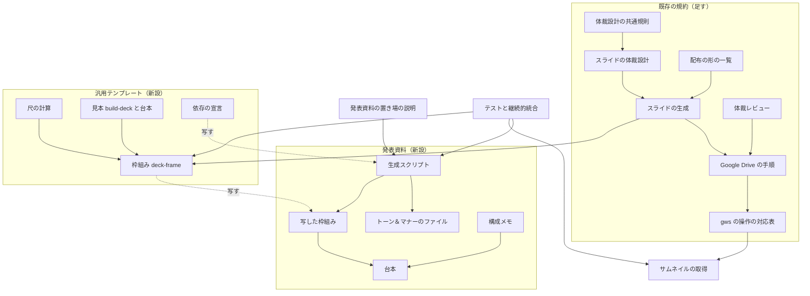
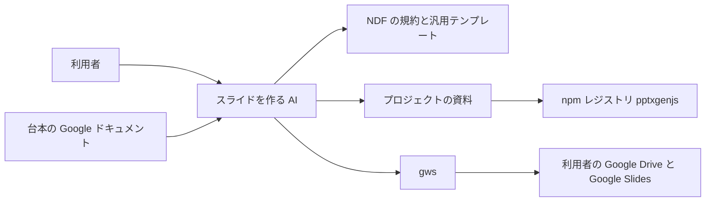
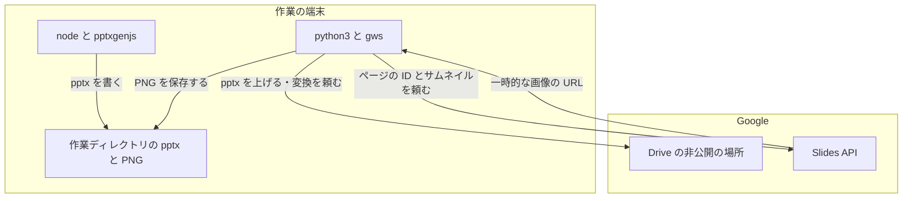
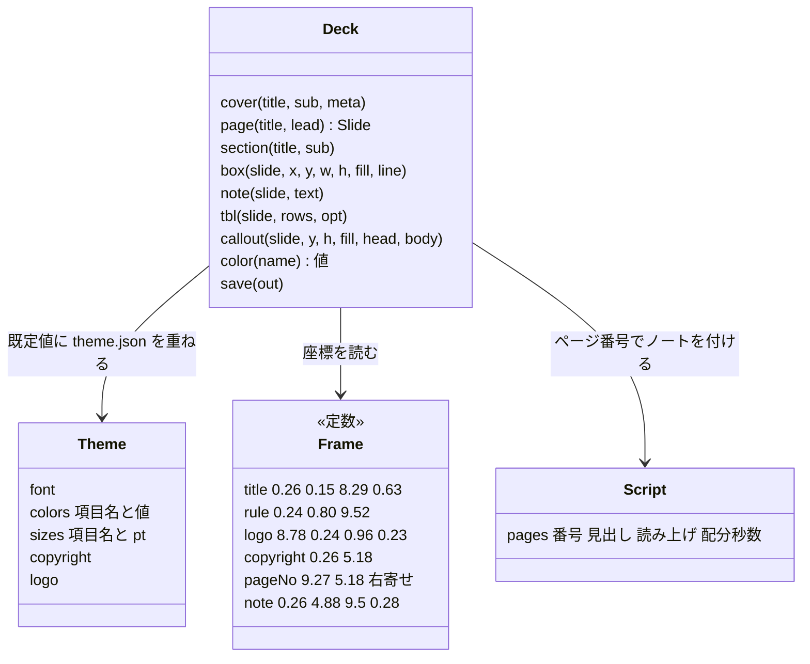
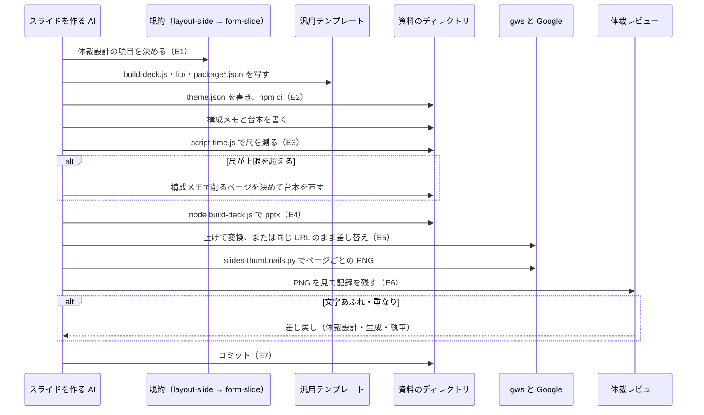

# スライド: 作り方の手順が NDF に無く、AI が毎回その場で作り方を組み立てて手本と違う資料になる → 生成スクリプトの汎用テンプレート・構成メモと台本・gws での変換とサムネイル確認を既存の規約から辿れ、その手順で発表資料を作れる（#2065）

## 目的

- **何が壊れているか**: NDF のスライドの規約（`layout-slide.md`・`form-slide.md`・`layout-review`・`system-gdrive.md`）は原則だけを持ち、生成スクリプト・ページの枠組み・トーン＆マナー・構成メモ・台本・Google Slides への変換と確認の手順を持たない
- **誰が困るか**: スライドを頼む利用者。AI が毎回その場で作り方を組み立て（2026-10-17 は python-pptx の自作）、手本と違う作りになって差し戻される
- **直すと何が成り立つか**: AI は既存の規約から汎用テンプレートと手順へ辿り、同じ作り方でスライドを作れる。その手順で発表資料「独自スキルプラグイン開発の薦め」（23 ページ）を作って、手順が通ることを示す

## 適用範囲

- **働く範囲**: 配布先のリポジトリでも働く。汎用テンプレートは `release` Skill の配下に置き、4 ランタイムへ Skill のディレクトリごと配る。発表資料はこのリポジトリの `docs/presentations/` だけに置く
- **プロジェクトごとに違うもの**: トーン＆マナー（書体・色・文字サイズ・著作権表示・ロゴ）はプロジェクトのファイル（`slides/theme.json`）で受ける。出力先・台本のパス・尺の上限は引数で受ける
- **当たるモード**: `documentation`（出力の形がスライドのとき）。ほかのモードでもスライドを作る作業はこの規約を読む

## あるべき姿の根拠

| 根拠 | 種類 | 何を示すか |
| --- | --- | --- |
| 「slide の作り方が違う。…を参考に。Skill 化した方が良いかも」（2026-10-17） | 利用者の指示の原文 | 手本の作り方（生成スクリプト方式）に揃える。python-pptx の自作を採らない |
| 「新しい Skill を作る前に既存のスライドの規約…への統合を優先する。トーン＆マナーは会社色の無い汎用テンプレートを既定にし、版面と枠組みの関数（page/box/note/tbl/section）は…踏襲、プロジェクトごとに差し替えられるようにする」（2026-10-17） | 利用者の指示の原文 | Skill を増やさず既存の規約へ足す。枠組みの座標は手本の値、トーン＆マナーは差し替えられる形 |
| 手本の 3 件（要求の「何をしたいか」の表）。2 件の生成スクリプトが同じ値の定数と同じ枠組みの関数を写して持ち、README に同じ gws の変換手順を書いている | 実測（2026-10-17 に読んだ） | 枠組みとトーン＆マナーと変換手順は資料ごとに繰り返される。共通の部品にする価値がある |
| `gws drive files copy`（`mimeType` 指定）・`gws slides presentations get`・`gws slides presentations pages getThumbnail` を `--dry-run` で打ち、要求の形（`POST …/files/<ID>/copy`・`GET …/presentations/<ID>`・`GET …/pages/<ページ>/thumbnail`）を確かめた（2026-10-17） | 実測 | 変換と確認の経路が gws の今の版で組める |
| `npm view pptxgenjs version license` → `4.0.1`・`MIT`（2026-10-17） | 実測 | 依存として宣言できる版と使用許諾 |

要求と受け入れ条件は #2065 の本文にある（コピーは [issue-2065-requirements.md](issue-2065-requirements.md) ）。この文書は「どう作るか」だけを扱う。

## ドメインモデル

### コンテキスト

| コンテキスト | 何の語が 1 つの意味に決まるか |
| --- | --- |
| スライドの作成（`ndf-slide`） | 汎用テンプレート・ページの枠組み・トーン＆マナー・生成スクリプト・構成メモ・台本・尺 |
| Google Workspace（`ndf-google-workspace`） | gws の操作・ファイルの ID・変換・サムネイル |

**スライドの作成が顧客、Google Workspace が供給者の関係（顧客 / 供給者）。** スライドの作成は、変換と
サムネイルの取得を `google-workspace` の操作の対応表とスクリプトに頼み、gws のコマンドを自分の規約に
写さない。供給者は顧客の要求（pptx の変換・同じ URL のままの差し替え・ページごとのサムネイル）を対応表へ足す。

### 集約

| 集約 | 持ち主（書き換えてよいもの） | 根 | エンティティ | 値オブジェクト |
| --- | --- | --- | --- | --- |
| 汎用テンプレート | NDF の配布物（`release/assets/slides/`）。プロジェクトは写すだけで書き換えない | ページの枠組み（`lib/deck-frame.js`） | — | 枠組みの座標・既定のトーン＆マナー |
| 資料 | プロジェクトの資料のディレクトリ（生成の作業をする AI） | 生成スクリプト（`slides/build-deck.js`） | ページ | トーン＆マナー（プロジェクトの値）・読み上げ・尺 |
| 変換したスライド | 利用者の Drive（gws を通して操作する） | Google Slides のファイル | ページ（`objectId`） | サムネイル |

資料は汎用テンプレートを ID（写した時点の `lib/` の内容のハッシュ）で参照し、オブジェクトとして持たない。資料が持つ枠組みは写しであり、
写した後に資料の側から書き換えない（I2）。

### 不変条件

| # | 集約 | 条件 | 破れたときの扱い |
| --- | --- | --- | --- |
| I1 | 汎用テンプレート | 枠組みの関数が置く見出し・罫線・ロゴ・著作権表示・ページ番号・注の座標は、トーン＆マナーの値に依らず手本と同じ値で固定される | トーン＆マナーの項目に座標を持たせない。座標は枠組みのファイルの定数だけが持つ |
| I2 | 資料 | トーン＆マナーの差し替えは `slides/theme.json` だけで済み、枠組みのファイル（`slides/lib/`）を書き換えない。枠組みを写し直してもプロジェクトの値が残る | 枠組みを書き換えた資料は、汎用テンプレートの更新を取り込めない。書き換えかどうかは、資料の `slides/lib/` の内容のハッシュを、写した時点の `lib/` の内容のハッシュ（資料の `README.md` に書いた値）と比べて決め、一致しなければ書き換えとみなしてプロジェクトの値を `theme.json` へ移す。NDF の版は基準にしない（版はスプリント単位でしか上がらず、同じ版数のまま develop で `lib/` が変わるため、版では写した元の `lib/` を一意に指せない）。新しい汎用テンプレートの `lib/` を写し直すのは更新の取り込みであり、書き換えとはみなさない。取り込んだら `README.md` のハッシュを写し直した `lib/` の値へ書き換える |
| I3 | 資料 | 生成スクリプトと枠組みの関数の本体に、書体名と色の値を直接書かない。色は `theme.json` の項目名で指す | 直書きが残ると、差し替えた後も既定の値が pptx に残る。テストが落とす |
| I4 | 資料 | スピーカーノートは台本のファイルの読み上げから入れる。生成スクリプトに読み上げを写さない | 写すと台本と食い違う。枠組みが台本を読み込み、ページ番号で対応させる |
| I5 | 資料 | 生成した pptx のページ数は、台本のページ数と等しい | 生成スクリプトが終了コード 1 で止まり、両方の数を出す |
| I6 | 資料 | 尺は台本の読み上げの字数を 350 字/分で割った値で、合計はページごとの値の和に等しい | 尺の上限（引数）を超えたら終了コード 1 を返し、構成メモで削るページを決める |
| I7 | 汎用テンプレート・資料 | 汎用テンプレートと資料に、手本の社名・案件名・コーポレートカラーの値・ロゴを入れない | 完了判定で差分の追加行を検索し、1 件でもあれば直す（受け入れ条件 13） |

### ドメインイベント

| # | イベント | 発生元 | 受け手 |
| --- | --- | --- | --- |
| E1 | 体裁設計で版面・トーン＆マナー・ページの枠組みを決めた | 体裁設計（`design` の `layout-slide.md`） | 生成（`release` の `form-slide.md`） |
| E2 | 汎用テンプレートを写し、トーン＆マナーをプロジェクトの値へ差し替えた | 生成 | 生成スクリプト（`theme.json` を読む） |
| E3 | 構成メモと台本を書き、尺を測った | 執筆（構成メモ・台本） | 生成スクリプト（台本を読む）・体裁設計（尺が超えたら削るページを決める） |
| E4 | 生成スクリプトで pptx を作った | 生成スクリプト | 変換（gws） |
| E5 | pptx を Drive へ上げ、Google Slides へ変換した（同じ URL のままの差し替えを含む） | 変換（`google-workspace`） | サムネイルの取得 |
| E6 | ページごとのサムネイルを取り、体裁レビューの記録を残した | 体裁レビュー（`layout-review`） | 差し戻し先（体裁設計・生成・執筆）か、コミット |
| E7 | 生成スクリプト・構成メモ・台本・README をコミットした | 生成の作業をする AI | Pull Request |

### 用語

| 用語 | 意味 | 用語集への反映 |
| --- | --- | --- |
| トーン＆マナーのファイル | プロジェクトのトーン＆マナーの値を持つ JSON（`slides/theme.json`）。書いた項目だけが汎用テンプレートの既定値を上書きする | 追加（`ndf-slide`） |
| 尺 | 台本の読み上げにかかる時間。読み上げの字数を 350 字/分で割って出す | 追加（`ndf-slide`） |
| 台本 | ページごとの見出しと読み上げの原稿。配分秒数は見出しに付けてよい（任意）。スピーカーノートへ入れる | 意味の変更（`ndf-slide`。配分秒数を任意にした） |

## 機能一覧

| # | 機能 | 誰が使うか |
| --- | --- | --- |
| F1 | 規約から汎用テンプレートと手順へ辿る（体裁設計 → 生成 → 変換 → 体裁レビュー） | スライドを作る AI |
| F2 | 汎用テンプレートを写して生成スクリプトを用意し、表紙・章扉・本編のページを作る | スライドを作る AI |
| F3 | トーン＆マナーをプロジェクトの値へ差し替える | スライドを作る AI・プロジェクトの持ち主 |
| F4 | 構成メモと台本を規約の形で書き、台本からスピーカーノートを入れる | スライドを作る AI |
| F5 | 台本の字数と尺をページごとと合計で出し、上限を超えたら知らせる | スライドを作る AI・発表者 |
| F6 | pptx を Google Slides へ変換する（新しく作る・同じ URL のまま差し替える） | スライドを作る AI |
| F7 | Google Slides のページごとのサムネイルを取り、体裁レビューで見る | 体裁レビューをする AI |
| F8 | 発表資料「独自スキルプラグイン開発の薦め」を F1〜F7 の手順で作る | 発表者（利用者） |

## 構成要素

**値の集合（スライドの生成の経路）を 1 つの値に置き換える。** 今の経路は「変換器を使う」「AI エージェントが組む」の 2 つで、
これを「生成スクリプトを書く」の 1 つにする（決定 12・13。決定 3 を置き換えた）。集合を前提にした規則を、集合の名前と値の名前での検索（`生成の経路`・
`AI エージェントが組む`・`変換器を使う`・`form-slide`・`layout-slide`）と、新しい経路が通る手順（体裁設計 → 生成 →
取り込み → 体裁レビュー）を読んで集めた。当てはまらない規則は下の表へ載せる。

| 要素 | 責務 | 変更の種類 |
| --- | --- | --- |
| 体裁設計の共通規則（`design/references/layout-common.md`） | 生成の経路ごとの渡し方の表に「生成スクリプトを書く → トーン＆マナーのファイルとページの枠組み」の行を足す | 変更（経路の集合の規則） |
| スライドの体裁設計（`design/references/layout-slide.md`） | 決める項目の「生成の経路」に生成スクリプトを足し、「トーン＆マナー（著作権表示・ロゴ）」「ページの枠組み」の行を足す。生成スクリプトの経路では決めた値を `theme.json` へ書くと示し、`form-slide.md` へ辿らせる | 変更（経路の集合の規則） |
| スライドの生成（`release/references/form-slide.md`） | 経路の表へ「生成スクリプトを書く（決定的）」を足し、起点（生成スクリプトの直前の版）と 1 ページの区切り（台本の `## <番号>.`）を経路ごとに書き分ける。新しい節「生成スクリプトの経路」に資料のファイルの並び・テンプレートの写し方・トーン＆マナーの差し替え・構成メモの形・台本の形と尺・生成・変換と確認の順を書く | 変更（経路の集合の規則）＋追加 |
| 配布の形の一覧（`release/references/distribution-forms.md`） | 「生成の経路は 2 つ」の行に、スライドは生成スクリプトの経路も持つ（`form-slide.md`）と足す | 変更（経路の集合の規則） |
| 汎用テンプレートの枠組み（`release/assets/slides/lib/deck-frame.js`） | 枠組みの関数（`cover`・`page`・`section`・`box`・`note`・`tbl`・`callout`、表のセル `H`・`C`・`B`）・座標の定数・既定のトーン＆マナー・`theme.json` の重ね合わせ・台本の読み込みとページ番号でのノートの付与・ページ数の照合・保存 | 新設 |
| 尺の計算（`release/assets/slides/lib/script-time.js`） | 台本を `deck-frame.js` の読み込みで読み、ページごとと合計の字数と尺を出す。上限を超えたら終了コード 1 | 新設 |
| 汎用テンプレートの見本（`release/assets/slides/build-deck.js` と `script.md`） | 表紙・章扉・本編（表と注を含む）の 3 ページを作る見本。写した後に資料の中身へ書き換える出発点 | 新設 |
| 依存の宣言（`release/assets/slides/package.json`・`package-lock.json`） | pptxgenjs の版を固定する。資料へ写して `npm ci` で入れる | 新設 |
| Google Drive の手順（`document-systems/references/system-gdrive.md`） | 投稿の手段に「pptx を上げて Google Slides へ変換する・同じ URL のまま差し替える」順を、描画して見る手段に「Google Slides はページごとのサムネイル」を書き、コマンドは `google-workspace` の対応表を指す | 変更 |
| gws の操作の対応表（`google-workspace/SKILL.md`） | pptx の変換（`files copy` と `mimeType`）・同じ URL のままの差し替え（`files update --upload`。pptx のあるディレクトリで打つ）・ページの ID の取得（`slides presentations get`）・サムネイルの取得（スクリプト）の行を足す | 変更 |
| サムネイルの取得（`google-workspace/scripts/slides-thumbnails.py`） | Google Slides の全ページの ID を取り、ページごとにサムネイルを取得して PNG を保存し、結果 JSON で保存先を返す | 新設 |
| 体裁レビュー（`layout-review/SKILL.md`） | 描画して見る手段の表の「Google スライド / ドキュメント」の行を分け、Google スライドはページごとのサムネイル（`system-gdrive.md`）とする | 変更 |
| 発表資料の置き場の説明（`docs/presentations/README.md`） | 資料一覧へ発表資料を足し、「新しい資料を追加するとき」に生成スクリプトの資料（ディレクトリの形）を足す | 変更 |
| 発表資料（`docs/presentations/<日付>-skill-plugin-development/`） | README・構成メモ・台本・`slides/`（生成スクリプト・トーン＆マナーのファイル・写した枠組み・依存の宣言） | 新設 |
| テストと継続的統合（`release/tests/test_slide_template.py`・`google-workspace/tests/test_slides_thumbnails.py`・`tests/test_presentation_decks.py`・`conftest.py`・`.github/workflows/pytest.yml`・`.gitignore`） | 生成を実行して pptx を検査する。CI に Node.js 22 と `npm ci` を足し、`node` を前提のコマンドに足す。`node_modules/` と生成した pptx を追跡から外す | 新設・変更 |

**当てはまるため変えない規則。** `layout-review` の「既知の失敗のリストでは足りない」（描画して見る理由は経路に依らない）、
`document-drafting` と `layout-common.md` の「版面・書体・色をソースへ埋めない」（生成スクリプトの経路では `theme.json` が
受け、I3 がこれを守る）、`layout-common.md` の「図表の種類は生成の経路が決める」（pptxgenjs は Mermaid を描かないため、
図は図形か画像で組む）、`import.md` の「Markdown → 生成の手段が無い」（Markdown からの変換は今も無い）。

### 構成要素図



### 文脈



外部の系は npm レジストリ・gws・利用者の Drive・台本の Google ドキュメントで、どれもこの変更では変えない。

### 配置



境界をまたぐのは pptx・ページの ID・サムネイルの画像だけである。認証は gws が自分の設定ディレクトリに持ち、
スクリプトはトークンを読まない（C1）。アップロード先はフォルダを指定しない（非公開）か、共有範囲を確かめた
利用者の既存の非公開フォルダに限る（要求の前提 4、`google-workspace` の手順）。

### 置き場所

```text
plugins/ndf/skills/
├── design/references/
│   ├── layout-common.md           # 変更
│   └── layout-slide.md            # 変更
├── release/
│   ├── references/
│   │   ├── distribution-forms.md  # 変更
│   │   └── form-slide.md          # 変更
│   ├── assets/slides/             # 新設（汎用テンプレート）
│   │   ├── build-deck.js
│   │   ├── script.md
│   │   ├── package.json
│   │   ├── package-lock.json
│   │   └── lib/
│   │       ├── deck-frame.js
│   │       └── script-time.js
│   └── tests/test_slide_template.py   # 新設
├── document-systems/references/system-gdrive.md   # 変更
├── google-workspace/
│   ├── SKILL.md                    # 変更
│   ├── scripts/slides-thumbnails.py    # 新設
│   └── tests/test_slides_thumbnails.py # 新設
└── layout-review/SKILL.md          # 変更

docs/presentations/
├── README.md                       # 変更
└── <日付>-skill-plugin-development/    # 新設
    ├── README.md                   # 成果物・トーン＆マナー・写した時点の lib/ の内容のハッシュ・生成と変換の手順・尺の出力
    ├── notes.md                    # 構成メモ（23 行）
    ├── script.md                   # 台本（第 7 稿の写し）
    └── slides/
        ├── build-deck.js
        ├── theme.json
        ├── package.json
        ├── package-lock.json
        └── lib/                    # release/assets/slides/lib/ の写し
            ├── deck-frame.js
            └── script-time.js

tests/test_presentation_decks.py    # 新設
conftest.py・.github/workflows/pytest.yml・.gitignore   # 変更
```

検査の手段: `claude plugin validate .`・`python3 scripts/check-skill-frontmatter.py`・`python3 plugins/ndf/scripts/doc-lint.py`
（受け入れ条件 15）と、下のテスト設計の pytest。

## 構造

`deck-frame.js` が公開する型と関数だけを描く。ページの中身（資料ごとの図形）は描かない。



- `createDeck({ theme, script, title, author })` が `Deck` を返す。`theme` は `theme.json` のパスか値、`script` は台本のパス（省略するとノートを付けない）
- `fill` は `theme.colors` の項目名で受ける（I3）。項目名でない値を渡したら例外で止める
- 座標は `Frame` の定数だけが持ち、`Theme` は座標を持たない（I1）

## 入出力の契約

### 体裁設計から生成へ渡す値

`layout-common.md` の「決めた値の書き先」のとおり、決めた値は設計文書の入出力の契約に書き、生成スクリプトの経路では
`theme.json` へ写す。

### トーン＆マナーのファイル（`slides/theme.json`）

書いた項目だけが既定値を上書きする。`colors` と `sizes` は項目ごとに重ね、ほかは値ごと置き換える。知らない項目名は
終了コード 1 で止める（書き損じが既定値のまま通らないようにする）。

| 項目 | 型 | 既定値 | 意味 |
| --- | --- | --- | --- |
| `font` | 文字列 | `Noto Sans JP` | 見出しと本文の書体 |
| `colors.accent` | 6 桁の 16 進 | `2B6CB0` | 強調の 1 色（表紙と章扉の帯・アクセントの線） |
| `colors.text` / `colors.ink` / `colors.mute` | 同上 | `000000` / `303030` / `7F7F7F` | 見出しの文字 / 本文の文字 / 注と著作権表示 |
| `colors.rule` | 同上 | `D9D9D9` | 罫線と表の枠 |
| `colors.panel1` / `colors.panel2` | 同上 | `F3F3F3` / `EEEEEE` | 区画の地 |
| `colors.warn` / `colors.caution` | 同上 | `F4CCCC` / `FFF2CC` | 注意を促す地（増加・条件） |
| `colors.header` | 同上 | `303030` | 表の見出し行の地（文字は白） |
| `sizes.title` / `sizes.lead` / `sizes.body` / `sizes.table` / `sizes.note` / `sizes.footer` | pt | `20` / `12` / `10` / `10` / `8` / `9` | 見出し / リード / 本文 / 表 / 注 / 著作権表示とページ番号 |
| `sizes.sectionTitle` / `sizes.sectionSub` / `sizes.coverTitle` / `sizes.coverSub` | pt | `32` / `14` / `28` / `16` | 章扉と表紙 |
| `copyright` | 文字列 | `""` | 著作権表示。空なら描かない |
| `logo` | 文字列か `null` | `null` | ロゴの PNG の、`theme.json` からの相対パス。`null` なら描かない |

既定値の正本は `deck-frame.js` の既定のトーン＆マナーの定数で、規約は項目の意味だけを書き、値を写さない。

### 台本（`script.md`）

| 規則 | 内容 |
| --- | --- |
| ページの区切り | `## <番号>. <見出し>` の行。番号は 1 から欠けずに続く。見出しの末尾に `（<秒>秒）` を付けると配分秒数になる |
| 読み上げ | 区切りの中の `>` で始まる行。`>` だけの行は段落の区切り。スピーカーノートは読み上げの段落を改行でつないだ文 |
| ほかの行 | ページに載せる要素の覚え書き。ノートにも字数にも入れない |
| 最初の区切りより前 | 題・想定・構成の表。読まない |
| 失敗 | 区切りが 1 つも無い・番号が欠ける・重なる → 終了コード 2 と、どの番号かを出す |

### 構成メモ（`notes.md`）

`## 構成` の節に、構成の考え方（何から逆算し、何を載せず、どこへ回したか）と、次の表を置く。表の行数はページ数と等しい。

```markdown
| # | 見出し | 役割 | 根拠 |
| ---: | --- | --- | --- |
| 1 | 表紙 | — | — |
| 2 | <台本の見出し> | <このページで聞き手に何を渡すか。載せる図・表・箇条書き> | <数値と主張の出所> |
```

ページに収まらない読み上げの削り方と、尺を超えたときに削るページは同じ文書の節に書く（要求の前提 3）。

### コマンド

| コマンド | 入力 | 出力 | 終了コード |
| --- | --- | --- | --- |
| `node slides/build-deck.js <出力>.pptx [<theme.json>]` | 出力のパス。トーン＆マナーのファイル（省略時は `slides/theme.json`、無ければ既定値） | pptx | 0 成功 / 1 引数・`theme.json`・ページ数の照合（I5）の失敗 / 2 台本の形の失敗 |
| `node slides/lib/script-time.js <台本> [--wpm 350] [--limit <分>] [--json]` | 台本のパス | 既定は Markdown の表（ページごとの番号・見出し・字数・尺の秒・配分秒数と合計の行）。`--json` は同じ値の JSON | 0 / 1 合計が上限を超えた / 2 台本の形の失敗 |
| `python3 "$SKILL_DIR/scripts/slides-thumbnails.py" <presentationId> <出力のディレクトリ> [--size LARGE]` | Google Slides の ID | `p<番号>.png` をページ順に保存。結果 JSON（`tool`・`status`・`summary`・`items` にページごとの `objectId` とパス・`metrics.pages`） | 0 / 1 gws の失敗（gws の出力を `items` に載せる）/ 2 引数の失敗 / 11 gws が未認証（`gws-check.py` と同じ値） |

gws の変換と差し替えのコマンドは `google-workspace` の対応表に置く（形は手本の README と同じ。`files update` の
`--upload` は作業ディレクトリの外のファイルを受けないため、pptx のあるディレクトリで打つ）。

## 処理の流れ



既にプロジェクトに生成スクリプト（`slides/build-deck.js`）があるときは、汎用テンプレートを写さずにそれに従う
（`form-slide.md` の「対象リポジトリの仕組みを先に探す」と同じ）。

## 非機能の実現方式

| 大項目 | 要求の条件 | 実現方式 | 確かめ方 |
| --- | --- | --- | --- |
| 運用・保守性 | トーン＆マナーの差し替えはプロジェクト側の値だけを書けば済み、汎用テンプレートの更新を取り込むときにプロジェクトの値が上書きされない | プロジェクトの値は `slides/theme.json` だけに置き、枠組みは `slides/lib/` へ写して書き換えない。更新の取り込みは `lib/` の写し直しだけで、`theme.json` に触れない | `theme.json` を置いた資料で `lib/` を写し直して生成し、差し替えた書体と色が pptx に残ることをテストで見る |
| セキュリティ | 生成スクリプト・規約・発表資料に Drive のフォルダ ID・ファイル ID・トークンを書かない。gws の認証情報をリポジトリに置かない（C1） | 規約と README の例は `<フォルダID>` の形にする。Google Slides の ID は引数でだけ受け、発表資料の README には置かない（URL は PR の記録に書く）。スクリプトはトークンを読まない | 完了判定で差分の追加行を `docs.google.com/.*/d/[A-Za-z0-9_-]{20,}` と `"fileId":"[A-Za-z0-9_-]{20,}"` で検索して 0 件 |
| システム環境 | Node.js 22（CI が使う版）と pptxgenjs で動く。依存の宣言の置き方は設計が決める | 依存は汎用テンプレートと資料の `slides/package.json` と `package-lock.json` で pptxgenjs `4.0.1` に固定する。CI の pytest に `actions/setup-node` の 22 と `npm ci` を足す | CI の pytest が Node.js 22 で生成のテストを通す |

## 決定の記録

決定の記録は [issue-2065-design-decisions.md](issue-2065-design-decisions.md) にある（決定 1〜13。決定 3 は決定 12・13 が置き換えた）。

## テスト設計

| 受け入れ条件・不変条件 | どの振る舞いで縛るか | どう壊したら落ちるべきか |
| --- | --- | --- |
| 受け入れ条件 1 | `plugins/ndf/manifests/*-skills.txt` の行数が develop と同じ（完了判定のコマンド） | manifests に行を足すと差が出る |
| 受け入れ条件 2・9 | `doc-lint.py` が参照切れを見る。`layout-slide.md` → `form-slide.md` → 汎用テンプレートと `system-gdrive.md` → `google-workspace`、`layout-review` → `system-gdrive.md` の経路をレビューで辿る | リンク先のファイル名を変えると `doc-lint.py` が落ちる |
| 受け入れ条件 3 | 汎用テンプレートの見本を生成すると終了コード 0 で、版面が 10 × 5.625 インチ、ページが 3 つ（表紙・章扉・本編）、本編に表と注がある | 版面の指定を外す・章扉を作らない・表を外すと落ちる |
| 受け入れ条件 4・I1 | 本編のページの見出し・罫線・著作権表示・ページ番号・注の位置が手本の座標（インチ）と一致し、`theme.json` で書体と色と文字の大きさを変えても位置が変わらない | 座標の定数を変える・トーン＆マナーの値で座標を動かすと落ちる |
| 受け入れ条件 5・I2・I3 | 書体・色・著作権表示・ロゴを差し替えた `theme.json` で生成すると、全ページの XML の書体名と色が差し替えた値だけになり、既定値が残らない。`lib/` を写し直しても同じ結果になる | 枠組みか見本に書体名・色を直書きすると落ちる。`theme.json` の項目を重ねずに丸ごと置き換えると、書いていない既定値が欠けて落ちる |
| `theme.json` の知らない項目 | 知らない項目名を書くと終了コード 1 で、項目名を出す | 知らない項目を読み捨てると落ちる |
| I4・受け入れ条件 11 | 発表資料を生成すると 23 ページすべてにノートがあり、各ノートが `script.md` の同じ番号の読み上げと一致する | ノートを生成スクリプトに写して食い違わせる・番号をずらすと落ちる |
| I5 | 台本のページ数と作ったページ数が違うと、生成が終了コード 1 で両方の数を出す | 照合を外すと落ちる |
| 台本の形の失敗 | 区切りの番号が欠ける・重なる台本で、生成と尺の計算が終了コード 2 と番号を出す | 欠けた番号を読み飛ばすと落ちる |
| I6・受け入れ条件 7 | 読み上げの字数が分かっている台本で、ページごとの字数と秒（350 字/分）と合計が期待どおりで、合計がページの和に等しい。`--limit` を下回る値にすると終了コード 1 | 空白や強調の記号を字数に数える・`>` 以外の行を数えると落ちる |
| 受け入れ条件 6 | 発表資料の `notes.md` の構成の表が 23 行で、番号が 1〜23（`tests/test_presentation_decks.py` が表を数える） | 行を欠かすと落ちる |
| 受け入れ条件 10 | 発表資料を生成すると終了コード 0 で 23 ページ。生成スクリプトが `./lib/deck-frame.js` を読み、`lib/` が汎用テンプレートの `lib/` と同じ内容で写されている（作った時点で比べる。以後は追随しない） | 枠組みを使わずに組むと落ちる |
| 受け入れ条件 8 | 規約に書いた gws のコマンド（変換・差し替え・ページの ID・サムネイル）を実装の作業で実際に打ち、打ったコマンドと終了コードを実装の PR に残す | — （手作業の記録） |
| サムネイルの取得 | 偽の gws を前にした実行で、ページの ID の順に `p<番号>.png` を保存し、結果 JSON にページ数と保存先が出る。gws が失敗すると終了コード 1 で gws の出力が `items` に載る。未認証は 11 | gws の失敗を成功として返す・ページの順を崩すと落ちる |
| 受け入れ条件 12 | 発表資料を Google Slides へ変換し、23 ページのサムネイルを見た体裁レビューの記録（`layout-review` の形）を PR に残す。差し戻した後のサムネイルで文字あふれと重なりが 0 件 | — （人が見る。承認ゲート 2 で利用者も見る） |
| 受け入れ条件 13・I7 | 完了判定で `git diff develop -- plugins/ docs/presentations/` の追加行を手本の社名・案件名・手本のコーポレートカラーの値で検索して 0 件 | — （完了判定のコマンド） |
| 受け入れ条件 14 | 完了判定で追加・変更した行をページの数え方の和語（受け入れ条件 14 の語）で検索して 0 件 | — （完了判定のコマンド） |
| 受け入れ条件 15 | 受け入れ条件の 5 つのコマンドが終了コード 0。`git diff develop --stat -- docs/presentations/2026-08-06-ai-plugins-intro.*` が空（`build.sh` は決定 12 で消す） | 2026-08-06 の資料に触れると差が出る |

`.md` の文言を照合するテストは書かない（`AGENTS.md` の DON'T）。`notes.md` の表を数えるのは構成メモの行数（受け入れ条件 6）
の検査であり、文言は照合しない。

## 設計の結果

| 課題 | 扱い | 取り込み先 | 触るファイル |
| --- | --- | --- | --- |
| #2065 | 実装する | — | `plugins/ndf/skills/design/references/layout-common.md`、`plugins/ndf/skills/design/references/layout-slide.md`、`plugins/ndf/skills/release/references/form-slide.md`、`plugins/ndf/skills/release/references/distribution-forms.md`、`plugins/ndf/skills/release/assets/slides/`、`plugins/ndf/skills/release/tests/`、`plugins/ndf/skills/document-systems/references/system-gdrive.md`、`plugins/ndf/skills/google-workspace/`、`plugins/ndf/skills/layout-review/SKILL.md`、`docs/presentations/README.md`、`docs/presentations/`、`tests/test_presentation_decks.py`、`conftest.py`、`.github/workflows/pytest.yml`、`.gitignore`、`docs/glossary.md`、`docs/glossary/glossary.json` |

## 未確認のまま残ること

| 項目 | 内容 |
| --- | --- |
| 発表資料のディレクトリの日付 | 発表日が未定。承認ゲート 1 で利用者が日付を示さなければ、台本を確定した日 `2026-10-17` を使う（`docs/presentations/README.md` の `YYYY-MM-DD-<topic>` の形） |
| 発表資料の著作権表示 | 発表資料の `theme.json` の `copyright` の文言（例: `NDF — github.com/devbasex/ai-plugins`）。承認ゲート 1 で利用者が示さなければこの例を使う |
| gws の実際の変換と差し替え | 設計では `--dry-run` で要求の形だけを確かめた。実際に上げて変換・差し替え・サムネイルを取るのは実装の作業で、打ったコマンドと結果を実装の PR に残す（受け入れ条件 8） |
| Noto Sans JP の変換後の見え方 | pptx の書体名 `Noto Sans JP` が Google Slides で代替されずに描かれるかは、変換したサムネイルで確かめる。代替されたら `layout-review` の「書体の代替」の手順で、配布先（Google Slides）で起きる欠けとして生成へ戻し、既定の書体を選び直す |
| サムネイルの一時的な URL の扱い | `getThumbnail` が返す画像の URL を認証なしで取れるかは、実装で 1 度打って確かめる。取れなければ gws の認証付きの取得へ切り替える |
| 台本の写しと正本の一致 | 台本の正本は第 7 稿の Google ドキュメントである。実装でドキュメントをテキストで書き出し、`script.md` の読み上げと突き合わせた結果を PR に残す（要求の前提 3） |
| 図の多いページの組み方 | 台本の 6・8・14 ページなどは図が要る。pptxgenjs は Mermaid を描かないため、図形で組むか画像を貼るかを実装でページごとに決め、構成メモの「役割」に書く |
