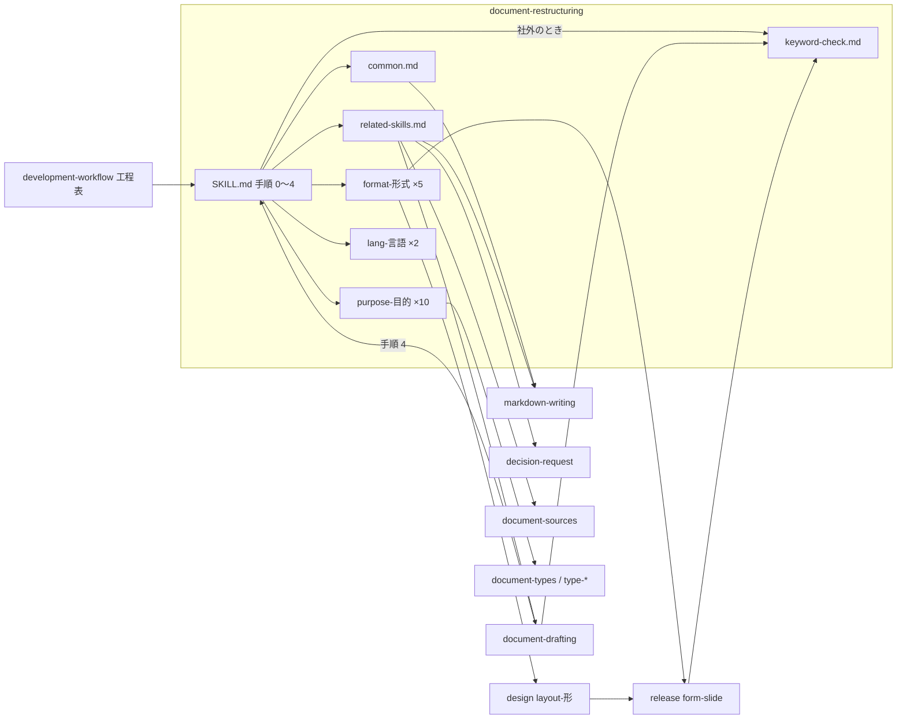
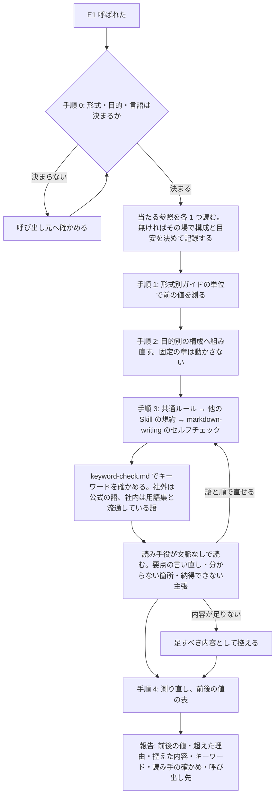

# 文書の組み直し: どの文書も「結論から」の 1 通りで組み直され、議論用の文書の提案が決定に読め、スライドや表計算には目安が無い → 文書形式と目的に合った構成と文章量で組み直し、文脈を持たない読み手が理解し納得できることを確かめてから渡せる（#2086 #2083 #2080 #469）

## 目的

- **何が壊れているか**: `document-restructuring` の構成は「何が決まったのか」から始まる 1 種類だけで、目安は Markdown の設計文書 3 本の実測だけである。議論用の文書では提案が決定に読め（#2083）、スライド・表計算・小説などには構成も目安も当たらない。社外向けの題の語を確かめる手順が無く（#2080）、`markdown-writing` と規約が二重にある（#469）
- **誰が困るか**: AI が作った文書を読む人（議論の参加者・発表の聞き手・社外の読者）と、構成を手で戻す利用者
- **直すと何が成り立つか**: 文書形式と文書の目的を決めてから、その 2 つに当たる参照だけで構成と文章量を決める。形式と目的に関わらない決まりは共通ルールとして 1 か所にあり、他の Skill の規約は書き写さずに指す

## 適用範囲

- **働く範囲**: 配布先のリポジトリでも働く（NDF の Skill の本文と参照）。工程の中（「ドキュメント再構成」）と、利用者が明示して呼ぶ場合の両方
- **プロジェクトごとに違うもの**: 測る手段（今の決まりのまま、対象リポジトリから探す）と、用語集の置き場（`markdown-writing` のルール 1 のとおり）。設定のキーは足さない
- **当たるモード**: `standard`（Skill 本文の手順を変える安定版の変更）

## あるべき姿の根拠

| 根拠 | 種類 | 何を示すか |
| --- | --- | --- |
| #2086 の「依頼（原文）」（2026-10-24） | 利用者の指示の原文 | 形式と目的ごとに文章量・題・構成を変え、共通ルールを定め、他の文書系 Skill の求めを満たす |
| #2083 の「どこで見つけたか」 | 実測（利用者の指摘と並べ直した 7 章） | 議論用の文書の構成は「論点 → 事実 → 解釈 → 提案 → 中身 → 未決の問い → 残リスク」 |
| #469 の「重なっている規約」と 2026-09-07 の往復の実測 | 実測 | 規約の二重が往復（最長文 96 → 111 → 96 字）を生む |
| #2080 の 83453e45a（PR #2072）・PR #2076 | 実測 | 公式に無い語「スキルプラグイン」が題に残り、リリースの直前に作り直した |
| [IMRaD](https://en.wikipedia.org/wiki/IMRAD)・[BLUF](https://en.wikipedia.org/wiki/BLUF_(communication)) | 外部の一次情報 | 論文と確定事項を伝える文書は、目的ごとに定まった構成を持つ |

要求と受け入れ条件は #2086 の本文にある（コピーは [issue-2086-requirements.md](issue-2086-requirements.md) ）。#2083・#2080・#469 の受け入れ条件は、そのコピーの受け入れ条件 13〜21 に入っている。この文書は「どう作るか」だけを扱う。

## ドメインモデル

### コンテキスト

| コンテキスト | 何の語が 1 つの意味に決まるか |
| --- | --- |
| NDF の文書の組み直し（`ndf-document`） | 文書形式・文書の目的・共通ルール・キーワード・形式別ガイド・目的別ガイド |
| NDF のスライドの生成（`ndf-slide`） | 台本・構成メモ・ページの文言 |
| NDF の工程（`ndf-workflow`） | 工程「ドキュメント再構成」・文書タイプ |

**`ndf-document` は、他の 2 つと文書系 Skill に対して順応者である。** 組み直しは上流の規約をそのまま受け入れ、言い換えずに節を指す。上流は `markdown-writing`・`release` の `form-slide.md`・`document-drafting`・`decision-request` である。上流の規約が変わっても、組み直しの参照は書き換えない。

### 集約

| 集約 | 持ち主（書き換えてよいもの） | 根 | エンティティ | 値オブジェクト |
| --- | --- | --- | --- | --- |
| 組み直しの規約 | `document-restructuring` | `SKILL.md` | 形式別ガイド（5）・目的別ガイド（10）・言語の参照（2）・共通ルール・キーワードの確かめ方 | 構成・目安（値と根拠）・手がかり |
| 書き方の規則 | `markdown-writing` | `SKILL.md` | ルール 1〜12・セルフチェック | 直訳の和語の対応表 |
| スライドのページの文言 | `release` | `form-slide.md` の「ページの文言を書く」 | — | — |
| 文書タイプ | `development-workflow`（判定）・`document-drafting`（書く節） | `document-types.md` | `type-*.md` の 6 つ | 読み手が最初に問うこと |

**組み直しの規約は、他の 3 つの集約を書き換えない。** 書き換えるのは、二重を解くために他の集約の行を「正本を指す 1 行」へ置き換える場合だけで、構成要素の表に載せた行に限る。

### 不変条件

| # | 集約 | 条件 | 破れたときの扱い |
| --- | --- | --- | --- |
| I1 | すべて | 1 つの決まりの本文は 1 ファイルの 1 節にだけある。他のファイルはその節を指す | レビューで二重を指摘し、正本でない側を指す 1 行へ直す |
| I2 | 組み直しの規約 | 1 回の組み直しで読む参照は、形式・目的・言語ごとに多くて 1 つ。当たる参照が無いときは読まずに、その場で決めた構成と目安を記録に残して続け、参照を足す候補として報告する（E4・受け入れ条件 9） | 2 つ以上当たるときは読む前に止め、形式か目的を決め直す。当たる参照が無いことは破れではない |
| I3 | 組み直しの規約 | 形式か目的が手がかりで決まらないとき、推測で参照を選ばない | 呼び出し元へ確かめる。明示の呼び出しでは利用者へ問う |
| I4 | 組み直しの規約 | 組み直しは内容を足さない | 説明できない行数の増加は手順 2 へ戻して外す（今の決まり） |
| I5 | 組み直しの規約 | 別の Skill が固定した章・必ず書く節・出典の節は、前後で残る | 手順 4 の表に欠けた節を出し、手順 2 からやり直す |
| I6 | 組み直しの規約 | 目安の各値に根拠（実測の出所か「未実測」）がある | 根拠の無い値は目安として使わない |
| I7 | 組み直しの規約 | 目安を超えた項目を直すために、手順 4 の後に手順 3 へ戻らない。I4・I5 の破れを直す戻り（手順 2 から）は I7 より先に効き、戻った後は手順 2〜4 を通し直す | 目安を超えた項目は理由と採らなかった直し方を残して終える |
| I8 | 組み直しの規約 | 参照を 1 つ足しても、ほかの参照ファイルと `SKILL.md` の手順を変えない | `SKILL.md` に形式・目的の一覧を持たせない |
| I9 | 組み直しの規約 | どの文書でも、キーワードごとに語・突き合わせた相手（社外は公式ドキュメント、社内は用語集と流通している語）・判定が残る。確かめられなかった語も残る | 手順 4 の報告に「キーワードの確認: 無し」と書かず、欠けとして出す |
| I11 | 組み直しの規約 | 組み直した文書は、文脈を持たない読み手役が読み、要点を言い直せたか・分からなかった箇所・納得できなかった主張が残る。読み手役を立てられなかったときは、その理由が残る（決定 11） | 手順 4 の報告に「読み手の確かめ: 無し」と書かず、欠けとして出す |
| I10 | 組み直しの規約 | 議論用の文書を組み直した後、提案が最初の章に「方針」として置かれない | 論点の章を最初へ戻す |

### ドメインイベント

| # | イベント | 発生元 | 受け手 |
| --- | --- | --- | --- |
| E1 | 組み直しが呼ばれた | 工程「ドキュメント再構成」・`document-drafting` の手順 4・利用者 | 手順 0 |
| E2 | 文書形式を決めた | 手順 0 | 手順 1（形式別ガイドの目安） |
| E3 | 文書の目的を決めた | 手順 0 | 手順 2（目的別ガイドの構成） |
| E4 | 当たる参照だけを読んだ | 手順 0 | 手順 1〜3 |
| E5 | 前の値を測った | 手順 1 | 手順 4 |
| E6 | 章立てを目的別の構成へ組み直した | 手順 2 | 手順 3 |
| E7 | 共通ルールと当たる他の Skill の規約で整えた | 手順 3 | 手順 4 |
| E8 | 題とキーワードを突き合わせた | 手順 3 | 手順 4 の報告 |
| E11 | 読み手役が読み、分からなかった箇所と納得できなかった主張を返した | 手順 3 の最後 | 手順 3（語と順の直し）・手順 4 の報告（足すべき内容） |
| E9 | 後の値を測り、前後の値の表を出した | 手順 4 | 呼び出し元 |
| E10 | 形式への適用を他の Skill へ渡した | 手順 4 の報告 | `release` の `form-*`・`notion-writing`・`layout-review` |

### 用語

| 用語 | 意味 | 用語集への反映 |
| --- | --- | --- |
| 文書形式 | 文書を読ませる形。リポジトリの Markdown・文書・ページ・スライド・表計算 | 追加（`ndf-document`。要求の工程で反映済み） |
| 文書の目的 | 読み手にその文書で何をしてもらうか・何を渡すかの種類 | 追加（同上） |
| 共通ルール | 文書形式と文書の目的に関わらず、組み直した文書が満たす決まり | 追加（同上） |
| キーワード | 文書の題・見出しと、本文で繰り返し使い、読み手が主題として受け取る語 | 追加（同上） |
| 確定事項を伝える文書 | 結論が既に決まっている文書 | 追加（同上） |
| 議論用の文書 | まだ決まっていないことを読み手と決めるための文書 | 追加（同上） |
| 形式別ガイド | 文書形式 1 つについて、文章量の単位と目安・題と見出しの付け方・呼び出し先を持つ `references/format-<形式>.md` | 追加（`ndf-document`） |
| 目的別ガイド | 文書の目的 1 つについて、構成・文章量・見分ける手がかりを持つ `references/purpose-<目的>.md` | 追加（`ndf-document`） |

「目的」の語は `requirements-design` の `document-requirements.md` の意味（読み手が読み終えた後にどうなるか）のまま残す。この変更では常に「文書の目的」と書く（決定 9）。

## 機能一覧

| # | 機能 | 誰が使うか |
| --- | --- | --- |
| F1 | 文書形式・文書の目的・言語を手がかりから決め、決まらなければ確かめる（手順 0） | 組み直しを行う AI |
| F2 | 形式別ガイドの単位と目安で前後の値を測る（手順 1・4） | 同上 |
| F3 | 目的別ガイドの構成で章立てを組み直す（手順 2） | 同上 |
| F4 | 共通ルールと、当たる他の Skill の規約で整える（手順 3） | 同上 |
| F5 | 読み手が社外の文書で、題とキーワードを公式の語と突き合わせる（手順 3） | 同上。`document-drafting`・`form-slide.md` からも指される |
| F7 | 文脈を持たない読み手役に組み直した文書を読ませ、要点の言い直し・分からなかった箇所・納得できなかった主張を受け取る（手順 3 の最後。決定 11） | 同上 |
| F6 | 形式への適用（生成・投稿・版面）を呼び出し先として報告に書く | 呼び出し元 |

## 構成要素

| 要素 | 状態 | 責務 |
| --- | --- | --- |
| `document-restructuring/SKILL.md` | 変更 | 手順 0〜4・参照の選び方・報告の形。形式と目的の一覧と、書き方の規則の本文を持たない（I1・I8） |
| `document-restructuring/references/common.md` | 新規 | 共通ルールの一覧。各行に正本（ファイルと節）と当たらない目的 |
| `document-restructuring/references/related-skills.md` | 新規 | 文書系 Skill の表（何を求めるか・どの手順で読むか・読まない理由） |
| `document-restructuring/references/keyword-check.md` | 新規 | キーワードの確かめ方（#2080 の正本） |
| `document-restructuring/references/format-<形式>.md` × 5 | 新規 | `markdown`・`document`・`page`・`slide`・`spreadsheet`。文章量の単位と目安（根拠つき）・題と見出し・測らない指標・呼び出し先 |
| `document-restructuring/references/purpose-<目的>.md` × 10 | 新規 | `decided`・`discussion`・`decision`・`agenda`・`report`・`manual`・`paper`・`blog`・`essay`・`novel`。見分ける手がかり・構成・文章量・結論の位置の読み替え |
| `document-restructuring/references/lang-*.md` | 変えない | 文の区切りと字数の数え方 |
| `markdown-writing/SKILL.md` | 変更 | ルール 12「パス・URL は、表示先（Markdown・VS Code・Slack など）でリンクとして認識される形で書く」を足す。半角スペースを置く・全角の括弧を密着させないは手段の例として添える（AC 27）。ルール 9 の冒頭に、章と文の長さは `document-restructuring` の形式別ガイドが持つと 1 行で指す |
| `document-drafting/SKILL.md` | 変更 | 手順 4 で `document-restructuring` を掛けること、読み手が社外なら `keyword-check.md` を指す行 |
| `release/references/form-slide.md` | 変更 | 「ページの文言を書く」に、題とキーワードは `keyword-check.md` で確かめると 1 行足す（正本はこちらのまま） |
| `design/references/layout-slide.md` | 変更 | 「ページの文言」「章立て」の行の本文を消し、`form-slide.md` の「ページの文言を書く」を指す 1 行にする（今ある二重を解く） |
| `development-workflow/SKILL.md` | 変更 | 工程の決まりの「ドキュメント再構成」の行に、手順 3 で `markdown-writing` のセルフチェックを通すことを書く（#469 の掛け忘れ） |
| `document-restructuring` の `description` | 変更 | 「文書形式と文書の目的に合わせて」を足す（一覧の文字数の予算の中で） |
| 用語集（`docs/glossary/glossary.json`・`docs/glossary.md`） | 変更 | 形式別ガイド・目的別ガイドを足す |
| Skill の名前（決定 10） | 改名 | `document-restructuring` → `document-rebuild`、`markdown-writing` → `document-style`。ディレクトリ・`name`・`manifests/*-skills.txt`・`dev.agy/skills/` のリンク・参照するファイル・工程表・テストを新しい名前へ揃える（AC 26） |
| `document-drafting`・`document-sources`・`document-systems`・`document-style` の frontmatter | 変更 | `user-invocable: false` を足し、スラッシュコマンドの一覧から外す（AC 25）。`description` に「工程と AI から呼ぶ」と書く |
| `plugins/ndf/skills/AUTHORING.md` の「発動制御の 4 分類」 | 変更 | 「工程から呼ぶ専用」（`user-invocable: false`。Claude Code だけが解釈する）の行を足し、`ndf-policies` だけの「常時注入のみ」と分ける |
| `development-workflow/references/glossary.md` | 変更 | 「手順」の行の `document-restructuring` を手順 0〜4 の 5 つ（決める・測る・組み直す・整える・測り直す）に合わせる。`docs/glossary/glossary.json` の「手順」の出典である |

**この表と以降の節は、改名の前の名前で書く。** 改名は決定 10 で、実装の最後に一括で行う。**新しい Skill は作らない。配布の基準（`manifests/*-skills.txt`）は、2 つの名前の行だけが変わる。** 参照は Skill のディレクトリの中にあり、4 ランタイムへ同じ形で配られる（`lang-*.md` と同じ経路）。

**図に含めない要素は `description` と用語集である。** どちらも組み直しの実行の中で読まれない。「処理の流れ」の図は手順だけを描く。指される側（`form-slide.md`・`layout-slide.md`・工程表・`document-drafting`）はこの図にだけ現れる。

**値の集合（文書形式・文書の目的）を前提にした既存の規則を集めて判定した。** 「構成」「結論・成果物が定義される位置」「平均文長」を `plugins/ndf` で検索した。当たりは `document-restructuring` の中だけだった。ほかの Skill の行（`design` の関連・工程表の「読み手の問う順へ組み直す」・`document-drafting` の手順 3）は、新しい形式と目的にもそのまま当てはまる。

当てはまらないのは次の 2 つで、上の表に載せた。

- 工程表の行: `markdown-writing` を掛けることが読み取れない
- `layout-slide.md`: スライドの文言が二重にある

### 共通ルール（`common.md` の中身）

**各共通ルールは、読み手に何が成り立つか（目的）を規則として書き、手段は例として添える**（AC 27）。手段だけを規則にすると、表示先や形が変わったときに規則が目的を外れる。利用者がこれまでに指摘した 5 つの扱いは決定 3 にある。

| # | 共通ルール | 正本 | 当たらない目的 |
| --- | --- | --- | --- |
| K1 | 読み手が問う順に並べる。構成は目的別ガイドが決める | `SKILL.md` の手順 2 | — |
| K2 | 内容を足さない。足すべき内容は控えて報告に残す | `SKILL.md` の手順 2 | — |
| K3 | 別の Skill が固定した章（設計文書の承認する人が読む欄・要求のテンプレート・Pull Request の本文の形・`type-*.md` の必ず書く節・出典の節）を動かさず消さない | 各 Skill。一覧は `related-skills.md` | — |
| K4 | 抽象の説明には実物の例を添え、最初の例を目的別の構成の 1 番目の章に置く | `common.md`（この行） | 小説 |
| K5 | 説明文に内部の識別子・略語・会話でできた語・検討過程・変更履歴を持ち込まない | `markdown-writing` のルール 1・3・4 | 小説 |
| K6 | 読み手が初めて見ても意味が通じる語で書く。訳語や造語を作らず、読み手の業界で流通している語（カタカナ語・英語を含む）を使い、1 語 1 意味にする。例: key term は「鍵の語」ではなく「キーワード」。キーワードは `keyword-check.md` で確かめる | `markdown-writing` のルール 2・11、`keyword-check.md` | — |
| K7 | 確かめていないことを断定しない。否定の結論には根拠を添える | `markdown-writing` のルール 5・6 | 小説・エッセイ |
| K8 | 個人情報と機密を書かない | `markdown-writing` のルール 7 | — |
| K9 | 目安を超えたら、測った値・理由・採らなかった直し方を残して進む | `SKILL.md` の手順 4 | — |
| K10 | パス・URL が、表示先（Markdown・VS Code の端末・Slack・Confluence など）でリンクとして認識され、クリックで開ける。例: 直後に半角スペースを置き、全角の括弧・句読点を密着させない | `markdown-writing` のルール 12 | 小説・エッセイ（パスと URL を持たない） |

### 文書形式ごとの目安（`format-<形式>.md` の中身）

| 文書形式 | 文章量の単位 | 目安 | 根拠 | 測らない指標 | 題と見出し | 呼び出し先 |
| --- | --- | --- | --- | --- | --- | --- |
| Markdown（リポジトリ） | 文・章・ファイル | 平均文長 40 字・最長文 100 字・章 40 行。ファイルの長さは `markdown-writing` のルール 9 | 実測 3 本（今の目安） | — | 題は主題と結論。設計文書と Pull Request は各 Skill の形 | `markdown-writing` |
| 文書（Word・Google ドキュメント・PDF） | 文・節・ページ | 文長は Markdown の値を借りる。1 節は 1 ページ以内 | 未実測 | 章あたりの行数（版面で変わる） | 件名に主題と求めること。見出しの階層は `layout-document.md` | `release` の `form-document.md` |
| ページ（Notion・Confluence・SharePoint） | 文・節・1 画面 | 文長は Markdown の値を借りる。冒頭 1 画面に要点 | 未実測 | 章あたりの行数 | 一覧と検索で見分けられる名詞句。階層は `layout-page.md` | `form-page.md`・`notion-writing`・`document-systems` |
| スライド | 1 ページ | 1 ページ 1 メッセージ。尺は `form-slide.md` の台本の測り方 | `form-slide.md`（尺は 350 字/分）。ページの字数は未実測 | 平均文長・最長文・章あたりの行数 | 見出しはページの結論。章扉で章を見せる（`form-slide.md` の「ページの文言を書く」） | `form-slide.md`・`layout-review` |
| 表計算 | 1 シート・1 セル | 1 シート 1 主題。先頭のシートに要約。1 セル 1 値 | 未実測 | 平均文長・最長文・章あたりの行数 | シート名は主題、列の見出しは名詞と単位。列の順は `layout-spreadsheet.md` | `form-spreadsheet.md` |

**形式別ガイドは規約を書き写さない。** スライドの「1 ページ 1 メッセージ」「見出しはページの結論」「章扉」の本文は、`form-slide.md` の「ページの文言を書く」にだけある。`format-slide.md` は節を指し、測り方（何を数えるか）だけを持つ（I1）。

### 文書の目的ごとの構成（`purpose-<目的>.md` の中身）

| ファイル | 当たる目的 | 構成（読み手の問いの順） | 結論の位置の読み替え |
| --- | --- | --- | --- |
| `decided` | 決まったことを伝える（確定した設計・確定仕様・説明・研修・指標定義） | 何が決まったか → なぜ → 根拠 → 中身 → 手順 → 終わりの条件（今の構成） | 最初の章（今の目安） |
| `discussion` | 議論（仕様案・論点の整理・確認待ちの問いを含む提案） | 論点 → 事実 → 事実の解釈 → 提案 → 提案の中身 → 確認すること（未決の問い） → 未確定・残リスク | 論点が最初の章 |
| `decision` | 決議依頼（承認依頼・決裁・稟議・採否を求める提案） | 何を決めるか → 分かったこと → 根拠の場所 → 選択肢ごとに何が変わるか → 推奨と理由 → 決めた後に起きること | 何を決めるかと推奨が冒頭 1 画面 |
| `agenda` | アジェンダ | 会議の目的と終わったときに決まっていること → 議題（決めること・持ち時間・担当） → 事前に読むもの → 決まらなかったときの扱い | 会議の目的が最初の章 |
| `report` | 作業レポート（作業報告・調査レポート・定例報告） | 結果（目標との差） → 何をしたか → 根拠（実測・出力） → 未確認・残リスク → 次の打ち手 | 結果が最初の章 |
| `manual` | 手順書（運用マニュアル） | 何ができるようになるか・前提 → 手順 → 確かめ方 → 失敗したとき → 改訂の記録 | できるようになることが最初の章 |
| `paper` | 論文 | 要旨 → 序論（問い・背景・先行研究） → 方法 → 結果 → 考察 → 結論 → 参考文献 | 要旨に結論がある |
| `blog` | ブログ | 題（読者が得るもの） → 導入（具体例と読む理由） → 本文（見出しごとに 1 つの主張） → まとめ → 参考 | 導入で得るものが分かる |
| `essay` | エッセイ | 書き手の論の運びを保つ。章を入れ替えず、段落の中の文の分割と語の統一に限る | 対象外 |
| `novel` | 小説 | 構成を変えない。表記と語の揺れの統一だけ（K6・K8） | 対象外 |

**文書タイプ（6 つ）は目的別ガイドへ次の表で対応させる。** 対応させた文書では、最初の章に `type-*.md` の「読み手が最初に問うこと」の答えを置く。目的別ガイドはその答えを書き写さずに節を指す（AC 10）。

| 文書タイプ | 目的別ガイド | 分かれ目 |
| --- | --- | --- |
| 提案・企画 | `decision`（未決の問いを含むなら `discussion`） | 読み手が採否を返すか、読み手と論点を決めるか |
| 決裁・稟議 | `decision` | — |
| 定例報告 | `report` | — |
| 指標定義 | `decided`（定義を変える提案なら `decision`） | 定義が決まっているか |
| 運用マニュアル | `manual` | — |
| 説明・研修 | `decided` | — |

**別の Skill が構成を固定している文書は、その形を優先する**（K3）。当たるのは設計文書（`design-template.md`）・要求（`requirements-design`）・Pull Request の本文（`pr`）である。これらでは、目的別の構成を固定されていない章の中だけに当てる。

**議論用の文書の提案の言い回しは `purpose-discussion.md` にだけ置く**（#2083 の候補 4。決定 7）。提案の章は「〜する案とする」「次の扱いを提案する」で書き、「〜する」「方針: 〜」の断定で書かない。

### 手がかり（手順 0 で使う）

| 決めるもの | 手がかり | 決まらないとき |
| --- | --- | --- |
| 文書形式 | 呼び出し元の指定 → 拡張子と置き場（`.md` はリポジトリの Markdown、`slides/`・`.pptx` はスライド、`.xlsx`・Google スプレッドシートは表計算、Notion・Confluence はページ、`.docx`・Google ドキュメントは文書） → 設計文書の入出力の契約 | 呼び出し元へ確かめる（I3） |
| 文書の目的 | 呼び出し元の指定 → 文書タイプ（`documentation` のとき） → 本文と Pull Request の語（「議論用」「案」「提案」「確認したいこと」は議論、承認欄・「承認してほしい」は決議依頼、議題と時刻は アジェンダ） → 目的別ガイドの「見分ける手がかり」 | 呼び出し元へ確かめる。当たる目的別ガイドが無いと決めたときは、その場の構成を報告に残し、参照を足す候補として報告する |
| 言語 | 本文の言語（今の決まり） | その場で区切りを決めて記録する（今の決まり） |

### 文書系 Skill の表（`related-skills.md` の中身）

文書系 Skill は、`description` が文書の執筆・組み直し・出所・置き場・版面・判断の材料のどれかを扱う Skill とする。`plugins/ndf/manifests/claude-skills.txt` と突き合わせて、表に無いものが 0 件であることを実装で確かめる。

| Skill・参照 | 何を求めるか | 読む手順 |
| --- | --- | --- |
| `markdown-writing` | 書き方の規則 1〜12・セルフチェック | 手順 3（すべての文書形式。ソースが Markdown のとき） |
| `document-drafting` と `type-*.md` | 必ず書く節・読み手が最初に問うこと | 手順 0（目的の対応）・手順 2（節を消さない） |
| `development-workflow` の `document-types.md` | 文書タイプの判定 | 手順 0 |
| `design` の `design-template.md` | 承認する人が読む欄と固定の章 | 手順 2（動かさない） |
| `design` の `layout-common.md`・`layout-<形>.md` | 版面で決める項目（見出しの階層・1 ページの情報量） | 手順 1（形式別ガイドから指される） |
| `release` の `form-slide.md` | ページの文言・章扉・台本の尺 | 手順 1・3（文書形式がスライド） |
| `release` の `form-document.md`・`form-page.md`・`form-spreadsheet.md` | 区切り（ページ・シートの単位） | 手順 1（文書形式が当たるとき） |
| `decision-request` | 判断を求める前の 5 項目 | 手順 2（目的が決議依頼・議論） |
| `document-sources` | 出典の節と区別の語 | 手順 2（出典の節を末尾に保つ）・手順 3（区別の語を消さない） |
| `investigation-rules` | 否定の結論に探した跡を示す | 手順 3（目的が作業レポート） |
| `document-systems`・`google-workspace` | 置き場からの取得と投稿 | 手順 0 の前（ソースが置き場にあるとき取得だけ）。投稿は読まない（組み直しの外） |
| `notion-writing` | Notion の記法と子ページを消さない編集 | 手順 2・3（ソースが Notion の記法のとき）。投稿は読まない |
| `layout-review` | 生成物の版面 | 読まない（生成の後の工程）。報告の「呼び出し先」に書く |
| `official-skills-autoloader` | Office と PDF の生成 | 読まない（生成の手段） |

### #469 の重なりの正本

| 対象 | 正本 | もう片方の扱い |
| --- | --- | --- |
| 文書の長さ | ファイルの長さと分割: `markdown-writing` のルール 9。章と文の長さ: `format-<形式>.md` | 単位が違うため両方残し、互いに 1 行で指す |
| 文の長さ | `format-<形式>.md`（数え方は `lang-*.md`） | `markdown-writing` は持たない（今のまま） |
| 対比・列挙の形 | `markdown-writing` のルール 8 | `SKILL.md` の手順 3 と指標の表から本文を外し、ルール 8 を指す |
| 多義語 | `markdown-writing` のルール 2 | 指標の表から行を外す。手順 3 のセルフチェックの多義語の候補数で見る |

## 処理の流れ

**手順 3 の中の順は「共通ルール → 他の Skill の規約 → `markdown-writing` のセルフチェック → キーワード → 読み手役の確かめ」で固定する。** 規則の点検を手順 4 の測り直しの前に済ませるため、測り直しの後に規則の点検で文が変わることが無い（I7）。

## 非機能の実現方式

| 条件 | 実現方式 |
| --- | --- |
| 読む参照は各 1 ファイル | `SKILL.md` は「`references/format-<形式>.md`・`purpose-<目的>.md`・`lang-<言語>.md` を探して 1 つずつ読む」とだけ書き、一覧を持たない（`lang-*.md` と同じ形。I8） |
| 同じ決まりを 2 か所に書かない | 共通ルールと文書系 Skill の表の各行が正本の節を指す。二重を解く行は構成要素の表に載せた 5 ファイルに限る |
| 4 ランタイムの配布が揃う | 新しい Skill を作らず、参照は Skill のディレクトリの中に置く。`claude plugin validate .` と既存の配布のテストで見る |
| `SKILL.md` の上限 | 構成・目安・表を参照へ出し、本文は手順と参照の選び方に絞る。今の 5,471 文字（約 2,200 トークン）を超えない程度を狙う |

## 決定の記録

決定 1・2・3・4 は利用者に委ねられた選択で、ゲート 1 で利用者が選ぶ。推奨の側で設計を書いた。

### 決定 1: 分類が既存の Skill とずれないように、文書形式を 5 つ・文書の目的を構成ごとに 10 にする（利用者が選ぶ）

文書形式は `release` の `form-*`・`design` の `layout-*` の 4 つ（文書・ページ・スライド・表計算）に、リポジトリの Markdown を足した 5 つにする。Notion・Confluence は置き場（`document-systems` の軸）で、文書形式はページである。目的は「構成が 1 つ違えば 1 ファイル」で切る。利用者が挙げた 8 つに、文書タイプから来る手順書と、今の構成が当たる確定事項を伝える文書を足して 10 にする。作業レポートと定例報告、説明と確定した設計は構成が同じなので 1 ファイルにまとめる。

採らなかった案は 3 つある。

- 置き場ごとに文書形式を分ける（Confluence と Notion を別の形式にする）: 置き場の違いが `document-systems` と重なる
- 目的を 4 つの系統（伝える・決める・報告・読み物）にまとめる: 系統の中で構成が割れ、1 つの参照の中に分岐ができる
- 文書タイプ 6 つと目的を 1 つの軸にまとめ、`type-*.md` を置き換える: `document-drafting` の「何を書くか」と組み直しの「どう並べるか」を混ぜる。`documentation` モードの判定まで変わる

根拠: Value 5 / Value 6（MVV 版 2）

### 決定 2: #469 の往復と二重を直すため、2 つの Skill を統合せずに呼び出しの関係を強める（利用者が選ぶ）

`markdown-writing` は書き方の規則の正本とする。`document-restructuring` は組み直しの手順・構成・文章量の目安の正本とする。二重の 4 行は「#469 の重なりの正本」の表のとおり片方へ寄せる。往復は、手順 3 の中で `markdown-writing` のセルフチェックを測り直しの前に通して止める。手順 4 の後に手順 3 へは戻らない（I7）。掛け忘れは、手順 3 で `markdown-writing` が掛かることを 2 か所に書いて防ぐ。工程表の「ドキュメント再構成」の行と、`document-drafting` の手順 4 である。

採らなかった案は 2 つある。

- 1 つの Skill に統合する: 本文が約 6,100 トークンになり、上限 5,000 を超える。値は 2 本の 15,187 文字を `check-skill-frontmatter.py` の換算 2.5 文字/トークンで割ったものである。`markdown-writing` を書いている最中に単独で呼ぶ場面（Pull Request の本文・コミットメッセージ）も残る。ほかの 17 ファイル（`plugins/ndf` の `.md`）からの参照と、4 ランタイムの配布の基準も直すことになる
- 同時に掛ける 3 つ目の Skill を足す: `document-restructuring` の手順 3 が既にその役を持つ。初期の Skill 一覧の予算だけを使う

根拠: Value 6 / Value 1（MVV 版 2）

### 決定 3: 共通ルールがどの形式と目的にも成り立つように、範囲を 10 行に絞り、利用者の指摘 5 つを形式・目的へ振り分ける（利用者が選ぶ）

共通ルールは K1〜K10 の 10 行で、形式か目的によって成り立たない決まりは入れない。利用者がこれまでに指摘した 5 つは次のように置く。

| 指摘 | 置き場 | 理由 |
| --- | --- | --- |
| 具体例から始める | 共通ルール K4（小説は当たらない） | 位置は目的が決める（論文は要旨が先）が、例を添えることはどの目的にも当たる |
| 直訳の和語を避け業界の語で、1 語 1 意味 | 共通ルール K6（正本は `markdown-writing` のルール 2・11） | どの形にも当たる |
| 判断を求める前に経緯・前提・材料を示す | 目的別ガイド `decision`・`discussion`（正本は `decision-request`） | 判断を求めない文書（小説・手順書）には当たらない |
| 内部用語を前提にしない | 共通ルール K5（正本は `markdown-writing` のルール 1） | どの形にも当たる |
| パス・URL をリンクとして認識される形で書く（半角スペースは手段） | 共通ルール K10（規則の本文は `markdown-writing` のルール 12 として足す） | 目的は表示先でリンクとして認識させることで、Markdown・VS Code・Slack・Confluence のどれにも当たる。当初は手段（パスの直後に半角スペース）を規則にしてリポジトリの Markdown に置いたが、利用者が「手段が目的化している」と指摘した（2026-10-24） |

#2065 のスライドの指摘は、形式別ガイド `format-slide.md` から `form-slide.md` を指す。指摘はスライドらしい語・章扉・1 ページ 1 メッセージ・台本を縮めないの 4 つである。

採らなかった案: `markdown-writing` のルール 1〜11 とスライドの規約をすべて共通ルールにする案。小説やスライドに当たらない行（表で書く・最長文）を「関わらず守る」と書くことになり、共通ルールの定義と食い違う。

根拠: Value 5 / Value 6（MVV 版 2）

### 決定 4: 社外向けの語の確かめを工程の早い時点で掛けるため、#2080 の手順の正本を `document-restructuring` の `keyword-check.md` に置く（利用者が選ぶ）

組み直しは、`documentation` の設計文書（題と構成案を持つ）にも、`document-drafting` の手順 4 で書き上げた文書にも掛かる。ここに置けば、題がゲート 1 の前に一度確かめられる。手順は次の 4 つを持つ。

| 持つもの | 中身 |
| --- | --- |
| 確かめる語の選び方 | 題・見出し・3 回以上出る語 |
| 出所 | 公式ドキュメントの URL |
| 残し方 | 語・出所・判定の表 |
| 表記の揺れ | 英語とカタカナの混在 |

見つからない語は「確かめられなかった」と残し、語を変えない。`form-slide.md` と `document-drafting` はこのファイルを指す。

採らなかった案は 2 つある。

- `form-slide.md` に置く: スライド以外の社外向けの文書に掛からない
- `document-drafting` に置く: `documentation` モードの執筆にしか掛からない。ブログや記事を明示して組み直す場面に掛からない

根拠: Value 6 / Value 1（MVV 版 2）

**キーワードの確かめは社外向けに限らず、すべての文書に掛ける**（2026-10-24 の利用者の指摘「相変わらず直訳だなあ。こういうのをなくしたい」。この設計文書自身が「鍵の語」「出力の形」「共通項」「形の参照」「目的の参照」と、流通していない語を用語として立てていた）。確かめる相手は読み手で分ける。

| 読み手 | 突き合わせる相手 | 当たらないときの扱い |
| --- | --- | --- |
| 社外 | 公式ドキュメントの語と表記（#2080） | 公式の語へ置き換える。見つからない語は「確かめられなかった」と残す |
| 社内・リポジトリ | 用語集の語と、読み手の業界で流通している語 | 訳語・造語は流通している語へ置き換える。置き換える語が無いときだけ、用語集へ定義を足す |

ファイル名も手順に合わせて `keyword-check.md` にする（当初は `official-terms.md`）。

### 決定 5: Mission の「AI が作るすべての文書」に掛けるため、`document-drafting` の手順 4 で組み直しを呼ぶ

今の工程表の「ドキュメント再構成」は設計文書にだけ掛かる。`documentation` モードで書き上げた提出物（提案書・スライドの台本）には掛からない。工程を足さず、`document-drafting` の手順 4（見直す）の中で組み直しを呼ぶ。承認ゲートと工程表の行は変えない。

採らなかった案: 工程表に提出物の組み直しの行を足す案。工程名を読むスクリプトとテスト（`test_document_restructuring_stage.py`）を変える。手順 4 の中で済む。

根拠: Value 6 / Value 4（MVV 版 2）

### 決定 6: 形式別ガイドに実測の無い目安を置くため、根拠に「未実測」と書き、試行の値で置き換える

文書・ページ・スライドの字数・表計算の目安には実測が無い。目安を置かないと測る基準が無く、置いて根拠を書かないと Markdown の実測と同じ重さで読まれる。根拠の列に「未実測」と書き、受け入れ条件 12 の試行で測った値が出たら、その形式別ガイドの根拠を実測へ置き換える。

採らなかった案: 実測があるまで目安を置かない案は、スライドと表計算で手順 1 と手順 4 が測るものを持たない。

根拠: Value 3（MVV 版 2）

### 決定 7: 提案が決定に読めないように、議論用の文書の言い回しの決まりを `purpose-discussion.md` に置く

言い回しの決まりは議論用の文書にだけ当たり、確定事項を伝える文書では断定が正しい。目的に依る決まりなので、書き方の規則（`markdown-writing`）ではなく目的別ガイドに置く。#2083 の候補 4 の「`markdown-writing` 側に置くかは要検討」への答えである。

採らなかった案: `markdown-writing` に置く案。どの文書を書くときにも読まれ、断定で書くべき文書に条件付きの規則が混ざる。

根拠: Value 6（MVV 版 2）

### 決定 8: スライドの文言の二重を解くため、`layout-slide.md` の「ページの文言」「章立て」の行を `form-slide.md` を指す 1 行にする

同じ決まり（台本の文を縮めない・見出しはページの結論・章扉）が `layout-slide.md` と `form-slide.md` の両方に本文としてある。`form-slide.md` の「ページの文言を書く」は書く時点の手順として読まれる。#2065 の確定仕様（`docs/specifications/ndf-slide-generation.md`）もこの節を指している。こちらを正本に残す。

採らなかった案: 正本を `format-slide.md` へ移す案。スライドを書く工程（`release`）が組み直しの参照を読むことになり、手順の流れと読む向きが逆になる。

根拠: Value 6（MVV 版 2）

### 決定 9: 語の意味を 2 つに割らないため、「目的」は `document-requirements.md` の意味のまま残し、この変更では「文書の目的」と書く

`document-requirements.md` の「目的」（読み手が読み終えた後にどうなるか）は要求の工程が使う。意味を変えると要求のテンプレートが変わる。用語集には「文書の目的」を別の語として足してある。

採らなかった案: 「目的」をこの変更の意味へ寄せる案は、要求のテンプレートと既存の要求文書の読み方を変える。

根拠: Value 8（MVV 版 2）

### 決定 10: 組み直しの Skill を呼びやすくするため、`document-rebuild` へ改名し、他の文書系 Skill をスラッシュコマンドの一覧から外す（利用者が選んだ）

利用者は「`/ndf:document-restructuring` の呼び出しがめんどくさい」と指摘し、改名と一覧から外すことの両方を選んだ（2026-10-24）。名前は `document` で始める（利用者の指定）。続けて `markdown-writing` も「Markdown にあまり関係なく、他の文書系 Skill と揃っていない」として、`document-style` への改名を選んだ。

| 対象 | 変更 | 効き方 |
| --- | --- | --- |
| `document-restructuring` | `document-rebuild` へ改名 | 4 ランタイムで名前が短くなる。Mission の「再構築」と同じ語である |
| `markdown-writing` | `document-style` へ改名 | 書き方の規則の Skill であることが名前で読め、文書系 Skill の名前が `document-` でそろう |
| `document-drafting`・`document-sources`・`document-systems`・`document-style` | `user-invocable: false` | Claude Code で `/ndf:doc` の候補が `document-rebuild` 1 つになる。工程と AI からは今までどおり呼べる。Codex・Kiro・agy にはこの設定が無く、一覧は変わらない |

決定 2（統合しない）はそのまま保つ。規則の正本は `document-style`、組み直しの手順の正本は `document-rebuild` になる。

採らなかった案:

- `markdown-writing` を廃止して `document-rebuild` の `references/` へ統合する: 書く最中（Pull Request の本文など）に規則だけを読みたい場面でも、組み直しの Skill を読み込むことになる。利用者が改名を選んだ
- 名前を `document` だけにする: 最も短いが、何をする Skill かが名前から読めない
- `user-invocable: false` を付けずに改名だけ行う: `/ndf:doc` の候補が 5 つのまま残る

根拠: Value 1（MVV 版 2）と利用者の指示（2026-10-24）

### 決定 11: Vision の「読む人が完全に理解し、納得できる」を確かめるため、手順 3 の最後に文脈を持たない読み手役の確かめを置く（利用者が選んだ）

今の指標（文長・章の行数・結論の位置）は読みやすさの形を測るが、読み手が理解し納得したかは測らない。書き手と同じ文脈を持つ AI が読み返しても、書き手の思い込み（内部の語・省いた前提）は見つからない。

| 項目 | 決まり |
| --- | --- |
| 読み手役 | 組み直した文書と、想定する読み手の説明（立場・前提知識）だけを渡す。会話・設計の経緯・リポジトリの文脈は渡さない。Claude Code ではサブエージェント、ほかのランタイムでは `external-ai` で別の CLI を呼ぶ |
| 読み手役に返させるもの | 要点の言い直し（結論・求められていること）・分からなかった語と箇所・納得できなかった主張と理由・読み終えて次に何をするか |
| 合否の見方 | 言い直した要点が文書の結論（目的別ガイドが定める冒頭の章）と食い違わない。分からなかった語・箇所が 0 件か、残した理由がある |
| 返ってきたものの扱い | 語の置き換えと順の入れ替えで直せるものは手順 3 の中で直す。前提や根拠が足りないものは内容を足すことになるため直さず、「足すべき内容」として報告に控える（I4 を保つ） |
| 回数 | 1 回。直した後に読み直させない（往復を止める I7 と同じ理由） |
| 立てられないとき | 理由を報告に残し、書き手が「文脈を捨てて読む」点検で代える。「確かめた」とは書かない（I11） |

採らなかった案:

- 指標だけで確かめる: 理解と納得は文長や構成の位置に現れない
- 読み手役の指摘で内容も足す: 組み直しと書き足しが混ざり、何が読みやすさに効いたかが分からなくなる
- 直した後にもう一度読ませる: 1 回ごとに指摘が出続け、往復が終わらない

根拠: Vision（MVV 版 2）と利用者の承認（2026-10-24、承認ゲート 1）

## テスト設計

`.md` の文言を照合するテストは書かない（`AGENTS.md`）。参照のつながりは既存の検査、手順の効き目は試行（受け入れ条件 12）で縛る。

| 受け入れ条件・不変条件 | どの振る舞いで縛るか | どう壊したら落ちるべきか |
| --- | --- | --- |
| AC 1・I1 | 共通ルールの各行の正本の指す先が実在する（`scripts/check-markdown-links.py`・`check-cross-skill-refs.py`） | 指す先のファイルか節の名前を変えると落ちる |
| AC 2 | 文書系 Skill の表と `claude-skills.txt` の突き合わせ（実装の Pull Request で手で行い、本文に残す） | 表から 1 行消すと、突き合わせで漏れが 1 件出る |
| AC 3・I5 | 試行の 3 本で、組み直しの前後で固定の章・必ず書く節・出典の節が残る | 試行の文書の出典の節を章の途中へ動かすと、前後の表に欠けが出る |
| AC 4・8・I3 | 試行で形式か目的を指定せずに呼び、手がかりで決まらない文書（拡張子の無い本文）で確かめに止まる | 推測で参照を選ぶ手順にすると、確かめずに進む |
| AC 5・6・I2・I6・I8 | 参照のリンクの検査が通り、各 `format-*.md` の目安の行に根拠がある（レビューで見る） | 根拠の列を空にすると、レビューで指摘が出る |
| AC 7・17・I1 | `form-slide.md` の「ページの文言を書く」を指すリンクが `layout-slide.md`・`format-slide.md` から通る | 見出しを変えるとリンクの検査が落ちる |
| AC 9・10・11・13・14・15・I10 | 議論用の文書（#469 の本文）の試行で、組み直した後の最初の章が論点で、提案の章が「案とする」で書かれる | 構成を `decided` にすると、最初の章が「方針」になる |
| AC 12 | 3 本（#469 の本文＝議論、`docs/presentations/2026-10-17-skill-plugin-development/` ＝スライド、`docs/specifications/ndf-slide-generation.md` ＝決まったこと）の前後の値の表を実装の Pull Request に残す | 1 本でも前後の表が欠けると、受け入れ条件 12 が満たされない |
| AC 16・17・I9 | スライドの試行でキーワードの表（語・出所・判定）が報告に出る | 社外向けの判定を外すと、表が出ない |
| AC 18・19・I7 | 試行の報告で、手順 4 の後に手順 3 をやり直していない（目安を超えた項目に理由が付く） | 手順 4 の後にセルフチェックを置くと、文が変わり前後の表と合わなくなる |
| AC 20・21 | 工程表の行と `document-drafting` の手順 4 の文面をレビューで見る。配布の基準の差分は改名の 2 行だけ（`git diff plugins/ndf/manifests`） | 改名以外の行が manifests に出ると、差分の確かめで見つかる |
| AC 25 | 改名後の `document-drafting`・`document-sources`・`document-systems`・`document-style` の frontmatter に `user-invocable: false` があり、`check-skill-frontmatter.py` が通る。Claude Code の `/ndf:doc` の候補を手で確かめ、実装の Pull Request に残す | 1 つでも付け忘れると、候補が 2 つ以上出る |
| AC 26 | `grep -rn 'document-restructuring\|markdown-writing'` が確定仕様・過去の記録・CHANGELOG の外で 0 件。`claude plugin validate .` と全体テスト（配布の基準のテストを含む） | 参照を 1 つ直し忘れると grep に当たり、`check-markdown-links.py` か配布のテストが落ちる |
| AC 27 | 共通ルールの各行が目的の形で書かれていることをレビューで見る（文言のテストは書かない） | 手段だけの行があると、レビューで指摘が出る |
| AC 22・23 | `test_document_restructuring_stage.py` を含む全体テスト（改名に合わせてテストの中の Skill 名も直す） | 工程名を変えるか、Skill 名を直し忘れると落ちる |
| AC 24 | `python3 scripts/check-skill-frontmatter.py` と `check-doc-line-limit.py` | `SKILL.md` が 500 行か `description` の上限を超えると落ちる |
| AC 29・I11 | 試行の 3 本それぞれで、読み手役の要点の言い直し・分からなかった箇所・納得できなかった主張の表が報告に出る | 読み手役に会話の文脈を渡すと、分からなかった箇所が出なくなる（試行で文脈を渡した版と比べる） |
| I4 | 試行の前後の行数の増加が、表への置き換えと章の分割で説明できる | 1 文を足すと、説明できない増加が出る |

## 設計の結果

| 課題 | 扱い | 取り込み先 | 触るファイル |
| --- | --- | --- | --- |
| #2086 | 実装する | — | `plugins/ndf/skills/document-restructuring/`（→ `document-rebuild/`）、`plugins/ndf/skills/markdown-writing/`（→ `document-style/`）、`plugins/ndf/skills/document-sources/SKILL.md`、`plugins/ndf/skills/document-systems/SKILL.md`、`plugins/ndf/skills/AUTHORING.md`、`plugins/ndf/manifests/*-skills.txt`、2 つの旧名を参照するファイル（約 71）、`plugins/ndf/skills/document-drafting/SKILL.md`、`plugins/ndf/skills/release/references/form-slide.md`、`plugins/ndf/skills/design/references/layout-slide.md`、`plugins/ndf/skills/development-workflow/SKILL.md`、`plugins/ndf/skills/development-workflow/references/glossary.md`、`docs/glossary/glossary.json`、`docs/glossary.md` |
| #2083 | 取り込む | #2086 | — |
| #2080 | 取り込む | #2086 | — |
| #469 | 取り込む | #2086 | — |

受け入れ条件と閉じる Issue の対応は要求のコピーにある（13〜15 が #2083、16〜17 が #2080、18〜21 が #469）。

## 未確認のまま残ること

| 項目 | 内容 |
| --- | --- |
| 形式ごとの目安の値 | 文書・ページ・スライドの字数・表計算は未実測。試行の 3 本でスライドとリポジトリの Markdown だけが測れる。文書・ページ・表計算は、使った後に実測で置き換える |
| 小説・エッセイ・論文・ブログ・アジェンダの構成 | このリポジトリに実物が無く、試行の 3 本に入らない。構成は外部の一般的な形（IMRaD など）に拠る |
| `SKILL.md` の本文の大きさ | 参照へ出した後の文字数は実装で測る。5,000 トークンに収まる見込み（今 約 2,200） |
| 文書系 Skill の数え漏れ | 「文書系」の線引き（`description` の内容）で表に入れた。線引きの外に、文書を書く手順を持つ Skill（`pr`・`retrospective` など）が残る。それらは本文の形を自分で固定しており、K3 で扱う |
| 議論用の文書の見分け方の精度 | 「案」「提案」の語は確定事項を伝える文書にも出る。誤って議論と判定したときは、呼び出し元の指定で上書きできるが、指定が無い場面の誤りは試行の 1 本では測れない |
