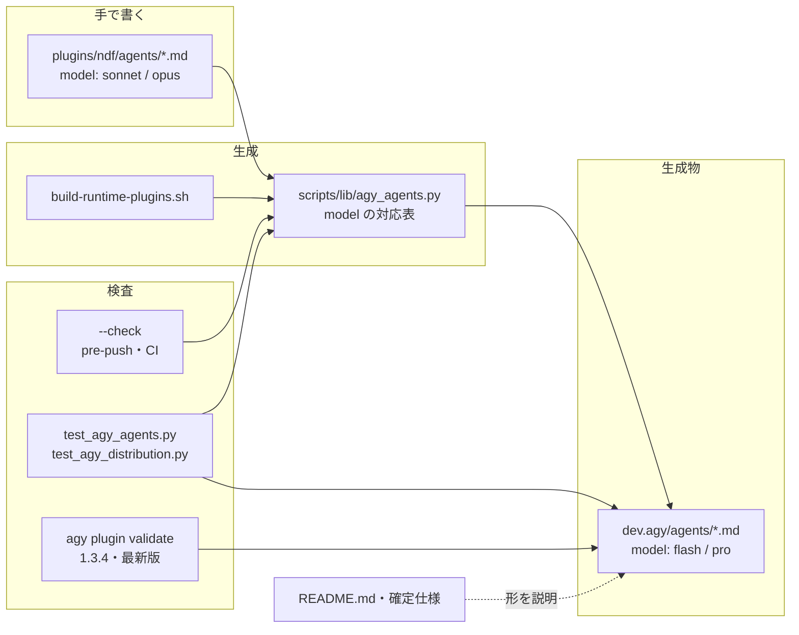
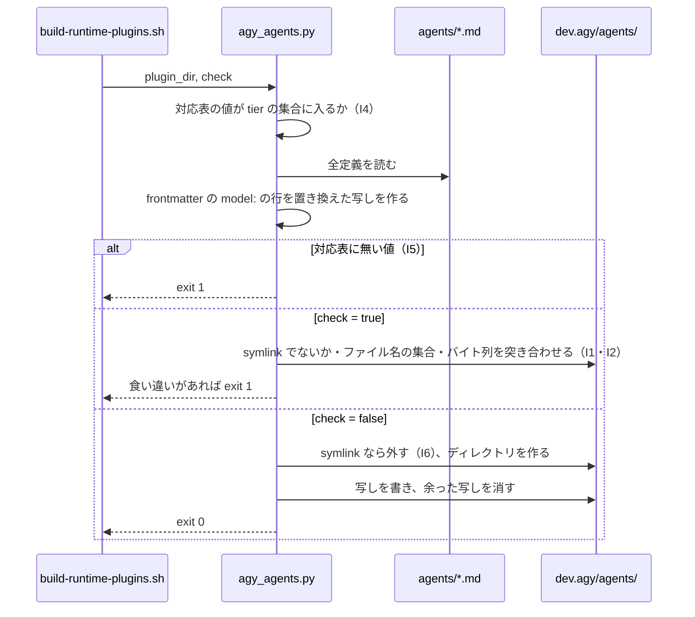

# agy のエージェント定義: agy 1.4 系でも 11 本すべてが読み込まれ、agy の入った手元で push が通る（#2087）

## 目的

- **何が壊れているか**: agy 1.4 系は `model` に tier 名（`flash` / `pro` / `inherit`）しか受け付けず、Claude Code と同じファイルを symlink で配っている 8 本（`model: sonnet` / `opus`）を読み飛ばす。`agy plugin validate` も exit 1 で落ちる
- **誰が困るか**: agy 1.4 系の利用者（8 本のエージェントを使えない）と、agy の入った手元で開発する人（pre-push が落ちて push できない）
- **直すと何が成り立つか**: agy に配る定義だけを生成した写しにして `model` を tier 名へ変換し、Claude Code の定義を変えずに 11 本すべてを agy に読み込ませる。写しの追従し忘れは `--check` と単体テストが塞ぐ

## 適用範囲

- **働く範囲**: このリポジトリの生成スクリプト（`scripts/build-runtime-plugins.sh`）と、その生成物を含む配布物（`plugins/ndf/dev.agy/agents/`）。生成物は配布物として利用者の agy に届く
- **プロジェクトごとに違うもの**: 無し（ai-plugins の配布物を作る生成の仕組みで、利用者のリポジトリでは動かない）
- **当たるモード**: `standard`

## あるべき姿の根拠

| 根拠 | 種類 | 何を示すか |
| --- | --- | --- |
| agy 1.4.7 で `model` を `flash` / `pro` に変換した写し（`/tmp` に作った試作）の `agy plugin validate` が exit 0・`agents 11`（2026-10-25） | 実測 | 変換した写しで受け入れ条件 1・2 が成り立つ |
| agy 1.4.7 で `model` の行を消した写しも exit 0・`agents 11`（同日） | 実測 | 外す形でも成り立つ（決定 2 の比べた案） |
| agy 1.3.4（CI の固定版、sha512 を照合して取得）で、変換・外す・今の symlink の 3 つとも exit 0・`agents : 11 processed`（同日） | 実測 | 前提 3 が成り立つ。どの形でも PR の `runtime-smoke (agy)` は通り続ける |
| agy の changelog がエージェント定義の `model` を tier 名（既定 `inherit`）と書く | 外部の一次情報 | `sonnet` / `opus` は agy の値の集合に無い |

要求と受け入れ条件は #2087 の本文にある（コピーは `issues/issue-2087-requirements.md`）。この文書は「どう作るか」だけを扱う。

## ドメインモデル

### コンテキスト

| コンテキスト | 何の語が 1 つの意味に決まるか |
| --- | --- |
| プロジェクト全体（`project-glossary`） | エージェント定義・agy に配る定義・model の対応表・tier |

1 つのコンテキストに収まる。Claude Code と agy の `model` の値は語として別のもの（Claude Code の型の名前 / agy の tier 名）で、対応表が 2 つを結ぶ。

### 集約

| 集約 | 持ち主（書き換えてよいもの） | 根 | エンティティ | 値オブジェクト |
| --- | --- | --- | --- | --- |
| エージェント定義の集合 | 開発者（手で書く） | `plugins/ndf/agents/` | 定義 1 本（`<名前>.md`） | `model` の値（Claude Code の型の名前） |
| agy に配る定義の集合 | 生成スクリプトだけ（手で書かない） | `plugins/ndf/dev.agy/agents/` | 写し 1 本（`<名前>.md`） | `model` の値（agy の tier 名） |

agy に配る定義の集合は、エージェント定義の集合と model の対応表から導ける。持ち主を生成スクリプトに限るのは、正を `plugins/ndf/agents/` の 1 か所に保つためである（要求の非機能の条件）。

### 不変条件

| # | 集約 | 条件 | 破れたときの扱い |
| --- | --- | --- | --- |
| I1 | agy に配る定義の集合 | 写しのファイル名の集合が、エージェント定義のファイル名の集合と等しい | `--check` が足りない写し・余った写しを示して exit 1 |
| I2 | agy に配る定義の集合 | 写し 1 本は、元の定義の frontmatter の `model:` の行だけを対応表で置き換えたバイト列と等しい（他の行・本文は同じ） | `--check` が食い違う写しを示して exit 1 |
| I3 | agy に配る定義の集合 | 写しの `model` は `flash` / `pro` / `inherit` / 欄なしのどれか | 単体テストが落ちる（agy なしで動く） |
| I4 | model の対応表 | 対応表の値はすべて agy の tier 名の集合に入る | 生成が始まる前に exit 1 |
| I5 | エージェント定義の集合 | 対応表に無い `model` の値を持つ定義があると、生成も `--check` も成り立たない（黙って外さない・黙って通さない） | 定義のパスと値を示して exit 1 |
| I6 | エージェント定義の集合 | 生成はエージェント定義のファイルを書き換えない（`dev.agy/agents` が古い symlink のままでも、その向き先へ書き込まない） | 単体テストが落ちる |

### ドメインイベント

| # | イベント | 発生元 | 受け手 |
| --- | --- | --- | --- |
| E1 | 開発者がエージェント定義を足した・変えた | 開発者 | 生成スクリプト（E2）、`--check`（E3） |
| E2 | agy に配る定義が E1 に追従した | `bash scripts/build-runtime-plugins.sh` | git（写しをコミットする） |
| E3 | 食い違いを見つけた | `build-runtime-plugins.sh --check`（pre-push・CI の `runtime-plugin-validate.yml`）、単体テスト | 開発者（exit 1 と食い違うパス） |
| E4 | agy が配る定義を検査した | `agy plugin validate`（手元の pre-push・PR の 1.3.4・日次の最新版） | 開発者・CI |
| E5 | 利用者の agy にエージェントが読み込まれた | `agy plugin install` | 利用者 |

### 用語

| 用語 | 意味 | 用語集への反映 |
| --- | --- | --- |
| agy に配る定義 | `plugins/ndf/dev.agy/agents/` の下にあり agy が読むエージェント定義。`plugins/ndf/agents/` から生成した写しで、`model` だけが agy の tier 名に変わる。手で直さない | 追加 |
| model の対応表 | Claude Code のエージェント定義の `model` の値（型の名前）から、agy の tier 名への対応。`scripts/lib/agy_agents.py` が持つ | 追加 |

## 機能一覧

| # | 機能 | 誰が使うか |
| --- | --- | --- |
| F1 | エージェント定義から agy に配る定義を生成する（`model` を対応表で変換する） | 開発者（`bash scripts/build-runtime-plugins.sh`） |
| F2 | agy に配る定義の追従し忘れ・手直し・余り・足りなさを見つける | pre-push と CI（`build-runtime-plugins.sh --check`） |
| F3 | agy に配る定義の `model` が agy の受け付けない値なら落とす（agy なし） | CI の単体テスト |
| F4 | agy の利用者に 11 本のエージェントが読み込まれる | agy の利用者 |

## 構成要素

| 要素 | 責務 |
| --- | --- |
| `scripts/lib/agy_agents.py`（新規） | model の対応表と agy の tier 名の集合を持つ。エージェント定義から写しを作り、書く（生成）か突き合わせる（`--check`）。古い symlink を外してからディレクトリを作る。食い違いを標準エラーへ出し、終了コードで返す |
| `scripts/build-runtime-plugins.sh`（変更） | `sync_agy_skill_links` の symlink の一覧から `agents` を外し、`agy_agents.py` を呼ぶ（`codex_skill_policies.py` と同じ呼び方）。冒頭の usage と、共有を説明するコメントを直す |
| `plugins/ndf/dev.agy/agents/*.md`（生成物・11 本） | agy に配る定義。symlink 1 本から実体のファイル 11 本へ変わる |
| `scripts/tests/test_agy_agents.py`（新規） | 不変条件 I1〜I6 と受け入れ条件 6・7 を agy なしで縛る |
| `scripts/tests/test_agy_distribution.py`（変更） | `test_dev_agy_shares_the_implementation` の `agents` の行を外す（`scripts` の行は残す） |
| `plugins/ndf/README.md`（変更） | 37 行目の段落を新しい形に合わせる（受け入れ条件 8） |
| `docs/specifications/ndf-worker-agent-and-skill-excerpts.md`（変更） | 64 行目の「`../agents` への symlink で同じ定義が配られる」を新しい形に合わせる |

変えないもの: `plugins/ndf/agents/*.md`（前提 2）、`scripts/validate-runtime-plugins.sh` と `.githooks/pre-push`（既に `--check` と `agy plugin validate` を呼んでおり、検査を緩めない）、`tests/runtime-smoke/`（`dev.agy` を丸ごと validate・install するため、形が変わっても手順は同じ）。



### パッケージ・モジュール構成

```text
scripts/
├── build-runtime-plugins.sh        # 変更: agents の symlink をやめ、agy_agents.py を呼ぶ
├── lib/
│   ├── codex_skill_policies.py     # 既存（呼び方の手本）
│   └── agy_agents.py               # 新規
└── tests/
    ├── test_agy_agents.py          # 新規
    └── test_agy_distribution.py    # 変更
plugins/ndf/
├── agents/*.md                     # 変えない（正）
└── dev.agy/
    ├── agents/*.md                 # symlink → 生成した写し 11 本
    ├── scripts -> ../scripts       # 変えない
    └── skills/                     # 変えない
```

## 入出力の契約

`scripts/lib/agy_agents.py` はコマンドとして呼ばれる。呼び方は `codex_skill_policies.py` に揃える。

```text
python3 scripts/lib/agy_agents.py <plugin ディレクトリ> <true|false>
```

| 引数・出力 | 形 |
| --- | --- |
| 1 つ目 | プラグインのディレクトリ（`plugins/ndf`）。`agents/` と `dev.agy/` を読む。`dev.agy/` が無いプラグインでは何もせず 0 で終わる |
| 2 つ目 | `true` なら書かずに突き合わせる（`--check`）。`false` なら書く |
| 終了コード 0 | 書き終えた、または食い違いが無い |
| 終了コード 1 | 食い違いがある・対応表に無い値がある・対応表が壊れている。理由ごとに 1 行を標準エラーへ出す |
| 標準エラーの行 | `Generated agent missing: <パス>` / `Generated agent is out of date: <パス>` / `Generated agent is stale: <パス>` / `Generated agents must be files, not a symlink: <パス>` / `Unknown model for agy: <パス>: <値>` |

標準エラーの行は `sync_agy_skill_links` の `Generated link …` と同じ形に揃え、パスはリポジトリの根からの相対で出す。標準出力には何も出さない（`build-runtime-plugins.sh` の最後の 1 行だけが出る）。

### model の対応表

| Claude Code の値 | agy の値 | 理由 |
| --- | --- | --- |
| `sonnet` | `flash` | 安い型を選んだ意図を、agy の安い tier へ写す |
| `opus` | `pro` | 高い型を選んだ意図を、agy の高い tier へ写す |
| `haiku` | `flash` | 安い型。今は使っていないが、Claude Code の型の名前の残り 1 つとして持つ |
| `inherit` | `inherit` | どちらも「呼び出し元の型を使う」 |
| 欄なし | 欄なし | 欄が無いままにする（agy の既定は `inherit`） |

型の名前でない値（`claude-opus-5-5` のような型 ID など）は対応表に無く、I5 のとおり exit 1 で止まる。足すときは対応表に 1 行足す。

## 処理の流れ



写しは、frontmatter（先頭の `---` から次の `---` まで）の中の `model:` で始まる 1 行だけを置き換えて作る。YAML として読み直して書き出さない（I2 のバイト列の一致を保つため。決定 3）。

`build-runtime-plugins.sh` の中の順序は、`sync_agy_skill_links` の後に `agy_agents.py` を呼ぶ。`sync_agy_skill_links` は `agents` を扱わなくなるため、2 つの順序に依存は無い。

## 非機能の実現方式

| 大項目 | 実現方式 |
| --- | --- |
| 運用・保守性 | 正は `plugins/ndf/agents/` の 1 か所。写しの持ち主は生成スクリプトだけで、手直しは `--check`（pre-push と CI の `runtime-plugin-validate.yml`）が I2 で落とす。対応表と tier の集合は `agy_agents.py` の 1 か所に置き、テストもそこを読む |
| システム環境 | agy 1.3.4 と 1.4.7 の両方で、変換した写しが exit 0・11 本になることを設計の時点で実測した（あるべき姿の根拠）。実装後は手元の 1.4.7 と PR の 1.3.4、リリース後は日次の最新版で見る |

## 決定の記録

### 決定 1: Claude Code の定義を変えずに agy だけの値を持たせるため、agy に配る定義を symlink から生成した写しへ変える

`dev.agy/agents` が `../agents` への symlink のままでは、agy が読む `model` を変えると Claude Code の定義が変わる（前提 2 に反する）。agy の `plugin install` は `dev.agy/` を丸ごと取り込み、取り込むときに中身を変える手段を持たないため、agy の受け付ける値は配布物の時点で入っていなければならない。そこで写しを生成し、コミットする。Kiro の MCP の installer（`dev.kiro/install.sh`）と同じく、生成物を追跡し `--check` で食い違いを見る形である。

採らなかった形: Claude Code の定義から `model` を外す（前提 2 に反し、Claude Code の型の選び分けを失う）。pre-push と validate の側で `Invalid model tier` だけを通す（検査を緩めるだけで、利用者の agy に読み込まれない状態が残る。要求の対象範囲で含まない）。

根拠: Value 6 / Value 1（MVV 版 3）

### 決定 2: Claude Code で選び分けた費用の意図を agy でも保つため、`model` は外さずに対応表で tier 名へ変換する（承認ゲート 1 で人が決める）

Claude Code の定義の `sonnet` / `opus` は、エージェントごとに安い型と高い型を選び分けた値である（前提 2）。agy の `flash` / `pro` は同じく安い tier と高い tier で、変換すればこの選び分けが agy でも保たれる。外す（既定の `inherit`）と、8 本はすべて利用者が選んだ型で動き、`sonnet` を選んだ 7 本も高い型で動きうる。費用を先に置く判断の基準（Value 10）に沿うのは変換である。

採らなかった案: `model` の行を外して既定の `inherit` にする。利用者が選んだ型をそのまま使えて対応表も要らないが、上の選び分けを agy で失う。agy 1.4.7 と 1.3.4 の実測ではどちらも通るため、どちらを採っても受け入れ条件 1〜4 は変わらない。人が外す方を選んだときは、対応表の `sonnet` / `opus` / `haiku` の値を `inherit` へ変えるだけで済む（構成要素とテスト設計は変わらない）。

根拠: Value 10 / Mission（MVV 版 3）

### 決定 3: 写しが元の定義と `model` の他で一致することを確かめやすくするため、frontmatter を YAML として読み直さず `model:` の 1 行だけを置き換える

YAML として読み直して書き出すと、引用符・改行の形・キーの順が書き手の形から変わりうる。受け入れ条件 6 の「`model` の欄の他が一致する」をバイト列で確かめられなくなり、`--check` の比較も読み直した結果どうしの比較になる。1 行の置き換えなら、写しと元の差は `model:` の 1 行だけになり、`diff` でも人が確かめられる。今 `model` を持つ 8 本は、すべて frontmatter の 3 行目に `model: <値>` の 1 行で書いている。

採らなかった案: `lib/yamlio.py`（ruamel.yaml）で読み書きする（`codex_skill_policies.py` は読むだけで書き戻さないため、手本にならない）。

根拠: Value 3（MVV 版 3）

### 決定 4: 対応表に無い値を黙って通さないため、型の名前でない `model` は生成を止める

対応表に無い値を外して `inherit` にすると、開発者が型 ID を書いたときに agy の側だけ黙って型の選び分けが消える。そのまま写すと agy に読み飛ばされ、今の不具合が戻る。止めれば、開発者は対応表に 1 行足すかを決める場面に必ず出会う。

採らなかった案: 対応表に無い値は外す（上のとおり黙って意図が消える）。

根拠: Value 6 / Value 7（MVV 版 3）

## テスト設計

| 受け入れ条件・不変条件 | どの振る舞いで縛るか | どう壊したら落ちるべきか |
| --- | --- | --- |
| 受け入れ条件 1・2 | 手元の agy 1.4.7 で `agy plugin validate plugins/ndf/dev.agy` が exit 0、`Invalid model tier` が 0 行、集計が `agents 11` | 写しの `model` を `sonnet` に戻すと exit 1・`agents 3` 系になる（設計時の実測と同じ） |
| 受け入れ条件 3 | 包みを `PATH` に置かずに `bash scripts/validate-runtime-plugins.sh` が exit 0 | 生成をし忘れると `--check` の段で exit 1 |
| 受け入れ条件 4 | PR の `runtime-smoke (agy)`（1.3.4）が成功する | —（1.3.4 は `model` を検査しない。設計時に 3 つの形で exit 0 を実測済み） |
| 受け入れ条件 5 | `git diff develop -- plugins/ndf/agents` に `model:` の行の差が無い | 生成が元の定義へ書き込むと差が出る（I6 のテストでも縛る） |
| 受け入れ条件 6・I1 | 一時のツリーで生成した直後は `--check` が 0。定義を 1 本足して生成し直さないと `--check` が 1 で、足りない写しのパスを出す。定義を 1 本消すと余った写しのパスを出す | ファイル名の集合を比べないように壊すと、足した・消した定義で落ちない |
| 受け入れ条件 6・I2 | 定義の本文を 1 文字変えて生成し直さないと `--check` が 1 で、そのパスを出す。写しの本文を手で直しても 1 | 比較を `model` の値だけにすると、本文の食い違いで落ちない |
| 受け入れ条件 7・I3 | リポジトリの `plugins/ndf/dev.agy/agents/*.md` の `model` がすべて tier の集合か欄なし。一時のツリーに `model: sonnet` の定義を 1 本足して生成すると、その写しは `flash` になる | 写しの `model` を `sonnet` にすると落ちる。変換を外すと、足した定義の写しが `sonnet` のままで落ちる |
| I4 | 対応表の値がすべて tier の集合に入る | 対応表の値を tier に無い値にすると、生成が exit 1 で止まる |
| I5 | 対応表に無い値（例: 型 ID）の定義があると、生成も `--check` も exit 1 で、パスと値を出す | 無い値を外す・そのまま写すように壊すと落ちない |
| I6 | 一時のツリーで `dev.agy/agents` を `../agents` への symlink にしてから生成すると、symlink が実体のディレクトリに変わり、元の定義のバイト列は変わらない。`--check` は symlink のときに 1 | symlink を外さずに書くと、元の定義の `model` が書き換わって落ちる |
| 受け入れ条件 8 | `plugins/ndf/README.md` の段落が「生成した写し・`model` を tier 名へ変換」と書く | —（`.md` の文言テストは書かない。レビューで見る） |
| 受け入れ条件 9 | リリース後に日次の `runtime-smoke-latest (agy)` の `agy validate ndf` が成功する | —（リリース後テストで見る） |

既存の `test_dev_agy_shares_the_implementation` は `scripts` の行だけを残す。`agents` の行を残すと、symlink を前提にしたまま落ちる。

## 設計の結果

| 課題 | 扱い | 取り込み先 | 触るファイル |
| --- | --- | --- | --- |
| #2087 | 実装する | — | `scripts/build-runtime-plugins.sh`、`scripts/lib/agy_agents.py`、`scripts/tests/test_agy_agents.py`、`scripts/tests/test_agy_distribution.py`、`plugins/ndf/dev.agy/agents/`、`plugins/ndf/README.md`、`docs/specifications/ndf-worker-agent-and-skill-excerpts.md` |

## 未確認のまま残ること

| 項目 | 内容 |
| --- | --- |
| `model` を変換するか外すか（未決 1） | 決定 2 で変換を推す。承認ゲート 1 で人が決める。外す方に決まったら、対応表の値を `inherit` へ変えるだけで、ほかの節は変わらない |
| agy の tier の選び方の効き目 | `flash` / `pro` が Claude Code の `sonnet` / `opus` と同じ費用と品質の差を持つかは測っていない。validate と読み込みの成否だけを実測した |
| `agy plugin install` の後の 11 本 | 設計では validate だけを実測した。install と `agy plugin list` は実装後の手元とリリース後テストで見る（受け入れ条件 9 と要求の検証手段） |
| 写しに対する既存の検査の扱い | 写しの `.md` 11 本が新たに追跡される。今の 11 本は相対リンクを持たず、`check-markdown-links.py` など `.md` を走査する検査に掛かる要素は見当たらないが、全体の検査（`check-lint.sh`・全体テスト）は実装で走らせて確かめる |
