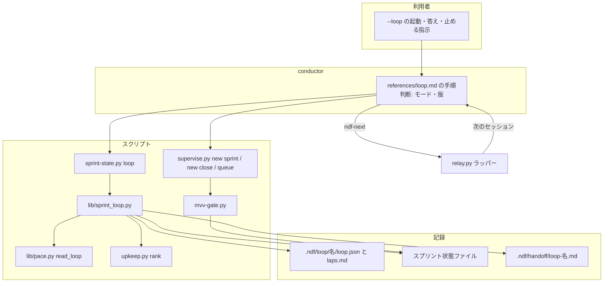
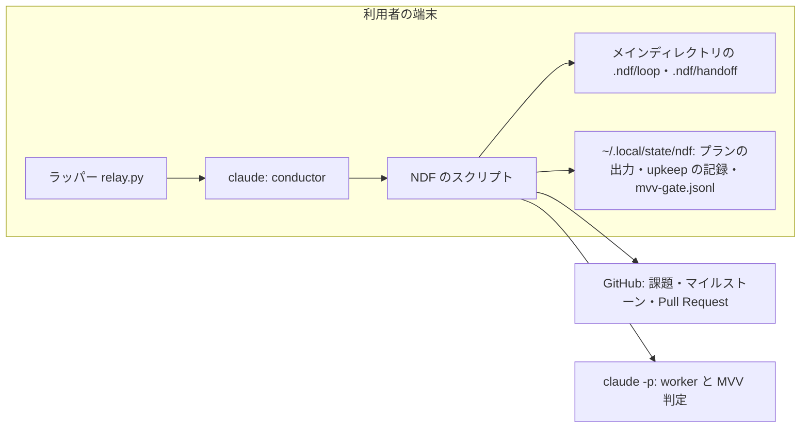
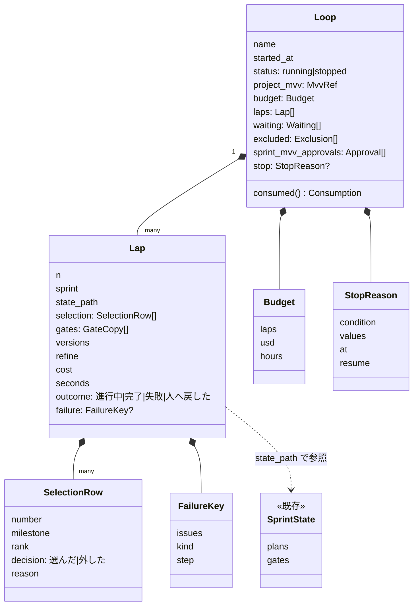
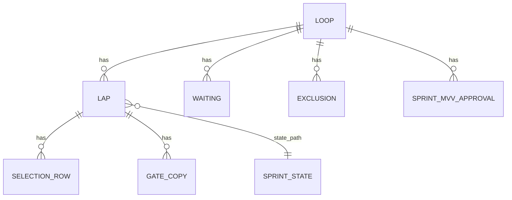
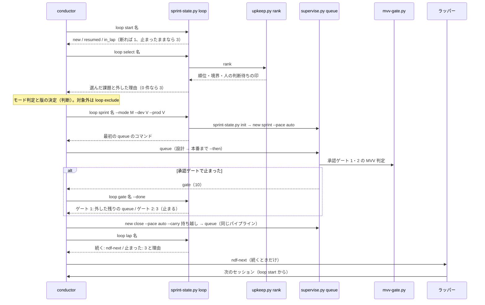
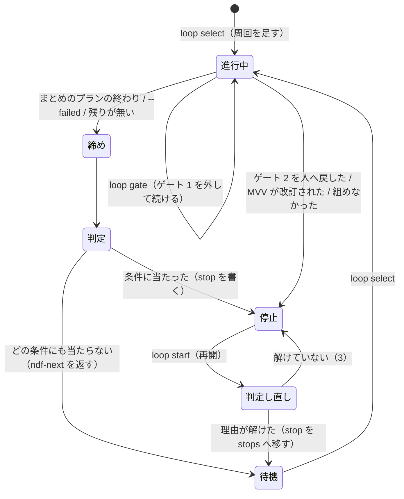

# development-workflow: 1 スプリントの振り返りと棚卸しで止まり、次のスプリントを人が選んで起動し直す → `--loop` で、棚卸しの順位から次のスプリントを機械で選び、レッドラインと止まる条件のときだけ止まって周回を続ける（#2089）

## 目的

- **何が壊れているか**: `/goal /ndf:development-workflow` は 1 スプリントの振り返り・棚卸しで終わる。次のスプリントを選んで始めるには、人が順位を読んで課題を決め、`/goal` の文面を書き直す。止まる条件と選んだ理由は、会話ごとに手で書くテンプレートの文面にしか無い
- **誰が困るか**: スプリントを続けて回したい利用者。承認ゲートを MVV 判定に任せても（`pace: auto`）、スプリントの境で毎回手が止まる
- **直すと何が成り立つか**: 利用者が `--loop` を付けて 1 回起動すれば、NDF が「選ぶ → 設計 → 実装 → 検査 → 配布 → 振り返り → 棚卸し → 次を選ぶ」を繰り返す。人が手を止めるのはレッドラインと止まる条件のときだけで、周回ごとの選定・判定・版・費用が 1 つの記録に残る。`--loop` を付けない起動は今と同じに動く

## 適用範囲

- **働く範囲**: 配布先のリポジトリでも働く（NDF の安定版の経路）。自動の切り替えは Claude Code のラッパー（`relay.py`）の下だけで、ほかのランタイムとラッパーの外では、カットポイントで `ndf-next` を出して止まり、貼り直せば同じ周回から続く
- **プロジェクトごとに違うもの**: ループを許すか・予算・同じ失敗の回数・1 周の課題の上限は `.ndf/pace.json` の `loop` 節で受ける。ループの名前・対象のマイルストーン・予算の上書きは起動の引数で受ける。テストのコマンド・ベースブランチ・配布の手段は今の宣言（`.ndf/project.json`・`.ndf/worktree.json`・`.ndf/supervise.json`）をそのまま使う
- **当たるモード**: ループの周回は `pace: auto` で組み、`auto` が許すモード（既定 `light` / `standard` / `legacy-refactor`）の課題だけを選ぶ。この変更自体は `standard`

## あるべき姿の根拠

| 根拠 | 種類 | 何を示すか |
| --- | --- | --- |
| 依頼の原文「振り返りとissue見直しの完了後、見直し結果に基づいて次のsprintを設定し、自動で次のsprintを開始できるようにしたい」「従来のgoalを明確に定めた開発手法もこれまで通り動くこと (引数で切り替え可能とする)」（#2089、2026-10-25） | 利用者の指示の原文 | 次のスプリントを棚卸しの結果から選んで続けること、引数で切り替えて今の進め方を残すこと |
| 「pace: autoを基本とし、MVVのレッドライン以外で承認を一切必要としないモードとします。」（#2089、2026-10-25） | 利用者の指示の原文 | 周回の中では `AskUserQuestion` も本文の承認待ちも出さず、レッドラインだけで人へ戻すこと |
| `relay.md` の「`/goal` のテンプレートを特定の課題に縛らない」と「止まるのは承認ゲート 2 つだけになる」（今の運用） | 既存の形 | 次のスプリントの選び方を文面で書く運用が既にあり、それを機械の手順へ移すのが最小の変更であること |
| 過去の課題の実測（`estimate.py actuals`、2026-10-24）: #2065 は A 1,817 秒・L 6,828 秒・C 5.55 USD、#2086 は A 2,462 秒・L 25,993 秒・C 6.11 USD（どちらも設計と実装まで） | 実測 | 予算の既定値の案（決定 5）の出所 |
| Anthropic のエンジニアリングブログ 3 本・OpenAI「Harness engineering」・Claude Code の `/goal` と hook の公式ドキュメント（2026-10-24 に本文を確認。出典は「外部の動向」） | 外部の一次情報 | 止まる条件と上限を必ず置くこと・作る役と判定する役を分けること・`/goal` の評価役が出力だけで判定し再開で計数を戻すこと。決定 5・8・12 の根拠 |

要求と受け入れ条件は #2089 の本文にある（コピーは `issues/issue-2089-requirements.md`）。この文書は「どう作るか」だけを扱う。

## ドメインモデル

### コンテキスト

| コンテキスト | 何の語が 1 つの意味に決まるか |
| --- | --- |
| NDF の開発ワークフロー（`ndf-workflow`） | 開発ループ・周回・ループの予算・止まる条件・ループの記録・承認ゲート・スプリント状態ファイル |
| NDF の課題の棚卸し（`ndf-issue-upkeep`） | 順位・切り出しの境界・容量・持ち越し・人の判断待ち |

**関係は順応者である。** 開発ループ（下流）は、棚卸しの `rank` の出力（上流）をそのまま読み、順位の付け方・境界の決め方を自分で持たない。順位の付け方を変えるのは棚卸しの側で、ループは翻訳の層を置かない（Value 6 の「同じ役割の定数・関数を Skill ごとに分けない」）。

### 集約

| 集約 | 持ち主（書き換えてよいもの） | 根 | エンティティ | 値オブジェクト |
| --- | --- | --- | --- | --- |
| 開発ループ | `lib/sprint_loop.py`（`sprint-state.py loop` の副命令だけが呼ぶ） | ループ（名前で識別） | 周回（番号で識別）・人の判断待ちの課題（課題の番号で識別） | 予算・選定の行・止まった理由・失敗の鍵・承認ゲートの判定の写し |
| スプリントの状態（既存） | `sprint-state.py`（今のまま） | スプリント | 計画の行・承認ゲートの記録 | 版・MVV の参照 |

**ループはスプリントの状態を ID（状態ファイルのパス）で参照し、中身を持たない。** 周回の終わりに、費用・秒・承認ゲートの判定・版をスプリントの状態から写して周回の行へ固定する（以後スプリントの状態が変わっても、周回の行は書き換えない）。

### 不変条件

| # | 集約 | 条件 | 破れたときの扱い |
| --- | --- | --- | --- |
| I1 | 開発ループ | 周回は追記だけで、番号は 1 から 1 ずつ増える。終わった周回の行は書き換えない | 書き込みを拒み、終了コード 1（記録が壊れている）で止まる |
| I2 | 開発ループ | 進行中の周回は高々 1 つ | 新しい周回の開始を拒む（`loop select` が「進行中の周回がある」で 1） |
| I3 | 開発ループ | 止まる条件は周回の境（周回の開始の前と終わりの後）でだけ判定する。周回の途中で `stop` を書かない | 周回の途中の停止の指示は、次の境まで効かない |
| I4 | 開発ループ | 選定は入力（`rank` の出力・ループの記録の人の判断待ちと除外・宣言・スプリント MVV の承認）だけで決まる。同じ入力からは同じ組と同じ並びが出る | — （テストで縛る） |
| I5 | 開発ループ | 答えの無い人の判断待ちの課題は選ばない | 選定の行に「人の判断待ち」で外す |
| I6 | 開発ループ | ループは承認ゲートを自分で通さない。承認ゲートの記録（`by: mvv`）を書くのは `mvv-gate.py` だけで、「従う」以外の判定を「従う」として扱わない | — （テストで縛る） |
| I7 | 開発ループ | 止まったループは、`loop start` が止まった理由を判定し直して解けたと確かめるまで、周回を始めない | 同じ理由で止まり直す |
| I8 | 開発ループ | 予算の消費（周回の数・費用・経過時間）は再開をまたいで引き継ぐ。経過時間はループの開始の時刻から数える | — （テストで縛る） |
| I9 | 開発ループ | 周回を始めるときのプロジェクト MVV の sha256 は、ループの開始時に記録した値と一致する | 周回を始めずに「MVV が改訂された」で止まる |

### ドメインイベント

| # | イベント | 発生元 | 受け手 |
| --- | --- | --- | --- |
| E1 | 利用者がループを始めた | 利用者（`--loop` の起動）→ `loop start` | 開発ループ（記録を作る・断る） |
| E2 | 周回を始めた | `loop select` | 開発ループ（周回の行を足す） |
| E3 | 次のスプリントの課題の組を選んだ | `loop select` | conductor（モード判定と版の決定）・スプリントの状態（`init`） |
| E4 | 課題を MVV の外・人の判断待ちとして外した | `loop select`・`loop exclude`・`loop gate` | 開発ループ（選定の行・人の判断待ち）・課題の本文 |
| E5 | スプリントを `pace: auto` で組んだ | `loop sprint`（`sprint-state.py init` と `supervise.py new sprint --pace auto`） | supervise のキュー |
| E6 | 承認ゲート 1 を MVV 判定で通した、またはレッドラインで人へ戻した | `mvv-gate.py check --gate design` | 開発ループ（`loop gate` が人の判断待ちへ移す）・スプリントの状態 |
| E7 | 実装・検査・開発版の配布を終えた | supervise のキュー | スプリントの状態（`update`） |
| E8 | 承認ゲート 2 を MVV 判定で通した、またはレッドラインで人へ戻した | `mvv-gate.py check --gate release` | 開発ループ（人へ戻したら `loop gate` が止める） |
| E9 | 本番へ配布した | 本番のプラン | スプリントの状態 |
| E10 | 振り返りと棚卸しを終えた | まとめのプラン（`new close --pace auto`） | 開発ループ（`loop lap` が持ち越しと順位の変化を読む） |
| E11 | 周回の記録を書き、止まる条件を判定した | `loop lap` | 開発ループ・引継ぎ文書・conductor（続ける / 止まる） |
| E12 | ループが止まった | `loop lap`・`loop select`・`loop gate`・`loop start` | 利用者（止まった理由と再開のコマンド）・引継ぎ文書 |
| E13 | 利用者がループを再開した | 利用者（再開のコマンド）→ `loop start` | 開発ループ（止まった理由を判定し直す） |

### 用語

| 用語 | 意味 | 用語集への反映 |
| --- | --- | --- |
| 開発ループ | スプリントを 1 つ終えるたびに、棚卸しの結果から次のスプリントを選んで続けて始める進め方。引数で切り替え、止まる条件に当たるまで繰り返す | 追加（要求の工程で追加済み） |
| 周回 | 開発ループの 1 回分。次のスプリントの選定から、そのスプリントの棚卸しと止まる条件の判定まで | 追加（要求の工程で追加済み） |
| ループの予算 | 開発ループが使ってよい量の上限。周回の数・費用・経過時間で数え、超えたら止まる | 追加（要求の工程で追加済み） |
| 止まる条件 | 開発ループを止める、機械で判定できる条件。予算を超えた・同じ失敗が続いた・着手できる課題が無い・MVV の外の課題しか残らない・利用者が止めた | 追加（要求の工程で追加済み） |
| ループの記録 | 開発ループの周回ごとの選定・承認ゲートの判定・版・費用と秒・止まる条件の判定を持つファイル（`.ndf/loop/<名>/loop.json`）と、そこから作る人が読む文書（`laps.md`） | 追加 |

## 機能一覧

| # | 機能 | 誰が使うか |
| --- | --- | --- |
| F1 | ループを始める・再開する（使ってよい条件を確かめ、断るときは 1 スプリントの起動の形を返す） | 利用者（`--loop` の起動）・conductor |
| F2 | 次のスプリントの課題の組を選び、選んだ・外した理由を周回へ書く | conductor |
| F3 | 課題を外す（モードが対象外・MVV に反する疑い） | conductor |
| F4 | 周回のスプリントを `pace: auto` で組む（状態の初期化とプランの書き出しの組み立て） | conductor |
| F5 | 承認ゲートで止まった判定を分け、承認ゲート 1 は課題を人の判断待ちへ移して残りで続け、承認ゲート 2 は止める | conductor |
| F6 | 人の判断待ちに答える（承認・差し戻し） | 利用者 |
| F7 | スプリントの終わりのまとめ（確定仕様化・課題を閉じる・振り返り・棚卸し）を `auto` で組み、前の周回の持ち越しを棚卸しへ渡す | conductor（`supervise.py new close --pace auto`） |
| F8 | 周回を締め、止まる条件を判定し、次の `ndf-next` か止まった理由を返す | conductor |
| F9 | ループを止める指示を置く | 利用者 |
| F10 | 周回の一覧と今の状態を出す | 利用者・conductor |
| F11 | スプリント MVV を承認してループへ渡す（決定 11） | 利用者 |

## 構成要素

| 要素 | 責務 |
| --- | --- |
| `development-workflow` の `SKILL.md`（節を 1 つ足す） | `--loop` の引数を受けたら `references/loop.md` の手順へ移ることだけを書く。既存の節は変えない |
| `references/loop.md`（新規） | conductor が周回ごとに打つ順・止まったときの出し方・人の判断待ちの答え方。判断（モード・版）と機械の手順（選定・判定・記録）の分担 |
| `sprint-state.py`（副命令 `loop` を足す） | `loop start` / `select` / `exclude` / `sprint` / `gate` / `answer` / `approve-mvv` / `lap` / `stop` / `status` / `list` の入口。引数を読み、`lib/sprint_loop.py` を呼び、結果 JSON を出す。既存の副命令は変えない |
| `lib/sprint_loop.py`（新規） | 開発ループの集約の持ち主。記録の読み書き（排他）・使ってよい条件・選定・止まる条件の判定・周回の締め・`laps.md` の描画。LLM を呼ばない |
| `lib/pace.py`（関数を足す） | `read_loop(root)`: `loop` 節を読み、既定を埋め、形を確かめる。`read_pace` は変えない（`loop` 節が壊れていても `fast` / `auto` は今どおり動く） |
| `supervise_lib/sprint.py`・`new_args.py`（`new close` に引数を足す） | `--pace auto` のときはまとめのステージだけを組む。`--record-pr` で本番の記録の Pull Request を受ける。`--carry` で前の周回の持ち越しを棚卸しのステップへ渡す |
| `handoff.py`（名の形を 1 つ足す） | 名の形（`NAME_RE`）に `loop-<ループ名>` を足す。今の 3 つの形の扱いは変えない |
| `references/handoff.md`（名の表に 1 行） | 引継ぎの対象が開発ループのときの名 `loop-<ループ名>` を表の先頭に足す |
| `references/pace.md`（設定の表に行を足す） | `loop` 節の項目を「設定（`.ndf/pace.json`）」の表へ足し、`loop.md` を指す |
| 既存のまま使うもの | `relay.py`（切り替え）・`upkeep.py rank`（順位）・`mvv-gate.py`（判定とレッドライン）・`supervise.py new sprint --pace auto` / `queue` / `wait` |

**図に含めない要素**: `references/handoff.md`・`references/pace.md` は文書の行を足すだけで、`SKILL.md` の節は `references/loop.md` へ移る入口だけで、処理の流れに現れない。`handoff.py` は `lib/sprint_loop.py` が引継ぎ文書（H）を書くときの部品で、L → H の辺に含める。



### システムの文脈と配置



**ループの記録はメインディレクトリの `.ndf/loop/` に置き、コミットしない。** 引継ぎ文書（`.ndf/handoff/`）と同じ扱いで、worktree の後片付けで消えず、`git status` に `?? .ndf/loop/` と出る。`.ndf/` の設定（C7）ではなく、スクリプトが作る記録である。

### パッケージ・モジュール構成

```text
plugins/ndf/
├── scripts/
│   ├── sprint-state.py            # 副命令 loop を足す
│   ├── handoff.py                 # 名の形に loop-<名> を足す
│   ├── lib/
│   │   ├── pace.py                # read_loop を足す
│   │   └── sprint_loop.py         # 新規: 開発ループの集約
│   ├── supervise_lib/
│   │   ├── sprint.py              # new close --pace auto / --carry / --record-pr
│   │   └── new_args.py            # 引数を足す
│   └── tests/
│       └── test_sprint_loop.py    # 新規
└── skills/development-workflow/
    ├── SKILL.md                   # 節「開発ループ（--loop）」を足す
    └── references/
        ├── loop.md                # 新規
        ├── handoff.md             # 名の表に 1 行
        └── pace.md                # 設定の表に loop 節の行
```

## 構造



`Loop.consumed()` は周回の行の和（数・費用・秒）とループの開始からの経過時間を返す純粋な関数で、書き込まない。

## データ構造

### ループの記録（`.ndf/loop/<名>/loop.json`）



| 項目 | 型 | 意味 |
| --- | --- | --- |
| `version` | 数 | 記録の形の版。`1` |
| `name` | 文字列 | ループの名前（英数字・`-`・`_`） |
| `repo` | 文字列 | `OWNER/REPO` |
| `started_at` | ISO 8601 | ループの開始の時刻。経過時間の起点（再開で変えない） |
| `project_mvv` | `{version, sha256}` | 開始時の承認済みプロジェクト MVV |
| `budget` | `{laps, usd, hours}` | 効いている予算（宣言の値。再開の引数で上書きしたら上書きの値） |
| `budget_history` | 配列 | 予算の上書きの履歴（`{at, from, to}`）。上書きのたびに 1 行足す |
| `same_failure` / `max_issues` | 数 | 宣言から写した値 |
| `milestones` | 文字列の配列 | 起動の引数で絞ったマイルストーン（空ならすべて） |
| `status` | `running` / `stopped` | 今の状態 |
| `stop` | オブジェクトか null | 止まった理由（下の表）。`running` に戻るときは `stops` へ移して null にする |
| `stops` | 配列 | 過去の止まった理由（追記だけ） |
| `laps[]` | 配列 | 周回（追記だけ。I1） |
| `waiting[]` | 配列 | 人の判断待ち（`{number, reason, gate, pr, lap, at, answer?, answered_at?}`）。答えは行を消さずに `answer` を足す |
| `excluded[]` | 配列 | 周回ごとの除外（`{number, reason, lap}`。モードが対象外・MVV に反する疑い） |
| `sprint_mvv_approvals[]` | 配列 | 利用者が承認したスプリント MVV（`{milestone, sha256, at, by}`） |

周回（`laps[]` の 1 行）:

| 項目 | 型 | 意味 |
| --- | --- | --- |
| `n` | 数 | 周回の番号 |
| `sprint` | 文字列 | スプリントの名前（`<ループ名>-<n>`） |
| `state_path` / `out` | パス | スプリント状態ファイルとプランの出力先 |
| `milestone` | 文字列 | 選んだ課題のマイルストーン |
| `rank_digest` | 文字列 | 選定に使った `rank` の `metrics.digest` |
| `selection[]` | 配列 | `{number, milestone, rank, decision, reason}`。外した行も載せる |
| `mode` | 文字列 | conductor が判定したモード |
| `gates[]` | 配列 | 承認ゲートの判定の写し（`{name, by, verdict, basis, pr, at}`）。`mvv-gate.jsonl` とスプリント状態の `gates[]` から写す |
| `versions` | `{dev, prod}` | 配布した版 |
| `retro` | 文字列 | 振り返りの置き場（まとめのプランの報告の URL） |
| `refine` | オブジェクト | `{report, rank_changes, deferred[]}`。棚卸しの報告・順位の変化・持ち越し |
| `created[]` | 数の配列 | 周回の中で起票された課題（選定の対象にしない。I4 の入力にもしない） |
| `cost` / `seconds` | 数 | スプリント状態ファイルとまとめのプランの行の和 |
| `outcome` | 文字列 | `進行中` / `完了` / `失敗` / `人へ戻した` |
| `failure` | オブジェクトか null | `{issues, kind, step}`（決定 8） |
| `relay_dir` | パスか null | 周回を締めたセッションの `NDF_RELAY_DIR` |
| `started_at` / `ended_at` | ISO 8601 | 周回の開始と終わり |

止まった理由（`stop`）:

| `condition` | 判定 | `values` |
| --- | --- | --- |
| `budget_laps` / `budget_usd` / `budget_hours` | 消費が予算以上 | `{consumed, budget}` |
| `same_failure` | 直近の失敗の周回が同じ鍵で `same_failure` 回続いた | `{key, count}` |
| `no_issue` | 選定の候補が 0 件 | `{milestones}` |
| `outside_mvv` | 候補が 1 件以上あり、すべて外れた | `{reasons}`（理由ごとの件数） |
| `user_stop` | 止める指示のファイルがある | `{at}` |
| `gate2_returned` | 承認ゲート 2 を人へ戻した | `{pr, verdict, reasons}` |
| `mvv_changed` | プロジェクト MVV の sha256 が開始時と違う・未承認になった | `{started, now}` |
| `refused` | 周回を組めなかった（`new sprint` が断った・状態を書けない） | `{step, exit, summary}` |

### CRUD

| 機能 | ループの記録 | 周回 | 人の判断待ち | スプリント状態 | 引継ぎ文書 | 課題の本文 |
| --- | --- | --- | --- | --- | --- | --- |
| F1 `loop start` | C / U（再開） | R | R | R | C / U | — |
| F2 `loop select` | U | C | R | — | — | — |
| F3 `loop exclude` | U | U（選定の行） | — | — | — | — |
| F4 `loop sprint` | U | U | — | C | — | — |
| F5 `loop gate` | U | U | C | R | U | U |
| F6 `loop answer` | U | — | U（答えを足す） | — | — | U |
| F8 `loop lap` | U | U（締める） | R | R | U | — |
| F9 `loop stop` | R | — | — | — | — | — |
| F11 `loop approve-mvv` | U | — | — | — | — | — |
| F10 `loop status` / `list` | R | R | R | R | — | — |

## 入出力の契約

### 起動の引数（`development-workflow`）

```text
/goal /ndf:development-workflow --loop [<ループ名>] [--milestones <M>,<M>...] [--budget-laps N] [--budget-usd X] [--budget-hours H]
```

| 引数 | 意味 | 無いとき |
| --- | --- | --- |
| `--loop` | 開発ループで進める | 今の 1 スプリントの進め方（受け入れ条件 1） |
| `<ループ名>` | 記録の名前。同じ名前の記録があれば再開する | `l<UTC の YYYYMMDD>`（同じ名前の記録があればそれを再開する） |
| `--milestones` | 選定の対象を絞る | 開いているマイルストーンすべて |
| `--budget-*` | 予算を上書きする（記録の `budget_history` に残る） | 宣言の値 |

`ndf-next` と再開のコマンドは、名前を必ず含めた `/goal /ndf:development-workflow --loop <ループ名>` の形である（`/goal` で始めていなければ付けない）。決定 12 で案 B を選んだときは、末尾に終わりの条件の節（`-- 終わり: [ndf-loop] stopped <ループ名> の行を出したとき`）を足す。Skill は `--` から後を引数として読まない。

### 設定（`.ndf/pace.json` の `loop` 節）

```json
{"loop": {"enabled": false, "budget": {"laps": 3, "usd": 60, "hours": 24}, "same_failure": 2, "max_issues": 3}}
```

| 項目 | 型 | 無いとき | 意味 |
| --- | --- | --- | --- |
| `loop.enabled` | bool | 偽（ループを断る） | ループを許すか |
| `loop.budget.laps` / `usd` / `hours` | 正の数 | 3 / 60 / 24 | ループの予算（決定 5） |
| `loop.same_failure` | 1 以上の整数 | 2 | 同じ失敗で止まる回数（決定 8） |
| `loop.max_issues` | 1 以上の整数 | 3 | 1 周の課題の上限（棚卸しの容量が無いときの切り出しの数。容量があっても超えない） |

**ループは `auto` 節も要る。** 周回は `pace: auto` で組むため、`auto.enabled` と `auto.verify` が無ければ `loop start` が断る。`loop` 節の形が誤っていれば `read_loop` が `PaceError` を投げ、`loop start` だけが断る（`read_pace` を使う `fast` / `auto` / `check-trigger` / `mvv-gate` は今どおり）。

### 副命令（`sprint-state.py loop`）

結果は既存と同じ `step_result` の 1 行の JSON（`tool: sprint-state`）。

| 副命令 | 入力 | 出力（`metrics` の主なキー） | 終了コード |
| --- | --- | --- | --- |
| `loop start <名> [--milestones M,...] [--budget-* ...] [--root DIR]` | 宣言・プロジェクト MVV・記録 | `status`（`new` / `resumed` / `in_lap`）・`lap`・`consumed`・`budget`・`next`（次に打つ副命令かプランの続き） | 0 = 始めた・続ける / 1 = 断った（`items` に理由、`next` に 1 スプリントの起動の形 `/ndf:development-workflow #<課題>`）/ 3 = 止まったまま（止まった理由が解けていない。`items` に理由と再開のコマンド） |
| `loop select <名>` | `upkeep.py rank` の出力（その場で打つ）・記録 | `lap`・`selected[]`・`excluded[]`・`milestone`・`rank_digest` | 0 = 選んだ / 3 = 止まった（`no_issue` / `outside_mvv`。`stop` を書いた）/ 1 = 進行中の周回がある・`rank` が 2 か 3 を返した |
| `loop exclude <名> <課題> --reason <文>` | 進行中の周回の選定 | 外した課題・選定をやり直した結果（`select` と同じ形） | 0 / 3（すべて外れた）/ 1 |
| `loop sprint <名> --mode M --dev V [--prod V] [--] <new sprint に足す引数>` | 進行中の周回の選定 | 打ったコマンド・`state_path`・`out`・マニフェストのパス・最初の `queue` のコマンド | 0 / 3（`sprint-state.py init` か `new sprint --pace auto` が断った。`stop: refused` を書く） |
| `loop gate <名> --done <done.json>` | キューの done・`mvv-gate.jsonl`・スプリントの状態 | `gate`（`1` / `2`）・人の判断待ちへ移した課題・続きの `queue` のコマンド（外した課題の計画を除いたもの） | 0 = 残りで続ける、または残りが無く周回を締めて次の周回へ進む（`ndf_next` を返す）/ 3 = 止まった（承認ゲート 2・MVV が改訂された・締めた後の判定で止まる条件に当たった） |
| `loop answer <名> <課題> --approved\|--rejected [--pr N]` | 人の判断待ち | 答えを書いた行 | 0 / 1（待っていない課題） |
| `loop lap <名> [--failed]` | スプリントの状態（`update` を内で打つ）・まとめのプランの done と報告・upkeep の候補の記録・止める指示のファイル | 締めた周回・`stop`（止まったとき）・`ndf_next`（続くとき） | 0 = 続く / 3 = 止まった |
| `loop approve-mvv <名> --milestone M` | マイルストーンの説明のスプリント MVV | 承認した sha256（`sprint_mvv_approvals` に 1 行） | 0 / 3（説明に `## Mission` / `## Vision` / `## Value` がそろわない） |
| `loop stop <名>` | — | 置いたファイルのパス | 0 |
| `loop status <名> [--json]` / `loop list <名> [--json]` | 記録・`relay_dir` の `log.jsonl` | 今の状態 / 周回の一覧（何周目・選んだ課題・版・費用・止まった理由） | 0 / 1（記録が無い） |

**3 は「止まる条件に当たった」で、失敗ではない。** `step_result` の 3（各スクリプトが定めた正常な否定の結果）に当てる。4 は `merge-when-green` のベースブランチとの衝突が使っているため使わない。断る（1）と止まった（3）は、`metrics.status` の `refused` / `stopped` でも見分ける。止まったときの出力の `items` には、止まった条件・判定に使った値・再開のコマンドを必ず載せ、`metrics.stop_line` に決まった語の 1 行（決定 12）を載せる。

### `supervise.py new close` に足す引数

| 引数 | 意味 | 既定 |
| --- | --- | --- |
| `--pace auto` | 最終の検査・開発版・本番を置かず、まとめのステージ（確定仕様化 → Pull Request → 課題を閉じる → 振り返り → 棚卸し）だけを組む。`fast` 節を読まない | 無し（今の形。`fast` のまとめ） |
| `--record-pr N` | 課題を閉じるステップ（`sprint-close.py --record-pr`）に渡す本番の記録の Pull Request | 無し（今の導き方） |
| `--carry N...` | 棚卸しのステップの指示へ「前の周回の持ち越し #N... を `--add` で渡す」を足す | 無し（指示は今のまま） |

`--pace` を渡さない `new close` の出力は変わらない（受け入れ条件 18）。

## 処理の流れ

### 1 周の流れ



**本番のキューから `loop lap` までを 1 本のパイプラインで流す。** 今の「本番の後のカットポイント」（`relay.md`）と同じ形で、`supervise.py queue <本番>` → `wait` → `new close --pace auto` → `queue <まとめ>` → `wait` → `loop lap` を続ける。ゲート 2 の通過から次のセッションの起動までに、conductor が組み立てる文は無い。

**周回の途中のカットポイント（ゲート 1 の後など）は今のまま切る。** `ndf-next` の中身はループの再開のコマンドで、次のセッションの `loop start` が `in_lap` と、引継ぎ文書 `loop-<名>` の「次にやること」を返す。conductor は今と同じく引継ぎ文書の続きから進める。

### 選定（`loop select`）

1. 進行中の周回があれば 1（I2）。プロジェクト MVV の sha256 が開始時と違えば `mvv_changed` で止まる（I9）
2. `upkeep.py rank --root <根>` を打つ。見積は記録（`estimates.json`）と説明の `### 順位` の表から採られ、棚卸しの担当が付けた段階がそのまま効く。2 か 3 なら 1 で返す（選定を推さない）。20（段階の欠けた課題がある）は、欠けた課題が `rows` に載らないだけなので続ける
3. マイルストーンを `rank` の `order` の順に見る（`--milestones` で絞ったときはその中だけ）。各マイルストーンで:
   - 説明に `## Mission` / `## Vision` / `## Value` がそろい、その sha256 が `sprint_mvv_approvals` に無ければ、そのマイルストーンの行をすべて「スプリント MVV が未承認」で外す
   - 候補は `rows` を `rank` の順に、`boundary.number` まで（境界が無ければ先頭から `max_issues` 件）と、`large_slot.status` が収まる（fit）ときの `large_slot.slice`
   - 候補から外す: `waiting_decision` が真（人の判断待ち）・`waiting[]` に答えの無い行がある（人の判断待ち）・この周回の `excluded[]` にある（その理由）・`size` が尺度を超える（容量）
   - 残りを `rank` の順に `max_issues` 件まで選ぶ。超えた行は「容量」で外す
   - 1 件でも選べたら、このマイルストーンで決める（1 つのスプリントは 1 つのマイルストーンから組む）
4. どのマイルストーンでも選べず、候補が 0 件なら `no_issue`、候補があってすべて外れたなら `outside_mvv` で止まる
5. 周回の行を足し、選んだ行と外した行を `selection[]` に、`rank` の `metrics.digest` を `rank_digest` に書く

**入力に無いものを選定に使わない。** 周回の中で起票された課題（`created[]`）は、`rank` が段階のある課題だけを並べるため、棚卸しが段階を付けた後の周回で初めて候補になる（受け入れ条件 6）。

### 承認ゲートで止まったとき（`loop gate`）

| キューが止まった所 | 判定の記録（`mvv-gate.jsonl` の行） | 扱い |
| --- | --- | --- |
| 設計のプラン（承認ゲート 1） | 機械のチェック 1・2（プロジェクト MVV・MVV の承認の不一致） | `mvv_changed` で止まる |
| 同上 | 機械のチェック 4・5（`boundary_paths`・MVV の宣言を変える）、判定の `boundary` が空でない、判定が「従わない」「判定できない」、判定を読めない | その課題を人の判断待ちへ移し（`waiting[]`・課題の本文）、残りの課題の計画で続きの `queue` を組む。残りが無ければ周回を `人へ戻した` で締めて次の周回へ（止まる条件の判定を通す） |
| 本番のプラン（承認ゲート 2） | どの判定でも | `gate2_returned` で止まる。今の「承認ゲートで止まった後の続け方」（`pace.md`）で利用者が答え、再開のコマンドで続ける |

**ゲート 1 の続きは、マニフェストの `resume` から外した課題の計画（設計・実装）を除いて組む。** 承認ゲート 1 の判定はプランの中で課題ごとに走るため、1 本が `関門` でも他の設計 PR はマージ済みである。

**課題の本文には `## 人の判断待ち（開発ループ <名>）` の節を書く。** 判定・理由・根拠の項目・設計 PR の URL と、答え方（`loop answer`）を載せる。節が既にあれば本文全体を書き直す形で置き換える。

### 人の判断待ちに答えたとき（`loop answer`）

| 答え | 記録 | その後 |
| --- | --- | --- |
| `--approved` | `waiting[]` の行に `answer: approved`。今の承認の記録（`sprint-state.py gate <その周回の状態> "関門 1" --by user --outcome approved --pr N`）を内で打ち、覆しの記録も今どおり残る | 利用者が設計 PR をマージした後の周回で、選定の対象に戻る。その課題は `--design` に入れず、`loop sprint` が `supervise.py design-results` で設計の結果を読んで実装のプランへ渡す |
| `--rejected` | `waiting[]` の行に `answer: rejected`。差し戻しの記録（`gate-rejections.jsonl`）を今どおり残す | 選定の対象に戻さない（答えのある行は外し続ける。理由「差し戻し」） |

### 止まる条件の判定（`loop lap`）



判定の順は次のとおりで、最初に当たったものを止まった理由にする（判定に使った値はすべて `values` に残す）。

1. `user_stop`: `.ndf/loop/<名>/stop` がある
2. `mvv_changed`: プロジェクト MVV が開始時と違う・承認と一致しない
3. `same_failure`: 直近の `outcome: 失敗` の周回を新しい順に見て、`failure` が同じ鍵の周回が `same_failure` 回続く（間に `完了` の周回があれば数え直す）
4. `budget_laps` / `budget_usd` / `budget_hours`: 終わった周回の数・費用の和・`started_at` からの経過時間が予算以上
5. （選定の時点で）`no_issue` / `outside_mvv`

**再開（`loop start`）は止まった理由ごとに解けたかを見る。** `user_stop` は再開でファイルを消して解ける。予算は再開の引数で上書きした予算で判定し直す。`same_failure` は止まった後に利用者が直したことを機械で知れないため、再開の起動そのものを解けた印とし、失敗の数を数え直す（`stops` に残る）。`gate2_returned` はその周回の状態に `関門 2` の記録（利用者の承認）があれば解け、本番のプランを `run <本番のプラン> --from bump` で続けてから（`pace.md` の「承認ゲートで止まった後の続け方」）、まとめのステージへ進む。差し戻しの記録があれば、その周回を `人へ戻した` で締めて次の周回へ進む。`mvv_changed` は開始時の値を今の承認済みの値へ置き換えず、新しい名前でループを始め直すよう示す（承認の記録の起点を混ぜない）。

### 止まったときの出し方

**止まったときは `ndf-next` のブロックを出さない。** ラッパーがブロックを拾うと次のセッションを起動し、同じ理由で止まり直して再起動ループの上限まで回る。conductor は止まった理由・判定に使った値・再開のコマンドを本文に書き、**最後に決まった語の 1 行 `[ndf-loop] stopped <ループ名> <condition>` を出して**応答を終える（決定 12）。1 行は `loop` の結果 JSON の `metrics.stop_line` をそのまま写し、conductor が文面を作らない。再開のコマンドは引継ぎ文書の「次に実行するコマンド」の節にも `ndf-next` の形で残す（受け入れ条件 12）。

| 止まった理由 | 利用者へ問うか |
| --- | --- |
| `gate2_returned` | 問う（レッドラインか判定が「従う」以外の承認ゲート 2。今の承認ゲートの出し方で `AskUserQuestion`） |
| それ以外 | 問わない。本文で理由と再開のコマンドを示して終える（本文の承認待ちの文にしない） |

**ラッパーの 1 日の起動回数の上限に当たったとき**は、ラッパーが次のセッションを起動せず、引継ぎ文書には直前の `ndf-next` が残る。`loop status` は最後の周回の `relay_dir` の `log.jsonl` に `stop`（`max-starts`）の行があれば「ラッパーが上限で止めた」と再開のコマンドを出す（非機能の可用性）。

## 非機能の実現方式

| 大項目 | 条件 | 実現方式 |
| --- | --- | --- |
| 可用性 | ラッパーの起動回数の上限で理由と再開のコマンドを残す | 周回の途中のカットポイントで引継ぎ文書へ再開のコマンドを書く（今の手順）。`loop status` がラッパーの記録の `stop` の行を読んで出す。ラッパーは変えない |
| 運用・保守性 | 止まる条件の判定は LLM を呼ばない。閾値は設定で受ける | `lib/sprint_loop.py` は LLM を呼ばない（判断はモードと版だけで、conductor が持つ）。閾値は `.ndf/pace.json` の `loop` 節と起動の引数だけから読み、スクリプトに既定値の定数を 1 か所だけ置く |
| セキュリティ | レッドラインと `boundary_paths` をループでも今と同じに効かせる | ループは承認ゲートを自分で通さない（I6）。判定は `mvv-gate.py check` をそのまま通り、`loop gate` は判定の記録を読んで外す・止めるだけ。`loop` 節に `boundary_paths` やレッドラインを変える項目を置かない |
| 移行性 | ループの設定が無いリポジトリでは何も変わらない | `loop` 節は `read_loop` だけが読む。`--loop` を付けない起動・`--pace` を付けない `new close` の振る舞いと出力は変わらない |
| 排他 | 同じループの記録を 2 つのセッションが同時に書かない | 記録の読み書きは `locks`（`sprint-state.py gate` と同じ排他）で囲み、`jsonio.write_atomic` で書く |

## 外部の動向

**一次情報は 2026-10-24 に別の担当が WebSearch・WebFetch で本文を開いて確かめた。** 主軸は Anthropic・OpenAI のエンジニアリングブログと Claude Code の公式ドキュメントで、個人ブログと StrongDM は語の原典として扱う。起票時に挙げた解説記事（medium・mindstudio・noqta・BCG Platinion・substack・ai.engineer）は根拠に使っていない。

### 出典

| 区分 | 出典 | 発行者・日付 | 確かめた範囲 |
| --- | --- | --- | --- |
| 主軸 | 「Effective harnesses for long-running agents」 https://www.anthropic.com/engineering/effective-harnesses-for-long-running-agents | Anthropic Engineering（Justin Young）・2025-11-26 | 本文 |
| 主軸 | 「Harness design for long-running application development」 https://www.anthropic.com/engineering/harness-design-long-running-apps | Anthropic Engineering（Prithvi Rajasekaran）・2026-03-24 | 本文 |
| 主軸 | 「Building effective agents」 https://www.anthropic.com/engineering/building-effective-agents | Anthropic Engineering（Erik Schluntz・Barry Zhang）・2024-12-19 | 本文 |
| 主軸 | 「Harness engineering: leveraging Codex in an agent-first world」 https://openai.com/index/harness-engineering/ | OpenAI（Ryan Lopopolo）・2026-02-11 | openai.com は 403 のため読み取りのプロキシ経由で本文を取得した。**日付は検索結果の値で、本文からは確かめていない** |
| 主軸 | Claude Code の `/goal` https://code.claude.com/docs/en/goal 、hook https://code.claude.com/docs/en/hooks ・ https://code.claude.com/docs/en/hooks-guide 、Agent SDK と非対話の上限 https://code.claude.com/docs/en/agent-sdk/agent-loop ・ https://code.claude.com/docs/en/agent-sdk/configuration ・ https://code.claude.com/docs/en/headless | Anthropic・2026-10-24 時点 | 本文 |
| 語の原典（loop engineering） | Addy Osmani「Loop Engineering」 https://addyosmani.com/blog/loop-engineering/ | 個人ブログ・2026-06-07 | 本文。これより早い用例は検索の範囲で見つからなかった（無いとは言えない） |
| 語の原典（software factory） | StrongDM「Software Factories And The Agentic Moment」 https://factory.strongdm.ai/ | StrongDM AI（Justin McCarthy）・2026-02-06 | **Story のページだけ。Principles・Techniques の下位ページは未読** |
| 語の原典（dark factory） | Dan Shapiro「The Five Levels」 https://www.danshapiro.com/blog/2026/01/the-five-levels-from-spicy-autocomplete-to-the-software-factory/ | 個人ブログ・2026-01-23 | 本文 |
| 語の原典（Ralph loop） | Geoffrey Huntley「everything is a ralph loop」 https://ghuntley.com/loop/ | 個人ブログ・2026-01-17 | 本文 |
| 未読 | arXiv「Loop Engineering: Building Blocks, Adoption, and Impact」 https://arxiv.org/pdf/2608.21884 | — | **検索で見つけたが開いていない。根拠に使わない** |

### 取り入れる考え方

| 考え方 | 出典 | この設計のどこで受けるか |
| --- | --- | --- |
| 反復には上限を含む止まる条件を必ず置き、人へ戻すのは「チェックポイント」と「行き詰まり」に限る（"stopping conditions (such as a maximum number of iterations)"、"pause for human feedback at checkpoints or when encountering blockers"） | Building effective agents | 止まる条件の 8 つ（データ構造の `stop`）。チェックポイントはレッドラインと承認ゲート 2（決定 4）、行き詰まりは同じ失敗（決定 8）と選べる課題が無いとき |
| 骨格は決まった順の workflow にし、各工程の中だけをエージェントに任せる。最小から始める | Building effective agents | 選定・判定・記録は LLM を呼ばないスクリプト（`lib/sprint_loop.py`）。周回は直列で 1 つずつ（I2）。並列の周回は入れない |
| 1 回に 1 つの塊だけを進める（"work on only one feature at a time"、"performs one task per loop"） | Effective harnesses・Huntley | 1 周回 1 スプリント・1 マイルストーン（決定 2） |
| 回の始めに前回の記録を読んでから次を選び、終わりに記録を書いてから次へ進む | Effective harnesses | `loop start` が記録を読み、`loop lap` が周回を締めて書いてから `ndf-next` を返す（1 周の流れ） |
| 完了の判定を書き換えにくい構造化データに置き、作る側に判定の項目を消させない（"It is unacceptable to remove or edit tests"）。完了の条件は実装の前に合意する（スプリント契約）。判定の材料を作る側の外に置く（StrongDM のシナリオ） | Effective harnesses・Harness design・StrongDM | 受け入れ条件は要求の工程で固定し、承認ゲート 1 の MVV 判定を通ってから実装する（今の `development-workflow`）。worker は受け入れ条件を書き換えない（今の規則）。ループの記録は JSON（`loop.json`）を正本にし、`laps.md` は描画だけ（決定 6） |
| 作る役と判定する役を分ける（"agents reliably skew positive when grading their own work"） | Harness design | 承認ゲートの判定は `mvv-gate.py` だけが書き、ループは自分で通さない（I6）。検査はクロスレビューと CI のまま |
| 完了は主張であって証明ではない。周回の記録に証跡を添える（"“done” is a claim and not a proof"） | Osmani | 周回の行に承認ゲートの判定の写し・Pull Request・版・振り返りの置き場を固定する（I1） |
| 周回ごとの費用と時間を記録し、予算の上限を必須にする（実測で 1 回 3〜6 時間・124〜200 USD） | Harness design | 予算の 3 つ（決定 5）と、周回の `cost` / `seconds` |
| `/goal` の計数（ターン・時間・トークン）は再開でリセットされる | `/goal` | 予算の累計は NDF のループの記録が持ち、`/goal` の計数に頼らない（I8・決定 5）。今の設計と一致する |
| `/goal` の評価役はコマンドもファイルも見ず、会話の出力だけで判定する。条件は出力で示せる形に書く | `/goal` | 止まったときに決まった語の 1 行を出す。推奨の案 B では再開のコマンドの条件にもその語を書く（決定 12） |
| Claude Code の安全弁（Tool を使わない応答が数ターン続く・Stop hook の block が 8 回続く）はターン単位で、周回をまたぐ失敗は捕まえない | `/goal`・hooks-guide | 同じ失敗は NDF が周回単位で数える（決定 8） |
| 人が持つのは優先順位・受け入れ条件・成果の確認（"We prioritize work, translate user feedback into acceptance criteria, and validate outcomes."）。判断が要るときだけ人へ戻す | OpenAI | 優先順位は MVV と棚卸しの順位、確認は承認ゲート 2 と周回の記録。周回の中で問わない（決定 4） |
| 周回の中で見つけた欠けた規則は、その場で直し続けずに仕組みの Issue にする（"so it never happens again"） | Huntley・OpenAI | 周回の中の起票は `created[]` に残し、棚卸しが段階を付けた後の周回で候補になる（受け入れ条件 6） |
| 人が後から追える記録を残す（"watch the loop"、"Build the loop. Stay the engineer."） | Huntley・Osmani | `laps.md` と `loop list`（何を選び、なぜ選び、何で終わったか） |
| ハーネスの部品はモデルの弱点の仮定で、効かなくなれば外す（"every component in a harness encodes an assumption about what the model can't do on its own"） | Harness design | 周回の記録の判定と費用を振り返りが読み、効いていない工程を Issue にする（今の `retrospective` の経路。この課題で仕組みは足さない） |

**位置付けは Shapiro の Level 4（人は仕様と MVV の水準で関わり、後から確かめる）であって、Level 5（dark factory）ではない。** MVV のレッドラインで人へ戻すという要求がそれを決める。

### 取り入れない考え方

| 考え方 | 出典 | 取り入れない理由 |
| --- | --- | --- |
| 人がコードを書かない・レビューしない規則と、「1 人 1 日 1,000 USD 以上」の目安 | StrongDM | 要求は予算で止まることで、消費を増やすことを目標にしない。配布するプラグインの品質の検査（クロスレビュー・CI・承認ゲート 2）を外せない |
| 止まる条件を持たず「収束するまで回す」形 | StrongDM | 要求の止まる条件と相容れない |
| Level 5（人が要らない工場）を目標にすること | Shapiro | レッドラインで人へ戻す要求と逆である |
| マージ前の検査を最小にし、不安定なテストは再実行で流す | OpenAI | 記事自身が "This would be irresponsible in a low-throughput environment." と条件を付けている。NDF は利用者へ配布するため、CI とクロスレビューの検査は残す |
| 新しい進捗ファイル（`claude-progress.txt`）を足す | Effective harnesses | 進捗は既に Issue・Pull Request・スプリント状態ファイルにある。ループが足すのは複数のスプリントを束ねる記録だけで、1 スプリントの進捗を写さない（決定 1・6） |
| Stop hook を自作して外側のループを強制する | hooks・`/goal` | `/goal` は既に Stop hook の包みで、二重にすると block の上限（8 回）と `stop_hook_active` に干渉する。周回の切り替えは今のラッパー（`relay.py`）が持つ |
| 棚卸しの候補に「エントロピーの返済」（文書の鮮度・規則の逸脱の掃除）の枠を常に入れる | OpenAI | 選定に枠を足すと、入力が `rank` の出力だけで決まる形（決定 2・I4）が崩れる。掃除の Issue は棚卸しが段階を付ければ順位で選ばれる。枠が要るかは棚卸しの側の課題とする |
| `/goal` の「直すまで消えないエラー」（認証の失敗・クレジット切れなど）を止まる条件に足す | `/goal` | そのエラーはセッションそのものを終えるため、NDF のスクリプトが判定する機会が無い。記録には進行中の周回が残り、引継ぎ文書の再開のコマンドで `loop start` が `in_lap` から続ける（`relay.md` の「落ちたときの続け方」） |
| worker の `claude -p` に `--max-budget-usd` を渡して 1 回ごとに上限を掛ける | 非対話の上限 | 上限で止まると、ステップの途中でブランチと Pull Request が半端に残る（決定 9 と同じ理由）。予算は周回の境で判定し、超過は高々 1 周回分になる。1 周回の上限が要るかはリリース後テストの実測で見る（「未確認のまま残ること」） |

## 決定の記録

### 決定 1: 新しい基盤を増やさないため、ループの記録を新しい集約にし、入口を `sprint-state.py loop` に足す

ループは複数のスプリントを束ねるため、1 スプリントの状態ファイルへ周回の項目を足すと、1 つのファイルが別の集約を 2 つ持つ。そこで記録は別のファイル（`loop.json`）にし、入口は既存の `sprint-state.py` の副命令として足す。結果 JSON の形・排他・原子的な書き込み・引継ぎ文書の節の置き換えは `sprint-state.py` の部品をそのまま使い、新しいキューや常駐の処理は作らない。

スプリント状態ファイルに `loop` の項目を足す案は、周回ごとに別の状態ファイルができるため、周回の一覧を出すのに全周回のファイルを探すことになり採らない。新しいスクリプト（`sprint-loop.py`）を作る案は、引数の読み方と結果の出し方が `sprint-state.py` と 2 つに分かれるため採らない。

根拠: Value 4 / Value 6（MVV 版 2）

### 決定 2: AI が範囲を広げないため、選定を `rank` の出力とループの記録だけで決め、1 つのマイルストーンから組む

マイルストーンの順（`rank` の `order`）に見て、最初に選べる課題があるマイルストーンの、順位の先頭から切り出しの境界まで（境界が無ければ `max_issues` 件）を選ぶ。1 つのスプリントは 1 つのマイルストーンから組むため、スプリント MVV の照合が 1 つで済む。外した行も理由つきで残すため、後から「なぜこの組か」を追える。

複数のマイルストーンから順位の値（CoD）の高い順に混ぜて選ぶ案は、スプリント MVV が 2 つ以上になり、マイルストーンの順（着手の順序）を飛び越えるため採らない。

根拠: Value 4 / Value 6（MVV 版 2）

### 決定 3: 判断を AI に残すため、モードと版は conductor が決め、対象外は `loop exclude` で選定へ戻す

モードの判定（`development-workflow` の手順 2）と版の決め方（`release` の規則）は判断であり、スクリプトにしない。conductor が判定した結果のうち、`auto` が許さないモード（`operation` / `documentation`）の課題と、MVV に反する疑いのある課題は `loop exclude` で外し、選定をやり直す。外した理由は周回の記録に残るため、同じ入力（除外の一覧を含む）からは同じ組になる（I4）。

選定の時点でモードを推す仕組みを足す案は、判断をスクリプトへ移すため採らない。

根拠: Value 4（MVV 版 2）

### 決定 4: 承認を求めずに続けるため、ゲート 1 で人へ戻した課題は人の判断待ちとして外し、ゲート 2 で人へ戻したら止まる（未決 1）

**承認ゲート 1 で選んでほしい案:**

| 案 | 振る舞い | 得失 |
| --- | --- | --- |
| A【推奨】 | ゲート 1: その課題を人の判断待ちとして外し、残りの課題で続ける。ゲート 2: その周回の本番を出さずに止まる | 利用者の指定「レッドライン以外で承認を一切求めない」と、共通原則の「決められないときは人へ戻す」の両方を満たす。ゲート 2 で止まるのは、本番を出さずに次の周回へ進むと、次の本番に判定を通っていない変更が混ざるため |
| B | どちらのゲートでもループを止めて承認を待つ | 単純だが、「判定できない」1 件で全体が止まり、利用者の指定に反する |
| C | 「判定できない」を「従う」と見なす | 共通原則の「決められないときも人へ戻す」に反する。採らない案として示す |

A を選ぶとき、「判定できない」「反する疑い」は止める理由ではなく外す理由になる。レッドライン（`boundary_paths`・MVV の宣言の変更・判定の `boundary`）も同じく外す理由で、ゲート 2 だけが止める理由である。

根拠: Value 2 / C1〜C8（MVV 版 2）

### 決定 5: 測れる量で止めるため、予算を周回の数・費用（USD）・経過時間の 3 つにし、既定を 3 周・60 USD・24 時間にする（未決 2）

費用（USD）と秒は、スプリント状態ファイルが done と報告から既に埋めている量で、新しく測る仕組みが要らない。トークン数は周回の単位で集めておらず、費用で上限を掛ければ同じ目的を果たすため足さない。

**累計はループの記録が持ち、`/goal` の計数に頼らない。** `/goal` はターン・時間・トークンを表示するが、`--continue` / `--resume` で基準がリセットされる（Claude Code の `/goal` のドキュメント）。ループは周回の境ごとにセッションを切り替えるため、`/goal` の計数ではループ全体の消費を数えられない（I8）。上限を必ず置くのは、反復の上限を止まる条件に含めるという Building effective agents の指針と、1 回の長い実行が 3〜6 時間・124〜200 USD に達した Harness design の実測による。判定は周回の境だけのため、超過は高々 1 周回分になる。

既定値の出所は過去の課題の実測（#2065: 5.55 USD・L 6,828 秒、#2086: 6.11 USD・L 25,993 秒。どちらも設計と実装まで）である。1 周 3 件で 1 件 6 USD とすると約 18 USD、まとめと検査を足して約 20 USD になり、3 周で 60 USD に当たる。1 件の L が 2〜7 時間のため、3 件を並列で回す周回を 3 回で 24 時間を上限にする。標本は 2 件で、まとめ（振り返り・棚卸し）の費用を含まないため、検証用のリポジトリで 2 周回した実測で見直す（リリース後テスト）。

**承認ゲート 1 で選んでほしい点:** 既定値をこの 3 つにするか。トークン数を予算に足すか（推奨: 足さない）。

根拠: Value 3 / Value 4（MVV 版 2）

### 決定 6: 人が読める記録を 1 つにするため、ループの記録を `.ndf/loop/<名>/` に置き、`laps.md` を描画し、引継ぎ文書は現在地だけを持つ（未決 3）

**承認ゲート 1 で選んでほしい案:**

| 案 | 置き場 | 得失 |
| --- | --- | --- |
| A【推奨】 | メインディレクトリの `.ndf/loop/<名>/loop.json`（正本）と `laps.md`（描画）。引継ぎ文書 `loop-<名>` は現在地と次のコマンドだけ | 引継ぎ文書と同じく worktree の後片付けで消えず、コミットも要らない。引継ぎ文書の 300 行の上限に周回の記録を載せずに済む。マシンをまたがない |
| B | 課題か Pull Request のコメントへ周回ごとに書く | マシンをまたいで残るが、周回の一覧を 1 つのコマンドで出すには GitHub を検索する（検索が当てにならないことは #1640 で実測済み）。選定の行が多いと読みにくい |
| C | `docs/` の文書としてコミットする | 周回ごとに Pull Request が要り、ループの中で承認の要らない変更を増やす |

**記録はコミットしない。** マシンをまたいで残す置き場は #1640 が棚卸しの持ち越しと合わせて決める。それまでは、周回の記録を課題の本文（人の判断待ち）とスプリントの Pull Request（承認ゲートの判定のコメント）にも残す今の経路で、マシンを替えても要点を追える。

根拠: Value 7（正本は 1 か所に置き、写さずに指す）/ Value 2（MVV 版 2）

### 決定 7: 今の進め方を壊さないため、ループを引数 `--loop` と `.ndf/pace.json` の `loop` 節で切り替え、`loop` 節を `read_pace` から分けて読む（未決 4）

`--loop` を付けない起動は、今の判定の手順へそのまま進む。`loop` 節は `read_loop` だけが読むため、節が無い・壊れているリポジトリでも `fast` / `auto` / トリガー / MVV 判定の振る舞いは変わらない。名前を省いた起動は日付の名前で始め、`ndf-next` には名前を必ず書く（再開で別のループを始めないため）。

**承認ゲート 1 で選んでほしい点:** 引数の形（`--loop [名] [--milestones] [--budget-*]`）と設定の形（`loop.enabled`・`budget`・`same_failure`・`max_issues`）。`.ndf/pace.json` の進め方の節として `pace: loop` を足す案は、周回の中は `auto` そのものであり、承認の扱いを 2 つの節で二重に持つことになるため採らない。

根拠: Value 5（MVV 版 2）

### 決定 8: 同じ失敗を機械で数えるため、失敗の鍵を「課題の組・計画の種類・止まったステップ」にし、既定 2 回で止める（未決 5）

周回が `失敗` で締まるのは、conductor がその周回を先へ進められないと判断して `loop lap --failed` を打ったときと、キューが `完了` でも `関門` でもない結果で終わったときである。鍵はスプリント状態ファイルの行（完了でもまだでもない最初の行）の課題・種類・止まったステップから作る。2 回は「1 回は立て直してやり直す」を許し、同じ所で 2 度落ちたら人へ戻す回数である。

鍵に失敗の理由の文を含める案は、文面の揺れで同じ失敗が別の鍵になるため採らない。

**NDF が数えるのは、Claude Code の安全弁が周回をまたぐ失敗を捕まえないためである。** `/goal` は Tool を使わない応答が数ターン続くと止め、hook は Tool の呼び出しを挟まない Stop の block が 8 回続くと止める（hooks-guide）。どちらもターン単位で、周回ごとにセッションが替わると数え直しになる。行き詰まりで人へ戻す（Building effective agents の "when encountering blockers"）には、周回の記録に鍵を残して数えるほかない。

**承認ゲート 1 で選んでほしい点:** 鍵の取り方と回数（推奨: この鍵で 2 回）。

根拠: Value 2 / Value 4（MVV 版 2）

### 決定 9: 再起動ループを起こさないため、止まったときは `ndf-next` のブロックを出さず、止まる条件は周回の境でだけ判定する

止まったときにブロックを出すと、ラッパーが次のセッションを起動し、同じ理由で止まり直す。止まった理由と再開のコマンドは本文と引継ぎ文書に残し、利用者が貼れば同じ周回の次から続く。周回の途中で止めないのは、途中で止めるとスプリントのブランチと Pull Request が半端に残り、再開の起点が周回の境とずれるためである（受け入れ条件 7）。利用者の止める指示（`loop stop`）も次の境で効く。

根拠: Value 2（MVV 版 2）

### 決定 10: `auto` の周回をスプリントの終わりまで機械で通すため、`new close --pace auto` でまとめのステージだけを組む

今の `auto` は確定仕様化・振り返り・棚卸しを課題ごとに conductor が通し、`new close` は `fast` のまとめ（最終の検査と `fast` 節の導入の確認を含む）である。`auto` の周回では検査と本番はスプリントのステージで済んでいるため、まとめのステージだけを組む引数を足す。棚卸しのステップは今の無人の指示のままで、前の周回の持ち越しを `--carry` で渡す（受け入れ条件 16）。持ち越しの番号は、`loop lap` が upkeep の候補の記録（`candidates.json` の `metrics.deferred`）から読んで周回へ書く。

`new close` を通さずに conductor が `retrospective` と `backlog-refinement` を順に起動する案は、周回の終わりの手順が文面に残り、パイプラインで本番から次の周回まで続けられないため採らない。

根拠: Value 4 / Value 6（MVV 版 2）

### 決定 11: スプリント MVV のレッドラインを緩めないため、スプリント MVV を持つマイルストーンは、利用者が承認した sha256 があるときだけ選ぶ

周回ごとにスプリント MVV の承認を人へ求めない（要求の前提 2）。一方でスプリント MVV を無視してプロジェクト MVV だけで判定すると、スプリントのレッドライン（R）が効かなくなる。そこで、説明にスプリント MVV を持つマイルストーンは、ループの記録の `sprint_mvv_approvals` に同じ sha256 があるときだけ選び、`loop sprint` が周回の状態へ承認ゲート `MVV` の記録を写す。承認は利用者が `sprint-state.py loop approve-mvv <名> --milestone M` で足す操作で、ループは問わない。

**承認ゲート 1 で選んでほしい点:** この形にするか。スプリント MVV を持つマイルストーンをループの対象から外す（承認の操作を作らない）案もある。

根拠: Vision / Value 2（MVV 版 2）

### 決定 12: `/goal` の評価役に止まったことを読ませるため、止まったときは決まった語の 1 行を出す

`/goal` の評価役はコマンドもファイルも見ず、会話の出力だけで条件を判定する（Claude Code の `/goal` のドキュメント）。今の起動の条件は `/ndf:development-workflow --loop <名>` だけで、止まった応答を「終わった」と読むかは評価役の解釈に任される。読まなければ評価役が止めを拒み、conductor は Tool を使わない応答を繰り返し、`/goal` の安全弁で止まるまで費用を使う。そこで止まったときは `loop` の結果の `metrics.stop_line` を写した 1 行 `[ndf-loop] stopped <名> <condition>` を最後に出す。続くとき（周回の境とカットポイント）は今どおり `ndf-next` を出し、条件は未達のままラッパーが切り替える（`relay.md` の付則）。

**承認ゲート 1 で選んでほしい案:**

| 案 | 振る舞い | 得失 |
| --- | --- | --- |
| A | 1 行を出すだけ。起動の条件は今の形 | 引数の形は変わらない。評価役がその 1 行を終わりと読むかは条件の文面に無いため、リリース後テストで確かめるまで分からない |
| B【推奨】 | 1 行を出し、`ndf-next` と再開のコマンドの条件の末尾に `-- 終わり: [ndf-loop] stopped <名> の行を出したとき` を足す | 公式の「条件は出力で示せる形に書く」「測れる終わりの状態を 1 つ持つ」に合う。Skill の引数の読み方に `--` から後を読まない規則が 1 つ増える |

根拠: Value 2 / Value 4（MVV 版 2）

## テスト設計

| 受け入れ条件・不変条件 | どの振る舞いで縛るか | どう壊したら落ちるべきか |
| --- | --- | --- |
| 1・18 | `--pace` を渡さない `new close`、`loop` を打たない `sprint-state.py` の各副命令、`read_pace` の出力が今のまま（既存のテストがすべて通る） | `new close` の既定を `auto` のまとめに変える・`read_pace` が `loop` 節を検証する |
| 2 | `loop start` が `loop.enabled` 偽・`auto` 節の欠け・プロジェクト MVV の未承認か不一致・`loop` 節の形の誤りのそれぞれで 1 を返し、`next` に 1 スプリントの起動の形を出し、記録を作らない | どれか 1 つの確かめを外す・断るときに記録を作る |
| 3・I6 | `loop gate` が判定の記録のどの行でも承認ゲートの記録を書かず、「判定できない」の行を人の判断待ちへ移す。ゲート 1 で全課題が外れたら周回を `人へ戻した` で締めて次の周回へ進み、ゲート 2 ではどの判定でも 3 で止まる | `unknown` を通過として扱う・`loop gate` が `sprint-state.py gate --by mvv` を打つ・ゲート 2 で人へ戻した後に次の周回を始める |
| 4・I4 | 同じ `rank` の出力と記録から、`select` が同じ組と並びを返す。境界まで・`max_issues` まで・1 つのマイルストーンから | 並びを集合で扱う・境界を無視する・2 つのマイルストーンから選ぶ |
| 5 | 選定の行が、選んだ行と外した行の両方を理由（順位・容量・スプリント MVV が未承認・人の判断待ち・除外の理由）つきで持つ | 外した行を書かない |
| 6 | 周回の中で起票された課題が、その周回の選定に入らない | `created[]` を候補に足す |
| 7 | 周回の数・費用・経過時間のそれぞれが予算以上で `loop lap` が 3 を返し、周回の途中（進行中の周回）では `stop` を書かない | 判定を `>` と `>=` で取り違える・`loop gate` で予算を判定する |
| 8 | 同じ鍵の失敗が `same_failure` 回続くと止まり、間に完了の周回があれば数え直す | 鍵を理由の文で作る・連続でなく累計で数える |
| 9・10 | 候補 0 件で `no_issue`、候補がすべて外れて `outside_mvv` | 2 つを取り違える・0 件で周回を足す |
| 11 | `loop stop` のファイルで次の境に止まり、再開でファイルが消える | 周回の途中で止める・再開でファイルを残して止まり直す |
| 12 | 止まった出力の `items` に条件・値・再開のコマンドがあり、`metrics.stop_line` が `[ndf-loop] stopped <名> <condition>` の形で、引継ぎ文書の「次に実行するコマンド」の節が再開のコマンドになる | 再開のコマンドを書かない・`stop_line` の条件の語を `stop.condition` と食い違わせる |
| 13・I8 | 再開した `loop start` が周回の数・費用・`started_at` を引き継ぎ、次の周回の番号が続く | 再開で `started_at` を今の時刻にする |
| 14・15 | `loop lap` の後、周回の行が選定・判定の写し・版・振り返りの置き場・棚卸しの結果・費用と秒・判定を持ち、`loop list` が一覧を出す | どれかの項目を写さない |
| 16 | 前の周回の持ち越しが `loop sprint` → `new close --carry` の棚卸しの指示に載る | 持ち越しを読まない |
| 17・I5 | 人の判断待ちの課題が答えの前は選ばれず、`--approved` の後の周回で選ばれ、`--rejected` の後は選ばれない | 答えを待たずに選ぶ・差し戻しを選び直す |
| 19 | 新しい常駐の処理・キューを作らない（設計の範囲。レビューで見る） | — |
| 20 | 設計文書の出典（レビューで見る） | — |
| I1 | 終わった周回の行を書き換える呼び出しが 1 で拒まれる | 締めた周回を上書きする |
| I2 | 進行中の周回があると `select` が 1 | 2 つ目の周回を足す |
| I3 | `loop gate` と `loop sprint` が `stop` を予算・失敗・停止の指示で書かない | 途中で予算を判定する |
| I7 | 止まったループで `select` が 3 を返し、`start` が解けたと判定した後だけ通る | `start` を経ずに周回を始める |
| I9 | 周回の開始でプロジェクト MVV の sha256 が違えば `mvv_changed` で止まる | 開始時の値を今の値で置き換える |

止まる条件と選定は、`rank` の出力・記録・宣言を入力にして `lib/sprint_loop.py` の関数を直接呼ぶ単体テストで縛る。`gh`・`claude`・`upkeep.py rank` は差し替える。

## 設計の結果

| 課題 | 扱い | 取り込み先 | 触るファイル |
| --- | --- | --- | --- |
| #2089 | 実装する | — | `plugins/ndf/scripts/sprint-state.py`、`plugins/ndf/scripts/handoff.py`、`plugins/ndf/scripts/lib/sprint_loop.py`、`plugins/ndf/scripts/lib/pace.py`、`plugins/ndf/scripts/supervise_lib/sprint.py`、`plugins/ndf/scripts/supervise_lib/new_args.py`、`plugins/ndf/scripts/tests/`、`plugins/ndf/skills/development-workflow/SKILL.md`、`plugins/ndf/skills/development-workflow/references/loop.md`、`plugins/ndf/skills/development-workflow/references/handoff.md`、`plugins/ndf/skills/development-workflow/references/pace.md`、`docs/glossary/` |

## 未確認のまま残ること

| 項目 | 内容 |
| --- | --- |
| 外部の一次情報の残り | OpenAI の記事の日付（検索結果の値）、StrongDM の Principles・Techniques のページ、arXiv 2608.21884 は確かめていない。どれも決定の根拠に使っていない |
| 予算の既定値 | 実測の標本が 2 件で、まとめの費用を含まない（決定 5）。リリース後テストの 2 周の実測で見直す |
| 外した課題を除いた続きの `queue` | マニフェストの `resume` から計画を除いて組めるか、`design-results` がマージされていない設計 PR を含む課題の組をどう扱うかは、実装（`tdd-cycle`）で走らせて確かめる |
| 人の判断待ちに答えた課題の設計の結果 | `--design` に入れない課題へ `supervise.py design-results` で設計の結果を渡せるかを、実装で確かめる |
| 失敗した周回の後始末 | 失敗で締めた周回のスプリントブランチと開いた Pull Request を次の周回がどう扱うか（今の conductor の手当てのまま残すか）。実装で 1 度失敗の周回を流して決める |
| 判定の記録の読み分け | `mvv-gate.jsonl` の行から機械のチェックのどれで外れたかを読めるか。読めなければ `mvv-gate.py` の結果の `items` を done から読む形にする |
| 持ち越しの読み先 | upkeep の候補の記録の置き場（`$NDF_UPKEEP_STATE_DIR`、既定は一時ディレクトリ）が周回をまたいで残るか。同じマシンの中では残る前提で、マシンをまたぐ置き場は #1640 が持つ |
| `/goal` の条件の判定 | 止まったときの 1 行（決定 12）を、評価役が「条件を満たした」か「達成できない」と判定してゴールを終えるか。リリース後テストで、止まる条件に当たる周回を 1 度流して確かめる |
| 1 周回の費用の上限 | 予算は周回の境で判定するため、1 周回の超過は止められない（決定 5）。リリース後テストの実測で 1 周回が予算を大きく超えるなら、周回の中の上限を別の課題で考える |
