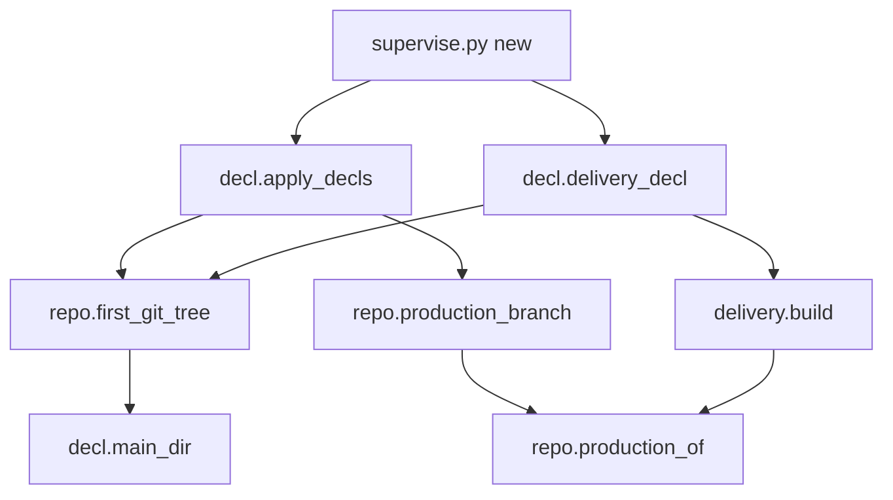
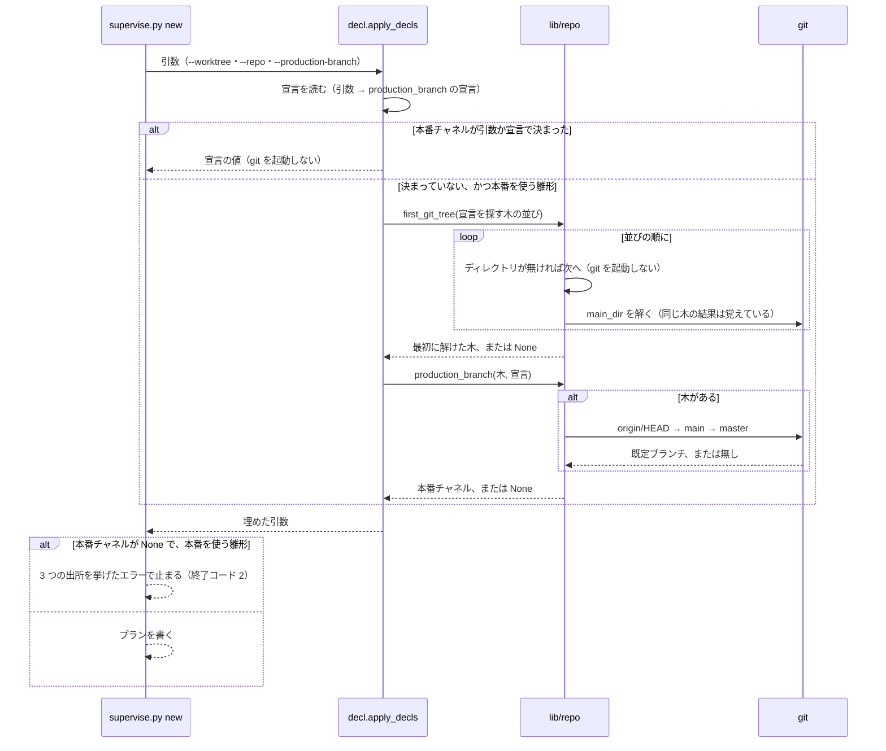

# supervise.py new: production_branch を宣言しないリポジトリでも、既定ブランチを本番にしてリリースプランを組める（#2097）

## 目的

- **今どうなっているか**: `.ndf/worktree.json` に `production_branch` が無いリポジトリで、まだ作っていない worktree のパスを `--worktree` に渡す。すると `supervise.py new release --channel prod` が止まる（終了コード 2）。文面は「本番の配布に要る本番のブランチが無い」である。既定ブランチを、存在しない worktree のパスから解こうとして失敗するためである。`new sprint` も本番のステージを置かない
- **誰に効くか**: `production_branch` を書かず、既定ブランチを本番にしている NDF の利用先のリポジトリと、そこでスプリントとリリースを回す conductor
- **変えると何が成り立つか**: worktree の有無にかかわらず、本番チャネルが既定ブランチに決まり、リリースプランと承認ゲート 2・本番のステージが組まれる。リリースの経路の判定とプランが同じ本番チャネルを使う

## 適用範囲

- **働く範囲**: NDF を使うすべてのリポジトリ（`supervise.py new` の `release`・`sprint`・`close`）。ai-plugins は `production_branch` を宣言しているため、振る舞いは変わらない
- **プロジェクトごとに違うもの**: 本番チャネルは、引数（`--production-branch`）と設定（`.ndf/worktree.json` の `production_branch`）で受ける。どちらも無ければ origin の既定ブランチを使う。受け方は変えない
- **当たるモード**: `standard`

## あるべき姿の根拠

| 根拠 | 種類 | 何を示すか |
| --- | --- | --- |
| 2026-11-05 に一時のリポジトリ（bare の origin と clone、`git remote set-head origin main`、`{"base_branch":"main"}` と `release` の `form: package-plugin`）で `new release --channel prod` を打った結果 | 実測 | worktree を作る前は終了コード 2 で止まり、`git worktree add` の後は同じコマンドが 13 ステップ（`approve` … `judge-record`）のプランを書く。違いは worktree の有無だけである |
| 同じ日に `git -C <存在しないパス> symbolic-ref --short refs/remotes/origin/HEAD` を打った結果 | 実測 | `fatal: cannot change to '…': No such file or directory` と終了コード 128。存在する worktree からは `origin/main` が返る。既定ブランチを解けない原因は、問い合わせる木が存在しないことである |
| `plugins/ndf/scripts/lib/repo.py` の `production_of` の docstring（「本番チャネルの決め方の正本」）と、用語集の「本番チャネル」の行 | 既存の形 | 本番チャネルの決め方は `production_branch` → 既定ブランチの順と決まっている。この変更は順序を変えず、既定ブランチを解く木だけを直す |

要求と受け入れ条件は #2097 の本文にある（コピーは [issues/issue-2097-requirements.md](issue-2097-requirements.md) ）。この文書は「どう作るか」だけを扱う。

## ドメインモデル

### コンテキスト

| コンテキスト | 何の語が 1 つの意味に決まるか |
| --- | --- |
| NDF の工程（`ndf-workflow`） | 本番チャネル・既定ブランチ・メインディレクトリ・リリースプラン・宣言を探す木 |
| リリース（`ndf-release`） | リリースの経路 |

リリースが供給者、NDF の工程が顧客の関係（顧客 / 供給者）。プランの雛形（工程の側）は、リリースの経路の判定（`lib/delivery.py`）が使う本番チャネルの決め方（`lib/repo.py` の `production_of`）を、そのまま受けて使う。工程の側に別の決め方を置かない。

### 集約

| 集約 | 持ち主（書き換えてよいもの） | 根 | エンティティ | 値オブジェクト |
| --- | --- | --- | --- | --- |
| 雛形の引数 | `supervise_lib/decl.py` の `apply_decls`（引数に無い値を宣言から埋める） | `supervise.py new` の引数の名前空間 | — | 本番チャネル（`a.production_branch`）・ベースブランチ（`a.base`） |
| 配布の判定の宣言 | `lib/delivery.py` の `build`（`supervise_lib/decl.py` の `delivery_decl` が入力を渡す） | `DeliveryDecl` | — | 本番チャネル・ベースブランチ・各値の出所 |

本番チャネルの値を決める規則（`production_of`）は `lib/repo.py` だけが持つ。2 つの集約は、同じ規則に、同じ木から解いた既定ブランチを渡して値を得る。

### 不変条件

| # | 集約 | 条件 | 破れたときの扱い |
| --- | --- | --- | --- |
| I1 | 雛形の引数 | 本番チャネルは、`--production-branch` → `production_branch` の宣言 → 既定ブランチの順で、最初に決まった値である | 結合のテストで落ちる |
| I2 | 雛形の引数 | 既定ブランチは、宣言を探す木の並び（`decl_roots`）のうち、最初に存在する git の木から解く。worktree のパスが存在しないことで結果が変わらない | 結合のテストで落ちる |
| I3 | 雛形の引数・配布の判定の宣言 | 同じ起動の中で、雛形の引数の本番チャネルと、配布の判定の宣言の本番チャネルは同じ値である | 結合のテストで落ちる |
| I4 | 雛形の引数 | `production_branch` の宣言か引数があるときは、既定ブランチを解く git を起動しない | 単体のテストで落ちる |
| I5 | 雛形の引数 | 3 つの出所のどれでも決まらないとき、本番を使う雛形は止まり、エラーの文面が 3 つの出所を挙げる | 結合のテストで落ちる |

### ドメインイベント

| # | イベント | 発生元 | 受け手 |
| --- | --- | --- | --- |
| E1 | `supervise.py new <種類>` が起動された | 利用者か conductor | `apply_decls` |
| E2 | 宣言を読んだ | `apply_decls`（`read_decl`） | 本番チャネルを決める処理（E3） |
| E3 | 本番チャネルが決まった | `apply_decls`（`repo.production_branch`）と `delivery_decl`（`delivery.build`） | 雛形（`release_templates.py`・`sprint.py`）と、リリースの経路の判定（`sprint_routes.py`） |
| E4 | プランを書いた | 雛形 | 利用者か conductor（結果 JSON） |

### 用語

| 用語 | 意味 | 用語集への反映 |
| --- | --- | --- |
| 宣言を探す木 | `supervise.py new` が `.ndf/` の宣言を探すディレクトリの並び。`--worktree` のパス → `--repo` → `--worktree` のパスの `/.worktrees/` より前 → 今のディレクトリの順 | 追加（`ndf-workflow`） |

## 機能一覧

| # | 機能 | 誰が使うか |
| --- | --- | --- |
| F1 | まだ作っていない worktree を渡しても、`production_branch` の無いリポジトリで本番のリリースプランを組む（`new release --channel prod`） | conductor・利用者 |
| F2 | 同じ条件で、`new sprint`（normal・fast・auto）と `new close` が承認ゲート 2 と本番のステージを置く | conductor |
| F3 | 本番チャネルが決まらないとき、3 つの出所を挙げて止まる | conductor・利用者 |

## 構成要素

パッケージの構成は変えない。新しいファイルを作らない。

### 変える要素

| 要素 | 責務 |
| --- | --- |
| `lib/repo.py` の `first_git_tree`（新設） | 木の並びから、存在するディレクトリで、かつメインディレクトリ（`decl.main_dir`）を解ける最初の木を返す。無ければ `None`。存在しないパスには git を起動しない |
| `lib/repo.py` の `production_branch`（変更） | 渡された木が `None` のときは既定ブランチを問い合わせず、`production_of(wt, None)` の結果（決まらない理由）を返す |
| `supervise_lib/decl.py` の `apply_decls`（変更） | 本番を使う雛形で本番チャネルが引数にも宣言にも無いときだけ、`first_git_tree(roots)` の木を `repo.production_branch` に渡す |
| `supervise_lib/decl.py` の `delivery_decl`（変更） | `delivery.build` に渡す既定ブランチを、`roots[0]` ではなく `first_git_tree(roots)` の木から解く |
| `supervise_lib/decl.py` の定数 `PRODUCTION_SOURCES`（新設） | 本番チャネルの 3 つの出所（`--production-branch`・`.ndf/worktree.json` の `production_branch`・既定ブランチ）を並べた文。エラーと案内の文面はこれを使う |
| `supervise_lib/release_templates.py` の `_validate_release_decl`（変更） | 本番チャネルが無いときのエラーの文面を `PRODUCTION_SOURCES` で組む |
| `supervise_lib/delivery_templates.py` の `plan_promote`（変更） | 昇格に要る本番チャネルが無いときのエラーの文面を `PRODUCTION_SOURCES` で組む |
| `supervise_lib/sprint.py` の `has_prod_branch` の docstring と、本番を置かないときの案内（変更） | 案内の出所の並びを `PRODUCTION_SOURCES` で組む |
| `supervise_lib/new_args.py` の `--production-branch` の help（変更） | 既定の決め方を、宣言 → 既定ブランチの順で書く |

`lib/delivery.py` の `load_delivery` は存在する木（呼び手の `root`）だけを受けるため変えない。`release_lib/names.py` の本番チャネルの文面は、`release-steps.py` が存在するリリースの worktree の中で読むもので、この変更の対象に含めない。

### 本番チャネルの値が決まるまでの呼び出し



図は本番チャネルの値が決まるまでの呼び出しだけを描く。文面の要素は値を決めないため、図に含めない。文面の要素は `PRODUCTION_SOURCES` である。それを使う `_validate_release_decl`・`plan_promote`・`sprint.py` の案内・`new_args.py` の help も文面の要素に当たる。

### 変えるファイルの配置

```
plugins/ndf/scripts/
├── lib/
│   └── repo.py                  # first_git_tree を足す。production_branch を変える
└── supervise_lib/
    ├── decl.py                  # apply_decls・delivery_decl・PRODUCTION_SOURCES
    ├── release_templates.py     # エラーの文面
    ├── delivery_templates.py    # エラーの文面
    ├── sprint.py                # 案内の文面
    └── new_args.py              # --production-branch の help
```

## 入出力の契約

コマンドの引数と宣言の形は変えない。変わるのは次の 2 つである。

| 場合 | 今 | 変更後 |
| --- | --- | --- |
| `production_branch` も引数も無く、origin の HEAD がある。`--worktree` のパスがまだ無い | `new release --channel prod` は終了コード 2。`new sprint` は承認ゲート 2 と本番を置かない | 既定ブランチを本番チャネルにしてプランを書く（終了コード 0、`status: ok`） |
| 3 つの出所のどれでも本番チャネルが決まらない | 終了コード 2。文面が出所を 2 つ（引数と宣言）挙げる | 終了コード 2 のまま。文面が出所を 3 つ挙げる |

エラーの文面（`new release --channel prod`）:

```text
supervise.py: error: 本番の配布に要る本番のブランチが無い（--production-branch・.ndf/worktree.json の production_branch・既定ブランチ（origin/HEAD → main / master））
```

## 処理の流れ



`new sprint` と `new close` では、`sprint_routes.apply_routes` が `delivery_decl` を呼ぶ。`delivery_decl` は `first_git_tree` の同じ木から既定ブランチを解いて `delivery.build` に渡す。引数の本番チャネル（`a.production_branch`）は上の流れで既に決まっており、`build` は引数を宣言より先に使うため、2 つの集約の値が一致する（I3）。

## 非機能の実現方式

| 大項目 | 実現方式 |
| --- | --- |
| 性能・拡張性 | `apply_decls` は、本番チャネルが引数か宣言で決まったときは `first_git_tree` も既定ブランチも呼ばない（I4）。`first_git_tree` は存在しないパスに git を起動せず、存在する木では `decl.main_dir` の覚えた結果を使う（宣言を読む `overlay_keys` が同じ木の `main_dir` を先に解いている）。`delivery_decl` は今も既定ブランチを 1 回問い合わせており、問い合わせる木が変わるだけである |
| 運用・保守性 | 本番チャネルの決め方は `lib/repo.py` の `production_of` だけが持つ。木を選ぶ規則も `lib/repo.py` の `first_git_tree` 1 つに置き、`apply_decls` と `delivery_decl` が同じ関数を呼ぶ。出所の並びの文面は `PRODUCTION_SOURCES` 1 つに置く |

## 決定の記録

### 決定 1: 存在しない worktree でも既定ブランチを解くため、宣言を探す木の並びから最初に存在する git の木を選ぶ

`decl_roots` の並び（`--worktree` → `--repo` → `/.worktrees/` より前 → 今のディレクトリ）は、宣言を探す順として既に決まっている。同じ並びから最初に git として解ける木を選べば、worktree が存在するときは今と同じ木（`--worktree`）を使い、存在しないときだけメインディレクトリか `--repo` へ進む。origin の HEAD はリポジトリで 1 つのため、どの木から解いても同じ値になる。判定には `decl.main_dir` を使い、git の木であるかの判定を別に作らない。

`decl.main_dir(roots[0])` だけを使う形は採らない。存在しないパスではメインディレクトリも解けず、結局は並びの次の木へ進む規則が要る。

根拠: Value 7 / Value 6（MVV 版 5）

### 決定 2: リリースの経路の判定と同じ値にするため、配布の判定の宣言も同じ木から既定ブランチを解く

`delivery_decl` は今、`roots[0]` から既定ブランチを解く。雛形の側だけを直すと、存在しない worktree ではリリースの経路の判定が本番チャネルを持たないまま残り、受け入れ条件 7 が成り立たない。両方が `first_git_tree` を呼べば、同じ起動の中で同じ木を使う。

この結果、昇格のプラン（`plan_promote`）も同じ補完を受ける。`production_branch` を宣言せず `base_branch` が既定ブランチと違うリポジトリでは、存在しない worktree を渡した `new sprint` に昇格のステージが現れる。これは worktree を作った後の今の振る舞いと同じ形であり、退行の確認（受け入れ条件 6）に含める。

昇格だけを今の振る舞いに留める形は採らない。worktree の有無で昇格の有無が変わる食い違いが残る。

根拠: Value 7（MVV 版 5）

### 決定 3: 文面を 1 か所で直せるようにするため、本番チャネルの出所の並びを定数 1 つに置く

出所の並びは、リリースプランのエラー・昇格のエラー・スプリントの案内・引数の help の 4 か所に書かれている。並びを 3 つに直すとき、1 か所でも古いままだと、利用者は既定ブランチへの後退が無いと読む。定数は雛形の側（`supervise_lib/decl.py`）に置く。`lib/repo.py` の `production_of` が返す理由の文は「何が無かったか」を述べ、利用者へ「どこで直すか」を示すのは雛形の側の役割である。

根拠: Value 7 / Value 8（MVV 版 5）

## テスト設計

テストは `plugins/ndf/scripts/tests/` に置く。一時の git リポジトリ（bare の origin と clone、origin の HEAD を `main` に設定）を作って `supervise.py new` を通す。

| 受け入れ条件・不変条件 | どの振る舞いで縛るか | どう壊したら落ちるべきか |
| --- | --- | --- |
| 受け入れ条件 1・I2 | 存在しない worktree のパスで `new release --channel prod` が終了コード 0・`status: ok` で、`approve`・`snapshot`・`release`・`verify` を含むプランを書く | `apply_decls` が `roots[0]` から既定ブランチを解く形に戻すと落ちる |
| 受け入れ条件 2・I1 | 上のプランで、本番の配布の確認が参照する ref が `main` である。origin の HEAD を `main` 以外にした組では、その名前になる | 既定ブランチの代わりにベースブランチか固定の `main` を入れると落ちる |
| 受け入れ条件 3 | worktree を作った後の同じコマンドのステップの並びが、受け入れ条件 1 と一致する | worktree の有無で別の規則を使う（存在しないときだけ固定の名前を入れる）ように壊すと、origin の HEAD を `main` 以外にした組で落ちる |
| 受け入れ条件 4・I5 | origin の HEAD もローカルの `main` / `master` も無いリポジトリで、終了コード 2 と、文面に 3 つの出所が現れる | `PRODUCTION_SOURCES` から既定ブランチを外すと落ちる |
| 受け入れ条件 5 | 存在しない worktree のパスで `new sprint` の normal・fast・auto が、承認ゲート 2 と本番のステージを置き、本番を置かない案内を出さない | `delivery_decl` か `apply_decls` の片方だけを `roots[0]` に戻すと落ちる |
| 受け入れ条件 6 | `production_branch` を宣言した組（既定ブランチと違う値を含む）と `--production-branch` を渡した組で、宣言か引数の値が本番チャネルになる。ai-plugins のメインディレクトリで打った `new release --channel prod` のプランが、変更の前後で同じ JSON になる | 既定ブランチを宣言より先に使うと落ちる |
| 受け入れ条件 6（昇格） | `base_branch` が既定ブランチと違い `production_branch` の無い組で、存在しない worktree と存在する worktree の `new sprint` が、同じ昇格のステージを持つ | `delivery_decl` だけを `roots[0]` に戻すと落ちる |
| 受け入れ条件 7・I3 | 同じ起動で、`a.production_branch` と `delivery_decl(a).production` が同じ値である | `delivery_decl` だけを `roots[0]` に戻すと落ちる |
| I4 | `production_branch` を宣言した組で `apply_decls` を通すと、既定ブランチを問い合わせる git が起動しない | `apply_decls` の分岐の条件を外し、常に `first_git_tree` を呼ぶと落ちる |

## 設計の結果

| 課題 | 扱い | 取り込み先 | 触るファイル |
| --- | --- | --- | --- |
| #2097 | 実装する | — | `plugins/ndf/scripts/lib/repo.py`、`plugins/ndf/scripts/supervise_lib/decl.py`、`plugins/ndf/scripts/supervise_lib/release_templates.py`、`plugins/ndf/scripts/supervise_lib/delivery_templates.py`、`plugins/ndf/scripts/supervise_lib/sprint.py`、`plugins/ndf/scripts/supervise_lib/new_args.py`、`plugins/ndf/scripts/tests/` |

## 未確認のまま残ること

| 項目 | 内容 |
| --- | --- |
| 今のディレクトリが別のリポジトリのとき | `--repo` も `/.worktrees/` も無く、`--worktree` のパスが存在しないときは、今のディレクトリの木から既定ブランチを解く。今のディレクトリが別のリポジトリなら、そのリポジトリの既定ブランチが入る。並びの順は要求の前提 2 のとおりで、この変更では変えない。conductor は `--worktree` に `.worktrees/` の下のパスを渡すため、この組み合わせは手で打ったときだけ起こる |
| fast / auto の `new sprint` の残りの前提 | fast / auto のプランを組むには、MVV の承認と `.ndf/pace.json` の許可も要る。受け入れ条件 5 のテストの組み立ては実装（`tdd-cycle`）で走らせて決める |
