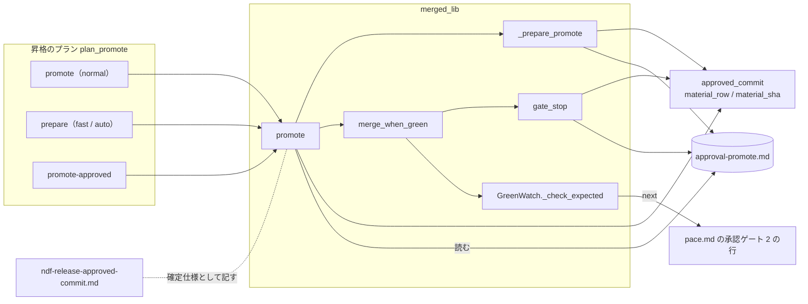
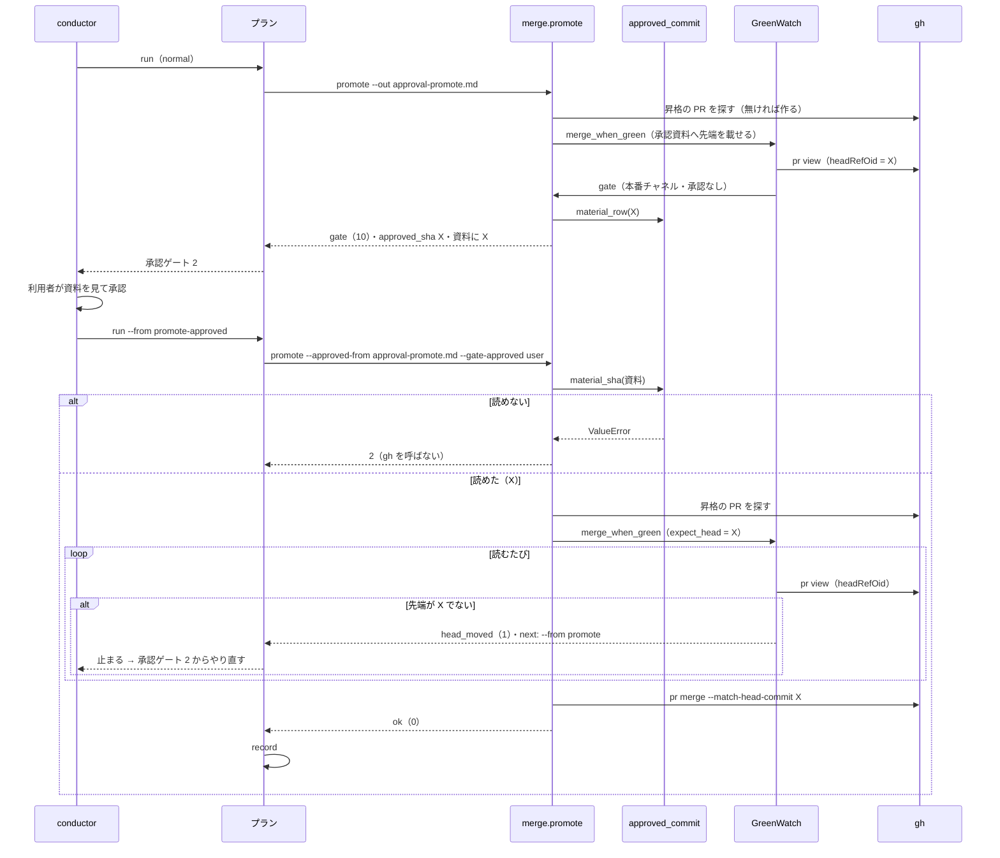

# 昇格の承認の後のマージ: 承認ゲート 2 で利用者が見た先端だけを本番チャネルへ入れる（#2104）

## 目的

- **何が壊れているか**: `pace: normal` の昇格のプランは、承認ゲート 2 で止まるときに昇格の Pull Request の先端を承認資料へ残さない。承認の後の `run <プラン> --from promote-approved` は、そのときの先端を照合せずにマージする
- **誰が困るか**: 経路 `promote` を組むリポジトリの利用者。承認の後にベースブランチが進むと（別のスプリントのマージなど）、見ていないコミットが本番チャネルへ入る
- **直すと何が成り立つか**: `promote-approved` は承認資料に載った「承認したコミット」が昇格の Pull Request の先端のときだけマージし、違えば・資料を読めなければマージせずに止まって承認ゲート 2 へ戻る。本番チャネルへの経路のうち昇格だけが照合を持たない状態が無くなる

## 適用範囲

- **働く範囲**: 配布先のリポジトリでも働く（`merged-steps.py promote` と、スプリントが書き出す昇格のプラン `plan_promote`）
- **プロジェクトごとに違うもの**: ベースブランチと本番チャネルの名前は今どおり引数（`--head` / `--base`。`.ndf/worktree.json` の `base_branch` / `production_branch` からプランが組む）。承認資料のパスはプランが決めて渡す（要求の前提 3）。新しい設定は足さない
- **当たるモード**: 経路 `promote` の昇格のプランを持つすべてのモード（`standard` / `light` / `operation` / `legacy-refactor`）。`pace` は `normal` と、`fast` / `auto` の `handoff` の後に `--from promote-approved` で続ける場合

## あるべき姿の根拠

| 根拠 | 種類 | 何を示すか |
| --- | --- | --- |
| `docs/specifications/ndf-release-approved-commit.md` の I5・P1〜P4（#815・#1529） | 実測（既存の実装とテスト） | 本番の配布と `fast` / `auto` の `promote` は、承認したコミット・確かめたコミットを `--expect-head` と `--match-head-commit` で照合して既に動いている。同じ照合の部品（`GreenWatch._check_expected`・`_merge_pr`）を使える |
| `plugins/ndf/scripts/lib/approved_commit.py` の `material_row` / `material_sha` | 実測（既存の実装） | 承認資料の「承認したコミット」の行を書く形と読む形が 1 か所に既にある。昇格の承認資料もこの行を持てば、形を新しく決めずに済む |
| #2104 の本文の「依頼（原文）」と、#1529 の承認ゲート 1 で利用者が「別の課題で起票する」と決めたこと | 利用者の指示の原文 | `normal` の昇格の照合の欠けを直す対象とすること |

要求と受け入れ条件は #2104 の本文にある（コピーは `issues/issue-2104-requirements.md`）。この文書は「どう作るか」だけを扱う。

## ドメインモデル

### コンテキスト

| コンテキスト | 何の語が 1 つの意味に決まるか |
| --- | --- |
| リリース（`ndf-release`） | 承認したコミット・昇格の Pull Request・昇格のプラン・承認資料の欄 |
| 開発の工程（`ndf-workflow`） | 承認ゲート 2・承認資料・`pace`・承認の後の続け方 |

リリースが供給者、開発の工程が顧客の関係（顧客 / 供給者）。開発の工程（conductor・`pace.md`）は、リリースの `promote-approved` が返す結果（`head_moved` と `next`）だけを受けて、承認ゲート 2 へ戻る。

### 集約

| 集約 | 持ち主（書き換えてよいもの） | 根 | エンティティ | 値オブジェクト |
| --- | --- | --- | --- | --- |
| 昇格の承認資料 | 資料の本文と「承認したコミット」の行は `merged_lib/merge.py` の `gate_stop`（`normal`）と `_prepare_promote`（`fast` / `auto`）が書く。「承認の記録」（`by: mvv`）の行だけは `fast` / `auto` の `mvv` ステップの `mvv-gate.py check --gate release --material` が書く。行の形は `lib/approved_commit.py` の `material_row` / `material_sha` | `{state_dir}/work/approval-promote.md` | — | 承認したコミット（40 桁）・判定の行 |
| 昇格のマージ | `merged_lib/merge.py` の `promote` | 昇格の Pull Request | — | 先端（`headRefOid`）・照合する SHA（`expect_head`） |
| 昇格のプラン | `supervise_lib/delivery_templates.py` の `plan_promote` | プラン | ステップ（`promote`・`prepare`・`promote-approved`） | 昇格の承認資料のパス（`PROMOTE_MATERIAL`） |

昇格のマージは、承認資料をパスで参照して読むだけで書き換えない。承認資料の持ち主は行ごとに決まる。資料の本文と「承認したコミット」の行は、`pace` ごとにどちらか 1 つだけが同じプランの中で書く（`normal` は `gate_stop`、`fast` / `auto` は `prepare`）。「承認の記録」（`by: mvv`）の行は `fast` / `auto` の `mvv-gate.py` だけが「承認したコミット」の行の直後へ書き、ほかの行を書き換えない（`normal` では書かれない）。そのため `fast` / `auto` の handoff の後に利用者が見る資料には `by: mvv` の承認の記録が残る。

### 不変条件

| # | 集約 | 条件 | 破れたときの扱い |
| --- | --- | --- | --- |
| I1 | 昇格の承認資料 | `promote` が昇格の Pull Request で承認ゲート 2 に止まる（終了コード 10）とき、承認資料の「2. 承認の判断に使うもの」の表に、止まる判定に使ったのと同じ 1 回の読みの `headRefOid` が `\| 承認したコミット \| <40 桁> \|` の 1 行で載り、結果の `metrics.approved_sha` と gate の `items[].head` も同じ値である | 先端が 40 桁の 16 進で読めなければ資料を書かずに終了コード 2（`EXIT_UNREADABLE`）で止まる。マージしない |
| I2 | 昇格の承認資料 | `fast` / `auto` の `prepare`（`--prepare`）が書く承認資料も、I1 と同じ形の「承認したコミット」の行を 1 行持つ。続く `mvv-gate.py` がその直後へ「承認の記録」（`by: mvv`）の行を足した後も、「承認したコミット」の行は 1 行のままで値は変わらない | I1 と同じ |
| I3 | 昇格のマージ | `--approved-from <資料>` を受けた `promote` は、昇格の Pull Request の先端が資料の承認したコミットに等しいときだけ `gh pr merge` を呼び、`--match-head-commit` にその SHA を渡す | 読むたびに比べ、違えば `gh pr merge` を呼ばずに `items[].result: head_moved`（`head` と `expected` つき）・終了コード 1 で止まり、`next` に承認ゲート 2 からのやり直しを書く |
| I4 | 昇格のマージ | `--approved-from` を受けた `promote` は、資料から承認したコミットを読めないまま照合を飛ばさない | `gh` を 1 度も呼ばずに終了コード 2 で止まる |
| I5 | 昇格のマージ | `promote` は `--gate-approved user` を `--approved-from` 無しで受けない（照合の材料の無い利用者の承認でマージしない） | `gh` を 1 度も呼ばずに終了コード 2 で止まり、`next` に資料つきの打ち方を書く |
| I6 | 昇格の承認資料 | 「承認したコミット」の行を書く形と読む形は `approved_commit.material_row` / `material_sha` の 1 か所が決める | 読めなければ I4 の扱い |
| I7 | 昇格のプラン | `normal` の `promote` ステップは `--out PROMOTE_MATERIAL` を持ち、`promote-approved` ステップは `normal` と `fast` / `auto` の両方で `--approved-from PROMOTE_MATERIAL --gate-approved user` を持つ（`fast` / `auto` の `prepare` の `--out` と同じパス） | プランの組み立てのテストで落とす |
| I8 | 昇格のプラン | `fast` / `auto` の `promote` ステップのコマンド（`--expect-head-from VERIFY_MATERIAL --gate-approved mvv`・`on_fail: handoff`）は変わらない | #1529 のテストで落とす |

### ドメインイベント

| # | イベント | 発生元 | 受け手 |
| --- | --- | --- | --- |
| E1 | `normal` の `promote` が昇格の Pull Request を見つけた（無ければ作った） | `promote` ステップ（`_find_or_create_promote_pr`） | `merge_when_green` |
| E2 | `promote` が先端 X を読み、承認資料へ X を載せて承認ゲート 2 で止まった | `promote` ステップ（`GreenWatch` の最初の読み → `gate_stop`） | 人（承認ゲート 2）・conductor |
| E3 | 利用者が承認資料を見て承認ゲート 2 を承認した | 人 | conductor（`sprint-state.py gate ... --by user --outcome approved` → `--from promote-approved`） |
| E4 | ベースブランチが X から Y へ進んだ | プランの外のマージ | `promote-approved`（先端の Y として読む。E3 の前でも後でも同じ） |
| E5 | `promote-approved` が承認資料から X を読んだ | `promote-approved` ステップ（`material_sha`） | `GreenWatch`（`expect_head = X`） |
| E6 | `promote-approved` が先端を読み、X と比べた | `GreenWatch` の読みのたび | 一致ならマージ、違えば conductor（`head_moved` と `next`） |
| E7 | X で CI が通り、`--match-head-commit X` で本番チャネルへマージした | `_merge_pr` | `record` ステップ |
| E8 | 照合で止まった後、`--from promote` から流し直し、新しい先端 Y で承認ゲート 2 に止まった | conductor（結果の `next` と `pace.md`） | E2 と同じ |

### 用語

| 用語 | 意味 | 用語集への反映 |
| --- | --- | --- |
| 承認したコミット | ゲート 2 の承認資料が対象にした、ベースブランチの先端のコミットの SHA（40 桁）。本番チャネルへ入れてよい中身の上限を示す | 無し（既存の語を同じ意味で昇格の承認資料にも使う。昇格の Pull Request の先端はベースブランチの先端である） |
| 昇格の承認資料 | 昇格の承認ゲート 2 で利用者（か MVV 判定）が見る承認資料（`{state_dir}/work/approval-promote.md`）。`normal` では `promote` の承認ゲート 2 の停止が、`fast` / `auto` では `prepare` が書く | 追加（`ndf-release`） |

## 機能一覧

| # | 機能 | 誰が使うか |
| --- | --- | --- |
| F1 | 承認ゲート 2 で止まるとき、昇格の Pull Request の先端（承認したコミット）を承認資料と結果に載せる | 承認ゲート 2 で承認する利用者・conductor |
| F2 | 承認の後のマージ（`promote-approved`）が、承認資料の承認したコミットの先端だけをマージする | conductor（プランの `--from promote-approved`） |
| F3 | 照合で止まったとき、承認ゲート 2 からやり直す打ち方を結果の `next` と `pace.md` で示す | conductor |

## 構成要素

| 要素 | 責務 |
| --- | --- |
| `lib/approved_commit.py`（変えない） | 「承認したコミット」の行の形（`material_row` で書く項目と値・`material_sha` で読む）。書き手と読み手が共有する |
| `merged_lib/merge.py` の `gate_stop` | `approved_sha` と `path` を受けたとき、判断の表の先頭へ `material_row(approved_sha)` を置いて `path` へ書き、`metrics.approved_sha` と gate の `items[].head` に同じ値を載せる。受けなければ今どおり（経路 `merge` の `merge-when-green` は渡さない） |
| `merged_lib/merge.py` の `merge_when_green` | 承認ゲート 2 の判定の閉包（`gate`）へ、`promote` から受けた「先端を承認資料へ載せるか」と資料のパスを通す。載せるときは最初の読みの `headRefOid` を `parse_sha` で確かめ、読めなければ終了コード 2 |
| `merged_lib/merge.py` の `promote` | `--approved-from` を受けたら `gh` より先に `material_sha` で承認したコミットを読み `a.expect_head` に入れる（読めなければ 2）。`--gate-approved user` が `--approved-from` 無しなら 2 で止まる。止まる前の承認ゲート 2 では `gate_stop` へ先端と `a.out` を渡し、`next` の打ち方に `--approved-from <書いた資料>` を入れる |
| `merged_lib/merge.py` の `_prepare_promote` | 判断の表の先頭へ `material_row(info["headRefOid"])` を置く |
| `merged_lib/checks.py` の `GreenWatch._check_expected` | `head_moved` で止まるとき、呼び手が渡した続け方（`a.moved_next`）があれば結果の `next` に載せる。無ければ今どおり `next` を持たない（#815・#1529 の呼び手は渡さない） |
| `merged-steps.py` の `promote` の引数 | `--approved-from <資料>` を足す（`--expect-head-from` と同時に受けない）。`--out` の説明を「`--prepare` と承認ゲート 2 の停止の承認資料の置き場」へ広げる。docstring の用法を合わせる |
| `supervise_lib/delivery_templates.py` の `plan_promote` | `PROMOTE_MATERIAL = "{state_dir}/work/approval-promote.md"` を置き、`normal` の `promote` へ `--out PROMOTE_MATERIAL`、両方の `promote-approved` へ `--approved-from PROMOTE_MATERIAL` を足す。`fast` / `auto` の `prepare` と `mvv` の `--material` も同じ定数を使う |
| `plugins/ndf/skills/development-workflow/references/pace.md` | 承認ゲート 2 の行の「`promote-approved` は照合を持たず…」を、照合で止まったときの続け方（`normal` は `--from promote`、`fast` / `auto` は `--from verify`）へ書き換える。昇格のプランの説明（229 行の辺り）に承認資料の照合を足す |
| `docs/specifications/ndf-release-approved-commit.md` | P5・「含まない」の `pace: normal` の行・「照合で止まった後の続き」の未確認の行・テストの P4・P5 の行を、この変更の形へ書き直す |

## 入出力の契約

### `merged-steps.py promote`

| 項目 | 書くこと |
| --- | --- |
| 名前 | `merged-steps.py promote --head <ベースブランチ> --base <本番チャネル> [--prepare] [--out <資料>] [--gate-approved user\|mvv] [--expect-head-from <資料> \| --approved-from <資料>]` |
| 入力（足すもの） | `--approved-from <資料>`: 昇格の承認資料。「承認したコミット」の欄の SHA が昇格の Pull Request の先端のときだけマージする。任意。`--expect-head-from` と同時には受けない（argparse の相互排他） |
| 入力（意味を広げるもの） | `--out <資料>`: `--prepare` に加え、承認ゲート 2 で止まるときの承認資料の置き場。無ければ今どおり承認資料の既定の置き場（`presentation_dir()`） |
| 出力（承認ゲート 2・終了コード 10） | 今の結果に加え、`metrics.approved_sha`（40 桁）と、`items[]` の `result: gate` の行の `head`（同じ値）。`next` は `承認を得たら promote --head <h> --base <b> --gate-approved user --approved-from <書いた資料>（プランなら run <プラン> --from promote-approved）` |
| 出力（`--prepare`・終了コード 0） | 今の結果のまま。承認資料に「承認したコミット」の行が増える |
| 失敗の形 | 資料が無い・欄が無い・40 桁の 16 進でない → `gh` を呼ばずに 2（I4）。`--gate-approved user` で `--approved-from` が無い → `gh` を呼ばずに 2（I5）。先端が違う → `items[].result: head_moved`（`head`・`expected`）で 1、`next` に「承認ゲート 2 からやり直す: プランなら run <プラン> --from promote（fast / auto は --from verify）。承認資料を新しい先端で作り直してから承認を求める」（I3）。承認ゲート 2 の停止で先端を読めない → 2（I1） |
| 互換性 | 引数を足すだけで、`--gate-approved mvv` の呼び出し（`fast` / `auto` の `promote` ステップ）と `--expect-head-from` は変わらない。`--gate-approved user` を資料なしで打つ既存の呼び出し（この変更の前に書き出したプランの `promote-approved`、手で打つ打ち方）は 2 で止まるようになる（決定 3） |

### 昇格の承認資料の行

`approval_present` の「## 2. 承認の判断に使うもの」の表の先頭の行に `| 承認したコミット | <40 桁> |` を置く（`_judge_table` が書く `| 項目 | 内容 |` の表の 1 行）。本番の配布の承認資料（`approval-facts`）と同じ欄の名前・同じ位置である。読み手は `material_sha`（`_cells` で欄の名前を引く）で、行の位置に頼らない。

`fast` / `auto` では、`mvv` ステップがこの資料を `mvv-gate.py check --gate release --material` に渡すため、`mvv-gate.py` は従うときに「承認の記録」（`by: mvv`）をこの行の直後へ書く（`material_sha_or_none` で欄を見つけた資料へ書く既存の振る舞い。#815 の I10）。`promote-approved` は承認の記録を読まない（決定 2）。

## 処理の流れ

`fast` / `auto` では、`prepare` が同じ資料へ先端 X を書き、`promote`（`--expect-head-from approval-verify.md --gate-approved mvv`）が確かめたコミットで照合する（#1529。変えない）。`note` か `promote` が落ちて `handoff` から承認ゲート 2 に戻り、利用者が承認して `--from promote-approved` で続けたときは、上の図の `run --from promote-approved` 以降と同じ照合を `prepare` が書いた X で行う。照合で止まったときの続きは `--from verify`（導入の確認を新しい先端で走らせ直す。#1529 の決定）。

## 非機能の実現方式

| 大項目 | 要求の条件 | 実現方式 | 確かめ方 |
| --- | --- | --- | --- |
| セキュリティ | 本番チャネルへ入るのは、承認資料に載った SHA と等しい先端だけである（受け入れ条件 3・4）。資料を読めないときに照合を飛ばす経路を持たない | `promote-approved` は `--approved-from` の資料から `material_sha` で読んだ SHA を `expect_head` にし、`GreenWatch` が読むたびに比べ、`--match-head-commit` で同じ SHA を固定してマージする。資料を読めないときと、`--gate-approved user` が資料なしのときは `gh` を呼ばずに 2 で止まる（I3〜I5） | `gh` を偽物にした `promote` の単体テストで、先端が違う・資料が無い・欄が無い・形が違う・`--approved-from` が無いの各場合に `gh pr merge` の呼び出しが 0 回であることを数える |
| 運用・保守性 | 照合で止まった結果は、どの SHA を期待し今どの SHA かを `items` に残し、続け方を `next` に書く。conductor がプランの外で手当てをしなくても承認ゲート 2 へ戻れる | `head_moved` の `items` に `head` と `expected` を残し（既存）、`promote` が `a.moved_next` に承認ゲート 2 からのやり直しの打ち方を入れて `next` に載せる。`pace.md` の承認ゲート 2 の行が同じ続け方を持つ | `head_moved` の結果の `next` に `--from promote` が入ることを単体テストで見る |

## 決定の記録

### 決定 1: 照合の材料を本番の配布と同じ形にするため、昇格の承認資料に「承認したコミット」の行を置き、読み書きを `material_row` / `material_sha` で共有する

`approved_commit.py` には、ゲート 2 の承認資料の対象を表す「承認したコミット」の欄の書き方（`material_row`）と読み方（`material_sha`）が既にある。昇格の Pull Request の先端はベースブランチの先端で、語の意味がそのまま当たる。新しい関数も行の形も足さずに受け入れ条件 8 を満たせる。

導入の確認の承認資料の行（`verified_line`）を流用する形は採らない。その行は「導入の確認をこのコミットで走らせた」を意味し、導入の確認を走らせない `normal` で書くと語の意味が変わる。

根拠: Value 6 / Value 8（MVV 版 3）

### 決定 2: 承認の後に conductor の操作を増やさないため、照合の基準は承認資料の「承認したコミット」の行だけにし、承認の記録の行は求めない（未決 1）

`normal` の承認ゲート 2 の承認は、conductor が `sprint-state.py gate ... --by user --outcome approved` で記録してから `--from promote-approved` で続ける形で既に残る。#815 の承認の記録（`release-steps.py approve --by user`）まで求めると、承認の後に打つ操作が 1 つ増え、昇格の経路だけ手順が変わる。照合が防ぐのは「利用者が見た先端と違う先端のマージ」で、資料の SHA との一致で足りる。

承認の記録をそろえる形は採らない。承認ゲートの工程を増やさずに守れる範囲が同じで、操作だけが増える。

根拠: Value 2 / Value 1（MVV 版 3）

### 決定 3: 照合の材料の無い承認でマージする経路を残さないため、`--gate-approved user` の `promote` は `--approved-from` を必須にし、無ければ 2 で止める（未決 2）

この変更の前に書き出したプランの `promote-approved` は `--approved-from` を持たない。今どおり通すと、要求の非機能の条件（資料を読めないときに照合を飛ばす経路を持たない）を満たさない経路が残る。止めても、`next` が `--from promote` からの流し直し（新しいプランは同じスプリントの書き出しで作られる）を示すため、戻せない損は無い。手で打つ打ち方も、承認ゲート 2 の停止の `next` が資料つきの形を示す。

古いプランを照合なしで通す形は採らない。プランの書き出しはスプリントごとで、移行のために照合の無い経路を残す費用が見合わない。

根拠: Value 1 / Vision（MVV 版 3）

### 決定 4: プランの組み立てを 1 つの形に保つため、承認資料のパスは `normal` と `fast` / `auto` で同じ `PROMOTE_MATERIAL` にし、`promote-approved` のコマンドは両方で等しいままにする

`fast` / `auto` の `prepare` は既に `{state_dir}/work/approval-promote.md` へ書く。`normal` の `promote` に同じパスを `--out` で渡せば、`promote-approved` は `pace` によらず同じコマンドになり、`test_supervise_pace_verify.py` の「両方の `promote-approved` が等しい」はそのまま成り立つ。

`promote-approved` が PR の番号から既定の置き場（`presentation_dir()`）を求める形は採らない。プランがパスを決めて渡すという前提 3 と合わず、読み手と書き手の結び付きがコードの中に隠れる。

根拠: Value 4 / Value 5（MVV 版 3）

### 決定 5: 照合で止まった後の続け方を 1 つの文で示すため、`head_moved` の `next` は `pace` で分けず `--from promote`（`fast` / `auto` は `--from verify`）を並べて書く

`promote-approved` のコマンドは `pace` によらず等しい（決定 4）ため、自分の `pace` を知らない。`pace` ごとに引数を足して `next` を分けると、等しさが崩れ、プランの引数が 1 つ増える。続け方の正本は `pace.md` の承認ゲート 2 の行で、`next` はそこと同じ 2 つの打ち方を示す。

照合の失敗を `on_fail` で `promote` へ自動で戻す形は採らない。`on_fail` は CI の失敗やマージの拒否にも掛かり、それらを承認ゲート 2 の取り直しに読み替えてしまう。

根拠: Value 4 / Value 2（MVV 版 3）

## テスト設計

| 受け入れ条件・不変条件 | どの振る舞いで縛るか | どう壊したら落ちるべきか |
| --- | --- | --- |
| AC1・I1 | `normal` の `promote`（`--out` つき）が本番チャネルへの PR で 10 を返したとき、資料の「承認したコミット」の欄を `material_sha` で読むと偽の `gh` が返した `headRefOid` に等しく、`metrics.approved_sha` と gate の `items[].head` も同じ | 行を書かない・別の読み（2 回目の `pr view`）の SHA を書く・`metrics` に載せないと落ちる |
| I1（読めない先端） | `headRefOid` が 40 桁でない PR では、資料を書かずに 2 で終える | 形を確かめずに資料を書く・10 で止まると落ちる |
| AC2・I3 | 資料が X・先端が X のまま CI が緑のとき、`gh pr merge` が `--match-head-commit X` つきで 1 回呼ばれ 0 で終える | `--match-head-commit` を外す・別の SHA を渡すと落ちる |
| AC3・I3 | 資料が X・最初の読みの先端が Y のとき、および CI を待つ間に Y へ変わったとき、`gh pr merge` を呼ばず `head_moved`（`head`・`expected`）で 1、`next` に `--from promote` を含む | 待ち直してマージする・`next` を持たないと落ちる |
| AC4・I4 | 資料が無い・欄が無い・40 桁の 16 進でないとき、`gh` の呼び出しが 0 回で 2 | 読む前に `gh pr list` を打つ・照合を飛ばしてマージすると落ちる |
| I5 | `--gate-approved user` を `--approved-from` 無しで打つと、`gh` の呼び出しが 0 回で 2 | 資料なしで今どおりマージすると落ちる |
| AC5・I7 | プランの組み立てで、`normal` の `promote` が `--out {state_dir}/work/approval-promote.md` を持ち、`normal` と `fast` / `auto` の `promote-approved` が等しく `--approved-from {state_dir}/work/approval-promote.md` を持つ。`fast` / `auto` の `prepare` の `--out` と同じパスである | 片方の `pace` にだけ付ける・パスを `prepare` と違えると落ちる |
| AC6・I2 | `--prepare` の資料の「承認したコミット」の欄が、偽の `gh` の `headRefOid` に等しい | `_prepare_promote` に行を足さないと落ちる |
| AC7・I8 | `fast` / `auto` の `promote` ステップのコマンドが `--expect-head-from {state_dir}/work/approval-verify.md --gate-approved mvv` で終わり、`on_fail: handoff` のまま。#1529 の `promote` のテストが通る | `promote` ステップへ `--approved-from` を足すと落ちる |
| AC8・I6 | `gate_stop`・`_prepare_promote` が書いた資料を `material_sha` で読めること（書き手と読み手が同じ関数を通ること）を、上の AC1・AC6 の行で縛る | 書き手が独自の文字列で欄を書き、`material_row` の項目名を変えると読めずに落ちる |
| AC9 | 文書の変更なので振る舞いのテストは書かない（`.md` の文言テストは書かない）。`instructions-check.py` と `check-skill-frontmatter.py` が通ること | — |
| AC10 | 全体テストと `ruff check .` が通る | — |

既存の `test_supervise_pace_verify.py` の `test_the_promote_plan_uses_the_declared_branch_names` は、`normal` の `promote` と `promote-approved` のコマンドが引数を持たない形（`endswith(base)`）を確かめている。受け入れ条件 5 と食い違う行だけを新しい形へ書き換え、`fast` の `promote` の行（`want`）と、ブランチ名の行は変えない。

## 設計の結果

| 課題 | 扱い | 取り込み先 | 触るファイル |
| --- | --- | --- | --- |
| #2104 | 実装する | — | `plugins/ndf/scripts/merged_lib/merge.py`、`plugins/ndf/scripts/merged_lib/checks.py`、`plugins/ndf/scripts/merged-steps.py`、`plugins/ndf/scripts/supervise_lib/delivery_templates.py`、`plugins/ndf/scripts/tests/`、`plugins/ndf/skills/development-workflow/references/pace.md`、`docs/specifications/ndf-release-approved-commit.md`、`docs/glossary/glossary.json`、`docs/glossary.md` |

## 未確認のまま残ること

| 項目 | 内容 |
| --- | --- |
| 経路 `merge` の `merge-approved` | 宛先が自動反映の本番チャネルのとき、`merge-when-green` の承認ゲート 2 の停止も先端を資料へ残さず、`--from merge-approved` は今の先端をマージする。同じ形の欠けを読みで確かめた（`gate_stop` の `next` が `merge-when-green <n> --gate-approved user` で照合の引数を持たない）。この課題の範囲外として conductor へ返す（要求の未決 3） |
| 実機での承認ゲート 2 | 昇格の経路を組むリポジトリで `pace: normal` の承認ゲート 2 を 1 度通し、資料の SHA とマージされた先端が等しいことは、リリース後テストで確かめる |
| 書き出し済みのプランの停止 | 版の更新をまたいで続くスプリントの `promote-approved` は 2 で止まる（決定 3）。止まった後に `--from promote` で流し直すと、書き出し済みのプランの `promote` は `--out` を持たないため、資料は既定の置き場へ書かれ、`next` が示す手打ちの形で続けることになる |
